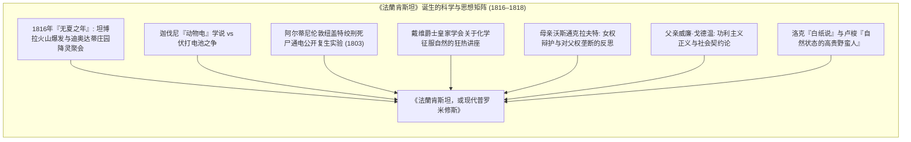
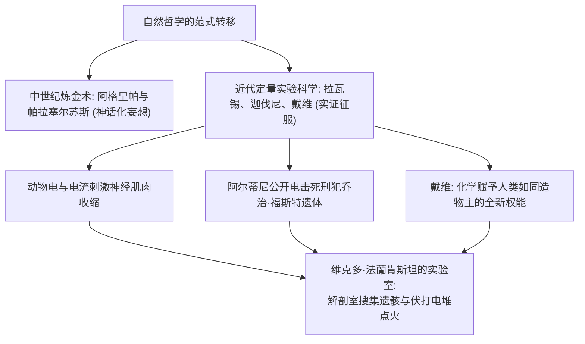
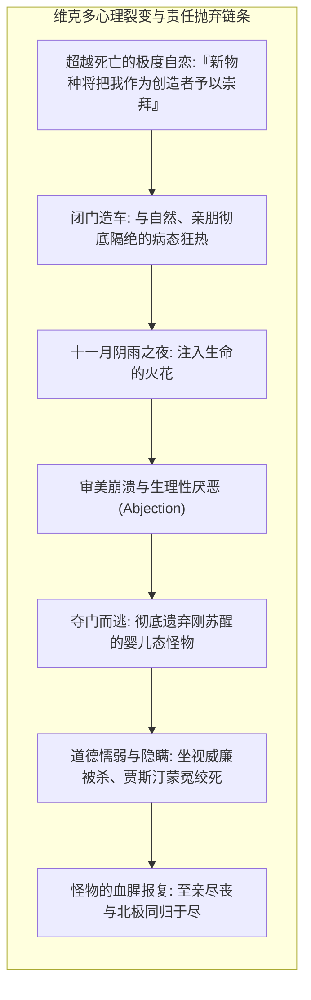
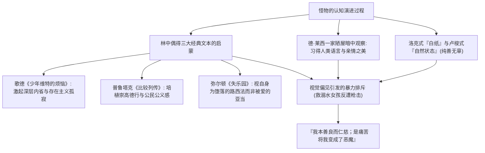
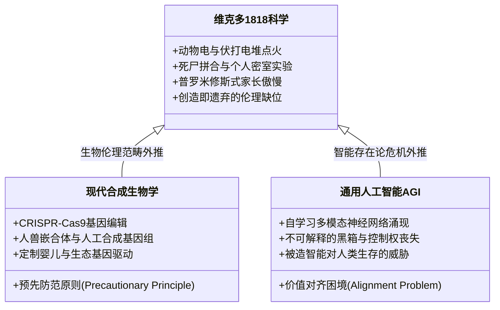

1818年，年仅20岁的英国女作家<strong>玛丽·沃斯通克拉夫特·雪莱（Mary Wollstonecraft Shelley, 1797–1851）</strong>匿名出版了《<strong>法蘭肯斯坦，或现代普罗米修斯（Frankenstein; or, The Modern Prometheus）</strong>》。这部被文学史界公认的<strong>“世界首部真正意义上的科幻小说（Science Fiction）”</strong>，不仅标志着现代科幻文学的开端，更以无可比拟的洞察力奠定了<strong>近代生命伦理学（Bioethics）</strong>的核心议题。

在大众流行文化的简化与误读中，“法蘭肯斯坦”常常被误当作为那个面目狰狞、脖嵌螺栓的怪物名字。但在雪莱的原本小说中，法蘭肯斯坦并非怪物，而是那个解剖死尸、盗取天火、跨越生死界限却在功成之时落荒而逃的年轻瑞士科学家——<strong>维克多·法蘭肯斯坦（Victor Frankenstein）</strong>。

在启蒙主义理性狂欢与工业革命技术乐观主义鼎盛的19世纪初，雪莱提出了人类文明最尖锐的本体论叩问：<strong>当人类科学掌握了创造生命的神圣权能时，创造者对其被造物、对其自身人性乃至整个人类社会，究竟承担着何种不可推卸的道德与抚育责任？</strong> 这一警世恒言，在200年后的今天，在人类全面涉足CRISPR基因编辑、合成生命与人工通用智能（AGI）研发竞赛的当下，散发着前所未有的现实震慑力。

---

## 1. 诞生纪事：1816年“无夏之年”与迪奥达蒂庄园的幻视

《法蘭肯斯坦》的诞生是全球性极端气候危机与浪漫主义思想风暴的罕见交汇。

1815年4月，荷属东印度群岛（现印度尼西亚）的<strong>坦博拉火山（Mount Tambora）</strong>爆发，成为人类有历史记载以来最剧烈的火山灾难。喷入平流层的巨量二氧化硫形成全球气溶胶硫酸盐幕，阻隔太阳辐射，导致<strong>1816年成为北半球著名的“无夏之年（The Year Without a Summer）”</strong>。暴雨连绵、寒冬不退、庄稼绝收、饥荒席卷欧洲。

在瑞士日内瓦湖畔的<strong>迪奥达蒂庄园（Villa Diodati）</strong>，逃离英国社交圈丑闻的诗人<strong>拜伦勋爵（Lord Byron）</strong>、其私人医生<strong>约翰·波利多里（John Polidori）</strong>、激进唯物主义诗人<strong>珀西·比希·雪莱（Percy Bysshe Shelley）</strong>，以及18岁的<strong>玛丽·沃斯通克拉夫特·戈德温（即后来的瑪麗·雪萊）</strong>聚居于此。

因连日狂风暴雨无法外出，众人围炉夜读法国版德国怪谈集《奇幻书（Fantasmagoriana）》。拜伦遂提议：<strong>“我们每人写一个鬼故事。”</strong> 波利多里在此写出了西方吸血鬼小说的鼻祖《吸血鬼》，而瑪麗·雪萊在历经数日创作焦虑后，于一次聆听珀西与拜伦彻夜辩论“生命的本质”“电击能否唤醒死者组织”的午夜，陷入了令其魂飞魄散的<strong>觉醒噩梦（Waking Nightmare）</strong>：

> “我看见一个研究亵渎神明技艺的苍白学徒，跪在他亲手拼凑的怪物旁边。我看见一个可怕的人形僵尸横卧在那里，随着某种强大机械的运作，它显现出生命的征兆，带着僵硬而不安的半生半死之躯挣扎扭动……”

---

## 2. 科学史根基：从隐秘炼金术到近代实验科学

《法蘭肯斯坦》之所以被誉为第一部真正意义上的科幻小说，在于其摒弃了中世城堡幽灵或恶魔契约的超自然迷信，将核心动力完全建立在<strong>当时欧洲最前沿的实验科学与自然哲学</strong>之上。

### 2.1 迦伐尼主义与人体复生实验

1791年，意大利博洛尼亚大学教授<strong>路易吉·迦伐尼（Luigi Galvani）</strong>发表蛙腿抽搐实验，提出了生物体内固有<strong>“动物电（Animal Electricity）”</strong>的假说。虽然随后亚历山德罗·伏打（Alessandro Volta）发明伏打电堆证明了电位差来自异种金属接触，但整个欧洲科学界已然深信：<strong>电，正是连接无机死物与有生血肉的那道神秘的“生命火花”</strong>。

1803年1月，迦伐尼的外甥<strong>乔瓦尼·阿尔蒂尼（Giovanni Aldini）</strong>在伦敦纽盖特监狱对刚被绞死的杀人犯乔治·福斯特的尸体进行了轰动全城的公开通电实验。电极触碰死者面部时，下颚颤动、单眼睁开、右拳举起，甚至令现场目击的医生吓致发疯休克。瑪麗·雪萊对这些耸人听闻的科学实录极为熟悉，维克多在阁楼上搜罗骨骼内脏、以伏打电火花赋予其生机的描写，正是这一时代科学震荡的真实投射。

---

## 3. 维克多的普罗米修斯式傲慢与道德弃绝

维克多·法蘭肯斯坦的悲剧，绝非在于探索自然规律，而在于他<strong>狂妄地篡夺神圣权能，却在生命诞生的瞬间彻底弃绝了抚育与道德责任</strong>。

### 3.1 盗火者的自恋幻觉与母性的剥夺

副标题“现代普罗米修斯”直指希腊神话中盗取天火、以泥土造人的提坦神。维克多沉溺于一种世俗造物主的自恋狂热：*“一个全新的物种将祝福我为其创造者，许多崇高美好的生命将归功于我的双手！”*

女性主义批评家（如艾伦·莫尔斯）指出，维克多试图通过男性智力在冰冷的实验室中进行<strong>无性繁殖</strong>，彻底排除了女性子宫与母亲的肉体存在。这种对母性生育权的暴力僭越，使新生生命从一开始便剥离了温情与伦理滋养，注定沦为畸形的噩梦。

### 3.2 审美的崩溃与即时遗弃

当那个由最美丽器官拼凑而成的巨人睁开浑浊暗黄的水泡眼、皮肤紧绷得露出肌肉血脉时，维克多体验到了克里斯蒂娃所谓的<strong>“贱斥（Abjection）”</strong>。

维克多面对自己亲手制造的生命，不仅未曾给予其姓名与关爱，反而惊恐逃遁。怪物在生理上虽是八英尺巨汉，在心智上却只是嗷嗷待哺的初生婴儿。<strong>正是创造者的无情遗弃，埋下了其后所有毁灭与杀戮的原罪。</strong>

---

## 4. 怪物的存在论悲剧：从自然善到复仇狂

小说最震撼人心的核心，是瑪麗·雪萊赋予了怪物以雄辩、敏感而深邃的心灵：

怪物在森林中拾获的《失乐园》，构成了其自我审视的哲学镜像。他向维克多发出字字泣血的拷问：

> “记住，我曾是你的亚当；但我无辜蒙受遗弃，倒变成了你的堕落路西法！……如果全人类都知道我的存在，他们也会像你一样拿起武器消灭我。那么，我难道不该仇恨那些憎恶我的人吗？！”

怪物的堕落雄辩地证明：<strong>恶并非诞生于实验室的泥土与电流，而是诞生于人类社会的审美傲慢、制度性排斥与同理心的彻底匮乏。</strong>

---

## 5. 三重嵌套结构与现代科技伦理的镜鉴

全书采用罗伯特·沃尔顿船长北极探险信件、维克多口述自白与怪物核心自诉的<strong>三重嵌套叙事（Frame Narrative）</strong>。沃尔顿船长作为维克多的镜像，最终在得知维克多的惨烈教训后，理智地放弃了牺牲船员生命征服北极点的狂热野心，选择南返，完成了对普罗米修斯式毁灭链条的伦理救赎。

在21世纪的今天，当我们面对<strong>CRISPR生殖细胞基因修改</strong>、<strong>人工合成生命（Synthetic Biology）</strong>以及<strong>人工通用智能（AGI）价值对齐（Value Alignment Problem）</strong>时，维克多·法蘭肯斯坦的幽灵依然在每一个高科技实验室游荡。

瑪麗·雪萊在两个世纪前以天才之笔警示全人类：<strong>任何脱离了伦理反思、拒绝承担抚育与共生责任的技术飞跃，最终制造出的，必将是反噬人类文明自身的怪物。</strong>
