In virtually every modern kitchen across the globe, the microwave oven stands as a ubiquitous testament to 20th-century applied electrodynamics. With the press of a few buttons, cold leftovers, chilled milk, or frozen meals are transformed into steaming, piping-hot food within tens of seconds. Yet beneath this deceptive domestic simplicity lies an extraordinary confluence of quantum electronics, relativistic electrodynamics, non-equilibrium thermodynamics, and multi-physics wave phenomena.

Unlike conventional culinary heating methods—such as boiling, grilling, conduction through frying pans, or convection in ovens—which rely entirely on surface heat transfer governed by Fourier's law, the microwave oven relies on <strong>volumetric dielectric heating</strong>. High-frequency electromagnetic radiation penetrates deep into the interior of matter, inducing intense dipolar rotation and ionic migration at the molecular level, directly transforming electromagnetic wave energy into thermal agitation throughout the substance's volume.

This definitive treatise explores the comprehensive scientific and engineering architecture of the microwave oven: from the foundational electrodynamics of lossy dielectrics and Debye relaxation, to the crossed-field relativistic kinematics of the cavity magnetron, the spatial mathematics of multimode resonant standing waves, the non-linear phase-change dynamics of frozen food thawing, the physics of electrical arcing and susceptors, and the wave-attenuation mechanics of cutoff waveguides and quarter-wave choke seals.

---

## 1. Volumetric Heating vs. Classical Surface Conduction: The Thermodynamic Paradigm Shift

To appreciate the physical revolution embodied by the microwave oven, one must first analyze the fundamental limits of classical thermal processing.

### 1.1 The Fourier Conduction Bottleneck

In conventional cooking, thermal energy is applied strictly to the outer boundary of the foodstuff via conduction, convection, or infrared radiation. The inward propagation of thermal energy is strictly governed by <strong>Fourier's Law of Thermal Conduction</strong>:

$$\mathbf{q} = -k \nabla T$$

where $\mathbf{q}$ is the local heat flux vector ($\mathrm{W/m^2}$), $k$ is the thermal conductivity of the material ($\mathrm{W/(m\cdot K)}$), and $\nabla T$ is the spatial temperature gradient.

For a transient, three-dimensional system without internal heat sources, the temperature distribution $T(\mathbf{r}, t)$ evolves according to the parabolic heat diffusion equation:

$$\rho C_p \frac{\partial T}{\partial t} = \nabla \cdot (k \nabla T)$$

where $\rho$ denotes mass density ($\mathrm{kg/m^3}$) and $C_p$ denotes specific heat capacity ($\mathrm{J/(kg\cdot K)}$). The characteristic rate of thermal diffusion is governed by thermal diffusivity $\alpha = k / (\rho C_p)$. 

Biomaterials, muscle tissue, dough, and water-rich culinary matrices exhibit notoriously low thermal conductivities:
- Liquid water: $k \approx 0.60\,\mathrm{W/(m\cdot K)}$
- Mammalian muscle tissue: $k \approx 0.45 - 0.55\,\mathrm{W/(m\cdot K)}$
- Bread dough and porous crumb: $k \approx 0.12 - 0.20\,\mathrm{W/(m\cdot K)}$

In comparison, structural metals such as copper ($k \approx 400\,\mathrm{W/(m\cdot K)}$) and aluminum ($k \approx 237\,\mathrm{W/(m\cdot K)}$) conduct heat hundreds to thousands of times faster. Consequently, to heat the geometric core of a thick roast or potato via classical conduction, the exterior boundary must be maintained at a high temperature for extended durations. This inevitable thermal gradient creates a stark profile: an overcooked, dehydrated exterior crust surrounding an interior that slowly crawls toward thermal equilibrium.

### 1.2 Volumetric Heat Generation

In contrast, microwave heating introduces an internal electromagnetic dissipation source term into the governing energy conservation equation:

$$\rho C_p \frac{\partial T}{\partial t} = \nabla \cdot (k \nabla T) + Q_{em}(\mathbf{r}, t)$$

where $Q_{em}(\mathbf{r}, t)$ is the volumetric electromagnetic power absorption density ($\mathrm{W/m^3}$). Because the electromagnetic field penetrates into the bulk of the dielectric, heat is generated *in situ* within the material's interior volume. 

The popular adage that "microwaves heat food from the inside out" is a physical half-truth. While radiative cooling at the food's exposed surface (convection into room-temperature ambient air and evaporative cooling via latent heat of vaporization) often leaves the outer skin cooler than the insulated interior, the electromagnetic dissipation itself initiates wherever the electric field magnitude $|E|$ is non-zero within the penetrable depth of the food.

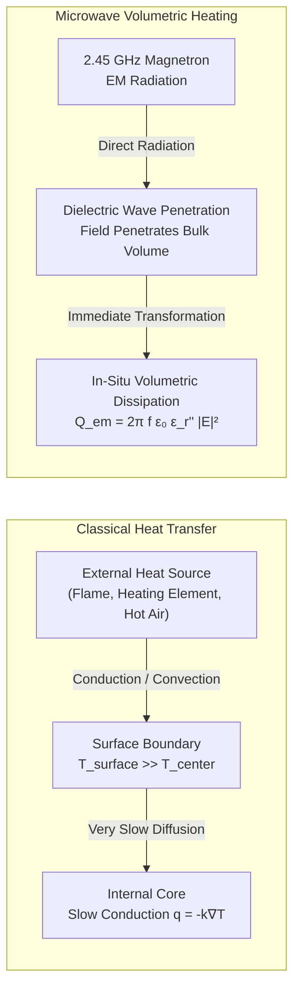

---

## 2. Electrodynamics of Lossy Media and Dielectric Heating

The conversion of high-frequency electromagnetic wave energy into disorganized microscopic thermal motion is governed by Maxwell's macroscopic equations in lossy, polarizable matter.

### 2.1 Maxwell's Equations and Complex Permittivity

In a linear, isotropic, homogeneous medium, Maxwell's curl equations in the frequency domain (assuming harmonic time dependence $e^{j\omega t}$) are:

$$\nabla \times \mathbf{E} = -j\omega \mu_0 \mu_r \mathbf{H}$$

$$\nabla \times \mathbf{H} = \mathbf{J} + j\omega \mathbf{D} = (\sigma + j\omega \epsilon_0 \epsilon_r') \mathbf{E}$$

where $\mathbf{E}$ is the electric field vector ($\mathrm{V/m}$), $\mathbf{H}$ is the magnetic field vector ($\mathrm{A/m}$), $\sigma$ is the ionic electrical conductivity ($\mathrm{S/m}$), $\epsilon_0 \approx 8.854 \times 10^{-12}\,\mathrm{F/m}$ is the vacuum permittivity, and $\mu_r \approx 1$ for non-magnetic organic matter.

By defining an effective complex relative permittivity $\hat{\epsilon}_r(\omega)$:

$$\hat{\epsilon}_r(\omega) = \epsilon_r'(\omega) - j \epsilon_{r,eff}''(\omega)$$

Maxwell's fourth equation can be compactly rewritten as:

$$\nabla \times \mathbf{H} = j\omega \epsilon_0 \left[ \epsilon_r' - j \left( \epsilon_{r,dipole}'' + \frac{\sigma}{\omega \epsilon_0} \right) \right] \mathbf{E}$$

The two components of this complex parameter dictate the interaction between electromagnetic waves and food:
1. <strong>Real Permittivity ($\epsilon_r'$)</strong>: The dielectric storage factor, quantifying the ability of polar molecules to polarize and temporarily store electrostatic potential energy in response to an applied field.
2. <strong>Dielectric Loss Factor ($\epsilon_{r,eff}''$)</strong>: The dissipative parameter, quantifying the efficiency with which electromagnetic field energy is irreversibly converted into thermal motion via molecular friction and ohmic conduction.
3. <strong>Loss Tangent ($\tan \delta$)</strong>: The dissipation factor, defined as:
   $$\tan \delta = \frac{\epsilon_{r,eff}''}{\epsilon_r'} = \frac{\epsilon_{r,dipole}'' + \frac{\sigma}{\omega \epsilon_0}}{\epsilon_r'}$$

### 2.2 Volumetric Power Dissipation Density

The local time-averaged volumetric power absorbed by a lossy dielectric from an electric field $\mathbf{E}$ is derived directly from Poynting's Theorem:

$$\langle \mathbf{S} \rangle = \frac{1}{2} \operatorname{Re}(\mathbf{E} \times \mathbf{H}^*)$$

$$\nabla \cdot \langle \mathbf{S} \rangle = -Q_{em}$$

Evaluating the divergence yields the celebrated <strong>Microwave Power Dissipation Equation</strong>:

$$Q_{em} = \frac{1}{2} \omega \epsilon_0 \epsilon_{r,eff}'' |\mathbf{E}|^2 = \pi f \epsilon_0 \left( \epsilon_{r,dipole}'' + \frac{\sigma}{2\pi f \epsilon_0} \right) |\mathbf{E}|^2$$

where $|\mathbf{E}|$ represents the peak amplitude of the local electric field (or with an RMS electric field $E_{rms}$, $Q_{em} = 2\pi f \epsilon_0 \epsilon_{r,eff}'' E_{rms}^2$).

This fundamental relation establishes that the local heating rate is:
- Linearly proportional to the operational frequency $f$.
- Linearly proportional to the dielectric loss factor $\epsilon_{r,eff}''$ (governed by moisture, temperature, and salinity).
- <strong>Quadratically proportional to the local electric field amplitude $|\mathbf{E}|^2$</strong>. Small spatial variations in field strength yield massive disparities in local heating.

### 2.3 The Microscopic Origins: Dipolar Relaxation and Ionic Conduction

Two distinct microscopic mechanisms dominate microwave dissipation in food systems:

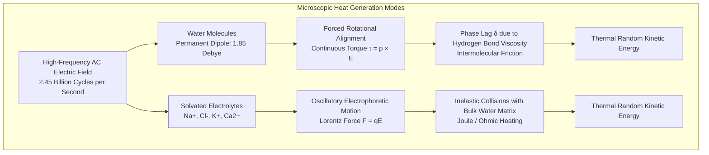

#### A. Dipolar Polarization and Relaxation
The water molecule ($\mathrm{H_2O}$) possesses an asymmetric bent geometry ($104.5^\circ$) with highly electronegative oxygen pulling electron density away from the two hydrogen nuclei. This configuration creates a potent permanent electric dipole moment of $p \approx 1.85\,\mathrm{Debye}$ ($6.17 \times 10^{-30}\,\mathrm{C\cdot m}$).

Under an applied electric field $\mathbf{E}$, an electric dipole experiences an aligning torque $\mathbf{\tau} = \mathbf{p} \times \mathbf{E}$. In a microwave oven operating at $2.45\,\mathrm{GHz}$, the electric field alternates direction $2.45 \times 10^9$ times per second. The water dipoles are forced to reorient continuously to track the oscillating field vector.

However, in liquid water, each molecule is trapped within a dynamic, hydrogen-bonded tetrahedral network. Reorientation requires breaking and reforming hydrogen bonds, presenting a macroscopic shear viscosity. As a result, the molecular rotation exhibits a <strong>finite relaxation time $\tau$</strong>, producing a phase lag $\delta$ between the applied electric field and the induced dielectric displacement $\mathbf{D}$. This phase lag generates viscous dissipation, converting electromagnetic field energy directly into thermal molecular motion.

According to the classical <strong>Debye Relaxation Theory</strong>:

$$\hat{\epsilon}_r(\omega) = \epsilon_\infty + \frac{\epsilon_s - \epsilon_\infty}{1 + j\omega \tau}$$

Separating into real and imaginary components:

$$\epsilon_r'(\omega) = \epsilon_\infty + \frac{\epsilon_s - \epsilon_\infty}{1 + \omega^2 \tau^2}$$

$$\epsilon_{r,dipole}''(\omega) = \frac{(\epsilon_s - \epsilon_\infty)\omega \tau}{1 + \omega^2 \tau^2}$$

where $\epsilon_s$ is the static low-frequency permittivity ($\approx 80$ at $20^\circ\mathrm{C}$), $\epsilon_\infty$ is the optical high-frequency permittivity limit ($\approx 4.5$), and $\tau$ is the dielectric relaxation time ($\approx 9.3 \times 10^{-12}\,\mathrm{s}$ at $20^\circ\mathrm{C}$).

The peak of dipolar loss $\epsilon_{r,dipole}''$ occurs exactly when $\omega \tau = 1$, corresponding to a critical relaxation frequency:

$$f_{relax} = \frac{1}{2\pi \tau} \approx \frac{1}{2\pi (9.3 \times 10^{-12}\,\mathrm{s})} \approx 17.1\,\mathrm{GHz} \quad (\text{at } 20^\circ\mathrm{C})$$

At $100^\circ\mathrm{C}$, the relaxation time drops to $\tau \approx 3.2 \times 10^{-12}\,\mathrm{s}$, shifting the loss peak to approximately $50\,\mathrm{GHz}$.

#### B. Ionic Electrophoresis (Ohmic Conduction)
Culinary materials are rarely pure water; they contain dissolved electrolytes ($\mathrm{Na^+}$, $\mathrm{Cl^-}$, $\mathrm{K^+}$, organic acid ions). Under an electric field, these free ions experience a Coulomb force:

$$\mathbf{F} = q \mathbf{E}$$

Because the electric field oscillates at gigahertz frequencies, these ions are accelerated back and forth over microscopic distances, colliding with neutral water molecules and macromolecular structures. This collision-dominated transport represents classic ohmic resistance within a liquid electrolyte, yielding a conductivity contribution:

$$\epsilon_{ionic}'' = \frac{\sigma}{\omega \epsilon_0} = \frac{\sigma}{2\pi f \epsilon_0}$$

As salinity increases, ionic loss dwarfs dipolar loss, particularly at lower frequencies and elevated temperatures (since ionic mobility increases as liquid viscosity decreases).

---

## 3. The Myth of "Water Resonance" and the True Physics of 2.45 GHz

A widespread scientific myth asserts that microwave ovens operate at $2.45\,\mathrm{GHz}$ because that is the "natural resonant frequency" of the water molecule. This assertion is <strong>empirically and theoretically false</strong>.

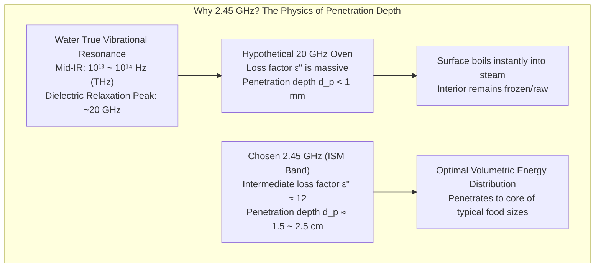

### 3.1 The Absurdity of Operating at True Resonance

The true intramolecular quantum vibrational modes of isolated $\mathrm{H_2O}$ molecules (symmetric stretching $\nu_1$, bending $\nu_2$, asymmetric stretching $\nu_3$) reside in the mid-infrared spectrum at frequencies of $4.7 \times 10^{13}\,\mathrm{Hz}$ to $1.1 \times 10^{14}\,\mathrm{Hz}$ ($\lambda \approx 2.7 - 6.3\,\mu\mathrm{m}$). 

Furthermore, even the relaxation peak of liquid water's hydrogen bond network sits at <strong>$\sim 17 - 22\,\mathrm{GHz}$</strong> at room temperature—nearly ten times higher than $2.45\,\mathrm{GHz}$.

To understand why operating at the relaxation peak would be disastrous, consider the <strong>Penetration Depth ($d_p$)</strong>, defined as the depth at which the transmitted electromagnetic power drops to $1/e$ ($\approx 36.8\%$) of its surface value:

$$d_p = \frac{c_0}{2\omega \operatorname{Im}\left\{\sqrt{\hat{\epsilon}_r}\right\}} = \frac{\lambda_0}{2\pi \sqrt{2\epsilon_r'}} \left[ \sqrt{1 + \left(\frac{\epsilon_{r,eff}''}{\epsilon_r'}\right)^2} - 1 \right]^{-1/2}$$

For low-to-moderate loss dielectrics ($\tan\delta \ll 1$), this simplifies to:

$$d_p \approx \frac{\lambda_0 \sqrt{\epsilon_r'}}{2\pi \epsilon_{r,eff}''} = \frac{c_0}{2\pi f \sqrt{\epsilon_r'} \tan\delta}$$

Let us calculate the penetration depth of water across different frequencies:
1. <strong>At the $20\,\mathrm{GHz}$ Relaxation Peak</strong>:
   $\epsilon_r' \approx 35$, $\epsilon_{r,eff}'' \approx 35$. The resulting penetration depth is:
   $$d_p \approx \frac{15\,\mathrm{mm}}{2\pi \sqrt{70} \left[ \sqrt{2} - 1 \right]^{1/2}} \approx 0.8\,\mathrm{mm}$$
   With an attenuation depth of less than one millimeter, all microwave energy would be absorbed in a paper-thin surface sheet. The surface would flash into dry steam while the interior remained completely untouched by radiation, replicating the worst shortcomings of a hot broiler.
2. <strong>At the Standard $2.45\,\mathrm{GHz}$ Frequency</strong>:
   For pure water at $25^\circ\mathrm{C}$, $\epsilon_r' \approx 78$, $\epsilon_{r,eff}'' \approx 12.5$. The penetration depth is:
   $$d_p \approx 1.7\,\mathrm{cm} - 2.5\,\mathrm{cm}$$
   Because waves enter the food from multiple reflections across all boundaries, an effective penetration depth of $2\,\mathrm{cm}$ allows radiation to envelop and permeate consumer-sized portions of food (steaks, bowls of soup, poultry breasts, casseroles) with remarkable volumetric uniformity.

### 3.2 Regulatory Allocation: The ISM Bands

The secondary reason $2.45\,\mathrm{GHz}$ was established worldwide is regulatory and telecommunication policy. 

High-power radio frequency equipment radiates enormous amounts of energy. If microwave ovens operated at arbitrary frequencies, any minute electromagnetic leakage would disrupt military radar, aeronautical navigation, cellular networks, and long-range communications.

To resolve this conflict, the International Telecommunication Union (ITU) established <strong>ISM (Industrial, Scientific, and Medical) bands</strong>—dedicated slices of the radio spectrum reserved internationally for non-communication RF energy usage without requiring licensing:
- $915\,\mathrm{MHz}$ ($\lambda \approx 32.8\,\mathrm{cm}$): Used primarily in North American heavy industrial heating, lumber drying, and commercial food processing due to its massive penetration depth ($d_p \approx 8-10\,\mathrm{cm}$).
- <strong>$2.45\,\mathrm{GHz}$ ($\lambda \approx 12.24\,\mathrm{cm}$)</strong>: The universal global standard for domestic and commercial consumer microwave ovens.
- $5.8\,\mathrm{GHz}$ ($\lambda \approx 5.17\,\mathrm{cm}$): Explored for miniaturized, precision laboratory synthesizers and high-density semiconductor heating.

---

## 4. The Heart of the Machine: Relativistic Kinematics of the Cavity Magnetron

The domestic microwave oven is uniquely empowered by an electron tube capable of generating 1,000 watts of continuous-wave (CW) microwave power with an astonishing power conversion efficiency exceeding $70\%$, while costing mere tens of dollars to manufacture: the <strong>Cavity Magnetron</strong>.

Invented in its multi-cavity resonant form by John Randall and Harry Boot at the University of Birmingham in 1940, the cavity magnetron transformed World War II radar technology before being adapted by Percy Spencer of Raytheon in 1945 to create the microwave oven.

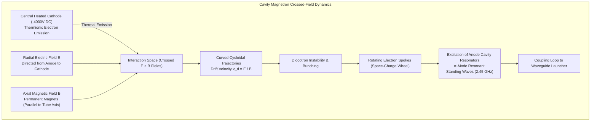

### 4.1 Geometry and Applied Fields

The magnetron consists of a vacuum envelope housing a coaxial cylindrical electrode geometry:
1. <strong>The Cathode</strong>: A central cylindrical tube made of thoriated tungsten or barium-impregnated porous nickel, heated by an internal AC filament to $\sim 1000 - 1500\,\mathrm{K}$ to release copious thermionic electrons. The cathode is energized at a high negative DC potential ($V_a \approx -4000\,\mathrm{V}$).
2. <strong>The Anode Block</strong>: A massive, water- or air-finned cylinder of high-conductivity oxygen-free electronic (OFE) copper held at chassis ground potential ($0\,\mathrm{V}$). Facing the cathode are $N$ identical, azimuthally arranged cavity resonators (typically $N = 8, 10, \text{ or } 12$ hole-and-slot, vane, or rising-sun structures).
3. <strong>Crossed Fields</strong>: 
   - A radially outward electric field:
     $$\mathbf{E}(r) = -\frac{V_0}{r \ln(r_a / r_c)} \hat{\mathbf{r}}$$
     where $r_c$ is cathode radius, $r_a$ is anode radius, and $V_0 = 4\,\mathrm{kV}$.
   - A uniform axial magnetic field:
     $$\mathbf{B} = B_z \hat{\mathbf{z}}$$
     imposed by powerful external strontium-ferrite permanent magnets capped with soft iron pole pieces.

### 4.2 Relativistic Equation of Motion and the Hull Cutoff Condition

An electron of rest mass $m_e$ and charge $-e$ moving with velocity $\mathbf{v}$ through the crossed-field interaction space experiences the Lorentz force:

$$\mathbf{F} = m_e \frac{d\mathbf{v}}{dt} = -e (\mathbf{E} + \mathbf{v} \times \mathbf{B})$$

In cylindrical coordinates $(r, \theta, z)$, assuming $z$-invariance:

$$m_e (\ddot{r} - r\dot{\theta}^2) = -e E_r - e r \dot{\theta} B_z$$

$$\frac{m_e}{r} \frac{d}{dt}(r^2 \dot{\theta}) = e \dot{r} B_z$$

Integrating the angular momentum conservation equation directly from the cathode ($r = r_c, \dot{\theta} = 0$) yields <strong>Busch's Theorem</strong>:

$$\dot{\theta} = \frac{e B_z}{2 m_e} \left( 1 - \frac{r_c^2}{r^2} \right) = \frac{\omega_c}{2} \left( 1 - \frac{r_c^2}{r^2} \right)$$

where $\omega_c = \frac{e B_z}{m_e}$ is the cyclotron frequency.

Substituting this into the conservation of mechanical energy ($E_k = \frac{1}{2}m_e(\dot{r}^2 + r^2\dot{\theta}^2) = e V(r)$) at the condition where electrons just graze the anode block ($\dot{r} = 0$ at $r = r_a$) yields the famous <strong>Hull Cut-Off Magnetic Field ($B_c$)</strong>:

$$B_c = \sqrt{\frac{8 m_e V_a}{e r_a^2 \left( 1 - \frac{r_c^2}{r_a^2} \right)^2}}$$

- <strong>Sub-critical Regime ($B < B_c$)</strong>: The magnetic force is insufficient to overcome the electrostatic pull; electrons strike the anode in simple radial paths. The tube functions as an ordinary high-current diode, converting all DC electrical energy into destructive waste heat on the anode copper.
- <strong>Super-critical Magnetron Regime ($B > B_c$)</strong>: The magnetic field violently deflects the accelerating electrons into cycloidal cusps. Electrons fail to reach the anode, reversing direction before striking the anode surface and forming a rotating sheath of space charge (the <strong>Brillouin Hub</strong>) orbiting the cathode at the $\mathbf{E} \times \mathbf{B}$ drift velocity:
  $$\mathbf{v}_d = \frac{\mathbf{E} \times \mathbf{B}}{B^2} \implies v_\theta \approx \frac{E_r}{B_z}$$

### 4.3 Cavity Resonators, $\pi$-Mode Oscillation, and the Hartree Synchronism

Each resonant cavity carved into the anode block behaves as an LC tank circuit:
- The cylindrical hole acts as a single-turn inductor of inductance $L \approx \mu_0 \pi r_{cavity}^2 / h$.
- The narrow parallel slot acts as a planar capacitor of capacitance $C \approx \epsilon_0 w h / d_{slot}$.
- The resonant frequency is $f_0 \approx 1 / (2\pi \sqrt{LC}) \approx 2.45\,\mathrm{GHz}$.

In an $N$-cavity anode, electromagnetic coupling between adjacent cavities creates multiple azimuthal standing-wave modes characterized by mode number $n$ ($n = 1, 2, \dots, N/2$). The phase shift of the RF electric field between adjacent cavity slots is:

$$\Delta \phi = \frac{2\pi n}{N}$$

The most stable, efficient, and dominant operational mode is the <strong>$\pi$-mode</strong> ($n = N/2$), where adjacent vanes oscillate with a <strong>$180^\circ$ ($\pi$ radians) phase inversion</strong>. To enforce the $\pi$-mode and suppress parasitic adjacent modes ($n = N/2 - 1$), alternate anode vanes are strapped together with solid copper rings (double-ring strapping).

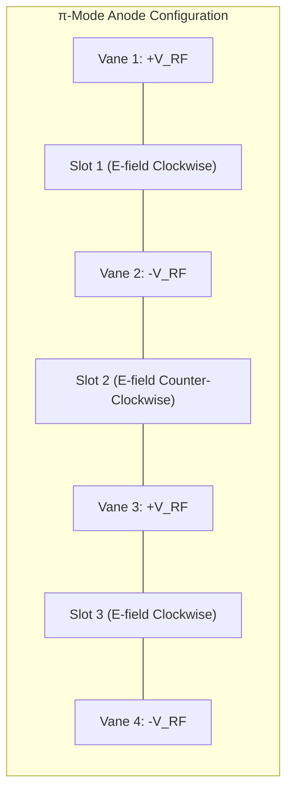

### 4.4 Electron Spoke Bunching: Phase Focusing and Energy Transfer

The brilliance of the magnetron lies in its self-consistent phase-focusing mechanism:
1. The $\pi$-mode produces alternating fringing RF electric fields across the cavity slots.
2. An electron drifting through the interaction space whose tangential velocity matches the phase velocity of the traveling RF wave ($v_\theta \approx v_{phase} = \frac{2\pi f_0 r}{N/2}$) interacts strongly with the RF field.
3. <strong>Decelerating Phase (Favorable Electrons)</strong>: An electron that encounters an RF electric field opposing its orbital drift transfers its kinetic energy to the electromagnetic wave. In a crossed-field system, losing kinetic energy causes the electron to drift *outward* toward higher electrostatic potential, converting potential energy from the high-voltage DC power supply into RF field energy. It continues to drift outward, repeatedly transferring energy to successive cavity slots until it finally impacts an anode vane at low residual velocity.
4. <strong>Accelerating Phase (Unfavorable Electrons)</strong>: An electron encountering an RF electric field aligned with its velocity gains kinetic energy from the wave. This accelerates it into a tighter cycloid, driving it directly back into the cathode filament within a single orbit. This phenomenon—known as <strong>back-bombardment</strong>—heats the cathode (allowing the external filament current to be reduced during continuous operation) while cleanly purging out-of-phase electrons from the interaction space.

This continuous spatial sorting causes the space charge to self-organize into a set of discrete, rotating <strong>electron spokes</strong> (typically 4 spokes for an 8-cavity magnetron or 6 for a 12-cavity magnetron). The rotating electron spokes act like the teeth of a mechanical gear driving the cavity electromagnetic fields, yielding an astonishing DC-to-RF conversion efficiency between $65\%$ and $75\%$.

An antenna probe welded to one of the resonant cavities taps into the intense localized RF magnetic field and launches the resulting $2.45\,\mathrm{GHz}$ transverse electric wave into a rectangular waveguide.

---

## 5. Waveguide Launch and Cavity Multimode Standing Waves

The generated microwave power exits the magnetron antenna and propagates through a rectangular metallic waveguide (typically WR-340 or WR-284 dimensions) into the cooking cavity.

### 5.1 The Multimode Resonant Cavity

The domestic microwave cooking chamber is an enclosed, highly conductive rectangular box of dimensions $a \times b \times d$ (width, depth, height). Because the metallic walls exhibit near-infinite electrical conductivity ($\sigma_{wall} > 10^7\,\mathrm{S/m}$), the tangential electric field must vanish at all boundary surfaces:

$$\mathbf{E}_{tangential} = \mathbf{0} \quad \text{at } x = 0, a; \quad y = 0, b; \quad z = 0, d$$

Under these boundary conditions, Maxwell's wave equation admits only discrete eigenvalue solutions: <strong>Transverse Electric ($\mathrm{TE}_{lmn}$)</strong> and <strong>Transverse Magnetic ($\mathrm{TM}_{lmn}$)</strong> resonant modes. The resonant frequencies for these standing wave modes are given by:

$$f_{lmn} = \frac{c_0}{2} \sqrt{ \left( \frac{l}{a} \right)^2 + \left( \frac{m}{b} \right)^2 + \left( \frac{n}{d} \right)^2 }$$

where $l, m, n$ are non-negative integers representing the number of half-wavelength standing-wave lobes along the $x, y, z$ axes.

For a standard kitchen microwave cavity with internal dimensions $a = 35\,\mathrm{cm}$, $b = 35\,\mathrm{cm}$, and $d = 22\,\mathrm{cm}$, solving for modes near $f_0 = 2.45\,\mathrm{GHz}$ ($\lambda_0 \approx 12.24\,\mathrm{cm}$) yields dozens of overlapping spatial modes (e.g., $\mathrm{TE}_{541}$, $\mathrm{TM}_{432}$, $\mathrm{TE}_{152}$).

The interference between the forward-propagating waves launched from the waveguide and their multiple specular reflections off the six conductive walls sets up a complex, three-dimensional <strong>standing wave interference pattern</strong>:
- <strong>Antinodes (Hot Spots)</strong>: Spatial locations where constructive interference maximizes the local electric field amplitude $|\mathbf{E}|^2$. Volumetric dissipation peaks sharply here.
- <strong>Nodes (Cold Spots)</strong>: Locations where destructive interference drives the electric field amplitude to near zero ($|\mathbf{E}|^2 \approx 0$). In these zones, dielectric heating is practically non-existent.

The physical distance between successive antinodes in a pure standing wave is exactly half the guided wavelength:

$$\Delta x = \frac{\lambda_g}{2} \approx 6.1\,\mathrm{cm}$$

If a stationary plate of food is placed in such a field, localized stripes or patches spaced roughly $6\,\mathrm{cm}$ apart will burn or boil while the intermediate regions remain completely cold.

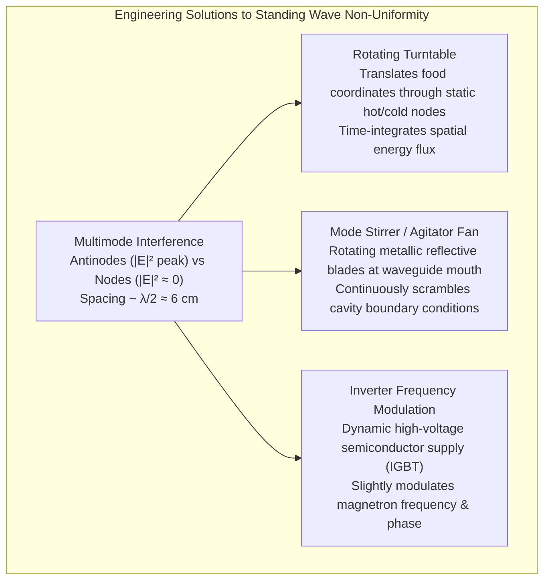

### 5.2 Mechanical and Electromagnetic Solutions to Hot Spots

To achieve acceptable culinary uniformity, microwave engineers implemented three complementary techniques:

1. <strong>The Motorized Turntable</strong>:
   By rotating the foodstuff on a circular glass carousel at $3 - 6\,\mathrm{RPM}$, individual volume elements of the food describe circular paths through the static three-dimensional interference grid. Over a 1-minute heating duration, every sector of the food averages out exposure to high-field antinodes and low-field nodes, transforming severe spatial gradients into a smooth radial exposure profile.
2. <strong>The Mode Stirrer</strong>:
   In flatbed (turntable-free) microwave ovens, a motorized, slowly rotating fan featuring irregular aluminum or stainless steel blades is mounted directly at the output aperture of the waveguide. The rotating conductive vanes present a continuously shifting electromagnetic boundary condition, continuously altering the phase and reflection angles of incoming microwaves. Consequently, the three-dimensional standing wave pattern in the cavity is continuously perturbed, sweeping nodes and antinodes across the oven volume multiple times per second.
3. <strong>Solid-State Inverter Power Modulation</strong>:
   Traditional microwave ovens power the magnetron using a bulky $60\,\mathrm{Hz}$ step-up transformer, high-voltage capacitor, and diode doubler. Because the magnetron has a steep diode-like V-I turn-on curve, it cannot be continuously throttled; a "50% power" setting simply pulses the magnetron at full $1000\,\mathrm{W}$ blast for 15 seconds, followed by 15 seconds of complete dormancy.
   
   In modern <strong>Inverter Microwaves</strong>, a high-frequency solid-state switching power supply (utilizing IGBT bridge inverters operating at $30 - 100\,\mathrm{kHz}$) allows true variable DC current control. The magnetron can emit a continuous, stable $200\,\mathrm{W}, 400\,\mathrm{W}$, or $600\,\mathrm{W}$ RF stream. Continuous gentle radiation prevents the severe localized boiling and thermal spikes characteristic of intermittent pulsed duty cycles.

---

## 6. The Phase Change Anomaly: The Physics of Frozen Food Thawing

The most common point of culinary failure in microwave operation is the attempted rapid thawing of frozen meats or soups. When subjected to standard microwave heating, frozen foods display an infuriating behavior: portions of the exterior begin boiling and cooking into tough, grey meat, while the core remains as hard as granite.

This frustrating phenomenon is a direct consequence of a catastrophic <strong>four-order-of-magnitude discontinuity</strong> in dielectric loss between ice and liquid water.

### 6.1 The Dielectric Phase-Change Discontinuity

| Material State | Temperature ($^\circ\mathrm{C}$) | Real Permittivity ($\epsilon_r'$) | Dielectric Loss ($\epsilon_{r,eff}''$) | Penetration Depth ($d_p$) |
|---|---|---|---|---|
| <strong>Ice (Hexagonal Ih)</strong> | $-12^\circ\mathrm{C}$ | $3.2$ | <strong>$0.003$</strong> | <strong>$\sim 1100\,\mathrm{cm}$ ($11\,\mathrm{m}$!)</strong> |
| <strong>Ice (Near Melting)</strong> | $-2^\circ\mathrm{C}$ | $3.2$ | <strong>$0.008$</strong> | <strong>$\sim 400\,\mathrm{cm}$ ($4\,\mathrm{m}$)</strong> |
| <strong>Liquid Pure Water</strong> | $+1.5^\circ\mathrm{C}$ | $84.0$ | <strong>$18.0$</strong> | <strong>$1.3\,\mathrm{cm}$</strong> |
| <strong>Liquid Pure Water</strong> | $+25^\circ\mathrm{C}$ | $78.0$ | <strong>$12.5$</strong> | <strong>$1.8\,\mathrm{cm}$</strong> |
| <strong>$0.5\,\mathrm{M}$ NaCl Saline Water</strong> | $+20^\circ\mathrm{C}$ | $70.0$ | <strong>$35.0$</strong> | <strong>$0.6\,\mathrm{cm}$</strong> |

In hexagonal ice ($\mathrm{Ice\ Ih}$), water molecules are locked rigidly into an open crystal lattice held by four directional hydrogen bonds. The energy barrier for molecular rotation is enormous ($E_A \approx 0.55\,\mathrm{eV}$). At $2.45\,\mathrm{GHz}$, the water dipoles in the crystal lattice are utterly incapable of tracking the oscillating electric field. The relaxation frequency of ice is located down in the audio spectrum ($\sim 1\,\mathrm{kHz}$ at $-10^\circ\mathrm{C}$). 

Consequently, at $2.45\,\mathrm{GHz}$, ice exhibits a minuscule loss factor of $\epsilon'' \approx 0.003$. Microwaves pass through solid ice almost as easily as through air or transparent glass; the penetration depth exceeds 10 meters!

The moment ice melts into liquid water, however, the rigid lattice collapses into a dynamic fluid. Dipolar mobility surges, and the loss factor jumps from <strong>$0.003$ to $18.0$</strong>—an instantaneous <strong>6,000-fold increase in microwave dissipation efficiency</strong>.

### 6.2 The Thermal Runaway Positive Feedback Loop

This massive physical discontinuity establishes a violent positive feedback loop known as <strong>Thermal Runaway</strong>:

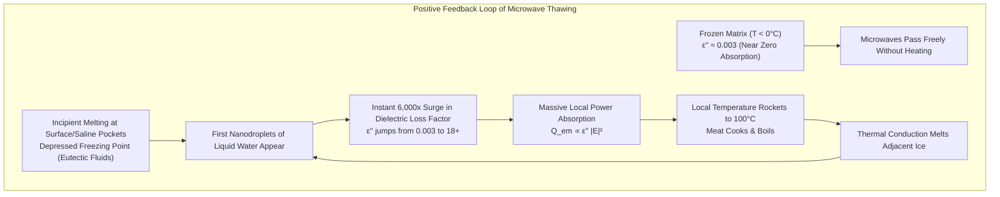

1. The microwave field permeates the frozen food with virtually zero bulk attenuation.
2. Minor structural irregularities, salt concentration gradients, or edges experience localized surface melting, creating the first microscopic pockets of liquid water.
3. These newborn droplets of liquid water immediately absorb microwave energy at thousands of times the rate of the surrounding frozen matrix.
4. The power dissipation density in the liquid zone skyrockets. The liquid pocket boils, its temperature surging toward $100^\circ\mathrm{C}$.
5. Heat conducts outward from this scalding liquid pocket into adjacent ice, melting it into more liquid water, which instantly joins the runaway microwave absorption cycle.
6. The user opens the door to discover that a corner of the beef roast has turned into grey, leathery cooked meat, while the geometric core is still at $-15^\circ\mathrm{C}$.

### 6.3 The Physics of the Defrost Algorithm

To thaw food successfully in a microwave, the physics of thermal diffusion must be balanced against dielectric absorption:
- The microwave duty cycle is drastically reduced (e.g., $20\%$ to $30\%$ effective power).
- The magnetron fires for brief pulses (e.g., 6 seconds on), followed by substantial quiescent intervals (e.g., 24 seconds off).
- During the quiescent period, microwave heating ceases entirely ($Q_{em} = 0$). The accumulated thermal energy in the heated water pockets is allowed to diffuse naturally via Fourier conduction ($\nabla \cdot (k \nabla T)$) into the surrounding cold ice.
- This conduction safely cools the liquid pockets while elevating the bulk ice toward the melting threshold ($0^\circ\mathrm{C}$). Only when thermal equilibrium has smoothed out the localized hotspots does the next microwave pulse fire.

---

## 7. Materials in the Cavity: Arcing, Glass, and Susceptor Engineering

Placing materials into the high-intensity electromagnetic field of a microwave oven produces radically different phenomena depending on their electrical conductivity and dielectric permittivity.

### 7.1 Good Conductors and the Physics of Metal Arcing

A universal domestic warning cautions against putting metals into a microwave. The physical justification lies in <strong>boundary electrodynamics</strong> and <strong>dielectric air breakdown</strong>.

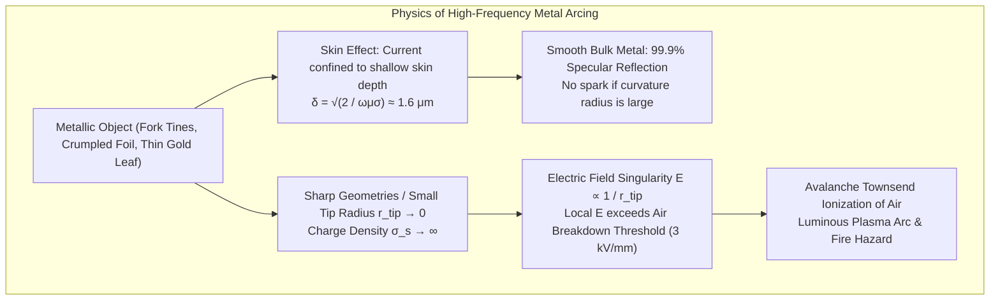

For a good conductor ($\sigma \gg \omega \epsilon$), electromagnetic waves do not penetrate into the bulk. Instead, they are attenuated within the <strong>skin depth ($\delta_s$)</strong>:

$$\delta_s = \sqrt{\frac{2}{\omega \mu \sigma}} = \sqrt{\frac{1}{\pi f \mu \sigma}}$$

For commercial aluminum ($\sigma \approx 3.5 \times 10^7\,\mathrm{S/m}$) at $2.45\,\mathrm{GHz}$:

$$\delta_s \approx \sqrt{\frac{1}{\pi (2.45 \times 10^9) (4\pi \times 10^{-7}) (3.5 \times 10^7)}} \approx 1.7\,\mu\mathrm{m}$$

Because the skin depth is under two microns, the incident wave cannot establish a propagating field within the metal. Free conduction electrons oscillate collectively, creating a macroscopic surface conduction current sheet $\mathbf{K} = \hat{\mathbf{n}} \times \mathbf{H}$ that sets up an equal and opposite reflected wave, producing near-perfect ($> 99.9\%$) specular reflection.

Why, then, do metals spark violently?
1. <strong>Geometric Field Singularity and Lightning Discharge</strong>:
   Electrostatic and high-frequency electrodynamic field lines concentrate dramatically around regions of high surface curvature. The electric field near a conductive tip of radius $r$ scales asymptotically as:
   $$E \propto \frac{1}{r^{1-\alpha}}$$
   On a fork tine, a bent staple, or the razor-sharp crinkles of crumpled aluminum foil, the effective radius of curvature approaches zero ($r \to 0$). The local electric field easily exceeds the <strong>dielectric breakdown strength of atmospheric air</strong> ($E_{breakdown} \approx 3 \times 10^6\,\mathrm{V/m} = 3\,\mathrm{kV/mm}$).
   
   Once this threshold is breached, free electrons naturally present from background cosmic rays are accelerated to kinetic energies exceeding the ionization potentials of nitrogen ($15.6\,\mathrm{eV}$) and oxygen ($12.1\,\mathrm{eV}$). An exponential Townsend electron avalanche ensues, collapsing the insulating air into a high-temperature, glowing, electrically conductive <strong>plasma arc</strong> ($T > 3000\,\mathrm{K}$) that scorches the cavity, cracks ceramics, and poses an immediate fire hazard.
2. <strong>Joule Heating of Ultra-Thin Films (Gold Trim and Metallized Films)</strong>:
   When metal is deposited as an ultra-thin film (such as decorative gold leaf on fine china or vacuum-metallized snack bags), its thickness $t$ ($10 - 100\,\mathrm{nm}$) is far thinner than the skin depth $\delta_s \approx 1.7\,\mu\mathrm{m}$.
   The film does not possess sufficient volume to fully reflect the wave, yet its sheet resistance $R_s = \frac{1}{\sigma t}$ is substantial. Enormous eddy currents induced by the RF field dissipate immense localized Joule heating ($I^2 R_s$). Within two seconds, the metallic gold film vaporizes, sparking vigorously and fracturing the delicate porcelain glaze via localized thermal shock.

### 7.2 Low-Loss Dielectrics: Microwave-Safe Cookware

Materials classified as "microwave-safe"—borosilicate glass (Pyrex), polypropylene (PP), polyethylene (PE), Teflon (PTFE), and high-fire glazed stoneware—are low-loss dielectrics.

These materials lack free conduction electrons ($\sigma \approx 0$) and have completely saturated, non-polar covalent bonds or rigid ionic structures that possess no unconstrained permanent dipole moments. Consequently, their dielectric loss factor is practically zero:
$$\epsilon_r'' < 0.001, \quad \tan\delta < 10^{-4}$$

The electromagnetic waves pass directly through these vessels without experiencing reflection or attenuation. The container remains completely cool, warming up only secondarily through classical conductive heat transfer from the steaming food resting upon it.

### 7.3 Susceptor Nanotechnology: Crisping the Impossible

A primary culinary limitation of microwave ovens is the absence of the Maillard reaction. The <strong>Maillard reaction</strong>—the non-enzymatic browning cascade between reducing sugars and amino acids responsible for the golden crusts of breads, roasted meats, and fried potatoes—requires surface temperatures of <strong>$140^\circ\mathrm{C} - 165^\circ\mathrm{C}$</strong>. Because microwave heating vaporizes liquid water at $100^\circ\mathrm{C}$, the food surface is bathed in escaping steam, pinning its maximum temperature to $\le 100^\circ\mathrm{C}$ and leaving pastries soggy and pale.

To overcome this, packaging engineers invented the <strong>Microwave Susceptor</strong>—the shiny grey metallic film embedded inside microwave pizza boxes, pot pie sleeves, and popcorn bags.

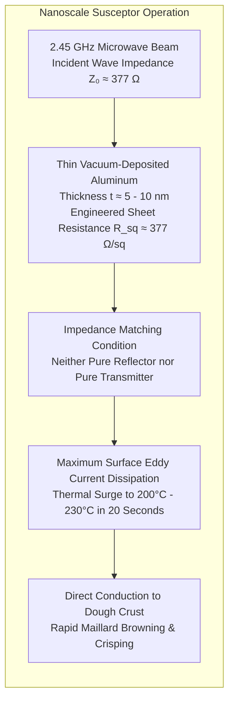

A susceptor is fabricated by vacuum-depositing an extraordinarily thin layer of elemental aluminum (thickness $t \approx 5 - 10\,\mathrm{nm}$) onto a heat-resistant polyethylene terephthalate (PET) substrate:
- If the aluminum layer were thick ($t > 1\,\mu\mathrm{m}$), it would reflect the microwaves back into the cavity.
- If the layer were absent, the plastic would transmit the microwaves with zero absorption.
- At a critical thickness of just a few nanometers, the sheet resistance of the film matches the order of magnitude of the intrinsic wave impedance of free space:
  $$Z_0 = \sqrt{\frac{\mu_0}{\epsilon_0}} \approx 376.73\,\Omega$$

Under this impedance-matching condition, the film functions as a near-perfect lossy resistive surface. Enormous eddy currents swirl across the nanoscopic aluminum island matrix, driving the film temperature from room ambient to <strong>$200^\circ\mathrm{C} - 230^\circ\mathrm{C}$ within 15 seconds</strong>. Acting as an intense, localized frying griddle, the susceptor flash-sears the contacting dough crust, crisping it and triggering full Maillard caramelization before interior steam can make it soggy.

---

## 8. Containment and Safety: Cutoff Waveguides and Quarter-Wave Chokes

A consumer microwave oven produces approximately 1,000 watts of high-frequency power—an intensity capable of causing severe internal tissue burns and cataracts within seconds of direct human exposure. The regulatory standard (enforced by the FDA and IEC) mandates that microwave leakage measured at a distance of $5\,\mathrm{cm}$ from the oven exterior shall never exceed <strong>$5\,\mathrm{mW/cm^2}$</strong> over the operating lifetime of the unit.

How does a domestic appliance with an opening door and a see-through glass window contain a 1 kW beam with near-absolute electromagnetic perfection?

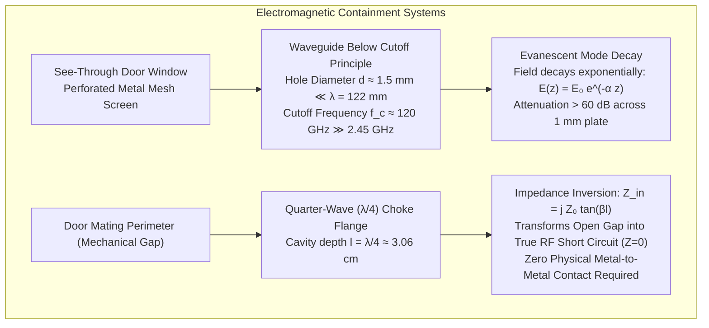

### 8.1 The Door Screen: Waveguide Below Cutoff

The dark perforated metal plate embedded in the oven door permits optical visibility while completely blocking microwaves. This is achieved by designing each individual perforation as a <strong>circular waveguide operating far below cutoff</strong>.

For a circular metallic tube of diameter $d$, the lowest-order propagating mode is the $\mathrm{TE}_{11}$ mode, which has a cutoff wavelength of:

$$\lambda_c = \frac{\pi d}{p_{11}'} \approx \frac{\pi d}{1.841} \approx 1.706\,d$$

The corresponding cutoff frequency is:

$$f_c = \frac{c_0}{\lambda_c} \approx \frac{c_0}{1.706\,d}$$

In a typical microwave door screen, the punched holes have a diameter of <strong>$d \approx 1.5\,\mathrm{mm}$</strong>. Calculating the cutoff frequency yields:

$$f_c \approx \frac{3 \times 10^8\,\mathrm{m/s}}{1.706 \times (1.5 \times 10^{-3}\,\mathrm{m})} \approx 1.17 \times 10^{11}\,\mathrm{Hz} = 117\,\mathrm{GHz}$$

The microwave oven frequency ($f = 2.45\,\mathrm{GHz}$) is nearly <strong>50 times lower</strong> than this cutoff frequency ($f \ll f_c$). 

When an electromagnetic wave attempts to penetrate a waveguide at a frequency below its cutoff, the propagation constant $\gamma = \alpha + j\beta$ becomes purely real ($\beta = 0$). The wave cannot propagate; it is transformed into an <strong>evanescent field</strong> whose amplitude decays exponentially along the depth of the hole ($z$):

$$E(z) = E_0 e^{-\alpha z}$$

The attenuation constant $\alpha$ is:

$$\alpha = \frac{2\pi}{\lambda_c} \sqrt{1 - \left( \frac{f}{f_c} \right)^2} \approx \frac{2\pi}{\lambda_c} \approx \frac{3.682}{d} \approx \frac{3.682}{0.0015\,\mathrm{m}} \approx 2455\,\mathrm{m^{-1}}$$

Converting to decibels of electromagnetic attenuation per unit depth:

$$\text{Attenuation Rate} = 20 \log_{10}(e) \cdot \alpha \approx 8.686 \times 2455 \approx 21,300\,\mathrm{dB/m} = 21.3\,\mathrm{dB/mm}$$

Across a perforated sheet metal thickness of just $1.0\,\mathrm{mm}$, the microwave attenuation exceeds <strong>$21\,\mathrm{dB}$</strong> for a single hole, and the collective array geometry provides well over <strong>$60 - 80\,\mathrm{dB}$</strong> of isolation ($>99.9999\%$ attenuation).

In contrast, visible light has wavelengths between $400\,\mathrm{nm}$ and $700\,\mathrm{nm}$ ($f \approx 430 - 750\,\mathrm{THz}$)—far above the $117\,\mathrm{GHz}$ cutoff frequency. Light waves pass through the apertures via ordinary geometric ray optics, allowing humans to clearly observe the illuminated food within.

### 8.2 The Perimeter Gap: Quarter-Wave Choke Seals

While a perforated screen protects the window, what prevents microwaves from escaping around the mechanical edges of the door? 

Mechanical doors warp, collect grease, and have manufacturing tolerances that leave gaps of $0.5 - 2.0\,\mathrm{mm}$. Relying on physical metal-to-metal spring contacts would be fatal: grease and oxidation would degrade electrical contact, causing arcing and catastrophic leakage.

To solve this, microwave door perimeters employ a brilliant transmission-line device: the <strong>Quarter-Wave ($\lambda/4$) Choke Cavity</strong>.

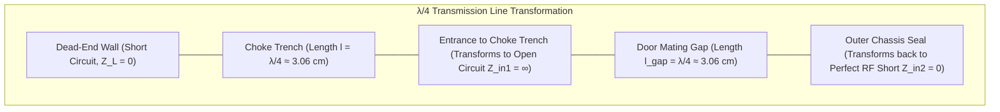

According to transmission line theory, the input impedance $Z_{in}$ of a lossless transmission line of characteristic impedance $Z_0$ and physical length $l$, terminated in a load impedance $Z_L$, is:

$$Z_{in} = Z_0 \frac{Z_L + j Z_0 \tan(\beta l)}{Z_0 + j Z_L \tan(\beta l)}$$

where $\beta = \frac{2\pi}{\lambda}$ is the phase propagation constant.

If the end of a transmission line channel is solidly short-circuited into the metal chassis ($Z_L = 0$):

$$Z_{in} = j Z_0 \tan(\beta l)$$

Now, let the length of this internal recessed channel be engineered to be precisely one-quarter of the free-space wavelength:

$$l = \frac{\lambda}{4} = \frac{12.24\,\mathrm{cm}}{4} \approx 3.06\,\mathrm{cm}$$

Evaluating the phase angle:

$$\beta l = \left( \frac{2\pi}{\lambda} \right) \left( \frac{\lambda}{4} \right) = \frac{\pi}{2} \implies \tan\left( \frac{\pi}{2} \right) \to \infty$$

$$Z_{in1} \to \infty \quad (\text{Pure Open Circuit})$$

Now, this infinite impedance (open circuit) is positioned at the junction with the door gap. The gap itself forms a secondary transmission line segment, also with an effective length of $\lambda/4$ leading out to the external world. Applying the impedance transformation formula a second time to an open circuit ($Z_L \to \infty$):

$$Z_{in2} = Z_0 \frac{\infty + \dots}{j \infty \tan(\pi/2)} \to \frac{Z_0}{j \tan(\pi/2)} = 0 \quad (\text{Pure RF Short Circuit})$$

By folding a precision $\lambda/4$ metallic trench into the perimeter rim of the door, <strong>the exterior boundary is transformed into a zero-impedance RF short circuit without requiring physical metal-to-metal contact</strong>. Even if there is a visible $1\,\mathrm{mm}$ gap between the door and the frame, the $2.45\,\mathrm{GHz}$ wave sees an impenetrable wall of zero impedance, reflecting 100% of the energy back inside the cooking chamber.

---

## 9. Physical Hazards: The Thermodynamics of Superheating

Beyond electrical arcing, the most dangerous physical phenomenon encountered in microwave heating is <strong>Liquid Superheating (Explosive Boiling)</strong>.

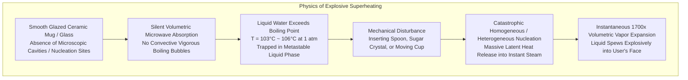

### 9.1 Classical Nucleation Theory vs. Microwave Quiescence

When water is heated classically on a stovetop, heat enters through the base of the metal pan. The microscopic roughness of the metallic surface contains thousands of microscopic crevices that trap tiny pockets of air. These air pockets serve as <strong>heterogeneous nucleation sites</strong>. 

According to the Young-Laplace equation, the vapor pressure inside a spherical bubble embryo of radius $R$ must exceed the ambient hydrostatic pressure $P_\infty$ plus the inward surface tension pressure:

$$P_{vapor}(T) - P_\infty \ge \frac{2\gamma}{R}$$

where $\gamma$ is the liquid-vapor surface tension ($\approx 0.059\,\mathrm{N/m}$ at $100^\circ\mathrm{C}$). Because nucleation sites provide a large initial radius $R$, the required pressure differential is small. Boiling initiates smoothly and continuously at $T \approx 100^\circ\mathrm{C}$, with visible bubbles breaking away and carrying excess heat away via latent heat of vaporization ($\Delta H_{vap} \approx 2260\,\mathrm{kJ/kg}$).

In contrast, when distilled or tap water is heated in a pristine, smooth glazed ceramic mug or glass beaker inside a microwave:
1. <strong>Absence of Nucleation Sites</strong>: High-fire glaze and polished glass are microscopically flat; trapped air pockets are virtually absent.
2. <strong>Volumetric Quiescence</strong>: Unlike a flame that creates intense buoyant convective plumes from the bottom, microwave heating deposits energy relatively uniformly throughout the upper and middle liquid volume. Convection currents remain sluggish and laminar.
3. <strong>Metastable Superheating</strong>: The water temperature easily climbs past the thermodynamic boiling threshold ($100^\circ\mathrm{C}$), reaching <strong>$103^\circ\mathrm{C}$ to $108^\circ\mathrm{C}$ at standard atmospheric pressure</strong> without boiling. The liquid is trapped in a precarious, metastable thermodynamic state.

### 9.2 The Catastrophic Phase Explosion

If a superheated mug of water is nudged, or if a nucleation catalyst is introduced (a metal spoon, a wooden stir stick, or a spoonful of soluble coffee granules containing thousands of porous microscopic air pockets), the barrier to nucleation collapses instantaneously:
- The effective nucleation radius jumps from zero to a macroscopic value ($R \gg R_c$).
- The enormous thermal energy stored above $100^\circ\mathrm{C}$ flashes into vapor within milliseconds.
- Because the specific volume of steam at atmospheric pressure is approximately <strong>1,700 times greater</strong> than that of liquid water, the sudden nucleation produces a catastrophic volumetric expansion.
- The expanding vapor bubble acts as a piston, violently ejecting the scalding column of superheated water out of the mug like an erupting geyser, inflicting horrific, full-thickness burns on the hands and face of the unsuspecting user.

---

## 10. Advanced Frontiers: Microwave Chemistry, Sintering, and Fusion Plasma

The electrodynamic mastery pioneered by the humble kitchen microwave has catalyzed transformative breakthroughs across heavy industry, pharmaceutical synthesis, and thermonuclear energy.

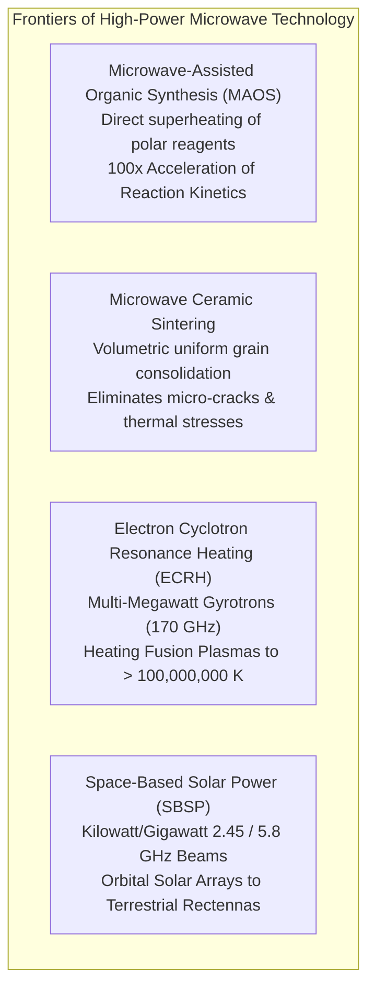

### 10.1 Microwave-Assisted Organic Synthesis (MAOS)

In modern medicinal and synthetic chemistry, microwave reactors have largely superseded traditional heating mantles and oil baths.
- By tuning the dielectric loss of solvents (e.g., ethanol, dimethylformamide, ionic liquids), chemists achieve ultra-rapid heating rates exceeding $10^\circ\mathrm{C}/\mathrm{second}$ under sealed pressurized conditions ($30\,\mathrm{bar}$, $250^\circ\mathrm{C}$).
- Reaction times that traditionally required 24 hours of reflux are completed in <strong>3 minutes</strong>.
- Selective heating enables specific molecular complexes or heterogeneous catalysts to be maintained at higher local effective temperatures than the surrounding non-polar solvent, suppressing secondary side-reactions and boosting synthetic yields from $40\%$ to over $95\%$.

### 10.2 Industrial Ceramic Sintering

Engineering ceramics (silicon nitride $\mathrm{Si_3N_4}$, zirconia $\mathrm{ZrO_2}$, alumina $\mathrm{Al_2O_3}$) require high-temperature sintering ($>1600^\circ\mathrm{C}$) to eliminate voids and achieve theoretical density.
- In conventional kilns, heating proceeds from the outside inward, generating severe thermal stresses that cause warping and microscopic fracture propagation.
- With microwave hybrid sintering, electromagnetic fields penetrate the entire ceramic green body, initiating volumetric consolidation. Grain growth is suppressed, producing nanostructured ceramics with unprecedented fracture toughness and mechanical hardness.

### 10.3 Electron Cyclotron Resonance Heating (ECRH) in Fusion Tokamaks

In the pursuit of commercial fusion energy, experimental magnetic confinement reactors (such as ITER in France or the Wendelstein 7-X stellarator in Germany) must heat hydrogen isotopes to temperatures exceeding <strong>150 million Kelvin</strong>—ten times hotter than the core of the Sun.

This is accomplished using <strong>Gyrotrons</strong>—the multi-megawatt relativistic descendants of the cavity magnetron. Gyrotrons fire coherent electromagnetic millimeter-wave beams at frequencies of <strong>$140 - 170\,\mathrm{GHz}$</strong> directly into the magnetically confined plasma. The frequency is tuned precisely to match the relativistic electron cyclotron resonance frequency:

$$\omega_{ce} = \frac{e B}{\gamma_{rel} m_e}$$

The plasma electrons absorb the gigawatt-scale microwave beams directly, pumping thermal energy into the deuterium-tritium fuel until thermonuclear fusion ignites.

### 10.4 Space-Based Solar Power (SBSP)

Concepts for orbital clean power rely on harvesting unfiltered, continuous solar energy in geostationary orbit (GEO) and beaming it down to Earth via coherent, phased-array microwave beams at $2.45\,\mathrm{GHz}$ or $5.8\,\mathrm{GHz}$. At these wavelengths, atmospheric absorption and rain attenuation are minimal. On the ground, vast arrays of rectifying antennas (<strong>rectennas</strong>) convert the incoming RF energy directly back into grid-compatible DC electricity with efficiencies exceeding $85\%$.

---

## 11. Conclusion: The Masterwork of Applied Electrodynamics in the Kitchen

The kitchen microwave oven is far more than a convenient food reheater; it is a masterwork of modern physics. It unites:
- <strong>Maxwell's Field Equations</strong>: Operating in lossy, polarizable dielectric matter to achieve internal volumetric heat deposition.
- <strong>Debye Relaxation & Viscous Dissipation</strong>: Exploiting the permanent molecular dipole moment of water and the mobility of solvated ions to generate friction at gigahertz frequencies.
- <strong>Relativistic Crossed-Field Vacuum Electronics</strong>: Using the cavity magnetron's self-organizing electron spokes to transform DC power into gigahertz radiation with $>70\%$ efficiency.
- <strong>Multimode Resonant Wave Mechanics</strong>: Balancing standing wave interference nodes and antinodes through spatial averaging, mode stirring, and solid-state inverter control.
- <strong>Phase Transition Discontinuities</strong>: Navigating the 6,000-fold dielectric loss jump between ice and water that dictates thawing kinetics and thermal runaway.
- <strong>Asymptotic Boundary Physics</strong>: Harnessing waveguides below cutoff and quarter-wave choke cavities to lock deadly high-power radiation securely within a consumer appliance.

The next time you place a cup of water or a dish of food inside a microwave oven and watch it steam within seconds, you are witnessing an elegant, synchronized symphony of relativistic physics, molecular thermodynamics, and precision microwave engineering working in flawless harmony.
