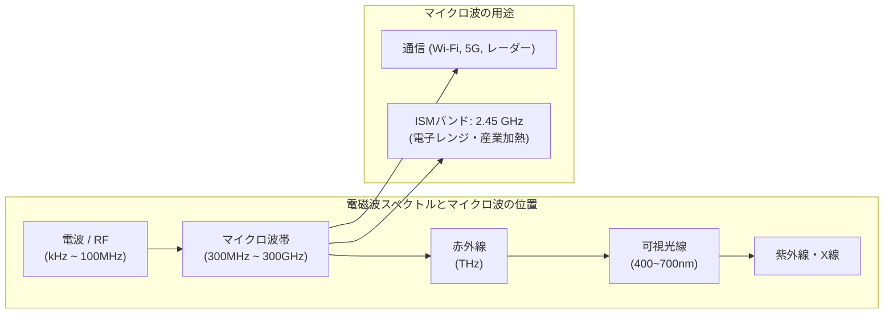
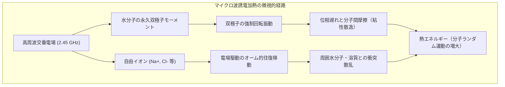
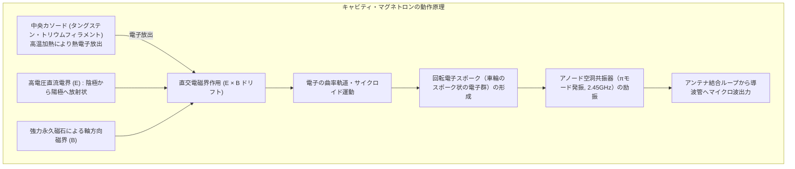
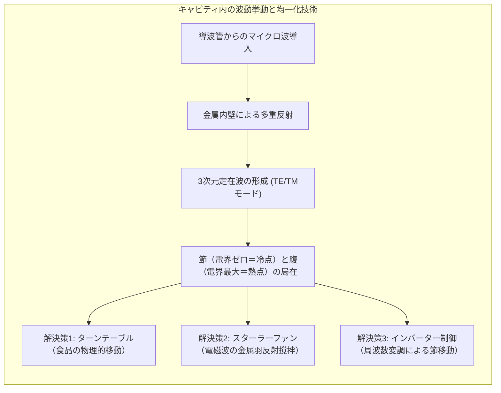
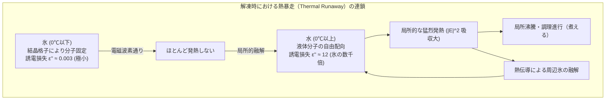
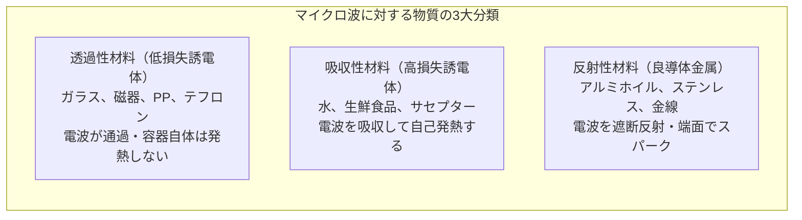
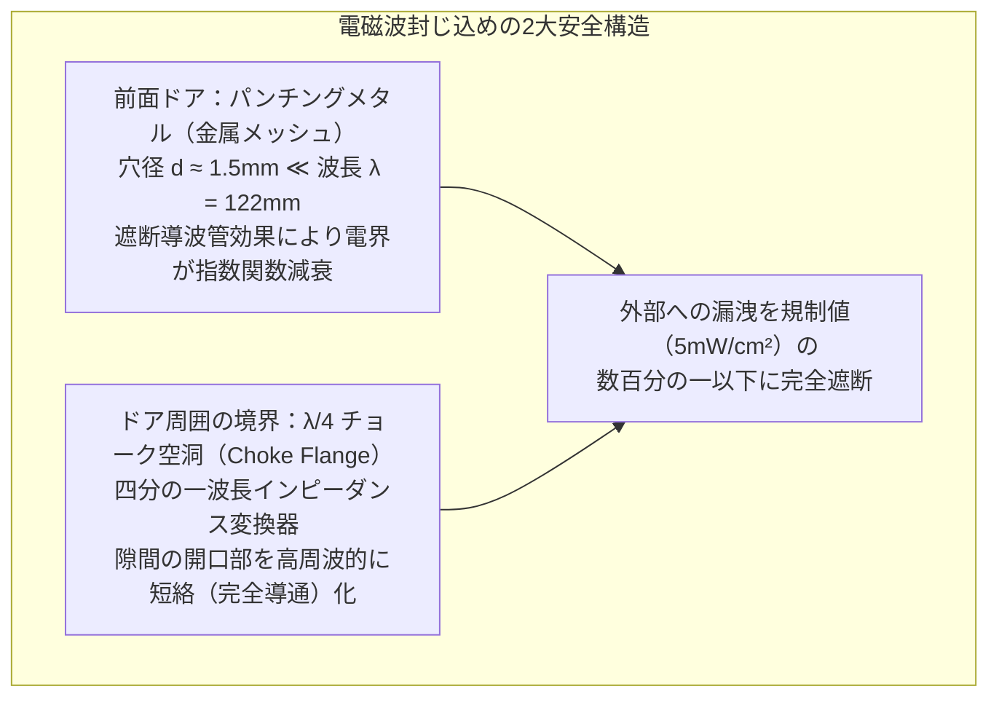
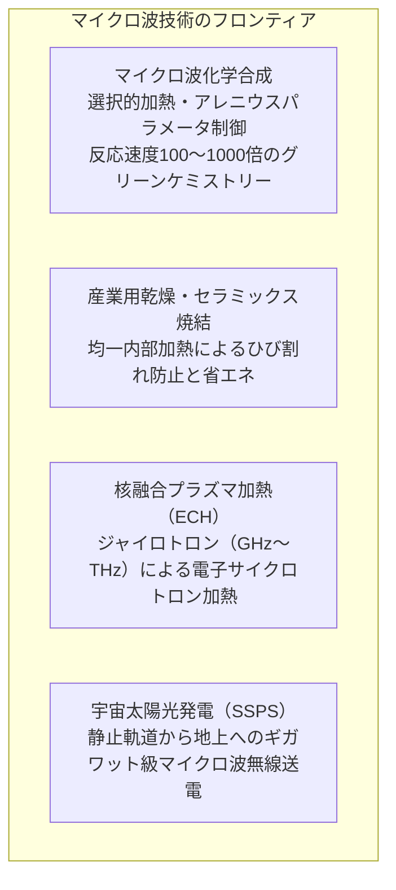

現代の家庭において、扉を開けて食品を入れ、スイッチを押すだけで数十秒から数分で湯気を立ち上らせる電子レンジ（Microwave Oven）は、あまりにも日常的な調理器具となっています。しかし、その内部で起きている現象を物理学的・電磁気学的な視点から精確に追跡すると、そこには20世紀の軍事レーダー開発に端を発する真空管技術、アインシュタインやマクスウェルが体系化した電磁気学、そして分子運動論と非平衡熱統計力学の粋が凝縮されています。

火や電熱ヒーター、オーブンのように「外部の熱源から物質表面へ熱伝導・対流・放射によって熱を浸透させる」従来の熱加工とは異なり、電子レンジは<strong>「電磁波が物質内部を透過しながら、分子スケールで直接仕事をして熱エネルギーへと変換する」</strong>という体積加熱（Volumetric Heating）の原理を採用しています。

本稿では、「なぜ電磁波で食品が温まるのか」「2.45GHzという周波数はなぜ選ばれたのか」「キャビティ・マグネトロンはどのようにして大電力高周波を生成するのか」「定在波と加熱ムラの数理」「水と氷で温まり方が激変する相転移の物性物理」「金属を入れると火花が散るメカニズムと安全遮蔽構造」に至るまで、電子レンジの全貌を数式と工学的理論を交えて徹底的に解説します。

---

## 1. 誘電加熱と体積加熱：従来の調理熱力学との根本的差異

電子レンジの加熱原理を理解するための第一歩は、伝統的な調理熱力学とマイクロ波加熱の違いを明確にすることです。

### 1.1 表面伝導加熱の物理的限界

フライパン、オーブン、湯煎などの古典的加熱手法では、熱流束（Heat Flux） $q$ はフーリエの法則（Fourier's Law）に従って物質表面から内部へと伝わります。

$$q = -k \nabla T$$

ここで $k$ は食品の熱伝導率（Thermal Conductivity, $\mathrm{W/(m\cdot K)}$）、$\nabla T$ は温度勾配です。食品の多く（肉、パン、野菜など）は水分や気泡を豊富に含む多孔質体であり、その熱伝導率は極めて低く、一般的な水で約 $0.6\,\mathrm{W/(m\cdot K)}$、肉類で $0.4\sim 0.5\,\mathrm{W/(m\cdot K)}$、パン生地では $0.1\sim 0.2\,\mathrm{W/(m\cdot K)}$ 程度しかありません。これは銅（約 $400\,\mathrm{W/(m\cdot K)}$）や鉄（約 $80\,\mathrm{W/(m\cdot K)}$）などの金属と比較して数百分の一から数千分の一という低さです。

したがって、分厚い肉の塊を外部から加熱する場合、中心部が目的の温度（例えば $70^\circ\mathrm{C}$）に達するまでには長い時間が必要となり、その間に表面付近は過熱されて乾燥・硬化・焦げ付きが生じるという不可避の熱的非対称性が生じます。

### 1.2 体積加熱（Volumetric Heating）への転換

これに対し、電子レンジが採用する<strong>誘電加熱（Dielectric Heating）</strong>では、物質が電磁エネルギーを直接吸収して自ら発熱します。熱伝導方程式に内部発熱密度項（Heat Generation Density） $Q_{gen}$ を組み込んだ非定常熱伝導方程式は次のように記述されます。

$$\rho C_p \frac{\partial T}{\partial t} = \nabla \cdot (k \nabla T) + Q_{gen}$$

ここで $\rho$ は密度（$\mathrm{kg/m^3}$）、$C_p$ は比熱容量（$\mathrm{J/(kg\cdot K)}$）です。従来の加熱では $Q_{gen} = 0$ であり、境界条件（表面温度）のみから熱が流入していました。しかし電子レンジでは、電磁場が食品内部へと透過し、<strong>物質内部の局所領域において直接 $Q_{gen} > 0$ を励起</strong>します。

これにより、外部の熱伝導速度に依存することなく、短時間で食品全体を昇温させることが可能となったのです。「電子レンジは内側から温まる」という通説が巷間に流布していますが、これは物理学的には半分正しく、半分は誤りです。マイクロ波の減衰特性や形状効果（レンズ効果）によって中心部が局所的に高温になる場合はあるものの、原理的には「透過する電磁波の電場強度が強い領域から順次、体積的に発熱する」というのが精確な物理的描写となります。

---

## 2. 電磁波の基礎とマイクロ波帯（なぜ2.45GHzなのか？）

電子レンジで用いられる電磁波は、周波数およそ $2.45\,\mathrm{GHz}$（波長 $\lambda \approx 12.24\,\mathrm{cm}$）の<strong>マイクロ波（Microwaves）</strong>です。この周波数はどのように選定されたのでしょうか。

### 2.1 俗説の否定：2.45GHzは「水の共振周波数」ではない

極めて頻繁に見られる誤解として、「2.45GHzは水分子の固有振動数（共振周波数）であり、共振によって激しく振動して発熱する」という説明があります。しかし、これは物理学的に<strong>完全な誤り</strong>です。

水分子（$\mathrm{H_2O}$）の気相における分子内振動モード（対称伸縮、変角、逆対称伸縮）の固有周波数は赤外線領域（数十テラヘルツから数百テラヘルツ、$10^{13}\sim 10^{14}\,\mathrm{Hz}$）に存在します。また、液相の水における水素結合ネットワークの集合的振動や回転緩和の共振ピークは、常温（$25^\circ\mathrm{C}$）において<strong>約20GHz〜22GHz</strong>付近に存在します。

もし仮に、電子レンジが水の最大共振周波数である20GHz近傍を採用していた場合、何が起きるでしょうか。

電磁波が物質中を進行する際の減衰を表す<strong>浸透深さ（Penetration Depth）</strong> $d_p$ は、電磁場のエネルギー密度が表面の値の $1/e$（約36.8%）に減衰する深さとして定義されます。

$$d_p = \frac{\lambda_0}{2\pi \sqrt{2 \epsilon'}} \left[ \sqrt{1 + \left(\frac{\epsilon''}{\epsilon'}\right)^2} - 1 \right]^{-1/2}$$

ここで $\lambda_0$ は真空中波長、$\epsilon'$ は比誘電率の実部（エネルギー蓄積能力）、$\epsilon''$ は比誘電率の虚部（誘電損失係数）です。

20GHzの周波数では、水に対する誘電損失が極めて高すぎるため、浸透深さ $d_p$ はわずか <strong>1ミリメートル未満</strong> になってしまいます。その結果、電磁波は食品の最表面の薄皮一枚ですべて吸収され尽くし、内部には全く届かなくなります。これでは表面が即座に沸騰・蒸発する一方で、内部は完全に冷たい生焼けのままとなり、従来の表面加熱オーブンよりも遥かに劣悪な加熱結果しかもたらしません。

### 2.2 2.45GHzが選択された真の理由

2.45GHzという周波数は、以下の3つの工学的・物理的要件の絶妙なトレードオフと、国際規格によって選定されました。

1. <strong>浸透深さと吸収効率の最適バランス</strong>:
   $2.45\,\mathrm{GHz}$（波長約 $12.2\,\mathrm{cm}$）において、常温の純水に対する浸透深さ $d_p$ は <strong>約 $1.5\sim 2.5\,\mathrm{cm}$</strong> となります。一般的な調理対象（肉の切り身、ご飯茶碗、スープ皿など）のサイズ（厚さ数センチメートル）に対し、電磁波が中心付近まで適度に透過しつつ、かつ十分に減衰してエネルギーを食品内部に残すという、理想的な加熱プロファイルを実現できます。
2. <strong>キャビティ・マグネトロンの製造容易性と寸法</strong>:
   波長 $\lambda \approx 12.2\,\mathrm{cm}$ は、家庭用キッチンのカウンターに載るキャビティ（幅 $30\sim 40\,\mathrm{cm}$）の寸法と極めて親和性が高く、多重モードの定在波を形成するのに最適な幾何学的スケールです。また、マグネトロンのアノード共振空洞の機械加工サイズ（数ミリから数センチ）も高精度かつ安価に量産可能でした。
3. <strong>電波法のISMバンド（Industrial, Scientific, and Medical Band）</strong>:
   電磁波は情報通信（ラジオ、テレビ、軍事通信、航空無線）の貴重な公共資源です。電子レンジのような大電力（500W〜1500W）の電磁波が空間に漏洩した場合、周辺の無線通信を致命的に妨害する恐れがあります。そのため、国際電気通信連合（ITU）は、通信以外の産業・科学・医療用として、遮蔽が不完全であっても通信に影響を与えにくい特定の周波数帯（ISMバンド：915MHz、2.45GHz、5.8GHz等）を無免許で使用可能と指定しました。915MHz帯は主に大型工業用乾燥機などで使用され、家庭用には寸法と浸透性のバランスから2.45GHzが世界標準となりました。

---

## 3. 誘電加熱（Dielectric Heating）の微視的メカニズム

電子レンジの加熱の根幹である「誘電加熱」は、物質内部の原子・分子スケールにおいてどのように発生しているのでしょうか。その主役は<strong>「双極子配向回転」</strong>と<strong>「イオン伝導」</strong>の2大メカニズムです。

### 3.1 水分子の極性と双極子配向回転（Dipolar Polarization）

水分子（$\mathrm{H_2O}$）は、電気陰性度の高い酸素原子（3.44）と水素原子（2.20）が約 $104.5^\circ$ の結合角をなして結合しています。酸素側が負（$\delta^-$）、水素側が正（$\delta^+$）に偏った電荷分布を持ち、約 $1.85\,\mathrm{Debye}$（$6.17 \times 10^{-30}\,\mathrm{C\cdot m}$）という強い<strong>永久電気双極子モーメント（Permanent Dipole Moment）</strong>を有しています。

電場 $\mathbf{E}$ が印加されると、双極子モーメント $\mathbf{p}$ にはトルク $\mathbf{T} = \mathbf{p} \times \mathbf{E}$ が作用し、電場の方向へと分子の向きを揃えようとする配向分極（Orientational Polarization）が生じます。

電子レンジの空洞内では、電場が毎秒 <strong>24億5000万回（$2.45 \times 10^9\,\mathrm{Hz}$）</strong> という猛烈な速度でプラスとマイナスの極性を反転させています。水分子はこの電場の反転に追従して激しく反転・回転運動を行おうとします。

しかし、液体の水の中では分子同士が強固な水素結合ネットワークを形成しており、回転には周囲の分子との摩擦抵抗（粘性散逸）が伴います。このため、電場の変化に対して分子の配向運動にわずかな<strong>「位相の遅れ（Phase Lag）」</strong>が生じます。

- <strong>周波数が低すぎる場合（例：商用電源の50/60Hz）</strong>:
  水分子は電場の変化に完全に追従して同位相でスムーズに向きを変えられるため、位相遅れがほとんど生じず、摩擦によるエネルギー散逸（熱への変換）は極小となります。
- <strong>周波数が高すぎる場合（例：可視光や紫外線領域、$10^{14}\sim 10^{15}\,\mathrm{Hz}$）</strong>:
  電場の反転が速すぎて水分子の巨大な慣性モーメントが追従できず、分子はほとんど静止したままとなるため、双極子回転による加熱は生じません。
- <strong>マイクロ波周波数帯（2.45GHz）</strong>:
  水分子が電場に追従しようとするものの完全には追従しきれず、<strong>最大の位相遅れを伴いながら激しく引きずり回される領域</strong>となります。電場から分子に注入された電磁エネルギーは、分子間水素結合を揺さぶり、無秩序な熱運動（並進・回転・振動エネルギー）へと不可逆的に散逸（Dissipation）します。これが電子レンジによる発熱の第一原理です。

### 3.2 複素誘電率とデバイの緩和理論

この現象を電磁気学的に定量化するのが<strong>複素誘電率（Complex Permittivity）</strong> $\epsilon^*$ です。

$$\epsilon^* = \epsilon' - j \epsilon'' = \epsilon_0 (\epsilon_r' - j \epsilon_r'')$$

ここで:
- $\epsilon'$（実部）: <strong>誘電率（Permittivity）</strong>。物質が外部電場によってどれだけ電気エネルギーを内部に分極・蓄積できるかを示します。
- $\epsilon''$（虚部）: <strong>誘電損失係数（Dielectric Loss Factor）</strong>。物質が電磁エネルギーをどれだけ熱へと変換・散逸させるかを示します。
- $\tan \delta = \frac{\epsilon''}{\epsilon'}$: <strong>誘電正接（Loss Tangent）</strong>。エネルギー散逸の効率指標です。

古典的なデバイの緩和モデル（Debye Relaxation Model）によれば、液体の極性分子の周波数特性は単一緩和時間 $\tau$ を用いて次のように表されます。

$$\epsilon^*(\omega) = \epsilon_\infty + \frac{\epsilon_s - \epsilon_\infty}{1 + j \omega \tau}$$

実部と虚部に分解すると:

$$\epsilon_r'(\omega) = \epsilon_\infty + \frac{\epsilon_s - \epsilon_\infty}{1 + \omega^2 \tau^2}$$

$$\epsilon_r''(\omega) = \frac{(\epsilon_s - \epsilon_\infty)\omega \tau}{1 + \omega^2 \tau^2}$$

ここで $\epsilon_s$ は静的誘電率（$\omega \to 0$ での水は約80）、$\epsilon_\infty$ は高周波極限誘電率（約4〜5）、$\omega = 2\pi f$ は角周波数です。$\epsilon_r''$ は $\omega \tau = 1$（すなわち $f = 1/(2\pi \tau)$）のときに極大値をとります。常温（$20^\circ\mathrm{C}$）の水における緩和時間 $\tau$ は約 $9.3 \times 10^{-12}\,\mathrm{s}$（9.3ピコ秒）であり、緩和周波数 $f_{rel} \approx 17\sim 20\,\mathrm{GHz}$ となります。2.45GHzはこの緩和周波数の低周波側の裾野に位置し、適度な損失（発熱）と適度な透過深度を両立しているのです。

### 3.3 イオン伝導（Ionic Conduction）の寄与

食品は純水ではなく、塩化ナトリウム（$\mathrm{NaCl}$）などの電解質を豊富に含んでいます。水溶液中では、塩はナトリウムイオン（$\mathrm{Na^+}$）と塩化物イオン（$\mathrm{Cl^-}$）に解離しています。

電場 $\mathbf{E}$ が印加されると、正イオンは電場の向きへ、負イオンは電場と逆向きへとローレンツ力（クーロン力 $q\mathbf{E}$）を受けて加速移動します。高周波電場のもとでイオンは猛烈な勢いで往復運動を繰り返しますが、この移動過程で周囲の水分子や有機高分子と絶え間なく衝突します。

この荷電粒子の往復運動と衝突によるオーム損（Joule Heating）が<strong>イオン伝導加熱</strong>です。全誘電損失係数 $\epsilon_{eff}''$ は、双極子損失 $\epsilon_d''$ とイオン導電率 $\sigma$ の和として記述されます。

$$\epsilon_{eff}'' = \epsilon_d'' + \frac{\sigma}{\omega \epsilon_0}$$

ここで $\sigma$ はイオン導電率（$\mathrm{S/m}$）、$\epsilon_0 \approx 8.854 \times 10^{-12}\,\mathrm{F/m}$ は真空の誘電率です。塩分濃度の高い食品（スープ、カレー、漬物など）では、イオン伝導項 $\frac{\sigma}{\omega \epsilon_0}$ が支配的となり、純水に比べて発熱効率が著しく向上する一方で、浸透深さ $d_p$ が極めて浅くなり、表面ばかりが急激に熱くなる原因となります。

### 3.4 吸収電力密度のポインティング方程式

電磁波によって物質単位体積あたりに散逸・吸収される熱エネルギー（電力密度 $P_v\, [\mathrm{W/m^3}]$）は、マクスウェル方程式とポインティングの定理から以下のように導出されます。

$$P_v = 2\pi f \epsilon_0 \epsilon_{eff}'' |E|^2 = \omega \epsilon_0 (\epsilon_d'' + \frac{\sigma}{\omega \epsilon_0}) |E|^2$$

この方程式は電子レンジ加熱の本質を明確に示しています。
1. <strong>周波数 $f$ に比例</strong>: 周波数が高いほど、単位時間あたりの発熱量は増大します。
2. <strong>損失係数 $\epsilon_{eff}''$ に比例</strong>: 水分量や塩分濃度の高い食品ほど強く発熱します。
3. <strong>電場強度の2乗 $|E|^2$ に比例</strong>: 電場の腹（強い定在波）に位置する部分は、節（電場ゼロ）の部分に比べて桁違いに急速加熱されます。

---

## 4. マイクロ波発生装置：キャビティ・マグネトロンの物理

家庭用電子レンジが $700\sim 1000\,\mathrm{W}$ もの巨大な高周波電力をこれほど安価に生成できるのは、内部に<strong>キャビティ・マグネトロン（Cavity Magnetron）</strong>と呼ばれる驚異的な真空管デバイスが搭載されているからです。

### 4.1 マグネトロンの内部幾何構造

マグネトロンは、高真空に保たれた円筒形の金属管です。
- <strong>中心陰極（カソード）</strong>: トリウム入りタングステンフィラメントで構成され、電流を通すことで赤熱し、大量の熱電子（Thermal Electrons）を空間に放出します。
- <strong>周囲陽極（アノード）</strong>: 高純度無酸素銅の円筒ブロックで、カソードと同軸に配置されます。アノードの内壁には、放射状に複数の空洞共振器（Cavity Resonators, 一般に8〜12個の穴とスロット）が精密に加工されています。
- <strong>軸方向磁場</strong>: マグネトロンの上下に配置された強力なフェライト永久磁石によって、円筒軸に平行な均一磁場 $\mathbf{B}$ が印加されています。
- <strong>放射状電場</strong>: カソードを負極、アノードを接地（正極）とし、数千ボルト（約 $-4000\,\mathrm{V}$）の巨大な負の高圧直流パルスが印加されることで、カソードからアノードへ向かう強力な動径方向電場 $\mathbf{E}$ が形成されます。

### 4.2 直交電磁場（Crossed-Field）とハル・カットオフ条件

電場 $\mathbf{E}$ と磁場 $\mathbf{B}$ が互いに直交する空間（Crossed-Field）に放出された電子には、電場による加速力と磁場によるローレンツ力が同時に作用します。電子の運動方程式は次の通りです。

$$m_e \frac{d\mathbf{v}}{dt} = -e (\mathbf{E} + \mathbf{v} \times \mathbf{B})$$

1. <strong>磁場が存在しない場合（$B = 0$）</strong>:
   電子は動径方向電場に沿ってカソードからアノードへと一直線に突入し、単なるダイオード電流となって陽極を熱するだけで電磁波は発生しません。
2. <strong>磁場が弱すぎる場合</strong>:
   電子の軌道はローレンツ力によって湾曲しますが、依然としてアノードに衝突します。
3. <strong>ハル・カットオフ磁場（Hull Cut-Off Magnetic Field $B_c$）</strong>:
   磁場を徐々に強めていくと、電子の軌道の曲率半径が小さくなり、アノード表面に到達する直前でかすめるように反転してカソード側へ戻る限界条件に達します。この限界磁場 $B_c$ は以下のように与えられます。

$$B_c = \sqrt{\frac{8 m_e V_a}{e r_a^2 (1 - r_c^2/r_a^2)^2}}$$

ここで $V_a$ は陽極電圧、$r_a$ は陽極半径、$r_c$ は陰極半径です。
マグネトロンはこの<strong>カットオフ条件をわずかに超える磁場領域（$B > B_c$）</strong>で動作します。電子はアノードに直接到達できず、カソードとアノードの間の作用空間（Interaction Space）で方位角方向に周回する電子雲（Space Charge Cloud）を形成します。その平均ドリフト速度 $v_d$ は、いわゆる $\mathbf{E} \times \mathbf{B}$ ドリフト速度です。

$$v_d = \frac{E}{B}$$

### 4.3 アノード共振空洞と $\pi$ モード発振

アノードの内壁に穿たれた円筒形の空洞共振器は、等価回路的にインダクタンス $L$（空洞壁の導電経路）とキャパシタンス $C$（空洞の開口部スロット）で構成される並列 $LC$ 共振回路を形成しています。

共振周波数は近似的に $f_0 \approx \frac{1}{2\pi \sqrt{LC}} \approx 2.45\,\mathrm{GHz}$ となるよう幾何学的寸法が設計されています。

隣接する空洞同士は、高周波的に逆位相（位相差 $\pi$ ラジアン、$180^\circ$）で発振する<strong>$\pi$ モード（$\pi$-mode）</strong>と呼ばれる定在波モードを維持します。これにより、スロット開口部には高周波交流電界が交互に逆向きに現れます。

### 4.4 電子スポークの形成とエネルギー転移（ハートリー条件）

カソード周囲を周回する電子雲がスロットの高周波電場と相互作用すると、劇的な自己組織化が生じます。

- <strong>減速位相に入った電子</strong>:
  高周波電場に逆らって運動する電子は、自らの運動エネルギーを高周波電磁場へと受け渡します。エネルギーを失った電子は磁場による曲率が強まり、外側（アノード方向）へとゆっくりシフトしていきます。高周波電場に長時間滞在してエネルギーを効率よく供給し続けるため、電磁波の振幅は指数関数的に増大します。
- <strong>加速位相に入った電子</strong>:
  電場からエネルギーを得て加速された電子は、直ちにカソード方向へ押し戻され、フィラメントに再衝突して熱を供給します（バックボンバードメント効果）。

この位相選択機構により、エネルギーを高周波場に供給する電子のみが作用空間に長寿命で生き残り、車輪のスポーク（輻）のようなパターン（<strong>電子スポーク / Electron Spokes</strong>）を自然に形成します。

電子スポークの回転角速度が高周波電場の $\pi$ モード位相速度と完全に同期（シンクロ）する条件（<strong>ハートリーの同期条件 / Hartree Condition</strong>）が満たされると、直流高電圧エネルギーが驚異的な変換効率（<strong>約65%〜75%</strong>）で $2.45\,\mathrm{GHz}$ のマイクロ波エネルギーへと変換されます。

生成されたマイクロ波は、共振空洞の一つに差し込まれた結合アンテナ（同軸プローブ）でピックアップされ、金属製の矩形導波管（Waveguide）を通じて加熱室（キャビティ）へと導かれます。

---

## 5. 加熱キャビティ内の電磁場分布と定在波（Standing Waves）

マグネトロンから送り出されたマイクロ波は、直方体の金属（ステンレスまたは塗装鋼板）で囲まれた加熱室（Cavity）へと放射されます。金属壁はマイクロ波に対してほぼ完全反射体（良導体）として振る舞うため、キャビティ内部は3次元の電磁波共振器となります。

### 5.1 3次元多重モード定在波の数理

直方体キャビティ（幅 $a$、奥行き $b$、高さ $c$）内部において、マクスウェルの波動方程式を解くと、許容される電磁波モードは離散的な固有モード（$\mathrm{TE}_{lmn}$ または $\mathrm{TM}_{lmn}$）の重ね合わせとして表されます。固有共振周波数 $f_{lmn}$ は次の公式で与えられます。

$$f_{lmn} = \frac{c_0}{2} \sqrt{\left(\frac{l}{a}\right)^2 + \left(\frac{m}{b}\right)^2 + \left(\frac{n}{c}\right)^2}$$

ここで $c_0$ は光速、$l, m, n$ は各軸方向の半波長の数（モード次数）です。
一般的な電子レンジの庫内寸法（例えば $30\,\mathrm{cm} \times 30\,\mathrm{cm} \times 20\,\mathrm{cm}$）において、$f = 2.45\,\mathrm{GHz}$（自由空間波長 $\lambda \approx 12.24\,\mathrm{cm}$）を代入すると、複数の高次モードが同時に励振される「マルチモード・キャビティ」となります。

キャビティ内壁での多重反射によって、入射波と反射波が干渉し合い、空間的に固定された<strong>定在波（Standing Waves）</strong>が不可避的に形成されます。
- <strong>腹（Antinodes）</strong>: 電界強度が最大振幅となる場所。$|E|^2$ が極大となるため、猛烈な局所加熱（ホットスポット）が生じます。
- <strong>節（Nodes）</strong>: 電界強度がゼロとなる場所。$|E| \approx 0$ であるため、電磁波が存在していても全く発熱しない点（コールドスポット）となります。

定在波の隣り合うホットスポット間の距離は、およそ <strong>半波長（$\lambda/2 \approx 6.1\,\mathrm{cm}$）</strong> です。電子レンジの皿の上に板チョコやマシュマロを敷き詰め、回転させずに加熱すると、約6cm間隔で規則的に局所融解する有名な実験は、この定在波の腹と節を直接可視化したものです。

### 5.2 加熱ムラの解消技術：回転と撹拌

この定在波による致命的な加熱ムラ（Cold Spots / Hot Spots）を解決するために、家電工学は主に2つの機構を考案しました。

1. <strong>ターンテーブル（Turntable方式）</strong>:
   食品自体をモーターで機械的に回転（毎分およそ3〜5回転）させることで、食品の各部分がキャビティ内のホットスポットとコールドスポットを交互に横切るようにします。時間平均的な受熱量を均一化する最もシンプルかつ確実な機構です。
2. <strong>フラットテーブルとスターラーファン（Stirrer Fan方式）</strong>:
   高級機や最新のフラット型電子レンジでは、底面に食品を固定し、導波管の出口に金属製の回転羽根（スターラーファン）を配置します。ファンが回転することでマイクロ波の反射角がミリ秒単位で連続的に変化し、キャビティ内の定在波パターンそのものが激しく揺動・撹乱されます。これにより、時間積分された電界分布が平滑化され、皿を回さなくても均一な加熱が可能となります。

---

## 6. 食品の相変化・物性と温まり方の非対称性（解凍の科学）

電子レンジで最も失敗しやすい調理操作が<strong>「冷凍肉の解凍」</strong>です。「外側は煮えて白くなっているのに、中心部は凍ったままカチカチ」という現象は誰もが経験したことがあるでしょう。この極端な加熱ムラは、水と氷の誘電特性の劇的な相変化に起因しています。

### 6.1 水と氷の誘電損失係数の超巨大ギャップ

物質の誘電損失係数 $\epsilon''$ は、分子が外部電場に対してどれだけ自由に回転・配向できるかに依存します。

| 状態・温度 | 比誘電率実部 $\epsilon_r'$ | 比誘電率虚部（損失） $\epsilon_r''$ | 誘電正接 $\tan\delta$ | 浸透深さ $d_p$ |
|---|---|---|---|---|
| <strong>氷（$-12^\circ\mathrm{C}$）</strong> | $3.2$ | <strong>$0.003$</strong> | $0.0009$ | <strong>約 $1100\,\mathrm{cm}$（透過）</strong> |
| <strong>純水（$1.5^\circ\mathrm{C}$）</strong> | $84.0$ | <strong>$18.0$</strong> | $0.214$ | <strong>約 $1.3\,\mathrm{cm}$</strong> |
| <strong>純水（$25^\circ\mathrm{C}$）</strong> | $78.0$ | <strong>$12.5$</strong> | $0.160$ | <strong>約 $1.8\,\mathrm{cm}$</strong> |
| <strong>食塩水（$0.5\,\mathrm{mol/L}$）</strong> | $70.0$ | <strong>$35.0$</strong> | $0.500$ | <strong>約 $0.6\,\mathrm{cm}$</strong> |

驚くべきことに、氷の誘電損失係数 $\epsilon_r'' \approx 0.003$ は、液体の水（$\epsilon_r'' \approx 12\sim 18$）と比較して <strong>約4000分の1以下</strong> という桁違いの小ささです。

氷の内部では、水分子同士が4本の水素結合によって強固な六方晶結晶格子（Ice Ih）にガッチリと拘束されています。そのため、2.45GHzの高速交番電場が印加されても、水分子は回転することができず、電磁エネルギーを摩擦熱として散逸させることができません。氷にとってマイクロ波は、ほとんど吸収されずに透明なガラスのように「素通り」してしまうのです。

### 6.2 熱暴走（Thermal Runaway）の物理メカニズム

この物性の断絶が、冷凍食品の解凍において<strong>熱暴走（Thermal Runaway）</strong>を引き起こします。

1. 冷凍肉の中にマイクロ波が照射されると、氷の部分は電波を素通りさせます。
2. しかし、肉の表面や角部、あるいは塩分を含んで凝固点降下を起こし、わずかでも液体の水として存在している微小領域が存在します。
3. その液体の水の部分は、周囲の氷の数千倍の効率でマイクロ波エネルギーを吸い尽くすように吸収し、一瞬で急加熱されます。
4. 加熱された液体の水は周囲の氷を熱伝導で融解させ、新たな液体の水を生成します。
5. 融解した新たな水がさらにマイクロ波を貪欲に吸収し、発熱が指数関数的に加速します。
6. この結果、食品内部の大部分の氷が冷たいまま取り残されているにもかかわらず、最初に溶けた部分だけが $100^\circ\mathrm{C}$ を超えてグツグツと沸騰し、「解凍」を通り越して「煮豚」になってしまうのです。

### 6.3 電子レンジの「解凍モード」はどう対策しているのか？

マグネトロンという真空管は、原理的に「出力を細かく連続的に絞る（弱火にする）」ことが苦手なデバイスです（従来のトランス式電源の場合、発振するか停止するかの二者択一）。

そこで電子レンジの解凍モードでは、<strong>「パルス幅変調（PWM：間欠発振）」</strong>という制御アルゴリズムが採用されています。
- 例えば定格700Wのレンジで解凍（200W相当）を行う場合、マグネトロンを「5秒間だけ発振させ、次の15秒間は完全に停止する」というサイクルを繰り返します。
- この15秒間の「停止時間（休止期）」こそが物理的に不可欠です。マイクロ波の照射を止め、最初に加熱された微小な水分領域の熱を、フーリエの熱伝導則に従って周囲の冷たい氷へとゆっくり拡散・浸透させます。
- 熱伝導によって周囲の氷が自然に $0^\circ\mathrm{C}$ 付近まで緩んでから、再び短時間のパルス照射を行うことで、熱暴走を防ぎながら均一な解凍を達成しているのです。
- 最新の<strong>インバーター式電子レンジ</strong>では、半導体スイッチング素子（IGBT）によって電源周波数を連続制御し、マグネトロンの出力を連続的な低電力（真の200W連続照射）に絞ることができるため、間欠発振に比べて解凍ムラをさらに大幅に低減しています。

---

## 7. 容器・調理器具の科学：なぜ金属は火花を散らし、陶器は温まるのか？

電子レンジに食品を入れる際、使用できる容器と絶対に入れてはならない素材が存在します。物質と電磁波の相互作用の観点から分類すると、すべての材料は以下の3つに大別されます。

### 7.1 金属を入れるとスパーク（火花放電）が起きる物理

「電子レンジに金属を入れてはいけない」というのは最も有名な安全規則ですが、その物理的根拠は電磁気学の<strong>「表皮効果（Skin Effect）」</strong>と<strong>「尖端放電（Point Discharge）」</strong>にあります。

良導体金属（金、銀、銅、アルミニウム、鉄など）では、自由電子密度が極めて高く、電導度 $\sigma$ が巨大です（アルミニウムで約 $3.5 \times 10^7\,\mathrm{S/m}$）。マイクロ波が金属表面に入射すると、電磁波の侵入深さを表す表皮厚さ（Skin Depth） $\delta_s$ は以下のようになります。

$$\delta_s = \sqrt{\frac{2}{\omega \mu \sigma}} = \sqrt{\frac{1}{\pi f \mu \sigma}}$$

$f = 2.45\,\mathrm{GHz}$ を代入すると、アルミニウムにおける表皮厚さはわずか <strong>約 $1.6\,\mu\mathrm{m}$（マイクロメートル）</strong> です。電磁波は金属の極表面で完全に遮断され、自由電子の集団運動によって反対方向の電磁場が励起されるため、エネルギーの99.9%以上が鏡のように完全反射されます。したがって、滑らかな分厚い金属の板や壁（キャビティ内壁そのもの）であれば、熱を吸収することも火花を散らすこともありません。

では、なぜアルミホイルやフォーク、金縁の皿を入れると激しい火花が散るのでしょうか。原因は以下の2点です。

1. <strong>尖端効果による電界集中（Electric Field Concentration）</strong>:
   フォークの先端、アルミホイルのクシャクシャに曲がったシワのエッジ、金属の角部などの曲率半径 $r$ が極めて小さい幾何学的形状では、静電容量が局所的に極小化し、電荷が極端に密集します。電場強度 $E \propto 1/r$ に従って局所電場が急激に跳ね上がり、空気の絶縁破壊電圧（大気圧下で約 $3 \times 10^6\,\mathrm{V/m}$、すなわち $3\,\mathrm{kV/mm}$）を容易に突破します。この瞬間、周囲の空気が電離してプラズマ（アーク放電・スパーク）が発生し、激しい音と光を発しながら容器やキャビティ壁を焦がします。
2. <strong>極薄膜のジュール熱融解</strong>:
   陶器の縁に塗られた美しい「金彩（金線）」や、薄いアルミ箔では、金属の厚みが数マイクロメートルから数十ナノメートルしかありません。ここに強力なマイクロ波によって巨大な高周波誘導起電力と高周波渦電流（Foucault Current）が流れると、金属膜の微小な電気抵抗であっても瞬時に莫大なジュール熱（$I^2 R$）が発生します。金線は数秒で数百度に達して断線・蒸発し、その微小な隙間で空中スパークを発生させて陶器を焼き割ってしまいます。

### 7.2 透過性容器（プラスチック、ガラス、セラミックス）

ポリプロピレン（PP）、ポリエチレン（PE）、パイレックス耐熱ガラス、高純度磁器などは、無極性高分子または強固な共有結合・イオン結合結晶であり、永久双極子モーメントを持ちません。

これらの材料は誘電損失係数 $\epsilon''$ が $0.001$ 以下の極小値をとるため、マイクロ波エネルギーを全く吸収せず、完全に透過します。したがって容器自体が発熱することはなく、温まるのは食品からの熱伝導による二次的な受熱のみとなります。

ただし、<strong>吸水性のある陶器（素焼き、貫入の入った和食器）</strong>は注意が必要です。素焼きの多孔質組織に洗浄時の水分が浸み込んでいると、容器内部の水分がマイクロ波を吸収して沸騰し、食器自体が熱湯のように熱くなったり、水蒸気爆発で割れたりすることがあります。

### 7.3 サセプター（Susceptor）：あえてマイクロ波を吸収する特殊素材

電子レンジの最大の弱点は「表面をカリッと香ばしく焦がす（メイラード反応を起こす）ことができない」点にあります。水分の沸点（$100^\circ\mathrm{C}$）を超えて表面温度を $150^\circ\mathrm{C}\sim 200^\circ\mathrm{C}$ に上げることができないためです。

この弱点を克服するために開発されたのが<strong>サセプター（Susceptor）</strong>と呼ばれる材料です。冷凍ピザや電子レンジ用ポップコーンの包装袋の底面に使われている銀色のフィルムがこれにあたります。

サセプターは、耐熱性ポリエステルフィルムの上に、アルミニウムやフェライト（酸化鉄複合体）を<strong>ナノメートル単位の極薄膜（光が透ける程度の厚さ）</strong>として蒸着させたものです。
- 分厚い金属は電波を完全反射し、完全な絶縁体は電波を素通りさせます。
- しかし、薄膜のシート抵抗が自由空間の波動インピーダンス（$Z_0 = \sqrt{\mu_0/\epsilon_0} \approx 377\,\Omega/\mathrm{sq}$）に近い領域に設計されたサセプターは、マイクロ波の電磁エネルギーを反射も透過もさせず、<strong>最大の効率で渦電流のジュール熱へと変換</strong>します。

その結果、サセプターフィルムは通電後数十秒で <strong>$200^\circ\mathrm{C}\sim 250^\circ\mathrm{C}$</strong> の超高温に達し、接触しているピザのクラストやパイ生地をジュージューとフライパンのように焼き上げ、香ばしい焼き目とサクサクの食感を生み出すのです。

---

## 8. 安全設計と電磁波遮蔽の構造力学

電子レンジの庫内では、人体を深刻に熱傷させるのに十分な約1000Wの超高出力マイクロ波が飛び交っています。それにもかかわらず、なぜ前面ガラスの窓から庫内の様子を肉眼で安全に見つめることができるのでしょうか。そこには電磁気学に基づく厳密な遮蔽設計が存在します。

### 8.1 ドアのパンチングメタルと遮断導波管（Waveguide Below Cutoff）

電子レンジのドアガラスには、無数の小さな穴が開いた黒い金属プレート（パンチングメタル）が挟み込まれています。

導波管の理論において、電磁波が管内を伝搬できる限界の周波数を<strong>遮断周波数（Cut-Off Frequency $f_c$）</strong>、対応する限界波長を<strong>遮断波長（$\lambda_c$）</strong>と呼びます。円形開口（穴の直径 $d$）を持つ導波管の場合、最低次モード（$\mathrm{TE}_{11}$）の遮断波長は次式で与えられます。

$$\lambda_c \approx 1.706 \times d$$

電子レンジのパンチングメタルの穴の直径は通常 <strong>$d \approx 1.0\sim 1.5\,\mathrm{mm}$</strong> 程度です。この穴に対する遮断波長 $\lambda_c$ は約 $2.5\,\mathrm{mm}$、対応する遮断周波数 $f_c$ は <strong>約 $120\,\mathrm{GHz}$</strong> に達します。

電子レンジのマイクロ波の周波数 $f = 2.45\,\mathrm{GHz}$ は、この遮断周波数 $120\,\mathrm{GHz}$ に比べて桁違いに低く、波長 $\lambda = 122.4\,\mathrm{mm}$ は穴の直径の100倍近く巨大です。周波数が遮断周波数より低い場合（$f \ll f_c$）、電波は穴を伝搬できず、エバネッセント波（減衰波）となって穴の深さ方向に対して<strong>指数関数的に減衰（減衰定数 $\alpha$）</strong>します。

$$\alpha = \frac{2\pi}{\lambda_c} \sqrt{1 - \left(\frac{f}{f_c}\right)^2} \approx \frac{2\pi}{\lambda_c} \approx \frac{3.68}{d}$$

厚さわずか $1\,\mathrm{mm}$ の金属板の穴を通過するだけで、2.45GHzの電界強度は数百分の一から数千分の一（数十デシベル）にまで減衰します。一方、可視光線の波長は $400\sim 700\,\mathrm{nm}$（$0.0004\sim 0.0007\,\mathrm{mm}$）と極限的に小さいため、遮断周波数は遥か高周波側にあり、穴を何の問題もなく直線透過して人間の目に届きます。「マイクロ波は完全に遮断し、可視光線だけをそのまま透過させる」という幾何光学的フィルターが実現しているのです。

### 8.2 四分の一波長（$\lambda/4$）チョーク構造（Choke Cavity）

ドアと本体の接合部（隙間）は、機械的な噛み合わせである以上、目に見えないミクロン単位の隙間が存在します。もし単に金属同士を接触させているだけだと、経年劣化や汚れで接触不良が生じた際、そこから電磁波が外部へ漏洩してしまいます。

これを完全に防ぐために考案されたのが、レーダー導波管技術を応用した<strong>四分の一波長チョーク（Quarter-Wave Choke）</strong>です。

伝送線路理論において、特性インピーダンス $Z_0$、長さ $l$ の無損失線路の先端が短絡（ショート、負荷インピーダンス $Z_L = 0$）されている場合、入力インピーダンス $Z_{in}$ は次のように変換されます。

$$Z_{in} = j Z_0 \tan(\beta l) = j Z_0 \tan\left(\frac{2\pi}{\lambda} l\right)$$

ここで線路の長さ $l$ をマイクロ波波長 $\lambda$ のちょうど4分の1（<strong>$l = \lambda/4 \approx 3.06\,\mathrm{cm}$</strong>）に設定すると:

$$\beta l = \frac{2\pi}{\lambda} \times \frac{\lambda}{4} = \frac{\pi}{2} \implies \tan\left(\frac{\pi}{2}\right) \to \infty$$

$$Z_{in} \to \infty \quad \text{（開放端 / オープン）}$$

さらに、この開放端からもう一度 $\lambda/4$ 進んだ位置（ドアの隙間の出口境界）では、再びインピーダンスが $90^\circ$ 位相回転して $Z_{in2} = 0$（<strong>高周波的短絡 / ショート</strong>）へと戻ります。

つまり、ドアの内周に沿って深さ約 $\lambda/4$ の精密な溝（チョーク空洞）を掘り込んでおくことで、<strong>「物理的には隙間が開いていても、2.45GHzの高周波電磁波にとっては電気的に完全な金属壁でピッタリ溶接されているのと同じ状態」</strong>を作り出すことができるのです。このパッシブな波動工学の妙技により、パッキンの摩耗や経年劣化にかかわらず、半永久的に電磁波漏洩をゼロレベルに抑え込むことができます。

---

## 9. 危険現象の物理：突沸（Superheating）のメカニズム

電子レンジの利用において最も注意すべき物理現象が<strong>「突沸（Superheating / Explosive Boiling）」</strong>です。水や牛乳、コーヒーをレンジで加熱し、取り出した瞬間やスプーンを入れた瞬間に、突然爆発するように液体が吹き飛んで重度の火傷を負う事故が後を絶ちません。

### 9.1 なぜ電子レンジでは突沸が起きるのか？

通常のやかんや鍋をガス火で加熱する場合、熱は底面の金属壁から加わります。鍋底の金属表面には微小な凹凸（マイクロキャビティ）が無数に存在し、そこに微小な空気の泡（気泡核）が捕捉されています。水温が沸点（$100^\circ\mathrm{C}$）に達すると、この気泡核を起点として蒸気泡が生成・成長し、プツプツと穏やかに沸騰が始まります（不均一核形成 / Heterogeneous Nucleation）。

しかし、電子レンジで滑らかな表面のマグカップに水を入れて加熱する場合、以下の悪条件が重なります。
1. <strong>気泡核の欠如</strong>: マグカップの内面が非常に滑らかで、かつ水道水が一度温められて脱気されていると、気泡を発生させる「核」が存在しません。
2. <strong>対流の不活性と静穏加熱</strong>: 外部からの強い対流攪乱や激しい沸騰泡による攪拌がなく、静かに体積加熱が進みます。
3. <strong>過加熱（Superheated State）の形成</strong>: 水分子は沸点である $100^\circ\mathrm{C}$ を超えても気化するための界面張力エネルギー障壁（Laplace Pressure）を突破できず、液体の状態を保ったまま $102^\circ\mathrm{C}\sim 105^\circ\mathrm{C}$ 以上の<strong>過加熱状態（准安定状態）</strong>へと突入します。

球状の蒸気気泡（半径 $R$）が液体中で自発的に成長するためには、気泡内部の飽和蒸気圧 $P_{sat}(T)$ が周囲の静水圧 $P_\infty$ と表面張力 $\gamma$ によるラプラス圧を上回る必要があります。

$$P_{sat}(T) - P_\infty \ge \frac{2\gamma}{R}$$

気泡核が存在しない清浄な液体中では初期半径 $R \to 0$ であるため、理論的には無限大の過加熱が必要となり、沸点を超えても液体のまま熱エネルギーを蓄積し続けます。

### 9.2 爆発の瞬間

この過加熱状態の液体に、スプーンを差し込んだり、砂糖やインスタントコーヒーの粉を投入したり、あるいはドアを開けたわずかな振動が加わった瞬間、表面の微小な傷や粉末の隙間から無数の空気が一瞬で液体内に導入されます。

臨界気泡半径 $R_c$ を超える気泡核が一度形成されると、過剰に蓄えられていた莫大な熱エネルギーが一気に水蒸気への相変化（気化潜熱の解放）へと雪崩を打って向かいます。水が水蒸気になると体積は約 <strong>1700倍</strong> に膨張するため、マグカップ内の液体全体が一瞬で上空へと爆発的に吹き飛ばされるのです。これを防ぐには、加熱しすぎないこと、および加熱直後にすぐに顔を近づけず、数十秒間放置して自然冷却を待つことが重要となります。

---

## 10. 先端マイクロ波応用技術：調理から宇宙・核融合へ

マグネトロンと誘電加熱の技術は、家庭用調理器具の枠組みを遥かに超えて、最先端の科学技術分野へと広く展開しています。

1. <strong>マイクロ波化学（Microwave Chemistry）</strong>:
   化学反応容器にマイクロ波を直接照射することで、特定の極性触媒や反応基質のみを選択的に加熱（マイクロ波特異的効果）し、従来の外部油浴加熱に比べて反応速度を10倍から1000倍に加速させ、副生成物を劇的に低減させるクリーンな合成手法として製薬や材料開発で不可欠となっています。
2. <strong>セラミックスのマイクロ波急速焼結</strong>:
   従来は巨大な炉で数日かけて焼結していたファインセラミックスを、電磁波の直接体積加熱により数十分で内部から均一に焼き固め、結晶粒の異常成長を防いで超高強度な材料を創出します。
3. <strong>核融合炉のプラズマ加熱（ECH: Electron Cyclotron Heating）</strong>:
   マグネトロンの発展形である超高出力ミリ波真空管「ジャイロトロン（Gyrotron）」を用い、数十万キロワットの高周波ビームを核融合実験炉（ITERなど）の磁場閉じ込めプラズマに打ち込み、電子サイクロトロン共鳴によってプラズマ温度を1億度以上にまで加熱・制御しています。
4. <strong>宇宙太陽光発電所（SSPS）</strong>:
   静止軌道上に浮かべた巨大な太陽電池パネルで発電した電力を、マイクロ波ビームに変換して地上の受電アンテナ（レクテナ）へと無線送電する究極のクリーンエネルギー構想が進められています。

---

## 11. まとめ：キッチンに潜む電磁気学と現代物理学の金字塔

普段私たちが何気なく冷凍食品やお弁当を温めるために使っている電子レンジは、20世紀初頭に相対性理論や量子力学が勃興したのと軌を一にして花開いた電磁気学と真空管技術の結晶です。

- <strong>体積加熱の革命</strong>: 熱伝導の限界を打破し、分子の双極子回転とイオン衝突によって物質内部から直接熱を生み出す。
- <strong>2.45GHzの調和</strong>: 共振ピークではなく、適度な浸透深さと吸収率、キャビティ寸法、ISMバンドの国際調和が生んだ工学的最適解。
- <strong>キャビティ・マグネトロン</strong>: 直交電磁場の中で電子が自発的に車輪のスポークを形成し、70%を超える驚異的な効率で高周波電力を生み出す真空管技術の極致。
- <strong>波の幾何学</strong>: ホットスポットとコールドスポットを克服するターンテーブルとスターラーファン、そして電磁波を完全に封じ込めるパンチングメタルと $\lambda/4$ チョーク構造。
- <strong>相転移のドラマ</strong>: 水と氷の誘電損失の断絶が引き起こす解凍の熱暴走と、パルス制御による克服。

極微の分子の回転から、3次元共振キャビティ内のマクスウェル波動、そして巨大な真空管の電子軌道に至るまで、電子レンジという四角い箱の中には、現代物理学の美しく力強い秩序が完璧に息づいています。科学の原理がどのようにして人類の生活を一変させたのかを実感する上で、これほど身近で、かつ奥深い題材は他に存在しないでしょう。
