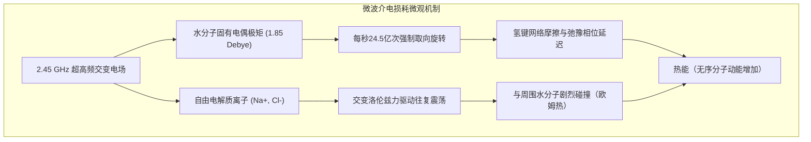
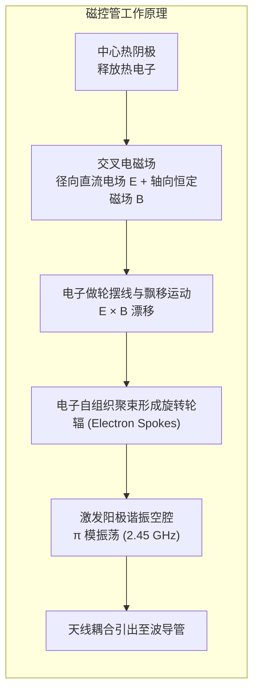

在当代厨房中，微波炉已经成为不可或缺的加热工具。只需将冷藏饭菜放入腔体，按下开关，短短几十秒到几分钟，食物便能热气腾腾。然而，这种司空见惯的现象背后，蕴含着20世纪军用雷达真空管技术、麦克斯韦经典电动力学、偶极子分子弛豫理论以及非平衡态热力学的极其精妙的物理机制。

与传统烹饪（如煎炒、烘烤、水煮）依靠外表面热传导向内部缓慢渗透的机制截然不同，微波炉利用<strong>体加热（Volumetric Heating）</strong>与<strong>介电加热（Dielectric Heating）</strong>原理，让高频电磁波直接穿透食物介质，驱动水分子剧烈旋转并引发离子振荡碰撞，直接在物质内部将电磁能量转化为无序的热运动。

---

### 1. 介电加热与体加热的物理本质

传统加热方式受制于傅里叶热传导定律：

$$q = -k \nabla T$$

大部分食品（如肉类、米饭、蔬菜）富含水分与多孔结构，其热传導率 $k$ 极低（通常介于 $0.2 \sim 0.6\,\mathrm{W/(m\cdot K)}$ 之间，仅为金属铜的千分之一）。因此，若要将大块肉类的内部加热至熟透，外表面必须长时间承受高温，极易造成外焦内生的热不对称性。

微波炉则在非定常热传导方程中直接引入了内部电磁耗散生热项 $Q_{em}$：

$$\rho C_p \frac{\partial T}{\partial t} = \nabla \cdot (k \nabla T) + Q_{em}$$

其中，单位体积吸收的微波功率密度由坡印廷定理与复介电常数虚部决定：

$$P_v = 2\pi f \epsilon_0 \epsilon_{eff}'' |E|^2$$

电磁波穿透介质，凡是有交变电场存在且介电损耗不为零的区域，内部各处分子均同步发热，打破了外部传热的速度瓶颈。

---

### 2. 为什么是2.45 GHz？破除“水共振频率”的流言

大众科普中常出现一个严重误区：“微波炉选择2.45GHz是因为这是水分子的固有共振频率”。这在物理学上是<strong>完全错误</strong>的。

水分子的真实量子红外共振振动频率高达几十太赫兹（$10^{13} \sim 10^{14}\,\mathrm{Hz}$），而液态水氢键网络的介电弛豫峰值在常温下位于 <strong>20 GHz 附近</strong>。

如果微波炉真的工作在 20 GHz 的水吸收峰，会发生什么？
电磁波在有损介质中的穿透深度公式为：

$$d_p = \frac{\lambda_0}{2\pi \sqrt{2\epsilon'}} \left[ \sqrt{1 + (\epsilon''/\epsilon')^2} - 1 \right]^{-1/2}$$

在 20 GHz 下，水的介电损耗系数过大，穿透深度 $d_p$ <strong>不足 1 毫米</strong>！所有微波能量将在食材最外层表皮被瞬间吸收殆尽，导致表皮瞬间焦糊汽化，而内部完全冰凉。

选用 <strong>2.45 GHz</strong>（真空中波长约 $12.24\,\mathrm{cm}$）的真正科学原因在于：
1. <strong>穿透深度与吸收效率的黄金折衷</strong>：在 2.45 GHz 下，室温水的穿透深度约为 $1.5 \sim 2.5\,\mathrm{cm}$，恰好与日常家庭烹饪食物的几何尺寸完美契合，使能量均匀分布于内外层。
2. <strong>空腔尺寸与磁控管制造可行性</strong>：12厘米的波长使得台式微波炉腔体（30~40厘米）能容纳多个驻波模态，且磁控管阳极腔加工精度适中。
3. <strong>国际无线电ISM频段规约</strong>：为防止大功率工业与家用微波设备干扰国防雷达和民航通信，国际电信联盟专门划定了无需执照的工业、科研与医疗（ISM）专用频段。

---

### 3. 微观致热机制：偶极旋转与离子传导

微波转化为热能主要依靠两大微观机制：

1. <strong>偶极取向极化与德拜弛豫（Dipolar Relaxation）</strong>：
   水分子由于氧原子的强电负性，具备 $1.85\,\mathrm{Debye}$ 的强电偶极矩。在每秒反转 24.5 亿次的交变电场作用下，水分子受到强烈的力矩作用被迫高速旋转。然而，液态水分子之间存在相互牵扯的氢键网络，使分子的旋转响应存在微小的<strong>相位滞后（Phase Lag $\delta$）</strong>。这种介电弛豫过程中的内摩擦直接将电磁能量耗散为分子的无规动能（热量）。
2. <strong>离子传导损耗（Ionic Conduction）</strong>：
   食物中溶有食盐等电解质（$\mathrm{Na^+}, \mathrm{Cl^-}$）。交变电场驱动离子在微观尺度高速往复迁移，与周围溶剂分子产生高频弹性与非弹性碰撞，产生欧姆焦耳热。盐分越高的食品，离子耗散越强，发热速度越快，但穿透深度也会相应减小。

---

### 4. 微波发生源：多腔磁控管（Cavity Magnetron）

微波炉的心脏是<strong>多腔磁控管</strong>，这是一种在交叉电磁场中工作的真空电子管，能以超过 70% 的惊人效率将直流高压电能转化为大功率微波。

- <strong>哈尔截止磁场（Hull Cut-off）</strong>：在中心阴极（负高压约 $-4000\,\mathrm{V}$）与外围阳极之间施加径向电场，同时在轴向施加由永久磁铁产生的强磁场。当磁场强度超过临界截止值 $B_c$ 时，电子无法直接飞抵阳极，而是在洛伦兹力作用下沿圆周做摆线漂移运动。
- <strong>$\pi$ 模谐振与电子轮辐</strong>：阳极铜块内部加工有8到12个微型谐振空腔（相当于并联 LC 谐振回路）。相邻空腔的狭缝处建立起反相（相位差 $\pi$）的高频高频交变电场。处于减速相位的电子将动能持续输送给电磁场，并自组织凝聚成旋转的“电子轮辐”（Electron Spokes），如同齿轮拨动空腔场，源源不断地激发出 2.45 GHz 的千瓦级微波。

---

### 5. 腔内驻波与冷热点分布

金属内壁对微波具有近乎100%的镜面反射率。入射电磁波与反射波在腔体内干涉叠加，形成三维多模<strong>驻波（Standing Waves）</strong>。
- <strong>波腹（Antinodes）</strong>：电场强度振幅最大处，内部发热功率极高，形成“热点”。
- <strong>波节（Nodes）</strong>：电场强度抵消为零处，几乎不发热，形成“冷点”。
相邻热点间的距离约为半个波长（$\lambda/2 \approx 6.1\,\mathrm{cm}$）。为解决这一顽疾，工程上采用了两大关键设计：
1. <strong>旋转转盘（Turntable）</strong>：驱动食物以每分钟数圈的速度旋转，使其交替穿过波腹与波节，实现受热的时间积分均匀化。
2. <strong>模式搅拌器（Stirrer Fan）</strong>：在微波导管出口处安装旋转金属风扇，动态改变微波反射边界条件，令腔内驻波电场图案高速抖动扫掠。

---

### 6. 解冻难题：冰与水的物性断崖与热失控

微波解冻肉类时常出现“边缘已经煮熟熟透，内部依然冻如顽石”的现象，其根源在于冰与水在介电损耗上的巨大物性断崖：

| 物质状态 | 温度 | 相对介电常数虚部（损耗 $\epsilon_r''$） | 穿透深度 $d_p$ |
|---|---|---|---|
| <strong>固态冰</strong> | $-10^\circ\mathrm{C}$ | <strong>$0.003$</strong> | <strong>约 $1000\,\mathrm{cm}$ (完全穿透)</strong> |
| <strong>液态水</strong> | $+20^\circ\mathrm{C}$ | <strong>$12.5$</strong> | <strong>约 $1.8\,\mathrm{cm}$</strong> |

在固态冰晶中，水分子被刚性锁死在六方晶格内，无法自由旋转，其损耗系数仅为液态水的 <strong>四千分之一</strong>。微波穿过冰块如同穿过透明玻璃，几乎不被吸收。

一旦食材边缘或含盐区域率先融化出微量液态水，这些水便以周围冰块数千倍的效率疯狂吞噬微波能量，引发剧烈的<strong>热失控（Thermal Runaway）</strong>。局部的液态水在几十秒内飙升至 $100^\circ\mathrm{C}$ 沸腾烹煮，而周围大部分冰依然无法吸热。

为此，微波炉的解冻模式必须采用<strong>间歇脉冲加热算法</strong>：以 20%~30% 的占空比发射微波（例如加热5秒、停机15秒）。在停机间歇期，完全依靠经典的傅里叶热传导让局部热水的热量自然扩散融化邻近的冰，抹平温差后再进行下一轮脉冲加热。

---

### 7. 金属打火与电磁屏蔽安全物理

1. <strong>金属尖端放电与等离子体电弧</strong>：
   良导体金属中的自由电子会对微波产生极高反射（趋肤深度仅约 $1.6\,\mu\mathrm{m}$）。但在金属尖端（如叉子尖齿、揉皱的铝箔棱角）处，曲率半径接近零，电荷极度富集，局部电场迅速击穿空气绝缘极限（$3\,\mathrm{kV/mm}$），激发产生耀眼的电离空气等离子体电弧（打火）。极薄金属涂层（如餐具金边）还会因巨大的高频涡流产生焦耳热而在数秒内熔断烧毁。
2. <strong>炉门防泄漏屏蔽设计</strong>：
   - <strong>截止波导金属网（Waveguide Below Cutoff）</strong>：观察窗金属网孔径仅约 $1.5\,\mathrm{mm}$，远小于 $122\,\mathrm{mm}$ 的微波波长。其截止频率高达 $120\,\mathrm{GHz}$，使得 2.45 GHz 的微波只能以倏逝波形式呈指数级急剧衰减（衰减率超过 $60\,\mathrm{dB}$），而波长仅几百纳米的可见光则能自由穿透。
   - <strong>四分之一波长（$\lambda/4$）抗流空腔（Choke Flange）</strong>：在炉门缝隙四周精密设计深度为 $\lambda/4 \approx 3.06\,\mathrm{cm}$ 的凹槽。基于传输线阻抗变换理论，$Z_{in} = j Z_0 \tan(\beta l)$，将终端短路变换为入口开路，再变换至缝隙外缘形成射频零阻抗短路，在物理缝隙存在的情况下实现了高频电磁波的电气“完全无缝焊接”。

---

### 8. 总结

微波炉从一个外表简单的家电立方体，生动展现了物理学从抽象理论向工程实际转换的极致魅力。从麦克斯韦方程组到偶极子德拜松弛，从相对论电子漂移到多模干涉驻波与截止波导屏蔽，每一个技术细节都闪耀着人类智慧对电磁客观规律的深刻把握与巧夺天工的运用。
