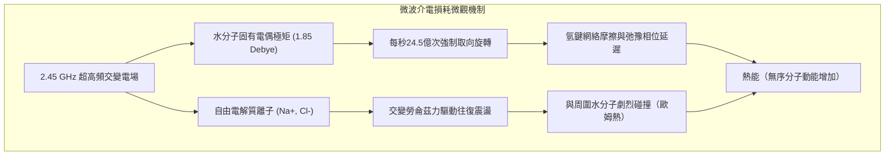

在當代廚房中，微波爐已經成為不可或缺的加熱工具。只需將冷藏飯菜放入腔體，按下開關，短短幾十秒到幾分鐘，食物便能熱氣騰騰。然而，這種司空見慣的現象背後，蘊含著20世紀軍用雷達真空管技術、馬克士威經典電動力學、偶極子分子弛豫理論以及非平衡態熱力學的極其精妙的物理機制。

與傳統烹飪（如煎炒、烘烤、水煮）依靠外表面熱傳導向內部緩慢滲透的機制截然不同，微波爐利用<strong>體加熱（Volumetric Heating）</strong>與<strong>介電加熱（Dielectric Heating）</strong>原理，讓高頻電磁波直接穿透食物介質，驅動水分子劇烈旋轉並引發離子振盪碰撞，直接在物質內部將電磁能量轉化為無序的熱運動。

---

### 1. 介電加熱與體加熱的物理本質

傳統加熱方式受制於傅立葉熱傳導定律：

$$q = -k \nabla T$$

大部分食品（如肉類、米飯、蔬菜）富含水分與多孔結構，其熱傳導率 $k$ 極低（通常介於 $0.2 \sim 0.6\,\mathrm{W/(m\cdot K)}$ 之間，僅為金屬銅的千分之一）。因此，若要將大塊肉類的內部加熱至熟透，外表面必須長時間承受高溫，極易造成外焦內生的熱不對稱性。

微波爐則在非定常熱傳導方程式中直接引入了內部電磁耗散生熱項 $Q_{em}$：

$$\rho C_p \frac{\partial T}{\partial t} = \nabla \cdot (k \nabla T) + Q_{em}$$

其中，單位體積吸收的微波功率密度由坡印廷定理與複介電常數虛部決定：

$$P_v = 2\pi f \epsilon_0 \epsilon_{eff}'' |E|^2$$

電磁波穿透介質，凡是有交變電場存在且介電損耗不為零的區域，內部各處分子均同步發熱，打破了外部傳熱的速度瓶頸。

---

### 2. 為什麼是2.45 GHz？破除「水共振頻率」的流言

大眾科普中常出現一個嚴重誤區：「微波爐選擇2.45GHz是因為這是水分子的固有共振頻率」。這在物理學上是<strong>完全錯誤</strong>的。

水分子的真實量子紅外共振振動頻率高達幾十太赫茲（$10^{13} \sim 10^{14}\,\mathrm{Hz}$），而液態水氫鍵網絡的介電弛豫峰值在常溫下位於 <strong>20 GHz 附近</strong>。

如果微波爐真的工作在 20 GHz 的水吸收峰，會發生什麼？
電磁波在有損介質中的穿透深度公式為：

$$d_p = \frac{\lambda_0}{2\pi \sqrt{2\epsilon'}} \left[ \sqrt{1 + (\epsilon''/\epsilon')^2} - 1 \right]^{-1/2}$$

在 20 GHz 下，水的介電損耗係數過大，穿透深度 $d_p$ <strong>不足 1 毫米</strong>！所有微波能量將在食材最外層表皮被瞬間吸收殆盡，導致表皮瞬間焦糊汽化，而內部完全冰涼。

選用 <strong>2.45 GHz</strong>（真空中波長約 $12.24\,\mathrm{cm}$）的真正科學原因在於：
1. <strong>穿透深度與吸收效率的黃金折衷</strong>：在 2.45 GHz 下，室溫水的穿透深度約為 $1.5 \sim 2.5\,\mathrm{cm}$，恰好與日常家庭烹飪食物的幾何尺寸完美契合，使能量均勻分布於內外層。
2. <strong>空腔尺寸與磁控管製造可行性</strong>：12公分的波長使得台式微波爐腔體（30~40公分）能容納多個駐波模態，且磁控管陽極腔加工精度適中。
3. <strong>國際無線電ISM頻段規約</strong>：為防止大功率工業與家用微波設備干擾國防雷達和民航通信，國際電信聯盟專門劃定了無需執照的工業、科研與醫療（ISM）專用頻段。

---

### 3. 微觀致熱機制：偶極旋轉與離子傳導

微波轉化為熱能主要依靠兩大微觀機制：

1. <strong>偶極取向極化與德拜弛豫（Dipolar Relaxation）</strong>：
   水分子由於氧原子的強電負性，具備 $1.85\,\mathrm{Debye}$ 的強電偶極矩。在每秒反轉 24.5 億次的交變電場作用下，水分子受到強烈的力矩作用被迫高速旋轉。然而，液態水分子之間存在相互牽扯的氫鍵網絡，使分子的旋轉響應存在微小的<strong>相位滯後（Phase Lag $\delta$）</strong>。這種介電弛豫過程中的內摩擦直接將電磁能量耗散為分子的無規動能（熱量）。
2. <strong>離子傳導損耗（Ionic Conduction）</strong>：
   食物中溶有食鹽等電解質（$\mathrm{Na^+}, \mathrm{Cl^-}$）。交變電場驅動離子在微觀尺度高速往復遷移，與周圍溶劑分子產生高頻彈性與非彈性碰撞，產生歐姆焦耳熱。鹽分越高的食品，離子耗散越強，發熱速度越快，但穿透深度也會相應減小。

---

### 4. 微波發生源：多腔磁控管（Cavity Magnetron）

微波爐的心臟是<strong>多腔磁控管</strong>，這是一種在交叉電磁場中工作的真空電子管，能以超過 70% 的驚人效率將直流高壓電能轉化為大功率微波。

- <strong>哈爾截止磁場（Hull Cut-off）</strong>：在中心陰極（負高壓約 $-4000\,\mathrm{V}$）與外圍陽極之間施加徑向電場，同時在軸向施加由永久磁鐵產生的強磁場。當磁場強度超過臨界截止值 $B_c$ 時，電子無法直接飛抵陽極，而是在勞侖茲力作用下沿圓周做擺線漂移運動。
- <strong>$\pi$ 模諧振與電子輪輻</strong>：陽極銅塊內部加工有8到12個微型諧振空腔（相當於並聯 LC 諧振回路）。相鄰空腔的狹縫處建立起反相（相位差 $\pi$）的高頻交變電場。處於減速相位的電子將動能持續輸送給電磁場，並自組織凝聚成旋轉的「電子輪輻」（Electron Spokes），如同齒輪撥動空腔場，源源不斷地激發出 2.45 GHz 的千瓦級微波。

---

### 5. 腔內駐波與冷熱點分布

金屬內壁對微波具有近乎100%的鏡面反射率。入射電磁波與反射波在腔體內干涉疊加，形成三維多模<strong>駐波（Standing Waves）</strong>。
- <strong>波腹（Antinodes）</strong>：電場強度振幅最大處，內部發熱功率極高，形成「熱點」。
- <strong>波節（Nodes）</strong>：電場強度抵消為零處，幾乎不發熱，形成「冷點」。
相鄰熱點間的距離約為半個波長（$\lambda/2 \approx 6.1\,\mathrm{cm}$）。為解決這一頑疾，工程上採用了旋轉轉盤（Turntable）與模式攪拌器（Stirrer Fan）來平均電場能量分布。

---

### 6. 解凍難題：冰與水的物性斷崖與熱失控

微波解凍肉類時常出現「邊緣已經煮熟熟透，內部依然凍如頑石」的現象，其根源在於固態冰晶中水分子被剛性鎖定在晶格內，介電損耗係數僅為液態水的四千分之一。微波穿過冰塊幾乎不被吸收，而一旦局部微量解凍成液態水，該區域就會以極高效率瘋狂吸收能量，形成嚴重的<strong>熱失控（Thermal Runaway）</strong>。因此解凍模式必須透過低占空比的間歇脈衝加熱，依靠熱傳導平衡溫差。

---

### 7. 金屬打火與電磁屏蔽安全物理

1. <strong>金屬尖端放電</strong>：金屬對微波呈強反射，但若存在尖銳邊緣（如叉子尖、鋁箔摺痕），電荷集中會使電場突破空氣擊穿電壓（$3\,\mathrm{kV/mm}$），激發出高溫電弧放電。
2. <strong>爐門屏蔽設計</strong>：
   - <strong>截止波導金屬網</strong>：孔徑 $1.5\,\mathrm{mm}$ 的金屬網截止頻率高達 $120\,\mathrm{GHz}$，使 $2.45\,\mathrm{GHz}$ 微波以倏逝波形式指數衰減超過 $60\,\mathrm{dB}$。
   - <strong>四分之一波長（$\lambda/4$）抗流空腔</strong>：利用傳輸線阻抗變換原理，在爐門縫隙處形成射頻零阻抗短路，半永久性確保微波完全不外洩。

---

### 8. 容器材料科學與脆化薄膜（Susceptor）技術

微波爐加熱對容器的材質有嚴格的要求：
1. <strong>微波適用容器（低損耗介電質）</strong>：聚丙烯（PP）、耐熱硼矽酸玻璃、高純度磁器等材料不含非約束性永久電偶極矩，介電損耗係數 $\epsilon'' < 0.001$。微波完全穿透而不被吸收，容器自身不發熱。
2. <strong>多孔陶器風險</strong>：未完全施釉的陶器吸附水分後，內部水分子會劇烈發熱，導致器具燙手甚至炸裂。
3. <strong>脆化薄膜（Susceptor）的表面焦化</strong>：微波爐難以引起梅納反應（需要 $140^\circ\mathrm{C} \sim 165^\circ\mathrm{C}$）。為解決此問題，冷凍披薩等包裝內側採用奈米級鋁沉積薄膜。其薄膜電阻與自由空間阻抗（$377\,\Omega/\mathrm{sq}$）精確匹配，將微波能量以最高效率轉化為表面渦流焦耳熱，在數十秒內飆升至 $200^\circ\mathrm{C}$ 以上，使麵皮酥脆金黃。

---

### 9. 突沸現象（Superheating）的物理危險

在微波爐中加熱清水時，由於容器內壁極其光滑且缺乏對流攪動，水容易進入超過 $100^\circ\mathrm{C}$ 卻不沸騰的「過熱狀態（准穩定態）」。一旦加入咖啡粉或放入湯匙引入氣泡核，過熱液體將在一瞬間發生爆炸性相變，體積暴增1700倍噴湧而出。使用時切忌過度加熱，加熱後應靜置數十秒再取出。
