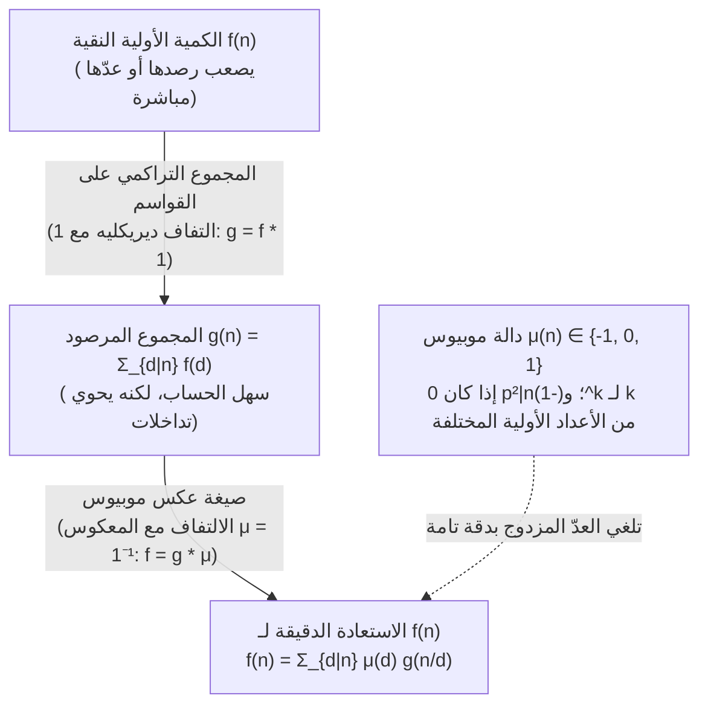
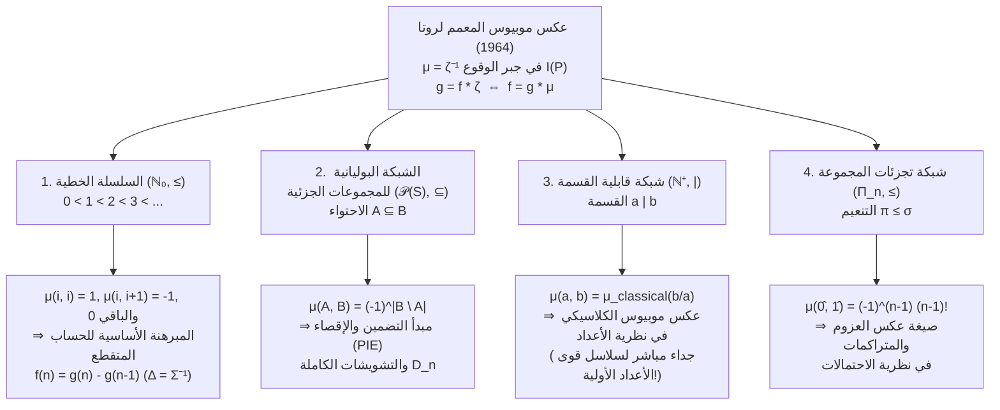

## 1. مقدمة: المسألة العكسية الأساسية في الرياضيات

في نظرية الأعداد والتوافقيات والجبر والفيزياء الإحصائية، نواجه مراراً وتكراراً نفس المسألة العكسية: <strong>الكمية النقية والأولية $f(n)$ التي نرغب في معرفتها يصعب للغاية إحصاؤها مباشرة، في حين أن المجموع التراكمي $g(n)$ الذي يخلط مساهمات جميع العناصر الأدنى في التسلسل الهرمي يسهل حسابه بشكل مدهش.</strong>

لنتأمل ثلاثة أمثلة كلاسيكية:

1. <strong>السلاسل الدورية وكلمات ليندون غير الدورية</strong>:
   باستخدام أبجدية من $q$ رمزاً، يوجد $g(n) = q^n$ سلسلة بطول $n$. غير أن هذا الإجمالي يتضمن سلاسل دورية متدهورة ناتجة عن تكرار كتلة أقصر دورها الأصغر $d \mid n$. فإذا كانت $f(d)$ تمثل عدد السلاسل غير الدورية حقاً ذات الدور الأصغر $d$، فإنها ترتبط بالمجموع عبر القواسم:
   $$g(n) = \sum_{d \mid n} f(d)$$
2. <strong>الكسور القابلة للاختزال وغير القابلة للاختزال (دالة أويلر $\varphi(n)$)</strong>:
   عند اختزال الكسور الـ $n$ وهي $\frac{1}{n}, \frac{2}{n}, \dots, \frac{n}{n}$ إلى أبسط صورة، يصبح كل مقام مختزل قاسماً $d \mid n$. وبما أنه يوجد $\varphi(d)$ بالضبط من الكسور غير القابلة للاختزال ذات المقام $d$، نحصل على متطابقة غاوس الشهيرة:
   $$n = \sum_{d \mid n} \varphi(d)$$
3. <strong>مجاميع المجموعات الجزئية ومبدأ التضمين والإقصاء (PIE)</strong>:
   إذا كانت كل مجموعة جزئية $A \subseteq S$ تحمل وزناً ذاتياً $f(A)$، ولكن المجموع التراكمي $g(B) = \sum_{A \subseteq B} f(A)$ هو وحده القابل للرصد، فكيف نستعيد $f(B)$؟

إن الطرح الساذج للقواسم الفعلية يؤدي فوراً إلى الطرح المفرط. فعند $n = 6$، القاسمان الفعليان الأعظميان هما $3$ و$2$، وتقاطعهما يقابل $\gcd(3, 2) = 1$:
$$f(6) = g(6) - g(3) - g(2) + g(1)$$
أما عند $n = 12$، فالقاسمان الفعليان الأعظميان هما $6$ و$4$ مع $\gcd(6, 4) = 2$:
$$f(12) = g(12) - g(6) - g(4) + g(2)$$
والمثير للدهشة أنه رغم كون $3$ و$1$ قاسمين للعدد $12$، فإن الحدين $g(3)$ و$g(1)$ معاملهما يساوي <strong>$0$</strong> (لأن خارجي القسمة $12/3 = 4 = 2^2$ و$12/1 = 12 = 2^2 \cdot 3$ يقبلان القسمة على مربع عدد أولي)!

في عام 1832، حلّ عالم الرياضيات الألماني <strong>أوغست فرديناند موبيوس (August Ferdinand Möbius)</strong> هذه المعضلة بإدخال <strong>دالة موبيوس $\mu(n)$</strong>. وفي عام 1964، عمّم <strong>جان-كارلو روتا (Gian-Carlo Rota)</strong> هذا المبدأ على <strong>المجموعات المرتبة جزئياً (Posets)</strong> و<strong>جبور الوقوع (Incidence Algebras)</strong>، مثبتاً أن عكس موبيوس العددي، ومبدأ التضمين والإقصاء، والمبرهنة الأساسية للتفاضل والتكامل المتقطع، وعكس العزوم والمتراكمات في نظرية الاحتمالات ما هي إلا تجليات لمعادلة عالمية واحدة: $\mu = \zeta^{-1}$.

---

## 2. دالة موبيوس $\mu(n)$: التعريف، والجدائية، والمتطابقة الأساسية

### 2.1 التعريف الرياضي الدقيق

> [!IMPORTANT]
> <strong>تعريف (دالة موبيوس $\mu(n)$، 1832)</strong>
> لكل عدد صحيح موجب $n \in \mathbb{N}^+$، تُعرّف <strong>دالة موبيوس</strong> $\mu : \mathbb{N}^+ \to \{-1, 0, 1\}$ كما يلي:
> $$\mu(n) = \begin{cases} 1 & \text{if } n = 1, \\[4pt] (-1)^k & \text{if } n = p_1 p_2 \cdots p_k \text{ جداء لـ } k \text{ من الأعداد الأولية المختلفة (خالٍ من المربعات)}, \\[4pt] 0 & \text{if } p^2 \mid n \text{ لعدد أولي ما } p. \end{cases}$$

| $n$ | التحليل إلى عوامل أولية | خالٍ من المربعات؟ | عدد العوامل الأولية $k$ | دالة موبيوس $\mu(n)$ | دالة ميرتنز $M(n) = \sum_{m=1}^n \mu(m)$ |
| :---: | :---: | :---: | :---: | :---: | :---: |
| $1$ | $1$ (جداء فارغ) | نعم | $0$ | $+1$ | $+1$ |
| $2$ | $2$ | نعم | $1$ | $-1$ | $0$ |
| $3$ | $3$ | نعم | $1$ | $-1$ | $-1$ |
| $4$ | $2^2$ | <strong>لا</strong> ($2^2 \mid 4$) | — | $0$ | $-1$ |
| $5$ | $5$ | نعم | $1$ | $-1$ | $-2$ |
| $6$ | $2 \cdot 3$ | نعم | $2$ | $+1$ | $-1$ |
| $7$ | $7$ | نعم | $1$ | $-1$ | $-2$ |
| $8$ | $2^3$ | <strong>لا</strong> ($2^2 \mid 8$) | — | $0$ | $-2$ |
| $9$ | $3^2$ | <strong>لا</strong> ($3^2 \mid 9$) | — | $0$ | $-2$ |
| $10$ | $2 \cdot 5$ | نعم | $2$ | $+1$ | $-1$ |
| $11$ | $11$ | نعم | $1$ | $-1$ | $-2$ |
| $12$ | $2^2 \cdot 3$ | <strong>لا</strong> ($2^2 \mid 12$) | — | $0$ | $-2$ |

### 2.2 الجدائية والمتطابقة الأساسية

1. <strong>الجدائية (Multiplicativity)</strong>: إذا كان $\gcd(a, b) = 1$، فإن <strong>$\mu(ab) = \mu(a)\mu(b)$</strong>.
   *البرهان*: إذا كان $a$ أو $b$ يقبل القسمة على مربع $p^2$، فإن $ab$ يقبل القسمة عليه أيضاً وينعدم الطرفان. وإذا كان كلاهما خالياً من المربعات بـ $r$ و$s$ من العوامل الأولية، فإن $\gcd(a, b) = 1$ يضمن انفصال مجموعتي عواملهما الأولية، ومنه $\mu(ab) = (-1)^{r+s} = (-1)^r (-1)^s = \mu(a)\mu(b)$. $\blacksquare$

2. <strong>المتطابقة الأساسية</strong>:
   $$\sum_{d \mid n} \mu(d) = \varepsilon(n) := \begin{cases} 1 & n = 1, \\ 0 & n > 1. \end{cases}$$
   *البرهان عبر مبرهنة ثنائي الحد*: عند $n = p_1^{a_1} \cdots p_k^{a_k} > 1$ ($k \ge 1$)، تساهم القواسم الخالية من المربعات $d \mid n$ فقط بقيم غير صفرية. ويوجد $\binom{k}{j}$ طريقة لاختيار $j$ من الأعداد الأولية المختلفة من $\{p_1, \dots, p_k\}$، ولكل منها $\mu(d) = (-1)^j$. وبموجب مبرهنة ثنائي الحد:
   $$\sum_{d \mid n} \mu(d) = \sum_{j = 0}^{k} \binom{k}{j} (-1)^j 1^{k - j} = (1 - 1)^k = 0. \quad \blacksquare$$

---

## 3. الحلقة الإبدالية للدوال الحسابية تحت التفاف ديريكليه

في فضاء الدوال الحسابية $\mathcal{A} = \{f : \mathbb{N}^+ \to \mathbb{C}\}$، يُعرّف <strong>التفاف ديريكليه (Dirichlet Convolution)</strong> بالعلاقة:

$$(f * g)(n) := \sum_{d \mid n} f(d)\,g\!\left(\frac{n}{d}\right) = \sum_{ab = n} f(a)\,g(b)$$

تشكل $(\mathcal{A}, +, *)$ حلقة إبدالية عنصرها المحايد هو <strong>$\varepsilon(n) = [n = 1]$</strong> ($f * \varepsilon = f$).
وبتعريف الدالة الثابتة <strong>$\mathbf{1}(n) = 1$</strong>، يصبح الجمع على القواسم التفافاً مع $\mathbf{1}$: $g(n) = \sum_{d \mid n} f(d) = (f * \mathbf{1})(n)$، أي $g = f * \mathbf{1}$.
وتعبر المتطابقة الأساسية $\sum_{d \mid n} \mu(d) = \varepsilon(n)$ عن أن:

$$\mu * \mathbf{1} = \mathbf{1} * \mu = \varepsilon \quad \Longleftrightarrow \quad \mu = \mathbf{1}^{-1}$$

<strong>دالة موبيوس $\mu$ ليست سوى المعكوس الضربي لديريكليه للدالة الثابتة $\mathbf{1}$!</strong> ومن ثَمّ تُبرهن <strong>صيغة عكس موبيوس الكلاسيكية</strong> في سطر واحد:

$$g = f * \mathbf{1} \iff g * \mu = f * (\mathbf{1} * \mu) = f * \varepsilon = f \iff f(n) = \sum_{d \mid n} \mu(d)\,g\!\left(\frac{n}{d}\right) = \sum_{d \mid n} \mu\!\left(\frac{n}{d}\right) g(d)$$

### متسلسلات ديريكليه، ودالة زيتا لريمان $\zeta(s)$، وفرضية ريمان

بربط كل دالة $f \in \mathcal{A}$ <strong>بمتسلسلة ديريكليه</strong> الخاصة بها $D_f(s) = \sum_{n=1}^{\infty} \frac{f(n)}{n^s}$، يتحول الالتفاف إلى ضرب عادي: $D_{f * g}(s) = D_f(s) D_g(s)$. وبما أن $D_{\mathbf{1}}(s) = \zeta(s) = \sum_{n=1}^{\infty} \frac{1}{n^s}$ هي <strong>دالة زيتا لريمان</strong> و$D_{\varepsilon}(s) = 1$، فإن المعادلة $\mathbf{1} * \mu = \varepsilon$ تعطي فوراً:

$$\zeta(s) \sum_{n = 1}^{\infty} \frac{\mu(n)}{n^s} = 1 \quad \Longrightarrow \quad \frac{1}{\zeta(s)} = \sum_{n = 1}^{\infty} \frac{\mu(n)}{n^s} \qquad (\operatorname{Re}(s) > 1)$$

- <strong>مبرهنة الأعداد الأولية (PNT)</strong> تكافئ $\sum_{n=1}^{\infty} \frac{\mu(n)}{n} = 0$، أو $M(x) = \sum_{n \le x} \mu(n) = o(x)$.
- <strong>فرضية ريمان (RH)</strong> تكافئ تحليلية $\frac{1}{\zeta(s)}$ في نصف المستوى $\operatorname{Re}(s) > \frac{1}{2}$، وهو ما يكافئ تماماً تلاشي الجذر التربيعي في دالة ميرتنز:
  $$\text{فرضية ريمان} \quad \Longleftrightarrow \quad M(x) = \sum_{n \le x} \mu(n) = O\!\left(x^{\frac{1}{2} + \varepsilon}\right) \quad (\forall \varepsilon > 0)$$

---

## 4. ثلاثة تطبيقات كلاسيكية

1. <strong>دالة أويلر $\varphi(n)$</strong>: من العلاقة $\sum_{d \mid n} \varphi(d) = n$ ($\varphi * \mathbf{1} = \mathrm{id}$)، يعطي العكس بواسطة $\mu$ العلاقة $\varphi = \mathrm{id} * \mu$:
   $$\varphi(n) = \sum_{d \mid n} \mu(d)\,\frac{n}{d} = n \prod_{p \mid n} \left(1 - \frac{1}{p}\right)$$
2. <strong>العقود غير الدورية (كلمات ليندون) وكثيرات الحدود غير القابلة للاختزال على $\mathbb{F}_q$</strong>:
   يحقق كلٌّ من عدد العقود غير الدورية $N_q(d)$ بطول $d$ وعدد كثيرات الحدود الواحدية غير القابلة للاختزال $I_q(d)$ من الدرجة $d$ على الحقل المنتهي $\mathbb{F}_q$ (نظراً لأن $x^{q^n} - x = \prod_{d \mid n} \prod_{\deg P = d} P(x)$) المعادلة $q^n = \sum_{d \mid n} d \cdot N_q(d) = \sum_{d \mid n} d \cdot I_q(d)$. ويعطي عكس موبيوس <strong>صيغة غاوس</strong>:
   $$N_q(n) = I_q(n) = \frac{1}{n} \sum_{d \mid n} \mu\!\left(\frac{n}{d}\right) q^d$$
3. <strong>كثيرات الحدود الدويرية (Cyclotomic Polynomials) $\Phi_n(x)$</strong>:
   من التحليل $x^n - 1 = \prod_{d \mid n} \Phi_d(x)$، يعطي عكس موبيوس الضربي:
   $$\Phi_n(x) = \prod_{d \mid n} (x^d - 1)^{\mu(n/d)}$$
   وعند $n = 12$، مع القواسم $d \in \{1, 2, 3, 4, 6, 12\}$ وقيم $\mu(12/d) \in \{0, +1, 0, -1, -1, +1\}$، نحسب مباشرة:
   $$\Phi_{12}(x) = \frac{(x^{12} - 1)(x^2 - 1)}{(x^6 - 1)(x^4 - 1)} = \frac{x^6 + 1}{x^2 + 1} = x^4 - x^2 + 1$$

---

## 5. التوحيد الكبير لجان-كارلو روتا (1964): المجموعات المرتبة جزئياً (Posets) وجبر الوقوع

لتكن $(P, \le)$ <strong>مجموعة مرتبة جزئياً (Poset)</strong> منتهية محلياً (أي أن كل فترة مغلقة $[x, y] = \{z \in P \mid x \le z \le y\}$ منتهية). يُزوَّد <strong>جبر الوقوع $I(P)$</strong> بعملية الالتفاف على الفترات:

$$(\alpha * \beta)(x, y) := \sum_{x \le z \le y} \alpha(x, z)\,\beta(z, y) \qquad (x \le y)$$

العنصر المحايد هو دلتا كرونيكر $\delta(x, y) = [x = y]$. وتمتلك <strong>دالة زيتا $\zeta(x, y) = 1$</strong> (عند $x \le y$) معكوساً وحيداً <strong>$\mu = \zeta^{-1}$</strong> يُعرّف تدريجياً بالعلاقة $\mu(x, x) = 1$ و$\mu(x, y) = -\sum_{x \le z < y} \mu(x, z)$ عند $x < y$. وبذلك نحصل على <strong>مبرهنة عكس موبيوس المعممة على المجموعات المرتبة جزئياً</strong>:

$$g(y) = \sum_{x \le y} f(x) \quad \Longleftrightarrow \quad f(y) = \sum_{x \le y} g(x)\,\mu(x, y)$$

| المجموعة المرتبة $(P, \le)$ | علاقة الترتيب $x \le y$ | دالة موبيوس $\mu(x, y)$ | المبرهنة الأساسية الناتجة عن $f = g * \mu$ |
| :--- | :--- | :--- | :--- |
| <strong>السلسلة الخطية</strong> $(\mathbb{N}_0, \le)$ | المتباينة $i \le j$ | $1$ ($j=i$)، و$-1$ ($j=i+1$)، و$0$ (غير ذلك) | <strong>التفاضل والتكامل المتقطع</strong> $f(n) = g(n) - g(n-1)$ |
| <strong>الشبكة البوليانية</strong> $(\mathcal{P}(S), \subseteq)$ | الاحتواء $A \subseteq B$ | $(-1)^{|B \setminus A|}$ | <strong>التضمين والإقصاء (PIE)</strong> والتشويشات $D_n = n!\sum_{k=0}^n \frac{(-1)^k}{k!}$ |
| <strong>شبكة القسمة</strong> $(\mathbb{N}^+, \mid)$ | قابلية القسمة $a \mid b$ | $\mu_{\text{classical}}(b/a) \in \{-1, 0, 1\}$ | <strong>عكس موبيوس الكلاسيكي</strong> $f(n) = \sum_{d \mid n} \mu(n/d) g(d)$ |
| <strong>شبكة التجزئات</strong> $(\Pi_n, \le)$ | التنعيم $\pi \le \sigma$ | $\mu(\pi, \hat{1}) = (-1)^{|\pi|-1}(|\pi|-1)!$ | <strong>عكس العزوم والمتراكمات</strong> $\kappa_n = \sum_{\pi \in \Pi_n} \mu(\pi, \hat{1}) \prod_{B \in \pi} \mathbb{E}[X_B]$ |
