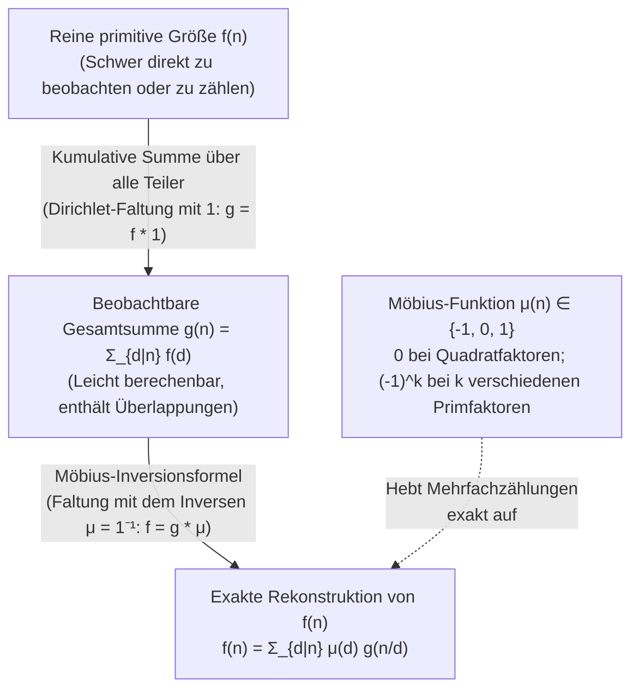
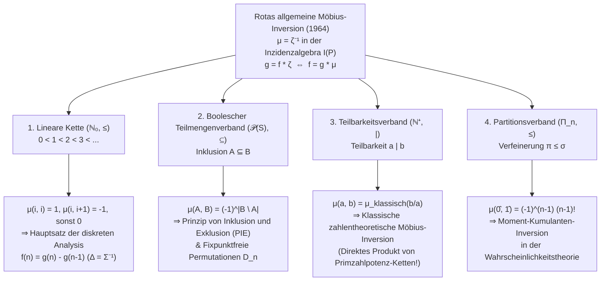

## 1. Einleitung: Das fundamentale inverse Problem der Mathematik

In der Zahlentheorie, Kombinatorik, Algebra und statistischen Physik begegnen wir immer wieder demselben inversen Problem: <strong>Die reine, primitive Größe $f(n)$, die wir eigentlich bestimmen möchten, lässt sich kaum direkt zählen oder messen, während die kumulative Summe $g(n)$, in der alle untergeordneten Beiträge einer Hierarchie zusammenfließen, erstaunlich leicht zu berechnen ist.</strong>

Betrachten wir drei klassische Beispiele:

1. <strong>Periodische Zeichenketten und aperiodische Lyndon-Wörter</strong>:
   Über einem Alphabet mit $q$ Zeichen gibt es insgesamt $g(n) = q^n$ Wörter der Länge $n$. Darunter befinden sich jedoch degenerierte Wörter, die durch Wiederholung eines kürzeren Blocks der Periodenlänge $d \mid n$ entstehen. Bezeichnet $f(d)$ die Anzahl der echt aperiodischen Wörter mit minimaler Periode $d$, so gilt die Teilersummen-Relation:
   $$g(n) = \sum_{d \mid n} f(d)$$
2. <strong>Kürzbare und unkürzbare Brüche (Eulersche $\varphi$-Funktion)</strong>:
   Kürzt man die $n$ Brüche $\frac{1}{n}, \frac{2}{n}, \dots, \frac{n}{n}$ vollständig, so wird jeder Nenner zu einem Teiler $d \mid n$. Da es zu jedem Nenner $d$ genau $\varphi(d)$ unkürzbare Brüche gibt, folgt die Gaußsche Identität:
   $$n = \sum_{d \mid n} \varphi(d)$$
3. <strong>Teilmengensummen und das Prinzip von Inklusion und Exklusion (PIE)</strong>:
   Ist für jede Teilmenge $A \subseteq S$ ein Gewicht $f(A)$ gegeben, aber nur die kumulative Summe $g(B) = \sum_{A \subseteq B} f(A)$ beobachtbar, wie gewinnt man $f(B)$ zurück?

Versucht man naiv, die Beiträge echter Teiler abzuziehen, gerät man sofort in die Falle der Mehrfachsubtraktion. Für $n = 6$ sind die maximalen echten Teiler $3$ und $2$; zieht man $g(3)$ und $g(2)$ von $g(6)$ ab, wird der Durchschnitt $\gcd(3, 2) = 1$ doppelt abgezogen, sodass man $g(1)$ wieder addieren muss:
$$f(6) = g(6) - g(3) - g(2) + g(1)$$
Für $n = 12$ sind die maximalen echten Teiler $6$ und $4$ mit $\gcd(6, 4) = 2$, also:
$$f(12) = g(12) - g(6) - g(4) + g(2)$$
Überraschenderweise tauchen die Teiler $d = 3$ und $d = 1$ (für die der Quotient $12/d$ durch das Quadrat $2^2 = 4$ teilbar ist) überhaupt nicht auf — ihr Koeffizient ist <strong>$0$</strong>!

Im Jahr 1832 löste der deutsche Mathematiker und Astronom <strong>August Ferdinand Möbius</strong> dieses Problem durch die Einführung der <strong>Möbius-Funktion $\mu(n)$</strong>. Im Jahr 1964 verallgemeinerte <strong>Gian-Carlo Rota</strong> dieses Prinzip auf <strong>partiell geordnete Mengen (Posets)</strong> und deren <strong>Inzidenzalgebren</strong> und zeigte, dass die zahlentheoretische Möbius-Inversion, das Prinzip von Inklusion und Exklusion, der Hauptsatz der diskreten Analysis und die Kumulantenentwicklung der Wahrscheinlichkeitstheorie allesamt Spezialfälle der Gleichung $\mu = \zeta^{-1}$ sind.

---

## 2. Die Möbius-Funktion $\mu(n)$: Definition, Multiplikativität und Fundamentalidentität

### 2.1 Definition und Wertetabelle

> [!IMPORTANT]
> <strong>Definition (Möbius-Funktion $\mu(n)$, 1832)</strong>
> Für jede positive ganze Zahl $n \in \mathbb{N}^+$ ist die <strong>Möbius-Funktion</strong> $\mu : \mathbb{N}^+ \to \{-1, 0, 1\}$ definiert durch:
> $$\mu(n) = \begin{cases} 1 & \text{falls } n = 1, \\[4pt] (-1)^k & \text{falls } n = p_1 p_2 \cdots p_k \text{ ein Produkt von } k \text{ verschiedenen Primzahlen ist (quadratfrei)}, \\[4pt] 0 & \text{falls } p^2 \mid n \text{ für eine Primzahl } p \text{ gilt (nicht quadratfrei)}. \end{cases}$$

| $n$ | Primfaktorzerlegung | Quadratfrei? | Anzahl $k$ versch. Primfaktoren | Möbius-Funktion $\mu(n)$ | Mertens-Funktion $M(n) = \sum_{m=1}^n \mu(m)$ |
| :---: | :---: | :---: | :---: | :---: | :---: |
| $1$ | $1$ (leeres Produkt) | Ja | $0$ | $+1$ | $+1$ |
| $2$ | $2$ | Ja | $1$ | $-1$ | $0$ |
| $3$ | $3$ | Ja | $1$ | $-1$ | $-1$ |
| $4$ | $2^2$ | <strong>Nein</strong> ($2^2 \mid 4$) | — | $0$ | $-1$ |
| $5$ | $5$ | Ja | $1$ | $-1$ | $-2$ |
| $6$ | $2 \cdot 3$ | Ja | $2$ | $+1$ | $-1$ |
| $7$ | $7$ | Ja | $1$ | $-1$ | $-2$ |
| $8$ | $2^3$ | <strong>Nein</strong> ($2^2 \mid 8$) | — | $0$ | $-2$ |
| $9$ | $3^2$ | <strong>Nein</strong> ($3^2 \mid 9$) | — | $0$ | $-2$ |
| $10$ | $2 \cdot 5$ | Ja | $2$ | $+1$ | $-1$ |
| $11$ | $11$ | Ja | $1$ | $-1$ | $-2$ |
| $12$ | $2^2 \cdot 3$ | <strong>Nein</strong> ($2^2 \mid 12$) | — | $0$ | $-2$ |

### 2.2 Multiplikativität und die Fundamentalidentität

1. <strong>Multiplikativität</strong>: Für teilerfremde $a, b \in \mathbb{N}^+$ mit $\gcd(a, b) = 1$ gilt <strong>$\mu(ab) = \mu(a)\mu(b)$</strong>.
   *Beweis*: Besitzt $a$ oder $b$ einen quadratischen Primfaktor $p^2$, so auch $ab$, und beide Seiten sind $0$. Sind beide quadratfrei mit $r$ bzw. $s$ Primfaktoren, so haben sie wegen $\gcd(a, b) = 1$ keine gemeinsamen Primteiler; daher hat $ab$ genau $r+s$ verschiedene Primfaktoren und es gilt $\mu(ab) = (-1)^{r+s} = (-1)^r (-1)^s = \mu(a)\mu(b)$. $\blacksquare$

2. <strong>Fundamentalidentität</strong>:
   $$\sum_{d \mid n} \mu(d) = \varepsilon(n) := \begin{cases} 1 & n = 1, \\ 0 & n > 1. \end{cases}$$
   *Beweis über den Binomischen Lehrsatz*: Für $n = 1$ ist $\mu(1) = 1$. Für $n = p_1^{a_1} \cdots p_k^{a_k} > 1$ ($k \ge 1$) liefern nur die quadratfreien Teiler $d \mid n$ einen Beitrag $\neq 0$. Diese entsprechen genau den Teilmengen von $\{p_1, \dots, p_k\}$. Da es $\binom{k}{j}$ Teilmengen mit $j$ Primzahlen gibt und für jede $\mu(d) = (-1)^j$ gilt, folgt:
   $$\sum_{d \mid n} \mu(d) = \sum_{j = 0}^{k} \binom{k}{j} (-1)^j 1^{k - j} = (1 - 1)^k = 0. \quad \blacksquare$$

---

## 3. Der kommutative Ring arithmetischer Funktionen unter der Dirichlet-Faltung

Auf dem Raum $\mathcal{A} = \{f : \mathbb{N}^+ \to \mathbb{C}\}$ aller zahlentheoretischen Funktionen ist die <strong>Dirichlet-Faltung</strong> definiert durch:

$$(f * g)(n) := \sum_{d \mid n} f(d)\,g\!\left(\frac{n}{d}\right) = \sum_{ab = n} f(a)\,g(b)$$

$(\mathcal{A}, +, *)$ bildet einen kommutativen Ring mit dem Einselement <strong>$\varepsilon(n) = [n = 1]$</strong> ($f * \varepsilon = f$).
Mit der konstanten Funktion <strong>$\mathbf{1}(n) = 1$</strong> schreibt sich jede Teilersumme als Faltung $g(n) = \sum_{d \mid n} f(d) = (f * \mathbf{1})(n)$, also $g = f * \mathbf{1}$.
Die Fundamentalidentität $\sum_{d \mid n} \mu(d) = \varepsilon(n)$ lautet in dieser Sprache:

$$\mu * \mathbf{1} = \mathbf{1} * \mu = \varepsilon \quad \Longleftrightarrow \quad \mu = \mathbf{1}^{-1}$$

<strong>Die Möbius-Funktion $\mu$ ist exakt das bezüglich der Dirichlet-Faltung inverse Element der konstanten Funktion $\mathbf{1}$!</strong> Damit folgt die <strong>klassische Möbius-Inversionsformel</strong> in einer einzigen Zeile:

$$g = f * \mathbf{1} \iff g * \mu = f * (\mathbf{1} * \mu) = f * \varepsilon = f \iff f(n) = \sum_{d \mid n} \mu(d)\,g\!\left(\frac{n}{d}\right) = \sum_{d \mid n} \mu\!\left(\frac{n}{d}\right) g(d)$$

### Verbindung zur analytischen Zahlentheorie: Dirichlet-Reihen und $\zeta(s)$

Ordnet man jeder Funktion $f \in \mathcal{A}$ ihre <strong>Dirichlet-Reihe</strong> $D_f(s) = \sum_{n=1}^{\infty} \frac{f(n)}{n^s}$ zu, so geht die Faltung in das gewöhnliche Produkt über: $D_{f * g}(s) = D_f(s) D_g(s)$. Da $D_{\mathbf{1}}(s) = \zeta(s) = \sum_{n=1}^{\infty} \frac{1}{n^s}$ die <strong>Riemannsche Zeta-Funktion</strong> und $D_{\varepsilon}(s) = 1$ ist, liefert $\mathbf{1} * \mu = \varepsilon$ sofort:

$$\zeta(s) \sum_{n = 1}^{\infty} \frac{\mu(n)}{n^s} = 1 \quad \Longrightarrow \quad \frac{1}{\zeta(s)} = \sum_{n = 1}^{\infty} \frac{\mu(n)}{n^s} \qquad (\operatorname{Re}(s) > 1)$$

- Der <strong>Primzahlsatz</strong> ist äquivalent zu $\sum_{n=1}^{\infty} \frac{\mu(n)}{n} = 0$ bzw. $M(x) = \sum_{n \le x} \mu(n) = o(x)$.
- Die <strong>Riemannsche Vermutung (Riemann Hypothesis)</strong> ist äquivalent dazu, dass $\frac{1}{\zeta(s)}$ für $\operatorname{Re}(s) > \frac{1}{2}$ holomorph ist, was wiederum exakt der Quadratwurzel-Auslöschung der Mertens-Funktion entspricht:
  $$\text{Riemannsche Vermutung} \quad \Longleftrightarrow \quad M(x) = \sum_{n \le x} \mu(n) = O\!\left(x^{\frac{1}{2} + \varepsilon}\right) \quad (\forall \varepsilon > 0)$$

---

## 4. Drei klassische Anwendungen

1. <strong>Eulersche $\varphi$-Funktion</strong>: Aus $\sum_{d \mid n} \varphi(d) = n$ ($\varphi * \mathbf{1} = \mathrm{id}$) folgt durch Möbius-Inversion $\varphi = \mathrm{id} * \mu$:
   $$\varphi(n) = \sum_{d \mid n} \mu(d)\,\frac{n}{d} = n \prod_{p \mid n} \left(1 - \frac{1}{p}\right)$$
2. <strong>Aperiodische Halsketten (Lyndon-Wörter) und irreduzible Polynome über $\mathbb{F}_q$</strong>:
   Sowohl die Anzahl $N_q(d)$ aperiodischer Halsketten der Länge $d$ über $q$ Symbolen als auch die Anzahl $I_q(d)$ normierter irreduzibler Polynome vom Grad $d$ über dem endlichen Körper $\mathbb{F}_q$ (da $x^{q^n} - x = \prod_{d \mid n} \prod_{\deg P = d} P(x)$) erfüllen $q^n = \sum_{d \mid n} d \cdot N_q(d) = \sum_{d \mid n} d \cdot I_q(d)$. Möbius-Inversion liefert die <strong>Gaußsche Formel</strong>:
   $$N_q(n) = I_q(n) = \frac{1}{n} \sum_{d \mid n} \mu\!\left(\frac{n}{d}\right) q^d$$
3. <strong>Kreisteilungspolynome (Zyklotomische Polynome) $\Phi_n(x)$</strong>:
   Aus $x^n - 1 = \prod_{d \mid n} \Phi_d(x)$ folgt durch multiplikative Möbius-Inversion:
   $$\Phi_n(x) = \prod_{d \mid n} (x^d - 1)^{\mu(n/d)}$$
   Für $n = 12$ mit Teilern $d \in \{1, 2, 3, 4, 6, 12\}$ und $\mu(12/d) \in \{0, +1, 0, -1, -1, +1\}$ ergibt sich sofort:
   $$\Phi_{12}(x) = \frac{(x^{12} - 1)(x^2 - 1)}{(x^6 - 1)(x^4 - 1)} = \frac{x^6 + 1}{x^2 + 1} = x^4 - x^2 + 1$$

---

## 5. Gian-Carlo Rotas Große Vereinheitlichung (1964): Halbordnungen (Posets) und Inzidenzalgebren

Sei $(P, \le)$ eine lokal endliche <strong>partiell geordnete Menge (Poset)</strong>, sodass jedes Intervall $[x, y] = \{z \in P \mid x \le z \le y\}$ endlich ist. Die <strong>Inzidenzalgebra $I(P)$</strong> ist mit der Intervall-Faltung ausgestattet:

$$(\alpha * \beta)(x, y) := \sum_{x \le z \le y} \alpha(x, z)\,\beta(z, y) \qquad (x \le y)$$

Das Einselement ist das Kronecker-Delta $\delta(x, y) = [x = y]$. Die <strong>Zeta-Funktion $\zeta(x, y) = 1$</strong> (für $x \le y$) besitzt ein eindeutiges Inverses <strong>$\mu = \zeta^{-1}$</strong>, das rekursiv durch $\mu(x, x) = 1$ und $\mu(x, y) = -\sum_{x \le z < y} \mu(x, z)$ für $x < y$ bestimmt ist. Damit gilt der <strong>allgemeine Möbius-Inversionssatz auf Posets</strong>:

$$g(y) = \sum_{x \le y} f(x) \quad \Longleftrightarrow \quad f(y) = \sum_{x \le y} g(x)\,\mu(x, y)$$

| Halbordnung (Poset) $(P, \le)$ | Ordnung $x \le y$ | Möbius-Funktion $\mu(x, y)$ | Resultierender Fundamentalsatz ($f = g * \mu$) |
| :--- | :--- | :--- | :--- |
| <strong>Lineare Kette</strong> $(\mathbb{N}_0, \le)$ | Größe $i \le j$ | $1$ ($j=i$), $-1$ ($j=i+1$), $0$ (sonst) | <strong>Hauptsatz der diskreten Analysis</strong> $f(n) = g(n) - g(n-1)$ |
| <strong>Boolescher Verband</strong> $(\mathcal{P}(S), \subseteq)$ | Teilmenge $A \subseteq B$ | $(-1)^{|B \setminus A|}$ | <strong>Inklusion-Exklusion (PIE)</strong> & Derangements $D_n = n!\sum_{k=0}^n \frac{(-1)^k}{k!}$ |
| <strong>Teilbarkeitsverband</strong> $(\mathbb{N}^+, \mid)$ | Teilbarkeit $a \mid b$ | $\mu_{\text{klassisch}}(b/a) \in \{-1, 0, 1\}$ | <strong>Klassische Möbius-Inversion</strong> $f(n) = \sum_{d \mid n} \mu(n/d) g(d)$ |
| <strong>Partitionsverband</strong> $(\Pi_n, \le)$ | Verfeinerung $\pi \le \sigma$ | $\mu(\pi, \hat{1}) = (-1)^{|\pi|-1}(|\pi|-1)!$ | <strong>Moment-Kumulanten-Formel</strong> $\kappa_n = \sum_{\pi \in \Pi_n} \mu(\pi, \hat{1}) \prod_{B \in \pi} \mathbb{E}[X_B]$ |

Insbesondere zeigt die Produktstruktur des Teilbarkeitsverbandes als direktes Produkt linearer Primexponent-Ketten sofort, warum $\mu(n) = 0$ für $p^2 \mid n$ gilt: Der diskrete Differenzoperator $\Delta g(m) = g(m) - g(m-1)$ blickt entlang jeder Primfaktor-Achse nur genau einen Schritt zurück und weist Abständen $\ge 2$ das Gewicht $0$ zu!
