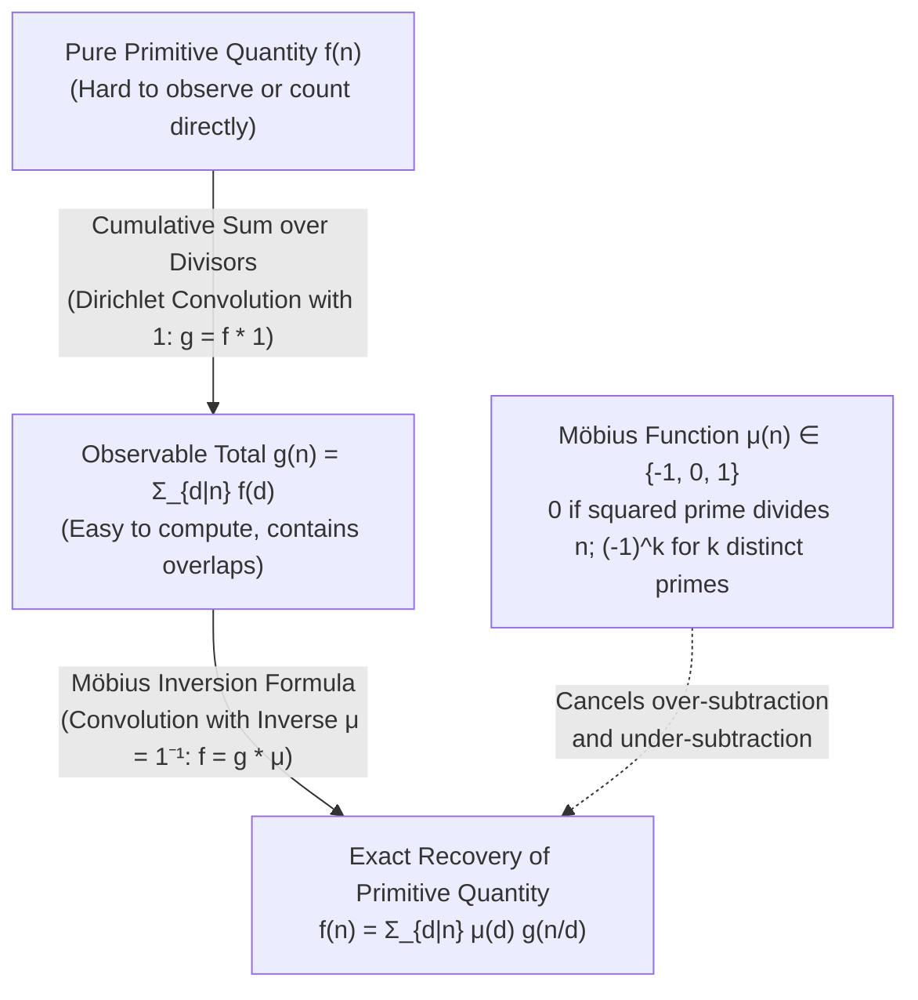
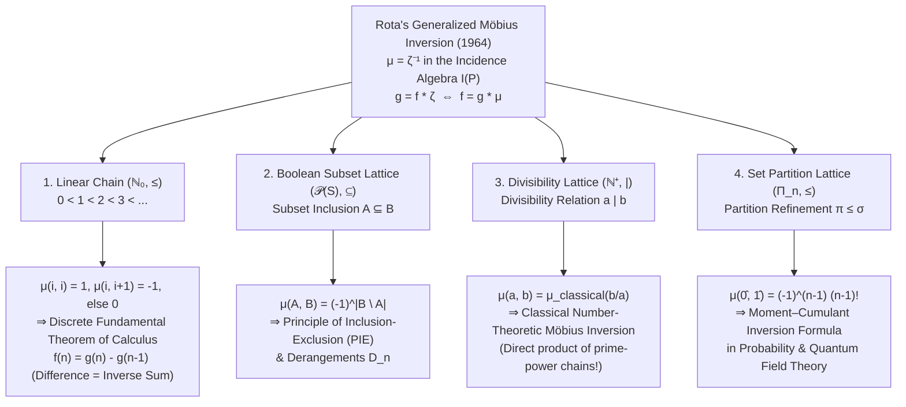

## 1. Introduction: Can We Recover the "Pure Primitive Value" from a Mixed "Cumulative Sum"?

Across number theory, combinatorics, algebra, and statistical physics, we repeatedly encounter a fundamental inverse problem: <strong>the pure, primitive quantity $f(n)$ that we truly wish to know is exceedingly difficult to count or measure directly, whereas the cumulative sum $g(n)$ that mixes together $f(d)$ over all lower elements $d$ in a hierarchy is astonishingly easy to compute.</strong>

To see how naturally this dilemma arises, consider three concrete examples.

### Example 1: Periodic Strings vs. Truly Aperiodic Strings
Suppose we form strings of length $n = 6$ using a binary alphabet $\{A, B\}$. The total number of such strings, $g(6)$, is effortless to compute: since there are $2$ choices for each of the $6$ positions, there are $g(6) = 2^6 = 64$ strings in total.
However, hidden inside these $64$ strings are "degenerate" periodic strings formed by repeating a shorter block whose length $d$ divides $6$:
- Minimum period $d = 1$: `AAAAAA`, `BBBBBB` (a block of length $1$ repeated $6$ times).
- Minimum period $d = 2$: `ABABAB`, `BABABA` (an aperiodic block of length $2$ repeated $3$ times).
- Minimum period $d = 3$: `AABAAB`, `ABAABA`, etc. (an aperiodic block of length $3$ repeated $2$ times).
- Minimum period $d = 6$: `AAABBB`, `ABABBA`, etc. (<strong>truly aperiodic strings of length $6$</strong> that cannot be decomposed into any smaller repeating period).

Let $f(d)$ denote the number of truly aperiodic strings of exact minimum period $d$. Because every string of length $n$ has a unique minimum period $d$ that must be a divisor of $n$ (written $d \mid n$), the easily computed total $g(n) = 2^n$ and the elusive primitive count $f(d)$ are linked by a <strong>divisor sum</strong>:

$$g(n) = \sum_{d \mid n} f(d)$$

When all we can easily observe is the mixed total $g(n) = 2^n$, how can we systematically strip away the lower-period contaminations to isolate the pure quantity $f(n)$?

### Example 2: Reducible Fractions vs. Irreducible Fractions
Consider the $n = 12$ fractions with denominator $12$ lying between $0$ and $1$:

$$\frac{1}{12},\ \frac{2}{12},\ \frac{3}{12},\ \frac{4}{12},\ \frac{5}{12},\ \frac{6}{12},\ \frac{7}{12},\ \frac{8}{12},\ \frac{9}{12},\ \frac{10}{12},\ \frac{11}{12},\ \frac{12}{12}$$

The total number of fractions is trivially $g(12) = 12$. Yet when we reduce each fraction to lowest terms, its denominator collapses to one of the divisors $d \in \{1, 2, 3, 4, 6, 12\}$ of $12$:
- Denominator $d = 1$: $\frac{1}{1}$ ($1$ fraction)
- Denominator $d = 2$: $\frac{1}{2}$ ($1$ fraction)
- Denominator $d = 3$: $\frac{1}{3}, \frac{2}{3}$ ($2$ fractions)
- Denominator $d = 4$: $\frac{1}{4}, \frac{3}{4}$ ($2$ fractions)
- Denominator $d = 6$: $\frac{1}{6}, \frac{5}{6}$ ($2$ fractions)
- Denominator $d = 12$ (already irreducible): $\frac{1}{12}, \frac{5}{12}, \frac{7}{12}, \frac{11}{12}$ ($4$ fractions)

The number of irreducible fractions with exact denominator $d$ (i.e., numerators $1 \le a \le d$ satisfying $\gcd(a, d) = 1$) is <strong>Euler's totient function $\varphi(d)$</strong>. Grouping the $n$ fractions by their reduced denominator yields Gauss's classic identity:

$$n = \sum_{d \mid n} \varphi(d)$$

Once again, the cumulative sum $g(n) = n$ is completely trivial, while the primitive summand $f(n) = \varphi(n)$ is trapped inside the divisor sum.

### Example 3: Subset Sums and the Principle of Inclusion-Exclusion
Suppose each subset $A$ of a finite set $S$ carries a pure intrinsic weight $f(A)$, but our measurement apparatus can only record the cumulative weight over all subsets contained within $B$:

$$g(B) = \sum_{A \subseteq B} f(A)$$

How do we invert this hierarchy of subset sums to recover the exact intrinsic weight $f(B)$ as a linear combination of the observable values $g(A)$?

---

### The Trap of Naive Subtraction: Over-Subtraction and Cancellation

Let us return to Example 1 with $n = 6$ and try to extract $f(6)$ from $g(6) = 2^6 = 64$.
The maximal proper divisors of $6$ are $3$ and $2$. Every degenerate string of length $6$ has period dividing either $3$ (counted in $g(3) = 2^3$) or $2$ (counted in $g(2) = 2^2$).
If we naively subtract $g(3)$ and $g(2)$ from $g(6)$:

$$g(6) - g(3) - g(2)$$

we immediately run into <strong>over-subtraction</strong>: strings of period $1$ (`AAAAAA` and `BBBBBB`) divide both $3$ and $2$ ($\gcd(3, 2) = 1$), so they are contained in both $g(3)$ and $g(2)$. Having subtracted them twice, we must add $g(1)$ back once:

$$f(6) = g(6) - g(3) - g(2) + g(1) = 64 - 8 - 4 + 2 = 54$$

What happens when $n = 12$? The divisors of $12$ are $1, 2, 3, 4, 6, 12$.
The maximal proper divisors of $12$ are $6$ and $4$. Every string of length $12$ whose minimum period is strictly less than $12$ must have a period dividing either $6$ or $4$. Moreover, a period divides both $6$ and $4$ if and only if it divides $\gcd(6, 4) = 2$. By two-set inclusion-exclusion, the exact count of aperiodic strings of length $12$ is:

$$f(12) = g(12) - g(6) - g(4) + g(2)$$

Look closely at this formula. Even though $3$ and $1$ are divisors of $12$, <strong>neither $g(3)$ nor $g(1)$ appears in the inversion formula for $f(12)$—their coefficients are identically $0$!</strong>
Why did every divisor appear with coefficient $\pm 1$ for $n = 6$, whereas for $n = 12$, the divisors $d = 3$ and $d = 1$ (corresponding to quotients $12/d = 4 = 2^2$ and $12/d = 12 = 2^2 \cdot 3$) vanish with coefficient $0$?

The mathematical law governing these exact deduplication coefficients $\{+1, -1, 0\}$ was discovered in 1832 by the German mathematician and astronomer <strong>August Ferdinand Möbius</strong>, who introduced the <strong>Möbius function $\mu(n)$</strong> and the <strong>Möbius Inversion Formula</strong>. Over a century later, in 1964, <strong>Gian-Carlo Rota</strong> elevated Möbius's insight into a breathtaking grand unification: by formulating <strong>Incidence Algebras over Partially Ordered Sets (Posets)</strong>, Rota proved that number-theoretic Möbius inversion, the Principle of Inclusion-Exclusion, the Fundamental Theorem of Discrete Calculus, and cumulant expansions in probability theory are all manifestations of a single universal equation: $\mu = \zeta^{-1}$.

In this article, we will explore the complete architecture of Möbius inversion—from elementary number theory and the commutative ring of Dirichlet convolutions to the Riemann Hypothesis, finite fields, cyclotomic polynomials, and Rota's incidence algebra over posets.

---

## 2. The Möbius Function $\mu(n)$: Definition, Square-Free Structure, and the Fundamental Identity

### 2.1 Rigorous Definition of the Möbius Function $\mu(n)$

In his 1832 paper *Über eine besondere Art von Umkehrung der Reihen* (*On a special kind of inversion of series*), August Ferdinand Möbius—famous in topology for the one-sided Möbius strip—introduced an arithmetic function $\mu : \mathbb{N}^+ \to \{-1, 0, 1\}$ that encodes the prime factorization structure of positive integers.

> [!IMPORTANT]
> <strong>Definition (The Möbius Function $\mu(n)$)</strong>
> For any positive integer $n \ge 1$, the <strong>Möbius function</strong> $\mu(n)$ is defined by:
> $$\mu(n) = \begin{cases} 1 & \text{if } n = 1, \\[6pt] (-1)^k & \text{if } n = p_1 p_2 \cdots p_k \text{ is a product of } k \text{ distinct primes}, \\[6pt] 0 & \text{if } p^2 \mid n \text{ for some prime } p \text{ (i.e., } n \text{ is not square-free)}. \end{cases}$$

An integer $n$ is called <strong>square-free</strong> if it is not divisible by the square of any prime ($p^2 \nmid n$ for all primes $p$), meaning every prime in its prime factorization $n = p_1^{a_1} \cdots p_k^{a_k}$ appears with exponent $a_i = 1$. Thus, $\mu(n)$ vanishes whenever $n$ has a repeated prime factor, and equals $(-1)^k$ according to the parity of the number of distinct prime factors when $n$ is square-free (with $n = 1$ corresponding to the empty product of $k = 0$ primes, $(-1)^0 = 1$).

The table below lists the prime factorization, square-free status, number of distinct prime factors $k$, the Möbius function $\mu(n)$, and its cumulative sum—the <strong>Mertens function</strong> $M(n) := \sum_{m=1}^n \mu(m)$—for $n = 1$ through $16$.

| $n$ | Prime Factorization | Square-Free? | Distinct Primes $k$ | Möbius Function $\mu(n)$ | Mertens Function $M(n) = \sum_{m=1}^n \mu(m)$ |
| :---: | :---: | :---: | :---: | :---: | :---: |
| $1$ | $1$ (empty product) | Yes | $0$ | $+1$ | $+1$ |
| $2$ | $2$ | Yes | $1$ | $-1$ | $0$ |
| $3$ | $3$ | Yes | $1$ | $-1$ | $-1$ |
| $4$ | $2^2$ | <strong>No</strong> ($2^2 \mid 4$) | — | $0$ | $-1$ |
| $5$ | $5$ | Yes | $1$ | $-1$ | $-2$ |
| $6$ | $2 \cdot 3$ | Yes | $2$ | $+1$ | $-1$ |
| $7$ | $7$ | Yes | $1$ | $-1$ | $-2$ |
| $8$ | $2^3$ | <strong>No</strong> ($2^2 \mid 8$) | — | $0$ | $-2$ |
| $9$ | $3^2$ | <strong>No</strong> ($3^2 \mid 9$) | — | $0$ | $-2$ |
| $10$ | $2 \cdot 5$ | Yes | $2$ | $+1$ | $-1$ |
| $11$ | $11$ | Yes | $1$ | $-1$ | $-2$ |
| $12$ | $2^2 \cdot 3$ | <strong>No</strong> ($2^2 \mid 12$) | — | $0$ | $-2$ |
| $13$ | $13$ | Yes | $1$ | $-1$ | $-3$ |
| $14$ | $2 \cdot 7$ | Yes | $2$ | $+1$ | $-2$ |
| $15$ | $3 \cdot 5$ | Yes | $2$ | $+1$ | $-1$ |
| $16$ | $2^4$ | <strong>No</strong> ($2^2 \mid 16$) | — | $0$ | $-1$ |

### 2.2 Why Does $\mu(n) = 0$ Whenever $p^2 \mid n$?

Every student who encounters $\mu(n)$ for the first time asks the same question: *Why does $\mu(n)$ alternate between $+1$ and $-1$ according to the number of prime factors, yet abruptly drop to $0$ the moment a prime factor is squared?*

The answer lies in the geometry of divisibility and the Principle of Inclusion-Exclusion, just as we saw for $n = 12$ in Section 1.
Let $n = p_1^{a_1} p_2^{a_2} \cdots p_k^{a_k}$ be the prime factorization of $n$. Any proper divisor $d < n$ that divides $n$ must divide at least one of the $k$ <strong>maximal proper divisors</strong> of $n$, obtained by dividing $n$ by a single prime factor once:

$$M_1 = \frac{n}{p_1},\quad M_2 = \frac{n}{p_2},\quad \dots,\quad M_k = \frac{n}{p_k}$$

To isolate $f(n)$ from $g(n) = \sum_{d \mid n} f(d)$, we must subtract the contributions of all proper divisors $d < n$. Because the set of proper divisors of $n$ is the union of the divisor sets of $M_1, M_2, \dots, M_k$, we apply Inclusion-Exclusion to these $k$ sets:
- First, we <strong>subtract</strong> the sum over each single maximal divisor $M_i = n/p_i$ (coefficient $-1 = \mu(p_i)$).
- Next, we <strong>add back</strong> the sum over the intersection of each pair $M_i$ and $M_j$, which consists of the divisors of $\gcd(n/p_i, n/p_j) = \frac{n}{p_i p_j}$ (coefficient $+1 = \mu(p_i p_j)$).
- Then, we <strong>subtract</strong> the triple intersections $\gcd(M_i, M_j, M_\ell) = \frac{n}{p_i p_j p_\ell}$ (coefficient $-1 = \mu(p_i p_j p_\ell)$), and so on.

Notice which quotients appear in these intersections: because we intersect subsets of the $k$ distinct maximal divisors $\{n/p_1, \dots, n/p_k\}$, each prime $p_i$ is divided out <strong>at most once</strong>! Quotients of the form $\frac{n}{d}$ where $p_i^2 \mid d$ never arise as intersections of the maximal proper divisors—their elements are already completely accounted for inside $\frac{n}{p_i}$. Consequently, any divisor $d$ divisible by a square $p^2$ requires zero additional correction, forcing $\mu(d) = 0$.

### 2.3 Multiplicativity and the Fundamental Identity of the Möbius Function

Let us now establish the two foundational algebraic pillars of $\mu(n)$.

> [!NOTE]
> <strong>Proposition 1 (Multiplicativity of $\mu$)</strong>
> The Möbius function is <strong>multiplicative</strong>: for any coprime positive integers $a, b$ (i.e., $\gcd(a, b) = 1$),
> $$\mu(ab) = \mu(a)\,\mu(b)$$

<strong>Proof:</strong>
1. If $a = 1$ or $b = 1$, the identity holds trivially since $\mu(1) = 1$.
2. If either $a$ or $b$ is not square-free, say $p^2 \mid a$ for some prime $p$, then $p^2 \mid ab$ as well. Hence $\mu(ab) = 0 = 0 \cdot \mu(b) = \mu(a)\mu(b)$.
3. If both $a$ and $b$ are square-free, write $a = p_1 \cdots p_r$ and $b = q_1 \cdots q_s$ as products of distinct primes. Because $\gcd(a, b) = 1$, the prime sets $\{p_1, \dots, p_r\}$ and $\{q_1, \dots, q_s\}$ are completely disjoint. Thus $ab = p_1 \cdots p_r q_1 \cdots q_s$ is a square-free product of $r + s$ distinct primes, giving
   $$\mu(ab) = (-1)^{r + s} = (-1)^r (-1)^s = \mu(a)\,\mu(b). \quad \blacksquare$$

*(Note: $\mu$ is not completely multiplicative; when $\gcd(a, b) > 1$, $\mu(ab) = 0 \neq \mu(a)\mu(b)$, as seen for $a = b = 2$ where $\mu(4) = 0 \neq (-1)(-1) = 1$.)*

Next, we prove the <strong>Fundamental Identity</strong> that powers all of Möbius inversion.

> [!IMPORTANT]
> <strong>Theorem 1 (Fundamental Identity of the Möbius Function)</strong>
> For every positive integer $n \ge 1$, the sum of $\mu(d)$ over all positive divisors $d$ of $n$ vanishes unless $n = 1$:
> $$\sum_{d \mid n} \mu(d) = \varepsilon(n) := \begin{cases} 1 & \text{if } n = 1, \\ 0 & \text{if } n > 1. \end{cases}$$

We give two instructive proofs of this theorem: one combinatorial (via the Binomial Theorem) and one algebraic (via multiplicativity).

<strong>Proof 1 (Combinatorial Proof via the Binomial Theorem):</strong>
For $n = 1$, the only divisor is $d = 1$, so $\sum_{d \mid 1} \mu(d) = \mu(1) = 1$.
For $n > 1$, let $n = p_1^{a_1} p_2^{a_2} \cdots p_k^{a_k}$ ($k \ge 1, a_i \ge 1$) be its prime factorization. In the divisor sum $\sum_{d \mid n} \mu(d)$, any divisor $d$ divisible by $p_i^2$ has $\mu(d) = 0$ and contributes nothing. The only divisors that contribute are the <strong>square-free divisors</strong> of $n$, which correspond bijectively to subsets of the prime factors $\{p_1, p_2, \dots, p_k\}$.
For each $0 \le j \le k$, there are $\binom{k}{j}$ ways to choose $j$ distinct primes from $\{p_1, \dots, p_k\}$, and their product $d$ satisfies $\mu(d) = (-1)^j$. By the Binomial Theorem,

$$\sum_{d \mid n} \mu(d) = \sum_{j = 0}^{k} \binom{k}{j} (-1)^j = \sum_{j = 0}^{k} \binom{k}{j} (-1)^j 1^{k - j} = (1 - 1)^k = 0^k = 0$$

since $k \ge 1$. $\blacksquare$

<strong>Proof 2 (Algebraic Proof via Multiplicativity):</strong>
If $f(n)$ is any multiplicative function, its divisor sum $F(n) := \sum_{d \mid n} f(d)$ is also multiplicative. Indeed, for $\gcd(a, b) = 1$, every divisor $d \mid ab$ factors uniquely as $d = d_1 d_2$ with $d_1 \mid a$, $d_2 \mid b$, and $\gcd(d_1, d_2) = 1$, so

$$F(ab) = \sum_{d_1 \mid a} \sum_{d_2 \mid b} f(d_1 d_2) = \left(\sum_{d_1 \mid a} f(d_1)\right)\!\left(\sum_{d_2 \mid b} f(d_2)\right) = F(a)\,F(b)$$

Since $\mu$ is multiplicative, $F(n) = \sum_{d \mid n} \mu(d)$ is multiplicative, so it suffices to evaluate $F$ on prime powers $n = p^a$ ($a \ge 1$). The divisors of $p^a$ are $1, p, p^2, \dots, p^a$, yielding

$$F(p^a) = \mu(1) + \mu(p) + \mu(p^2) + \cdots + \mu(p^a) = 1 + (-1) + 0 + \cdots + 0 = 0$$

Therefore, for any $n = p_1^{a_1} \cdots p_k^{a_k} > 1$, multiplicativity immediately gives $F(n) = \prod_{i=1}^k F(p_i^{a_i}) = 0$. $\blacksquare$

---

## 3. The Commutative Ring of Arithmetic Functions under Dirichlet Convolution

Why does the Möbius inversion formula work so effortlessly? Rather than viewing it as a clever manipulation of double sums, modern algebra reveals that Möbius inversion is simply <strong>multiplying both sides of a linear equation $g = f * \mathbf{1}$ by the multiplicative inverse $\mu = \mathbf{1}^{-1}$ in a commutative ring</strong>.

### 3.1 Definition and Ring Structure of Dirichlet Convolution

Let $\mathcal{A} = \{f : \mathbb{N}^+ \to \mathbb{C}\}$ denote the vector space of all <strong>arithmetic functions</strong> under pointwise addition $(f + g)(n) := f(n) + g(n)$. Following Peter Gustav Lejeune Dirichlet, we equip $\mathcal{A}$ with a multiplication operation that respects the multiplicative structure of the integers.

> [!IMPORTANT]
> <strong>Definition (Dirichlet Convolution)</strong>
> For any two arithmetic functions $f, g \in \mathcal{A}$, their <strong>Dirichlet convolution</strong> $f * g \in \mathcal{A}$ is defined at each $n \ge 1$ by:
> $$(f * g)(n) := \sum_{d \mid n} f(d)\,g\!\left(\frac{n}{d}\right) = \sum_{\substack{a, b \ge 1 \\ ab = n}} f(a)\,g(b)$$

Let us verify that $(\mathcal{A}, +, *)$ forms a <strong>commutative ring with unity</strong>:

1. <strong>Commutativity ($f * g = g * f$):</strong>
   The condition $ab = n$ is symmetric in $a$ and $b$ (substituting $c = n/d$ as $d$ runs over divisors of $n$):
   $$(f * g)(n) = \sum_{ab = n} f(a)g(b) = \sum_{ba = n} g(b)f(a) = (g * f)(n)$$

2. <strong>Associativity ($(f * g) * h = f * (g * h)$):</strong>
   Both expressions equal the sum over all ordered triples $(a, b, c)$ of positive integers whose product is $abc = n$:
   $$((f * g) * h)(n) = \sum_{mc = n} (f * g)(m)\,h(c) = \sum_{abc = n} f(a)\,g(b)\,h(c) = \sum_{ak = n} f(a)\,(g * h)(k) = (f * (g * h))(n)$$

3. <strong>Multiplicative Identity ($\varepsilon$):</strong>
   Define $\varepsilon(n) := [n = 1]$ (which is $1$ at $n = 1$ and $0$ for all $n > 1$). In the sum $(f * \varepsilon)(n) = \sum_{d \mid n} f(d)\varepsilon(n/d)$, every term with $d < n$ has $n/d > 1$ and vanishes, leaving only $d = n$:
   $$(f * \varepsilon)(n) = f(n)\,\varepsilon(1) = f(n)$$
   Thus <strong>$f * \varepsilon = \varepsilon * f = f$</strong>, so $\varepsilon$ is the multiplicative identity of $(\mathcal{A}, +, *)$.

4. <strong>Characterization of Units (Invertible Functions):</strong>
   When does an arithmetic function $f \in \mathcal{A}$ possess a <strong>Dirichlet inverse</strong> $f^{-1}$ satisfying $f * f^{-1} = \varepsilon$? Evaluating at $n = 1$ gives $(f * f^{-1})(1) = f(1)f^{-1}(1) = \varepsilon(1) = 1$, which requires $f(1) \neq 0$. Conversely, whenever <strong>$f(1) \neq 0$</strong>, a unique inverse $g = f^{-1}$ exists and can be computed recursively for $n = 1, 2, 3, \dots$ via:
   $$g(1) = \frac{1}{f(1)}, \qquad g(n) = -\frac{1}{f(1)} \sum_{\substack{d \mid n \\ d < n}} f\!\left(\frac{n}{d}\right) g(d) \quad (n > 1)$$

### 3.2 Duality Between $\mathbf{1}$ and $\mu$: The One-Line Proof of Möbius Inversion

Now define the <strong>constant function $\mathbf{1}$</strong> by $\mathbf{1}(n) := 1$ for all $n \in \mathbb{N}^+$.
Observe what happens when we convolve any function $f \in \mathcal{A}$ with $\mathbf{1}$:

$$(f * \mathbf{1})(n) = \sum_{d \mid n} f(d)\,\mathbf{1}\!\left(\frac{n}{d}\right) = \sum_{d \mid n} f(d)$$

<strong>Taking the divisor sum of $f$ is literally convolving $f$ with the constant function $\mathbf{1}$: $g = f * \mathbf{1}$!</strong>

Now rewrite Theorem 1—the Fundamental Identity $\sum_{d \mid n} \mu(d) = \varepsilon(n)$—in the language of Dirichlet convolution:

$$\sum_{d \mid n} \mu(d) = \sum_{d \mid n} \mu(d)\,\mathbf{1}\!\left(\frac{n}{d}\right) = (\mu * \mathbf{1})(n) = \varepsilon(n)$$

That is:

$$\mu * \mathbf{1} = \mathbf{1} * \mu = \varepsilon \quad \Longleftrightarrow \quad \mu = \mathbf{1}^{-1}$$

<strong>The Möbius function $\mu$ is nothing other than the exact Dirichlet inverse $\mathbf{1}^{-1}$ of the constant function $\mathbf{1}$!</strong>
With this structural realization in hand, the <strong>Classical Möbius Inversion Formula</strong> becomes a one-line algebraic corollary.

> [!IMPORTANT]
> <strong>Theorem 2 (Classical Möbius Inversion Formula)</strong>
> Let $f, g : \mathbb{N}^+ \to \mathbb{C}$ be arithmetic functions. Then
> $$g(n) = \sum_{d \mid n} f(d) \quad (\forall n \ge 1) \quad \Longleftrightarrow \quad f(n) = \sum_{d \mid n} \mu(d)\,g\!\left(\frac{n}{d}\right) = \sum_{d \mid n} \mu\!\left(\frac{n}{d}\right) g(d) \quad (\forall n \ge 1)$$

<strong>One-Line Proof via Dirichlet Convolution:</strong>
Since $\mathbf{1} * \mu = \varepsilon$, convolving both sides of $g = f * \mathbf{1}$ on the right by $\mu$ yields
$$g = f * \mathbf{1} \iff g * \mu = (f * \mathbf{1}) * \mu = f * (\mathbf{1} * \mu) = f * \varepsilon = f. \quad \blacksquare$$

<strong>Direct Verification by Interchanging Double Sums:</strong>
To see the cancellation explicitly in summation notation, substitute $g(n/d) = \sum_{c \mid (n/d)} f(c)$ into the right-hand side. Because the condition "$d \mid n$ and $c \mid (n/d)$" is equivalent to "$cd \mid n$", which in turn is equivalent to "$c \mid n$ and $d \mid (n/c)$", we can interchange the order of summation:

$$\sum_{d \mid n} \mu(d)\,g\!\left(\frac{n}{d}\right) = \sum_{d \mid n} \mu(d) \sum_{c \mid (n/d)} f(c) = \sum_{c \mid n} f(c) \sum_{d \mid (n/c)} \mu(d) = \sum_{c \mid n} f(c)\,\varepsilon\!\left(\frac{n}{c}\right) = f(n)$$

Every single lower divisor $c < n$ has $n/c > 1$, so its inner sum $\sum_{d \mid (n/c)} \mu(d)$ collapses to $0$, leaving only the pure term $c = n$!

The table below summarizes the most important arithmetic functions in number theory and their algebraic relationships in the ring $(\mathcal{A}, +, *)$.

| Symbol | Name of Arithmetic Function | Definition $f(n)$ | Convolution Identity | Möbius Inverted Form |
| :---: | :--- | :--- | :---: | :---: |
| $\varepsilon$ | Multiplicative Identity | $[n = 1]$ | $\mathbf{1} * \mu = \varepsilon$ | $\mu = \varepsilon * \mu$ |
| $\mathbf{1}$ | Constant Function | $1$ | $\mathbf{1} = \varepsilon * \mathbf{1}$ | $\varepsilon = \mathbf{1} * \mu$ |
| $\mu$ | Möbius Function | $(-1)^k$ (square-free), $0$ (else) | $\mu = \mathbf{1}^{-1}$ | $\mathbf{1} = \mu^{-1}$ |
| $\mathrm{id}$ | Identity Function | $n$ | $\mathrm{id} = \varphi * \mathbf{1}$ | $\varphi = \mathrm{id} * \mu$ |
| $\tau$ (or $d$) | Number of Divisors | $\sum_{d \mid n} 1$ | $\tau = \mathbf{1} * \mathbf{1}$ | $\mathbf{1} = \tau * \mu$ |
| $\sigma$ | Sum of Divisors | $\sum_{d \mid n} d$ | $\sigma = \mathrm{id} * \mathbf{1}$ | $\mathrm{id} = \sigma * \mu$ |
| $\varphi$ | Euler's Totient Function | $|\{1 \le k \le n : \gcd(k,n)=1\}|$ | $\varphi * \mathbf{1} = \mathrm{id}$ | $\varphi = \mathrm{id} * \mu$ |
| $\Lambda$ | Von Mangoldt Function | $\log p$ (if $n=p^k$), $0$ (else) | $\Lambda * \mathbf{1} = \log$ | $\Lambda = \log * \mu$ |

### 3.3 Bridge to Analytic Number Theory: Dirichlet Series, the Riemann Zeta Function, and the Riemann Hypothesis

Why does Dirichlet convolution take the form $\sum_{ab=n} f(a)g(b)$? The analytic answer emerges when we associate to each arithmetic function $f \in \mathcal{A}$ its generating function as a <strong>Dirichlet series</strong>:

$$D_f(s) := \sum_{n = 1}^{\infty} \frac{f(n)}{n^s} \qquad (s \in \mathbb{C})$$

Because $a^{-s} b^{-s} = (ab)^{-s}$, multiplying two Dirichlet series and grouping terms by the denominator product $ab = n$ converts Dirichlet convolution into ordinary multiplication of complex functions:

$$D_f(s) \cdot D_g(s) = \left(\sum_{a=1}^{\infty} \frac{f(a)}{a^s}\right)\!\left(\sum_{b=1}^{\infty} \frac{g(b)}{b^s}\right) = \sum_{n=1}^{\infty} \frac{1}{n^s} \left(\sum_{ab = n} f(a)g(b)\right) = \sum_{n=1}^{\infty} \frac{(f * g)(n)}{n^s} = D_{f * g}(s)$$

Now evaluate this homomorphism on our three fundamental functions:
- The Dirichlet series of the multiplicative identity $\varepsilon(n) = [n=1]$ is $D_{\varepsilon}(s) = 1$.
- The Dirichlet series of the constant function $\mathbf{1}(n) = 1$ is the <strong>Riemann zeta function</strong>:
  $$D_{\mathbf{1}}(s) = \sum_{n = 1}^{\infty} \frac{1}{n^s} = \zeta(s) \qquad (\operatorname{Re}(s) > 1)$$
- Therefore, applying $D$ to the identity $\mathbf{1} * \mu = \varepsilon$ yields $D_{\mathbf{1}}(s) D_{\mu}(s) = 1$, proving that <strong>the Dirichlet series of the Möbius function is the exact reciprocal of the Riemann zeta function</strong>:

> [!TIP]
> <strong>Reciprocal of the Riemann Zeta Function</strong>
> For all complex numbers $s$ with $\operatorname{Re}(s) > 1$,
> $$\zeta(s) \sum_{n = 1}^{\infty} \frac{\mu(n)}{n^s} = 1 \quad \Longleftrightarrow \quad \frac{1}{\zeta(s)} = \sum_{n = 1}^{\infty} \frac{\mu(n)}{n^s}$$

We can also see this directly from Euler's product formula $\zeta(s) = \prod_{p} (1 - p^{-s})^{-1}$. Taking the reciprocal gives:

$$\frac{1}{\zeta(s)} = \prod_{p \text{ prime}} \left(1 - \frac{1}{p^s}\right) = \left(1 - \frac{1}{2^s}\right)\!\left(1 - \frac{1}{3^s}\right)\!\left(1 - \frac{1}{5^s}\right)\!\left(1 - \frac{1}{7^s}\right)\cdots$$

When we expand this infinite product, each prime factor $(1 - p^{-s})$ contributes either $1$ or $-p^{-s}$ at most once. Hence any integer $n$ divisible by $p^2$ never appears (coefficient $0$), while a square-free product of $k$ distinct primes $n = p_1 \cdots p_k$ appears with coefficient $(-1)^k = \mu(n)$!

This identity $\frac{1}{\zeta(s)} = \sum_{n=1}^{\infty} \frac{\mu(n)}{n^s}$ places the Möbius function at the epicenter of analytic number theory:
1. <strong>Equivalence with the Prime Number Theorem (PNT):</strong> The Prime Number Theorem ($\pi(x) \sim \frac{x}{\log x}$ as $x \to \infty$, proved by Hadamard and de la Vallée Poussin in 1896) is <strong>logically equivalent</strong> to the statement that the Dirichlet series for $1/\zeta(s)$ converges to $0$ at $s = 1$:
   $$\sum_{n = 1}^{\infty} \frac{\mu(n)}{n} = 0 \quad \Longleftrightarrow \quad M(x) = \sum_{n \le x} \mu(n) = o(x) \quad (x \to \infty)$$
2. <strong>Equivalence with the Riemann Hypothesis (RH):</strong> Because the poles of $\frac{1}{\zeta(s)}$ are precisely the zeros of $\zeta(s)$, the Riemann Hypothesis—which asserts that all non-trivial zeros of $\zeta(s)$ lie on the critical line $\operatorname{Re}(s) = \frac{1}{2}$—is equivalent to the analyticity of $\frac{1}{\zeta(s)}$ throughout the half-plane $\operatorname{Re}(s) > \frac{1}{2}$. By Abel summation (Mellin transform):
   $$\frac{1}{\zeta(s)} = s \int_1^{\infty} \frac{M(x)}{x^{s + 1}}\,dx$$
   Analytic continuation of this integral to $\operatorname{Re}(s) > \frac{1}{2}$ holds if and only if the Mertens function $M(x) = \sum_{n \le x} \mu(n)$ exhibits square-root cancellation:
   $$\text{Riemann Hypothesis} \quad \Longleftrightarrow \quad M(x) = \sum_{n \le x} \mu(n) = O\!\left(x^{\frac{1}{2} + \varepsilon}\right) \quad (\forall \varepsilon > 0)$$
   In other words, the deepest open problem in mathematics is equivalent to proving that the parity of the number of prime factors of square-free integers ($\mu(n) = \pm 1$) cancels out at the same rate $O(x^{1/2+\varepsilon})$ as a sequence of independent fair coin tosses!

---

## 4. Three Classic Applications Across Number Theory, Combinatorics, and Algebra

Let us now witness the power of Möbius inversion in action by solving three celebrated problems from number theory, combinatorics, and abstract algebra.

### 4.1 Application 1: Euler's Totient Function $\varphi(n)$

Let $\varphi(n)$ count the integers $1 \le k \le n$ that are coprime to $n$ ($\gcd(k, n) = 1$).
As we saw in Example 2 of Section 1, we can partition the $n$ integers $\{1, 2, \dots, n\}$ according to the greatest common divisor $c = \gcd(k, n)$. Since $c \mid n$, setting $d = n/c$ bijectively indexes the divisors $d \mid n$. Because $\gcd(k, n) = n/d \iff \gcd(k/(n/d), d) = 1$ with $1 \le k/(n/d) \le d$, there are exactly $\varphi(d)$ integers in $\{1, \dots, n\}$ having $\gcd(k, n) = n/d$. Summing over all divisors $d \mid n$ gives:

$$\sum_{d \mid n} \varphi(d) = n \quad \Longleftrightarrow \quad \varphi * \mathbf{1} = \mathrm{id}$$

Applying Möbius inversion ($\varphi = \mathrm{id} * \mu$) immediately yields the explicit formula for $\varphi(n)$:

$$\varphi(n) = \sum_{d \mid n} \mu(d)\,\frac{n}{d} = n \sum_{d \mid n} \frac{\mu(d)}{d}$$

Factoring $n = p_1^{a_1} \cdots p_k^{a_k}$ and noting that $\mu(d)$ is nonzero only on square-free divisors $d = p_{i_1} \cdots p_{i_r}$, the sum factors into Euler's famous product formula:

$$\varphi(n) = n \sum_{d \mid n} \frac{\mu(d)}{d} = n \prod_{p \mid n} \left(1 + \frac{\mu(p)}{p}\right) = n \prod_{p \mid n} \left(1 - \frac{1}{p}\right)$$

### 4.2 Application 2: Counting Aperiodic Necklaces (Lyndon Words) and Irreducible Polynomials over $\mathbb{F}_q$

Next, we uncover a remarkable bridge between combinatorics on words and Galois theory of finite fields, both governed by the exact same Möbius inversion formula.

#### (A) Aperiodic Strings and Lyndon Words
Consider all $q^n$ strings of length $n$ over an alphabet of size $q$. Every string $w$ has a unique smallest period $d \mid n$, meaning $w$ is formed by repeating a primitive (aperiodic) string of length $d$ exactly $n/d$ times.
Let $M_q(d)$ be the number of aperiodic strings of length $d$. Rotating (cyclically shifting) an aperiodic string of length $d$ generates $d$ distinct strings of length $d$; each equivalence class under rotation is an <strong>aperiodic necklace</strong>, and its lexicographically smallest representative is called a <strong>Lyndon word</strong>. Thus, if $N_q(d)$ denotes the number of aperiodic necklaces (or Lyndon words) of length $d$, we have $M_q(d) = d \cdot N_q(d)$.
Partitioning all $q^n$ strings of length $n$ by their minimum period $d \mid n$ gives:

$$q^n = \sum_{d \mid n} M_q(d) = \sum_{d \mid n} d \cdot N_q(d)$$

Applying Möbius inversion with $g(n) = q^n$ and $f(d) = d \cdot N_q(d)$ yields <strong>Moreau's Necklace-Counting Formula (1872)</strong> (also known as Witt's dimension formula for free Lie algebras):

$$n \cdot N_q(n) = \sum_{d \mid n} \mu\!\left(\frac{n}{d}\right) q^d \quad \Longrightarrow \quad N_q(n) = \frac{1}{n} \sum_{d \mid n} \mu\!\left(\frac{n}{d}\right) q^d$$

> [!TIP]
> <strong>Combinatorial Proof of Fermat's Little Theorem and Euler–Gauss Congruence</strong>
> Because $N_q(n)$ counts a set of necklaces, it must be an integer for every $q, n \ge 1$. Therefore,
> $$\sum_{d \mid n} \mu\!\left(\frac{n}{d}\right) q^d \equiv 0 \pmod{n}$$
> When $n = p$ is prime, its only divisors are $d = 1$ and $d = p$, with $\mu(p) = -1$ and $\mu(1) = 1$. The congruence immediately becomes <strong>$q^p - q \equiv 0 \pmod{p}$</strong>, giving a purely combinatorial proof of <strong>Fermat's Little Theorem</strong>!

#### (B) Monic Irreducible Polynomials over a Finite Field $\mathbb{F}_q$
Now let $\mathbb{F}_q$ be the finite field (Galois field) with $q = p^r$ elements. How many monic <strong>irreducible polynomials</strong> of degree $n$ exist in the polynomial ring $\mathbb{F}_q[x]$? Denote this number by $I_q(n)$.

By the theory of finite fields, the extension field $\mathbb{F}_{q^n}$ is the splitting field of the polynomial $x^{q^n} - x$ over $\mathbb{F}_q$, and its elements are precisely the $q^n$ distinct roots of $x^{q^n} - x = 0$.
Every element $\alpha \in \mathbb{F}_{q^n}$ generates a subfield $\mathbb{F}_q(\alpha) \cong \mathbb{F}_{q^d}$ contained in $\mathbb{F}_{q^n}$, which happens if and only if the degree $d = \deg P$ of the minimal polynomial $P(x) \in \mathbb{F}_q[x]$ of $\alpha$ divides $n$ ($d \mid n$). Consequently, $x^{q^n} - x$ factors over $\mathbb{F}_q$ into the product of all monic irreducible polynomials whose degree $d$ divides $n$:

$$x^{q^n} - x = \prod_{d \mid n} \prod_{\substack{P \in \mathbb{F}_q[x] \text{ monic irreducible} \\ \deg P = d}} P(x)$$

Comparing the <strong>degrees</strong> of both sides of this polynomial identity, the left-hand side has degree $q^n$, while each of the $I_q(d)$ irreducible polynomials of degree $d$ contributes $d$ to the degree on the right-hand side:

$$q^n = \sum_{d \mid n} d \cdot I_q(d)$$

This is the <strong>exact same equation</strong> as for Lyndon words! Applying Möbius inversion gives <strong>Gauss's Formula</strong> for the number of monic irreducible polynomials of degree $n$ over $\mathbb{F}_q$:

$$I_q(n) = \frac{1}{n} \sum_{d \mid n} \mu\!\left(\frac{n}{d}\right) q^d$$

Not only does this prove that $I_q(n) = N_q(n)$ for all $q$ and $n$, it also allows a simple lower bound showing $I_q(n) > 0$ for every $n \ge 1$, guaranteeing the existence of a finite field $\mathbb{F}_{q^n} \cong \mathbb{F}_q[x]/(P(x))$ of every degree $n$!

### 4.3 Application 3: Multiplicative Möbius Inversion and Cyclotomic Polynomials $\Phi_n(x)$

When a cumulative hierarchy is combined by multiplication rather than addition—taking values in an abelian group written multiplicatively, such as nonzero rational functions $\mathbb{C}(x)^{\times}$—replacing sums with products and scalar multiples $c \cdot g$ with powers $g^c$ gives the <strong>Multiplicative Möbius Inversion Formula</strong>:

$$G(n) = \prod_{d \mid n} F(d) \quad \Longleftrightarrow \quad F(n) = \prod_{d \mid n} G(d)^{\mu(n/d)} = \prod_{d \mid n} G\!\left(\frac{n}{d}\right)^{\mu(d)}$$

The crown jewel application of multiplicative Möbius inversion is the computation of the <strong>$n$-th Cyclotomic Polynomial $\Phi_n(x)$</strong>, defined as the monic polynomial whose roots are the <strong>primitive $n$-th roots of unity</strong> in $\mathbb{C}$ (those $e^{2\pi i k / n}$ with $1 \le k \le n$ and $\gcd(k, n) = 1$):

$$\Phi_n(x) := \prod_{\substack{1 \le k \le n \\ \gcd(k, n) = 1}} \left(x - e^{2\pi i k / n}\right)$$

Expanding this product directly from complex trigonometric numbers is a nightmare for large $n$. However, partitioning all $n$-th roots of unity $e^{2\pi i k / n}$ ($1 \le k \le n$) by their exact multiplicative order $d \mid n$ decomposes $x^n - 1$ into a product over all divisors of $n$:

$$x^n - 1 = \prod_{d \mid n} \Phi_d(x)$$

Applying multiplicative Möbius inversion with $G(n) = x^n - 1$ and $F(d) = \Phi_d(x)$ immediately expresses $\Phi_n(x)$ purely in terms of elementary binomials $x^d - 1$, without a single complex number or cosine in sight!

> [!IMPORTANT]
> <strong>Explicit Formula for Cyclotomic Polynomials via Möbius Inversion</strong>
> $$\Phi_n(x) = \prod_{d \mid n} (x^d - 1)^{\mu(n/d)}$$

Let us compute <strong>$\Phi_{12}(x)$</strong> by hand using this formula. The divisors of $12$ are $d \in \{1, 2, 3, 4, 6, 12\}$:
- $d = 1 \implies 12/d = 12 = 2^2 \cdot 3 \implies \mu(12) = 0$
- $d = 2 \implies 12/d = 6 = 2 \cdot 3 \implies \mu(6) = (-1)^2 = +1$
- $d = 3 \implies 12/d = 4 = 2^2 \implies \mu(4) = 0$
- $d = 4 \implies 12/d = 3 \implies \mu(3) = -1$
- $d = 6 \implies 12/d = 2 \implies \mu(2) = -1$
- $d = 12 \implies 12/d = 1 \implies \mu(1) = +1$

Putting factors with $\mu = +1$ in the numerator, factors with $\mu = -1$ in the denominator, and ignoring factors with $\mu = 0$:

$$\begin{aligned}
\Phi_{12}(x) &= (x^1 - 1)^0 (x^2 - 1)^{+1} (x^3 - 1)^0 (x^4 - 1)^{-1} (x^6 - 1)^{-1} (x^{12} - 1)^{+1} \\[6pt]
&= \frac{(x^{12} - 1)(x^2 - 1)}{(x^6 - 1)(x^4 - 1)} = \frac{(x^6 + 1)(x^6 - 1)(x^2 - 1)}{(x^6 - 1)(x^2 + 1)(x^2 - 1)} \\[6pt]
&= \frac{x^6 + 1}{x^2 + 1} = x^4 - x^2 + 1
\end{aligned}$$

In three lines of elementary polynomial division, we obtain $\Phi_{12}(x) = x^4 - x^2 + 1$. Moreover, because every factor $x^d - 1$ is monic with integer coefficients, Gauss's Lemma and polynomial division immediately prove that $\Phi_n(x) \in \mathbb{Z}[x]$ for every $n \ge 1$.

---

## 5. Gian-Carlo Rota's 1964 Grand Unification: Partially Ordered Sets (Posets) and Incidence Algebras

Up to this point, we have studied Möbius inversion on the divisibility hierarchy $d \mid n$. Yet in Section 1, we noticed that the Principle of Inclusion-Exclusion on subsets $A \subseteq B$ feels uncannily similar. Why do primes and subsets obey the same inversion philosophy?

In 1964, MIT mathematician <strong>Gian-Carlo Rota</strong> published his landmark paper *"On the Foundations of Combinatorial Theory I: Theory of Möbius Functions"*, transforming modern combinatorics forever. Rota demonstrated that <strong>the Möbius function has nothing intrinsically to do with prime numbers</strong>. Instead, every <strong>locally finite partially ordered set (poset)</strong> possesses its own canonical Möbius function $\mu(x, y)$ as the matrix inverse of its order relation $\zeta(x, y)$, unifying number theory, combinatorics, calculus, and probability under a single algebraic roof.

### 5.1 Locally Finite Partially Ordered Sets (Posets)

A <strong>partially ordered set (poset)</strong> is a pair $(P, \le)$ consisting of a set $P$ and a binary relation $\le$ satisfying three axioms for all $x, y, z \in P$:
1. <strong>Reflexivity:</strong> $x \le x$.
2. <strong>Antisymmetry:</strong> If $x \le y$ and $y \le x$, then $x = y$.
3. <strong>Transitivity:</strong> If $x \le y$ and $y \le z$, then $x \le z$.

The order is called *partial* because two elements $x, y \in P$ need not be comparable (for instance, under divisibility $a \mid b$, neither $2 \mid 3$ nor $3 \mid 2$ holds; under subset inclusion $A \subseteq B$, $\{1, 2\}$ and $\{2, 3\}$ are incomparable).

For any $x \le y$ in $P$, the <strong>closed interval</strong> $[x, y]$ is the set of all intermediate elements:

$$[x, y] := \{z \in P \mid x \le z \le y\}$$

A poset $(P, \le)$ is called <strong>locally finite</strong> if every closed interval $[x, y]$ is a finite set.

### 5.2 The Incidence Algebra $I(P)$, the Zeta Function $\zeta$, and the Möbius Function $\mu = \zeta^{-1}$

Given a locally finite poset $(P, \le)$, consider the set $I(P)$ of all complex-valued functions of two variables $\alpha : P \times P \to \mathbb{C}$ that vanish outside the order relation:

$$\alpha(x, y) = 0 \quad \text{whenever } x \not\le y$$

Rota endowed $I(P)$ with a multiplication operation by summing over the interval $[x, y]$:

> [!IMPORTANT]
> <strong>Definition (Incidence Algebra $I(P)$ and Interval Convolution)</strong>
> For any $\alpha, \beta \in I(P)$, their <strong>convolution product</strong> $\alpha * \beta \in I(P)$ is defined for $x \le y$ by:
> $$(\alpha * \beta)(x, y) := \sum_{x \le z \le y} \alpha(x, z)\,\beta(z, y)$$
> By local finiteness, this sum is always finite. Equipped with pointwise addition and convolution $*$, $(I(P), +, *)$ is an associative algebra (typically non-commutative) called the <strong>incidence algebra</strong> of $(P, \le)$.

To grasp the incidence algebra intuitively, suppose $P = \{x_1, x_2, \dots, x_N\}$ is a finite poset listed in a linear extension (topological sort) so that $x_i \le x_j \implies i \le j$. Then every element $\alpha \in I(P)$ is simply an <strong>$N \times N$ upper-triangular matrix</strong> whose $(i, j)$-entry is zero whenever $x_i \not\le x_j$, and the convolution $(\alpha * \beta)(x, y) = \sum_{x \le z \le y} \alpha(x, z)\beta(z, y)$ is <strong>ordinary matrix multiplication</strong>!

Within the incidence algebra $I(P)$, three special elements take center stage:

1. <strong>The Identity Element (Kronecker Delta $\delta$):</strong>
   $$\delta(x, y) := \begin{cases} 1 & \text{if } x = y, \\ 0 & \text{if } x \neq y. \end{cases}$$
   This corresponds to the identity matrix $I$ and satisfies $\alpha * \delta = \delta * \alpha = \alpha$ for all $\alpha \in I(P)$.

2. <strong>The Zeta Function ($\zeta$):</strong>
   $$\zeta(x, y) := \begin{cases} 1 & \text{if } x \le y, \\ 0 & \text{if } x \not\le y. \end{cases}$$
   Why is the indicator function of the partial order called the *zeta function*? Because for any function $f : P \to \mathbb{C}$, forming the cumulative sum $g(y) = \sum_{x \le y} f(x)$ over all elements below $y$ is precisely multiplying the row vector $f$ on the right by the matrix $\zeta$:
   $$g(y) = \sum_{x \le y} f(x) = \sum_{x \le y} f(x)\,\zeta(x, y) = (f * \zeta)(y)$$

3. <strong>The Möbius Function ($\mu = \zeta^{-1}$):</strong>
   Viewed as an upper-triangular matrix, the zeta function $\zeta$ has $\zeta(x, x) = 1 \neq 0$ along its entire main diagonal (it is a unipotent upper-triangular matrix). A fundamental theorem of linear algebra guarantees that <strong>every upper-triangular matrix with $1$s on the main diagonal is invertible</strong>!
   Expanding the inverse condition $(\mu * \zeta)(x, y) = \sum_{x \le z \le y} \mu(x, z)\,\zeta(z, y) = \sum_{x \le z \le y} \mu(x, z) = \delta(x, y)$ and isolating the $z = y$ term determines $\mu(x, y)$ uniquely by induction on the size of the interval $[x, y]$:

> [!IMPORTANT]
> <strong>Theorem 3 (Poset Möbius Function and Rota's Generalized Möbius Inversion Theorem)</strong>
> Let $(P, \le)$ be any locally finite poset. The <strong>Möbius function</strong> $\mu = \zeta^{-1} \in I(P)$ is uniquely determined by the recursion:
> $$\mu(x, y) = \begin{cases} 1 & \text{if } x = y, \\[6pt] -\displaystyle\sum_{x \le z < y} \mu(x, z) = -\displaystyle\sum_{x < z \le y} \mu(z, y) & \text{if } x < y, \\[10pt] 0 & \text{if } x \not\le y. \end{cases}$$
> Let $f, g : P \to \mathbb{C}$ be functions on $P$. If the principal order ideal $\{x \in P \mid x \le y\}$ is finite for every $y \in P$, then:
> $$g(y) = \sum_{x \le y} f(x) \quad (\forall y \in P) \quad \Longleftrightarrow \quad f(y) = \sum_{x \le y} g(x)\,\mu(x, y) \quad (\forall y \in P)$$
> Dually, if the principal filter $\{y \in P \mid y \ge x\}$ is finite for every $x \in P$, then:
> $$g(x) = \sum_{y \ge x} f(y) \quad (\forall x \in P) \quad \Longleftrightarrow \quad f(x) = \sum_{y \ge x} \mu(x, y)\,g(y) \quad (\forall x \in P)$$

<strong>Proof:</strong>
In matrix/convolution notation, $g = f * \zeta \iff g * \mu = f * (\zeta * \mu) = f * \delta = f$. Written out explicitly with sums:
$$\sum_{x \le y} g(x)\,\mu(x, y) = \sum_{x \le y} \left(\sum_{w \le x} f(w)\,\zeta(w, x)\right) \mu(x, y) = \sum_{w \le y} f(w) \sum_{w \le x \le y} \zeta(w, x)\,\mu(x, y) = \sum_{w \le y} f(w)\,\delta(w, y) = f(y). \quad \blacksquare$$

---

## 6. Four Posets That Unify Mathematics: Calculus, Combinatorics, Number Theory, and Probability

To appreciate the breathtaking scope of Theorem 3, let us compute $\mu(x, y)$ on <strong>four fundamental posets</strong> across mathematics. In each case, a cornerstone theorem of a different mathematical discipline emerges automatically from $\mu = \zeta^{-1}$.

### Case 1: The Linear Chain $(\mathbb{N}_0, \le)$ — The Fundamental Theorem of Discrete Calculus

Consider the non-negative integers $P = \mathbb{N}_0 = \{0, 1, 2, 3, \dots\}$ under the standard linear order $0 \le 1 \le 2 \le 3 \le \cdots$.
Let us compute $\mu(i, j)$ for $i \le j$ directly from the recursion $\mu(i, j) = -\sum_{i \le k < j} \mu(i, k)$:
- For $j = i$: <strong>$\mu(i, i) = 1$</strong>.
- For $j = i + 1$: The half-open interval $[i, i+1)$ contains only $k = i$, so
  $$\mu(i, i+1) = -\mu(i, i) = -1.$$
- For $j = i + 2$: The interval $[i, i+2)$ contains $k = i$ and $k = i+1$, so
  $$\mu(i, i+2) = -\big(\mu(i, i) + \mu(i, i+1)\big) = -(1 - 1) = 0.$$
- By induction, <strong>$\mu(i, j) = 0$ for all $j \ge i + 2$</strong>!

Thus, the Möbius function of a linear chain is simply the backward first-difference stencil:

$$\mu(i, j) = \begin{cases} 1 & \text{if } j = i, \\ -1 & \text{if } j = i + 1, \\ 0 & \text{otherwise.} \end{cases}$$

Substituting this into Rota's inversion formula $f(n) = \sum_{k=0}^{n} g(k)\,\mu(k, n)$, the only non-vanishing terms are $k = n$ (with $\mu(n, n) = 1$) and $k = n - 1$ (with $\mu(n-1, n) = -1$):

$$g(n) = \sum_{k = 0}^{n} f(k) \quad \Longleftrightarrow \quad f(n) = g(n) - g(n - 1) = \Delta g(n) \quad (\text{with } g(-1) := 0)$$

<strong>The Fundamental Theorem of Discrete Calculus—that the backward difference operator $\Delta$ is the inverse of the cumulative summation operator $\Sigma$—is simply Möbius inversion on the linear chain $(\mathbb{N}_0, \le)$!</strong>

### Case 2: The Boolean Subset Lattice $(\mathcal{P}(S), \subseteq)$ — The Principle of Inclusion-Exclusion (PIE) and Derangements

Next, let $S = \{1, 2, \dots, n\}$ be a finite set, and consider its power set $P = \mathcal{P}(S)$ ordered by subset inclusion $A \subseteq B$ (the <strong>Boolean lattice</strong>).

To compute $\mu(A, B)$ without tedious algebra, we use a general theorem about <strong>direct products of posets</strong>: if $(P_1, \le_1)$ and $(P_2, \le_2)$ are locally finite posets, their Cartesian product $P_1 \times P_2$ ordered componentwise satisfies

$$\mu_{P_1 \times P_2}\big((x_1, x_2),\, (y_1, y_2)\big) = \mu_{P_1}(x_1, y_1) \cdot \mu_{P_2}(x_2, y_2)$$

Every subset $A \subseteq S = \{1, \dots, n\}$ corresponds to its characteristic bit-vector $(e_1, \dots, e_n) \in \{0, 1\}^n$, where $e_i = 1$ if $i \in A$ and $0$ otherwise. Under this correspondence, $A \subseteq B$ holds if and only if $e_i \le f_i$ in each coordinate.
Therefore, <strong>the Boolean lattice $(\mathcal{P}(S), \subseteq)$ is isomorphic to the $n$-fold direct product $\{0 < 1\}^n$ of the 2-element linear chain $\{0 < 1\}$</strong>!
By Case 1, the 2-element chain has $\mu(0, 0) = \mu(1, 1) = 1$ and $\mu(0, 1) = -1$. When $A \subseteq B$, the number of coordinates that step from $0$ to $1$ is precisely $|B \setminus A| = |B| - |A|$. Multiplying across the $n$ coordinates immediately gives:

$$\mu(A, B) = (-1)^{|B \setminus A|} = (-1)^{|B| - |A|} \qquad (A \subseteq B)$$

Plugging this into Theorem 3 yields the <strong>Principle of Inclusion-Exclusion (PIE)</strong>:

> [!IMPORTANT]
> <strong>Principle of Inclusion-Exclusion as Möbius Inversion on the Boolean Lattice</strong>
> For any functions $f, g : \mathcal{P}(S) \to \mathbb{C}$ on the subsets of a finite set $S$:
> $$g(B) = \sum_{A \subseteq B} f(A) \quad \Longleftrightarrow \quad f(B) = \sum_{A \subseteq B} (-1)^{|B \setminus A|} g(A)$$
> And in upward (dual) form:
> $$g(A) = \sum_{B \supseteq A} f(B) \quad \Longleftrightarrow \quad f(A) = \sum_{B \supseteq A} (-1)^{|B \setminus A|} g(B)$$

<strong>Application to Derangements ($D_n$):</strong>
A permutation $\sigma \in S_n$ is a <strong>derangement</strong> if it leaves no element fixed ($\sigma(i) \neq i$ for all $i \in \{1, \dots, n\}$). For each subset $A \subseteq \{1, \dots, n\}$, let $f(A)$ be the number of permutations whose exact set of fixed points is $A$. Then the number of derangements is $D_n = f(\varnothing)$.
Meanwhile, the upward cumulative sum $g(A) = \sum_{B \supseteq A} f(B)$ counts all permutations that fix *at least* the elements of $A$. Since the remaining $n - |A|$ elements can be permuted arbitrarily, we have $g(A) = (n - |A|)!$.
Applying upward Möbius inversion at $A = \varnothing$ gives the classic formula for derangements in one line:

$$D_n = f(\varnothing) = \sum_{B \supseteq \varnothing} (-1)^{|B|} g(B) = \sum_{k = 0}^{n} \binom{n}{k} (-1)^k (n - k)! = n! \sum_{k = 0}^{n} \frac{(-1)^k}{k!} \approx \frac{n!}{e}$$

### Case 3: The Divisibility Lattice $(\mathbb{N}^+, \mid)$ — The True Structural Meaning of $\mu(n) = 0$

Now consider $P = \mathbb{N}^+$ ordered by divisibility $a \mid b$.
When $a \mid b$, factor the quotient into primes: $\frac{b}{a} = n = p_1^{e_1} p_2^{e_2} \cdots p_k^{e_k}$.
Every intermediate integer $c \in [a, b]$ (satisfying $a \mid c \mid b$) is uniquely of the form $c = a \cdot p_1^{x_1} \cdots p_k^{x_k}$ with $0 \le x_i \le e_i$.
Therefore, <strong>the divisibility interval $[a, b]$ is isomorphic to the direct product of $k$ linear chains of prime exponents</strong>:

$$[a, b] \cong [1, b/a] \cong \{0 < 1 < \cdots < e_1\} \times \{0 < 1 < \cdots < e_2\} \times \cdots \times \{0 < 1 < \cdots < e_k\}$$

By the product theorem and Case 1 (the linear chain), the Möbius function of the divisibility poset factors across the prime-power chains:

$$\mu_{\text{div}}(a, b) = \prod_{i = 1}^{k} \mu_{\text{chain}}(0, e_i)$$

Recall from Case 1 that on a linear chain, $\mu_{\text{chain}}(0, e_i)$ equals $+1$ if $e_i = 0$, $-1$ if $e_i = 1$, and <strong>$0$ whenever $e_i \ge 2$</strong>! Multiplying these together gives:

$$\mu_{\text{div}}(a, b) = \begin{cases} 1 & \text{if all } e_i = 0 \text{ (i.e., } b/a = 1\text{)}, \\ (-1)^k & \text{if all } e_i = 1 \text{ (i.e., } b/a = p_1 \cdots p_k \text{ is square-free)}, \\ 0 & \text{if } e_i \ge 2 \text{ for some } i \text{ (i.e., } p_i^2 \mid (b/a)\text{)}, \end{cases} = \mu_{\text{classical}}\!\left(\frac{b}{a}\right)$$

> [!TIP]
> <strong>Rota's Ultimate Revelation: Why Square Factors Give $\mu(n) = 0$</strong>
> Why does the classical Möbius function vanish on numbers divisible by $p^2$? Because the divisibility lattice of integers is a <strong>multi-dimensional grid whose axes are the prime exponents</strong>!
> Summing over divisors ($g = f * \mathbf{1}$) means integrating (taking cumulative sums) along each prime-exponent axis independently. Inverting that sum ($f = g * \mu$) means applying the <strong>first-difference operator $\Delta g(m) = g(m) - g(m-1)$ along each prime-exponent axis</strong>!
> Because the first derivative / backward difference $\Delta$ only looks $1$ step back ($e_i = 0$ and $e_i = 1$) and assigns weight $0$ to steps of distance $e_i \ge 2$, <strong>the vanishing of $\mu(n)$ when $p^2 \mid n$ is literally the exact same phenomenon as the discrete derivative $g(m) - g(m-1)$ having zero coefficient at $g(m-2)$!</strong>

### Case 4: The Set Partition Lattice $(\Pi_n, \le)$ — Moments and Cumulants in Probability Theory

Finally, consider a poset that is *not* a direct product of chains: the lattice $\Pi_n$ of all <strong>partitions of an $n$-element set $\{1, 2, \dots, n\}$</strong>, ordered by refinement ($\pi \le \sigma$ if every block of $\pi$ is a subset of a block of $\sigma$).
The minimum element $\hat{0} = \{\{1\}, \{2\}, \dots, \{n\}\}$ splits the set into $n$ singletons, while the maximum element $\hat{1} = \{\{1, 2, \dots, n\}\}$ groups all elements into a single block.
By the Frucht–Rota–Schützenberger Theorem, the Möbius function on $\Pi_n$ satisfies:

$$\mu(\hat{0}, \hat{1}) = (-1)^{n - 1} (n - 1)!, \qquad \mu(\pi, \hat{1}) = (-1)^{|\pi| - 1} (|\pi| - 1)!$$

where $|\pi|$ is the number of blocks in the partition $\pi$.
In probability theory, statistics, and quantum field theory (connected Feynman diagrams), the joint <strong>moments</strong> $\mathbb{E}[X_1 X_2 \cdots X_n]$ of random variables are sums over all partitions $\pi \in \Pi_n$ of products of pure irreducible correlations called <strong>cumulants</strong> $\kappa(X_B)$:

$$\mathbb{E}[X_1 X_2 \cdots X_n] = \sum_{\pi \in \Pi_n} \prod_{B \in \pi} \kappa(X_B)$$

Applying Rota's Möbius inversion on the partition lattice $\Pi_n$ at $\sigma = \hat{1}$ immediately extracts the pure $n$-th cumulant in terms of the observable moments:

$$\kappa(X_1, \dots, X_n) = \sum_{\pi \in \Pi_n} (-1)^{|\pi| - 1} (|\pi| - 1)! \prod_{B \in \pi} \mathbb{E}\!\left[\prod_{i \in B} X_i\right]$$

For $n = 2$, this gives the variance $\kappa_2 = \mathbb{E}[X_1 X_2] - \mathbb{E}[X_1]\mathbb{E}[X_2]$; for $n = 3$, the third central cumulant $\kappa_3 = \mathbb{E}[X^3] - 3\mathbb{E}[X^2]\mathbb{E}[X] + 2(\mathbb{E}[X])^3$.

---

### Summary Comparison Table: The Four Faces of Möbius Inversion

| Poset $(P, \le)$ | Meaning of Order $x \le y$ | Structure of Interval $[x, y]$ | Möbius Function $\mu(x, y)$ | Meaning of Cumulative Sum $g = f * \zeta$ | Fundamental Theorem Given by $f = g * \mu$ |
| :--- | :--- | :--- | :--- | :--- | :--- |
| <strong>Linear Chain</strong> $(\mathbb{N}_0, \le)$ | Magnitude $i \le j$ | Chain of length $j - i$ | $\begin{cases} 1 & (j=i) \\ -1 & (j=i+1) \\ 0 & (j \ge i+2) \end{cases}$ | Prefix sum (Discrete integral) $g(n) = \sum_{k=0}^n f(k)$ | <strong>Discrete Fundamental Theorem of Calculus</strong> $f(n) = g(n) - g(n-1)$ |
| <strong>Boolean Lattice</strong> $(\mathcal{P}(S), \subseteq)$ | Subset inclusion $A \subseteq B$ | Hypercube $\{0 < 1\}^{|B \setminus A|}$ | $(-1)^{|B \setminus A|}$ | Sum over subsets $g(B) = \sum_{A \subseteq B} f(A)$ | <strong>Principle of Inclusion-Exclusion (PIE)</strong> $f(B) = \sum_{A \subseteq B} (-1)^{|B \setminus A|} g(A)$ |
| <strong>Divisibility Lattice</strong> $(\mathbb{N}^+, \mid)$ | Divisibility $a \mid b$ | Product of prime-exponent chains $\prod_i \{0 < \cdots < e_i\}$ | $\mu_{\text{classical}}\!\left(\frac{b}{a}\right)$ $\in \{-1, 0, 1\}$ | Divisor sum $g(n) = \sum_{d \mid n} f(d)$ | <strong>Classical Möbius Inversion Formula</strong> $f(n) = \sum_{d \mid n} \mu(n/d) g(d)$ |
| <strong>Partition Lattice</strong> $(\Pi_n, \le)$ | Partition refinement $\pi \le \sigma$ | Lattice of block mergings | $\mu(\pi, \hat{1}) =$ $(-1)^{|\pi|-1}(|\pi|-1)!$ | Expansion of moments into cumulants | <strong>Moment–Cumulant Inversion Formula</strong> (Connected correlation extraction) |

---

## 7. Conclusion: The Mathematical Scalpel That Peels Away Redundancy

We began with a deceptively simple question: *When we can only observe a mixed total $g$, can we recover the pure primitive quantity $f$?* Our investigation has revealed four enduring insights:

1. <strong>The Möbius Function as a Deduplication Filter:</strong>
   By assigning $(-1)^k$ to products of $k$ distinct primes and $0$ to any integer with a squared prime factor, $\mu(n)$ satisfies the Fundamental Identity $\sum_{d \mid n} \mu(d) = \varepsilon(n) = [n=1]$. This exact cancellation for all $n > 1$ acts as a mathematical sieve that annihilates every lower-level contamination.
2. <strong>Dirichlet Convolution and the Reciprocal Zeta Function:</strong>
   In the commutative ring of arithmetic functions under Dirichlet convolution, summing over divisors is multiplication by the constant function $\mathbf{1}$, and $\mu = \mathbf{1}^{-1}$ is its exact inverse. Analytic number theory translates $\mathbf{1} * \mu = \varepsilon$ into $\frac{1}{\zeta(s)} = \sum_{n=1}^{\infty} \frac{\mu(n)}{n^s}$, linking the asymptotic cancellation of $\mu(n)$ directly to the Prime Number Theorem and the Riemann Hypothesis.
3. <strong>Extracting Primitive Objects Across Algebra and Combinatorics:</strong>
   Whether isolating coprime residues via $\varphi(n)$, counting aperiodic Lyndon words $N_q(n)$ and irreducible polynomials $I_q(n)$ over $\mathbb{F}_q$, or computing cyclotomic polynomials $\Phi_n(x)$ via rational division, Möbius inversion effortlessly extracts irreducible building blocks from trivial total counts.
4. <strong>Rota's Poset Unification:</strong>
   By elevating $\mu$ to the inverse $\zeta^{-1}$ in the incidence algebra $I(P)$ of any locally finite poset, Gian-Carlo Rota showed that discrete differentiation, the Principle of Inclusion-Exclusion, classical number-theoretic Möbius inversion, and cumulant expansions are all the exact same inversion principle operating on different partial orders.

Whenever nature or mathematics presents us with overlapping hierarchical totals, Möbius inversion serves as the universal scalpel—peeling away layer after layer of redundancy until only the pure, irreducible essence remains.
