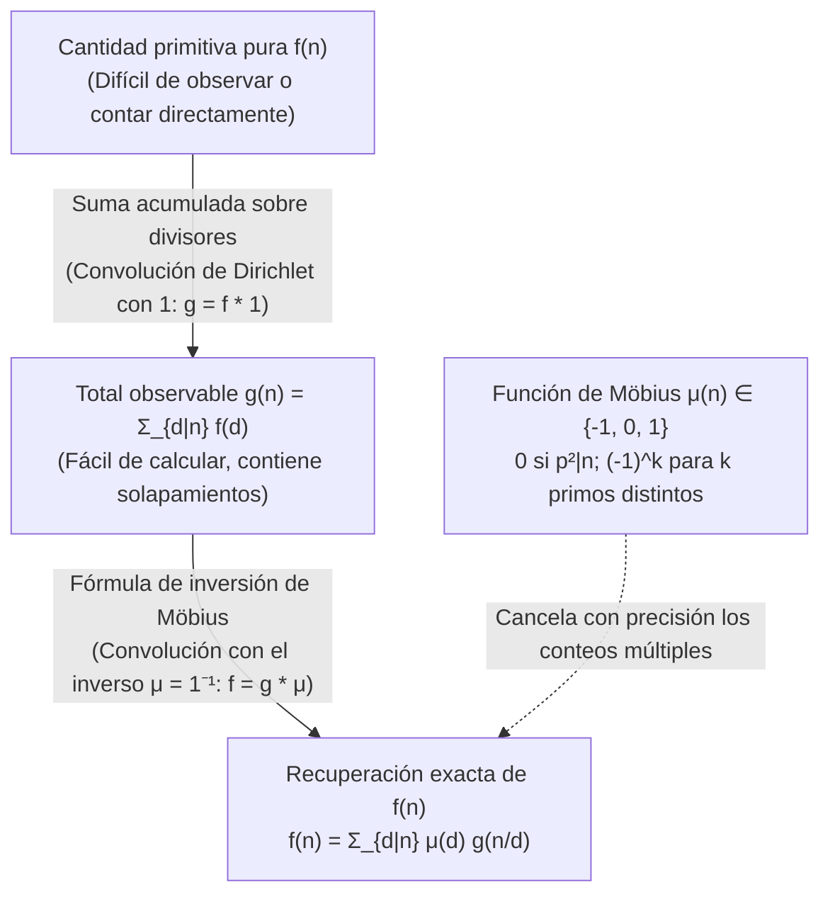
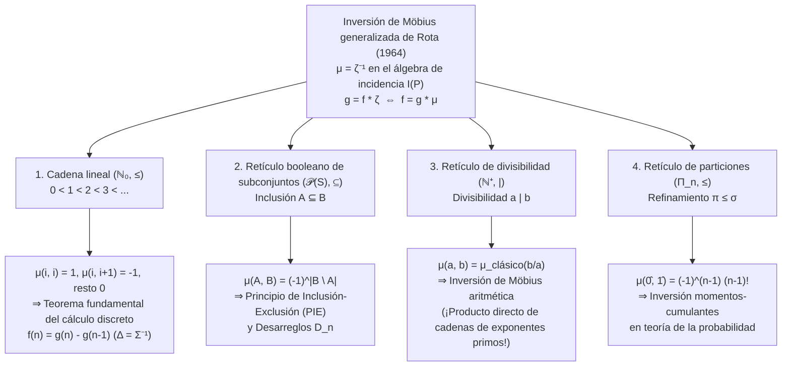

## 1. Introducción: El problema inverso fundamental en matemáticas

En teoría de números, combinatoria, álgebra y física estadística nos enfrentamos repetidamente al mismo problema inverso: <strong>la cantidad pura y primitiva $f(n)$ que deseamos conocer es sumamente difícil de contar directamente, mientras que la suma acumulada $g(n)$, que mezcla las contribuciones de todos los elementos inferiores de una jerarquía, resulta extraordinariamente fácil de calcular.</strong>

Veamos tres ejemplos clásicos:

1. <strong>Cadenas periódicas y palabras de Lyndon aperiódicas</strong>:
   Con un alfabeto de $q$ símbolos existen $g(n) = q^n$ cadenas de longitud $n$. Sin embargo, este total incluye cadenas periódicas degeneradas formadas al repetir un bloque más corto de período mínimo $d \mid n$. Si $f(d)$ denota el número de cadenas verdaderamente aperiódicas de período mínimo exacto $d$, se cumple:
   $$g(n) = \sum_{d \mid n} f(d)$$
2. <strong>Fracciones reducibles e irreducibles (Función $\varphi(n)$ de Euler)</strong>:
   Al simplificar las $n$ fracciones $\frac{1}{n}, \frac{2}{n}, \dots, \frac{n}{n}$, cada denominador se convierte en un divisor $d \mid n$. Dado que existen exactamente $\varphi(d)$ fracciones irreducibles con denominador $d$, obtenemos la identidad de Gauss:
   $$n = \sum_{d \mid n} \varphi(d)$$
3. <strong>Sumas sobre subconjuntos y el Principio de Inclusión-Exclusión (PIE)</strong>:
   Si cada subconjunto $A \subseteq S$ tiene un peso intrínseco $f(A)$ pero solo podemos observar la suma acumulada $g(B) = \sum_{A \subseteq B} f(A)$, ¿cómo recuperamos $f(B)$?

La resta ingenua de los divisores propios conduce de inmediato a una sustracción excesiva. Para $n = 6$, los divisores propios максимаles son $3$ y $2$, cuya intersección corresponde a $\gcd(3, 2) = 1$:
$$f(6) = g(6) - g(3) - g(2) + g(1)$$
Para $n = 12$, los divisores propios maximales son $6$ y $4$ con $\gcd(6, 4) = 2$:
$$f(12) = g(12) - g(6) - g(4) + g(2)$$
Sorprendentemente, aunque $3$ y $1$ son divisores de $12$, los términos $g(3)$ y $g(1)$ tienen coeficiente <strong>$0$</strong> (porque los cocientes $12/3 = 4 = 2^2$ y $12/1 = 12 = 2^2 \cdot 3$ son divisibles por el cuadrado de un primo).

En 1832, el matemático alemán <strong>August Ferdinand Möbius</strong> resolvió este problema introduciendo la <strong>función de Möbius $\mu(n)$</strong>. En 1964, <strong>Gian-Carlo Rota</strong> generalizó este principio a los <strong>conjuntos parcialmente ordenados (posets)</strong> y sus <strong>álgebras de incidencia</strong>, demostrando que la inversión de Möbius en teoría de números, el principio de inclusión-exclusión, el teorema fundamental del cálculo discreto y la relación entre momentos y cumulantes en probabilidad son casos particulares de la ecuación universal $\mu = \zeta^{-1}$.

---

## 2. La función de Möbius $\mu(n)$: Definición, multiplicatividad e identidad fundamental

### 2.1 Definición rigurosa

> [!IMPORTANT]
> <strong>Definición (Función de Möbius $\mu(n)$, 1832)</strong>
> Para todo entero positivo $n \in \mathbb{N}^+$, la <strong>función de Möbius</strong> $\mu : \mathbb{N}^+ \to \{-1, 0, 1\}$ se define como:
> $$\mu(n) = \begin{cases} 1 & \text{si } n = 1, \\[4pt] (-1)^k & \text{si } n = p_1 p_2 \cdots p_k \text{ es producto de } k \text{ primos distintos (libre de cuadrados)}, \\[4pt] 0 & \text{si } p^2 \mid n \text{ para algún primo } p. \end{cases}$$

| $n$ | Factorización prima | ¿Libre de cuadrados? | Primos distintos $k$ | Función de Möbius $\mu(n)$ | Función de Mertens $M(n) = \sum_{m=1}^n \mu(m)$ |
| :---: | :---: | :---: | :---: | :---: | :---: |
| $1$ | $1$ (producto vacío) | Sí | $0$ | $+1$ | $+1$ |
| $2$ | $2$ | Sí | $1$ | $-1$ | $0$ |
| $3$ | $3$ | Sí | $1$ | $-1$ | $-1$ |
| $4$ | $2^2$ | <strong>No</strong> ($2^2 \mid 4$) | — | $0$ | $-1$ |
| $5$ | $5$ | Sí | $1$ | $-1$ | $-2$ |
| $6$ | $2 \cdot 3$ | Sí | $2$ | $+1$ | $-1$ |
| $7$ | $7$ | Sí | $1$ | $-1$ | $-2$ |
| $8$ | $2^3$ | <strong>No</strong> ($2^2 \mid 8$) | — | $0$ | $-2$ |
| $9$ | $3^2$ | <strong>No</strong> ($3^2 \mid 9$) | — | $0$ | $-2$ |
| $10$ | $2 \cdot 5$ | Sí | $2$ | $+1$ | $-1$ |
| $11$ | $11$ | Sí | $1$ | $-1$ | $-2$ |
| $12$ | $2^2 \cdot 3$ | <strong>No</strong> ($2^2 \mid 12$) | — | $0$ | $-2$ |

### 2.2 Multiplicatividad e identidad fundamental

1. <strong>Multiplicatividad</strong>: Si $\gcd(a, b) = 1$, entonces <strong>$\mu(ab) = \mu(a)\mu(b)$</strong>.
   *Demostración*: Si $a$ o $b$ es divisible por un cuadrado $p^2$, entonces $ab$ también lo es y ambos lados valen $0$. Si ambos son libres de cuadrados con $r$ y $s$ factores primos, como $\gcd(a, b) = 1$, sus conjuntos de primos son disjuntos y $\mu(ab) = (-1)^{r+s} = (-1)^r (-1)^s = \mu(a)\mu(b)$. $\blacksquare$

2. <strong>Identidad fundamental</strong>:
   $$\sum_{d \mid n} \mu(d) = \varepsilon(n) := \begin{cases} 1 & n = 1, \\ 0 & n > 1. \end{cases}$$
   *Demostración mediante el teorema del binomio*: Para $n = p_1^{a_1} \cdots p_k^{a_k} > 1$ ($k \ge 1$), solo los divisores libres de cuadrados $d \mid n$ aportan términos no nulos. Hay $\binom{k}{j}$ formas de elegir $j$ primos distintos de $\{p_1, \dots, p_k\}$, cada una con $\mu(d) = (-1)^j$. Por el teorema del binomio:
   $$\sum_{d \mid n} \mu(d) = \sum_{j = 0}^{k} \binom{k}{j} (-1)^j 1^{k - j} = (1 - 1)^k = 0. \quad \blacksquare$$

---

## 3. El anillo conmutativo de funciones aritméticas bajo la convolución de Dirichlet

En el espacio $\mathcal{A} = \{f : \mathbb{N}^+ \to \mathbb{C}\}$ de las funciones aritméticas, la <strong>convolución de Dirichlet</strong> se define por:

$$(f * g)(n) := \sum_{d \mid n} f(d)\,g\!\left(\frac{n}{d}\right) = \sum_{ab = n} f(a)\,g(b)$$

$(\mathcal{A}, +, *)$ es un anillo conmutativo con identidad <strong>$\varepsilon(n) = [n = 1]$</strong> ($f * \varepsilon = f$).
Si definimos la función constante <strong>$\mathbf{1}(n) = 1$</strong>, sumar sobre los divisores equivale a convolucionar con $\mathbf{1}$: $g(n) = \sum_{d \mid n} f(d) = (f * \mathbf{1})(n)$, es decir, $g = f * \mathbf{1}$.
La identidad fundamental $\sum_{d \mid n} \mu(d) = \varepsilon(n)$ expresa que:

$$\mu * \mathbf{1} = \mathbf{1} * \mu = \varepsilon \quad \Longleftrightarrow \quad \mu = \mathbf{1}^{-1}$$

<strong>¡La función de Möbius $\mu$ es exactamente el inverso de Dirichlet de la función constante $\mathbf{1}$!</strong> De este modo, la <strong>fórmula clásica de inversión de Möbius</strong> se demuestra en una sola línea:

$$g = f * \mathbf{1} \iff g * \mu = f * (\mathbf{1} * \mu) = f * \varepsilon = f \iff f(n) = \sum_{d \mid n} \mu(d)\,g\!\left(\frac{n}{d}\right) = \sum_{d \mid n} \mu\!\left(\frac{n}{d}\right) g(d)$$

### Series de Dirichlet, función zeta de Riemann $\zeta(s)$ e hipótesis de Riemann

Asociando a cada $f \in \mathcal{A}$ su <strong>serie de Dirichlet</strong> $D_f(s) = \sum_{n=1}^{\infty} \frac{f(n)}{n^s}$, la convolución se transforma en multiplicación ordinaria: $D_{f * g}(s) = D_f(s) D_g(s)$. Como $D_{\mathbf{1}}(s) = \zeta(s) = \sum_{n=1}^{\infty} \frac{1}{n^s}$ es la <strong>función zeta de Riemann</strong> y $D_{\varepsilon}(s) = 1$, la ecuación $\mathbf{1} * \mu = \varepsilon$ implica inmediatamente:

$$\zeta(s) \sum_{n = 1}^{\infty} \frac{\mu(n)}{n^s} = 1 \quad \Longrightarrow \quad \frac{1}{\zeta(s)} = \sum_{n = 1}^{\infty} \frac{\mu(n)}{n^s} \qquad (\operatorname{Re}(s) > 1)$$

- El <strong>Teorema de los Números Primos</strong> equivale a $\sum_{n=1}^{\infty} \frac{\mu(n)}{n} = 0$, o $M(x) = \sum_{n \le x} \mu(n) = o(x)$.
- La <strong>Hipótesis de Riemann (RH)</strong> equivale a la analiticidad de $\frac{1}{\zeta(s)}$ en $\operatorname{Re}(s) > \frac{1}{2}$, lo que equivale exactamente a la cancelación de raíz cuadrada en la función de Mertens:
  $$\text{Hipótesis de Riemann} \quad \Longleftrightarrow \quad M(x) = \sum_{n \le x} \mu(n) = O\!\left(x^{\frac{1}{2} + \varepsilon}\right) \quad (\forall \varepsilon > 0)$$

---

## 4. Tres aplicaciones clásicas

1. <strong>Función $\varphi(n)$ de Euler</strong>: A partir de $\sum_{d \mid n} \varphi(d) = n$ ($\varphi * \mathbf{1} = \mathrm{id}$), al invertir con $\mu$ obtenemos $\varphi = \mathrm{id} * \mu$:
   $$\varphi(n) = \sum_{d \mid n} \mu(d)\,\frac{n}{d} = n \prod_{p \mid n} \left(1 - \frac{1}{p}\right)$$
2. <strong>Collares aperiódicos (palabras de Lyndon) y polinomios irreducibles sobre $\mathbb{F}_q$</strong>:
   Tanto el número $N_q(d)$ de collares aperiódicos de longitud $d$ sobre $q$ letras como el número $I_q(d)$ de polinomios irreducibles mónicos de grado $d$ sobre el cuerpo finito $\mathbb{F}_q$ (dado que $x^{q^n} - x = \prod_{d \mid n} \prod_{\deg P = d} P(x)$) satisfacen $q^n = \sum_{d \mid n} d \cdot N_q(d) = \sum_{d \mid n} d \cdot I_q(d)$. La inversión de Möbius proporciona la <strong>fórmula de Gauss</strong>:
   $$N_q(n) = I_q(n) = \frac{1}{n} \sum_{d \mid n} \mu\!\left(\frac{n}{d}\right) q^d$$
3. <strong>Polinomios ciclotómicos $\Phi_n(x)$</strong>:
   De $x^n - 1 = \prod_{d \mid n} \Phi_d(x)$, la inversión multiplicativa de Möbius arroja:
   $$\Phi_n(x) = \prod_{d \mid n} (x^d - 1)^{\mu(n/d)}$$
   Para $n = 12$, con $d \in \{1, 2, 3, 4, 6, 12\}$ y $\mu(12/d) \in \{0, +1, 0, -1, -1, +1\}$, calculamos directamente:
   $$\Phi_{12}(x) = \frac{(x^{12} - 1)(x^2 - 1)}{(x^6 - 1)(x^4 - 1)} = \frac{x^6 + 1}{x^2 + 1} = x^4 - x^2 + 1$$

---

## 5. La gran unificación de Gian-Carlo Rota (1964): Posets y álgebras de incidencia

Sea $(P, \le)$ un <strong>conjunto parcialmente ordenado (poset)</strong> localmente finito (todo intervalo cerrado $[x, y] = \{z \in P \mid x \le z \le y\}$ es finito). El <strong>álgebra de incidencia $I(P)$</strong> se equipa con la convolución sobre intervalos:

$$(\alpha * \beta)(x, y) := \sum_{x \le z \le y} \alpha(x, z)\,\beta(z, y) \qquad (x \le y)$$

La identidad es la delta de Kronecker $\delta(x, y) = [x = y]$. La <strong>función zeta $\zeta(x, y) = 1$</strong> (para $x \le y$) posee un único inverso <strong>$\mu = \zeta^{-1}$</strong> definido recursivamente por $\mu(x, x) = 1$ y $\mu(x, y) = -\sum_{x \le z < y} \mu(x, z)$ para $x < y$. Así se obtiene el <strong>teorema de inversión de Möbius generalizado sobre posets</strong>:

$$g(y) = \sum_{x \le y} f(x) \quad \Longleftrightarrow \quad f(y) = \sum_{x \le y} g(x)\,\mu(x, y)$$

| Poset $(P, \le)$ | Relación de orden $x \le y$ | Función de Möbius $\mu(x, y)$ | Teorema fundamental obtenido de $f = g * \mu$ |
| :--- | :--- | :--- | :--- |
| <strong>Cadena lineal</strong> $(\mathbb{N}_0, \le)$ | Magnitud $i \le j$ | $1$ ($j=i$), $-1$ ($j=i+1$), $0$ (resto) | <strong>Cálculo discreto fundamental</strong> $f(n) = g(n) - g(n-1)$ |
| <strong>Retículo booleano</strong> $(\mathcal{P}(S), \subseteq)$ | Inclusión $A \subseteq B$ | $(-1)^{|B \setminus A|}$ | <strong>Inclusión-Exclusión (PIE)</strong> y Desarreglos $D_n = n!\sum_{k=0}^n \frac{(-1)^k}{k!}$ |
| <strong>Retículo de divisibilidad</strong> $(\mathbb{N}^+, \mid)$ | Divisibilidad $a \mid b$ | $\mu_{\text{clásico}}(b/a) \in \{-1, 0, 1\}$ | <strong>Inversión de Möbius clásica</strong> $f(n) = \sum_{d \mid n} \mu(n/d) g(d)$ |
| <strong>Retículo de particiones</strong> $(\Pi_n, \le)$ | Refinamiento $\pi \le \sigma$ | $\mu(\pi, \hat{1}) = (-1)^{|\pi|-1}(|\pi|-1)!$ | <strong>Inversión momentos-cumulantes</strong> $\kappa_n = \sum_{\pi \in \Pi_n} \mu(\pi, \hat{1}) \prod_{B \in \pi} \mathbb{E}[X_B]$ |
