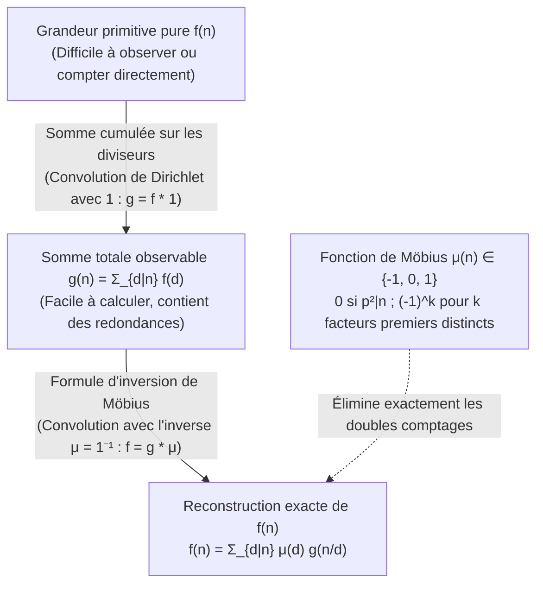
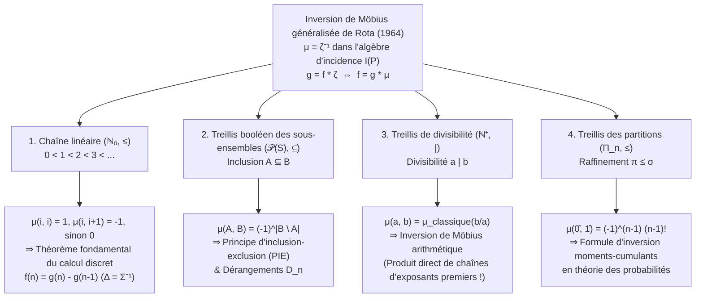

## 1. Introduction : Le problème inverse fondamental en mathématiques

En théorie des nombres, en combinatoire, en algèbre et en physique statistique, nous rencontrons sans cesse le même problème inverse : <strong>la quantité pure et primitive $f(n)$ que nous cherchons à déterminer est très difficile à compter directement, tandis que la somme cumulée $g(n)$, qui mélange les contributions de tous les éléments inférieurs d'une hiérarchie, se calcule avec une facilité déconcertante.</strong>

Considérons trois exemples fondamentaux :

1. <strong>Mots périodiques et mots de Lyndon apériodiques</strong> :
   Sur un alphabet à $q$ lettres, il existe $g(n) = q^n$ mots de longueur $n$. Mais ce total inclut les mots périodiques obtenus en répétant un motif plus court de période minimale $d \mid n$. Si $f(d)$ désigne le nombre de mots véritablement apériodiques de période minimale $d$, alors :
   $$g(n) = \sum_{d \mid n} f(d)$$
2. <strong>Fractions réductibles et irréductibles (Indicatrice d'Euler $\varphi(n)$)</strong> :
   En réduisant les $n$ fractions $\frac{1}{n}, \frac{2}{n}, \dots, \frac{n}{n}$ sous forme irréductible, chaque dénominateur devient un diviseur $d \mid n$. Comme il y a exactement $\varphi(d)$ fractions irréductibles de dénominateur $d$, on obtient l'identité de Gauss :
   $$n = \sum_{d \mid n} \varphi(d)$$
3. <strong>Sommes sur les sous-ensembles et principe d'inclusion-exclusion (PIE)</strong> :
   Si chaque sous-ensemble $A \subseteq S$ possède un poids intrinsèque $f(A)$ mais que seule la somme cumulée $g(B) = \sum_{A \subseteq B} f(A)$ est observable, comment isoler $f(B)$ ?

Une soustraction naïve des diviseurs propres entraîne immédiatement des soustractions excessives. Pour $n = 6$, les diviseurs propres maximaux sont $3$ et $2$, et leur intersection correspond à $\gcd(3, 2) = 1$, d'où :
$$f(6) = g(6) - g(3) - g(2) + g(1)$$
Pour $n = 12$, les diviseurs propres maximaux sont $6$ et $4$ avec $\gcd(6, 4) = 2$, ce qui donne :
$$f(12) = g(12) - g(6) - g(4) + g(2)$$
De manière remarquable, bien que $3$ et $1$ divisent $12$, les termes $g(3)$ et $g(1)$ ont un coefficient égal à <strong>$0$</strong> (car les quotients $12/3 = 4 = 2^2$ et $12/1 = 12 = 2^2 \cdot 3$ contiennent un facteur premier au carré) !

En 1832, le mathématicien allemand <strong>August Ferdinand Möbius</strong> a résolu ce problème en introduisant la <strong>fonction de Möbius $\mu(n)$</strong>. En 1964, <strong>Gian-Carlo Rota</strong> a généralisé cette théorie aux <strong>ensembles partiellement ordonnés (posets)</strong> et à leurs <strong>algèbres d'incidence</strong>, démontrant que l'inversion arithmétique de Möbius, le principe d'inclusion-exclusion, le théorème fondamental du calcul discret et l'inversion moments-cumulants en probabilités ne sont que des cas particuliers de l'équation universelle $\mu = \zeta^{-1}$.

---

## 2. La fonction de Möbius $\mu(n)$ : Définition, multiplicativité et identité fondamentale

### 2.1 Définition rigoureuse

> [!IMPORTANT]
> <strong>Définition (Fonction de Möbius $\mu(n)$, 1832)</strong>
> Pour tout entier strictement positif $n \in \mathbb{N}^+$, la <strong>fonction de Möbius</strong> $\mu : \mathbb{N}^+ \to \{-1, 0, 1\}$ est définie par :
> $$\mu(n) = \begin{cases} 1 & \text{si } n = 1, \\[4pt] (-1)^k & \text{si } n = p_1 p_2 \cdots p_k \text{ est le produit de } k \text{ nombres premiers distincts (sans facteur carré)}, \\[4pt] 0 & \text{s'il existe un nombre premier } p \text{ tel que } p^2 \mid n. \end{cases}$$

| $n$ | Factorisation première | Sans facteur carré ? | Nombre $k$ de facteurs premiers | Fonction de Möbius $\mu(n)$ | Fonction de Mertens $M(n) = \sum_{m=1}^n \mu(m)$ |
| :---: | :---: | :---: | :---: | :---: | :---: |
| $1$ | $1$ (produit vide) | Oui | $0$ | $+1$ | $+1$ |
| $2$ | $2$ | Oui | $1$ | $-1$ | $0$ |
| $3$ | $3$ | Oui | $1$ | $-1$ | $-1$ |
| $4$ | $2^2$ | <strong>Non</strong> ($2^2 \mid 4$) | — | $0$ | $-1$ |
| $5$ | $5$ | Oui | $1$ | $-1$ | $-2$ |
| $6$ | $2 \cdot 3$ | Oui | $2$ | $+1$ | $-1$ |
| $7$ | $7$ | Oui | $1$ | $-1$ | $-2$ |
| $8$ | $2^3$ | <strong>Non</strong> ($2^2 \mid 8$) | — | $0$ | $-2$ |
| $9$ | $3^2$ | <strong>Non</strong> ($3^2 \mid 9$) | — | $0$ | $-2$ |
| $10$ | $2 \cdot 5$ | Oui | $2$ | $+1$ | $-1$ |
| $11$ | $11$ | Oui | $1$ | $-1$ | $-2$ |
| $12$ | $2^2 \cdot 3$ | <strong>Non</strong> ($2^2 \mid 12$) | — | $0$ | $-2$ |

### 2.2 Multiplicativité et identité fondamentale

1. <strong>Multiplicativité</strong> : Si $\gcd(a, b) = 1$, alors <strong>$\mu(ab) = \mu(a)\mu(b)$</strong>.
   *Démonstration* : Si $a$ ou $b$ est divisible par un carré $p^2$, alors $ab$ l'est aussi et les deux membres valent $0$. S'ils sont tous deux sans facteur carré avec $r$ et $s$ facteurs premiers, l'hypothèse $\gcd(a, b) = 1$ garantit que leurs ensembles de facteurs premiers sont disjoints, d'où $\mu(ab) = (-1)^{r+s} = (-1)^r (-1)^s = \mu(a)\mu(b)$. $\blacksquare$

2. <strong>Identité fondamentale</strong> :
   $$\sum_{d \mid n} \mu(d) = \varepsilon(n) := \begin{cases} 1 & n = 1, \\ 0 & n > 1. \end{cases}$$
   *Démonstration par la formule du binôme* : Pour $n = p_1^{a_1} \cdots p_k^{a_k} > 1$ ($k \ge 1$), seuls les diviseurs sans facteur carré $d \mid n$ ont une contribution non nulle. Il y a $\binom{k}{j}$ façons de choisir $j$ facteurs premiers parmi $\{p_1, \dots, p_k\}$, chacune donnant $\mu(d) = (-1)^j$. Par la formule du binôme de Newton :
   $$\sum_{d \mid n} \mu(d) = \sum_{j = 0}^{k} \binom{k}{j} (-1)^j 1^{k - j} = (1 - 1)^k = 0. \quad \blacksquare$$

---

## 3. L'anneau commutatif des fonctions arithmétiques sous la convolution de Dirichlet

Sur l'espace $\mathcal{A} = \{f : \mathbb{N}^+ \to \mathbb{C}\}$ des fonctions arithmétiques, la <strong>convolution de Dirichlet</strong> est définie par :

$$(f * g)(n) := \sum_{d \mid n} f(d)\,g\!\left(\frac{n}{d}\right) = \sum_{ab = n} f(a)\,g(b)$$

$(\mathcal{A}, +, *)$ est un anneau commutatif unitaire dont l'élément neutre multiplicatif est <strong>$\varepsilon(n) = [n = 1]$</strong> ($f * \varepsilon = f$).
En notant <strong>$\mathbf{1}(n) = 1$</strong> la fonction constante égale à $1$, la sommation sur les diviseurs s'écrit $g(n) = \sum_{d \mid n} f(d) = (f * \mathbf{1})(n)$, soit $g = f * \mathbf{1}$.
L'identité fondamentale $\sum_{d \mid n} \mu(d) = \varepsilon(n)$ signifie exactement que :

$$\mu * \mathbf{1} = \mathbf{1} * \mu = \varepsilon \quad \Longleftrightarrow \quad \mu = \mathbf{1}^{-1}$$

<strong>La fonction de Möbius $\mu$ est l'inverse exact de la fonction constante $\mathbf{1}$ pour la convolution de Dirichlet !</strong> La <strong>formule d'inversion de Möbius classique</strong> se démontre alors en une seule ligne :

$$g = f * \mathbf{1} \iff g * \mu = f * (\mathbf{1} * \mu) = f * \varepsilon = f \iff f(n) = \sum_{d \mid n} \mu(d)\,g\!\left(\frac{n}{d}\right) = \sum_{d \mid n} \mu\!\left(\frac{n}{d}\right) g(d)$$

### Séries de Dirichlet, fonction zêta de Riemann $\zeta(s)$ et hypothèse de Riemann

Le passage aux <strong>séries de Dirichlet</strong> $D_f(s) = \sum_{n=1}^{\infty} \frac{f(n)}{n^s}$ transforme la convolution en produit ordinaire : $D_{f * g}(s) = D_f(s) D_g(s)$. Comme $D_{\mathbf{1}}(s) = \zeta(s) = \sum_{n=1}^{\infty} \frac{1}{n^s}$ est la <strong>fonction zêta de Riemann</strong> et $D_{\varepsilon}(s) = 1$, la relation $\mathbf{1} * \mu = \varepsilon$ donne immédiatement :

$$\zeta(s) \sum_{n = 1}^{\infty} \frac{\mu(n)}{n^s} = 1 \quad \Longrightarrow \quad \frac{1}{\zeta(s)} = \sum_{n = 1}^{\infty} \frac{\mu(n)}{n^s} \qquad (\operatorname{Re}(s) > 1)$$

- Le <strong>théorème des nombres premiers</strong> est équivalent à $\sum_{n=1}^{\infty} \frac{\mu(n)}{n} = 0$, soit $M(x) = \sum_{n \le x} \mu(n) = o(x)$.
- L'<strong>hypothèse de Riemann (RH)</strong> est équivalente au caractère holomorphe de $\frac{1}{\zeta(s)}$ sur $\operatorname{Re}(s) > \frac{1}{2}$, ce qui équivaut exactement à la majoration en racine carrée de la fonction de Mertens :
  $$\text{Hypothèse de Riemann} \quad \Longleftrightarrow \quad M(x) = \sum_{n \le x} \mu(n) = O\!\left(x^{\frac{1}{2} + \varepsilon}\right) \quad (\forall \varepsilon > 0)$$

---

## 4. Trois applications classiques

1. <strong>Indicatrice d'Euler $\varphi(n)$</strong> : De $\sum_{d \mid n} \varphi(d) = n$ ($\varphi * \mathbf{1} = \mathrm{id}$), l'inversion de Möbius donne $\varphi = \mathrm{id} * \mu$ :
   $$\varphi(n) = \sum_{d \mid n} \mu(d)\,\frac{n}{d} = n \prod_{p \mid n} \left(1 - \frac{1}{p}\right)$$
2. <strong>Colliers apériodiques (mots de Lyndon) et polynômes irréductibles sur $\mathbb{F}_q$</strong> :
   Le nombre $N_q(d)$ de colliers apériodiques de longueur $d$ sur un alphabet de taille $q$ et le nombre $I_q(d)$ de polynômes irréductibles unitaires de degré $d$ sur le corps fini $\mathbb{F}_q$ (via $x^{q^n} - x = \prod_{d \mid n} \prod_{\deg P = d} P(x)$) vérifient tous deux $q^n = \sum_{d \mid n} d \cdot N_q(d) = \sum_{d \mid n} d \cdot I_q(d)$. L'inversion de Möbius fournit la <strong>formule de Gauss</strong> :
   $$N_q(n) = I_q(n) = \frac{1}{n} \sum_{d \mid n} \mu\!\left(\frac{n}{d}\right) q^d$$
3. <strong>Polynômes cyclotomiques $\Phi_n(x)$</strong> :
   À partir de $x^n - 1 = \prod_{d \mid n} \Phi_d(x)$, l'inversion de Möbius multiplicative donne :
   $$\Phi_n(x) = \prod_{d \mid n} (x^d - 1)^{\mu(n/d)}$$
   Pour $n = 12$, avec $d \in \{1, 2, 3, 4, 6, 12\}$ et $\mu(12/d) \in \{0, +1, 0, -1, -1, +1\}$, on obtient :
   $$\Phi_{12}(x) = \frac{(x^{12} - 1)(x^2 - 1)}{(x^6 - 1)(x^4 - 1)} = \frac{x^6 + 1}{x^2 + 1} = x^4 - x^2 + 1$$

---

## 5. La grande unification de Gian-Carlo Rota (1964) : Posets et algèbres d'incidence

Soit $(P, \le)$ un <strong>ensemble partiellement ordonné (poset)</strong> localement fini (chaque intervalle fermé $[x, y] = \{z \in P \mid x \le z \le y\}$ est fini). L'<strong>algèbre d'incidence $I(P)$</strong> est munie du produit de convolution :

$$(\alpha * \beta)(x, y) := \sum_{x \le z \le y} \alpha(x, z)\,\beta(z, y) \qquad (x \le y)$$

L'élément neutre est le delta de Kronecker $\delta(x, y) = [x = y]$. La <strong>fonction zêta $\zeta(x, y) = 1$</strong> (pour $x \le y$) admet un unique inverse <strong>$\mu = \zeta^{-1}$</strong> défini par récurrence par $\mu(x, x) = 1$ et $\mu(x, y) = -\sum_{x \le z < y} \mu(x, z)$ pour $x < y$. On obtient ainsi le <strong>théorème d'inversion de Möbius généralisé sur les posets</strong> :

$$g(y) = \sum_{x \le y} f(x) \quad \Longleftrightarrow \quad f(y) = \sum_{x \le y} g(x)\,\mu(x, y)$$

| Poset $(P, \le)$ | Relation d'ordre $x \le y$ | Fonction de Möbius $\mu(x, y)$ | Théorème fondamental issu de $f = g * \mu$ |
| :--- | :--- | :--- | :--- |
| <strong>Chaîne linéaire</strong> $(\mathbb{N}_0, \le)$ | Ordre naturel $i \le j$ | $1$ ($j=i$), $-1$ ($j=i+1$), $0$ (sinon) | <strong>Calcul discret fondamental</strong> $f(n) = g(n) - g(n-1)$ |
| <strong>Treillis booléen</strong> $(\mathcal{P}(S), \subseteq)$ | Inclusion $A \subseteq B$ | $(-1)^{|B \setminus A|}$ | <strong>Principe d'inclusion-exclusion (PIE)</strong> & Dérangements $D_n = n!\sum_{k=0}^n \frac{(-1)^k}{k!}$ |
| <strong>Treillis de divisibilité</strong> $(\mathbb{N}^+, \mid)$ | Divisibilité $a \mid b$ | $\mu_{\text{classique}}(b/a) \in \{-1, 0, 1\}$ | <strong>Inversion de Möbius classique</strong> $f(n) = \sum_{d \mid n} \mu(n/d) g(d)$ |
| <strong>Treillis des partitions</strong> $(\Pi_n, \le)$ | Raffinement $\pi \le \sigma$ | $\mu(\pi, \hat{1}) = (-1)^{|\pi|-1}(|\pi|-1)!$ | <strong>Inversion moments-cumulants</strong> $\kappa_n = \sum_{\pi \in \Pi_n} \mu(\pi, \hat{1}) \prod_{B \in \pi} \mathbb{E}[X_B]$ |
