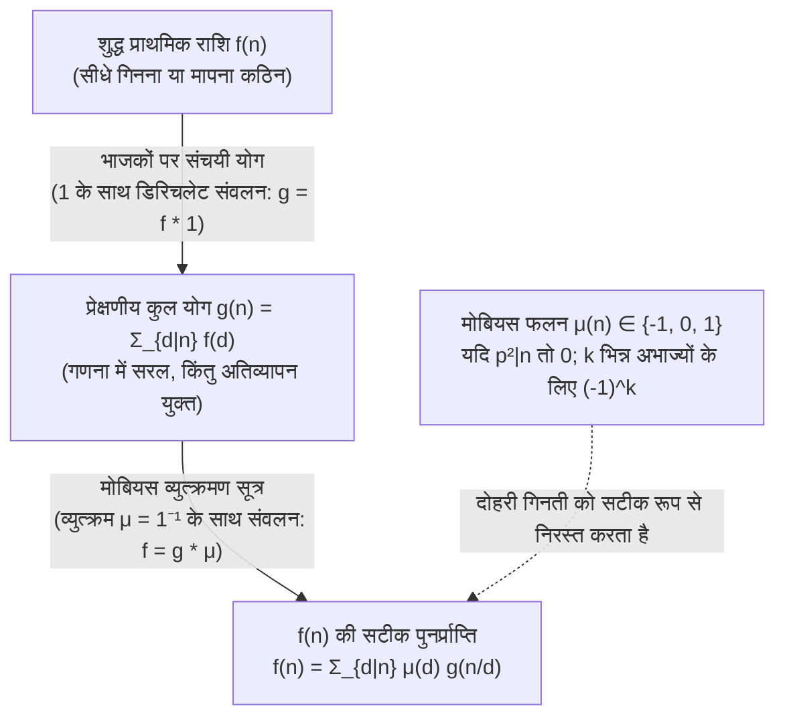
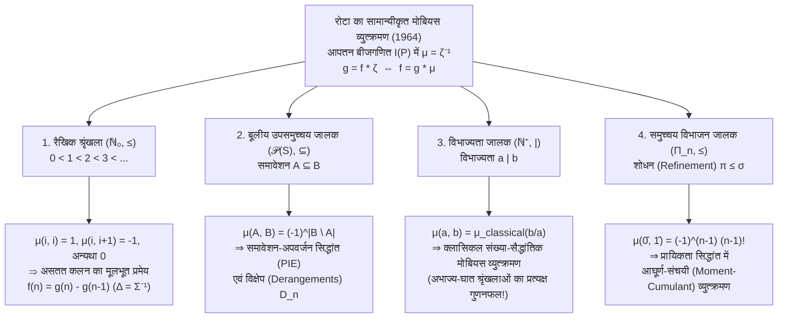

## 1. भूमिका: गणित की मूलभूत व्युत्क्रम समस्या (Inverse Problem)

संख्या सिद्धांत, सांयोगिकी (combinatorics), बीजगणित और सांख्यिकीय भौतिकी में हम बार-बार एक ही मूलभूत व्युत्क्रम समस्या का सामना करते हैं: <strong>वह शुद्ध, प्राथमिक राशि $f(n)$ जिसे हम वास्तव में जानना चाहते हैं, उसे सीधे गिनना अत्यंत कठिन होता है, जबकि पदानुक्रम के सभी निचले अवयवों के योगदानों को मिलाने वाला संचयी योग $g(n)$ आश्चर्यजनक रूप से आसानी से ज्ञात हो जाता है।</strong>

आइए तीन क्लासिकल उदाहरण देखें:

1. <strong>आवर्ती स्ट्रिंग्स और अनावर्ती लिंडन शब्द (Lyndon Words)</strong>:
   $q$ अक्षरों की वर्णमाला से लंबाई $n$ की कुल $g(n) = q^n$ स्ट्रिंग्स बनती हैं। किंतु इनमें वे आवर्ती स्ट्रिंग्स भी शामिल हैं जो किसी छोटे आवर्त $d \mid n$ वाले खंड की पुनरावृत्ति से बनी हैं। यदि $f(d)$ न्यूनतम आवर्त $d$ वाली शुद्ध अनावर्ती स्ट्रिंग्स की संख्या हो, तो भाजकों पर योग का संबंध लागू होता है:
   $$g(n) = \sum_{d \mid n} f(d)$$
2. <strong>लघुकरणीय और अलघुकरणीय भिन्न (यूलर का टोशिएंट फलन $\varphi(n)$)</strong>:
   जब हम $n$ भिन्नों $\frac{1}{n}, \frac{2}{n}, \dots, \frac{n}{n}$ को सरलतम रूप में लिखते हैं, तो प्रत्येक हर (denominator) $n$ का एक भाजक $d \mid n$ बन जाता है। चूँकि हर $d$ वाली अलघुकरणीय भिन्नों की संख्या $\varphi(d)$ होती है, हमें गाउस की प्रसिद्ध सर्वसमिका मिलती है:
   $$n = \sum_{d \mid n} \varphi(d)$$
3. <strong>उपसमुच्चय योग और समावेशन-अपवर्जन का सिद्धांत (PIE)</strong>:
   यदि प्रत्येक उपसमुच्चय $A \subseteq S$ का अपना शुद्ध भार $f(A)$ हो, किंतु केवल संचयी योग $g(B) = \sum_{A \subseteq B} f(A)$ ही प्रेक्षणीय हो, तो $f(B)$ को वापस कैसे प्राप्त करें?

उचित भाजकों को सीधे घटाने पर तुरंत अति-घटाव (over-subtraction) की समस्या उत्पन्न होती है। $n = 6$ के लिए अधिकतम उचित भाजक $3$ और $2$ हैं, जिनका सर्वनिष्ठ $\gcd(3, 2) = 1$ है:
$$f(6) = g(6) - g(3) - g(2) + g(1)$$
$n = 12$ के लिए अधिकतम उचित भाजक $6$ और $4$ हैं जिनका $\gcd(6, 4) = 2$ है:
$$f(12) = g(12) - g(6) - g(4) + g(2)$$
आश्चर्यजनक रूप से, यद्यपि $3$ और $1$ भी $12$ के भाजक हैं, फिर भी $g(3)$ और $g(1)$ का गुणांक यहाँ <strong>$0$</strong> है (क्योंकि भागफल $12/3 = 4 = 2^2$ और $12/1 = 12 = 2^2 \cdot 3$ अभाज्य संख्या के वर्ग से विभाज्य हैं)!

1832 में जर्मन गणितज्ञ <strong>ऑगस्ट फर्डिनेंड मोबियस (August Ferdinand Möbius)</strong> ने <strong>मोबियस फलन $\mu(n)$</strong> प्रस्तुत कर इस समस्या का समाधान किया। 1964 में <strong>जियान-कार्लो रोटा (Gian-Carlo Rota)</strong> ने इसे <strong>अंशतः क्रमित समुच्चयों (Posets)</strong> और उनके <strong>आपतन बीजगणित (Incidence Algebras)</strong> तक व्यापक बनाया, और सिद्ध किया कि संख्या-सैद्धांतिक मोबियस व्युत्क्रमण, समावेशन-अपवर्जन सिद्धांत, असतत कलन का मूलभूत प्रमेय और प्रायिकता में आघूर्ण-संचयी (moment-cumulant) व्युत्क्रमण सभी एक ही सार्वभौमिक समीकरण $\mu = \zeta^{-1}$ के रूप हैं।

---

## 2. मोबियस फलन $\mu(n)$: परिभाषा, गुणनात्मकता और मूलभूत सर्वसमिका

### 2.1 कठोर परिभाषा

> [!IMPORTANT]
> <strong>परिभाषा (मोबियस फलन $\mu(n)$, 1832)</strong>
> किसी भी धनात्मक पूर्णांक $n \in \mathbb{N}^+$ के लिए <strong>मोबियस फलन</strong> $\mu : \mathbb{N}^+ \to \{-1, 0, 1\}$ इस प्रकार परिभाषित है:
> $$\mu(n) = \begin{cases} 1 & \text{यदि } n = 1, \\[4pt] (-1)^k & \text{यदि } n = p_1 p_2 \cdots p_k, \text{ जहाँ } p_i \text{ भिन्न अभाज्य संख्याएँ हैं (वर्ग-मुक्त / square-free)}, \\[4pt] 0 & \text{यदि किसी अभाज्य } p \text{ के लिए } p^2 \mid n. \end{cases}$$

| $n$ | अभाज्य गुणनखंडन | वर्ग-मुक्त (Square-free)? | भिन्न अभाज्य $k$ | मोबियस फलन $\mu(n)$ | मर्टेंस फलन $M(n) = \sum_{m=1}^n \mu(m)$ |
| :---: | :---: | :---: | :---: | :---: | :---: |
| $1$ | $1$ (रिक्त गुणनफल) | हाँ | $0$ | $+1$ | $+1$ |
| $2$ | $2$ | हाँ | $1$ | $-1$ | $0$ |
| $3$ | $3$ | हाँ | $1$ | $-1$ | $-1$ |
| $4$ | $2^2$ | <strong>नहीं</strong> ($2^2 \mid 4$) | — | $0$ | $-1$ |
| $5$ | $5$ | हाँ | $1$ | $-1$ | $-2$ |
| $6$ | $2 \cdot 3$ | हाँ | $2$ | $+1$ | $-1$ |
| $7$ | $7$ | हाँ | $1$ | $-1$ | $-2$ |
| $8$ | $2^3$ | <strong>नहीं</strong> ($2^2 \mid 8$) | — | $0$ | $-2$ |
| $9$ | $3^2$ | <strong>नहीं</strong> ($3^2 \mid 9$) | — | $0$ | $-2$ |
| $10$ | $2 \cdot 5$ | हाँ | $2$ | $+1$ | $-1$ |
| $11$ | $11$ | हाँ | $1$ | $-1$ | $-2$ |
| $12$ | $2^2 \cdot 3$ | <strong>नहीं</strong> ($2^2 \mid 12$) | — | $0$ | $-2$ |

### 2.2 गुणनात्मकता और मूलभूत सर्वसमिका

1. <strong>गुणनात्मकता (Multiplicativity)</strong>: यदि $\gcd(a, b) = 1$, तो <strong>$\mu(ab) = \mu(a)\mu(b)$</strong>।
   *उपपत्ति*: यदि $a$ या $b$ किसी वर्ग $p^2$ से विभाज्य है, तो $ab$ भी $p^2$ से विभाज्य होगा और दोनों पक्ष $0$ होंगे। यदि दोनों वर्ग-मुक्त हैं जिनमें क्रमशः $r$ और $s$ अभाज्य गुणनखंड हैं, तो $\gcd(a, b) = 1$ के कारण उनके अभाज्य समुच्चय असंयुक्त हैं और $\mu(ab) = (-1)^{r+s} = (-1)^r (-1)^s = \mu(a)\mu(b)$। $\blacksquare$

2. <strong>मूलभूत सर्वसमिका (Fundamental Identity)</strong>:
   $$\sum_{d \mid n} \mu(d) = \varepsilon(n) := \begin{cases} 1 & n = 1, \\ 0 & n > 1. \end{cases}$$
   *द्विपद प्रमेय द्वारा उपपत्ति*: $n = p_1^{a_1} \cdots p_k^{a_k} > 1$ ($k \ge 1$) के लिए केवल वर्ग-मुक्त भाजक $d \mid n$ ही अशून्य योगदान देते हैं। $\{p_1, \dots, p_k\}$ में से $j$ भिन्न अभाज्य चुनने के $\binom{k}{j}$ तरीके हैं और प्रत्येक के लिए $\mu(d) = (-1)^j$ है। द्विपद प्रमेय से:
   $$\sum_{d \mid n} \mu(d) = \sum_{j = 0}^{k} \binom{k}{j} (-1)^j 1^{k - j} = (1 - 1)^k = 0. \quad \blacksquare$$

---

## 3. डिरिचलेट संवलन (Dirichlet Convolution) के अंतर्गत अंकगणितीय फलनों का क्रमविनिमेय वलय

अंकगणितीय फलनों की समष्टि $\mathcal{A} = \{f : \mathbb{N}^+ \to \mathbb{C}\}$ पर <strong>डिरिचलेट संवलन</strong> इस प्रकार परिभाषित है:

$$(f * g)(n) := \sum_{d \mid n} f(d)\,g\!\left(\frac{n}{d}\right) = \sum_{ab = n} f(a)\,g(b)$$

$(\mathcal{A}, +, *)$ एक क्रमविनिमेय वलय (commutative ring) है जिसका गुणात्मक तत्समक <strong>$\varepsilon(n) = [n = 1]$</strong> ($f * \varepsilon = f$) है।
अचर फलन <strong>$\mathbf{1}(n) = 1$</strong> परिभाषित करने पर भाजकों पर योग लेना $\mathbf{1}$ के साथ संवलन करने के तुल्य है: $g(n) = \sum_{d \mid n} f(d) = (f * \mathbf{1})(n)$, अर्थात् $g = f * \mathbf{1}$।
मूलभूत सर्वसमिका $\sum_{d \mid n} \mu(d) = \varepsilon(n)$ का अर्थ है:

$$\mu * \mathbf{1} = \mathbf{1} * \mu = \varepsilon \quad \Longleftrightarrow \quad \mu = \mathbf{1}^{-1}$$

<strong>मोबियस फलन $\mu$ वास्तव में अचर फलन $\mathbf{1}$ का डिरिचलेट व्युत्क्रम है!</strong> इससे <strong>क्लासिकल मोबियस व्युत्क्रमण सूत्र</strong> एक ही पंक्ति में सिद्ध हो जाता है:

$$g = f * \mathbf{1} \iff g * \mu = f * (\mathbf{1} * \mu) = f * \varepsilon = f \iff f(n) = \sum_{d \mid n} \mu(d)\,g\!\left(\frac{n}{d}\right) = \sum_{d \mid n} \mu\!\left(\frac{n}{d}\right) g(d)$$

### डिरिचलेट श्रेणी, रीमान ज़ीटा फलन $\zeta(s)$ और रीमान परिकल्पना

प्रत्येक $f \in \mathcal{A}$ को उसकी <strong>डिरिचलेट श्रेणी</strong> $D_f(s) = \sum_{n=1}^{\infty} \frac{f(n)}{n^s}$ से जोड़ने पर संवलन साधारण गुणन में बदल जाता है: $D_{f * g}(s) = D_f(s) D_g(s)$। चूँकि $D_{\mathbf{1}}(s) = \zeta(s) = \sum_{n=1}^{\infty} \frac{1}{n^s}$ <strong>रीमान ज़ीटा फलन</strong> है और $D_{\varepsilon}(s) = 1$, समीकरण $\mathbf{1} * \mu = \varepsilon$ तुरंत देता है:

$$\zeta(s) \sum_{n = 1}^{\infty} \frac{\mu(n)}{n^s} = 1 \quad \Longrightarrow \quad \frac{1}{\zeta(s)} = \sum_{n = 1}^{\infty} \frac{\mu(n)}{n^s} \qquad (\operatorname{Re}(s) > 1)$$

- <strong>अभाज्य संख्या प्रमेय (PNT)</strong> $\sum_{n=1}^{\infty} \frac{\mu(n)}{n} = 0$ या $M(x) = \sum_{n \le x} \mu(n) = o(x)$ के तुल्य है।
- <strong>रीमान परिकल्पना (Riemann Hypothesis)</strong> अर्ध-समतल $\operatorname{Re}(s) > \frac{1}{2}$ में $\frac{1}{\zeta(s)}$ की वैश्लेषिकता के तुल्य है, जो मर्टेंस फलन में वर्गमूल निरसन के समतुल्य है:
  $$\text{रीमान परिकल्पना} \quad \Longleftrightarrow \quad M(x) = \sum_{n \le x} \mu(n) = O\!\left(x^{\frac{1}{2} + \varepsilon}\right) \quad (\forall \varepsilon > 0)$$

---

## 4. तीन क्लासिकल अनुप्रयोग

1. <strong>यूलर का टोशिएंट फलन $\varphi(n)$</strong>: $\sum_{d \mid n} \varphi(d) = n$ ($\varphi * \mathbf{1} = \mathrm{id}$) से $\mu$ द्वारा व्युत्क्रमण करने पर $\varphi = \mathrm{id} * \mu$ मिलता है:
   $$\varphi(n) = \sum_{d \mid n} \mu(d)\,\frac{n}{d} = n \prod_{p \mid n} \left(1 - \frac{1}{p}\right)$$
2. <strong>अनावर्ती हार (Lyndon Words) और $\mathbb{F}_q$ पर अखंडनीय बहुपद</strong>:
   $q$ अक्षरों पर लंबाई $d$ के अनावर्ती हारों की संख्या $N_q(d)$ और परिमित क्षेत्र $\mathbb{F}_q$ पर घात $d$ के एकगुणांकी अखंडनीय बहुपदों (monic irreducible polynomials) की संख्या $I_q(d)$ (चूँकि $x^{q^n} - x = \prod_{d \mid n} \prod_{\deg P = d} P(x)$) दोनों $q^n = \sum_{d \mid n} d \cdot N_q(d) = \sum_{d \mid n} d \cdot I_q(d)$ को संतुष्ट करते हैं। मोबियस व्युत्क्रमण से <strong>गाउस का सूत्र</strong> प्राप्त होता है:
   $$N_q(n) = I_q(n) = \frac{1}{n} \sum_{d \mid n} \mu\!\left(\frac{n}{d}\right) q^d$$
3. <strong>साइक्लोटोमिक बहुपद (Cyclotomic Polynomials) $\Phi_n(x)$</strong>:
   $x^n - 1 = \prod_{d \mid n} \Phi_d(x)$ से गुणात्मक मोबियस व्युत्क्रमण देता है:
   $$\Phi_n(x) = \prod_{d \mid n} (x^d - 1)^{\mu(n/d)}$$
   $n = 12$ के लिए भाजकों $d \in \{1, 2, 3, 4, 6, 12\}$ और $\mu(12/d) \in \{0, +1, 0, -1, -1, +1\}$ से सीधे गणना करने पर:
   $$\Phi_{12}(x) = \frac{(x^{12} - 1)(x^2 - 1)}{(x^6 - 1)(x^4 - 1)} = \frac{x^6 + 1}{x^2 + 1} = x^4 - x^2 + 1$$

---

## 5. जियान-कार्लो रोटा का महा-एकीकरण (1964): पोसेट्स (Posets) और आपतन बीजगणित

मान लीजिए $(P, \le)$ एक स्थानीयतः परिमित <strong>अंशतः क्रमित समुच्चय (Poset)</strong> है (प्रत्येक संवृत अंतराल $[x, y] = \{z \in P \mid x \le z \le y\}$ परिमित है)। <strong>आपतन बीजगणित (Incidence Algebra) $I(P)$</strong> में अंतराल संवलन इस प्रकार परिभाषित है:

$$(\alpha * \beta)(x, y) := \sum_{x \le z \le y} \alpha(x, z)\,\beta(z, y) \qquad (x \le y)$$

इसका तत्समक क्रोनेकर डेल्टा $\delta(x, y) = [x = y]$ है। <strong>ज़ीटा फलन $\zeta(x, y) = 1$</strong> ($x \le y$ के लिए) का एक अद्वितीय व्युत्क्रम <strong>$\mu = \zeta^{-1}$</strong> होता है जो पुनरावर्ती रूप से $\mu(x, x) = 1$ और $\mu(x, y) = -\sum_{x \le z < y} \mu(x, z)$ ($x < y$) द्वारा निर्धारित होता है। इससे <strong>पोसेट्स पर रोटा का सामान्यीकृत मोबियस व्युत्क्रमण प्रमेय</strong> प्राप्त होता है:

$$g(y) = \sum_{x \le y} f(x) \quad \Longleftrightarrow \quad f(y) = \sum_{x \le y} g(x)\,\mu(x, y)$$

| पोसेट $(P, \le)$ | क्रम संबंध $x \le y$ | मोबियस फलन $\mu(x, y)$ | $f = g * \mu$ से प्राप्त मूलभूत प्रमेय |
| :--- | :--- | :--- | :--- |
| <strong>रैखिक श्रृंखला</strong> $(\mathbb{N}_0, \le)$ | परिमाण $i \le j$ | $1$ ($j=i$), $-1$ ($j=i+1$), $0$ (अन्यथा) | <strong>असतत कलन का मूलभूत प्रमेय</strong> $f(n) = g(n) - g(n-1)$ |
| <strong>बूलीय जालक</strong> $(\mathcal{P}(S), \subseteq)$ | समावेशन $A \subseteq B$ | $(-1)^{|B \setminus A|}$ | <strong>समावेशन-अपवर्जन (PIE)</strong> व विक्षेप $D_n = n!\sum_{k=0}^n \frac{(-1)^k}{k!}$ |
| <strong>विभाज्यता जालक</strong> $(\mathbb{N}^+, \mid)$ | विभाज्यता $a \mid b$ | $\mu_{\text{classical}}(b/a) \in \{-1, 0, 1\}$ | <strong>क्लासिकल मोबियस व्युत्क्रमण</strong> $f(n) = \sum_{d \mid n} \mu(n/d) g(d)$ |
| <strong>विभाजन जालक</strong> $(\Pi_n, \le)$ | शोधन $\pi \le \sigma$ | $\mu(\pi, \hat{1}) = (-1)^{|\pi|-1}(|\pi|-1)!$ | <strong>आघूर्ण-संचयी व्युत्क्रमण</strong> $\kappa_n = \sum_{\pi \in \Pi_n} \mu(\pi, \hat{1}) \prod_{B \in \pi} \mathbb{E}[X_B]$ |
