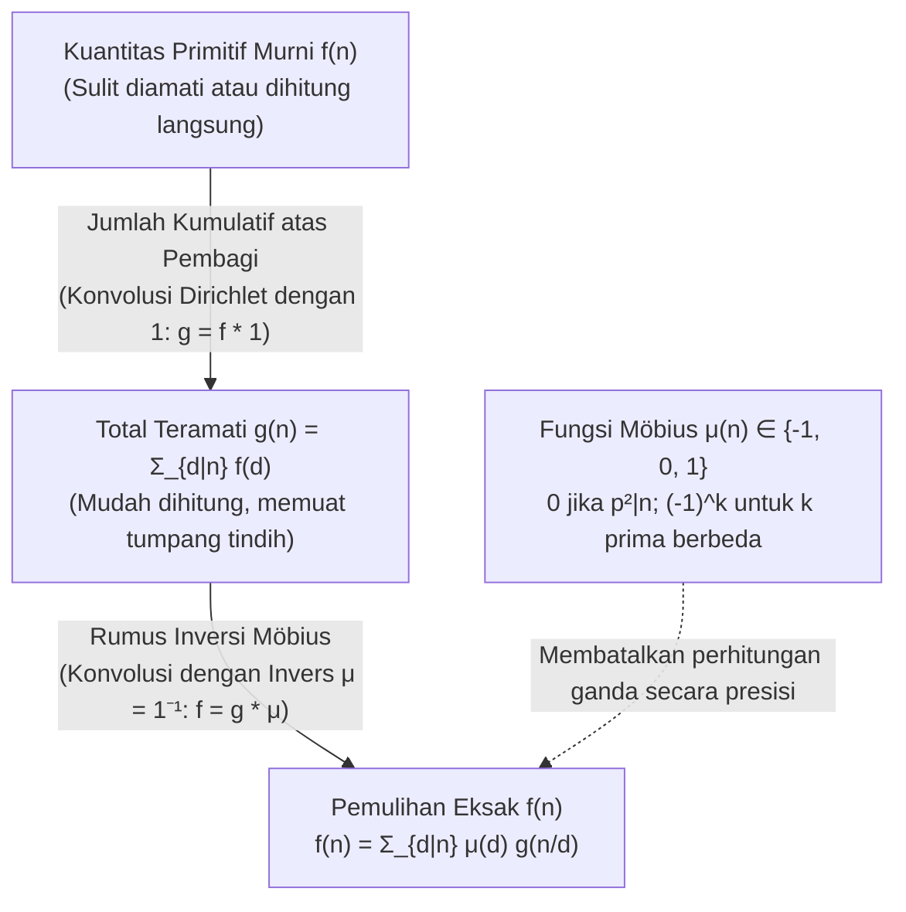
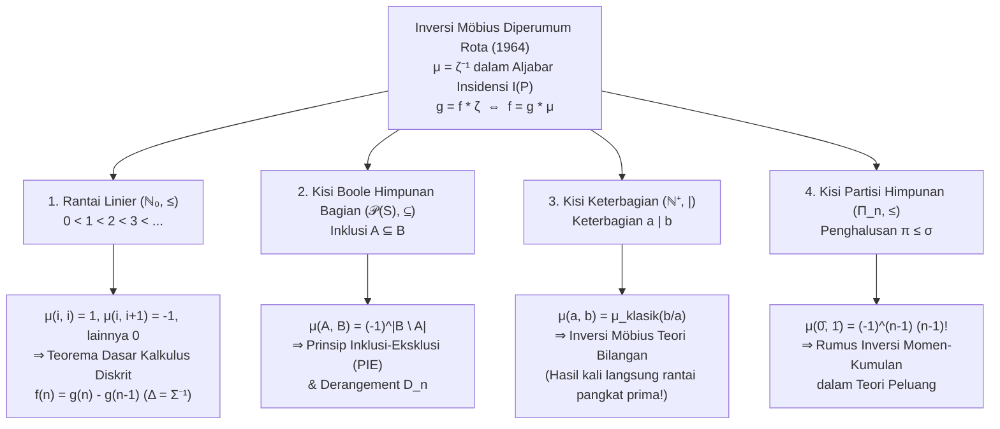

## 1. Pendahuluan: Masalah Invers Fundamental dalam Matematika

Dalam teori bilangan, kombinatorika, aljabar, dan fisika statistik, kita berulang kali menghadapi masalah invers yang sama: <strong>kuantitas murni dan primitif $f(n)$ yang ingin kita ketahui sangat sulit dihitung secara langsung, sedangkan jumlah kumulatif $g(n)$ yang mencampurkan kontribusi seluruh elemen yang lebih rendah dalam suatu hierarki justru sangat mudah dihitung.</strong>

Mari kita tinjau tiga contoh klasik:

1. <strong>Untai Periodik dan Kata Lyndon Aperiodik</strong>:
   Dengan alfabet berukuran $q$, terdapat tepat $g(n) = q^n$ untai (*string*) dengan panjang $n$. Namun total ini mencakup untai periodik degenerasi yang terbentuk dari pengulangan blok yang lebih pendek dengan periode minimum $d \mid n$. Jika $f(d)$ menyatakan banyaknya untai yang benar-benar aperiodik dengan periode minimum eksak $d$, berlaku jumlah atas pembagi:
   $$g(n) = \sum_{d \mid n} f(d)$$
2. <strong>Pecahan Tereduksi dan Tak Tereduksi (Fungsi Totien Euler $\varphi(n)$)</strong>:
   Saat kita menyederhanakan ke-$n$ pecahan $\frac{1}{n}, \frac{2}{n}, \dots, \frac{n}{n}$, setiap penyebut tereduksi menjadi pembagi $d \mid n$. Karena terdapat tepat $\varphi(d)$ pecahan tak tereduksi berpenyebut $d$, kita memperoleh identitas klasik Gauss:
   $$n = \sum_{d \mid n} \varphi(d)$$
3. <strong>Jumlah Himpunan Bagian dan Prinsip Inklusi-Eksklusi (PIE)</strong>:
   Jika setiap himpunan bagian $A \subseteq S$ memiliki bobot intrinsik $f(A)$, tetapi hanya jumlah kumulatif $g(B) = \sum_{A \subseteq B} f(A)$ yang dapat diamati, bagaimana cara memulihkan $f(B)$?

Pengurangan naif terhadap pembagi sejati langsung menyebabkan pengurangan berlebih (*over-subtraction*). Untuk $n = 6$, pembagi sejati maksimalnya adalah $3$ dan $2$, yang irisannya bersesuaian dengan $\gcd(3, 2) = 1$:
$$f(6) = g(6) - g(3) - g(2) + g(1)$$
Untuk $n = 12$, pembagi sejati maksimalnya adalah $6$ dan $4$ dengan $\gcd(6, 4) = 2$:
$$f(12) = g(12) - g(6) - g(4) + g(2)$$
Mengejutkannya, meskipun $3$ dan $1$ adalah pembagi $12$, suku $g(3)$ dan $g(1)$ memiliki koefisien <strong>$0$</strong> (karena hasil bagi $12/3 = 4 = 2^2$ dan $12/1 = 12 = 2^2 \cdot 3$ habis dibagi kuadrat bilangan prima)!

Pada tahun 1832, matematikawan Jerman <strong>August Ferdinand Möbius</strong> memecahkan masalah ini dengan memperkenalkan <strong>fungsi Möbius $\mu(n)$</strong>. Pada tahun 1964, <strong>Gian-Carlo Rota</strong> menggeneralisasi prinsip ini ke <strong>himpunan terurut parsial (*poset*)</strong> dan <strong>aljabar insidensi</strong>, membuktikan bahwa inversi Möbius teori bilangan, prinsip inklusi-eksklusi, teorema dasar kalkulus diskrit, dan inversi momen-kumulan dalam teori peluang semuanya adalah manifestasi dari satu persamaan universal $\mu = \zeta^{-1}$.

---

## 2. Fungsi Möbius $\mu(n)$: Definisi, Multiplikativitas, dan Identitas Fundamental

### 2.1 Definisi Eksak

> [!IMPORTANT]
> <strong>Definisi (Fungsi Möbius $\mu(n)$, 1832)</strong>
> Untuk setiap bilangan bulat positif $n \in \mathbb{N}^+$, <strong>fungsi Möbius</strong> $\mu : \mathbb{N}^+ \to \{-1, 0, 1\}$ didefinisikan oleh:
> $$\mu(n) = \begin{cases} 1 & \text{jika } n = 1, \\[4pt] (-1)^k & \text{jika } n = p_1 p_2 \cdots p_k \text{ adalah hasil kali } k \text{ bilangan prima berbeda (bebas-kuadrat)}, \\[4pt] 0 & \text{jika } p^2 \mid n \text{ untuk suatu bilangan prima } p. \end{cases}$$

| $n$ | Faktorisasi Prima | Bebas-Kuadrat? | Banyak Prima $k$ | Fungsi Möbius $\mu(n)$ | Fungsi Mertens $M(n) = \sum_{m=1}^n \mu(m)$ |
| :---: | :---: | :---: | :---: | :---: | :---: |
| $1$ | $1$ (produk kosong) | Ya | $0$ | $+1$ | $+1$ |
| $2$ | $2$ | Ya | $1$ | $-1$ | $0$ |
| $3$ | $3$ | Ya | $1$ | $-1$ | $-1$ |
| $4$ | $2^2$ | <strong>Tidak</strong> ($2^2 \mid 4$) | — | $0$ | $-1$ |
| $5$ | $5$ | Ya | $1$ | $-1$ | $-2$ |
| $6$ | $2 \cdot 3$ | Ya | $2$ | $+1$ | $-1$ |
| $7$ | $7$ | Ya | $1$ | $-1$ | $-2$ |
| $8$ | $2^3$ | <strong>Tidak</strong> ($2^2 \mid 8$) | — | $0$ | $-2$ |
| $9$ | $3^2$ | <strong>Tidak</strong> ($3^2 \mid 9$) | — | $0$ | $-2$ |
| $10$ | $2 \cdot 5$ | Ya | $2$ | $+1$ | $-1$ |
| $11$ | $11$ | Ya | $1$ | $-1$ | $-2$ |
| $12$ | $2^2 \cdot 3$ | <strong>Tidak</strong> ($2^2 \mid 12$) | — | $0$ | $-2$ |

### 2.2 Multiplikativitas dan Identitas Fundamental

1. <strong>Multiplikativitas</strong>: Jika $\gcd(a, b) = 1$, maka <strong>$\mu(ab) = \mu(a)\mu(b)$</strong>.
   *Bukti*: Jika $a$ atau $b$ habis dibagi suatu kuadrat $p^2$, maka $ab$ juga habis dibagi $p^2$ sehingga kedua ruas bernilai $0$. Jika keduanya bebas-kuadrat dengan $r$ dan $s$ faktor prima, karena $\gcd(a, b) = 1$, himpunan faktor primanya saling lepas dan $\mu(ab) = (-1)^{r+s} = (-1)^r (-1)^s = \mu(a)\mu(b)$. $\blacksquare$

2. <strong>Identitas Fundamental</strong>:
   $$\sum_{d \mid n} \mu(d) = \varepsilon(n) := \begin{cases} 1 & n = 1, \\ 0 & n > 1. \end{cases}$$
   *Bukti melalui Teorema Binomial*: Untuk $n = p_1^{a_1} \cdots p_k^{a_k} > 1$ ($k \ge 1$), hanya pembagi bebas-kuadrat $d \mid n$ yang memberi kontribusi tak-nol. Terdapat $\binom{k}{j}$ cara memilih $j$ bilangan prima berbeda dari $\{p_1, \dots, p_k\}$, masing-masing dengan $\mu(d) = (-1)^j$. Menurut teorema binomial:
   $$\sum_{d \mid n} \mu(d) = \sum_{j = 0}^{k} \binom{k}{j} (-1)^j 1^{k - j} = (1 - 1)^k = 0. \quad \blacksquare$$

---

## 3. Gelanggang Komutatif Fungsi Aritmetika di Bawah Konvolusi Dirichlet

Pada ruang fungsi aritmetika $\mathcal{A} = \{f : \mathbb{N}^+ \to \mathbb{C}\}$, <strong>konvolusi Dirichlet</strong> didefinisikan oleh:

$$(f * g)(n) := \sum_{d \mid n} f(d)\,g\!\left(\frac{n}{d}\right) = \sum_{ab = n} f(a)\,g(b)$$

$(\mathcal{A}, +, *)$ membentuk gelanggang komutatif dengan identitas <strong>$\varepsilon(n) = [n = 1]$</strong> ($f * \varepsilon = f$).
Dengan mendefinisikan fungsi konstan <strong>$\mathbf{1}(n) = 1$</strong>, menjumlahkan atas pembagi sama artinya dengan mengonvolusikan terhadap $\mathbf{1}$: $g(n) = \sum_{d \mid n} f(d) = (f * \mathbf{1})(n)$, atau $g = f * \mathbf{1}$.
Identitas fundamental $\sum_{d \mid n} \mu(d) = \varepsilon(n)$ menyatakan bahwa:

$$\mu * \mathbf{1} = \mathbf{1} * \mu = \varepsilon \quad \Longleftrightarrow \quad \mu = \mathbf{1}^{-1}$$

<strong>Fungsi Möbius $\mu$ tidak lain adalah invers Dirichlet dari fungsi konstan $\mathbf{1}$!</strong> Dengan demikian, <strong>rumus inversi Möbius klasik</strong> terbukti hanya dalam satu baris:

$$g = f * \mathbf{1} \iff g * \mu = f * (\mathbf{1} * \mu) = f * \varepsilon = f \iff f(n) = \sum_{d \mid n} \mu(d)\,g\!\left(\frac{n}{d}\right) = \sum_{d \mid n} \mu\!\left(\frac{n}{d}\right) g(d)$$

### Deret Dirichlet, Fungsi Zeta Riemann $\zeta(s)$, dan Hipotesis Riemann

Dengan mengaitkan setiap $f \in \mathcal{A}$ pada <strong>deret Dirichlet</strong>-nya $D_f(s) = \sum_{n=1}^{\infty} \frac{f(n)}{n^s}$, konvolusi berubah menjadi perkalian biasa: $D_{f * g}(s) = D_f(s) D_g(s)$. Karena $D_{\mathbf{1}}(s) = \zeta(s) = \sum_{n=1}^{\infty} \frac{1}{n^s}$ adalah <strong>fungsi zeta Riemann</strong> dan $D_{\varepsilon}(s) = 1$, persamaan $\mathbf{1} * \mu = \varepsilon$ langsung menghasilkan:

$$\zeta(s) \sum_{n = 1}^{\infty} \frac{\mu(n)}{n^s} = 1 \quad \Longrightarrow \quad \frac{1}{\zeta(s)} = \sum_{n = 1}^{\infty} \frac{\mu(n)}{n^s} \qquad (\operatorname{Re}(s) > 1)$$

- <strong>Teorema Bilangan Prima</strong> ekuivalen dengan $\sum_{n=1}^{\infty} \frac{\mu(n)}{n} = 0$, atau $M(x) = \sum_{n \le x} \mu(n) = o(x)$.
- <strong>Hipotesis Riemann (RH)</strong> ekuivalen dengan keanalitikan $\frac{1}{\zeta(s)}$ pada $\operatorname{Re}(s) > \frac{1}{2}$, yang tepat ekuivalen dengan pembatalan akar kuadrat pada fungsi Mertens:
  $$\text{Hipotesis Riemann} \quad \Longleftrightarrow \quad M(x) = \sum_{n \le x} \mu(n) = O\!\left(x^{\frac{1}{2} + \varepsilon}\right) \quad (\forall \varepsilon > 0)$$

---

## 4. Tiga Aplikasi Klasik

1. <strong>Fungsi Totien Euler $\varphi(n)$</strong>: Dari $\sum_{d \mid n} \varphi(d) = n$ ($\varphi * \mathbf{1} = \mathrm{id}$), inversi dengan $\mu$ memberikan $\varphi = \mathrm{id} * \mu$:
   $$\varphi(n) = \sum_{d \mid n} \mu(d)\,\frac{n}{d} = n \prod_{p \mid n} \left(1 - \frac{1}{p}\right)$$
2. <strong>Kalung Aperiodik (Kata Lyndon) dan Polinomial Tak Tereduksi di Atas $\mathbb{F}_q$</strong>:
   Baik banyaknya kalung aperiodik $N_q(d)$ dengan panjang $d$ atas $q$ huruf maupun banyaknya polinomial monik tak tereduksi $I_q(d)$ berderajat $d$ di atas lapangan hingga $\mathbb{F}_q$ (karena $x^{q^n} - x = \prod_{d \mid n} \prod_{\deg P = d} P(x)$) memenuhi $q^n = \sum_{d \mid n} d \cdot N_q(d) = \sum_{d \mid n} d \cdot I_q(d)$. Inversi Möbius menghasilkan <strong>rumus Gauss</strong>:
   $$N_q(n) = I_q(n) = \frac{1}{n} \sum_{d \mid n} \mu\!\left(\frac{n}{d}\right) q^d$$
3. <strong>Polinomial Siklotomik $\Phi_n(x)$</strong>:
   Dari $x^n - 1 = \prod_{d \mid n} \Phi_d(x)$, inversi Möbius multiplikatif memberikan:
   $$\Phi_n(x) = \prod_{d \mid n} (x^d - 1)^{\mu(n/d)}$$
   Untuk $n = 12$, dengan $d \in \{1, 2, 3, 4, 6, 12\}$ dan $\mu(12/d) \in \{0, +1, 0, -1, -1, +1\}$, kita langsung memperoleh:
   $$\Phi_{12}(x) = \frac{(x^{12} - 1)(x^2 - 1)}{(x^6 - 1)(x^4 - 1)} = \frac{x^6 + 1}{x^2 + 1} = x^4 - x^2 + 1$$

---

## 5. Unifikasi Agung Gian-Carlo Rota (1964): Poset dan Aljabar Insidensi

Misalkan $(P, \le)$ adalah <strong>himpunan terurut parsial (*poset*)</strong> hingga secara lokal (setiap interval tertutup $[x, y] = \{z \in P \mid x \le z \le y\}$ berhingga). <strong>Aljabar insidensi $I(P)$</strong> dilengkapi dengan konvolusi atas interval:

$$(\alpha * \beta)(x, y) := \sum_{x \le z \le y} \alpha(x, z)\,\beta(z, y) \qquad (x \le y)$$

Identitasnya adalah delta Kronecker $\delta(x, y) = [x = y]$. <strong>Fungsi zeta $\zeta(x, y) = 1$</strong> (untuk $x \le y$) memiliki invers tunggal <strong>$\mu = \zeta^{-1}$</strong> yang ditentukan secara rekursif oleh $\mu(x, x) = 1$ dan $\mu(x, y) = -\sum_{x \le z < y} \mu(x, z)$ untuk $x < y$. Maka diperoleh <strong>teorema inversi Möbius diperumum pada poset</strong>:

$$g(y) = \sum_{x \le y} f(x) \quad \Longleftrightarrow \quad f(y) = \sum_{x \le y} g(x)\,\mu(x, y)$$

| Poset $(P, \le)$ | Relasi Urutan $x \le y$ | Fungsi Möbius $\mu(x, y)$ | Teorema Fundamental dari $f = g * \mu$ |
| :--- | :--- | :--- | :--- |
| <strong>Rantai linier</strong> $(\mathbb{N}_0, \le)$ | Besaran $i \le j$ | $1$ ($j=i$), $-1$ ($j=i+1$), $0$ (lainnya) | <strong>Kalkulus diskrit dasar</strong> $f(n) = g(n) - g(n-1)$ |
| <strong>Kisi Boole</strong> $(\mathcal{P}(S), \subseteq)$ | Inklusi $A \subseteq B$ | $(-1)^{|B \setminus A|}$ | <strong>Inklusi-Eksklusi (PIE)</strong> & *Derangement* $D_n = n!\sum_{k=0}^n \frac{(-1)^k}{k!}$ |
| <strong>Kisi keterbagian</strong> $(\mathbb{N}^+, \mid)$ | Keterbagian $a \mid b$ | $\mu_{\text{klasik}}(b/a) \in \{-1, 0, 1\}$ | <strong>Inversi Möbius klasik</strong> $f(n) = \sum_{d \mid n} \mu(n/d) g(d)$ |
| <strong>Kisi partisi</strong> $(\Pi_n, \le)$ | Penghalusan $\pi \le \sigma$ | $\mu(\pi, \hat{1}) = (-1)^{|\pi|-1}(|\pi|-1)!$ | <strong>Inversi momen-kumulan</strong> $\kappa_n = \sum_{\pi \in \Pi_n} \mu(\pi, \hat{1}) \prod_{B \in \pi} \mathbb{E}[X_B]$ |
