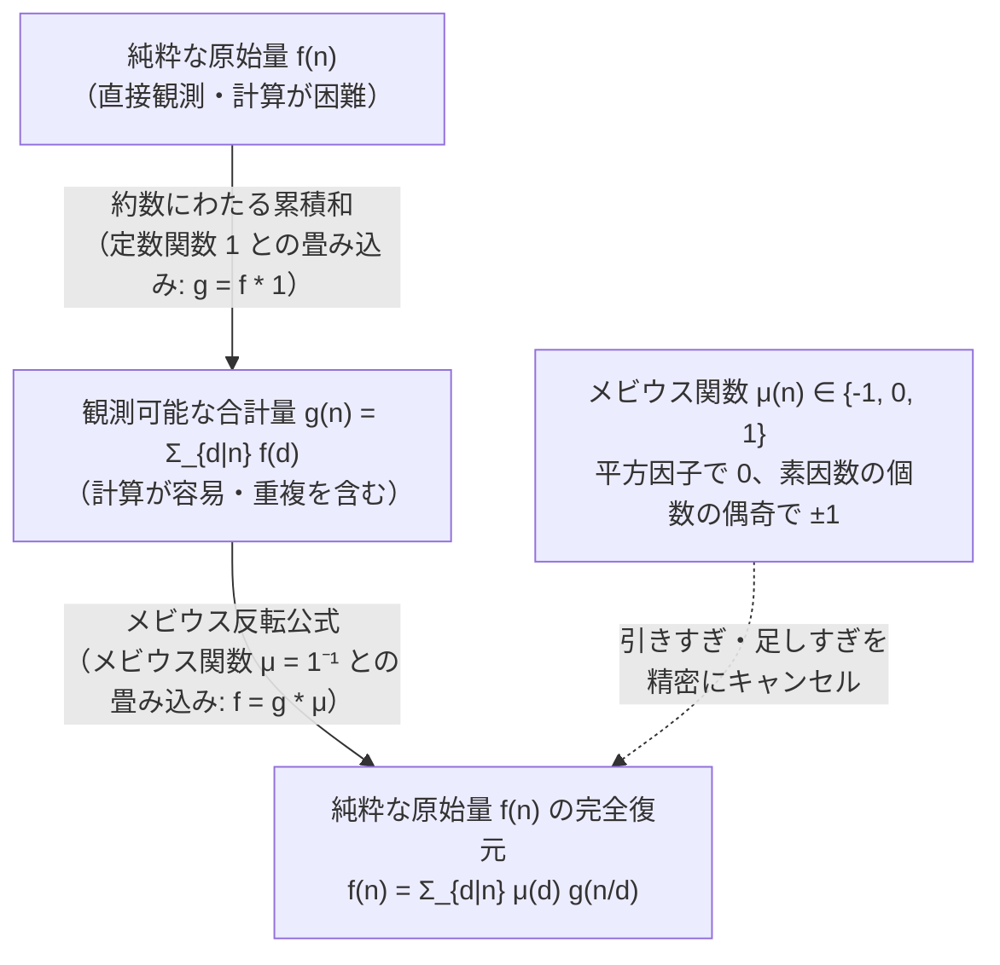
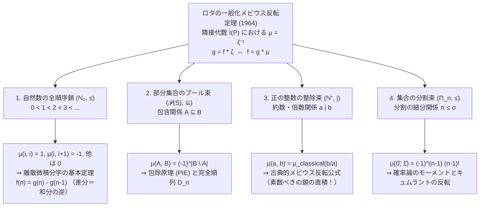

## 1. はじめに：混ざり合った「合計」から「純粋な元の値」を取り戻せるか？

数学や物理学、あるいは情報科学のさまざまな場面において、私たちはしばしば共通のジレンマに直面する。それは、<strong>「本当に知りたい純粋な量（原始的な要素） $f(n)$ は直接数えるのが極めて難しいにもかかわらず、下位の階層にある要素がすべて混ざり合った合計（累積和） $g(n)$ ならば驚くほど簡単に計算できる」</strong>という逆問題の構図である。

具体的な例を3つ挙げてみよう。

### 例1：周期を持つ文字列と「真に非周期的な文字列」
アルファベット $\{A, B\}$ の2文字を使って、長さ $n = 6$ の文字列を作ることを考える。作れる文字列の総数 $g(6)$ は、各文字の選び方が2通りずつあるため、即座に $g(6) = 2^6 = 64$ 通りとわかる。
しかし、この $64$ 個の文字列の中には、より短い周期の繰り返しでできている「退化した文字列」が混ざり込んでいる。
- 最小周期 $d = 1$ の文字列：`AAAAAA`, `BBBBBB`（長さ $1$ のパターンの6回繰り返し）
- 最小周期 $d = 2$ の文字列：`ABABAB`, `BABABA`（長さ $2$ の非周期パターンの3回繰り返し）
- 最小周期 $d = 3$ の文字列：`AAB AAB`, `ABA ABA` など（長さ $3$ の非周期パターンの2回繰り返し）
- 最小周期 $d = 6$ の文字列：`AAABBB`, `ABABBA` など（どの真約数の周期も持たない、<strong>真に非周期的な長さ $6$ の文字列</strong>）

最小周期がちょうど $d$ である「純粋な長さ $d$ の非周期的文字列」の個数を $f(d)$ とおくと、長さ $n$ のあらゆる文字列は、$n$ のいずれかの約数 $d$（$d \mid n$ と書く）を最小周期として一意に分類される。したがって、私たちが簡単に計算できる全体の個数 $g(n) = 2^n$ と、本当に知りたい純粋な個数 $f(d)$ の間には、次の<strong>約数にわたる和（Divisor Sum）</strong>の関係が成り立っている。

$$g(n) = \sum_{d \mid n} f(d)$$

$g(n) = 2^n$ という「合計」しかわからない状態から、下位の約数 $d$ からの混入分をきれいに取り除き、純粋な $f(n)$ だけを式として取り出すにはどうすればよいだろうか？

### 例2：約分される分数と「既約分数」の個数
分母を $n = 12$ とする $12$ 個の分数

$$\frac{1}{12},\ \frac{2}{12},\ \frac{3}{12},\ \frac{4}{12},\ \frac{5}{12},\ \frac{6}{12},\ \frac{7}{12},\ \frac{8}{12},\ \frac{9}{12},\ \frac{10}{12},\ \frac{11}{12},\ \frac{12}{12}$$

を並べてみよう。分数の総数が $g(12) = 12$ 個であることは自明である。しかし、これらを既約分数（これ以上約分できない分数）に直すと、分母は $12$ の約数 $d \in \{1, 2, 3, 4, 6, 12\}$ のいずれかへと振り分けられる。
- 分母 $d = 1$ になるもの：$\frac{1}{1}$ （$1$ 個）
- 分母 $d = 2$ になるもの：$\frac{1}{2}$ （$1$ 個）
- 分母 $d = 3$ になるもの：$\frac{1}{3}, \frac{2}{3}$ （$2$ 個）
- 分母 $d = 4$ になるもの：$\frac{1}{4}, \frac{3}{4}$ （$2$ 個）
- 分母 $d = 6$ になるもの：$\frac{1}{6}, \frac{5}{6}$ （$2$ 個）
- 分母 $d = 12$ のまま残るもの：$\frac{1}{12}, \frac{5}{12}, \frac{7}{12}, \frac{11}{12}$ （$4$ 個）

分母がちょうど $d$ である（$1$ から $d$ までのうち $d$ と互いに素な分子を持つ）既約分数の個数を $\varphi(d)$（オイラーのトーシェント関数）と呼ぶ。全体の個数 $n$ は、すべての約数 $d \mid n$ にわたる既約分数の個数の合計に他ならない。

$$n = \sum_{d \mid n} \varphi(d)$$

ここでもまた、「合計 $\sum_{d \mid n} \varphi(d) = n$ は自明にわかるが、そこから純粋な $\varphi(n)$ をどう逆算するか」というまったく同じ構造が現れる。

### 例3：部分集合の累積と「包除原理」
有限集合 $S$ の各部分集合 $A \subseteq S$ に対してある固有の量 $f(A)$ が定まっているとする。しかし観測できるのは、$B$ に含まれるすべての部分集合 $A \subseteq B$ の寄与が足し合わされた累積量

$$g(B) = \sum_{A \subseteq B} f(A)$$

だけであるとする。このとき、下位の部分集合からの重複寄与をすべて剥ぎ取り、$f(B)$ を $g(A)$ たちの線形結合として復元するには、どの部分集合を足し、どの部分集合を引けばよいのか？

---

### 素朴な引き算の罠：「引きすぎ」と「足しすぎ」の連鎖

例1の $n = 6$ に戻って、$g(6) = 2^6$ から純粋な $f(6)$ を取り出すことを考えよう。
$6$ の極大な真約数は $2$ と $3$ である。周期 $2$ の文字列（`ABABAB` など）はすべて $g(2) = 2^2$ に含まれ、周期 $3$ の文字列（`AABAAB` など）はすべて $g(3) = 2^3$ に含まれる。
そこで素朴に、全体 $g(6)$ から $g(2)$ と $g(3)$ を引いてみる。

$$g(6) - g(2) - g(3)$$

すると何が起きるか？ 周期 $1$ の文字列（`AAAAAA` と `BBBBBB`）は、周期 $2$ の文字列としても、周期 $3$ の文字列としてもカウントされている。つまり、$\gcd(2, 3) = 1$ に対応する $g(1)$ の分が<strong>2回引かれてしまい（過剰減算）</strong>、個数が足りなくなってしまうのである！
したがって、引きすぎた $g(1)$ を1回だけ足し戻さなければならない。

$$f(6) = g(6) - g(3) - g(2) + g(1) = 64 - 8 - 4 + 2 = 54$$

では、$n = 12$ のときはどうなるだろうか？ $12$ の約数は $1, 2, 3, 4, 6, 12$ の6個ある。
$12$ の極大な真約数は $6$ と $4$ である。周期 $12$ 未満の退化した文字列は、すべて周期 $6$（$g(6)$）か周期 $4$（$g(4)$）のいずれかに必ず含まれる。そして、$g(6)$ と $g(4)$ の両方に重複して含まれるのは、$\gcd(6, 4) = 2$ の周期を持つ文字列（$g(2)$）である。したがって、集合の包除原理を考えれば、

$$f(12) = g(12) - g(6) - g(4) + g(2)$$

となるはずである。ここで驚くべき事実に気づくだろう。$12$ の約数であるにもかかわらず、<strong>$g(3)$ と $g(1)$ が式のどこにも登場しない（係数が $0$ になっている）</strong>のである！
なぜ $n = 6$ のときはすべての約数 $6, 3, 2, 1$ が式に現れたのに、$n = 12$ のときは $\frac{12}{d}$ が $4 = 2^2$ や $12 = 2^2 \cdot 3$ となる項（つまり $d = 3$ や $d = 1$）の係数が $0$ になって消えてしまうのか？

この「約数の階層構造において、重複を過不足なく相殺するための符号 $+1, -1, 0$ の法則」を完全に解き明かしたのが、1832年にドイツの数学者アウグスト・フェルディナント・メビウス（August Ferdinand Möbius）が発見した<strong>メビウス関数 $\mu(n)$</strong> と<strong>メビウス反転公式（Möbius Inversion Formula）</strong>である。さらに20世紀半ば、ジャン＝カルロ・ロタ（Gian-Carlo Rota）はこの仕組みを<strong>半順序集合（Poset）上の隣接代数</strong>へと昇華させ、整数論・組合せ論・微積分学・確率論を貫く壮大な統一理論を打ち立てた。

本稿では、この「合計から元の数を取り戻す数学」の核心を、初等整数論の直感から抽象代数学・解析的整数論、そして半順序集合の一般理論に至るまで、一切の飛躍なく徹底的に掘り下げていこう。

---

## 2. メビウス関数 $\mu(n)$ の定義と基本性質：素因数が織りなす包除の符号

### 2.1 メビウス関数 $\mu(n)$ の厳密な定義

「メビウスの帯」で広く知られる数学者・天文学者アウグスト・フェルディナント・メビウスは、1832年の論文 *Über eine besondere Art von Umkehrung der Reihen*（級数の特殊な反転について）において、べき級数の係数を反転する問題の中から、正の整数 $n \in \mathbb{N}^+$ に対して $\{-1, 0, 1\}$ の3値のみをとる次の数論的関数 $\mu(n)$ を導入した。

> [!IMPORTANT]
> <strong>定義（メビウス関数 $\mu(n)$）</strong>
> 正の整数 $n \ge 1$ に対して、<strong>メビウス関数（Möbius function）</strong> $\mu : \mathbb{N}^+ \to \{-1, 0, 1\}$ を次のように定める。
> $$\mu(n) = \begin{cases} 1 & (n = 1 \text{ のとき}) \\[6pt] (-1)^k & (n = p_1 p_2 \cdots p_k \text{ が相異なる } k \text{ 個の素数の積で表されるとき}) \\[6pt] 0 & (\text{ある素数 } p \text{ に対して } p^2 \mid n \text{ となるとき}) \end{cases}$$

ここで、ある素数の2乗 $p^2$ で割り切れる整数を「平方因子を持つ（squared factor を持つ）」と言い、どの素数の2乗でも割り切れない整数（すなわち素因数分解したときにすべての素因数の指数が $1$ である整数）を<strong>無平方数（Square-free integer）</strong>と呼ぶ。
この言葉を使えば、メビウス関数とは<strong>「$n$ が無平方数でないならば $0$、無平方数ならばその素因数の個数 $k$ の偶奇に応じて $(-1)^k$ を返す関数」</strong>である（$n=1$ は $k=0$ 個の素数の積とみなせば $(-1)^0 = 1$ となり、第2の条件に自然に統合される）。

実際に $n = 1$ から $16$ までの $\mu(n)$ の値と、その累積和である<strong>メルテンス関数（Mertens function）</strong> $M(x) := \sum_{1 \le n \le x} \mu(n)$ を表で確認してみよう。

| $n$ | 素因数分解 | 無平方か？（Square-free） | 相異なる素因数の個数 $k$ | メビウス関数 $\mu(n)$ | 累積和 $M(n) = \sum_{m=1}^n \mu(m)$ |
| :---: | :---: | :---: | :---: | :---: | :---: |
| $1$ | $1$ （空積） | Yes | $0$ | $+1$ | $+1$ |
| $2$ | $2$ | Yes | $1$ | $-1$ | $0$ |
| $3$ | $3$ | Yes | $1$ | $-1$ | $-1$ |
| $4$ | $2^2$ | <strong>No</strong> ($2^2 \mid 4$) | — | $0$ | $-1$ |
| $5$ | $5$ | Yes | $1$ | $-1$ | $-2$ |
| $6$ | $2 \cdot 3$ | Yes | $2$ | $+1$ | $-1$ |
| $7$ | $7$ | Yes | $1$ | $-1$ | $-2$ |
| $8$ | $2^3$ | <strong>No</strong> ($2^2 \mid 8$) | — | $0$ | $-2$ |
| $9$ | $3^2$ | <strong>No</strong> ($3^2 \mid 9$) | — | $0$ | $-2$ |
| $10$ | $2 \cdot 5$ | Yes | $2$ | $+1$ | $-1$ |
| $11$ | $11$ | Yes | $1$ | $-1$ | $-2$ |
| $12$ | $2^2 \cdot 3$ | <strong>No</strong> ($2^2 \mid 12$) | — | $0$ | $-2$ |
| $13$ | $13$ | Yes | $1$ | $-1$ | $-3$ |
| $14$ | $2 \cdot 7$ | Yes | $2$ | $+1$ | $-2$ |
| $15$ | $3 \cdot 5$ | Yes | $2$ | $+1$ | $-1$ |
| $16$ | $2^4$ | <strong>No</strong> ($2^2 \mid 16$) | — | $0$ | $-1$ |

### 2.2 なぜ平方因子を持つと $\mu(n) = 0$ になるのか？

初めてメビウス関数の定義を見た人が必ず抱く疑問がある。「素因数の個数の偶奇で $+1$ と $-1$ が交互に現れるのは包除原理として理解できるが、<strong>なぜ同じ素数が2回以上掛けられた瞬間（$p^2 \mid n$）に $\mu(n) = 0$ になるのか？</strong>」という点である。

この理由は、第1節で見た $n = 12 = 2^2 \cdot 3$ の例を振り返ると氷解する。
一般の正の整数 $n = p_1^{a_1} p_2^{a_2} \cdots p_k^{a_k}$ を考えよう。$n$ の約数のうち、$n$ 自身を除いた「真の約数」の中で最も大きいもの（<strong>極大真約数</strong>）は、$n$ をどれか1つの素因数 $p_i$ で1回だけ割った

$$M_1 = \frac{n}{p_1},\quad M_2 = \frac{n}{p_2},\quad \dots,\quad M_k = \frac{n}{p_k}$$

のちょうど $k$ 個である。$n$ のいかなる真約数 $d < n$ も、必ずこれら $k$ 個の極大真約数 $M_1, \dots, M_k$ の少なくとも1つの約数になっている。
したがって、$g(n) = \sum_{d \mid n} f(d)$ から真約数 $d < n$ の寄与をすべて取り除いて $f(n)$ を得るには、$k$ 個の集合（それぞれ $M_i$ の約数全体）の和集合の寄与を、高校数学でもおなじみの<strong>包除原理（Principle of Inclusion-Exclusion）</strong>によって差し引けばよい。

- まず、1つずつの極大真約数の寄与 $g(n/p_i)$ を<strong>引く</strong>（係数 $-1 = \mu(p_i)$）。
- 次に、2つの極大真約数の共通部分（最大公約数 $\gcd(n/p_i, n/p_j) = \frac{n}{p_i p_j}$ の約数全体）の寄与 $g(n / (p_i p_j))$ を引きすぎた分として<strong>足し戻す</strong>（係数 $+1 = \mu(p_i p_j)$）。
- 同様に、3つの共通部分 $\frac{n}{p_i p_j p_\ell}$ の寄与を<strong>引く</strong>（係数 $-1 = \mu(p_i p_j p_\ell)$）。

この包除原理のプロセスにおいて登場する共通部分の分母は、$k$ 個の異なる素数 $\{p_1, p_2, \dots, p_k\}$ から重複なく選んだ部分集合の積 $d = p_{i_1} p_{i_2} \cdots p_{i_r}$（すなわち<strong>無平方な約数</strong>）だけに限定される！同じ素数 $p_i$ で2回割った $\frac{n}{p_i^2}$ のような数は、極大真約数たちの共通部分（最大公約数）として決して新しく現れることはなく、すでに $\frac{n}{p_i}$ の内部で完全に処理されているのである。だからこそ、$p^2 \mid d$ となる約数 $d$ に対しては、それ以上の補正を行う必要がなく、係数 $\mu(d) = 0$ となるのである。

### 2.3 メビウス関数の乗法性と基本恒等式

メビウス関数が持つ最も重要な2つの代数的性質を証明しよう。

> [!NOTE]
> <strong>命題1（メビウス関数の乗法性）</strong>
> 互いに素な正の整数 $a, b$（すなわち $\gcd(a, b) = 1$）に対して、次が成り立つ。
> $$\mu(ab) = \mu(a)\,\mu(b)$$

<strong>【証明】</strong>
1. $a = 1$ または $b = 1$ のとき：$\mu(1) = 1$ より自明に等号が成り立つ。
2. $a$ または $b$ の少なくとも一方が平方因子を持つとき：ある素数 $p$ に対して $p^2 \mid a$（または $p^2 \mid b$）ならば、当然 $p^2 \mid ab$ でもある。よって左辺は $\mu(ab) = 0$ であり、右辺も $\mu(a) = 0$（または $\mu(b) = 0$）より $\mu(a)\mu(b) = 0$ となって一致する。
3. $a, b$ がともに無平方数のとき：$a = p_1 \cdots p_r$、$b = q_1 \cdots q_s$（$p_i$ たちは相異なる素数、$q_j$ たちも相異なる素数）と表せる。ここで仮定 $\gcd(a, b) = 1$ より、$\{p_1, \dots, p_r\}$ と $\{q_1, \dots, q_s\}$ には共通の素数が1つも存在しない。したがって積 $ab = p_1 \cdots p_r q_1 \cdots q_s$ は相異なる $r + s$ 個の素数の積（無平方数）となり、
   $$\mu(ab) = (-1)^{r + s} = (-1)^r (-1)^s = \mu(a)\,\mu(b)$$
   が成り立つ。$\blacksquare$

（※注意：$\gcd(a, b) > 1$ のときは一般に $\mu(ab) = \mu(a)\mu(b)$ は成り立たない。例えば $a = 2, b = 2$ のとき $\mu(4) = 0 \neq (-1)(-1) = 1$ である。このように $\gcd(a, b) = 1$ のときに限り積を保つ数論的関数を<strong>乗法的関数（Multiplicative function）</strong>と呼ぶ。）

次に、メビウス反転公式の心臓部となる<strong>基本恒等式</strong>を証明する。

> [!IMPORTANT]
> <strong>定理1（メビウス関数の基本恒等式）</strong>
> 任意の正の整数 $n \ge 1$ に対して、$n$ のすべての正の約数 $d$ にわたるメビウス関数の和は、$n = 1$ のときのみ $1$ となり、$n > 1$ のときは常に $0$ となる。
> $$\sum_{d \mid n} \mu(d) = \varepsilon(n) := \begin{cases} 1 & (n = 1 \text{ のとき}) \\ 0 & (n > 1 \text{ のとき}) \end{cases}$$

この美しい定理には、組合せ論的な視点（二項定理）と代数的視点（乗法性）の2通りの鮮やかな証明がある。両方を見ておこう。

<strong>【証明1：二項定理による組合せ論的証明】</strong>
$n = 1$ のときは、約数は $d = 1$ のみであるから $\sum_{d \mid 1} \mu(d) = \mu(1) = 1$ となり成り立つ。
$n > 1$ のとき、$n$ の素因数分解を $n = p_1^{a_1} p_2^{a_2} \cdots p_k^{a_k}$（$k \ge 1$, $a_i \ge 1$）とする。
$n$ の約数 $d \mid n$ のうち、$p_i^2 \mid d$ となる平方因子を持つ約数はすべて $\mu(d) = 0$ となるため、和に寄与しない。したがって、和に寄与するのは $n$ の無平方な約数、すなわち集合 $\{p_1, p_2, \dots, p_k\}$ からいくつかの素数を選んで掛け合わせた積 $d = p_{i_1} p_{i_2} \cdots p_{i_j}$ ($0 \le j \le k$) のみである。
$k$ 個の素数からちょうど $j$ 個の素数を選ぶ組合せは $\binom{k}{j}$ 通りあり、そのそれぞれに対して $\mu(d) = (-1)^j$ であるから、二項定理より

$$\sum_{d \mid n} \mu(d) = \sum_{j = 0}^{k} \binom{k}{j} (-1)^j = \sum_{j = 0}^{k} \binom{k}{j} (-1)^j 1^{k - j} = (1 - 1)^k = 0^k = 0$$

を得る（$k \ge 1$ より $0^k = 0$）。$\blacksquare$

<strong>【証明2：乗法性を利用した代数的証明】</strong>
一般に、$f(n)$ が乗法的関数であるとき、その約数和 $F(n) := \sum_{d \mid n} f(d)$ もまた乗法的関数になる。なぜなら、$\gcd(a, b) = 1$ のとき、積 $ab$ の任意の約数 $d \mid ab$ は $a$ の約数 $d_1 \mid a$ と $b$ の約数 $d_2 \mid b$（ただし $\gcd(d_1, d_2) = 1$）の積 $d = d_1 d_2$ として一意に表されるため、

$$F(ab) = \sum_{d \mid ab} f(d) = \sum_{d_1 \mid a} \sum_{d_2 \mid b} f(d_1 d_2) = \sum_{d_1 \mid a} f(d_1) \sum_{d_2 \mid b} f(d_2) = F(a)\,F(b)$$

となるからである。
いま $\mu(n)$ は乗法的であるから、$F(n) = \sum_{d \mid n} \mu(d)$ も乗法的である。よって、素数べき $n = p^a$ ($a \ge 1$) についてのみ $F(p^a)$ を計算すれば十分である。$p^a$ の約数は $1, p, p^2, \dots, p^a$ であるから、

$$F(p^a) = \mu(1) + \mu(p) + \mu(p^2) + \cdots + \mu(p^a) = 1 + (-1) + 0 + \cdots + 0 = 0$$

となる。ゆえに、任意の $n = p_1^{a_1} \cdots p_k^{a_k} > 1$ に対して、乗法性より

$$\sum_{d \mid n} \mu(d) = F(n) = F(p_1^{a_1}) F(p_2^{a_2}) \cdots F(p_k^{a_k}) = 0 \cdot 0 \cdots 0 = 0$$

が直ちに従う。$\blacksquare$

---

## 3. ディリクレ畳み込み（Dirichlet Convolution）と数論的関数の可換環

メビウス反転公式は、単なる「巧みな計算トリック」ではない。数論的関数全体の集合に適切な「掛け算」を導入すると、メビウス反転とは単なる<strong>「一次方程式 $a x = b$ の両辺に $a^{-1}$ を掛けて $x = a^{-1} b$ を得る操作」</strong>に過ぎないことが見えてくる。

### 3.1 ディリクレ畳み込みの定義と環構造

正の整数全体の集合 $\mathbb{N}^+$ から複素数体 $\mathbb{C}$ への関数 $f : \mathbb{N}^+ \to \mathbb{C}$ を<strong>数論的関数（Arithmetic function）</strong>と呼ぶ。数論的関数全体の集合を $\mathcal{A}$ と書くことにしよう。
集合 $\mathcal{A}$ には、通常の点ごとの加法 $(f + g)(n) := f(n) + g(n)$ に加えて、ペーター・グスタフ・ディリクレ（Peter Gustav Lejeune Dirichlet）に由来する次の積が定義される。

> [!IMPORTANT]
> <strong>定義（ディリクレ畳み込み / Dirichlet Convolution）</strong>
> 2つの数論的関数 $f, g \in \mathcal{A}$ に対して、それらの<strong>ディリクレ畳み込み</strong> $f * g \in \mathcal{A}$ を次式で定める。
> $$(f * g)(n) := \sum_{d \mid n} f(d)\,g\!\left(\frac{n}{d}\right) = \sum_{\substack{a, b \ge 1 \\ ab = n}} f(a)\,g(b)$$

この演算 $*$ がいかに自然で強力な代数的性質を持つかを確認しよう。

1. <strong>交換法則（Commutativity）：$f * g = g * f$</strong>
   和の添字 $ab = n$ は $a$ と $b$ に関して完全に対称である（$d \mid n$ に対して $c = n/d$ と置換すれば $c \mid n$ かつ $d = n/c$ となる）から、
   $$(f * g)(n) = \sum_{ab = n} f(a)g(b) = \sum_{ba = n} g(b)f(a) = (g * f)(n)$$
   が成り立つ。

2. <strong>結合法則（Associativity）：$(f * g) * h = f * (g * h)$</strong>
   左辺を展開すると、$ab = m$ かつ $mc = n$ となる正の整数を走るため、結局 $abc = n$ となる3つ組 $(a, b, c)$ にわたる三重和に一致する。
   $$((f * g) * h)(n) = \sum_{mc = n} (f * g)(m)\,h(c) = \sum_{abc = n} f(a)\,g(b)\,h(c) = \sum_{ak = n} f(a)\,(g * h)(k) = (f * (g * h))(n)$$

3. <strong>単位元（Identity element） $\varepsilon$ の存在：$f * \varepsilon = \varepsilon * f = f$</strong>
   第2節の定理1で登場した関数
   $$\varepsilon(n) := [n = 1] = \begin{cases} 1 & (n = 1) \\ 0 & (n > 1) \end{cases}$$
   を考えよう。任意の $f \in \mathcal{A}$ に対して、$\varepsilon(n/d)$ は $n/d = 1$（すなわち $d = n$）のときのみ $1$ となり、それ以外の約数 $d < n$ ではすべて $0$ となる。したがって、
   $$(f * \varepsilon)(n) = \sum_{d \mid n} f(d)\,\varepsilon\!\left(\frac{n}{d}\right) = f(n)\,\varepsilon(1) = f(n)$$
   となり、<strong>$\varepsilon$ はディリクレ畳み込みにおける乗法単位元</strong>である！（注意：すべての $n$ で $1$ をとる定数関数は単位元ではない！）

4. <strong>分配法則：$f * (g + h) = f * g + f * h$</strong>
   シグマ記号の線形性から明らかである。

以上より、$(\mathcal{A}, +, *)$ は $\varepsilon$ を単位元とする<strong>単位的可換環（Commutative ring with unity）</strong>（より強くは整域）をなす！

さらに、どのような関数 $f \in \mathcal{A}$ がディリクレ畳み込みに関する<strong>逆元 $f^{-1}$</strong>（すなわち $f * f^{-1} = \varepsilon$ を満たす関数）を持つかも完全に決定できる。
$(f * g)(1) = f(1)g(1) = \varepsilon(1) = 1$ でなければならないから、$f$ が逆元を持つための必要十分条件は <strong>$f(1) \neq 0$</strong> であることである。実際、$f(1) \neq 0$ のとき、$g = f^{-1}$ の値は
$$g(1) = \frac{1}{f(1)}, \qquad g(n) = -\frac{1}{f(1)} \sum_{\substack{d \mid n \\ d < n}} f\!\left(\frac{n}{d}\right) g(d) \quad (n > 1)$$
という漸化式によって $n = 1, 2, 3, \dots$ の順に一意に定まる。

### 3.2 定数関数 $\mathbf{1}$ とメビウス関数 $\mu$ の双対性、そしてメビウス反転公式の1行証明

ここで、すべての $n \ge 1$ に対して常に $1$ を返す<strong>定数関数 $\mathbf{1}$</strong> を導入しよう。

$$\mathbf{1}(n) := 1 \quad (\forall n \in \mathbb{N}^+)$$

すると、本稿の冒頭から考えてきた「約数にわたる累積和 $g(n) = \sum_{d \mid n} f(d)$ をとる操作」は、ディリクレ畳み込みの言葉を使えば、<strong>関数 $f$ に定数関数 $\mathbf{1}$ を畳み込む操作</strong>としてたった一言で表現できる！

$$g(n) = \sum_{d \mid n} f(d) = \sum_{d \mid n} f(d)\,\mathbf{1}\!\left(\frac{n}{d}\right) = (f * \mathbf{1})(n) \quad \Longleftrightarrow \quad g = f * \mathbf{1}$$

では、第2節で証明したメビウス関数の基本恒等式 $\sum_{d \mid n} \mu(d) = \varepsilon(n)$ は、ディリクレ畳み込みの言葉では何を意味しているだろうか？

$$\sum_{d \mid n} \mu(d) = \sum_{d \mid n} \mu(d)\,\mathbf{1}\!\left(\frac{n}{d}\right) = (\mu * \mathbf{1})(n) = \varepsilon(n)$$

すなわち、

$$\mu * \mathbf{1} = \mathbf{1} * \mu = \varepsilon \quad \Longleftrightarrow \quad \mu = \mathbf{1}^{-1}$$

なんと、<strong>メビウス関数 $\mu$ の正体とは、可換環 $(\mathcal{A}, +, *)$ における定数関数 $\mathbf{1}$（約数和作用素）の厳密な乗法逆元 $\mathbf{1}^{-1}$ に他ならない</strong>のである！

この事実さえわかれば、<strong>古典的メビウス反転公式（Classical Möbius Inversion Formula）</strong>の証明は、文字通り「たった1行の代数計算」で完結する。

> [!IMPORTANT]
> <strong>定理2（古典的メビウス反転公式）</strong>
> 2つの数論的関数 $f, g : \mathbb{N}^+ \to \mathbb{C}$ に対して、次の2つの関係式は互いに同値である。
> $$g(n) = \sum_{d \mid n} f(d) \quad (\forall n \ge 1) \quad \Longleftrightarrow \quad f(n) = \sum_{d \mid n} \mu(d)\,g\!\left(\frac{n}{d}\right) = \sum_{d \mid n} \mu\!\left(\frac{n}{d}\right) g(d) \quad (\forall n \ge 1)$$

<strong>【ディリクレ畳み込みによる1行証明】</strong>
$\mu * \mathbf{1} = \varepsilon$ であるから、
$$g = f * \mathbf{1} \implies g * \mu = (f * \mathbf{1}) * \mu = f * (\mathbf{1} * \mu) = f * \varepsilon = f.$$
逆に $f = g * \mu$ ならば、両辺に $\mathbf{1}$ を畳み込むことで $f * \mathbf{1} = (g * \mu) * \mathbf{1} = g * (\mu * \mathbf{1}) = g * \varepsilon = g$ が得られる。$\blacksquare$

<strong>【二重和の順序交換による直接確認】</strong>
念のため、畳み込み記号を使わずにシグマ記号の変形だけで何が起きているかも確認しておこう。$g(n/d) = \sum_{c \mid (n/d)} f(c)$ を右辺に代入すると、条件「$d \mid n$ かつ $c \mid (n/d)$」は「$cd \mid n$」、すなわち「$c \mid n$ かつ $d \mid (n/c)$」と同値であるから、和の順序を交換して

$$\sum_{d \mid n} \mu(d)\,g\!\left(\frac{n}{d}\right) = \sum_{d \mid n} \mu(d) \sum_{c \mid (n/d)} f(c) = \sum_{c \mid n} f(c) \sum_{d \mid (n/c)} \mu(d) = \sum_{c \mid n} f(c)\,\varepsilon\!\left(\frac{n}{c}\right) = f(n)$$

となる。内側の和 $\sum_{d \mid (n/c)} \mu(d)$ が、$c = n$ 以外のすべての約数 $c < n$ において劇的に $0$ へと消滅し、純粋な $f(n)$ の項だけをピンポイントで救い出している様子が手に取るようにわかるだろう。

整数論で頻繁に登場する主要な数論的関数と、それらのディリクレ畳み込みによる関係式を一覧表にまとめておく。

| 記号 | 関数の名称 | 定義 $f(n)$ | ディリクレ畳み込みによる表現 | メビウス反転による双対表現 |
| :---: | :--- | :--- | :---: | :---: |
| $\varepsilon$ | 単位元（アイバーソン記号） | $[n = 1]$ | $\mathbf{1} * \mu = \varepsilon$ | $\mu = \varepsilon * \mu$ |
| $\mathbf{1}$ | 定数関数 | $1$ | $\mathbf{1} = \varepsilon * \mathbf{1}$ | $\varepsilon = \mathbf{1} * \mu$ |
| $\mu$ | メビウス関数 | $(-1)^k$ (無平方), $0$ (他) | $\mu = \mathbf{1}^{-1}$ | $\mathbf{1} = \mu^{-1}$ |
| $\mathrm{id}$ | 恒等関数 | $n$ | $\mathrm{id} = \varphi * \mathbf{1}$ | $\varphi = \mathrm{id} * \mu$ |
| $\tau$ (または $d$) | 約数個数関数 | $\sum_{d \mid n} 1$ | $\tau = \mathbf{1} * \mathbf{1}$ | $\mathbf{1} = \tau * \mu$ |
| $\sigma$ | 約数和関数 | $\sum_{d \mid n} d$ | $\sigma = \mathrm{id} * \mathbf{1}$ | $\mathrm{id} = \sigma * \mu$ |
| $\varphi$ | オイラーのトーシェント関数 | $|\{1 \le k \le n : \gcd(k,n)=1\}|$ | $\varphi * \mathbf{1} = \mathrm{id}$ | $\varphi = \mathrm{id} * \mu$ |
| $\Lambda$ | フォン・マンゴルト関数 | $\log p$ ($n=p^k$), $0$ (他) | $\Lambda * \mathbf{1} = \log$ | $\Lambda = \log * \mu$ |

### 3.3 解析的整数論への架け橋：ディリクレ級数とリーマンゼータ関数 $\zeta(s)$

ディリクレ畳み込み $f * g$ がなぜあのような形をしているのか、そのもう一つの本質的な理由は<strong>ディリクレ級数（Dirichlet series）</strong>と呼ばれる母関数を考えると明らかになる。
数論的関数 $f \in \mathcal{A}$ に対して、複素変数 $s \in \mathbb{C}$ の無限級数

$$D_f(s) := \sum_{n = 1}^{\infty} \frac{f(n)}{n^s}$$

を対応させる。このとき、指数法則 $a^{-s} b^{-s} = (ab)^{-s}$ により、2つのディリクレ級数の通常の積をとって分母 $ab = n$ ごとに項をまとめると、その分子にはちょうどディリクレ畳み込み $(f * g)(n)$ が現れる！

$$D_f(s) \cdot D_g(s) = \left(\sum_{a=1}^{\infty} \frac{f(a)}{a^s}\right)\!\left(\sum_{b=1}^{\infty} \frac{g(b)}{b^s}\right) = \sum_{n=1}^{\infty} \frac{1}{n^s} \left(\sum_{ab = n} f(a)g(b)\right) = \sum_{n=1}^{\infty} \frac{(f * g)(n)}{n^s} = D_{f * g}(s)$$

ここで、定数関数 $\mathbf{1}(n) = 1$ に対応するディリクレ級数は、かの有名な<strong>リーマンゼータ関数（Riemann zeta function）</strong>そのものである。

$$D_{\mathbf{1}}(s) = \sum_{n = 1}^{\infty} \frac{1}{n^s} = \zeta(s) \qquad (\operatorname{Re}(s) > 1)$$

そして、乗法単位元 $\varepsilon(n) = [n=1]$ のディリクレ級数は $D_{\varepsilon}(s) = \frac{1}{1^s} + 0 + 0 + \cdots = 1$ である。
したがって、先ほどの恒等式 $\mathbf{1} * \mu = \varepsilon$ をディリクレ級数の世界に移すと、$D_{\mathbf{1}}(s) \cdot D_{\mu}(s) = D_{\varepsilon}(s)$、すなわち次の驚異的な等式が直ちに得られる。

> [!TIP]
> <strong>リーマンゼータ関数の逆数とメビウス関数</strong>
> 複素平面の半平面 $\operatorname{Re}(s) > 1$ において、リーマンゼータ関数 $\zeta(s)$ の逆数はメビウス関数 $\mu(n)$ を係数とするディリクレ級数に一致する。
> $$\zeta(s) \sum_{n = 1}^{\infty} \frac{\mu(n)}{n^s} = 1 \quad \Longleftrightarrow \quad \frac{1}{\zeta(s)} = \sum_{n = 1}^{\infty} \frac{\mu(n)}{n^s}$$

この式は、オイラー積表示 $\zeta(s) = \prod_{p:\text{素数}} \left(1 - \frac{1}{p^s}\right)^{-1}$ の逆数をとっても直感的に理解できる。

$$\frac{1}{\zeta(s)} = \prod_{p:\text{素数}} \left(1 - \frac{1}{p^s}\right) = \left(1 - \frac{1}{2^s}\right)\!\left(1 - \frac{1}{3^s}\right)\!\left(1 - \frac{1}{5^s}\right)\!\left(1 - \frac{1}{7^s}\right)\cdots$$

この無限積を展開すると、各因子からは $1$ か $-p^{-s}$ のどちらかしか選べないため、同じ素数 $p$ が2回以上掛けられた分母 $(p^2)^s$ は決して現れない（すなわち平方因子を持つ $n$ の係数は $0$）。そして、相異なる $k$ 個の素数 $p_1, \dots, p_k$ の積 $n = p_1 \cdots p_k$ の項は、$-p_i^{-s}$ を $k$ 個掛け合わせることで係数 $(-1)^k$ を伴ってちょうど1回現れる。これがまさに $\mu(n)$ の定義そのものなのである！

さらにこの関係式 $\frac{1}{\zeta(s)} = \sum_{n=1}^{\infty} \frac{\mu(n)}{n^s}$ は、解析的整数論の最高峰の定理および未解決問題と直結している。
- <strong>素数定理（Prime Number Theorem）との同値性</strong>：$x$ 以下の素数の個数 $\pi(x)$ が $\frac{x}{\log x}$ に漸近するという素数定理は、境界直線 $\operatorname{Re}(s) = 1$ 上の $s = 1$ において上記の級数が $0$ に収束すること、すなわち
  $$\sum_{n = 1}^{\infty} \frac{\mu(n)}{n} = 0 \quad \left(\text{あるいはメルテンス関数について } \lim_{x \to \infty} \frac{M(x)}{x} = \lim_{x \to \infty} \frac{1}{x}\sum_{n \le x} \mu(n) = 0\right)$$
  と<strong>完全に同値</strong>であることが知られている（エドムント・ランダウおよびハーディ＝リトルウッドによる結果）。
- <strong>リーマン予想（Riemann Hypothesis）との同値性</strong>：ゼータ関数 $\zeta(s)$ の非自明な零点がすべて臨界線 $\operatorname{Re}(s) = \frac{1}{2}$ 上にあるというリーマン予想は、逆数 $\frac{1}{\zeta(s)}$ が半平面 $\operatorname{Re}(s) > \frac{1}{2}$ において一切の極を持たず正則であることと同値である。部分和分（アーベルの総和公式）とメロン変換を用いると、$\operatorname{Re}(s) > \frac{1}{2}$ での $\frac{1}{\zeta(s)}$ の収束・正則性は、メルテンス関数 $M(x) = \sum_{n \le x} \mu(n)$ の増大度が任意の $\varepsilon > 0$ に対して
  $$M(x) = \sum_{n \le x} \mu(n) = O\!\left(x^{\frac{1}{2} + \varepsilon}\right) \quad (x \to \infty)$$
  を満たすことと<strong>完全に同値</strong>になる！つまり、「無平方な整数が持つ素因数の個数が偶数か奇数か（$\mu(n) = +1$ か $-1$ か）が、まるで公正なコイントスのランダムウォークのように平方根オーダー $O(x^{1/2+\varepsilon})$ で打ち消し合う」という主張こそが、リーマン予想の数論的・組合せ論的な真の姿なのである。

---

## 4. メビウス反転の3大古典応用：整数論・組合せ論・代数学の交差点

メビウス反転公式が実際の具体的な問題においてどれほど鮮やかに機能するかを、整数論・組合せ論・代数学を代表する3つの古典的名作を通じて体験しよう。

### 4.1 応用1：オイラーのトーシェント関数 $\varphi(n)$ の明示公式

正の整数 $n$ に対して、$1 \le k \le n$ のうち $n$ と互いに素（$\gcd(k, n) = 1$）である整数 $k$ の個数を $\varphi(n)$ とおく。
第1節の例2で見たガウスの恒等式を厳密に証明しよう。集合 $\{1, 2, \dots, n\}$ の各元 $k$ を、最大公約数 $\gcd(k, n) = c$ の値によってグループ分けする。$c$ は $n$ の約数であるから、$d = \frac{n}{c}$ とおけば $d$ も $n$ の約数を一通り走る。
このとき、
$$\gcd(k, n) = c = \frac{n}{d} \iff \gcd\!\left(\frac{k}{n/d},\, d\right) = 1 \quad \text{かつ} \quad 1 \le \frac{k}{n/d} \le d$$
であるから、$\gcd(k, n) = \frac{n}{d}$ を満たす $k \in \{1, \dots, n\}$ の個数は、$1$ から $d$ までのうち $d$ と互いに素な整数の個数、すなわち $\varphi(d)$ にちょうど一致する。
したがって、集合 $\{1, \dots, n\}$ の要素数をグループごとに足し合わせることで、任意の $n \ge 1$ に対して

$$\sum_{d \mid n} \varphi(d) = n \quad \Longleftrightarrow \quad \varphi * \mathbf{1} = \mathrm{id}$$

が成り立つ。
さあ、メビウス反転公式の出番である！両辺に右から $\mu$ を畳み込めば、直ちに $\varphi = \mathrm{id} * \mu$ となり、

$$\varphi(n) = \sum_{d \mid n} \mu(d)\,\frac{n}{d} = n \sum_{d \mid n} \frac{\mu(d)}{d}$$

が得られる。ここで $n = p_1^{a_1} p_2^{a_2} \cdots p_k^{a_k}$ と素因数分解すると、$\mu(d) \neq 0$ となるのは素因数 $p_1, \dots, p_k$ の部分集合の積に限られるから、右辺の和は綺麗に因数分解されておなじみのオイラー積公式が導かれる。

$$\varphi(n) = n \sum_{d \mid n} \frac{\mu(d)}{d} = n \prod_{p \mid n} \left(1 + \frac{\mu(p)}{p}\right) = n \prod_{p \mid n} \left(1 - \frac{1}{p}\right)$$

### 4.2 応用2：非周期的ネックレス（リンドン語）の数え上げと有限体 $\mathbb{F}_q$ 上の既約多項式の個数

次に、組合せ論における「文字列・ネックレスの数え上げ」と、抽象代数学（ガロア理論）における「有限体上の既約多項式の数え上げ」が、メビウス反転を通じて完全に同じ式に帰着するという劇的な現象を見よう。

#### (A) 非周期的文字列とリンドン語（Lyndon words）の数え上げ
$q$ 個の文字からなるアルファベット $\Sigma$ を用いて作られる長さ $n$ の文字列全体（総数 $q^n$ 個）を考える。各文字列 $w \in \Sigma^n$ は、それ自身の最小周期 $d$（ただし $d \mid n$）を一意に持つ。
最小周期がちょうど $d$ である（すなわち、より短い周期の繰り返しでは書けない）原始的な文字列の個数を $M_q(d)$ とおく。この原始的文字列を $1$ 文字ずつ巡回シフト（回転）させると、互いに異なるちょうど $d$ 個の文字列が得られる（もし $d$ 回未満のシフトで元に戻ってしまうなら、最小周期が $d$ より小さくなって矛盾するからである）。
巡回シフトで移り合う文字列を同一視した同値類を<strong>非周期的ネックレス（Aperiodic necklace）</strong>、またその同値類の中で辞書式順序が最小の代表元を<strong>リンドン語（Lyndon word）</strong>と呼ぶ。長さ $d$ の非周期的ネックレス（＝リンドン語）の個数を $N_q(d)$ とおけば、$M_q(d) = d \cdot N_q(d)$ である。
長さ $n$ のすべての文字列 $q^n$ 個は、その最小周期 $d \mid n$ ごとに漏れなく重複なく分類されるから、

$$q^n = \sum_{d \mid n} M_q(d) = \sum_{d \mid n} d \cdot N_q(d)$$

が成り立つ。ここで $g(n) = q^n$、$f(d) = d \cdot N_q(d)$ としてメビウス反転公式を適用すると、

$$n \cdot N_q(n) = \sum_{d \mid n} \mu\!\left(\frac{n}{d}\right) q^d \quad \Longrightarrow \quad N_q(n) = \frac{1}{n} \sum_{d \mid n} \mu\!\left(\frac{n}{d}\right) q^d$$

が得られる！これは1872年にシャルル・モロー（Charles Moreau）が導出した<strong>ネックレス数え上げ公式</strong>（自由リー代数におけるWittの次元公式とも呼ばれる）である。

> [!TIP]
> <strong>メビウス反転から見えるフェルマーの小定理</strong>
> 上式の $N_q(n)$ はネックレスの「個数」であるから、当然ながら任意の正の整数 $q, n$ に対して整数でなければならない。したがって、常に
> $$n \ \Big|\ \sum_{d \mid n} \mu\!\left(\frac{n}{d}\right) q^d$$
> が成り立つ。特に $n = p$（素数）のとき、約数は $d = 1, p$ のみであり、$\mu(p) = -1, \mu(1) = 1$ であるから、上式は <strong>$p \mid (q^p - q)$</strong> すなわち<strong>フェルマーの小定理</strong>そのものになる！メビウス反転はフェルマーの小定理のあらゆる合成数 $n$ への自然な一般化（オイラー＝ガウスの合同式）を与えているのである。

#### (B) 有限体 $\mathbb{F}_q$ 上の $n$ 次モニック既約多項式の個数 $I_q(n)$
今度は場面をガラリと変えて、位数 $q = p^r$（$p$ は素数）の有限体（ガロア体） $\mathbb{F}_q$ 上の多項式環 $\mathbb{F}_q[x]$ を考えよう。最高次係数が $1$（モニック）で、これ以上因数分解できない $n$ 次の<strong>既約多項式（Irreducible polynomial）</strong>は、$\mathbb{F}_q[x]$ の中に一体何個存在するだろうか？その個数を $I_q(n)$ とおく。

ガロア理論の基本定理によれば、拡大体 $\mathbb{F}_{q^n}$ の乗法群 $\mathbb{F}_{q^n}^{\times}$ は位数 $q^n - 1$ の巡回群であるから、$\mathbb{F}_{q^n}$ のすべての元 $\alpha$ は方程式 $x^{q^n} - x = 0$ の根となり、重根を持たない。
一方、各元 $\alpha \in \mathbb{F}_{q^n}$ の $\mathbb{F}_q$ 上の最小多項式 $P(x) \in \mathbb{F}_q[x]$ の次数 $d = \deg P$ は、中間体 $\mathbb{F}_q(\alpha) = \mathbb{F}_{q^d}$ が $\mathbb{F}_{q^n}$ の部分体となる条件から、必ず $n$ の約数（$d \mid n$）となる。逆に、次数 $d \mid n$ の任意のモニック既約多項式は $\mathbb{F}_{q^d} \subseteq \mathbb{F}_{q^n}$ 内に相異なる $d$ 個の根を持つ。
したがって、多項式 $x^{q^n} - x$ は、次数 $d$ が $n$ を割り切るすべてのモニック既約多項式をちょうど1回ずつ掛け合わせた積に完全に因数分解される！

$$x^{q^n} - x = \prod_{d \mid n} \prod_{\substack{P \in \mathbb{F}_q[x] \text{ モニック既約} \\ \deg P = d}} P(x)$$

この等式の両辺の<strong>次数（degree）</strong>を比較してみよう。左辺の次数は $q^n$ である。右辺では、次数 $d$ の既約多項式が $I_q(d)$ 個ずつ掛け合わされているから、右辺の次数は $\sum_{d \mid n} d \cdot I_q(d)$ である。ゆえに、

$$q^n = \sum_{d \mid n} d \cdot I_q(d)$$

となり、先ほどのネックレスの式と<strong>1文字たりとも違わない同一の関係式</strong>が現れる！メビウス反転公式を適用すれば、カール・フリードリヒ・ガウス（Carl Friedrich Gauss）が導いた既約多項式の個数公式が直ちに得られる。

$$I_q(n) = \frac{1}{n} \sum_{d \mid n} \mu\!\left(\frac{n}{d}\right) q^d$$

しかもこれによって、<strong>「有限体 $\mathbb{F}_q$ 上の $n$ 次モニック既約多項式の個数 $I_q(n)$ は、$q$ 文字からなる長さ $n$ のリンドン語の個数 $N_q(n)$ と常に完全に一致する（$I_q(n) = N_q(n) > 0$）」</strong>という、組合せ論と体論を結ぶ神秘的な全単射の存在が証明されたのである。

### 4.3 応用3：乗法的メビウス反転と円分多項式 $\Phi_n(x)$ の明示計算

メビウス反転公式は、足し算（シグマ $\sum$）だけでなく、掛け算（プロダクト $\prod$）に対してもそのまま適用できる。
可換群（あるいは体 $\mathbb{C}(x)^{\times}$ のような乗法群）に値をとる関数 $F, G$ に対して、加法を乗法に、スカラー倍 $c \cdot g$ をべき乗 $g^c$ に置き換えるだけで、次の<strong>乗法的メビウス反転公式（Multiplicative Möbius Inversion Formula）</strong>が成り立つ。

$$G(n) = \prod_{d \mid n} F(d) \quad \Longleftrightarrow \quad F(n) = \prod_{d \mid n} G(d)^{\mu(n/d)} = \prod_{d \mid n} G\!\left(\frac{n}{d}\right)^{\mu(d)}$$

（証明は直接代入して $\prod_{d \mid n} G(n/d)^{\mu(d)} = \prod_{d \mid n} \prod_{c \mid (n/d)} F(c)^{\mu(d)} = \prod_{c \mid n} F(c)^{\sum_{d \mid (n/c)} \mu(d)} = \prod_{c \mid n} F(c)^{\varepsilon(n/c)} = F(n)$ とすれば一瞬である。）

この乗法的メビウス反転が最も劇的な威力を発揮するのが、代数学・整数論の要である<strong>円分多項式（Cyclotomic polynomial） $\Phi_n(x)$</strong> の計算である。
複素数平面における $1$ の $n$ 乗根 $\zeta_n^k = e^{2\pi i k / n}$ ($k = 1, 2, \dots, n$) のうち、$n$ 乗して初めて $1$ になるもの（すなわち $\gcd(k, n) = 1$ を満たすもの）を<strong>$1$ の原始 $n$ 乗根</strong>と呼ぶ。すべての原始 $n$ 乗根を根に持つモニック多項式が第 $n$ 円分多項式 $\Phi_n(x)$ である。

$$\Phi_n(x) := \prod_{\substack{1 \le k \le n \\ \gcd(k, n) = 1}} \left(x - e^{2\pi i k / n}\right)$$

定義のまま $\Phi_n(x)$ を計算しようとすると、$\cos(2\pi k/n) + i\sin(2\pi k/n)$ という複雑な複素数を展開しなければならず、結果が整数係数多項式になることすら一見してはわからない。
しかし、$1$ の $n$ 乗根全体 $e^{2\pi i k / n}$ ($k = 1, \dots, n$) を、その乗法的位数 $d \mid n$（すなわち原始 $d$ 乗根となるグループ）ごとに分類すると、方程式 $x^n - 1 = 0$ の根全体は各 $d \mid n$ の原始 $d$ 乗根全体に過不足なく分割されるため、

$$x^n - 1 = \prod_{d \mid n} \Phi_d(x)$$

が成り立つ。ここに $G(n) = x^n - 1$、$F(d) = \Phi_d(x)$ として<strong>乗法的メビウス反転公式</strong>を適用すると、複素数や三角関数を一切使わない次の明示公式が得られる！

> [!IMPORTANT]
> <strong>円分多項式のメビウス反転表示</strong>
> $$\Phi_n(x) = \prod_{d \mid n} (x^d - 1)^{\mu(n/d)}$$

実際にこの公式を使って、<strong>$n = 12$ の円分多項式 $\Phi_{12}(x)$</strong> を手計算で求めてみよう。
$12$ の約数は $d \in \{1, 2, 3, 4, 6, 12\}$ である。それぞれの $d$ に対する $\frac{12}{d}$ と $\mu\!\left(\frac{12}{d}\right)$ は次のようになる。
- $d = 1 \implies 12/d = 12 = 2^2 \cdot 3 \implies \mu(12) = 0$
- $d = 2 \implies 12/d = 6 = 2 \cdot 3 \implies \mu(6) = (-1)^2 = +1$
- $d = 3 \implies 12/d = 4 = 2^2 \implies \mu(4) = 0$
- $d = 4 \implies 12/d = 3 \implies \mu(3) = -1$
- $d = 6 \implies 12/d = 2 \implies \mu(2) = -1$
- $d = 12 \implies 12/d = 1 \implies \mu(1) = +1$

指数が $+1$ のものは分子に、$-1$ のものは分母に、$0$ のものは $1$ として消えるから、

$$\begin{aligned}
\Phi_{12}(x) &= (x^1 - 1)^0 (x^2 - 1)^{+1} (x^3 - 1)^0 (x^4 - 1)^{-1} (x^6 - 1)^{-1} (x^{12} - 1)^{+1} \\[6pt]
&= \frac{(x^{12} - 1)(x^2 - 1)}{(x^6 - 1)(x^4 - 1)} = \frac{(x^6 + 1)(x^6 - 1)(x^2 - 1)}{(x^6 - 1)(x^2 + 1)(x^2 - 1)} \\[6pt]
&= \frac{x^6 + 1}{x^2 + 1} = x^4 - x^2 + 1
\end{aligned}$$

わずか3行の初等的な約分だけで、$\Phi_{12}(x) = x^4 - x^2 + 1$ が寸分の狂いもなく求まった！しかもこの表示から、任意の $n$ に対して $\Phi_n(x)$ がモニックな整数係数多項式 $\mathbb{Z}[x]$ の元であることも直ちに証明される。

---

## 5. ジャン＝カルロ・ロタの大統一理論（1964年）：半順序集合（Poset）と隣接代数（Incidence Algebra）

ここまで、正の整数の約数関係 $d \mid n$ におけるメビウス反転を見てきた。しかし1964年、マサチューセッツ工科大学（MIT）の数学者ジャン＝カルロ・ロタ（Gian-Carlo Rota）は、組合せ論の歴史を塗り替える記念碑的論文 *"On the Foundations of Combinatorial Theory I: Theory of Möbius Functions"* を発表し、衝撃的な事実を明らかにした。

それは、<strong>「メビウス関数やメビウス反転公式は、素数や整数論に固有の性質ではまったくない。任意の『半順序集合（Poset）』の上に普遍的に存在する線形代数の構造（ゼータ行列の逆行列）であり、微積分学の基本定理も、包除原理も、整数論のメビウス反転も、すべて同じひとつの定理の異なる座標表現に過ぎない」</strong>という大統一理論であった。

### 5.1 局所有限な半順序集合（Poset）の定義

集合 $P$ とその上の二項関係 $\le$ の組 $(P, \le)$ が、任意の $x, y, z \in P$ に対して次の3公理を満たすとき、$(P, \le)$ を<strong>半順序集合（Partially Ordered Set, 略して Poset）</strong>と呼ぶ。
1. <strong>反射律（Reflexivity）</strong>：$x \le x$
2. <strong>反対称律（Antisymmetry）</strong>：$x \le y$ かつ $y \le x \implies x = y$
3. <strong>推移律（Transitivity）</strong>：$x \le y$ かつ $y \le z \implies x \le z$

（「半」順序と呼ばれるのは、すべてのペア $x, y$ が比較可能である必要がないからである。例えば整除関係 $a \mid b$ では、$2$ と $3$ は互いに割り切らないため比較不能であり、包含関係 $A \subseteq B$ でも $\{1, 2\}$ と $\{2, 3\}$ は比較不能である。）

さらに、任意の $x \le y$ に対して、<strong>閉区間（Interval）</strong>

$$[x, y] := \{z \in P \mid x \le z \le y\}$$

に含まれる要素の個数が常に有限であるとき、半順序集合 $(P, \le)$ は<strong>局所有限（Locally finite）</strong>であるという。以下では局所有限な半順序集合のみを考える。

### 5.2 隣接代数（Incidence Algebra） $I(P)$ とゼータ関数・メビウス関数

局所有限な半順序集合 $(P, \le)$ 上で、$x \le y$ を満たすペア（すなわち閉区間 $[x, y]$）に対して複素数値を割り当てる2変数関数 $\alpha : P \times P \to \mathbb{C}$（ただし $x \not\le y$ のときは $\alpha(x, y) = 0$ と定める）全体の集合を $I(P)$ とおく。
ロタは、この集合 $I(P)$ の上に次の<strong>畳み込み積（Convolution）</strong>を導入した。

> [!IMPORTANT]
> <strong>定義（隣接代数 $I(P)$ と畳み込み積）</strong>
> $\alpha, \beta \in I(P)$ に対して、積 $\alpha * \beta \in I(P)$ を、区間 $[x, y]$ 内のすべての要素 $z$ にわたる和として定義する。
> $$(\alpha * \beta)(x, y) := \sum_{x \le z \le y} \alpha(x, z)\,\beta(z, y) \qquad (x \le y)$$
> 局所有限性より、この和は常に有限和であり確定する。この結合代数 $(I(P), +, *)$ を $P$ の<strong>隣接代数（Incidence algebra）</strong>と呼ぶ。

直感的に言えば、もし $P$ が有限集合 $\{x_1, x_2, \dots, x_N\}$ であり、$x_i \le x_j \implies i \le j$ となるように番号付け（トポロジカルソート）されているならば、$\alpha \in I(P)$ とは $x_i \not\le x_j$ の成分がすべて $0$ であるような<strong>上三角行列（Upper triangular matrix）</strong> $(\alpha(x_i, x_j))_{1 \le i, j \le N}$ に他ならず、畳み込み積 $(\alpha * \beta)(x, y) = \sum_{x \le z \le y} \alpha(x, z)\beta(z, y)$ とは<strong>通常の行列の掛け算そのもの</strong>である！

この行列の視点に立てば、隣接代数 $I(P)$ における3つの主役が驚くほど明快に理解できる。

1. <strong>単位元（クロネッカーのデルタ） $\delta$</strong>（単位行列 $I$ に対応）：
   $$\delta(x, y) := \begin{cases} 1 & (x = y \text{ のとき}) \\ 0 & (x \neq y \text{ のとき}) \end{cases}$$
   任意の $\alpha \in I(P)$ に対して $\alpha * \delta = \delta * \alpha = \alpha$ を満たす。

2. <strong>ゼータ関数（Zeta function） $\zeta$</strong>（順序関係 $x \le y$ の箇所にすべて $1$ を並べた上三角行列に対応）：
   $$\zeta(x, y) := \begin{cases} 1 & (x \le y \text{ のとき}) \\ 0 & (x \not\le y \text{ のとき}) \end{cases}$$
   なぜこれを「ゼータ関数」と呼ぶのか？ それは、$P$ 上の関数 $f : P \to \mathbb{C}$ に対して「$y$ 以下のすべての要素 $x \le y$ にわたる累積和 $g(y)$ をとる操作」が、まさに $\zeta$ を右から掛ける操作
   $$g(y) = \sum_{x \le y} f(x) = \sum_{x \le y} f(x)\,\zeta(x, y)$$
   として表されるからである（第3節の定数関数 $\mathbf{1}$ およびリーマンゼータ関数 $\zeta(s)$ の完全な一般化！）。

3. <strong>メビウス関数（Möbius function） $\mu = \zeta^{-1}$</strong>（ゼータ行列 $\zeta$ の逆行列に対応）：
   ゼータ関数 $\zeta$ を上三角行列として見ると、その対角成分はすべて $\zeta(x, x) = 1 \neq 0$（固有値がすべて $1$ のべき単上三角行列）である。線形代数の基本事実として、<strong>対角成分がすべて $1$ である上三角行列は必ず正則であり、一意な逆行列を持つ</strong>！
   実際、$\mu * \zeta = \zeta * \mu = \delta$ を成分で書き下すと、
   $$(\mu * \zeta)(x, y) = \sum_{x \le z \le y} \mu(x, z)\,\zeta(z, y) = \sum_{x \le z \le y} \mu(x, z) = \delta(x, y)$$
   となる。これを $z = y$ の項について解くことで、任意の局所有限な半順序集合 $P$ 上のメビウス関数 $\mu(x, y)$ が、区間 $[x, y]$ の要素数に関する帰納法によって<strong>一意かつ機械的に定義される</strong>。

> [!IMPORTANT]
> <strong>定理3（半順序集合上のメビウス関数 $\mu(x, y)$ とロタの一般化メビウス反転定理）</strong>
> 任意の局所有限な半順序集合 $(P, \le)$ 上において、ゼータ関数 $\zeta$ の逆元 $\mu = \zeta^{-1} \in I(P)$ は次の漸化式によって一意に定まる。
> $$\mu(x, y) = \begin{cases} 1 & (x = y \text{ のとき}) \\[6pt] -\displaystyle\sum_{x \le z < y} \mu(x, z) = -\displaystyle\sum_{x < z \le y} \mu(z, y) & (x < y \text{ のとき}) \\[10pt] 0 & (x \not\le y \text{ のとき}) \end{cases}$$
> そして、任意の関数 $f, g : P \to \mathbb{C}$（ただし各 $y \in P$ に対して $\{x \in P \mid x \le y\}$ が有限集合であるとする）に対して、次の<strong>一般化メビウス反転公式</strong>が成り立つ。
> $$g(y) = \sum_{x \le y} f(x) \quad (\forall y \in P) \quad \Longleftrightarrow \quad f(y) = \sum_{x \le y} g(x)\,\mu(x, y) \quad (\forall y \in P)$$
> また双対的に、各 $x \in P$ に対して $\{y \in P \mid y \ge x\}$ が有限集合であるとき、上側累積和に対する反転公式も同様に成り立つ。
> $$g(x) = \sum_{y \ge x} f(y) \quad (\forall x \in P) \quad \Longleftrightarrow \quad f(x) = \sum_{y \ge x} \mu(x, y)\,g(y) \quad (\forall x \in P)$$

<strong>【証明】</strong>
ベクトル（行ベクトル） $f, g$ と行列 $\zeta, \mu$ の積として見れば、
$$g = f * \zeta \iff g * \mu = (f * \zeta) * \mu = f * (\zeta * \mu) = f * \delta = f$$
である。シグマ記号で直接確かめても、
$$\sum_{x \le y} g(x)\,\mu(x, y) = \sum_{x \le y} \left(\sum_{w \le x} f(w)\,\zeta(w, x)\right) \mu(x, y) = \sum_{w \le y} f(w) \sum_{w \le x \le y} \zeta(w, x)\,\mu(x, y) = \sum_{w \le y} f(w)\,\delta(w, y) = f(y)$$
となって、寸分の狂いもなく成立する。$\blacksquare$

---

## 6. 4つの半順序集合が紡ぐ大統一：微積分・包除原理・整数論・確率論

定理3がどれほど凄まじい統一力を持っているかを確認するため、数学の異なる分野に現れる<strong>4つの代表的な半順序集合 $(P, \le)$</strong> にこの定理を適用してみよう。驚くべきことに、それぞれの分野の基本定理が $\mu = \zeta^{-1}$ の計算から自動的に飛び出してくる。

### ケース1：自然数の全順序鎖 $(\mathbb{N}_0, \le)$ ── 離散微積分学の基本定理（差分と和分）

非負整数全体の集合 $P = \mathbb{N}_0 = \{0, 1, 2, 3, \dots\}$ に、通常の大小関係 $0 \le 1 \le 2 \le 3 \le \cdots$ を入れた半順序集合（全順序鎖 / Linear chain）を考えよう。
定理3の漸化式 $\mu(i, j) = -\sum_{i \le k < j} \mu(i, k)$ を使って、$\mu(i, j)$ ($i \le j$) を下から順に計算してみる。
- $j = i$ のとき：定義より <strong>$\mu(i, i) = 1$</strong>。
- $j = i + 1$ のとき：区間 $[i, i+1)$ には $k = i$ しかないので、
  $$\mu(i, i+1) = -\mu(i, i) = -1.$$
- $j = i + 2$ のとき：区間 $[i, i+2)$ には $k = i, i+1$ があるので、
  $$\mu(i, i+2) = -\big(\mu(i, i) + \mu(i, i+1)\big) = -(1 + (-1)) = 0.$$
- $j = i + 3$ のとき：$\mu(i, i+3) = -(1 - 1 + 0) = 0$。

以下帰納的に、$j - i \ge 2$ となるすべてのペアで <strong>$\mu(i, j) = 0$</strong> となる！すなわち、全順序鎖の上でのメビウス関数は

$$\mu(i, j) = \begin{cases} 1 & (j = i) \\ -1 & (j = i + 1) \\ 0 & (j \ge i + 2 \text{ または } j < i) \end{cases}$$

である。これを定理3の一般化メビウス反転公式 $f(n) = \sum_{k=0}^{n} g(k)\,\mu(k, n)$ に代入すると、$\mu(k, n) \neq 0$ となるのは $k = n$（係数 $+1$）と $k = n - 1$（係数 $-1$）の2項だけであるから、

$$g(n) = \sum_{k = 0}^{n} f(k) \quad \Longleftrightarrow \quad f(n) = g(n) - g(n - 1) = \Delta g(n) \quad (\text{ただし } g(-1) := 0)$$

となる。なんと、<strong>「数列の累積和（和分 $\Sigma$）の逆演算が階差（差分 $\Delta$）である」という離散微積分学の基本定理は、全順序集合 $(\mathbb{N}_0, \le)$ 上のメビウス反転公式そのものだった</strong>のである！

### ケース2：部分集合のブール束 $(\mathcal{P}(S), \subseteq)$ ── 包除原理（PIE）と完全順列

次に、有限集合 $S = \{1, 2, \dots, n\}$ のすべての部分集合からなるべき集合 $P = \mathcal{P}(S)$ に、集合の包含関係 $A \subseteq B$ を順序として入れた半順序集合（<strong>ブール束 / Boolean lattice</strong>）を考えよう。

ここで、半順序集合の<strong>直積（Direct product）</strong>に関する極めて強力な一般原理を導入する。
2つの局所有限な半順序集合 $(P_1, \le_1)$ と $(P_2, \le_2)$ の直積集合 $P_1 \times P_2$ に、成分ごとの順序 $(x_1, x_2) \le (y_1, y_2) \iff x_1 \le_1 y_1 \text{ かつ } x_2 \le_2 y_2$ を入れると、直積上のメビウス関数は各成分のメビウス関数の積に分解される（隣接代数のテンソル積の性質）：

$$\mu_{P_1 \times P_2}\big((x_1, x_2),\, (y_1, y_2)\big) = \mu_{P_1}(x_1, y_1) \cdot \mu_{P_2}(x_2, y_2)$$

いま、$n$ 元集合 $S = \{1, \dots, n\}$ の部分集合 $A \subseteq S$ は、各要素 $i \in S$ が $A$ に属するか否かを $0$ と $1$ で表した特性ベクトル $(e_1, e_2, \dots, e_n) \in \{0, 1\}^n$ と一対一に対応し、包含関係 $A \subseteq B$ は各成分の大小関係 $e_i \le f_i$ と完全に一致する。
すなわち、<strong>ブール束 $(\mathcal{P}(S), \subseteq)$ は、2元全順序鎖 $\{0 < 1\}$ の $n$ 個の直積 $\{0 < 1\}^n$ と順序同型である</strong>！
ケース1で求めた通り、2元鎖 $\{0 < 1\}$ 上のメビウス関数は $\mu(0, 0) = \mu(1, 1) = 1$、$\mu(0, 1) = -1$ である。$A \subseteq B$ のとき、成分が $0$ から $1$ へ変化する箇所の個数は差集合の要素数 $|B \setminus A| = |B| - |A|$ に等しいから、直積の公式より計算することすらなく

$$\mu(A, B) = (-1)^{|B \setminus A|} = (-1)^{|B| - |A|} \qquad (A \subseteq B)$$

が導かれる！これを定理3のメビウス反転公式に代入すれば、組合せ論の大黒柱である<strong>包除原理（Principle of Inclusion-Exclusion, PIE）</strong>が直ちに得られる。

> [!IMPORTANT]
> <strong>ブール束上のメビウス反転としての包除原理（PIE）</strong>
> 有限集合 $S$ の部分集合に対して定義された関数 $f, g : \mathcal{P}(S) \to \mathbb{C}$ について、次が成り立つ。
> $$g(B) = \sum_{A \subseteq B} f(A) \quad \Longleftrightarrow \quad f(B) = \sum_{A \subseteq B} (-1)^{|B \setminus A|} g(A)$$
> （上側累積和の双対版）：
> $$g(A) = \sum_{B \supseteq A} f(B) \quad \Longleftrightarrow \quad f(A) = \sum_{B \supseteq A} (-1)^{|B \setminus A|} g(B)$$

<strong>【具体例：完全順列（Derangements / 攪乱順列） $D_n$ の導出】</strong>
$\{1, 2, \dots, n\}$ の順列 $\sigma \in S_n$ のうち、すべての $i$ について $\sigma(i) \neq i$ となるもの（不動点を持たない順列）を<strong>完全順列</strong>といい、その総数を $D_n$（モンモール数）と書く。
各順列 $\sigma$ に対して「不動点の集合 $\mathrm{Fix}(\sigma) = \{i \in S \mid \sigma(i) = i\}$ がちょうど $A$ に一致する順列の個数」を $f(A)$ とおこう。私たちが求めたい完全順列の総数は $D_n = f(\varnothing)$（不動点集合が空集合である順列の個数）である。
一方、上側累積和 $g(A) := \sum_{B \supseteq A} f(B)$ は、「少なくとも集合 $A$ の要素をすべて不動点として固定する順列の個数」を意味する。$A$ の $|A|$ 個の要素を固定すれば、残りの $n - |A|$ 個の要素はどのように並べ替えてもよいから、$g(A) = (n - |A|)!$ と即座に計算できる！
よって、双対版のメビウス反転公式を $A = \varnothing$ に適用すれば、

$$D_n = f(\varnothing) = \sum_{B \supseteq \varnothing} (-1)^{|B \setminus \varnothing|} g(B) = \sum_{k = 0}^{n} \binom{n}{k} (-1)^k (n - k)! = n! \sum_{k = 0}^{n} \frac{(-1)^k}{k!}$$

が一撃で導出される（$n \to \infty$ で $D_n / n! \to e^{-1} \approx 0.36788$ に収束する）。

### ケース3：正の整数の整除束 $(\mathbb{N}^+, \mid)$ ── 古典的メビウス反転公式の真の正体

さあ、正の整数全体の集合 $P = \mathbb{N}^+$ に、「$a$ が $b$ を割り切る（$a \mid b$）」という整除関係を順序として入れた半順序集合（<strong>整除束 / Divisibility lattice</strong>）に戻ってこよう。
$a \mid b$ のとき、商を $n = \frac{b}{a} = p_1^{e_1} p_2^{e_2} \cdots p_k^{e_k}$ と素因数分解する。
区間 $[a, b] = \{c \in \mathbb{N}^+ \mid a \mid c \text{ かつ } c \mid b\}$ の各要素 $c$ は、$c = a d$（ただし $d \mid n$）と一意に書ける。そして $n$ の約数 $d = p_1^{x_1} p_2^{x_2} \cdots p_k^{x_k}$ が整除関係を持つ条件は、各素因数の指数が $0 \le x_i \le e_i$ を満たすことである。
つまり、<strong>整除束における区間 $[a, b]$ は、各素因数 $p_i$ の指数が作る全順序鎖 $\{0 < 1 < 2 < \cdots < e_i\}$ の直積と完全に順序同型なのである</strong>！

$$[a, b] \cong [1, n] \cong \{0 < 1 < \cdots < e_1\} \times \{0 < 1 < \cdots < e_2\} \times \cdots \times \{0 < 1 < \cdots < e_k\}$$

ケース1で証明した通り、全順序鎖の上でのメビウス関数 $\mu_{\text{chain}}(0, e_i)$ は、
- $e_i = 0$ のとき $+1$
- $e_i = 1$（1ステップ上）のとき $-1$
- $e_i \ge 2$（<strong>2ステップ以上上</strong>）のとき <strong>$0$</strong>（微分の逆演算である差分 $g(m) - g(m-1)$ が1つ手前までしか参照しないため！）

であった。したがって、直積のメビウス関数の公式を適用すると、

$$\mu_{\text{div}}(a, b) = \prod_{i = 1}^{k} \mu_{\text{chain}}(0, e_i) = \begin{cases} 1 & (\text{すべての } e_i = 0 \text{ すなわち } b/a = 1 \text{ のとき}) \\ (-1)^k & (\text{すべての } e_i = 1 \text{ すなわち } b/a = p_1 \cdots p_k \text{ が無平方のとき}) \\ 0 & (\text{ある } i \text{ で } e_i \ge 2 \text{ すなわち } p_i^2 \mid (b/a) \text{ のとき}) \end{cases}$$

となり、古典的メビウス関数 $\mu(b/a)$ が完全に復元される！

> [!TIP]
> <strong>ロタの理論が解き明かした「平方因子で $\mu(n) = 0$ になる」究極の理由</strong>
> 第2節では平方因子で $\mu(n) = 0$ となる理由を包除原理から説明したが、ロタの半順序集合の視点に立つとさらに驚くべき本質が見える。
> 整数の約数束とは「素因数ごとの指数の全順序鎖の直積（多次元グリッド）」であり、約数和をとることは「各素因数の軸方向に累積和（積分）をとること」に等しい。その逆演算であるメビウス反転とは<strong>「各素因数の軸方向に1階差分 $\Delta(m) = g(m) - g(m-1)$（微分）をとる偏微分作用素の積」</strong>だったのである！
> 1階差分は現在の値 $m$ と1つ手前の値 $m-1$ しか使わず、2つ以上手前の値 $m-2, m-3, \dots$ の係数はすべて $0$ になる。この<strong>「1階差分において2ステップ以上離れた項の係数が $0$ になる」という微積分学の自明な事実こそが、整数論において「2乗以上の素因数 $p^2 \mid n$ でメビウス関数 $\mu(n) = 0$ になる」ことの正体だった</strong>のである！

### ケース4：集合の分割束 $(\Pi_n, \le)$ ── 確率論におけるモーメントとキュムラント

最後に、半順序集合が直積に分解できない非自明な例として、$n$ 元集合 $\{1, 2, \dots, n\}$ の<strong>分割（Partition）全体の集合 $\Pi_n$</strong> を挙げよう。
例えば $n = 3$ のとき、$\{1, 2, 3\}$ の分割は
- 最小元 $\hat{0} = \{\{1\}, \{2\}, \{3\}\}$（3ブロック：すべてバラバラ）
- 中間の元 $\{\{1, 2\}, \{3\}\},\ \{\{1, 3\}, \{2\}\},\ \{\{2, 3\}, \{1\}\}$（2ブロック）
- 最大元 $\hat{1} = \{\{1, 2, 3\}\}$（1ブロック：全体が1つにまとまった状態）

の5個（ベル数 $B_3 = 5$）ある。分割 $\pi$ の各ブロックが分割 $\sigma$ のブロックの細分になっているとき $\pi \le \sigma$ と順序を定める。
この分割束 $\Pi_n$ 上のメビウス関数はフルcht＝ロタ＝シュッツェンベルジェの定理により

$$\mu(\hat{0}, \hat{1}) = (-1)^{n - 1} (n - 1)!, \qquad \mu(\pi, \hat{1}) = (-1)^{|\pi| - 1} (|\pi| - 1)!$$

（ただし $|\pi|$ は分割 $\pi$ のブロック数）と求まる。
統計学や確率論、および場の量子論（連結ファインマン図形の展開）において、確率変数 $X_1, \dots, X_n$ の<strong>モーメント（積率）</strong> $\mathbb{E}[X_1 \cdots X_n]$ は、独立な部分集団ごとの純粋な同時相関を表す<strong>キュムラント（Cumulants / 連結グリーン関数）</strong> $\kappa(X_B)$ を用いて、すべての分割 $\pi \in \Pi_n$ にわたる和として書かれる。

$$\mathbb{E}[X_1 X_2 \cdots X_n] = \sum_{\pi \in \Pi_n} \prod_{B \in \pi} \kappa(X_B)$$

これに分割束 $\Pi_n$ 上のメビウス反転公式を適用すると、観測可能なモーメントから純粋な相関（キュムラント）を抽出する反転公式

$$\kappa(X_1, \dots, X_n) = \sum_{\pi \in \Pi_n} \mu(\pi, \hat{1}) \prod_{B \in \pi} \mathbb{E}\!\left[\prod_{i \in B} X_i\right] = \sum_{\pi \in \Pi_n} (-1)^{|\pi| - 1} (|\pi| - 1)! \prod_{B \in \pi} \mathbb{E}\!\left[\prod_{i \in B} X_i\right]$$

が直ちに導かれる（例えば $n=1$ で $\kappa_1 = \mathbb{E}[X]$、$n=2$ で分散 $\kappa_2 = \mathbb{E}[X^2] - (\mathbb{E}[X])^2$、$n=3$ で3次中心積率 $\kappa_3 = \mathbb{E}[X^3] - 3\mathbb{E}[X^2]\mathbb{E}[X] + 2(\mathbb{E}[X])^3$ が機械的に得られる！）。

---

### 4つの半順序集合におけるメビウス反転の比較一覧表

ロタの理論によって統一された4つの世界の対応関係を表にまとめよう。

| 半順序集合 $(P, \le)$ | 順序 $x \le y$ の意味 | 区間 $[x, y]$ の構造 | メビウス関数 $\mu(x, y)$ | 累積和 $g = f * \zeta$ の意味 | メビウス反転 $f = g * \mu$ が与える基本定理 |
| :--- | :--- | :--- | :--- | :--- | :--- |
| <strong>全順序鎖</strong> $(\mathbb{N}_0, \le)$ | 大小関係 $i \le j$ | 長さ $j - i$ の一本鎖 | $\begin{cases} 1 & (j=i) \\ -1 & (j=i+1) \\ 0 & (j \ge i+2) \end{cases}$ | 数列の部分和（和分） $g(n) = \sum_{k=0}^n f(k)$ | <strong>離散微積分学の基本定理</strong> $f(n) = g(n) - g(n-1)$ |
| <strong>ブール束</strong> $(\mathcal{P}(S), \subseteq)$ | 部分集合の包含 $A \subseteq B$ | 2元鎖の $|B \setminus A|$ 個の直積 $\{0 < 1\}^{|B \setminus A|}$ | $(-1)^{|B \setminus A|}$ | 部分集合にわたる和 $g(B) = \sum_{A \subseteq B} f(A)$ | <strong>包除原理（PIE）</strong> $f(B) = \sum_{A \subseteq B} (-1)^{|B \setminus A|} g(A)$ |
| <strong>整除束</strong> $(\mathbb{N}^+, \mid)$ | 整数の約数関係 $a \mid b$ | 素因数ごとの指数鎖の直積 $\prod_i \{0 < \cdots < e_i\}$ | $\mu_{\text{classical}}\!\left(\frac{b}{a}\right)$ $\in \{-1, 0, 1\}$ | 約数にわたる和 $g(n) = \sum_{d \mid n} f(d)$ | <strong>古典的メビウス反転公式</strong> $f(n) = \sum_{d \mid n} \mu(n/d) g(d)$ |
| <strong>分割束</strong> $(\Pi_n, \le)$ | 集合分割の細分 $\pi \le \sigma$ | 分割のブロック統合が作る束 | $\mu(\pi, \hat{1}) =$ $(-1)^{|\pi|-1}(|\pi|-1)!$ | キュムラントからモーメントへの展開 | <strong>モーメント・キュムラント反転公式</strong> （連結相関関数の抽出） |

---

## 7. まとめ：重複を剥がし、隠れた本質を掘り起こす「数学のメス」

本稿では、「混ざり合った合計 $g$ しかわからないときに、いかにして純粋な元の値 $f$ を取り戻すか」という逆問題を出発点として、メビウス反転の豊かな数学的世界を旅してきた。その要点を振り返ろう。

1. <strong>包除の符号としてのメビウス関数 $\mu(n)$</strong>：
   素因数の個数の偶奇によって $(-1)^k$ と符号を変え、平方因子 $p^2 \mid n$ を持つときに $0$ となるメビウス関数 $\mu(n)$ は、基本恒等式 $\sum_{d \mid n} \mu(d) = \varepsilon(n) = [n=1]$ を満たす。この「$n > 1$ で完全に $0$ に打ち消し合う」性質こそが、下位階層のあらゆる重複寄与を一掃するフィルターとして機能する。
2. <strong>ディリクレ畳み込みとゼータ関数の逆数</strong>：
   数論的関数のなす可換環 $(\mathcal{A}, +, *)$ において、約数にわたる和をとることは定数関数 $\mathbf{1}$ との畳み込み $g = f * \mathbf{1}$ であり、メビウス関数はその厳密な逆元 $\mu = \mathbf{1}^{-1}$ である。ディリクレ級数の世界ではこれは $\frac{1}{\zeta(s)} = \sum_{n=1}^{\infty} \frac{\mu(n)}{n^s}$ と表現され、$\mu(n)$ の符号の打ち消し合いの速さが素数定理やリーマン予想と直結している。
3. <strong>数論・組合せ論・代数学を貫く応用力</strong>：
   オイラーのトーシェント関数 $\varphi(n)$、非周期的ネックレス（リンドン語）の数え上げ、有限体 $\mathbb{F}_q$ 上の既約多項式の個数、そして円分多項式 $\Phi_n(x)$ の明示計算に至るまで、直接数えることが困難な「既約・原始的・非周期的」な対象はすべてメビウス反転によって鮮やかに抽出される。
4. <strong>ロタの半順序集合と隣接代数による大統一</strong>：
   任意の局所有限な半順序集合 $(P, \le)$ 上の隣接代数 $I(P)$ において、順序関係を表すゼータ関数 $\zeta(x, y) = 1$ の逆元 $\mu = \zeta^{-1}$ を考えることで、離散微積分の差分・和分（全順序鎖）、包除原理（ブール束）、古典的メビウス反転（整除束）、キュムラント展開（分割束）が、たった一つの反転原理の異なる姿として完全に統合される。

私たちが目にする世界のデータは、多くの場合、単純な要素が階層的に重なり合った「累積和」として現れる。その複雑な重なりの中から、余分な重複をメスで切り剥がし、最も純粋で還元不可能な「原始的構造」を取り出して見せてくれること——それこそが、メビウス反転という数学が持つ普遍的な美しさと力なのである。
