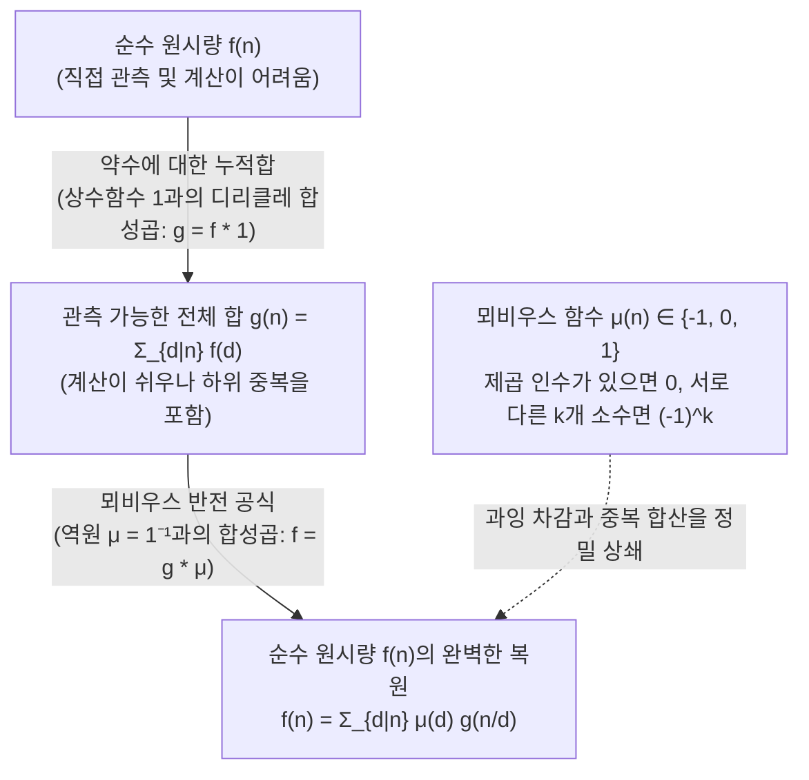
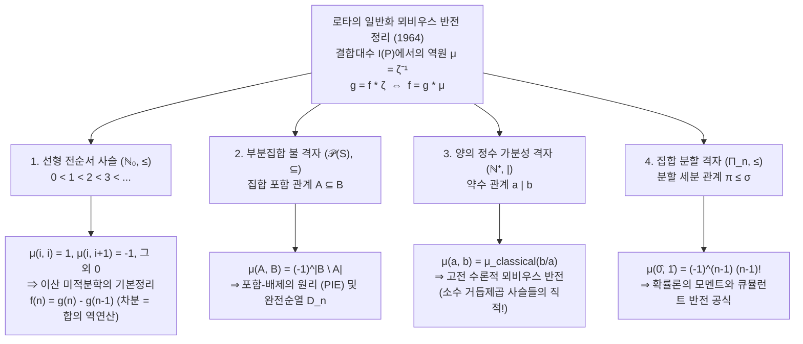

## 1. 들어가며: 뒤섞인 '합계'로부터 '순수한 원래의 값'을 복원할 수 있는가?

정수론, 조합론, 대수학, 그리고 통계물리학의 수많은 문제에서 우리는 동일한 역문제(Inverse Problem)의 딜레마와 마주한다. <strong>우리가 진정으로 알고자 하는 순수하고 원시적인 양(Primitive quantity) $f(n)$은 직접 세거나 측정하기가 매우 어려운 반면, 계층 구조의 하위 요소들이 모두 합쳐진 누적 합계 $g(n)$은 놀라울 정도로 쉽게 계산된다는 점이다.</strong>

대표적인 세 가지 예를 살펴보자.

1. <strong>주기 문자열과 비주기 원시 문자열(린든 단어, Lyndon words)</strong>:
   $q$개의 문자로 길이 $n$인 문자열을 만들면 총개수는 자명하게 $g(n) = q^n$이다. 하지만 이 속에는 더 짧은 주기 $d \mid n$이 반복되어 만들어진 퇴화 문자열들이 섞여 있다. 최소 주기가 정확히 $d$인 '순수 비주기 문자열'의 개수를 $f(d)$라 하면, 모든 길이 $n$의 문자열은 유일한 최소 주기 $d \mid n$을 가지므로 다음의 약수 합 관계가 성립한다:
   $$g(n) = \sum_{d \mid n} f(d)$$
2. <strong>가약분수와 기약분수(오일러 피 함수 $\varphi(n)$)</strong>:
   분모가 $n$인 $n$개의 분수 $\frac{1}{n}, \frac{2}{n}, \dots, \frac{n}{n}$을 기약분수로 약분하면, 분모는 $n$의 약수 $d \mid n$ 중 하나가 된다. 분모가 정확히 $d$인 기약분수의 개수가 바로 오일러 피 함수 $\varphi(d)$이므로, 전체 개수 $n$은 가우스 항등식을 만족한다:
   $$n = \sum_{d \mid n} \varphi(d)$$
3. <strong>부분집합 누적합과 포함-배제의 원리(Inclusion-Exclusion)</strong>:
   유한집합 $S$의 각 부분집합 $A$가 고유한 값 $f(A)$를 가질 때, 관측 가능한 양이 $B$에 포함되는 모든 부분집합의 합 $g(B) = \sum_{A \subseteq B} f(A)$뿐인 경우다.

전체 합 $g(n)$에서 진약수들의 합을 단순히 빼면 '과잉 차감(중복 빼기)'의 함정에 빠진다. 예를 들어 $n = 6$일 때 극대 진약수인 $3$과 $2$에 대해 $g(3), g(2)$를 빼면, $\gcd(3, 2) = 1$에 해당하는 $g(1)$이 두 번 빠지므로 한 번 다시 더해주어야 한다:
$$f(6) = g(6) - g(3) - g(2) + g(1)$$
반면 $n = 12$일 때는 극대 진약수가 $6$과 $4$이고 그 교집합은 $\gcd(6, 4) = 2$이므로 다음과 같이 된다:
$$f(12) = g(12) - g(6) - g(4) + g(2)$$
놀랍게도 $3$과 $1$ 역시 $12$의 약수이지만, 몫 $12/3 = 4 = 2^2$과 $12/1 = 12 = 2^2 \cdot 3$이 제곱 인수를 포함하기 때문에 <strong>$g(3)$과 $g(1)$의 계수는 $0$이 되어 식에서 완전히 사라진다!</strong>

1832년 독일의 수학자 아우구스트 페르디난트 뫼비우스(August Ferdinand Möbius)는 <strong>뫼비우스 함수 $\mu(n)$</strong>를 도입하여 이 중복 제거의 부호 법칙을 완벽히 규명했다. 그리고 1964년, MIT의 수학자 지안-카를로 로타(Gian-Carlo Rota)는 기념비적인 논문 *"On the Foundations of Combinatorial Theory I: Theory of Möbius Functions"*를 통해 이를 <strong>부분순서집합(Poset) 위의 결합대수(Incidence Algebra)</strong>로 일반화하여, 정수론의 뫼비우스 반전, 조합론의 포함-배제 원리, 이산 미적분학의 기본정리, 확률론의 큐뮬런트 전개가 모두 $\mu = \zeta^{-1}$이라는 단 하나의 방정식의 서로 다른 모습임을 증명했다.

---

## 2. 뫼비우스 함수 $\mu(n)$의 정의, 곱셈성 및 기본 항등식

### 2.1 뫼비우스 함수의 엄밀한 정의

> [!IMPORTANT]
> <strong>정의 (뫼비우스 함수 $\mu(n)$, 1832)</strong>
> 양의 정수 $n \in \mathbb{N}^+$에 대하여 <strong>뫼비우스 함수</strong> $\mu : \mathbb{N}^+ \to \{-1, 0, 1\}$를 다음과 같이 정의한다:
> $$\mu(n) = \begin{cases} 1 & (n = 1\text{일 때}), \\[4pt] (-1)^k & (n = p_1 p_2 \cdots p_k\text{가 서로 다른 } k\text{개의 소수의 곱일 때}), \\[4pt] 0 & (\text{어떤 소수 } p\text{에 대하여 } p^2 \mid n\text{일 때, 즉 제곱 인수를 가질 때}). \end{cases}$$

$n = 1$부터 $12$까지의 소인수분해, 제곱인수 없는 정수(Square-free) 여부, $\mu(n)$ 및 누적합인 <strong>메르텐스 함수(Mertens function)</strong> $M(n) = \sum_{m=1}^n \mu(m)$의 값은 다음과 같다.

| $n$ | 소인수분해 | Square-free 여부 | 서로 다른 소인수 개수 $k$ | 뫼비우스 함수 $\mu(n)$ | 메르텐스 함수 $M(n) = \sum_{m=1}^n \mu(m)$ |
| :---: | :---: | :---: | :---: | :---: | :---: |
| $1$ | $1$ (공곱) | Yes | $0$ | $+1$ | $+1$ |
| $2$ | $2$ | Yes | $1$ | $-1$ | $0$ |
| $3$ | $3$ | Yes | $1$ | $-1$ | $-1$ |
| $4$ | $2^2$ | <strong>No</strong> ($2^2 \mid 4$) | — | $0$ | $-1$ |
| $5$ | $5$ | Yes | $1$ | $-1$ | $-2$ |
| $6$ | $2 \cdot 3$ | Yes | $2$ | $+1$ | $-1$ |
| $7$ | $7$ | Yes | $1$ | $-1$ | $-2$ |
| $8$ | $2^3$ | <strong>No</strong> ($2^2 \mid 8$) | — | $0$ | $-2$ |
| $9$ | $3^2$ | <strong>No</strong> ($3^2 \mid 9$) | — | $0$ | $-2$ |
| $10$ | $2 \cdot 5$ | Yes | $2$ | $+1$ | $-1$ |
| $11$ | $11$ | Yes | $1$ | $-1$ | $-2$ |
| $12$ | $2^2 \cdot 3$ | <strong>No</strong> ($2^2 \mid 12$) | — | $0$ | $-2$ |

<strong>왜 $p^2 \mid n$일 때 $\mu(n) = 0$인가?</strong>
$n = p_1^{a_1} \cdots p_k^{a_k}$의 모든 진약수는 $k$개의 극대 진약수 $M_i = n/p_i$들의 약수 집합의 합집합에 속한다. 포함-배제 원리에 의해 이들의 교집합은 $\gcd(n/p_{i_1}, \dots, n/p_{i_r}) = \frac{n}{p_{i_1}\cdots p_{i_r}}$로 주어지며, 각 소인수는 최대 한 번만 나누어진다. 따라서 제곱 인수를 갖는 $d$($p^2 \mid d$)는 극대 진약수들의 교집합으로 새롭게 등장하지 않으며 이미 $n/p$ 단계에서 완전히 처리되었으므로 보정 계수가 $\mu(d) = 0$이 된다.

### 2.2 곱셈성(Multiplicativity)과 기본 항등식의 증명

1. <strong>곱셈성</strong>: $\gcd(a, b) = 1$이면 <strong>$\mu(ab) = \mu(a)\mu(b)$</strong>이다.
   <strong>증명</strong>: $a$ 또는 $b$가 제곱 인수를 가지면 $ab$도 제곱 인수를 가져 양변 모두 $0$이다. 둘 다 제곱 인수가 없으면 서로소 조건에 의해 소인수 집합이 서로소이므로, $ab$는 $r+s$개의 서로 다른 소수의 곱이 되어 $\mu(ab) = (-1)^{r+s} = (-1)^r (-1)^s = \mu(a)\mu(b)$가 성립한다. $\blacksquare$

2. <strong>기본 항등식(Fundamental Identity)</strong>:
   $$\sum_{d \mid n} \mu(d) = \varepsilon(n) := \begin{cases} 1 & n = 1, \\ 0 & n > 1. \end{cases}$$
   <strong>증명 (이항정리)</strong>: $n = 1$일 때는 $\mu(1) = 1$이다. $n = p_1^{a_1} \cdots p_k^{a_k} > 1$ ($k \ge 1$)일 때, $\mu(d) \neq 0$인 약수 $d$는 $\{p_1, \dots, p_k\}$에서 $j$개의 소수를 선택한 곱뿐이며, 그 개수는 $\binom{k}{j}$이고 각각 $\mu(d) = (-1)^j$이다. 따라서 이항정리에 의해:
   $$\sum_{d \mid n} \mu(d) = \sum_{j = 0}^{k} \binom{k}{j} (-1)^j 1^{k - j} = (1 - 1)^k = 0. \quad \blacksquare$$

---

## 3. 디리클레 합성곱(Dirichlet Convolution)과 수론적 함수의 가환환

### 3.1 디리클레 합성곱과 역원 $\mu = \mathbf{1}^{-1}$

수론적 함수들의 공간 $\mathcal{A} = \{f : \mathbb{N}^+ \to \mathbb{C}\}$ 위에 <strong>디리클레 합성곱</strong>을 정의하자:

$$(f * g)(n) := \sum_{d \mid n} f(d)\,g\!\left(\frac{n}{d}\right) = \sum_{ab = n} f(a)\,g(b)$$

$(\mathcal{A}, +, *)$는 <strong>$\varepsilon(n) = [n = 1]$</strong>을 곱셈 항등원($f * \varepsilon = f$)으로 갖는 <strong>단위원을 가진 가환환</strong>을 이룬다.
모든 $n$에 대해 $\mathbf{1}(n) = 1$인 <strong>상수함수 $\mathbf{1}$</strong>을 도입하면, 약수 합 연산은 $\mathbf{1}$과의 합성곱으로 표현된다:
$$g(n) = \sum_{d \mid n} f(d) = (f * \mathbf{1})(n) \iff g = f * \mathbf{1}$$
한편 기본 항등식 $\sum_{d \mid n} \mu(d) = \varepsilon(n)$은 합성곱 기호로 쓰면 다음과 같다:
$$\mu * \mathbf{1} = \mathbf{1} * \mu = \varepsilon \quad \Longleftrightarrow \quad \mu = \mathbf{1}^{-1}$$
즉, <strong>뫼비우스 함수 $\mu$는 상수함수(약수 합 연산자) $\mathbf{1}$의 디리클레 합성곱에 대한 정확한 역원이다!</strong>
따라서 <strong>고전적 뫼비우스 반전 공식</strong>은 단 한 줄의 대수 계산으로 증명된다:
$$g = f * \mathbf{1} \iff g * \mu = f * (\mathbf{1} * \mu) = f * \varepsilon = f \iff f(n) = \sum_{d \mid n} \mu(d)\,g\!\left(\frac{n}{d}\right) = \sum_{d \mid n} \mu\!\left(\frac{n}{d}\right) g(d)$$

### 3.2 디리클레 급수, 리만 제타 함수 $\zeta(s)$와 리만 가설

수론적 함수 $f$의 <strong>디리클레 급수</strong> $D_f(s) = \sum_{n=1}^{\infty} \frac{f(n)}{n^s}$는 합성곱을 일반 곱셈으로 바꾸는 환 준동형사상($D_{f * g}(s) = D_f(s) D_g(s)$)이다. 상수함수 $\mathbf{1}$의 디리클레 급수는 <strong>리만 제타 함수</strong> $\zeta(s) = \sum_{n=1}^{\infty} \frac{1}{n^s}$이고 $D_{\varepsilon}(s) = 1$이므로, $\mathbf{1} * \mu = \varepsilon$으로부터 즉시 다음을 얻는다:

$$\zeta(s) \sum_{n = 1}^{\infty} \frac{\mu(n)}{n^s} = 1 \quad \Longrightarrow \quad \frac{1}{\zeta(s)} = \sum_{n = 1}^{\infty} \frac{\mu(n)}{n^s} \qquad (\operatorname{Re}(s) > 1)$$

이 관계식은 해석적 수론의 핵심 정리들과 직결된다:
- <strong>소수 정리(Prime Number Theorem)</strong>는 $\sum_{n=1}^{\infty} \frac{\mu(n)}{n} = 0$ (즉 $M(x) = \sum_{n \le x} \mu(n) = o(x)$)과 동치이다.
- <strong>리만 가설(Riemann Hypothesis)</strong>은 $\frac{1}{\zeta(s)}$이 $\operatorname{Re}(s) > \frac{1}{2}$에서 해석적임과 동치이며, 이는 메르텐스 함수의 제곱근 상쇄 평가와 완전히 동치이다:
  $$\text{리만 가설 (RH)} \quad \Longleftrightarrow \quad M(x) = \sum_{n \le x} \mu(n) = O\!\left(x^{\frac{1}{2} + \varepsilon}\right) \quad (\forall \varepsilon > 0)$$

---

## 4. 3대 고전 응용: 오일러 피 함수, 린든 단어와 기약다항식, 원분다항식

### 4.1 응용 1: 오일러 피 함수 $\varphi(n)$의 명시적 공식
$\sum_{d \mid n} \varphi(d) = n$ ($\varphi * \mathbf{1} = \mathrm{id}$)의 양변에 $\mu$를 합성곱하면 $\varphi = \mathrm{id} * \mu$가 되어 다음을 얻는다:
$$\varphi(n) = \sum_{d \mid n} \mu(d)\,\frac{n}{d} = n \sum_{d \mid n} \frac{\mu(d)}{d} = n \prod_{p \mid n} \left(1 - \frac{1}{p}\right)$$

### 4.2 응용 2: 비주기 목걸이(린든 단어)와 유한체 $\mathbb{F}_q$ 위의 기약다항식 개수
- <strong>비주기 목걸이와 린든 단어</strong>: $q$개 문자로 만든 길이 $n$의 문자열 $q^n$개를 최소 주기 $d \mid n$에 따라 분류하면, 길이 $d$인 비주기 목걸이(린든 단어)의 개수 $N_q(d)$에 대하여 $q^n = \sum_{d \mid n} d \cdot N_q(d)$가 성립한다. 뫼비우스 반전을 적용하면 모로(Moreau)의 공식을 얻는다:
  $$N_q(n) = \frac{1}{n} \sum_{d \mid n} \mu\!\left(\frac{n}{d}\right) q^d$$
- <strong>유한체 $\mathbb{F}_q$ 위의 기약다항식</strong>: 다항식 $x^{q^n} - x$는 차수 $d$가 $n$을 나누는 모든 일계수(monic) 기약다항식들의 곱으로 인수분해된다. 차수 $d$인 기약다항식의 개수를 $I_q(d)$라 하고 양변의 차수를 비교하면 $q^n = \sum_{d \mid n} d \cdot I_q(d)$가 되어 <strong>가우스의 공식</strong>을 얻는다:
  $$I_q(n) = N_q(n) = \frac{1}{n} \sum_{d \mid n} \mu\!\left(\frac{n}{d}\right) q^d$$

### 4.3 응용 3: 곱셈적 뫼비우스 반전과 원분다항식 $\Phi_n(x)$
덧셈을 곱셈으로 바꾸면 $G(n) = \prod_{d \mid n} F(d) \iff F(n) = \prod_{d \mid n} G(d)^{\mu(n/d)}$가 성립한다.
$1$의 원시 $n$제곱근을 근으로 갖는 <strong>원분다항식</strong> $\Phi_n(x)$는 $x^n - 1 = \prod_{d \mid n} \Phi_d(x)$를 만족하므로, 곱셈적 반전에 의해 다음이 성립한다:
$$\Phi_n(x) = \prod_{d \mid n} (x^d - 1)^{\mu(n/d)}$$
예를 들어 <strong>$n = 12$일 때 $\Phi_{12}(x)$</strong>를 계산하면, $d \in \{1, 2, 3, 4, 6, 12\}$에 대해 $\mu(12/d)$는 각각 $0, +1, 0, -1, -1, +1$이므로:
$$\Phi_{12}(x) = \frac{(x^{12} - 1)(x^2 - 1)}{(x^6 - 1)(x^4 - 1)} = \frac{(x^6 + 1)(x^2 - 1)}{x^4 - 1} = \frac{x^6 + 1}{x^2 + 1} = x^4 - x^2 + 1$$

---

## 5. 지안-카를로 로타(Gian-Carlo Rota)의 1964 대통일 이론: 부분순서집합과 결합대수

1964년 로타는 모든 닫힌 구간 $[x, y] = \{z \in P \mid x \le z \le y\}$가 유한집합인 <strong>국소 유한 부분순서집합(Locally finite Poset) $(P, \le)$</strong> 위에서 <strong>결합대수(Incidence Algebra) $I(P)$</strong>의 합성곱을 정의했다:
$$(\alpha * \beta)(x, y) := \sum_{x \le z \le y} \alpha(x, z)\,\beta(z, y) \qquad (x \le y)$$
항등원은 크로네커 델타 $\delta(x, y) = [x = y]$이며, 순서 지시함수인 <strong>제타 함수 $\zeta(x, y) = 1$</strong> ($x \le y$)은 주대각선 성분이 모두 $1$인 상삼각행렬에 대응하므로 유일한 역원 <strong>$\mu = \zeta^{-1}$</strong>을 갖는다:
$$\mu(x, x) = 1, \qquad \mu(x, y) = -\sum_{x \le z < y} \mu(x, z) = -\sum_{x < z \le y} \mu(z, y) \quad (x < y)$$
이로써 <strong>일반화된 뫼비우스 반전 정리</strong>가 성립한다:
$$g(y) = \sum_{x \le y} f(x) \quad \Longleftrightarrow \quad f(y) = \sum_{x \le y} g(x)\,\mu(x, y)$$

### 4대 부분순서집합의 대통일 비교

1. <strong>선형 사슬 $(\mathbb{N}_0, \le)$ — 이산 미적분학의 기본정리</strong>:
   $\mu(i, i) = 1$, $\mu(i, i+1) = -1$, $j \ge i+2$일 때 $\mu(i, j) = 0$이므로 $g(n) = \sum_{k=0}^n f(k) \iff f(n) = g(n) - g(n-1) = \Delta g(n)$ ($\Delta = \Sigma^{-1}$)이 도출된다.
2. <strong>불 격자 $(\mathcal{P}(S), \subseteq)$ — 포함-배제의 원리(PIE)와 완전순열 $D_n$</strong>:
   $\{0 < 1\}^n$의 직적이므로 $\mu(A, B) = (-1)^{|B \setminus A|}$가 되어 포함-배제의 원리를 얻으며, 부동점 집합에 적용하면 <strong>완전순열(교란순열, Derangements)</strong> 공식 $D_n = n! \sum_{k=0}^n \frac{(-1)^k}{k!}$이 즉시 유도된다.
3. <strong>가분성 격자 $(\mathbb{N}^+, \mid)$ — 고전적 뫼비우스 반전의 기하학적 본질</strong>:
   구간 $[a, b]$는 $b/a = p_1^{e_1}\cdots p_k^{e_k}$의 소인수 지수 사슬 $\{0 < 1 < \cdots < e_i\}$들의 직적과 동형이다. 선형 사슬에서 2단계 이상 떨어진 곳의 1계 차분 계수가 $0$이므로, $e_i \ge 2$ ($p_i^2 \mid (b/a)$)일 때 $\mu(a, b) = \mu_{\text{classical}}(b/a) = 0$이 되는 것이다!
4. <strong>집합 분할 격자 $(\Pi_n, \le)$ — 확률론의 모멘트와 큐뮬런트(Cumulants)</strong>:
   $\mu(\hat{0}, \hat{1}) = (-1)^{n-1}(n-1)!$에 의해 모멘트 $\mathbb{E}[X_1\cdots X_n]$으로부터 순수 상관관계인 큐뮬런트 $\kappa(X_1, \dots, X_n) = \sum_{\pi \in \Pi_n} (-1)^{|\pi|-1}(|\pi|-1)! \prod_{B \in \pi} \mathbb{E}[\prod_{i \in B} X_i]$를 추출한다.

| 부분순서집합 $(P, \le)$ | 순서 관계 $x \le y$ | 구간 $[x, y]$의 구조 | 뫼비우스 함수 $\mu(x, y)$ | 일반화 뫼비우스 반전이 도출하는 기본 정리 |
| :--- | :--- | :--- | :--- | :--- |
| <strong>선형 사슬</strong> $(\mathbb{N}_0, \le)$ | 대소 관계 $i \le j$ | 길이 $j-i$인 선형 사슬 | $j=i$면 $1$, $j=i+1$이면 $-1$, 외 $0$ | <strong>이산 미적분학의 기본정리</strong> $f(n) = g(n) - g(n-1)$ |
| <strong>불 격자</strong> $(\mathcal{P}(S), \subseteq)$ | 부분집합 포함 $A \subseteq B$ | 초입방체 $\{0 < 1\}^{|B \setminus A|}$ | $(-1)^{|B \setminus A|}$ | <strong>포함-배제의 원리 (PIE)</strong> $f(B) = \sum_{A \subseteq B} (-1)^{|B \setminus A|} g(A)$ |
| <strong>가분성 격자</strong> $(\mathbb{N}^+, \mid)$ | 약수 관계 $a \mid b$ | 소인수 지수 사슬의 직적 | $\mu_{\text{classical}}(b/a) \in \{-1, 0, 1\}$ | <strong>고전 수론적 뫼비우스 반전</strong> $f(n) = \sum_{d \mid n} \mu(n/d) g(d)$ |
| <strong>분할 격자</strong> $(\Pi_n, \le)$ | 분할 세분 $\pi \le \sigma$ | 블록 병합 격자 | $\mu(\pi, \hat{1}) = (-1)^{|\pi|-1}(|\pi|-1)!$ | <strong>모멘트-큐뮬런트 반전 공식</strong> |

---

## 6. 맺음말: 중복을 도려내고 숨겨진 본질을 드러내는 수학의 메스

관측할 수 있는 데이터가 하위 요소들의 중첩된 합계뿐일지라도, 그 바탕에 놓인 부분순서 구조의 제타 함수를 역전($\mu = \zeta^{-1}$)시키면 모든 중복을 한 치의 오차도 없이 걷어낼 수 있다. 뫼비우스 반전은 정수론과 조합론을 넘어 현대 수학 전반에서 '순수한 원시적 구조'를 발굴해 내는 가장 보편적이고 우아한 수학적 메스이다.
