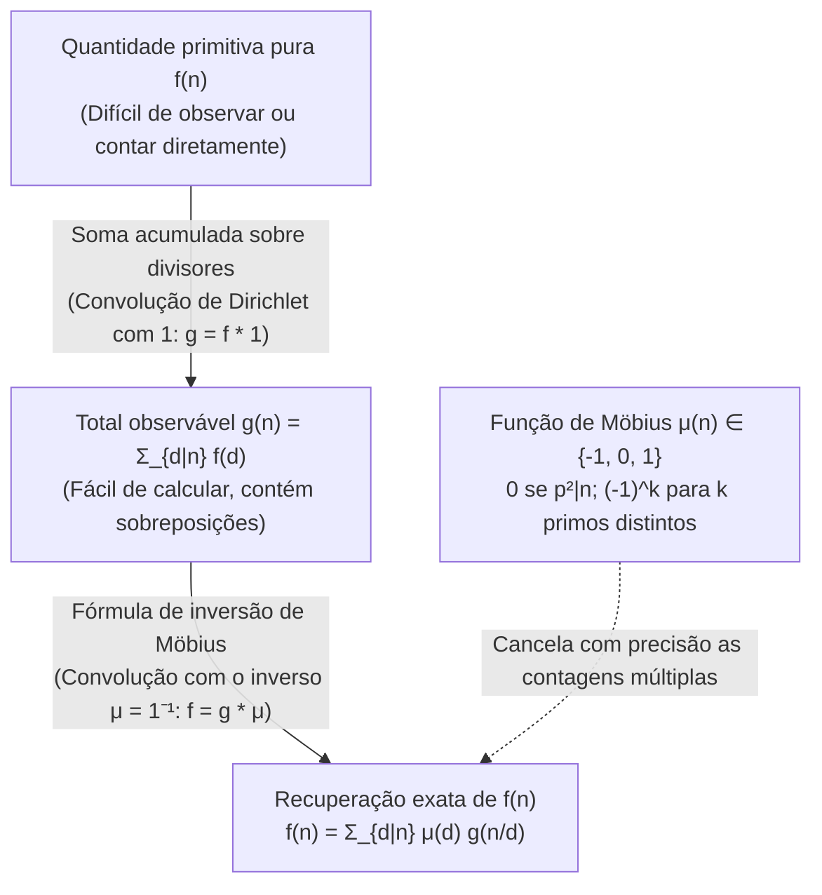
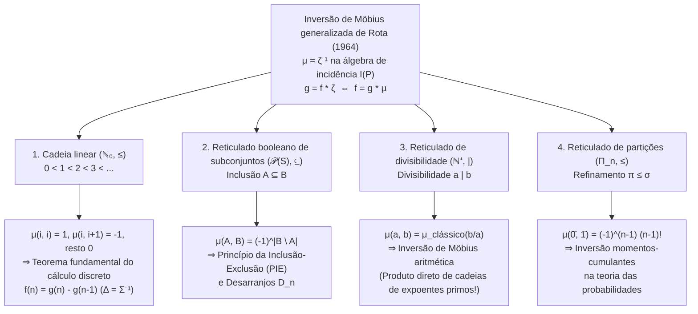

## 1. Introdução: O problema inverso fundamental da matemática

Na teoria dos números, combinatória, álgebra e física estatística, deparamo-nos repetidamente com o mesmo problema inverso: <strong>a quantidade pura e primitiva $f(n)$ que desejamos conhecer é extremamente difícil de contar diretamente, ao passo que a soma acumulada $g(n)$, que mistura as contribuições de todos os elementos inferiores de uma hierarquia, é surpreendentemente fácil de calcular.</strong>

Vejamos três exemplos clássicos:

1. <strong>Sequências periódicas e palavras de Lyndon aperiódicas</strong>:
   Com um alfabeto de $q$ símbolos, existem $g(n) = q^n$ sequências de comprimento $n$. Contudo, esse total inclui sequências periódicas degeneradas formadas pela repetição de um bloco menor de período mínimo $d \mid n$. Se $f(d)$ denota o número de sequências verdadeiramente aperiódicas de período mínimo exato $d$, vale a soma sobre os divisores:
   $$g(n) = \sum_{d \mid n} f(d)$$
2. <strong>Frações redutíveis e irredutíveis (Função totiente de Euler $\varphi(n)$)</strong>:
   Ao simplificar as $n$ frações $\frac{1}{n}, \frac{2}{n}, \dots, \frac{n}{n}$, cada denominador reduzido torna-se um divisor $d \mid n$. Como existem exatamente $\varphi(d)$ frações irredutíveis com denominador $d$, obtemos a identidade de Gauss:
   $$n = \sum_{d \mid n} \varphi(d)$$
3. <strong>Somas sobre subconjuntos e o Princípio da Inclusão-Exclusão (PIE)</strong>:
   Se cada subconjunto $A \subseteq S$ possui um peso intrínseco $f(A)$, mas apenas a soma acumulada $g(B) = \sum_{A \subseteq B} f(A)$ é observável, como recuperar $f(B)$?

A subtração ingênua dos divisores próprios leva imediatamente à subtração excessiva. Para $n = 6$, os divisores próprios maximais são $3$ e $2$, cuja interseção corresponde a $\gcd(3, 2) = 1$:
$$f(6) = g(6) - g(3) - g(2) + g(1)$$
Para $n = 12$, os divisores próprios maximais são $6$ e $4$ com $\gcd(6, 4) = 2$:
$$f(12) = g(12) - g(6) - g(4) + g(2)$$
Surpreendentemente, embora $3$ e $1$ sejam divisores de $12$, os termos $g(3)$ e $g(1)$ têm coeficiente <strong>$0$</strong> (pois os quocientes $12/3 = 4 = 2^2$ e $12/1 = 12 = 2^2 \cdot 3$ são divisíveis pelo quadrado de um número primo)!

Em 1832, o matemático alemão <strong>August Ferdinand Möbius</strong> resolveu esse problema introduzindo a <strong>função de Möbius $\mu(n)$</strong>. Em 1964, <strong>Gian-Carlo Rota</strong> generalizou esse princípio para <strong>conjuntos parcialmente ordenados (posets)</strong> e suas <strong>álgebras de incidência</strong>, demonstrando que a inversão aritmética de Möbius, o princípio da inclusão-exclusão, o teorema fundamental do cálculo discreto e a inversão entre momentos e cumulantes na probabilidade são todos casos particulares da equação universal $\mu = \zeta^{-1}$.

---

## 2. A função de Möbius $\mu(n)$: Definição, multiplicatividade e identidade fundamental

### 2.1 Definição rigorosa

> [!IMPORTANT]
> <strong>Definição (Função de Möbius $\mu(n)$, 1832)</strong>
> Para todo inteiro positivo $n \in \mathbb{N}^+$, a <strong>função de Möbius</strong> $\mu : \mathbb{N}^+ \to \{-1, 0, 1\}$ é definida por:
> $$\mu(n) = \begin{cases} 1 & \text{se } n = 1, \\[4pt] (-1)^k & \text{se } n = p_1 p_2 \cdots p_k \text{ é o produto de } k \text{ primos distintos (livre de quadrados)}, \\[4pt] 0 & \text{se } p^2 \mid n \text{ para algum primo } p. \end{cases}$$

| $n$ | Fatoração prima | Livre de quadrados? | Primos distintos $k$ | Função de Möbius $\mu(n)$ | Função de Mertens $M(n) = \sum_{m=1}^n \mu(m)$ |
| :---: | :---: | :---: | :---: | :---: | :---: |
| $1$ | $1$ (produto vazio) | Sim | $0$ | $+1$ | $+1$ |
| $2$ | $2$ | Sim | $1$ | $-1$ | $0$ |
| $3$ | $3$ | Sim | $1$ | $-1$ | $-1$ |
| $4$ | $2^2$ | <strong>Não</strong> ($2^2 \mid 4$) | — | $0$ | $-1$ |
| $5$ | $5$ | Sim | $1$ | $-1$ | $-2$ |
| $6$ | $2 \cdot 3$ | Sim | $2$ | $+1$ | $-1$ |
| $7$ | $7$ | Sim | $1$ | $-1$ | $-2$ |
| $8$ | $2^3$ | <strong>Não</strong> ($2^2 \mid 8$) | — | $0$ | $-2$ |
| $9$ | $3^2$ | <strong>Não</strong> ($3^2 \mid 9$) | — | $0$ | $-2$ |
| $10$ | $2 \cdot 5$ | Sim | $2$ | $+1$ | $-1$ |
| $11$ | $11$ | Sim | $1$ | $-1$ | $-2$ |
| $12$ | $2^2 \cdot 3$ | <strong>Não</strong> ($2^2 \mid 12$) | — | $0$ | $-2$ |

### 2.2 Multiplicatividade e identidade fundamental

1. <strong>Multiplicatividade</strong>: Se $\gcd(a, b) = 1$, então <strong>$\mu(ab) = \mu(a)\mu(b)$</strong>.
   *Demonstração*: Se $a$ ou $b$ é divisível por um quadrado $p^2$, então $ab$ também o é e ambos os lados valem $0$. Se ambos são livres de quadrados com $r$ e $s$ fatores primos, como $\gcd(a, b) = 1$, seus conjuntos de primos são disjuntos e $\mu(ab) = (-1)^{r+s} = (-1)^r (-1)^s = \mu(a)\mu(b)$. $\blacksquare$

2. <strong>Identidade fundamental</strong>:
   $$\sum_{d \mid n} \mu(d) = \varepsilon(n) := \begin{cases} 1 & n = 1, \\ 0 & n > 1. \end{cases}$$
   *Demonstração pelo teorema binomial*: Para $n = p_1^{a_1} \cdots p_k^{a_k} > 1$ ($k \ge 1$), apenas os divisores livres de quadrados $d \mid n$ contribuem com termos não nulos. Existem $\binom{k}{j}$ maneiras de escolher $j$ primos distintos de $\{p_1, \dots, p_k\}$, cada uma com $\mu(d) = (-1)^j$. Pelo teorema binomial:
   $$\sum_{d \mid n} \mu(d) = \sum_{j = 0}^{k} \binom{k}{j} (-1)^j 1^{k - j} = (1 - 1)^k = 0. \quad \blacksquare$$

---

## 3. O anel comutativo de funções aritméticas sob a convolução de Dirichlet

No espaço $\mathcal{A} = \{f : \mathbb{N}^+ \to \mathbb{C}\}$ das funções aritméticas, a <strong>convolução de Dirichlet</strong> é definida por:

$$(f * g)(n) := \sum_{d \mid n} f(d)\,g\!\left(\frac{n}{d}\right) = \sum_{ab = n} f(a)\,g(b)$$

$(\mathcal{A}, +, *)$ é um anel comutativo com identidade <strong>$\varepsilon(n) = [n = 1]$</strong> ($f * \varepsilon = f$).
Definindo a função constante <strong>$\mathbf{1}(n) = 1$</strong>, somar sobre os divisores equivale a convolucionar com $\mathbf{1}$: $g(n) = \sum_{d \mid n} f(d) = (f * \mathbf{1})(n)$, ou seja, $g = f * \mathbf{1}$.
A identidade fundamental $\sum_{d \mid n} \mu(d) = \varepsilon(n)$ expressa que:

$$\mu * \mathbf{1} = \mathbf{1} * \mu = \varepsilon \quad \Longleftrightarrow \quad \mu = \mathbf{1}^{-1}$$

<strong>A função de Möbius $\mu$ é exatamente o inverso de Dirichlet da função constante $\mathbf{1}$!</strong> Assim, a <strong>fórmula clássica de inversão de Möbius</strong> é demonstrada em uma única linha:

$$g = f * \mathbf{1} \iff g * \mu = f * (\mathbf{1} * \mu) = f * \varepsilon = f \iff f(n) = \sum_{d \mid n} \mu(d)\,g\!\left(\frac{n}{d}\right) = \sum_{d \mid n} \mu\!\left(\frac{n}{d}\right) g(d)$$

### Séries de Dirichlet, função zeta de Riemann $\zeta(s)$ e hipótese de Riemann

Associando a cada $f \in \mathcal{A}$ sua <strong>série de Dirichlet</strong> $D_f(s) = \sum_{n=1}^{\infty} \frac{f(n)}{n^s}$, a convolução transforma-se em multiplicação ordinária: $D_{f * g}(s) = D_f(s) D_g(s)$. Como $D_{\mathbf{1}}(s) = \zeta(s) = \sum_{n=1}^{\infty} \frac{1}{n^s}$ é a <strong>função zeta de Riemann</strong> e $D_{\varepsilon}(s) = 1$, a equação $\mathbf{1} * \mu = \varepsilon$ implica imediatamente:

$$\zeta(s) \sum_{n = 1}^{\infty} \frac{\mu(n)}{n^s} = 1 \quad \Longrightarrow \quad \frac{1}{\zeta(s)} = \sum_{n = 1}^{\infty} \frac{\mu(n)}{n^s} \qquad (\operatorname{Re}(s) > 1)$$

- O <strong>Teorema dos Números Primos</strong> equivale a $\sum_{n=1}^{\infty} \frac{\mu(n)}{n} = 0$, ou $M(x) = \sum_{n \le x} \mu(n) = o(x)$.
- A <strong>Hipótese de Riemann (RH)</strong> equivale à analiticidade de $\frac{1}{\zeta(s)}$ em $\operatorname{Re}(s) > \frac{1}{2}$, o que equivale exatamente ao cancelamento da raiz quadrada na função de Mertens:
  $$\text{Hipótese de Riemann} \quad \Longleftrightarrow \quad M(x) = \sum_{n \le x} \mu(n) = O\!\left(x^{\frac{1}{2} + \varepsilon}\right) \quad (\forall \varepsilon > 0)$$

---

## 4. Três aplicações clássicas

1. <strong>Função totiente de Euler $\varphi(n)$</strong>: A partir de $\sum_{d \mid n} \varphi(d) = n$ ($\varphi * \mathbf{1} = \mathrm{id}$), invertendo com $\mu$ obtemos $\varphi = \mathrm{id} * \mu$:
   $$\varphi(n) = \sum_{d \mid n} \mu(d)\,\frac{n}{d} = n \prod_{p \mid n} \left(1 - \frac{1}{p}\right)$$
2. <strong>Colares aperiódicos (palavras de Lyndon) e polinômios irredutíveis sobre $\mathbb{F}_q$</strong>:
   Tanto o número $N_q(d)$ de colares aperiódicos de comprimento $d$ sobre $q$ letras quanto o número $I_q(d)$ de polinômios irredutíveis mônicos de grau $d$ sobre o corpo finito $\mathbb{F}_q$ (visto que $x^{q^n} - x = \prod_{d \mid n} \prod_{\deg P = d} P(x)$) satisfazem $q^n = \sum_{d \mid n} d \cdot N_q(d) = \sum_{d \mid n} d \cdot I_q(d)$. A inversão de Möbius fornece a <strong>fórmula de Gauss</strong>:
   $$N_q(n) = I_q(n) = \frac{1}{n} \sum_{d \mid n} \mu\!\left(\frac{n}{d}\right) q^d$$
3. <strong>Polinômios ciclotômicos $\Phi_n(x)$</strong>:
   De $x^n - 1 = \prod_{d \mid n} \Phi_d(x)$, a inversão multiplicativa de Möbius resulta em:
   $$\Phi_n(x) = \prod_{d \mid n} (x^d - 1)^{\mu(n/d)}$$
   Para $n = 12$, com $d \in \{1, 2, 3, 4, 6, 12\}$ e $\mu(12/d) \in \{0, +1, 0, -1, -1, +1\}$, calculamos diretamente:
   $$\Phi_{12}(x) = \frac{(x^{12} - 1)(x^2 - 1)}{(x^6 - 1)(x^4 - 1)} = \frac{x^6 + 1}{x^2 + 1} = x^4 - x^2 + 1$$

---

## 5. A grande unificação de Gian-Carlo Rota (1964): Posets e álgebras de incidência

Seja $(P, \le)$ um <strong>conjunto parcialmente ordenado (poset)</strong> localmente finito (todo intervalo fechado $[x, y] = \{z \in P \mid x \le z \le y\}$ é finito). A <strong>álgebra de incidência $I(P)$</strong> é equipada com a convolução sobre intervalos:

$$(\alpha * \beta)(x, y) := \sum_{x \le z \le y} \alpha(x, z)\,\beta(z, y) \qquad (x \le y)$$

A identidade é o delta de Kronecker $\delta(x, y) = [x = y]$. A <strong>função zeta $\zeta(x, y) = 1$</strong> (para $x \le y$) possui um único inverso <strong>$\mu = \zeta^{-1}$</strong> definido recursivamente por $\mu(x, x) = 1$ e $\mu(x, y) = -\sum_{x \le z < y} \mu(x, z)$ para $x < y$. Obtém-se assim o <strong>teorema de inversão de Möbius generalizado sobre posets</strong>:

$$g(y) = \sum_{x \le y} f(x) \quad \Longleftrightarrow \quad f(y) = \sum_{x \le y} g(x)\,\mu(x, y)$$

| Poset $(P, \le)$ | Relação de ordem $x \le y$ | Função de Möbius $\mu(x, y)$ | Teorema fundamental obtido de $f = g * \mu$ |
| :--- | :--- | :--- | :--- |
| <strong>Cadeia linear</strong> $(\mathbb{N}_0, \le)$ | Magnitude $i \le j$ | $1$ ($j=i$), $-1$ ($j=i+1$), $0$ (resto) | <strong>Cálculo discreto fundamental</strong> $f(n) = g(n) - g(n-1)$ |
| <strong>Reticulado booleano</strong> $(\mathcal{P}(S), \subseteq)$ | Inclusão $A \subseteq B$ | $(-1)^{|B \setminus A|}$ | <strong>Inclusão-Exclusão (PIE)</strong> e Desarranjos $D_n = n!\sum_{k=0}^n \frac{(-1)^k}{k!}$ |
| <strong>Reticulado de divisibilidade</strong> $(\mathbb{N}^+, \mid)$ | Divisibilidade $a \mid b$ | $\mu_{\text{clássico}}(b/a) \in \{-1, 0, 1\}$ | <strong>Inversão de Möbius clássica</strong> $f(n) = \sum_{d \mid n} \mu(n/d) g(d)$ |
| <strong>Reticulado de partições</strong> $(\Pi_n, \le)$ | Refinamento $\pi \le \sigma$ | $\mu(\pi, \hat{1}) = (-1)^{|\pi|-1}(|\pi|-1)!$ | <strong>Inversão momentos-cumulantes</strong> $\kappa_n = \sum_{\pi \in \Pi_n} \mu(\pi, \hat{1}) \prod_{B \in \pi} \mathbb{E}[X_B]$ |
