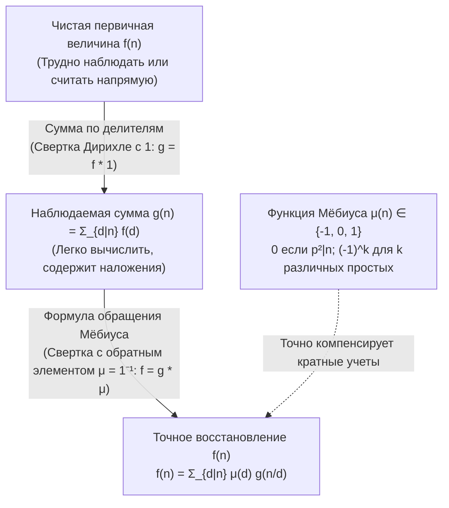
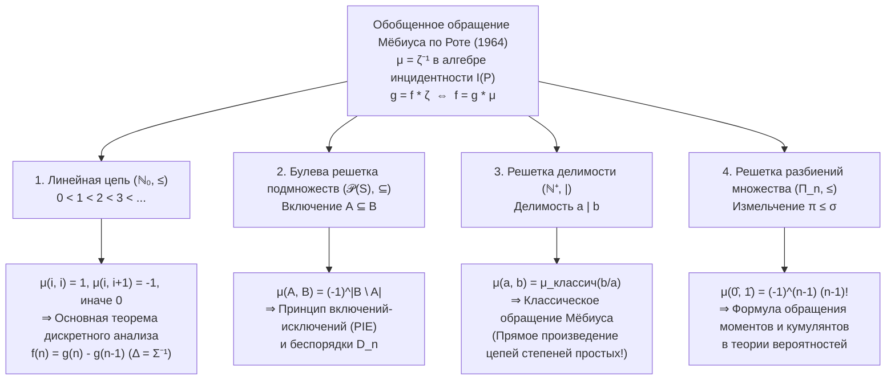

## 1. Введение: фундаментальная обратная задача математики

В теории чисел, комбинаторике, алгебре и статистической физике мы постоянно сталкиваемся с одной и той же обратной задачей: <strong>чистую первичную величину $f(n)$, которую мы хотим найти, крайне трудно подсчитать напрямую, тогда как накопленная сумма $g(n)$, смешивающая вклады всех младших элементов иерархии, вычисляется удивительно просто.</strong>

Рассмотрим три классических примера:

1. <strong>Периодические строки и апериодические слова Линдона</strong>:
   Над алфавитом из $q$ символов существует ровно $g(n) = q^n$ строк длины $n$. Однако в это число входят вырожденные периодические строки, образованные повторением более короткого блока минимального периода $d \mid n$. Если $f(d)$ — число истинно апериодических строк минимального периода $d$, то выполняется сумма по делителям:
   $$g(n) = \sum_{d \mid n} f(d)$$
2. <strong>Сократимые и несократимые дроби (функция Эйлера $\varphi(n)$)</strong>:
   Если сократить все $n$ дробей $\frac{1}{n}, \frac{2}{n}, \dots, \frac{n}{n}$, каждый приведенный знаменатель окажется делителем $d \mid n$. Поскольку существует ровно $\varphi(d)$ несократимых дробей со знаменателем $d$, получаем классическое тождество Гаусса:
   $$n = \sum_{d \mid n} \varphi(d)$$
3. <strong>Суммы по подмножествам и формула включений-исключений (PIE)</strong>:
   Если каждое подмножество $A \subseteq S$ несет собственный вес $f(A)$, но измерима лишь накопленная сумма $g(B) = \sum_{A \subseteq B} f(A)$, как восстановить $f(B)$?

Наивное вычитание собственных делителей сразу приводит к избыточному вычитанию. Для $n = 6$ максимальными собственными делителями являются $3$ и $2$, пересечение которых отвечает $\gcd(3, 2) = 1$:
$$f(6) = g(6) - g(3) - g(2) + g(1)$$
Для $n = 12$ максимальными собственными делителями являются $6$ и $4$ с $\gcd(6, 4) = 2$:
$$f(12) = g(12) - g(6) - g(4) + g(2)$$
Поразительно, но хотя $3$ и $1$ делят $12$, слагаемые $g(3)$ и $g(1)$ входят с коэффициентом <strong>$0$</strong> (так как частные $12/3 = 4 = 2^2$ и $12/1 = 12 = 2^2 \cdot 3$ делятся на квадрат простого числа)!

В 1832 году немецкий математик <strong>Август Фердинанд Мёбиус</strong> решил эту задачу, введя <strong>функцию Мёбиуса $\mu(n)$</strong>. В 1964 году <strong>Джан-Карло Рота</strong> обобщил этот принцип на <strong>частично упорядоченные множества (посеты)</strong> и их <strong>алгебры инцидентности</strong>, доказав, что теоретико-числовое обращение Мёбиуса, принцип включений-исключений, основная теорема дискретного анализа и связь моментов с кумулянтами в теории вероятностей — это частные случаи единого уравнения $\mu = \zeta^{-1}$.

---

## 2. Функция Мёбиуса $\mu(n)$: определение, мультипликативность и основное тождество

### 2.1 Строгое определение

> [!IMPORTANT]
> <strong>Определение (Функция Мёбиуса $\mu(n)$, 1832)</strong>
> Для любого натурального числа $n \in \mathbb{N}^+$ <strong>функция Мёбиуса</strong> $\mu : \mathbb{N}^+ \to \{-1, 0, 1\}$ определяется как:
> $$\mu(n) = \begin{cases} 1, & \text{если } n = 1, \\[4pt] (-1)^k, & \text{если } n = p_1 p_2 \cdots p_k \text{ — произведение } k \text{ различных простых чисел (свободно от квадратов)}, \\[4pt] 0, & \text{если } p^2 \mid n \text{ для некоторого простого } p. \end{cases}$$

| $n$ | Разложение на простые | Свободно от квадратов? | Число простых $k$ | Функция Мёбиуса $\mu(n)$ | Функция Мертенса $M(n) = \sum_{m=1}^n \mu(m)$ |
| :---: | :---: | :---: | :---: | :---: | :---: |
| $1$ | $1$ (пустое произведение) | Да | $0$ | $+1$ | $+1$ |
| $2$ | $2$ | Да | $1$ | $-1$ | $0$ |
| $3$ | $3$ | Да | $1$ | $-1$ | $-1$ |
| $4$ | $2^2$ | <strong>Нет</strong> ($2^2 \mid 4$) | — | $0$ | $-1$ |
| $5$ | $5$ | Да | $1$ | $-1$ | $-2$ |
| $6$ | $2 \cdot 3$ | Да | $2$ | $+1$ | $-1$ |
| $7$ | $7$ | Да | $1$ | $-1$ | $-2$ |
| $8$ | $2^3$ | <strong>Нет</strong> ($2^2 \mid 8$) | — | $0$ | $-2$ |
| $9$ | $3^2$ | <strong>Нет</strong> ($3^2 \mid 9$) | — | $0$ | $-2$ |
| $10$ | $2 \cdot 5$ | Да | $2$ | $+1$ | $-1$ |
| $11$ | $11$ | Да | $1$ | $-1$ | $-2$ |
| $12$ | $2^2 \cdot 3$ | <strong>Нет</strong> ($2^2 \mid 12$) | — | $0$ | $-2$ |

### 2.2 Мультипликативность и основное тождество

1. <strong>Мультипликативность</strong>: Если $\gcd(a, b) = 1$, то <strong>$\mu(ab) = \mu(a)\mu(b)$</strong>.
   *Доказательство*: Если $a$ или $b$ делится на квадрат $p^2$, то и $ab$ делится на $p^2$, так что обе части равны $0$. Если оба числа свободны от квадратов и содержат $r$ и $s$ простых множителей, то при $\gcd(a, b) = 1$ их простые делители не пересекаются и $\mu(ab) = (-1)^{r+s} = (-1)^r (-1)^s = \mu(a)\mu(b)$. $\blacksquare$

2. <strong>Основное тождество</strong>:
   $$\sum_{d \mid n} \mu(d) = \varepsilon(n) := \begin{cases} 1, & n = 1, \\ 0, & n > 1. \end{cases}$$
   *Доказательство через бином Ньютона*: При $n = p_1^{a_1} \cdots p_k^{a_k} > 1$ ($k \ge 1$) ненулевой вклад дают только свободные от квадратов делители $d \mid n$. Существует $\binom{k}{j}$ способов выбрать $j$ различных простых из $\{p_1, \dots, p_k\}$, каждому из которых отвечает $\mu(d) = (-1)^j$. По формуле бинома Ньютона:
   $$\sum_{d \mid n} \mu(d) = \sum_{j = 0}^{k} \binom{k}{j} (-1)^j 1^{k - j} = (1 - 1)^k = 0. \quad \blacksquare$$

---

## 3. Коммутативное кольцо арифметических функций со сверткой Дирихле

На пространстве арифметических функций $\mathcal{A} = \{f : \mathbb{N}^+ \to \mathbb{C}\}$ <strong>свертка Дирихле</strong> определяется формулой:

$$(f * g)(n) := \sum_{d \mid n} f(d)\,g\!\left(\frac{n}{d}\right) = \sum_{ab = n} f(a)\,g(b)$$

Множество $(\mathcal{A}, +, *)$ образует коммутативное кольцо с единицей <strong>$\varepsilon(n) = [n = 1]$</strong> ($f * \varepsilon = f$).
Для постоянной функции <strong>$\mathbf{1}(n) = 1$</strong> суммирование по делителям совпадает со сверткой с $\mathbf{1}$: $g(n) = \sum_{d \mid n} f(d) = (f * \mathbf{1})(n)$, то есть $g = f * \mathbf{1}$.
Основное тождество $\sum_{d \mid n} \mu(d) = \varepsilon(n)$ означает, что:

$$\mu * \mathbf{1} = \mathbf{1} * \mu = \varepsilon \quad \Longleftrightarrow \quad \mu = \mathbf{1}^{-1}$$

<strong>Функция Мёбиуса $\mu$ есть в точности обратный элемент по Дирихле к тождественной единице $\mathbf{1}$!</strong> Отсюда <strong>классическая формула обращения Мёбиуса</strong> доказывается в одну строчку:

$$g = f * \mathbf{1} \iff g * \mu = f * (\mathbf{1} * \mu) = f * \varepsilon = f \iff f(n) = \sum_{d \mid n} \mu(d)\,g\!\left(\frac{n}{d}\right) = \sum_{d \mid n} \mu\!\left(\frac{n}{d}\right) g(d)$$

### Ряды Дирихле, дзета-функция Римана $\zeta(s)$ и гипотеза Римана

Сопоставляя каждой функции $f \in \mathcal{A}$ ее <strong>ряд Дирихле</strong> $D_f(s) = \sum_{n=1}^{\infty} \frac{f(n)}{n^s}$, мы переводим свертку в обычное произведение: $D_{f * g}(s) = D_f(s) D_g(s)$. Так как $D_{\mathbf{1}}(s) = \zeta(s) = \sum_{n=1}^{\infty} \frac{1}{n^s}$ — <strong>дзета-функция Римана</strong>, а $D_{\varepsilon}(s) = 1$, тождество $\mathbf{1} * \mu = \varepsilon$ немедленно дает:

$$\zeta(s) \sum_{n = 1}^{\infty} \frac{\mu(n)}{n^s} = 1 \quad \Longrightarrow \quad \frac{1}{\zeta(s)} = \sum_{n = 1}^{\infty} \frac{\mu(n)}{n^s} \qquad (\operatorname{Re}(s) > 1)$$

- <strong>Асимптотический закон распределения простых чисел</strong> эквивалентен $\sum_{n=1}^{\infty} \frac{\mu(n)}{n} = 0$, или $M(x) = \sum_{n \le x} \mu(n) = o(x)$.
- <strong>Гипотеза Римана (RH)</strong> эквивалентна аналитичности $\frac{1}{\zeta(s)}$ в полуплоскости $\operatorname{Re}(s) > \frac{1}{2}$, что равносильно оценке функции Мертенса:
  $$\text{Гипотеза Римана} \quad \Longleftrightarrow \quad M(x) = \sum_{n \le x} \mu(n) = O\!\left(x^{\frac{1}{2} + \varepsilon}\right) \quad (\forall \varepsilon > 0)$$

---

## 4. Три классических приложения

1. <strong>Функция Эйлера $\varphi(n)$</strong>: Из $\sum_{d \mid n} \varphi(d) = n$ ($\varphi * \mathbf{1} = \mathrm{id}$) обращением с $\mu$ получаем $\varphi = \mathrm{id} * \mu$:
   $$\varphi(n) = \sum_{d \mid n} \mu(d)\,\frac{n}{d} = n \prod_{p \mid n} \left(1 - \frac{1}{p}\right)$$
2. <strong>Апериодические ожерелья (слова Линдона) и неприводимые многочлены над $\mathbb{F}_q$</strong>:
   Как число $N_q(d)$ апериодических ожерелий длины $d$ над алфавитом из $q$ букв, так и число $I_q(d)$ нормированных неприводимых многочленов степени $d$ над конечным полем $\mathbb{F}_q$ (поскольку $x^{q^n} - x = \prod_{d \mid n} \prod_{\deg P = d} P(x)$) удовлетворяют соотношению $q^n = \sum_{d \mid n} d \cdot N_q(d) = \sum_{d \mid n} d \cdot I_q(d)$. Обращение Мёбиуса дает <strong>формулу Гаусса</strong>:
   $$N_q(n) = I_q(n) = \frac{1}{n} \sum_{d \mid n} \mu\!\left(\frac{n}{d}\right) q^d$$
3. <strong>Круговые (циклотомические) многочлены $\Phi_n(x)$</strong>:
   Из разложения $x^n - 1 = \prod_{d \mid n} \Phi_d(x)$ мультипликативное обращение Мёбиуса дает:
   $$\Phi_n(x) = \prod_{d \mid n} (x^d - 1)^{\mu(n/d)}$$
   Для $n = 12$ при $d \in \{1, 2, 3, 4, 6, 12\}$ и $\mu(12/d) \in \{0, +1, 0, -1, -1, +1\}$ сразу находим:
   $$\Phi_{12}(x) = \frac{(x^{12} - 1)(x^2 - 1)}{(x^6 - 1)(x^4 - 1)} = \frac{x^6 + 1}{x^2 + 1} = x^4 - x^2 + 1$$

---

## 5. Великое объединение Джан-Карло Роты (1964): посеты и алгебры инцидентности

Пусть $(P, \le)$ — локально конечное <strong>частично упорядоченное множество (посет)</strong> (каждый замкнутый интервал $[x, y] = \{z \in P \mid x \le z \le y\}$ конечен). В <strong>алгебре инцидентности $I(P)$</strong> свертка по интервалам задается как:

$$(\alpha * \beta)(x, y) := \sum_{x \le z \le y} \alpha(x, z)\,\beta(z, y) \qquad (x \le y)$$

Единицей служит символ Кронекера $\delta(x, y) = [x = y]$. <strong>Дзета-функция посета $\zeta(x, y) = 1$</strong> (при $x \le y$) имеет единственный обратный элемент <strong>$\mu = \zeta^{-1}$</strong>, определяемый рекуррентно: $\mu(x, x) = 1$ и $\mu(x, y) = -\sum_{x \le z < y} \mu(x, z)$ при $x < y$. Это дает <strong>обобщенную теорему обращения Мёбиуса на посетах</strong>:

$$g(y) = \sum_{x \le y} f(x) \quad \Longleftrightarrow \quad f(y) = \sum_{x \le y} g(x)\,\mu(x, y)$$

| Посет $(P, \le)$ | Отношение порядка $x \le y$ | Функция Мёбиуса $\mu(x, y)$ | Фундаментальная теорема из $f = g * \mu$ |
| :--- | :--- | :--- | :--- |
| <strong>Линейная цепь</strong> $(\mathbb{N}_0, \le)$ | Неравенство $i \le j$ | $1$ ($j=i$), $-1$ ($j=i+1$), $0$ (иначе) | <strong>Дискретный анализ</strong> $f(n) = g(n) - g(n-1)$ |
| <strong>Булева решетка</strong> $(\mathcal{P}(S), \subseteq)$ | Включение $A \subseteq B$ | $(-1)^{|B \setminus A|}$ | <strong>Включения-исключения (PIE)</strong> и беспорядки $D_n = n!\sum_{k=0}^n \frac{(-1)^k}{k!}$ |
| <strong>Решетка делимости</strong> $(\mathbb{N}^+, \mid)$ | Делимость $a \mid b$ | $\mu_{\text{классич}}(b/a) \in \{-1, 0, 1\}$ | <strong>Классическое обращение Мёбиуса</strong> $f(n) = \sum_{d \mid n} \mu(n/d) g(d)$ |
| <strong>Решетка разбиений</strong> $(\Pi_n, \le)$ | Измельчение $\pi \le \sigma$ | $\mu(\pi, \hat{1}) = (-1)^{|\pi|-1}(|\pi|-1)!$ | <strong>Связь моментов и кумулянтов</strong> $\kappa_n = \sum_{\pi \in \Pi_n} \mu(\pi, \hat{1}) \prod_{B \in \pi} \mathbb{E}[X_B]$ |
