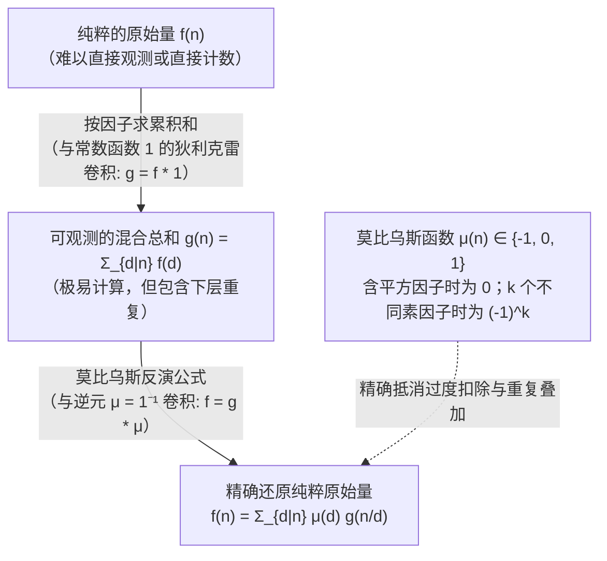
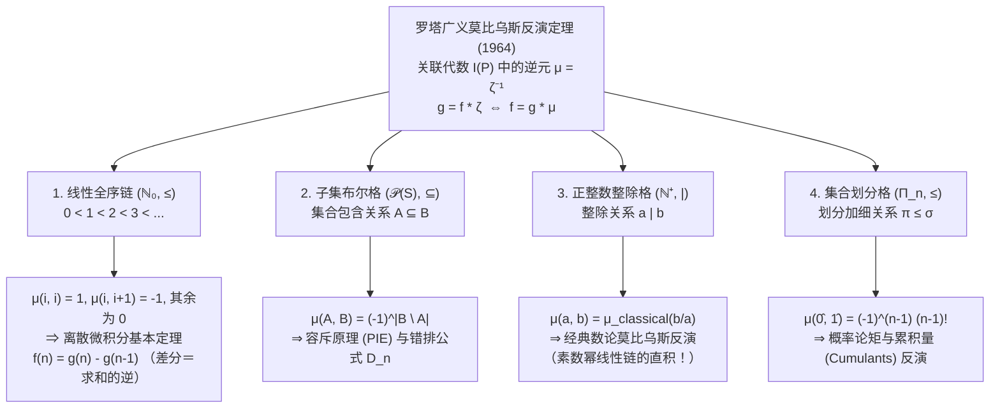

## 1. 引言：从“混杂的总和”中还原“纯粹的原始量”

在数论、组合数学、代数学以及统计物理的众多核心问题中，我们经常面临同一个逆问题（Inverse Problem）困境：<strong>我们真正渴望得知的纯粹原始量（Primitive quantity） $f(n)$ 往往难以直接计数或测量，但将层级结构中所有下层元素混杂在一起的累积总和 $g(n)$ 却可以轻而易举地算出。</strong>

让我们看三个极具代表性的具体例子：

1. <strong>周期字符串与非周期原始字符串（Lyndon 词）</strong>：
   用 $q$ 个字母构造长度为 $n$ 的字符串，总数显然是 $g(n) = q^n$。然而，在这 $q^n$ 个字符串中，混杂着由更短周期 $d \mid n$ 重复而成的退化字符串（例如当 $n=6$ 时，包含最小周期为 $d = 1, 2, 3$ 的重复模式）。设最小周期恰好为 $d$ 的“真正非周期字符串”有 $f(d)$ 个，由于每个长度为 $n$ 的字符串都有唯一的最小周期 $d \mid n$，我们便得到因子和关系：
   $$g(n) = \sum_{d \mid n} f(d)$$
2. <strong>可约分数与既约分数（欧拉函数 $\varphi(n)$）</strong>：
   考察分母为 $n$ 的 $n$ 个分数 $\frac{1}{n}, \frac{2}{n}, \dots, \frac{n}{n}$。将它们化为最简既约分数后，分母必然变为 $n$ 的某个正因子 $d \mid n$，而分母恰好为 $d$ 的既约分数个数正是欧拉函数 $\varphi(d)$。因此总个数 $n$ 满足高斯恒等式：
   $$n = \sum_{d \mid n} \varphi(d)$$
3. <strong>子集累积和与容斥原理（Inclusion-Exclusion）</strong>：
   设有限集合 $S$ 的每个子集 $A$ 具有内禀权重 $f(A)$，但能直接观测的只有包含在 $B$ 内的所有子集权重之和 $g(B) = \sum_{A \subseteq B} f(A)$。

如果我们试图从 $g(n)$ 中通过朴素的减法剔除真因子的贡献，立刻会遭遇“多减（过度扣除）”与“多加”的连锁陷阱。例如当 $n = 6$ 时，极大真因子为 $3$ 和 $2$，从 $g(6)$ 中减去 $g(3)$ 和 $g(2)$ 会导致周期为 $\gcd(3, 2) = 1$ 的部分被减去两次，必须加回一次 $g(1)$：
$$f(6) = g(6) - g(3) - g(2) + g(1)$$
而当 $n = 12$ 时，极大真因子为 $6$ 和 $4$，它们的交集对应 $\gcd(6, 4) = 2$，于是：
$$f(12) = g(12) - g(6) - g(4) + g(2)$$
奇妙的是，尽管 $3$ 和 $1$ 也是 $12$ 的因子，$g(3)$ 和 $g(1)$ 的系数却变成了 <strong>$0$</strong>（因为商 $12/3 = 4 = 2^2$ 和 $12/1 = 12 = 2^2 \cdot 3$ 含有平方素因子）！

1832年，因“莫比乌斯带”闻名于世的德国数学家奥古斯特·费迪南德·莫比乌斯（August Ferdinand Möbius）引入了<strong>莫比乌斯函数 $\mu(n)$</strong>，完美解决了这一去重难题。1964年，麻省理工学院数学家吉安-卡洛·罗塔（Gian-Carlo Rota）进一步发表了里程碑论文 *"On the Foundations of Combinatorial Theory I: Theory of Möbius Functions"*，将莫比乌斯反演提升至<strong>偏序集（Poset）上的关联代数（Incidence Algebra）</strong>，证明了数论反演、容斥原理、微积分基本定理与概率论累积量展开本质上是同一个定理。

---

## 2. 莫比乌斯函数 $\mu(n)$ 的定义、乘性及基本恒等式

### 2.1 莫比乌斯函数的严格定义

> [!IMPORTANT]
> <strong>定义（莫比乌斯函数 $\mu(n)$，1832）</strong>
> 对任意正整数 $n \in \mathbb{N}^+$，<strong>莫比乌斯函数</strong> $\mu : \mathbb{N}^+ \to \{-1, 0, 1\}$ 定义为：
> $$\mu(n) = \begin{cases} 1 & \text{若 } n = 1, \\[4pt] (-1)^k & \text{若 } n = p_1 p_2 \cdots p_k \text{ 为 } k \text{ 个互不相同的素数之积（无平方因子）}, \\[4pt] 0 & \text{若存在素数 } p \text{ 使得 } p^2 \mid n \text{（即 } n \text{ 含有平方素因子）}. \end{cases}$$

下表列出了 $n = 1$ 至 $12$ 的素因数分解、无平方因子（Square-free）判定、$\mu(n)$ 的取值以及累积和<strong>梅滕斯函数（Mertens function）</strong> $M(n) = \sum_{m=1}^n \mu(m)$：

| $n$ | 素因数分解 | 是否无平方因子？ | 不同素因子个数 $k$ | 莫比乌斯函数 $\mu(n)$ | 梅滕斯函数 $M(n) = \sum_{m=1}^n \mu(m)$ |
| :---: | :---: | :---: | :---: | :---: | :---: |
| $1$ | $1$（空积） | 是 | $0$ | $+1$ | $+1$ |
| $2$ | $2$ | 是 | $1$ | $-1$ | $0$ |
| $3$ | $3$ | 是 | $1$ | $-1$ | $-1$ |
| $4$ | $2^2$ | <strong>否</strong> ($2^2 \mid 4$) | — | $0$ | $-1$ |
| $5$ | $5$ | 是 | $1$ | $-1$ | $-2$ |
| $6$ | $2 \cdot 3$ | 是 | $2$ | $+1$ | $-1$ |
| $7$ | $7$ | 是 | $1$ | $-1$ | $-2$ |
| $8$ | $2^3$ | <strong>否</strong> ($2^2 \mid 8$) | — | $0$ | $-2$ |
| $9$ | $3^2$ | <strong>否</strong> ($3^2 \mid 9$) | — | $0$ | $-2$ |
| $10$ | $2 \cdot 5$ | 是 | $2$ | $+1$ | $-1$ |
| $11$ | $11$ | 是 | $1$ | $-1$ | $-2$ |
| $12$ | $2^2 \cdot 3$ | <strong>否</strong> ($2^2 \mid 12$) | — | $0$ | $-2$ |

<strong>为什么当 $p^2 \mid n$ 时 $\mu(n) = 0$？</strong>
设 $n = p_1^{a_1} \cdots p_k^{a_k}$。$n$ 的所有真因子都包含在 $k$ 个极大真因子 $M_i = n/p_i$ ($i=1,\dots,k$) 的因子集合之并中。根据集合的容斥原理，这些极大真因子集合的交集对应于最大公约数 $\gcd(n/p_{i_1}, \dots, n/p_{i_r}) = \frac{n}{p_{i_1}\cdots p_{i_r}}$，其中每个素因子至多被除掉一次。因此，只有无平方因子的除数 $d = p_{i_1}\cdots p_{i_r}$ 才会出现在容斥过程中；一旦 $p^2 \mid d$，对应的项早已在单次除法的层级中被彻底抵消，故其修正系数必为 $\mu(d) = 0$。

### 2.2 积性（Multiplicativity）与基本恒等式的证明

1. <strong>积性</strong>：若 $\gcd(a, b) = 1$，则 <strong>$\mu(ab) = \mu(a)\mu(b)$</strong>。
   <strong>证明</strong>：若 $a$ 或 $b$ 含有平方素因子，则 $ab$ 也含有平方素因子，两边皆为 $0$；若 $a = p_1\cdots p_r$ 与 $b = q_1\cdots q_s$ 均无平方因子，由 $\gcd(a, b) = 1$ 知素因子集合互不相交，故 $ab$ 是 $r+s$ 个不同素数之积，从而 $\mu(ab) = (-1)^{r+s} = (-1)^r (-1)^s = \mu(a)\mu(b)$。$\blacksquare$

2. <strong>基本恒等式（Fundamental Identity）</strong>：
   $$\sum_{d \mid n} \mu(d) = \varepsilon(n) := \begin{cases} 1 & n = 1, \\ 0 & n > 1. \end{cases}$$
   <strong>证明（二项式定理）</strong>：当 $n = 1$ 时显然为 $\mu(1) = 1$。当 $n = p_1^{a_1} \cdots p_k^{a_k} > 1$ ($k \ge 1$) 时，唯有无平方因子的 $d \mid n$ 对求和有非零贡献。从 $k$ 个不同素因子中选出 $j$ 个构成 $d = p_{i_1}\cdots p_{i_j}$ 共有 $\binom{k}{j}$ 种选法，每一项满足 $\mu(d) = (-1)^j$。由二项式定理：
   $$\sum_{d \mid n} \mu(d) = \sum_{j = 0}^{k} \binom{k}{j} (-1)^j 1^{k - j} = (1 - 1)^k = 0. \quad \blacksquare$$

---

## 3. 狄利克雷卷积（Dirichlet Convolution）与数论函数交换环

### 3.1 狄利克雷卷积与逆元 $\mu = \mathbf{1}^{-1}$

在全体数论函数空间 $\mathcal{A} = \{f : \mathbb{N}^+ \to \mathbb{C}\}$ 上，定义<strong>狄利克雷卷积</strong>：

$$(f * g)(n) := \sum_{d \mid n} f(d)\,g\!\left(\frac{n}{d}\right) = \sum_{ab = n} f(a)\,g(b)$$

代数结构 $(\mathcal{A}, +, *)$ 构成一个以 <strong>$\varepsilon(n) = [n = 1]$</strong> 为乘法单位元（满足 $f * \varepsilon = \varepsilon * f = f$）的<strong>含幺交换环</strong>。任一满足 $f(1) \neq 0$ 的函数 $f$ 均存在唯一的狄利克雷逆元 $f^{-1}$。

引入恒等于 $1$ 的<strong>常数函数 $\mathbf{1}(n) = 1$</strong>。不难发现，“对所有因子求和”正是与常数函数 $\mathbf{1}$ 作卷积：
$$g(n) = \sum_{d \mid n} f(d) = (f * \mathbf{1})(n) \iff g = f * \mathbf{1}$$
而莫比乌斯函数的基本恒等式 $\sum_{d \mid n} \mu(d) = \varepsilon(n)$ 用卷积语言表述即为：
$$\mu * \mathbf{1} = \mathbf{1} * \mu = \varepsilon \quad \Longleftrightarrow \quad \mu = \mathbf{1}^{-1}$$
<strong>莫比乌斯函数 $\mu$ 正是常数函数（因子求和算子）$\mathbf{1}$ 在狄利克雷卷积环中的精确乘法逆元！</strong>

由此，<strong>经典莫比乌斯反演公式</strong>仅需一行代数推导即可得证：
$$g = f * \mathbf{1} \iff g * \mu = f * (\mathbf{1} * \mu) = f * \varepsilon = f \iff f(n) = \sum_{d \mid n} \mu(d)\,g\!\left(\frac{n}{d}\right) = \sum_{d \mid n} \mu\!\left(\frac{n}{d}\right) g(d)$$

### 3.2 狄利克雷级数、黎曼 $\zeta$ 函数与黎曼猜想

若将数论函数 $f$ 映射为其<strong>狄利克雷级数</strong> $D_f(s) = \sum_{n=1}^{\infty} \frac{f(n)}{n^s}$，则狄利克雷卷积恰好转化为级数的普通乘法：$D_{f * g}(s) = D_f(s) D_g(s)$。
由于常数函数 $\mathbf{1}$ 对应于<strong>黎曼 $\zeta$ 函数</strong> $D_{\mathbf{1}}(s) = \zeta(s) = \sum_{n=1}^{\infty} \frac{1}{n^s}$，而单位元对应于 $D_{\varepsilon}(s) = 1$，恒等式 $\mathbf{1} * \mu = \varepsilon$ 直接给出：

$$\zeta(s) \sum_{n = 1}^{\infty} \frac{\mu(n)}{n^s} = 1 \quad \Longrightarrow \quad \frac{1}{\zeta(s)} = \sum_{n = 1}^{\infty} \frac{\mu(n)}{n^s} \qquad (\operatorname{Re}(s) > 1)$$

这一解析恒等式将莫比乌斯函数置于解析数论的核心：
- <strong>素数定理（Prime Number Theorem）</strong>等价于 $\sum_{n=1}^{\infty} \frac{\mu(n)}{n} = 0$（即 $M(x) = \sum_{n \le x} \mu(n) = o(x)$）。
- <strong>黎曼猜想（Riemann Hypothesis）</strong>——即 $\zeta(s)$ 的所有非平凡零点均位于临界线 $\operatorname{Re}(s) = \frac{1}{2}$ 上——等价于 $\frac{1}{\zeta(s)}$ 在 $\operatorname{Re}(s) > \frac{1}{2}$ 内全纯，通过阿贝尔分部求和与梅林变换，这完全等价于梅滕斯函数的平方根抵消界：
  $$\text{黎曼猜想 (RH)} \quad \Longleftrightarrow \quad M(x) = \sum_{n \le x} \mu(n) = O\!\left(x^{\frac{1}{2} + \varepsilon}\right) \quad (\forall \varepsilon > 0)$$

---

## 4. 三大经典应用：欧拉函数、Lyndon 词与既约多项式、分圆多项式

### 4.1 应用 1：欧拉函数 $\varphi(n)$ 的显式乘积公式
由 $\sum_{d \mid n} \varphi(d) = n$（即 $\varphi * \mathbf{1} = \mathrm{id}$），两边同卷 $\mu$ 得 $\varphi = \mathrm{id} * \mu$：
$$\varphi(n) = \sum_{d \mid n} \mu(d)\,\frac{n}{d} = n \sum_{d \mid n} \frac{\mu(d)}{d} = n \prod_{p \mid n} \left(1 - \frac{1}{p}\right)$$

### 4.2 应用 2：非周期项链（Lyndon 词）与有限域 $\mathbb{F}_q$ 上的既约多项式
- <strong>非周期项链与 Lyndon 词</strong>：$q$ 元字母表上长为 $n$ 的 $q^n$ 个字符串按最小周期 $d \mid n$ 分类。每个长为 $d$ 的非周期项链（Lyndon 词）循环移位产生 $d$ 个不同的字符串，设其个数为 $N_q(d)$，则 $q^n = \sum_{d \mid n} d \cdot N_q(d)$。莫比乌斯反演给出 Moreau 公式：
  $$N_q(n) = \frac{1}{n} \sum_{d \mid n} \mu\!\left(\frac{n}{d}\right) q^d$$
- <strong>有限域 $\mathbb{F}_q$ 上的首一既约多项式</strong>：在有限域 $\mathbb{F}_q$ 上，多项式 $x^{q^n} - x$ 恰好分解为所有次数 $d \mid n$ 的首一既约多项式之积。设 $d$ 次首一既约多项式有 $I_q(d)$ 个，比较两边次数得 $q^n = \sum_{d \mid n} d \cdot I_q(d)$。莫比乌斯反演立即给出<strong>高斯公式</strong>：
  $$I_q(n) = N_q(n) = \frac{1}{n} \sum_{d \mid n} \mu\!\left(\frac{n}{d}\right) q^d$$

### 4.3 应用 3：乘性莫比乌斯反演与分圆多项式 $\Phi_n(x)$
将加法换为乘法，若 $G(n) = \prod_{d \mid n} F(d)$，则乘性莫比乌斯反演为 $F(n) = \prod_{d \mid n} G(d)^{\mu(n/d)}$。
以全体本原 $n$ 次单位根为根的<strong>分圆多项式</strong> $\Phi_n(x)$ 满足 $x^n - 1 = \prod_{d \mid n} \Phi_d(x)$。应用乘性反演得：
$$\Phi_n(x) = \prod_{d \mid n} (x^d - 1)^{\mu(n/d)}$$
例如计算 <strong>$\Phi_{12}(x)$</strong>：$12$ 的因子 $d \in \{1, 2, 3, 4, 6, 12\}$ 对应的 $\mu(12/d)$ 分别为 $\mu(12)=0, \mu(6)=1, \mu(4)=0, \mu(3)=-1, \mu(2)=-1, \mu(1)=1$，于是：
$$\Phi_{12}(x) = \frac{(x^{12} - 1)(x^2 - 1)}{(x^6 - 1)(x^4 - 1)} = \frac{(x^6 + 1)(x^2 - 1)}{x^4 - 1} = \frac{x^6 + 1}{x^2 + 1} = x^4 - x^2 + 1$$

---

## 5. 罗塔（Gian-Carlo Rota）1964 大统一理论：偏序集与关联代数

1964年，罗塔指出莫比乌斯反演可以推广到任意<strong>局部有限偏序集（Locally finite Poset） $(P, \le)$</strong>（即每个闭区间 $[x, y] = \{z \in P \mid x \le z \le y\}$ 均为有限集）。
在区间函数集合 $I(P)$ 上定义<strong>关联代数（Incidence Algebra）</strong>的卷积乘法：
$$(\alpha * \beta)(x, y) := \sum_{x \le z \le y} \alpha(x, z)\,\beta(z, y) \qquad (x \le y)$$
其单位元为克罗内克函数 $\delta(x, y) = [x = y]$。定义偏序指示函数为<strong>泽塔函数 $\zeta(x, y) = 1$</strong>（当 $x \le y$）。由于 $\zeta$ 对应于主对角线全为 $1$ 的上三角矩阵，它在 $I(P)$ 中必有唯一逆元 <strong>$\mu = \zeta^{-1}$</strong>，由以下递推式唯一确定：
$$\mu(x, x) = 1, \qquad \mu(x, y) = -\sum_{x \le z < y} \mu(x, z) = -\sum_{x < z \le y} \mu(z, y) \quad (x < y)$$
由此得到<strong>偏序集上的广义莫比乌斯反演定理</strong>：
$$g(y) = \sum_{x \le y} f(x) \quad \Longleftrightarrow \quad f(y) = \sum_{x \le y} g(x)\,\mu(x, y)$$

### 四大偏序集的统一图景

1. <strong>线性全序链 $(\mathbb{N}_0, \le)$ —— 离散微积分基本定理（差分与和分）</strong>：
   递推可得 $\mu(i, i) = 1$，$\mu(i, i+1) = -1$，当 $j \ge i + 2$ 时 $\mu(i, j) = 0$。反演公式直接给出 $g(n) = \sum_{k=0}^n f(k) \iff f(n) = g(n) - g(n-1) = \Delta g(n)$，即差分算子 $\Delta$ 是求和算子 $\Sigma$ 的逆：$\Delta = \Sigma^{-1}$！
2. <strong>子集布尔格 $(\mathcal{P}(S), \subseteq)$ —— 容斥原理与错排问题 $D_n$</strong>：
   布尔格同构于二元链 $\{0 < 1\}^n$ 的直积，故 $\mu(A, B) = (-1)^{|B \setminus A|}$。反演公式正是<strong>容斥原理（PIE）</strong>！将其应用于固定点子集，立得 $n$ 元<strong>错排数（Derangements）</strong>：
   $$D_n = n! \sum_{k = 0}^{n} \frac{(-1)^k}{k!}$$
3. <strong>正整数整除格 $(\mathbb{N}^+, \mid)$ —— 数论莫比乌斯反演的几何本质</strong>：
   区间 $[a, b]$ 同构于 $b/a = p_1^{e_1}\cdots p_k^{e_k}$ 各素因子指数线性链 $\{0 < 1 < \cdots < e_i\}$ 的直积！因为在线性链上距离 $\ge 2$ 时 $\mu(0, e_i) = 0$（一阶差分只看前一步），故只要存在 $e_i \ge 2$（即 $p_i^2 \mid (b/a)$），乘积 $\mu(a, b) = \mu_{\text{classical}}(b/a)$ 必然为 $0$！
4. <strong>集合划分格 $(\Pi_n, \le)$ —— 概率论中的矩与累积量（Cumulants）</strong>：
   在 $n$ 元集合划分格 $\Pi_n$ 上，$\mu(\hat{0}, \hat{1}) = (-1)^{n-1}(n-1)!$，从而将随机变量的矩展开 $\mathbb{E}[X_1\cdots X_n] = \sum_{\pi \in \Pi_n} \prod_{B \in \pi} \kappa(X_B)$ 反演为累积量公式：
   $$\kappa(X_1, \dots, X_n) = \sum_{\pi \in \Pi_n} (-1)^{|\pi| - 1} (|\pi| - 1)! \prod_{B \in \pi} \mathbb{E}\!\left[\prod_{i \in B} X_i\right]$$

| 偏序集 $(P, \le)$ | 偏序关系 $x \le y$ | 区间 $[x, y]$ 的结构 | 莫比乌斯函数 $\mu(x, y)$ | 广义莫比乌斯反演给出的核心定理 |
| :--- | :--- | :--- | :--- | :--- |
| <strong>线性全序链</strong> $(\mathbb{N}_0, \le)$ | 数值大小 $i \le j$ | 长度为 $j-i$ 的链 | $j=i$ 时 $1$；$j=i+1$ 时 $-1$；余为 $0$ | <strong>离散微积分基本定理</strong> $f(n) = g(n) - g(n-1)$ |
| <strong>子集布尔格</strong> $(\mathcal{P}(S), \subseteq)$ | 子集包含 $A \subseteq B$ | 超立方体 $\{0 < 1\}^{|B \setminus A|}$ | $(-1)^{|B \setminus A|}$ | <strong>容斥原理（PIE）</strong> $f(B) = \sum_{A \subseteq B} (-1)^{|B \setminus A|} g(A)$ |
| <strong>整除格</strong> $(\mathbb{N}^+, \mid)$ | 整除关系 $a \mid b$ | 素指数链的直积 | $\mu_{\text{classical}}(b/a) \in \{-1, 0, 1\}$ | <strong>经典数论莫比乌斯反演</strong> $f(n) = \sum_{d \mid n} \mu(n/d) g(d)$ |
| <strong>集合划分格</strong> $(\Pi_n, \le)$ | 划分加细 $\pi \le \sigma$ | 划分块合并格 | $\mu(\pi, \hat{1}) = (-1)^{|\pi|-1}(|\pi|-1)!$ | <strong>概率论矩与累积量（Cumulant）反演公式</strong> |

---

## 6. 结语：剥离冗余、直抵纯粹本质的数学手术刀

从数论中素因子交织的符号 $\mu(n)$，到狄利克雷级数中黎曼 $\zeta$ 函数的倒数 $\frac{1}{\zeta(s)}$，再到罗塔偏序集关联代数中的普适逆元 $\mu = \zeta^{-1}$，莫比乌斯反演向我们揭示了一个深刻的数学哲学：无论可观测的表象多么混杂重叠，只要底层的偏序层级结构清晰，我们总能打造出一把精确的“数学手术刀”，将一切重复计算的冗余层层剥离，还原出最纯粹、不可再分的原始结构。
