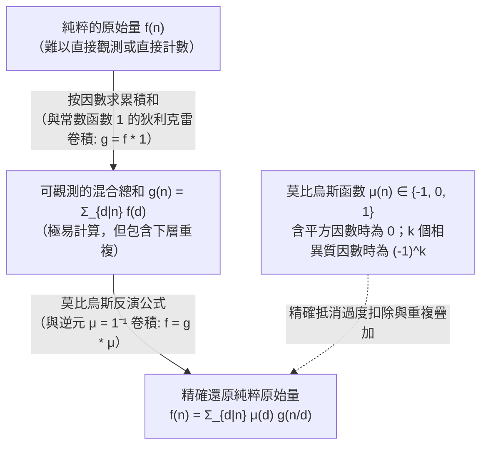
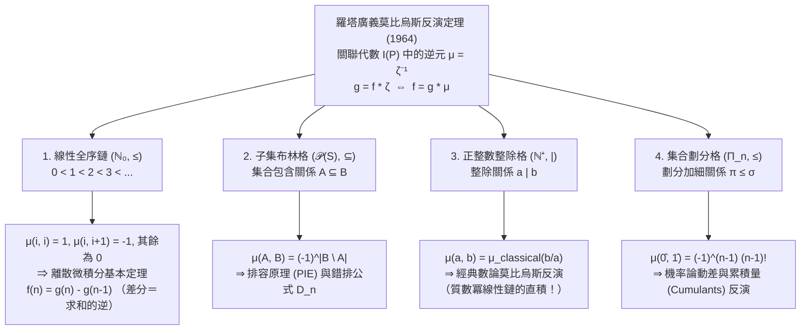

## 1. 引言：從「混雜的總和」中還原「純粹的原始量」

在數論、組合數學、代數學以及統計物理的眾多核心問題中，我們經常面臨同一個逆問題（Inverse Problem）困境：<strong>我們真正渴望得知的純粹原始量（Primitive quantity） $f(n)$ 往往難以直接計數或測量，但將層級結構中所有下層元素混雜在一起的累積總和 $g(n)$ 卻可以輕而易舉地算出。</strong>

讓我們看三個極具代表性的具體例子：

1. <strong>週期字串與非週期原始字串（Lyndon 詞）</strong>：
   用 $q$ 個字母構造長度為 $n$ 的字串，總數顯然是 $g(n) = q^n$。然而，在這 $q^n$ 個字串中，混雜著由更短週期 $d \mid n$ 重複而成的退化字串（例如當 $n=6$ 時，包含最小週期為 $d = 1, 2, 3$ 的重複模式）。設最小週期恰好為 $d$ 的「真正非週期字串」有 $f(d)$ 個，由於每個長度為 $n$ 的字串都有唯一的最小週期 $d \mid n$，我們便得到因數和關係：
   $$g(n) = \sum_{d \mid n} f(d)$$
2. <strong>可約分數與既約分數（歐拉函數 $\varphi(n)$）</strong>：
   考察分母為 $n$ 的 $n$ 個分數 $\frac{1}{n}, \frac{2}{n}, \dots, \frac{n}{n}$。將它們化為最簡既約分數後，分母必然變為 $n$ 的某個正因數 $d \mid n$，而分母恰好為 $d$ 的既約分數個數正是歐拉函數 $\varphi(d)$。因此總個數 $n$ 滿足高斯恆等式：
   $$n = \sum_{d \mid n} \varphi(d)$$
3. <strong>子集累積和與排容原理（Inclusion-Exclusion）</strong>：
   設有限集合 $S$ 的每個子集 $A$ 具有內稟權重 $f(A)$，但能直接觀測的只有包含在 $B$ 內的所有子集權重之和 $g(B) = \sum_{A \subseteq B} f(A)$。

如果我們試圖從 $g(n)$ 中透過樸素的減法剔除真因數的貢獻，立刻會遭遇「多減（過度扣除）」與「多加」的連鎖陷阱。例如當 $n = 6$ 時，極大真因數為 $3$ 和 $2$，從 $g(6)$ 中減去 $g(3)$ 和 $g(2)$ 會導致週期為 $\gcd(3, 2) = 1$ 的部分被減去兩次，必須加回一次 $g(1)$：
$$f(6) = g(6) - g(3) - g(2) + g(1)$$
而當 $n = 12$ 時，極大真因數為 $6$ 和 $4$，它們的交集對應 $\gcd(6, 4) = 2$，於是：
$$f(12) = g(12) - g(6) - g(4) + g(2)$$
奇妙的是，儘管 $3$ 和 $1$ 也是 $12$ 的因數，$g(3)$ 和 $g(1)$ 的係數卻變成了 <strong>$0$</strong>（因為商 $12/3 = 4 = 2^2$ 和 $12/1 = 12 = 2^2 \cdot 3$ 含有平方質因數）！

1832年，因「莫比烏斯帶」聞名於世的德國數學家奧古斯特·費迪南德·莫比烏斯（August Ferdinand Möbius）引入了<strong>莫比烏斯函數 $\mu(n)$</strong>，完美解決了這一去重難題。1964年，麻省理工學院數學家吉安-卡洛·羅塔（Gian-Carlo Rota）進一步發表了里程碑論文 *"On the Foundations of Combinatorial Theory I: Theory of Möbius Functions"*，將莫比烏斯反演提升至<strong>偏序集（Poset）上的關聯代數（Incidence Algebra）</strong>，證明了數論反演、排容原理、微積分基本定理與機率論累積量展開本質上是同一個定理。

---

## 2. 莫比烏斯函數 $\mu(n)$ 的定義、乘性及基本恆等式

### 2.1 莫比烏斯函數的嚴格定義

> [!IMPORTANT]
> <strong>定義（莫比烏斯函數 $\mu(n)$，1832）</strong>
> 對任意正整數 $n \in \mathbb{N}^+$，<strong>莫比烏斯函數</strong> $\mu : \mathbb{N}^+ \to \{-1, 0, 1\}$ 定義為：
> $$\mu(n) = \begin{cases} 1 & \text{若 } n = 1, \\[4pt] (-1)^k & \text{若 } n = p_1 p_2 \cdots p_k \text{ 為 } k \text{ 個互不相同的質數之積（無平方因數）}, \\[4pt] 0 & \text{若存在質數 } p \text{ 使得 } p^2 \mid n \text{（即 } n \text{ 含有平方質因數）}. \end{cases}$$

下表列出了 $n = 1$ 至 $12$ 的質因數分解、無平方因數（Square-free）判定、$\mu(n)$ 的取值以及累積和<strong>梅滕斯函數（Mertens function）</strong> $M(n) = \sum_{m=1}^n \mu(m)$：

| $n$ | 質因數分解 | 是否無平方因數？ | 相異質因數個數 $k$ | 莫比烏斯函數 $\mu(n)$ | 梅滕斯函數 $M(n) = \sum_{m=1}^n \mu(m)$ |
| :---: | :---: | :---: | :---: | :---: | :---: |
| $1$ | $1$（空積） | 是 | $0$ | $+1$ | $+1$ |
| $2$ | $2$ | 是 | $1$ | $-1$ | $0$ |
| $3$ | $3$ | 是 | $1$ | $-1$ | $-1$ |
| $4$ | $2^2$ | <strong>否</strong> ($2^2 \mid 4$) | — | $0$ | $-1$ |
| $5$ | $5$ | 是 | $1$ | $-1$ | $-2$ |
| $6$ | $2 \cdot 3$ | 是 | $2$ | $+1$ | $-1$ |
| $7$ | $7$ | 是 | $1$ | $-1$ | $-2$ |
| $8$ | $2^3$ | <strong>否</strong> ($2^2 \mid 8$) | — | $0$ | $-2$ |
| $9$ | $3^2$ | <strong>否</strong> ($3^2 \mid 9$) | — | $0$ | $-2$ |
| $10$ | $2 \cdot 5$ | 是 | $2$ | $+1$ | $-1$ |
| $11$ | $11$ | 是 | $1$ | $-1$ | $-2$ |
| $12$ | $2^2 \cdot 3$ | <strong>否</strong> ($2^2 \mid 12$) | — | $0$ | $-2$ |

<strong>為什麼當 $p^2 \mid n$ 時 $\mu(n) = 0$？</strong>
設 $n = p_1^{a_1} \cdots p_k^{a_k}$。$n$ 的所有真因數都包含在 $k$ 個極大真因數 $M_i = n/p_i$ ($i=1,\dots,k$) 的因數集合之聯集中。根據集合的排容原理，這些極大真因數集合的交集對應於最大公因數 $\gcd(n/p_{i_1}, \dots, n/p_{i_r}) = \frac{n}{p_{i_1}\cdots p_{i_r}}$，其中每個質因數至多被除掉一次。因此，只有無平方因數的除數 $d = p_{i_1}\cdots p_{i_r}$ 才會出現在排容過程中；一旦 $p^2 \mid d$，對應的項早已在單次除法的層級中被徹底抵消，故其修正係數必為 $\mu(d) = 0$。

### 2.2 積性（Multiplicativity）與基本恆等式的證明

1. <strong>積性</strong>：若 $\gcd(a, b) = 1$，則 <strong>$\mu(ab) = \mu(a)\mu(b)$</strong>。
   <strong>證明</strong>：若 $a$ 或 $b$ 含有平方質因數，則 $ab$ 也含有平方質因數，兩邊皆為 $0$；若 $a = p_1\cdots p_r$ 與 $b = q_1\cdots q_s$ 均無平方因數，由 $\gcd(a, b) = 1$ 知質因數集合互不相交，故 $ab$ 是 $r+s$ 個相異質數之積，從而 $\mu(ab) = (-1)^{r+s} = (-1)^r (-1)^s = \mu(a)\mu(b)$。$\blacksquare$

2. <strong>基本恆等式（Fundamental Identity）</strong>：
   $$\sum_{d \mid n} \mu(d) = \varepsilon(n) := \begin{cases} 1 & n = 1, \\ 0 & n > 1. \end{cases}$$
   <strong>證明（二項式定理）</strong>：當 $n = 1$ 時顯然為 $\mu(1) = 1$。當 $n = p_1^{a_1} \cdots p_k^{a_k} > 1$ ($k \ge 1$) 時，唯有無平方因數的 $d \mid n$ 對求和有非零貢獻。從 $k$ 個相異質因數中選出 $j$ 個構成 $d = p_{i_1}\cdots p_{i_j}$ 共有 $\binom{k}{j}$ 種選法，每一項滿足 $\mu(d) = (-1)^j$。由二項式定理：
   $$\sum_{d \mid n} \mu(d) = \sum_{j = 0}^{k} \binom{k}{j} (-1)^j 1^{k - j} = (1 - 1)^k = 0. \quad \blacksquare$$

---

## 3. 狄利克雷卷積（Dirichlet Convolution）與數論函數交換環

### 3.1 狄利克雷卷積與逆元 $\mu = \mathbf{1}^{-1}$

在全體數論函數空間 $\mathcal{A} = \{f : \mathbb{N}^+ \to \mathbb{C}\}$ 上，定義<strong>狄利克雷卷積</strong>：

$$(f * g)(n) := \sum_{d \mid n} f(d)\,g\!\left(\frac{n}{d}\right) = \sum_{ab = n} f(a)\,g(b)$$

代數結構 $(\mathcal{A}, +, *)$ 構成一個以 <strong>$\varepsilon(n) = [n = 1]$</strong> 為乘法單位元（滿足 $f * \varepsilon = \varepsilon * f = f$）的<strong>含幺交換環</strong>。任一滿足 $f(1) \neq 0$ 的函數 $f$ 均存在唯一的狄利克雷逆元 $f^{-1}$。

引入恆等於 $1$ 的<strong>常數函數 $\mathbf{1}(n) = 1$</strong>。不難發現，「對所有因數求和」正是與常數函數 $\mathbf{1}$ 作卷積：
$$g(n) = \sum_{d \mid n} f(d) = (f * \mathbf{1})(n) \iff g = f * \mathbf{1}$$
而莫比烏斯函數的基本恆等式 $\sum_{d \mid n} \mu(d) = \varepsilon(n)$ 用卷積語言表述即為：
$$\mu * \mathbf{1} = \mathbf{1} * \mu = \varepsilon \quad \Longleftrightarrow \quad \mu = \mathbf{1}^{-1}$$
<strong>莫比烏斯函數 $\mu$ 正是常數函數（因數求和算子）$\mathbf{1}$ 在狄利克雷卷積環中的精確乘法逆元！</strong>

由此，<strong>經典莫比烏斯反演公式</strong>僅需一行代數推導即可得證：
$$g = f * \mathbf{1} \iff g * \mu = f * (\mathbf{1} * \mu) = f * \varepsilon = f \iff f(n) = \sum_{d \mid n} \mu(d)\,g\!\left(\frac{n}{d}\right) = \sum_{d \mid n} \mu\!\left(\frac{n}{d}\right) g(d)$$

### 3.2 狄利克雷級數、黎曼 $\zeta$ 函數與黎曼猜想

若將數論函數 $f$ 映射為其<strong>狄利克雷級數</strong> $D_f(s) = \sum_{n=1}^{\infty} \frac{f(n)}{n^s}$，則狄利克雷卷積恰好轉化為級數的普通乘法：$D_{f * g}(s) = D_f(s) D_g(s)$。
由於常數函數 $\mathbf{1}$ 對應於<strong>黎曼 $\zeta$ 函數</strong> $D_{\mathbf{1}}(s) = \zeta(s) = \sum_{n=1}^{\infty} \frac{1}{n^s}$，而單位元對應於 $D_{\varepsilon}(s) = 1$，恆等式 $\mathbf{1} * \mu = \varepsilon$ 直接給出：

$$\zeta(s) \sum_{n = 1}^{\infty} \frac{\mu(n)}{n^s} = 1 \quad \Longrightarrow \quad \frac{1}{\zeta(s)} = \sum_{n = 1}^{\infty} \frac{\mu(n)}{n^s} \qquad (\operatorname{Re}(s) > 1)$$

這一解析恆等式將莫比烏斯函數置於解析數論的核心：
- <strong>質數定理（Prime Number Theorem）</strong>等價於 $\sum_{n=1}^{\infty} \frac{\mu(n)}{n} = 0$（即 $M(x) = \sum_{n \le x} \mu(n) = o(x)$）。
- <strong>黎曼猜想（Riemann Hypothesis）</strong>——即 $\zeta(s)$ 的所有非平凡零點均位於臨界線 $\operatorname{Re}(s) = \frac{1}{2}$ 上——等價於 $\frac{1}{\zeta(s)}$ 在 $\operatorname{Re}(s) > \frac{1}{2}$ 內全純，透過阿貝爾分部求和與梅林變換，這完全等價於梅滕斯函數的平方根抵消界：
  $$\text{黎曼猜想 (RH)} \quad \Longleftrightarrow \quad M(x) = \sum_{n \le x} \mu(n) = O\!\left(x^{\frac{1}{2} + \varepsilon}\right) \quad (\forall \varepsilon > 0)$$

---

## 4. 三大經典應用：歐拉函數、Lyndon 詞與既約多項式、分圓多項式

### 4.1 應用 1：歐拉函數 $\varphi(n)$ 的顯式乘積公式
由 $\sum_{d \mid n} \varphi(d) = n$（即 $\varphi * \mathbf{1} = \mathrm{id}$），兩邊同卷 $\mu$ 得 $\varphi = \mathrm{id} * \mu$：
$$\varphi(n) = \sum_{d \mid n} \mu(d)\,\frac{n}{d} = n \sum_{d \mid n} \frac{\mu(d)}{d} = n \prod_{p \mid n} \left(1 - \frac{1}{p}\right)$$

### 4.2 應用 2：非週期項鍊（Lyndon 詞）與有限體 $\mathbb{F}_q$ 上的既約多項式
- <strong>非週期項鍊與 Lyndon 詞</strong>：$q$ 元字母表上長為 $n$ 的 $q^n$ 個字串按最小週期 $d \mid n$ 分類。每個長為 $d$ 的非週期項鍊（Lyndon 詞）循環移位產生 $d$ 個不同的字串，設其個數為 $N_q(d)$，則 $q^n = \sum_{d \mid n} d \cdot N_q(d)$。莫比烏斯反演給出 Moreau 公式：
  $$N_q(n) = \frac{1}{n} \sum_{d \mid n} \mu\!\left(\frac{n}{d}\right) q^d$$
- <strong>有限體 $\mathbb{F}_q$ 上的首一既約多項式</strong>：在有限體 $\mathbb{F}_q$ 上，多項式 $x^{q^n} - x$ 恰好分解為所有次數 $d \mid n$ 的首一既約多項式之積。設 $d$ 次首一既約多項式有 $I_q(d)$ 個，比較兩邊次數得 $q^n = \sum_{d \mid n} d \cdot I_q(d)$。莫比烏斯反演立即給出<strong>高斯公式</strong>：
  $$I_q(n) = N_q(n) = \frac{1}{n} \sum_{d \mid n} \mu\!\left(\frac{n}{d}\right) q^d$$

### 4.3 應用 3：乘性莫比烏斯反演與分圓多項式 $\Phi_n(x)$
將加法換為乘法，若 $G(n) = \prod_{d \mid n} F(d)$，則乘性莫比烏斯反演為 $F(n) = \prod_{d \mid n} G(d)^{\mu(n/d)}$。
以全體本原 $n$ 次單位根為根的<strong>分圓多項式</strong> $\Phi_n(x)$ 滿足 $x^n - 1 = \prod_{d \mid n} \Phi_d(x)$。應用乘性反演得：
$$\Phi_n(x) = \prod_{d \mid n} (x^d - 1)^{\mu(n/d)}$$
例如計算 <strong>$\Phi_{12}(x)$</strong>：$12$ 的因數 $d \in \{1, 2, 3, 4, 6, 12\}$ 對應的 $\mu(12/d)$ 分別為 $\mu(12)=0, \mu(6)=1, \mu(4)=0, \mu(3)=-1, \mu(2)=-1, \mu(1)=1$，於是：
$$\Phi_{12}(x) = \frac{(x^{12} - 1)(x^2 - 1)}{(x^6 - 1)(x^4 - 1)} = \frac{(x^6 + 1)(x^2 - 1)}{x^4 - 1} = \frac{x^6 + 1}{x^2 + 1} = x^4 - x^2 + 1$$

---

## 5. 羅塔（Gian-Carlo Rota）1964 大統一理論：偏序集與關聯代數

1964年，羅塔指出莫比烏斯反演可以推廣到任意<strong>局部有限偏序集（Locally finite Poset） $(P, \le)$</strong>（即每個閉區間 $[x, y] = \{z \in P \mid x \le z \le y\}$ 均為有限集）。
在區間函數集合 $I(P)$ 上定義<strong>關聯代數（Incidence Algebra）</strong>的卷積乘法：
$$(\alpha * \beta)(x, y) := \sum_{x \le z \le y} \alpha(x, z)\,\beta(z, y) \qquad (x \le y)$$
其單位元為克羅內克函數 $\delta(x, y) = [x = y]$。定義偏序指示函數為<strong>澤塔函數 $\zeta(x, y) = 1$</strong>（當 $x \le y$）。由於 $\zeta$ 對應於主對角線全為 $1$ 的上三角矩陣，它在 $I(P)$ 中必有唯一逆元 <strong>$\mu = \zeta^{-1}$</strong>，由以下遞推式唯一確定：
$$\mu(x, x) = 1, \qquad \mu(x, y) = -\sum_{x \le z < y} \mu(x, z) = -\sum_{x < z \le y} \mu(z, y) \quad (x < y)$$
由此得到<strong>偏序集上的廣義莫比烏斯反演定理</strong>：
$$g(y) = \sum_{x \le y} f(x) \quad \Longleftrightarrow \quad f(y) = \sum_{x \le y} g(x)\,\mu(x, y)$$

### 四大偏序集的統一圖景

1. <strong>線性全序鏈 $(\mathbb{N}_0, \le)$ —— 離散微積分基本定理（差分與和分）</strong>：
   遞推可得 $\mu(i, i) = 1$，$\mu(i, i+1) = -1$，當 $j \ge i + 2$ 時 $\mu(i, j) = 0$。反演公式直接給出 $g(n) = \sum_{k=0}^n f(k) \iff f(n) = g(n) - g(n-1) = \Delta g(n)$，即差分算子 $\Delta$ 是求和算子 $\Sigma$ 的逆：$\Delta = \Sigma^{-1}$！
2. <strong>子集布林格 $(\mathcal{P}(S), \subseteq)$ —— 排容原理與錯排問題 $D_n$</strong>：
   布林格同構於二元鏈 $\{0 < 1\}^n$ 的直積，故 $\mu(A, B) = (-1)^{|B \setminus A|}$。反演公式正是<strong>排容原理（PIE）</strong>！將其應用於固定點子集，立得 $n$ 元<strong>錯排數（Derangements）</strong>：
   $$D_n = n! \sum_{k = 0}^{n} \frac{(-1)^k}{k!}$$
3. <strong>正整數整除格 $(\mathbb{N}^+, \mid)$ —— 數論莫比烏斯反演的幾何本質</strong>：
   區間 $[a, b]$ 同構於 $b/a = p_1^{e_1}\cdots p_k^{e_k}$ 各質因數指數線性鏈 $\{0 < 1 < \cdots < e_i\}$ 的直積！因為在線性鏈上距離 $\ge 2$ 時 $\mu(0, e_i) = 0$（一階差分只看前一步），故只要存在 $e_i \ge 2$（即 $p_i^2 \mid (b/a)$），乘積 $\mu(a, b) = \mu_{\text{classical}}(b/a)$ 必然為 $0$！
4. <strong>集合劃分格 $(\Pi_n, \le)$ —— 機率論中的動差與累積量（Cumulants）</strong>：
   在 $n$ 元集合劃分格 $\Pi_n$ 上，$\mu(\hat{0}, \hat{1}) = (-1)^{n-1}(n-1)!$，從而將隨機變數的動差展開 $\mathbb{E}[X_1\cdots X_n] = \sum_{\pi \in \Pi_n} \prod_{B \in \pi} \kappa(X_B)$ 反演為累積量公式：
   $$\kappa(X_1, \dots, X_n) = \sum_{\pi \in \Pi_n} (-1)^{|\pi| - 1} (|\pi| - 1)! \prod_{B \in \pi} \mathbb{E}\!\left[\prod_{i \in B} X_i\right]$$

| 偏序集 $(P, \le)$ | 偏序關係 $x \le y$ | 區間 $[x, y]$ 的結構 | 莫比烏斯函數 $\mu(x, y)$ | 廣義莫比烏斯反演給出的核心定理 |
| :--- | :--- | :--- | :--- | :--- |
| <strong>線性全序鏈</strong> $(\mathbb{N}_0, \le)$ | 數值大小 $i \le j$ | 長度為 $j-i$ 的鏈 | $j=i$ 時 $1$；$j=i+1$ 時 $-1$；餘為 $0$ | <strong>離散微積分基本定理</strong> $f(n) = g(n) - g(n-1)$ |
| <strong>子集布林格</strong> $(\mathcal{P}(S), \subseteq)$ | 子集包含 $A \subseteq B$ | 超立方體 $\{0 < 1\}^{|B \setminus A|}$ | $(-1)^{|B \setminus A|}$ | <strong>排容原理（PIE）</strong> $f(B) = \sum_{A \subseteq B} (-1)^{|B \setminus A|} g(A)$ |
| <strong>整除格</strong> $(\mathbb{N}^+, \mid)$ | 整除關係 $a \mid b$ | 質指數鏈的直積 | $\mu_{\text{classical}}(b/a) \in \{-1, 0, 1\}$ | <strong>經典數論莫比烏斯反演</strong> $f(n) = \sum_{d \mid n} \mu(n/d) g(d)$ |
| <strong>集合劃分格</strong> $(\Pi_n, \le)$ | 劃分加細 $\pi \le \sigma$ | 劃分塊合併格 | $\mu(\pi, \hat{1}) = (-1)^{|\pi|-1}(|\pi|-1)!$ | <strong>機率論動差與累積量（Cumulant）反演公式</strong> |

---

## 6. 結語：剝離冗餘、直抵純粹本質的數學手術刀

從數論中質因數交織的符號 $\mu(n)$，到狄利克雷級數中黎曼 $\zeta$ 函數的倒數 $\frac{1}{\zeta(s)}$，再到羅塔偏序集關聯代數中的普適逆元 $\mu = \zeta^{-1}$，莫比烏斯反演向我們揭示了一個深刻的數學哲學：無論可觀測的表象多麼混雜重疊，只要底層的偏序層級結構清晰，我們總能打造出一把精確的「數學手術刀」，將一切重複計算的冗餘層層剝離，還原出最純粹、不可再分的原始結構。
