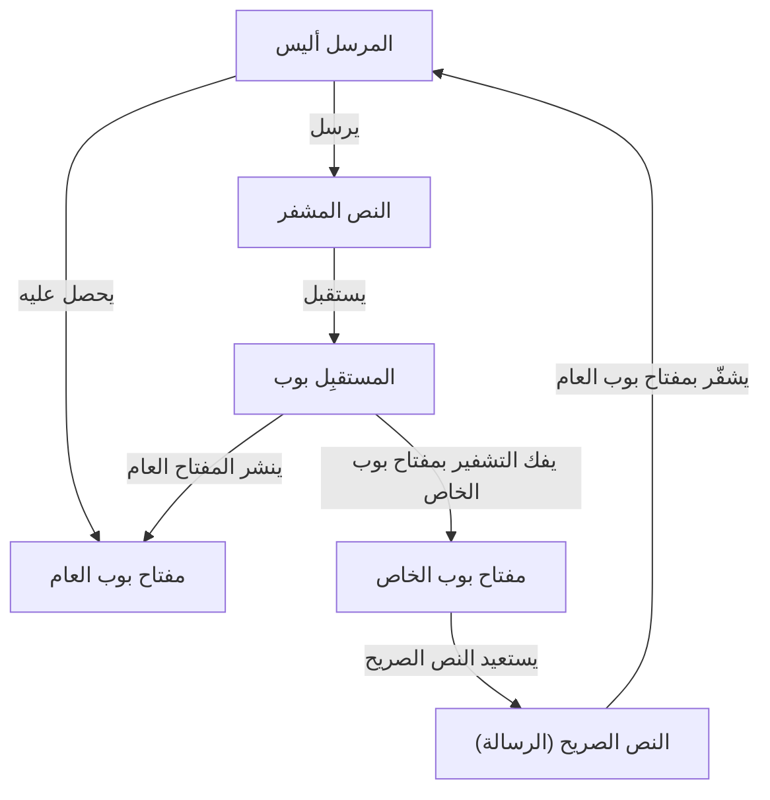
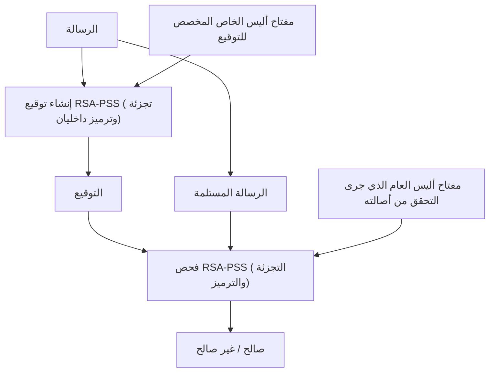
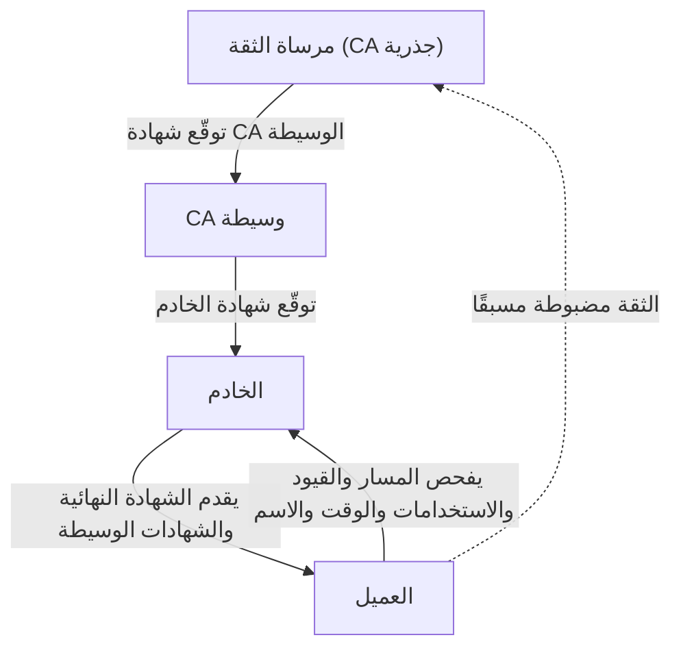

يدعم علم التشفير السرية وسلامة البيانات والمصادقة، لكنه لا يضمن وحده جميع جوانب أمن المعلومات، بما فيها التوافر. يشرح هذا المقال أدوار المفاتيح المتماثلة والعامة، والأسس الرياضية لـ RSA والمنحنيات الإهليلجية، ودوال التجزئة، والتوقيعات الرقمية، وPKI. ونميز بين الشرح الرياضي والشروط التي تحتاج إليها المخططات والبروتوكولات في الاستخدام الفعلي.

## 1. أدوار المفاتيح المتماثلة والعامة

### 1.1. التشفير المتماثل وتوزيع المفاتيح

يستخدم **التشفير المتماثل** مفتاحًا سريًا مشتركًا للتشفير وفك التشفير. وAES مثال على التشفير بالكتل. تناسب هذه التقنيات حماية كميات كبيرة من البيانات، لكن الطرفين يحتاجان إلى وسيلة آمنة لمشاركة المفتاح. ولا يكشف التشفير وحده التعديلات بالضرورة؛ تستخدم الاتصالات الفعلية الحماية التي يحددها البروتوكول، مثل التشفير الموثَّق الذي يكشف التلاعب.

### 1.2. اختلاف عمليات المفتاح العام

تستخدم **تقنيات المفتاح العام** زوجًا من مفتاح عام ومفتاح خاص، لكن ليست كلها «تشفيرًا بالمفتاح العام وفكًا بالمفتاح الخاص».

- **تشفير المفتاح العام**: التشفير بالمفتاح العام للمستقبِل وفك التشفير بالمفتاح الخاص المقابل.
- **التوقيعات الرقمية**: التوقيع بالمفتاح الخاص للموقِّع والتحقق بالمفتاح العام.
- **الاتفاق على المفاتيح (key agreement)**: اشتقاق سر مشترك من مواد المفاتيح لدى الطرفين، ثم توليد مفاتيح الاتصال وفق البروتوكول.

لا يحتاج المفتاح العام إلى توزيع سري، لكن **يجب التحقق من ارتباطه بالطرف المقصود**. يوضح الرسم التالي تشفير المفتاح العام فقط. ونجاح فك التشفير لا يصادق وحده على هوية المرسل.



## 2. الأسس الرياضية لتقنيات المفتاح العام

عند مناقشة الأمان، يجب الفصل بين افتراضات الصعوبة الحسابية، وشروط توليد المفاتيح، وبناء المخطط. تتيح عوامل RSA السرية إجراء العملية العكسية، لكن لا يمكن تفسير الاتفاق على المفاتيح والتوقيعات على المنحنيات الإهليلجية جميعًا بالعملية العكسية نفسها.

### 2.1. مفاتيح RSA وعملياته

قدّم ريفست وشامير وأدلمان RSA عام 1977. يرتبط RSA بصعوبة تحليل أعداد صحيحة كبيرة إلى عواملها. ويسمح تحليل المعامل باستعادة مفتاح خاص، لكن لم يثبت أن عكس RSA عمومًا والتحليل إلى عوامل متكافئان في الصعوبة. ولا يعتمد الأمان على طول المفتاح وحده، بل أيضًا على العشوائية وتوليد المفاتيح والحشو والتنفيذ.

#### 2.1.1. توليد المفاتيح بصيغة تعليمية

1. اختر عددين أوليين فرديين كبيرين ومختلفين $p,q$، واحسب $N=pq$.
2. احسب دالة أويلر:

$$\phi(N)=(p-1)(q-1)$$

3. اختر $e$ بحيث $1<e<\phi(N)$ و$\gcd(e,\phi(N))=1$. يستخدم المثال $e=65537$.
4. استخدم، مثلًا، [خوارزمية إقليدس](/ar/p/euclidean-algorithm/) الممتدة لإيجاد $1\le d<\phi(N)$ الذي يحقق:

$$ed\equiv1\pmod{\phi(N)}$$

المفتاح العام هو $(N,e)$، وأحد التمثيلات الأساسية للمفتاح الخاص هو $(N,d)$. وتحتفظ التطبيقات أيضًا بـ $p,q$ وقيم مبرهنة البواقي الصينية (CRT) لتسريع الحساب، وهي معلومات سرية كذلك. نستخدم هنا $\phi(N)$ للشرح. ويعبّر RFC 8017 عن شرط المعكوس باستخدام $\lambda(N)=\operatorname{lcm}(p-1,q-1)$؛ والبناء أعلاه يحقق ذلك الشرط أيضًا.

#### 2.1.2. عمليات RSA وشروط البرهان

لممثّل الرسالة الصحيح $0\le M<N$، تكون العمليتان الأساسيتان:

$$C\equiv M^e\pmod N$$

$$M\equiv C^d\pmod N$$

تنطبق مبرهنة أويلر مباشرة **فقط إذا كان $\gcd(M,N)=1$**. بكتابة $ed=1+t\phi(N)$ نحصل على:

$$M^{ed}=M\left(M^{\phi(N)}\right)^t\equiv M\pmod N$$

أما الرسائل التي ليست أولية نسبيًا مع $N$، فننظر إلى كلٍّ من $r=p$ و$r=q$ على حدة. إذا كان $M\equiv0\pmod r$، فإن $M^{ed}\equiv0\pmod r$. وإلا فإن مبرهنة فيرما الصغرى و$(r-1)\mid(ed-1)$ تعطيان $M^{ed}\equiv M\pmod r$. تجمع مبرهنة البواقي الصينية التطابقين، فيثبت الاسترجاع الصحيح لكل $0\le M<N$.

مثلًا، عند $p=61,q=53,e=17,d=2753$ و$M=61$، تكون $M^{3120}\bmod3233=1220$، فلا يجوز تطبيق خطوة مبرهنة أويلر مباشرة. ومع ذلك يعيد RSA القيمة 61 بعد التشفير وفك التشفير. هذا المفتاح الصغير للتوضيح، وليس مفتاحًا آمنًا.

**لا تستخدم رفع العدد إلى قوة بترديد $N$ وحده بوصفه مخطط تشفير.** يتطلب تشفير RSA العملي مخططًا مثل RSAES-OAEP. مع RSA-2048 وSHA-256، يقبل المثال الآتي 190 بايت على الأكثر من النص الصريح (RFC 8017 §7.1.1):

$$m_{\mathrm{len}}\le k_{\mathrm{bytes}}-2h_{\mathrm{len}}-2=256-2\cdot32-2=190$$

تُحمى البيانات الكبيرة بتشفير متماثل موثَّق ضمن مخطط هجين معياري. لا يشفّر هذا المثال ملفات عشوائية الطول مباشرة باستخدام RSA.

### 2.2. المنحنيات الإهليلجية واللوغاريتم المتقطع

عند اختيار معاملات مناسبة، يمكن أن تستهدف **[تقنيات المنحنيات الإهليلجية (ECC)](/ar/p/elliptic-curve-cryptography-math-cpp/)** أمانًا كلاسيكيًا مماثلًا بمفاتيح أقصر من RSA. وطول المفتاح بالبتات ليس بحد ذاته قوة الأمان بالبتات.

ندرس هنا صيغة وايرستراس القصيرة على الحقل الأولي $\mathbb F_p$ لعدد أولي $p>3$. لا يشمل هذا جميع تمثيلات المنحنيات الإهليلجية:

$$y^2\equiv x^3+ax+b\pmod p$$

$$4a^3+27b^2\not\equiv0\pmod p$$

يُعرَّف الجمع على نقاط المنحنى مع نقطة اللانهاية. لتكن $G$ نقطة تولّد زمرة جزئية رتبتها عدد أولي كبير $n$. يُختار العدد السري (scalar) بتوزيع منتظم من $1\le k\le n-1$ باستخدام عشوائية آمنة تشفيريًا. وتكون نقطة المفتاح العام:

$$P=kG$$

إيجاد $k$ من $G,P$ هو مسألة اللوغاريتم المتقطع على المنحنى الإهليلجي. ومجرد اختيار «$k$ كبير» لا يكفي؛ فالمنحنى والزمرة الجزئية والتحقق من المفاتيح والعشوائية كلها مهمة. وECC اسم لعائلة من التقنيات؛ يُستخدم ECDH للاتفاق على المفاتيح، وECDSA للتوقيعات. ويعني $kG$ جمع النقطة تكراريًا، لا الجداء القياسي بين متجهين.

### 2.3. RSA-OAEP باستخدام Python

يمكن تشغيل كل مثال من أمثلة Python الثلاثة بصورة مستقلة. وقد فُحصت باستخدام Python 3.12.14 و`cryptography` 50.0.2. تُولَّد المفاتيح في الذاكرة مع كل تشغيل لأغراض تعليمية. وليست الأمثلة أنظمة إنتاج تشمل تخزين المفاتيح وتوزيعها، ومصادقة الطرف الآخر، ومعالجة الأخطاء.

```python
from cryptography.hazmat.primitives.asymmetric import rsa
from cryptography.hazmat.primitives.asymmetric import padding
from cryptography.hazmat.primitives import hashes
import base64

# 1. إنشاء زوج مفاتيح RSA
private_key = rsa.generate_private_key(
    public_exponent=65537,
    key_size=2048,
)
public_key = private_key.public_key()

# 2. تعريف الرسالة
message = "هذه رسالة سرية للغاية حول التشفير الحديث.".encode('utf-8')

# 3. التشفير باستخدام المفتاح العام (باستخدام حشوة OAEP)
ciphertext = public_key.encrypt(
    message,
    padding.OAEP(
        mgf=padding.MGF1(algorithm=hashes.SHA256()),
        algorithm=hashes.SHA256(),
        label=None
    )
)
print("النص المشفر (Base64):", base64.b64encode(ciphertext).decode('utf-8'))

# 4. فك التشفير باستخدام المفتاح الخاص
decrypted_message = private_key.decrypt(
    ciphertext,
    padding.OAEP(
        mgf=padding.MGF1(algorithm=hashes.SHA256()),
        algorithm=hashes.SHA256(),
        label=None
    )
)
print("الرسالة التي تم فك تشفيرها:", decrypted_message.decode('utf-8'))
```

## 3. دوال التجزئة التشفيرية

تحسب دالة التجزئة ملخصًا ثابت الطول من المدخل. وهي حتمية: المدخل نفسه يعطي النتيجة نفسها دائمًا. وليست تشفيرًا ولا توليدًا للأعداد العشوائية بحد ذاتها. ويتوقف الحد الأقصى لطول المدخل على الخوارزمية.

### 3.1. ثلاث خصائص للمقاومة

1. **مقاومة الصورة المسبقة (preimage resistance)**: عند إعطاء قيمة تجزئة $h$، يصعب إيجاد مدخل يحقق $H(m)=h$. ولا يعني ذلك استعادة مدخل أصلي وحيد.
2. **مقاومة الصورة المسبقة الثانية (second-preimage resistance)**: عند إعطاء $m_1$، يصعب إيجاد $m_2\ne m_1$ بحيث $H(m_2)=H(m_1)$.
3. **مقاومة التصادم (collision resistance)**: يصعب إيجاد مدخلين مختلفين لهما التجزئة نفسها حتى إن استطاع المهاجم اختيار كليهما.

لا يصادق الملخص وحده على المصدر. إذا استطاع المهاجم استبدال الرسالة وملخصها معًا، فلن تكشف المقارنة البسيطة التغيير. يلزم مرجع موثوق أو آلية مصادقة مناسبة.

### 3.2. SHA-2 وSHA-256

ينتمي SHA-256 إلى عائلة SHA-2، ويخرج 256 بت، ويقبل مدخلًا يقل طوله عن $2^{64}$ بت. تُقسَّم الرسالة، بعد إضافة حشو يتضمن طولها، إلى كتل 512 بت، وتُعالج بدءًا من القيمة الابتدائية المحددة. ويمكن للتنفيذ المتدفق إضافة الحشو عند الوصول إلى الكتل الأخيرة.

يمكن تلخيص معالجة ميركل–دامغارد باستخدام الكتل $M_i$ وقيم الربط $H_i$ كما يأتي:

$$H_i=f(H_{i-1},M_i)$$

لا يعني هذا الملخص أن حذف دالة الضغط أو الحشو المحددين ينتج مخططًا آمنًا.

### 3.3. SHA-3 وبناء الإسفنج

SHA-3 معيار مبني على Keccak يكمل SHA-2. ولا يعني ذلك أن جميع الهجمات على SHA-2 تصبح غير مؤثرة، أو أن استبدال SHA-2 مطلوب دائمًا.

- **الامتصاص (absorb)**: تُدمج كتل المدخل، مع اللاحقة والحشو المحددين، بعملية XOR مع جزء rate من الحالة، ثم يُطبَّق تبديل.
- **الاستخراج (squeeze)**: يُؤخذ الخرج من جزء rate. وإذا لزم خرج إضافي، يتكرر التبديل والاستخراج.

لدوال SHA-3 الأربع، مثل SHA3-256، أطوال خرج ثابتة. أما SHAKE128 وSHAKE256 في FIPS 202 نفسه فهما XOF يمكن تحديد طول خرجهما. اللاحقة والحشو مهمان؛ ولا يكفي اسم «Keccak-256» للحكم بأن خرجه يطابق SHA3-256.

### 3.4. التجزئة باستخدام Python

```python
from cryptography.hazmat.primitives import hashes

message = "يعتمد التشفير الحديث بشكل كبير على دوال التجزئة الآمنة.".encode('utf-8')

# توليد SHA-256
digest_sha256 = hashes.Hash(hashes.SHA256())
digest_sha256.update(message)
hash_result_sha256 = digest_sha256.finalize()
print("SHA-256:", hash_result_sha256.hex())

# توليد SHA-3 (SHA3-256)
digest_sha3 = hashes.Hash(hashes.SHA3_256())
digest_sha3.update(message)
hash_result_sha3 = digest_sha3.finalize()
print("SHA3-256:", hash_result_sha3.hex())
```

## 4. التوقيعات الرقمية

يوفر مخطط التوقيع الرقمي **إنشاء التوقيع** بالمفتاح الخاص و**التحقق منه** بالمفتاح العام. مع سلامة البناء والتنفيذ، وموثوقية ارتباط المفتاح بالهوية، والإدارة السليمة للمفتاح الخاص، تدعم التوقيعات سلامة البيانات ومصادقة الموقِّع. ويمكن أن تقدم أدلة لعدم التنصل، لكنها لا تثبت دون شروط نية الشخص أو عدم تسرب المفتاح.

### 4.1. الفرق بين التوقيع والتشفير

تعميم التوقيع بوصفه «تشفيرًا بالمفتاح الخاص وفكًا بالمفتاح العام» خطأ. لدى RSA مخططات مختلفة للتشفير والتوقيع؛ ويستخدم المثال **RSASSA-PSS**. لا يخفي التوقيع الرسالة. ويتحقق الفحص من استيفاء المفتاح العام والرسالة والتوقيع لشروط المخطط؛ وليس فك تشفير عامًّا يستعيد الملخص.

### 4.2. الإنشاء والتحقق: نظرة عامة على RSA-PSS



1. يحسب الموقِّع تجزئة الرسالة، وينشئ التوقيع بترميز PSS والملح وعملية المفتاح الخاص. ثم يرسل الرسالة والتوقيع.
2. يستخدم المتحقق مفتاحًا عامًا موثوقًا ومعاملات متوافقة لفحص الرسالة والتوقيع المستلمين. التجزئة والترميز جزء من مخطط التوقيع؛ ولا تتلقى API في المثال ملخصًا محسوبًا مسبقًا.

### 4.3. RSA-PSS باستخدام Python

نولّد مفتاحًا مخصصًا للتوقيع، منفصلًا عن مفتاح مثال التشفير. طول الملح هو طول ملخص SHA-256، أي 32 بايت، ويستخدم التحقق الإعداد نفسه. ويجب إثبات أصالة المفتاح العام خارج هذا المثال.

```python
import base64
from cryptography.exceptions import InvalidSignature
from cryptography.hazmat.primitives import hashes
from cryptography.hazmat.primitives.asymmetric import padding, rsa

# توليد مفتاح مخصص للتوقيع منفصل عن مثال التشفير
signing_key = rsa.generate_private_key(public_exponent=65537, key_size=2048)
verification_key = signing_key.public_key()
doc_message = "وثيقة عقد: يوافق الطرف أ على دفع 1000 دولار للطرف ب.".encode("utf-8")
pss = padding.PSS(
    mgf=padding.MGF1(hashes.SHA256()),
    salt_length=padding.PSS.DIGEST_LENGTH,
)
signature = signing_key.sign(doc_message, pss, hashes.SHA256())
print("التوقيع (Base64):", base64.b64encode(signature).decode("ascii"))

try:
    verification_key.verify(signature, doc_message, pss, hashes.SHA256())
    print("التوقيع صالح لهذه الرسالة وهذا المفتاح العام.")
except InvalidSignature:
    print("التوقيع غير صالح لهذه الرسالة وهذا المفتاح العام.")
```

## 5. البنية التحتية للمفاتيح العامة (PKI)

إذا قُبل مفتاح مهاجم على أنه مفتاح الطرف المقصود، فقد تتجه حتى العمليات التشفيرية الصحيحة إلى الطرف الخطأ. توفر **PKI** شهادات وإعدادات ثقة وإجراءات تحقق لإثبات ارتباط المفاتيح العامة بالأسماء أو المعلومات الأخرى.

### 5.1. جهات إصدار الشهادات وشهادات X.509

تتحقق جهة إصدار الشهادات (CA) من السيطرة على اسم النطاق أو معلومات موضوع الشهادة وفق سياساتها، ثم تصدر الشهادة. ولا تثبت جميع الشهادات الهوية الشخصية لمشغل الموقع بالقدر نفسه.

تتضمن شهادة X.509 الإصدار والرقم التسلسلي وخوارزمية التوقيع والجهة المُصدِرة والموضوع وفترة الصلاحية والمفتاح العام للموضوع والامتدادات والتوقيع. وتوقّع CA **ترميز DER لبنية TBSCertificate** التي تحتوي المعلومات المراد توقيعها، لا المفتاح العام وحده.

### 5.2. سلاسل الشهادات وTLS



يوضح الرسم مثالًا واحدًا: CA جذرية → CA وسيطة → خادم. يبني العميل مسارًا إلى مرساة ثقة (trust anchor) مضبوطة مسبقًا، ويفحص التوقيعات وفترات الصلاحية وقيود CA واستخدامات المفاتيح ومعالجة الامتدادات الحرجة، إلى جانب متطلبات أخرى. ولا يقتصر ذلك على فحص شهادة الخادم مباشرة بالمفتاح الجذري. وتتبع معالجة الإلغاء الآلية وسياسة التطبيق المعمول بهما.

يتطلب TLS أيضًا فحص هوية الخدمة. لأسماء DNS، يُقارَن الاسم المتوقع بإدخالات `dNSName` في `subjectAltName`، دون الرجوع إلى Common Name بديلًا (RFC 9525). ولا يجوز قبول شهادة موقع آخر حتى لو صح توقيعها.

لا يكفي فحص الشهادة وحده لإنشاء اتصال مشفر. يجمع TLS 1.3 تبادل المفاتيح والمصادقة وتأكيد المفاتيح لاشتقاق مفاتيح حركة البيانات، ويحمي السجلات بتشفير موثَّق. وقد أزيل نقل المفاتيح باستخدام RSA الثابت من TLS 1.3. وقد لا ترسل اتصالات PSK أو استئناف الجلسة شهادات، لذلك لا يمثل الرسم جميع اتصالات TLS.

## 6. الخلاصة

- يحمي التشفير المتماثل كميات كبيرة من البيانات. يجب الفصل بين السرية وكشف التعديل.
- تختلف أدوار تشفير المفتاح العام والاتفاق على المفاتيح والتوقيعات. ويجب أيضًا التحقق من أصالة المفاتيح.
- تنتج دوال التجزئة ملخصات، لكنها لا تصادق وحدها على المصدر.
- تدعم التوقيعات سلامة البيانات والمصادقة، مع الالتزام بشروط المخطط وإدارة المفاتيح.
- فحص مسار PKI واسم الخدمة ومصافحة TLS عمليات مترابطة لكنها مختلفة.

هذه أساسيات. تستخدم أنظمة الإنتاج مكتبات تخضع للصيانة وبروتوكولات معيارية، وتقيّم إدارة المفاتيح والخوارزميات والمعاملات والانتقال إلى [تشفير ما بعد الكم](/ar/p/post-quantum-cryptography/). ولا تكفي أمثلة هذا المقال وحدها للحكم على أمان نظام كامل.

### المراجع

- [RFC 8017: PKCS #1 — RSA Cryptography Specifications](https://www.rfc-editor.org/rfc/rfc8017.html) (§§3, 5–9)
- [cryptography 50.0.2: RSA](https://cryptography.io/en/50.0.2/hazmat/primitives/asymmetric/rsa/)
- [RFC 6090: Fundamental Elliptic Curve Cryptography Algorithms](https://www.rfc-editor.org/rfc/rfc6090.html) (§§3.3, 5.3.1)
- [NIST FIPS 180-4: Secure Hash Standard](https://nvlpubs.nist.gov/nistpubs/FIPS/NIST.FIPS.180-4.pdf) (§§5–6)
- [NIST FIPS 202: SHA-3 Standard](https://nvlpubs.nist.gov/nistpubs/FIPS/NIST.FIPS.202.pdf) (§§4–6)
- [NIST FIPS 186-5: Digital Signature Standard](https://csrc.nist.gov/pubs/fips/186-5/final)
- [RFC 5280: Internet X.509 PKI Certificate and CRL Profile](https://www.rfc-editor.org/rfc/rfc5280.html) (§§4.1, 6)
- [RFC 9525: Service Identity in TLS](https://www.rfc-editor.org/rfc/rfc9525.html)
- [RFC 8446: TLS 1.3](https://www.rfc-editor.org/rfc/rfc8446.html) (§§1.2, 2)
