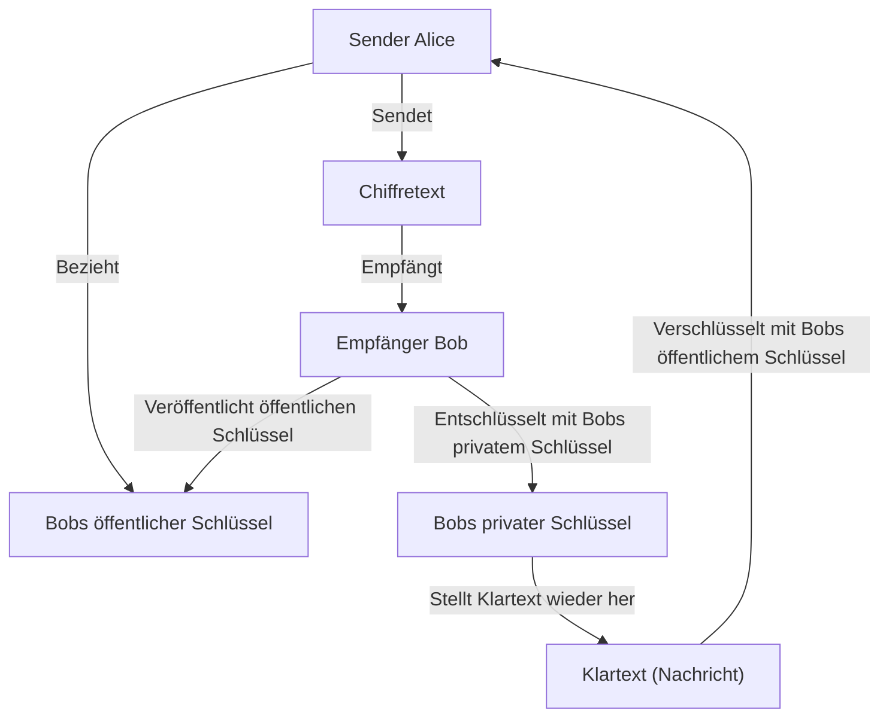
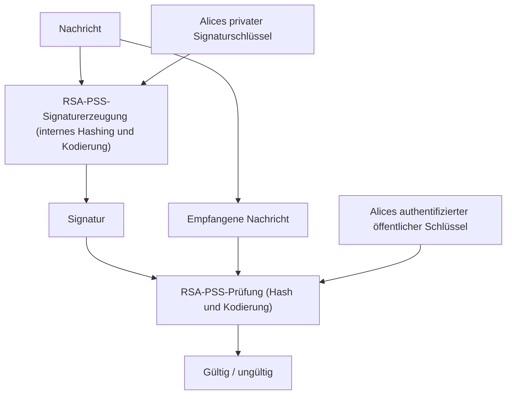
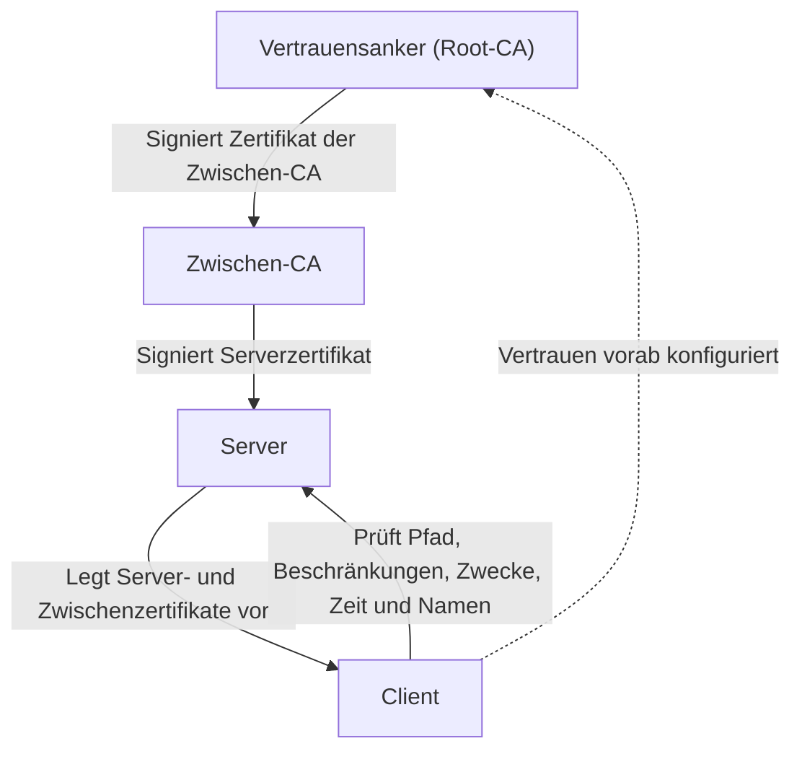

Kryptographie unterstützt Vertraulichkeit, Integrität und Authentifizierung. Sie kann allein nicht alle Aspekte der Informationssicherheit einschließlich der Verfügbarkeit gewährleisten. Dieser Artikel erläutert die Rollen symmetrischer und öffentlicher Schlüssel, die mathematischen Grundlagen von RSA und elliptischen Kurven, Hash-Funktionen, digitale Signaturen und PKI. Dabei unterscheiden wir mathematische Erklärungen von den Bedingungen, die praktische Verfahren und Protokolle benötigen.

## 1. Rollen symmetrischer und öffentlicher Schlüssel

### 1.1. Symmetrische Verschlüsselung und Schlüsselverteilung

**Symmetrische Verschlüsselung** verwendet einen gemeinsam geheim gehaltenen Schlüssel zum Ver- und Entschlüsseln. AES ist eine typische Blockchiffre. Solche Verfahren eignen sich für große Datenmengen, doch die Beteiligten müssen den Schlüssel sicher teilen können. Verschlüsselung allein erkennt nicht zwangsläufig Änderungen; reale Kommunikationsprotokolle verlangen geeignete Schutzverfahren wie authentifizierte Verschlüsselung.

### 1.2. Unterschiedliche Public-Key-Operationen

**Public-Key-Verfahren** verwenden Paare aus öffentlichem und privatem Schlüssel. Sie bedeuten aber nicht alle »mit dem öffentlichen Schlüssel verschlüsseln und mit dem privaten entschlüsseln«.

- **Public-Key-Verschlüsselung**: Mit dem öffentlichen Schlüssel des Empfängers verschlüsseln und mit dem zugehörigen privaten Schlüssel entschlüsseln.
- **Digitale Signaturen**: Mit dem privaten Schlüssel des Unterzeichners signieren und mit dem öffentlichen Schlüssel prüfen.
- **Schlüsselvereinbarung**: Aus dem Schlüsselmaterial der Beteiligten ein gemeinsames Geheimnis ableiten und daraus gemäß dem Protokoll Kommunikationsschlüssel erzeugen.

Ein öffentlicher Schlüssel muss nicht geheim verteilt werden. **Seine Zuordnung zum vorgesehenen Kommunikationspartner muss jedoch authentifiziert werden.** Das folgende Diagramm zeigt nur Public-Key-Verschlüsselung. Erfolgreiches Entschlüsseln allein authentifiziert den Absender nicht.



## 2. Mathematische Grundlagen von Public-Key-Verfahren

Bei Sicherheitsüberlegungen müssen Annahmen über die Rechenschwierigkeit, Anforderungen an die Schlüsselerzeugung und der Aufbau des Verfahrens unterschieden werden. Die geheimen Faktoren von RSA ermöglichen die inverse Operation. Schlüsselvereinbarung und Signaturen mit elliptischen Kurven lassen sich jedoch nicht alle als dieselbe »Umkehrrechnung« erklären.

### 2.1. RSA-Schlüssel und -Operationen

Rivest, Shamir und Adleman stellten RSA 1977 vor. Es hängt mit der Schwierigkeit zusammen, große ganze Zahlen zu faktorisieren. Wer den Modulus faktorisiert, kann einen privaten Schlüssel bestimmen. Es ist aber nicht bewiesen, dass die allgemeine RSA-Inversion und die Faktorisierung gleich schwierig sind. Sicherheit hängt neben der Schlüssellänge auch von Zufallserzeugung, Schlüsselerzeugung, Padding und Implementierung ab.

#### 2.1.1. Schlüsselerzeugung im Lehrbuchmodell

1. Verschiedene große ungerade Primzahlen $p,q$ wählen und $N=pq$ berechnen.
2. Die eulersche Phi-Funktion berechnen:

$$\phi(N)=(p-1)(q-1)$$

3. $e$ so wählen, dass $1<e<\phi(N)$ und $\gcd(e,\phi(N))=1$ gelten. Das Beispiel verwendet $e=65537$.
4. Etwa mit dem erweiterten [euklidischen Algorithmus](/de/p/euclidean-algorithm/) ein $1\le d<\phi(N)$ bestimmen, das folgende Bedingung erfüllt:

$$ed\equiv1\pmod{\phi(N)}$$

Der öffentliche Schlüssel ist $(N,e)$; eine grundlegende Darstellung des privaten Schlüssels ist $(N,d)$. Implementierungen speichern außerdem $p,q$ und Werte für den chinesischen Restsatz (CRT), um schneller zu rechnen. Auch diese Werte sind geheim. Wir verwenden hier zur Erklärung $\phi(N)$. RFC 8017 beschreibt die Inversenbedingung mit $\lambda(N)=\operatorname{lcm}(p-1,q-1)$; die obige Konstruktion erfüllt auch diese Bedingung.

#### 2.1.2. RSA-Operationen und Beweisbedingungen

Für einen ganzzahligen Nachrichtenrepräsentanten $0\le M<N$ lauten die primitiven Operationen:

$$C\equiv M^e\pmod N$$

$$M\equiv C^d\pmod N$$

Der Satz von Euler ist unmittelbar **nur für $\gcd(M,N)=1$ anwendbar**. Mit $ed=1+t\phi(N)$ ergibt sich:

$$M^{ed}=M\left(M^{\phi(N)}\right)^t\equiv M\pmod N$$

Für nicht teilerfremde Nachrichten betrachten wir $r=p$ und $r=q$ getrennt. Ist $M\equiv0\pmod r$, gilt $M^{ed}\equiv0\pmod r$. Andernfalls liefern der kleine Satz von Fermat und $(r-1)\mid(ed-1)$ die Beziehung $M^{ed}\equiv M\pmod r$. Der chinesische Restsatz kombiniert beide Kongruenzen und beweist die korrekte Wiederherstellung für alle $0\le M<N$.

Mit $p=61,q=53,e=17,d=2753$ und $M=61$ ist beispielsweise $M^{3120}\bmod3233=1220$: Der Schritt mit dem Satz von Euler ist nicht direkt anwendbar. Trotzdem liefert RSA nach Ver- und Entschlüsselung wieder 61. Dieser winzige Schlüssel dient nur der Veranschaulichung und ist nicht sicher.

**Die rohe modulare Potenzierung darf nicht allein als Verschlüsselungsverfahren verwendet werden.** Praktische RSA-Verschlüsselung benötigt ein Verfahren wie RSAES-OAEP. Mit RSA-2048 und SHA-256 akzeptiert das folgende Beispiel höchstens 190 Klartextbytes (RFC 8017 §7.1.1):

$$m_{\mathrm{len}}\le k_{\mathrm{bytes}}-2h_{\mathrm{len}}-2=256-2\cdot32-2=190$$

Große Nutzdaten werden in einem standardisierten hybriden Verfahren mit symmetrischer authentifizierter Verschlüsselung geschützt. Das Beispiel verschlüsselt keine beliebig langen Dateien direkt mit RSA.

### 2.2. Elliptische Kurven und diskreter Logarithmus

Mit geeigneten Parametern kann **[Kryptographie auf elliptischen Kurven (ECC)](/de/p/elliptic-curve-cryptography-math-cpp/)** mit kürzeren Schlüsseln als RSA eine vergleichbare klassische Sicherheit anstreben. Die Schlüssellänge in Bit ist nicht selbst die Sicherheitsstärke in Bit.

Hier betrachten wir die kurze Weierstraßform über dem Primkörper $\mathbb F_p$ mit $p>3$. Das umfasst nicht jede Darstellung elliptischer Kurven:

$$y^2\equiv x^3+ax+b\pmod p$$

$$4a^3+27b^2\not\equiv0\pmod p$$

Auf den Kurvenpunkten zusammen mit dem Punkt im Unendlichen wird eine Addition definiert. Sei $G$ ein Erzeuger einer Untergruppe großer Primzahlordnung $n$. Der geheime Skalar wird mit kryptographisch sicherem Zufall gleichverteilt aus $1\le k\le n-1$ gewählt. Der öffentliche Punkt lautet:

$$P=kG$$

$k$ aus $G,P$ zu bestimmen, ist das diskrete Logarithmusproblem auf elliptischen Kurven. Nur ein »großes $k$« zu wählen genügt nicht: Kurve, Untergruppe, Schlüsselvalidierung und Zufallserzeugung sind wichtig. ECC bezeichnet eine Familie von Techniken; ECDH dient der Schlüsselvereinbarung und ECDSA der Signatur.

### 2.3. RSA-OAEP in Python

Die drei Python-Beispiele lassen sich jeweils unabhängig ausführen. Sie wurden mit Python 3.12.14 und `cryptography` 50.0.2 geprüft. Die Schlüssel werden bei jeder Ausführung zu Lernzwecken im Arbeitsspeicher erzeugt. Die Beispiele sind keine Produktionssysteme einschließlich Schlüsselspeicherung und -verteilung, Partnerauthentifizierung und Fehlerbehandlung.

```python
from cryptography.hazmat.primitives.asymmetric import rsa
from cryptography.hazmat.primitives.asymmetric import padding
from cryptography.hazmat.primitives import hashes
import base64

# 1. Generierung des RSA-Schlüsselpaares
private_key = rsa.generate_private_key(
    public_exponent=65537,
    key_size=2048,
)
public_key = private_key.public_key()

# 2. Definition der Nachricht
message = b"This is a highly confidential message about modern cryptography."

# 3. Verschlüsselung mit dem öffentlichen Schlüssel (unter Verwendung von OAEP-Padding)
ciphertext = public_key.encrypt(
    message,
    padding.OAEP(
        mgf=padding.MGF1(algorithm=hashes.SHA256()),
        algorithm=hashes.SHA256(),
        label=None
    )
)
print("Chiffretext (Base64):", base64.b64encode(ciphertext).decode('utf-8'))

# 4. Entschlüsselung mit dem privaten Schlüssel
decrypted_message = private_key.decrypt(
    ciphertext,
    padding.OAEP(
        mgf=padding.MGF1(algorithm=hashes.SHA256()),
        algorithm=hashes.SHA256(),
        label=None
    )
)
print("Entschlüsselte Nachricht:", decrypted_message.decode('utf-8'))
```

## 3. Kryptographische Hash-Funktionen

Eine Hash-Funktion berechnet aus einer Eingabe einen Digest fester Länge. Sie ist deterministisch: Dieselbe Eingabe ergibt immer dasselbe Resultat. Sie ist weder Verschlüsselung noch für sich genommen eine Zufallszahlenerzeugung. Die maximale Eingabelänge hängt vom Algorithmus ab.

### 3.1. Drei Resistenzeigenschaften

1. **Urbildresistenz (Preimage-Resistenz)**: Für einen vorgegebenen Hash-Wert $h$ ist es schwierig, eine Eingabe mit $H(m)=h$ zu finden. Es geht nicht darum, eine eindeutig bestimmte ursprüngliche Eingabe wiederherzustellen.
2. **Resistenz gegen zweite Urbilder (Second-Preimage-Resistenz)**: Für ein gegebenes $m_1$ ist es schwierig, $m_2\ne m_1$ mit $H(m_2)=H(m_1)$ zu finden.
3. **Kollisionsresistenz**: Es ist schwierig, zwei verschiedene Eingaben mit demselben Hash-Wert zu finden, auch wenn der Angreifer beide wählen kann.

Ein Digest allein authentifiziert seine Quelle nicht. Kann ein Angreifer sowohl Nachricht als auch Digest ersetzen, erkennt ein einfacher Vergleich die Änderung nicht. Benötigt wird ein vertrauenswürdiger Referenzwert oder ein geeignetes Authentifizierungsverfahren.

### 3.2. SHA-2 und SHA-256

SHA-256 gehört zur SHA-2-Familie, erzeugt 256 Bit Ausgabe und erlaubt Eingaben mit weniger als $2^{64}$ Bit. Die Nachricht wird mit einem Padding einschließlich Längenangabe in 512-Bit-Blöcke aufgeteilt und vom vorgeschriebenen Anfangswert aus verarbeitet. Eine Streaming-Implementierung kann das Padding beim Erreichen der letzten Blöcke ergänzen.

Mit Blöcken $M_i$ und Verkettungswerten $H_i$ lässt sich die Verarbeitung vom Merkle–Damgård-Typ schematisch so darstellen:

$$H_i=f(H_{i-1},M_i)$$

Diese Übersicht bedeutet nicht, dass durch Weglassen der vorgeschriebenen Kompressionsfunktion oder des Paddings ein sicheres Verfahren entsteht.

### 3.3. SHA-3 und die Sponge-Konstruktion

SHA-3 ist ein auf Keccak beruhender Standard, der SHA-2 ergänzt. Das bedeutet weder, dass sämtliche Angriffe auf SHA-2 wirkungslos werden, noch dass SHA-2 immer ersetzt werden muss.

- **Absorptionsphase (absorb)**: Eingabeblöcke mit vorgeschriebenem Suffix und Padding werden per XOR mit dem Rate-Anteil des Zustands verknüpft; anschließend wird eine Permutation angewendet.
- **Ausgabephase (squeeze)**: Aus dem Rate-Anteil wird Ausgabe entnommen. Wenn mehr benötigt wird, werden Permutation und Entnahme wiederholt.

Die vier SHA-3-Hash-Funktionen wie SHA3-256 haben feste Ausgabelängen. SHAKE128 und SHAKE256 im selben FIPS 202 sind XOFs, deren Ausgabelänge vorgegeben wird. Suffix und Padding sind wichtig: Aus dem Namen »Keccak-256« allein folgt nicht, dass die Ausgabe mit SHA3-256 übereinstimmt.

### 3.4. Hash-Berechnung in Python

```python
from cryptography.hazmat.primitives import hashes

message = b"Modern cryptography heavily relies on secure hash functions."

# Generierung von SHA-256
digest_sha256 = hashes.Hash(hashes.SHA256())
digest_sha256.update(message)
hash_result_sha256 = digest_sha256.finalize()
print("SHA-256:", hash_result_sha256.hex())

# Generierung von SHA-3 (SHA3-256)
digest_sha3 = hashes.Hash(hashes.SHA3_256())
digest_sha3.update(message)
hash_result_sha3 = digest_sha3.finalize()
print("SHA3-256:", hash_result_sha3.hex())
```

## 4. Digitale Signaturen

Ein digitales Signaturverfahren ermöglicht die **Signaturerzeugung** mit einem privaten Schlüssel und die **Signaturprüfung** mit einem öffentlichen Schlüssel. Bei korrekter Konstruktion und Implementierung, vertrauenswürdiger Zuordnung von Schlüssel und Identität sowie angemessener Verwaltung des privaten Schlüssels unterstützen Signaturen Integrität und Authentifizierung des Unterzeichners. Sie können Beweismittel für Nichtabstreitbarkeit liefern, belegen aber weder die Absicht der Person noch die Nichtkompromittierung des Schlüssels bedingungslos.

### 4.1. Unterschied zwischen Signieren und Verschlüsseln

Signaturen allgemein als »mit dem privaten Schlüssel verschlüsseln und mit dem öffentlichen entschlüsseln« zu beschreiben ist falsch. RSA besitzt unterschiedliche Verschlüsselungs- und Signaturverfahren; das Beispiel nutzt **RSASSA-PSS**. Eine Signatur verbirgt die Nachricht nicht. Die Prüfung entscheidet, ob öffentlicher Schlüssel, Nachricht und Signatur die Verfahrensbedingungen erfüllen. Sie ist keine allgemeine Entschlüsselung, die einen Digest zurückgewinnt.

### 4.2. Erzeugung und Prüfung im Überblick (RSA-PSS)



1. Der Unterzeichner hasht die Nachricht und erzeugt die Signatur mit PSS-Kodierung, Salt und der privaten Schlüsseloperation. Er übermittelt Nachricht und Signatur.
2. Der Prüfer verwendet einen vertrauenswürdigen öffentlichen Schlüssel und passende Parameter für die empfangene Nachricht und Signatur. Hash-Berechnung und Kodierung sind Teil des Signaturverfahrens; die API im Beispiel erhält keinen vorab berechneten Digest.

### 4.3. RSA-PSS in Python

Wir erzeugen einen eigenen Signaturschlüssel, getrennt vom Schlüssel des Verschlüsselungsbeispiels. Die Salt-Länge ist die Länge des SHA-256-Digests (32 Byte); die Prüfung verwendet dieselbe Einstellung. Die Authentizität des öffentlichen Schlüssels muss außerhalb dieses Beispiels sichergestellt werden.

```python
import base64
from cryptography.exceptions import InvalidSignature
from cryptography.hazmat.primitives import hashes
from cryptography.hazmat.primitives.asymmetric import padding, rsa

# Eigenen Signaturschlüssel getrennt vom Verschlüsselungsbeispiel erzeugen
signing_key = rsa.generate_private_key(public_exponent=65537, key_size=2048)
verification_key = signing_key.public_key()
doc_message = b"Contract document: Party A agrees to pay Party B $1000."
pss = padding.PSS(
    mgf=padding.MGF1(hashes.SHA256()),
    salt_length=padding.PSS.DIGEST_LENGTH,
)
signature = signing_key.sign(doc_message, pss, hashes.SHA256())
print("Signatur (Base64):", base64.b64encode(signature).decode("ascii"))

try:
    verification_key.verify(signature, doc_message, pss, hashes.SHA256())
    print("Signatur für diese Nachricht und diesen öffentlichen Schlüssel GÜLTIG.")
except InvalidSignature:
    print("Signatur für diese Nachricht und diesen öffentlichen Schlüssel UNGÜLTIG.")
```

## 5. Public Key Infrastructure (PKI)

Wird der Schlüssel eines Angreifers als Schlüssel des Partners akzeptiert, können auch korrekte kryptographische Operationen an die falsche Gegenstelle gerichtet sein. **PKI** stellt Zertifikate, Vertrauenskonfiguration und Prüfverfahren bereit, um Zuordnungen zwischen öffentlichen Schlüsseln und Namen oder anderen Angaben festzustellen.

### 5.1. Zertifizierungsstellen und X.509-Zertifikate

Eine Zertifizierungsstelle (CA) prüft gemäß ihren Richtlinien die Kontrolle über eine Domain oder Angaben zum Zertifikatsinhaber und stellt ein Zertifikat aus. Nicht jedes Zertifikat weist die persönliche Identität des Website-Betreibers im selben Umfang nach.

Ein X.509-Zertifikat enthält Version, Seriennummer, Signaturalgorithmus, Aussteller, Zertifikatsinhaber, Gültigkeitszeitraum, öffentlichen Schlüssel des Inhabers, Erweiterungen und Signatur. Die CA signiert die **DER-Kodierung von TBSCertificate** mit den zu signierenden Informationen, nicht nur den öffentlichen Schlüssel.

### 5.2. Zertifikatsketten und TLS



Das Diagramm zeigt ein Beispiel: Root-CA → Zwischen-CA → Server. Der Client baut einen Pfad zu einem konfigurierten Vertrauensanker auf und prüft unter anderem Signaturen, Gültigkeitszeiträume, CA-Beschränkungen, Schlüsselverwendungen und nicht unterstützte kritische Erweiterungen. Er prüft nicht lediglich das Serverzertifikat direkt mit dem Root-Schlüssel. Die Behandlung von Sperrungen folgt dem jeweiligen Mechanismus und den Anwendungsrichtlinien.

TLS verlangt auch die Prüfung der Dienstidentität. Bei DNS-Namen wird der erwartete Name mit den `dNSName`-Einträgen in `subjectAltName` verglichen, ohne auf Common Name zurückzufallen (RFC 9525). Ein Zertifikat für eine andere Website darf auch bei korrekter Signatur nicht akzeptiert werden.

Zertifikatsprüfung allein stellt noch keine verschlüsselte Verbindung her. TLS 1.3 kombiniert Schlüsselaustausch, Authentifizierung und Schlüsselbestätigung, leitet daraus Verkehrsschlüssel ab und schützt Records durch authentifizierte Verschlüsselung. Statischer RSA-Schlüsseltransport wurde in TLS 1.3 entfernt. PSK- und Wiederaufnahmeverbindungen können Zertifikate weglassen; das Diagramm beschreibt daher nicht jede TLS-Verbindung.

## 6. Zusammenfassung

- Symmetrische Verschlüsselung schützt große Datenmengen. Vertraulichkeit und Änderungserkennung sind zu unterscheiden.
- Public-Key-Verschlüsselung, Schlüsselvereinbarung und Signaturen haben unterschiedliche Rollen. Auch Schlüssel müssen authentifiziert werden.
- Hash-Funktionen erzeugen Digests. Sie authentifizieren die Quelle nicht allein.
- Signaturen unterstützen Integrität und Authentifizierung unter den Bedingungen des Verfahrens und der Schlüsselverwaltung.
- PKI-Pfadprüfung, Prüfung des Dienstnamens und TLS-Handshake sind verwandte, aber unterschiedliche Vorgänge.

Das sind Grundlagen. Produktionssysteme verwenden gepflegte Bibliotheken und standardisierte Protokolle und bewerten Schlüsselverwaltung, Algorithmen, Parameter und den Übergang zur Post-Quanten-Kryptographie. Die Beispiele dieses Artikels reichen nicht aus, um die Sicherheit eines ganzen Systems zu beurteilen.

### Referenzen

- [RFC 8017: PKCS #1 — RSA Cryptography Specifications](https://www.rfc-editor.org/rfc/rfc8017.html) (§§3, 5–9)
- [cryptography 50.0.2: RSA](https://cryptography.io/en/50.0.2/hazmat/primitives/asymmetric/rsa/)
- [RFC 6090: Fundamental Elliptic Curve Cryptography Algorithms](https://www.rfc-editor.org/rfc/rfc6090.html) (§§3.3, 5.3.1)
- [NIST FIPS 180-4: Secure Hash Standard](https://nvlpubs.nist.gov/nistpubs/FIPS/NIST.FIPS.180-4.pdf) (§§5–6)
- [NIST FIPS 202: SHA-3 Standard](https://nvlpubs.nist.gov/nistpubs/FIPS/NIST.FIPS.202.pdf) (§§4–6)
- [NIST FIPS 186-5: Digital Signature Standard](https://csrc.nist.gov/pubs/fips/186-5/final)
- [RFC 5280: Internet X.509 PKI Certificate and CRL Profile](https://www.rfc-editor.org/rfc/rfc5280.html) (§§4.1, 6)
- [RFC 9525: Service Identity in TLS](https://www.rfc-editor.org/rfc/rfc9525.html)
- [RFC 8446: TLS 1.3](https://www.rfc-editor.org/rfc/rfc8446.html) (§§1.2, 2)
