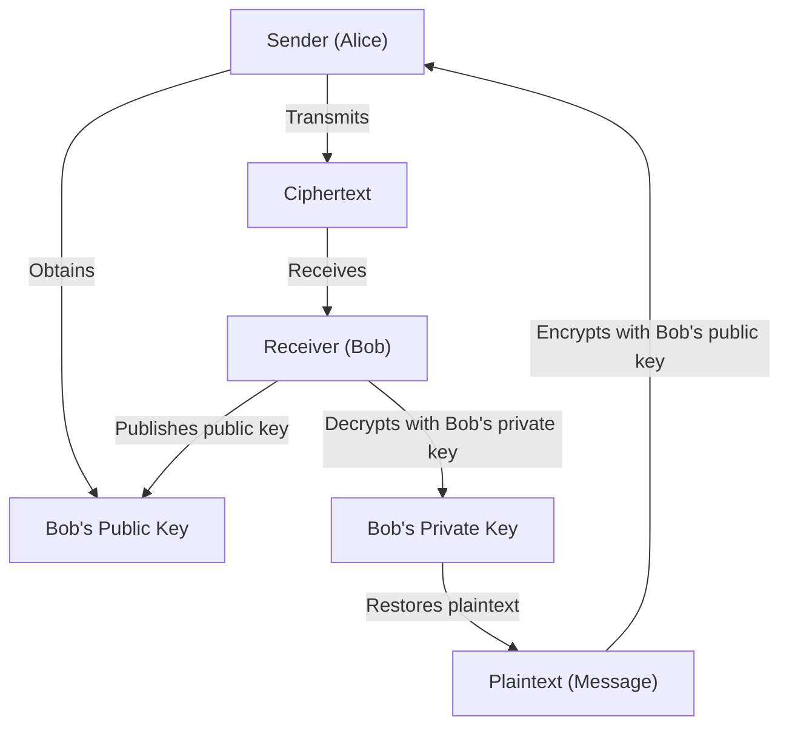
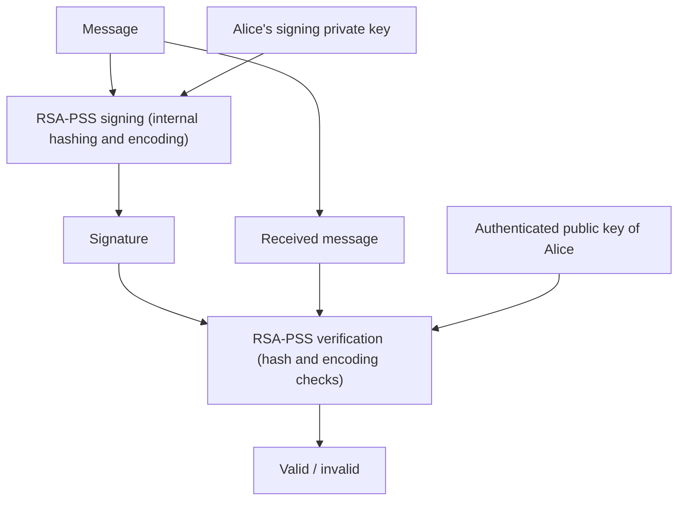
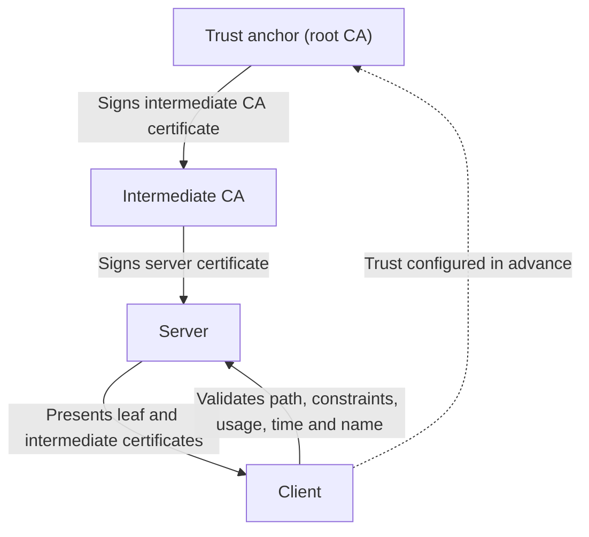

Cryptography supports confidentiality, integrity and authentication. It cannot, by itself, guarantee every aspect of information security, including availability. This article explains symmetric and public keys, the mathematical foundations of RSA and elliptic curves, hash functions, digital signatures and PKI. We distinguish mathematical explanations from the conditions required by practical schemes and protocols.

## 1. The Roles of Symmetric and Public Keys

### 1.1. Symmetric Encryption and Key Distribution

**Symmetric encryption** uses a shared secret key for encryption and decryption. AES is a representative block cipher. Symmetric encryption suits bulk data, but the parties need a way to share the secret safely. Encryption alone does not necessarily detect modification; real communication uses the protection required by its protocol, such as authenticated encryption.

### 1.2. Different Public-Key Operations

**Public-key techniques** use public/private key pairs, but they do not all mean “encrypt with the public key and decrypt with the private key.”

- **Public-key encryption**: encrypt with the recipient's public key and decrypt with the corresponding private key.
- **Digital signatures**: sign with the signer's private key and verify with the public key.
- **Key agreement**: derive a shared secret from the parties' key material and generate communication keys according to the protocol.

A public key does not require secret distribution, but **its association with the intended party must be authenticated**. The following diagram shows public-key encryption only. Successful decryption alone does not authenticate the sender.



## 2. Mathematical Foundations of Public-Key Techniques

Security discussions must distinguish computational assumptions, key-generation requirements and scheme construction. RSA's secret factors provide a way to perform the inverse operation, but elliptic-curve key agreement and signatures cannot all be explained as the same “inverse calculation.”

### 2.1. RSA Keys and Operations

Rivest, Shamir and Adleman announced RSA in 1977. It is related to the difficulty of factoring large integers. Factoring the modulus allows recovery of a private key, but general RSA inversion has not been proved equivalent in difficulty to factoring. Security depends on randomness, key generation, padding and implementation, as well as key size.

#### 2.1.1. Textbook Key Generation

1. Choose distinct large odd primes $p,q$ and compute $N=pq$.
2. Compute:

$$\phi(N)=(p-1)(q-1)$$

3. Choose $e$ with $1<e<\phi(N)$ and $\gcd(e,\phi(N))=1$. The implementation below uses $e=65537$.
4. Use the extended [Euclidean algorithm](/en/p/euclidean-algorithm/), for example, to find $1\le d<\phi(N)$ satisfying:

$$ed\equiv1\pmod{\phi(N)}$$

The public key is $(N,e)$; a basic private-key representation is $(N,d)$. Implementations also retain $p,q$ and CRT values for efficiency. Those values are secret too. We use $\phi(N)$ for explanation. RFC 8017 expresses the inverse condition using $\lambda(N)=\operatorname{lcm}(p-1,q-1)$; the construction above also satisfies that condition.

#### 2.1.2. RSA Operations and Proof Conditions

For an integer message representative $0\le M<N$, the primitive operations are:

$$C\equiv M^e\pmod N$$

$$M\equiv C^d\pmod N$$

Euler's theorem applies directly **only when $\gcd(M,N)=1$**. Writing $ed=1+t\phi(N)$ gives:

$$M^{ed}=M\left(M^{\phi(N)}\right)^t\equiv M\pmod N$$

For non-coprime messages, consider $r=p$ and $r=q$ separately. If $M\equiv0\pmod r$, then $M^{ed}\equiv0\pmod r$. Otherwise, Fermat's little theorem and $(r-1)\mid(ed-1)$ give $M^{ed}\equiv M\pmod r$. Combining both congruences with the Chinese remainder theorem proves correctness for every $0\le M<N$.

For example, with $p=61,q=53,e=17,d=2753$ and $M=61$, we have $M^{3120}\bmod3233=1220$, so the Euler-theorem step cannot be used directly. RSA still returns 61 after the roundtrip. This tiny key is an illustration, not a secure key.

**Do not use raw modular exponentiation as an encryption scheme.** Practical RSA encryption needs a scheme such as RSAES-OAEP. With RSA-2048 and SHA-256, the example below accepts at most 190 plaintext bytes (RFC 8017 §7.1.1):

$$m_{\mathrm{len}}\le k_{\mathrm{bytes}}-2h_{\mathrm{len}}-2=256-2\cdot32-2=190$$

Large payloads use symmetric authenticated encryption within a standard hybrid scheme. This is not an example of directly encrypting arbitrary-length files with RSA.

### 2.2. Elliptic Curves and the Discrete Logarithm Problem

With suitable parameters, **[elliptic curve cryptography (ECC)](/en/p/elliptic-curve-cryptography-math-cpp/)** can target comparable classical security with shorter keys than RSA. Key length in bits is not itself the security strength in bits.

Here we consider short Weierstrass form over the prime field $\mathbb F_p$ with $p>3$. This does not cover every elliptic-curve representation:

$$y^2\equiv x^3+ax+b\pmod p$$

$$4a^3+27b^2\not\equiv0\pmod p$$

Addition is defined on the curve's points together with the point at infinity. Let $G$ generate a subgroup of large prime order $n$. Choose a secret scalar uniformly from $1\le k\le n-1$ using cryptographically secure randomness. The public point is:

$$P=kG$$

Finding $k$ from $G,P$ is the elliptic curve discrete logarithm problem. Merely choosing a “large $k$” does not provide security: the curve, subgroup, key validation and randomness matter. ECC is a family of techniques; ECDH is used for key agreement and ECDSA for signatures.

### 2.3. RSA-OAEP in Python

Each of the three Python examples can run independently. They were checked with Python 3.12.14 and `cryptography` 50.0.2. Keys are generated in memory on each run for learning purposes. These examples are not production systems covering key storage and distribution, peer authentication and error handling.

```python
from cryptography.hazmat.primitives.asymmetric import rsa
from cryptography.hazmat.primitives.asymmetric import padding
from cryptography.hazmat.primitives import hashes
import base64

# 1. Generate RSA key pair
private_key = rsa.generate_private_key(
    public_exponent=65537,
    key_size=2048,
)
public_key = private_key.public_key()

# 2. Define the message
message = b"This is a highly confidential message about modern cryptography."

# 3. Encrypt using the public key (using OAEP padding)
ciphertext = public_key.encrypt(
    message,
    padding.OAEP(
        mgf=padding.MGF1(algorithm=hashes.SHA256()),
        algorithm=hashes.SHA256(),
        label=None
    )
)
print("Ciphertext (Base64):", base64.b64encode(ciphertext).decode('utf-8'))

# 4. Decrypt using the private key
decrypted_message = private_key.decrypt(
    ciphertext,
    padding.OAEP(
        mgf=padding.MGF1(algorithm=hashes.SHA256()),
        algorithm=hashes.SHA256(),
        label=None
    )
)
print("Decrypted Message:", decrypted_message.decode('utf-8'))
```

## 3. Cryptographic Hash Functions

A hash function computes a fixed-length digest from an input. It is deterministic: the same input produces the same result. It is neither encryption nor, by itself, random-number generation. Input limits depend on the algorithm.

### 3.1. Three Resistance Properties

1. **Preimage resistance**: given a hash value $h$, finding an input with $H(m)=h$ is difficult. This is not about recovering a unique original input.
2. **Second-preimage resistance**: given $m_1$, finding $m_2\ne m_1$ with $H(m_2)=H(m_1)$ is difficult.
3. **Collision resistance**: finding two different inputs with the same hash is difficult even when the attacker chooses both.

A digest alone does not authenticate its source. If an attacker can replace both the message and its digest, a simple comparison will not detect the change. A trusted reference value or an appropriate authentication mechanism is needed.

### 3.2. SHA-2 and SHA-256

SHA-256 is a member of SHA-2, with a 256-bit output and input length below $2^{64}$ bits. The message, padded with length information, is parsed into 512-bit blocks and processed from the specified initial value. A streaming implementation can add the padding when it reaches the final blocks.

A schematic of its Merkle–Damgård processing, with blocks $M_i$ and chaining values $H_i$, is:

$$H_i=f(H_{i-1},M_i)$$

This overview does not mean that omitting the prescribed compression function or padding produces a secure scheme.

### 3.3. SHA-3 and the Sponge Construction

SHA-3 is a Keccak-based standard that supplements SHA-2. It does not mean that every attack on SHA-2 becomes ineffective or that SHA-2 always needs replacing.

- **Absorb**: XOR input blocks, with the prescribed suffix and padding, into the rate portion of the state and apply a permutation.
- **Squeeze**: extract output from the rate portion. Repeat the permutation and extraction if more output is needed.

The four SHA-3 hash functions, such as SHA3-256, have fixed output lengths. SHAKE128 and SHAKE256 in the same FIPS 202 standard are XOFs with a chosen output length. The suffix and padding specifications matter: the name “Keccak-256” alone does not establish that its output equals SHA3-256.

### 3.4. Hashing in Python

```python
from cryptography.hazmat.primitives import hashes

message = b"Modern cryptography heavily relies on secure hash functions."

# Generate SHA-256
digest_sha256 = hashes.Hash(hashes.SHA256())
digest_sha256.update(message)
hash_result_sha256 = digest_sha256.finalize()
print("SHA-256:", hash_result_sha256.hex())

# Generate SHA-3 (SHA3-256)
digest_sha3 = hashes.Hash(hashes.SHA3_256())
digest_sha3.update(message)
hash_result_sha3 = digest_sha3.finalize()
print("SHA3-256:", hash_result_sha3.hex())
```

## 4. Digital Signatures

A digital signature scheme provides **signature generation** with a private key and **signature verification** with a public key. With a sound construction and implementation, a trusted key association and appropriate private-key management, signatures support integrity and signer authentication. They can provide evidence for non-repudiation, but cannot unconditionally establish the person's intent or the absence of key compromise.

### 4.1. How Signing Differs from Encryption

It is incorrect to generalize signatures as “encrypt with the private key and decrypt with the public key.” RSA has different encryption and signature schemes; the example below uses **RSASSA-PSS**. Signing does not hide the message. Verification checks the public key, message and signature against the scheme's conditions; it is not generic decryption that recovers a digest.

### 4.2. Signing and Verification (RSA-PSS Overview)



1. The signer hashes the message and generates a signature using PSS encoding, a salt and the private-key operation. The message and signature are delivered to the verifier.
2. The verifier uses a trusted public key and matching parameters to verify the received message and signature. Hashing and encoding are part of the signature scheme; the API below is not being passed a precomputed digest.

### 4.3. RSA-PSS in Python

We generate a dedicated signing key, separate from the encryption example. The salt length is the SHA-256 digest length (32 bytes), and verification uses the same setting. The recipient must establish public-key authenticity outside this example.

```python
import base64
from cryptography.exceptions import InvalidSignature
from cryptography.hazmat.primitives import hashes
from cryptography.hazmat.primitives.asymmetric import padding, rsa

# Generate a dedicated signing key, separate from the encryption example
signing_key = rsa.generate_private_key(public_exponent=65537, key_size=2048)
verification_key = signing_key.public_key()
doc_message = b"Contract document: Party A agrees to pay Party B $1000."
pss = padding.PSS(
    mgf=padding.MGF1(hashes.SHA256()),
    salt_length=padding.PSS.DIGEST_LENGTH,
)
signature = signing_key.sign(doc_message, pss, hashes.SHA256())
print("Signature (Base64):", base64.b64encode(signature).decode("ascii"))

try:
    verification_key.verify(signature, doc_message, pss, hashes.SHA256())
    print("Signature is VALID for this message and public key.")
except InvalidSignature:
    print("Signature is INVALID for this message and public key.")
```

## 5. Public Key Infrastructure (PKI)

If you accept an attacker's key as your peer's, correct cryptographic operations can still authenticate or encrypt to the wrong party. **PKI** provides certificates, trust configuration and verification procedures to establish associations between public keys and names or other information.

### 5.1. Certificate Authorities and X.509 Certificates

A certificate authority (CA) checks domain control or subject information according to its policies and issues a certificate. Not every certificate establishes the site operator's personal identity to the same extent.

An X.509 certificate includes a version, serial number, signature algorithm, issuer, subject, validity period, subject public key, extensions and signature. The CA signs the **DER encoding of TBSCertificate**, containing the information to be signed, rather than the public key alone.

### 5.2. Certificate Chains and TLS



This diagram shows one example: root CA → intermediate CA → server. The client builds a path to a configured trust anchor and validates certificate signatures, validity periods, CA constraints, key usage and unsupported critical extensions, among other requirements. It does not simply verify the leaf directly with the root key. Revocation handling follows the applicable mechanism and application policy.

TLS also requires service-identity checking. For DNS names, compare the expected service name with `dNSName` entries in the certificate's `subjectAltName`, without falling back to Common Name (RFC 9525). A correctly signed certificate for another site must not be accepted.

Certificate validation alone does not establish encrypted communication. TLS 1.3 combines key exchange, authentication and key confirmation to derive traffic keys and protects records with authenticated encryption. Static RSA key transport was removed in TLS 1.3. PSK and resumption connections may omit certificates, so this diagram does not describe every TLS connection.

## 6. Summary

- Symmetric encryption protects bulk data. Distinguish confidentiality from modification detection.
- Public-key encryption, key agreement and signatures have different roles. Authenticate keys too.
- Hashes produce digests. They do not authenticate the source by themselves.
- Signatures support integrity and authentication, subject to key management and scheme requirements.
- PKI path validation, service-name checking and the TLS handshake are related but distinct operations.

These are foundations. Production systems use maintained libraries and standard protocols and assess key management, algorithms, parameters and migration to post-quantum cryptography. These examples alone cannot establish the security of an entire system.

### References

- [RFC 8017: PKCS #1 — RSA Cryptography Specifications](https://www.rfc-editor.org/rfc/rfc8017.html) (§§3, 5–9)
- [cryptography 50.0.2: RSA](https://cryptography.io/en/50.0.2/hazmat/primitives/asymmetric/rsa/)
- [RFC 6090: Fundamental Elliptic Curve Cryptography Algorithms](https://www.rfc-editor.org/rfc/rfc6090.html) (§§3.3, 5.3.1)
- [NIST FIPS 180-4: Secure Hash Standard](https://nvlpubs.nist.gov/nistpubs/FIPS/NIST.FIPS.180-4.pdf) (§§5–6)
- [NIST FIPS 202: SHA-3 Standard](https://nvlpubs.nist.gov/nistpubs/FIPS/NIST.FIPS.202.pdf) (§§4–6)
- [NIST FIPS 186-5: Digital Signature Standard](https://csrc.nist.gov/pubs/fips/186-5/final)
- [RFC 5280: Internet X.509 PKI Certificate and CRL Profile](https://www.rfc-editor.org/rfc/rfc5280.html) (§§4.1, 6)
- [RFC 9525: Service Identity in TLS](https://www.rfc-editor.org/rfc/rfc9525.html)
- [RFC 8446: TLS 1.3](https://www.rfc-editor.org/rfc/rfc8446.html) (§§1.2, 2)
