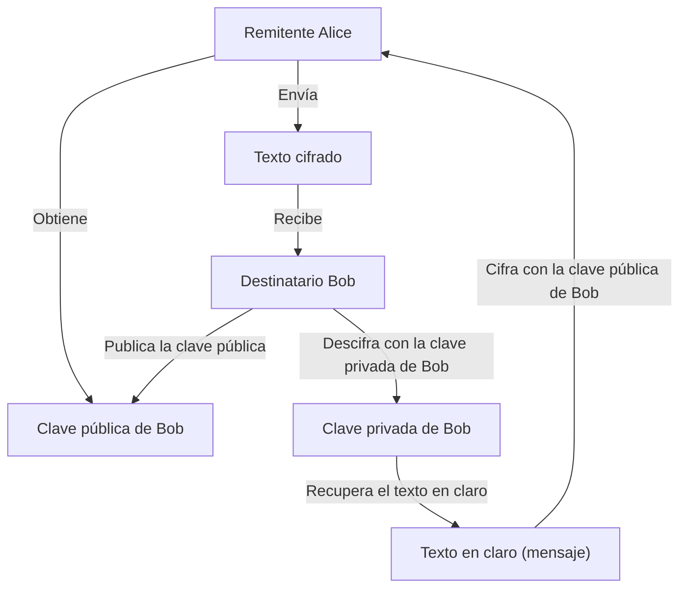
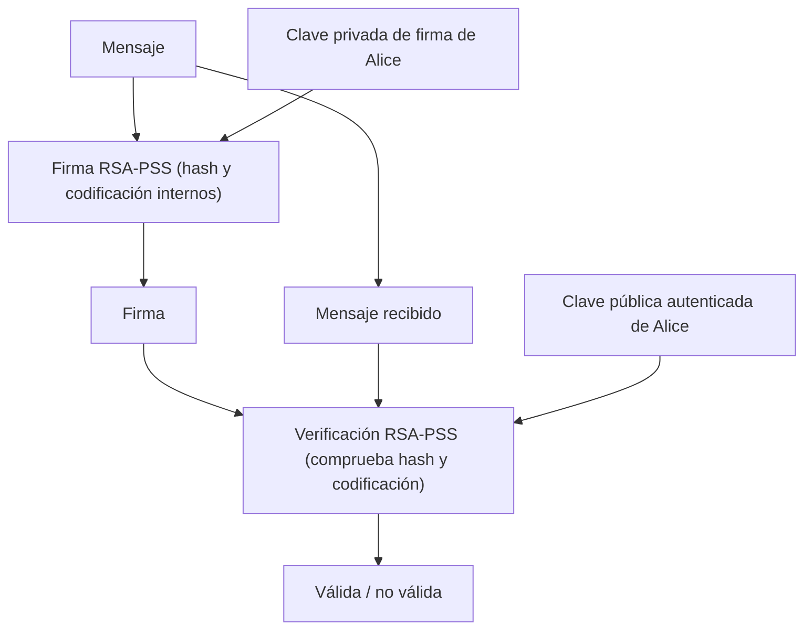
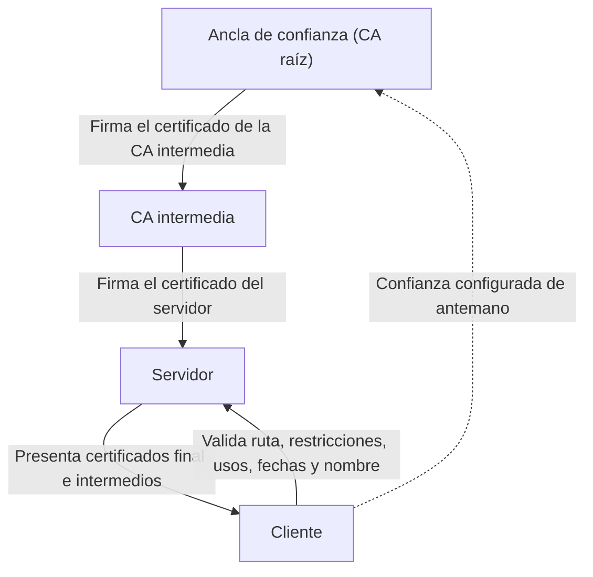

La criptografía contribuye a la confidencialidad, la integridad y la autenticación. Por sí sola no puede garantizar todos los aspectos de la seguridad de la información, incluida la disponibilidad. Este artículo explica las claves simétricas y públicas, los fundamentos matemáticos de RSA y las curvas elípticas, las funciones hash, las firmas digitales y la PKI. Distinguimos la explicación matemática de las condiciones exigidas por los esquemas y protocolos de uso real.

## 1. Funciones de las claves simétricas y públicas

### 1.1. Cifrado simétrico y distribución de claves

El **cifrado simétrico** utiliza una clave secreta compartida para cifrar y descifrar. AES es un ejemplo de cifrado por bloques. Estas técnicas son adecuadas para grandes volúmenes de datos, pero las partes necesitan compartir la clave de forma segura. El cifrado por sí solo no siempre detecta modificaciones; las comunicaciones reales emplean la protección que exige su protocolo, como el cifrado autenticado.

### 1.2. Diferentes operaciones de clave pública

Las **técnicas de clave pública** utilizan pares de claves pública y privada, pero no todas consisten en «cifrar con la pública y descifrar con la privada».

- **Cifrado de clave pública**: se cifra con la clave pública del destinatario y se descifra con la privada correspondiente.
- **Firmas digitales**: se firma con la clave privada del firmante y se verifica con la pública.
- **Acuerdo de claves**: las partes derivan un secreto compartido a partir de su material criptográfico y generan las claves de comunicación según el protocolo.

La clave pública no requiere una distribución secreta, pero **hay que autenticar su asociación con el interlocutor previsto**. El siguiente diagrama representa únicamente el cifrado de clave pública. Descifrar correctamente no autentica por sí solo al remitente.



## 2. Fundamentos matemáticos de las técnicas de clave pública

Al analizar la seguridad, deben distinguirse las hipótesis de dificultad computacional, las condiciones de generación de claves y la construcción del esquema. Los factores secretos de RSA permiten realizar la operación inversa, pero el acuerdo de claves y las firmas con curvas elípticas no se explican como una misma «operación inversa».

### 2.1. Claves y operaciones RSA

Rivest, Shamir y Adleman anunciaron RSA en 1977. Está relacionado con la dificultad de factorizar enteros grandes. Factorizar el módulo permite recuperar una clave privada, pero no se ha demostrado que invertir RSA en general sea equivalente en dificultad a factorizar. La seguridad también depende de la aleatoriedad, la generación de claves, el relleno y la implementación, además del tamaño de la clave.

#### 2.1.1. Generación de claves de libro de texto

1. Elegir primos impares grandes y distintos $p,q$, y calcular $N=pq$.
2. Calcular la función indicatriz de Euler:

$$\phi(N)=(p-1)(q-1)$$

3. Elegir $e$ con $1<e<\phi(N)$ y $\gcd(e,\phi(N))=1$. El ejemplo utiliza $e=65537$.
4. Usar, por ejemplo, el [algoritmo de Euclides](/es/p/euclidean-algorithm/) extendido para obtener $1\le d<\phi(N)$ que satisfaga:

$$ed\equiv1\pmod{\phi(N)}$$

La clave pública es $(N,e)$; una representación básica de la privada es $(N,d)$. Las implementaciones también conservan $p,q$ y valores del teorema chino del resto (CRT) para acelerar los cálculos. Estos datos también son secretos. Aquí usamos $\phi(N)$ para la explicación. RFC 8017 expresa la condición del inverso mediante $\lambda(N)=\operatorname{lcm}(p-1,q-1)$; la construcción anterior también satisface esa condición.

#### 2.1.2. Operaciones RSA y condiciones de la demostración

Para un representante entero del mensaje $0\le M<N$, las operaciones primitivas son:

$$C\equiv M^e\pmod N$$

$$M\equiv C^d\pmod N$$

El teorema de Euler se puede aplicar directamente **solo si $\gcd(M,N)=1$**. Al escribir $ed=1+t\phi(N)$, obtenemos:

$$M^{ed}=M\left(M^{\phi(N)}\right)^t\equiv M\pmod N$$

Para los mensajes no coprimos, consideramos por separado $r=p$ y $r=q$. Si $M\equiv0\pmod r$, entonces $M^{ed}\equiv0\pmod r$. En caso contrario, el pequeño teorema de Fermat y $(r-1)\mid(ed-1)$ dan $M^{ed}\equiv M\pmod r$. Al combinar ambas congruencias mediante el teorema chino del resto, se demuestra la recuperación correcta para todos los $0\le M<N$.

Por ejemplo, con $p=61,q=53,e=17,d=2753$ y $M=61$, resulta $M^{3120}\bmod3233=1220$: no se puede aplicar directamente el paso del teorema de Euler. Aun así, RSA devuelve 61 tras el cifrado y descifrado. Esta clave diminuta es ilustrativa, no segura.

**No se debe usar la exponenciación modular sin más como esquema de cifrado.** El cifrado RSA real necesita un esquema como RSAES-OAEP. Con RSA-2048 y SHA-256, el ejemplo siguiente admite como máximo 190 bytes de texto en claro (RFC 8017 §7.1.1):

$$m_{\mathrm{len}}\le k_{\mathrm{bytes}}-2h_{\mathrm{len}}-2=256-2\cdot32-2=190$$

Los datos grandes se protegen mediante cifrado simétrico autenticado dentro de un esquema híbrido estándar. Este ejemplo no cifra directamente archivos de longitud arbitraria con RSA.

### 2.2. Curvas elípticas y logaritmo discreto

Con parámetros adecuados, la **[criptografía de curva elíptica (ECC)](/es/p/elliptic-curve-cryptography-math-cpp/)** permite aspirar a una seguridad clásica comparable con claves más cortas que RSA. La longitud de la clave en bits no equivale a la fortaleza de seguridad en bits.

Aquí consideramos la forma corta de Weierstrass sobre el cuerpo primo $\mathbb F_p$, con $p>3$. No abarca todas las representaciones de curvas elípticas:

$$y^2\equiv x^3+ax+b\pmod p$$

$$4a^3+27b^2\not\equiv0\pmod p$$

Se define una suma sobre los puntos de la curva y el punto del infinito. Sea $G$ un generador de un subgrupo de orden primo grande $n$. El escalar secreto se elige uniformemente en $1\le k\le n-1$, con aleatoriedad criptográficamente segura. El punto público es:

$$P=kG$$

Encontrar $k$ a partir de $G,P$ es el problema del logaritmo discreto sobre curvas elípticas. Elegir únicamente un «$k$ grande» no basta: importan la curva, el subgrupo, la validación de las claves y la aleatoriedad. ECC designa una familia de técnicas; ECDH se utiliza para el acuerdo de claves y ECDSA para las firmas.

### 2.3. Ejemplo de RSA-OAEP en Python

Los tres ejemplos de Python pueden ejecutarse por separado. Se comprobaron con Python 3.12.14 y `cryptography` 50.0.2. Las claves se generan en memoria en cada ejecución con fines didácticos. No son sistemas de producción que cubran el almacenamiento y la distribución de claves, la autenticación del interlocutor y la gestión de errores.

```python
from cryptography.hazmat.primitives.asymmetric import rsa
from cryptography.hazmat.primitives.asymmetric import padding
from cryptography.hazmat.primitives import hashes
import base64

# 1. Generación de un par de claves RSA
private_key = rsa.generate_private_key(
    public_exponent=65537,
    key_size=2048,
)
public_key = private_key.public_key()

# 2. Definición del mensaje
message = b"This is a highly confidential message about modern cryptography."

# 3. Cifrado usando la clave pública (utilizando el padding OAEP)
ciphertext = public_key.encrypt(
    message,
    padding.OAEP(
        mgf=padding.MGF1(algorithm=hashes.SHA256()),
        algorithm=hashes.SHA256(),
        label=None
    )
)
print("Texto cifrado (Base64):", base64.b64encode(ciphertext).decode('utf-8'))

# 4. Descifrado usando la clave privada
decrypted_message = private_key.decrypt(
    ciphertext,
    padding.OAEP(
        mgf=padding.MGF1(algorithm=hashes.SHA256()),
        algorithm=hashes.SHA256(),
        label=None
    )
)
print("Mensaje descifrado:", decrypted_message.decode('utf-8'))
```

## 3. Funciones hash criptográficas

Una función hash calcula un resumen de longitud fija a partir de una entrada. Es determinista: una misma entrada produce siempre el mismo resultado. No es cifrado ni, por sí sola, generación de números aleatorios. El límite de longitud de entrada depende del algoritmo.

### 3.1. Tres propiedades de resistencia

1. **Resistencia a preimagen**: dado un valor hash $h$, es difícil encontrar una entrada que cumpla $H(m)=h$. No se trata de recuperar una entrada original única.
2. **Resistencia a segunda preimagen**: dado $m_1$, es difícil encontrar $m_2\ne m_1$ tal que $H(m_2)=H(m_1)$.
3. **Resistencia a colisiones**: es difícil encontrar dos entradas distintas con el mismo hash, incluso si el atacante puede elegir ambas.

Un resumen por sí solo no autentica su origen. Si un atacante puede sustituir tanto el mensaje como el resumen, una comparación sencilla no detectará el cambio. Se necesita un valor de referencia de confianza o un mecanismo de autenticación adecuado.

### 3.2. SHA-2 y SHA-256

SHA-256 pertenece a SHA-2, produce 256 bits y admite entradas de menos de $2^{64}$ bits. El mensaje, con el relleno que incluye su longitud, se divide en bloques de 512 bits y se procesa desde el valor inicial especificado. Una implementación en flujo puede añadir el relleno al llegar a los bloques finales.

Un esquema del procesamiento de tipo Merkle–Damgård, con bloques $M_i$ y valores de encadenamiento $H_i$, es:

$$H_i=f(H_{i-1},M_i)$$

Esta descripción no significa que omitir la función de compresión o el relleno especificados permita construir un esquema seguro.

### 3.3. SHA-3 y la construcción de esponja

SHA-3 es un estándar basado en Keccak que complementa SHA-2. No significa que todo ataque contra SHA-2 deje de funcionar ni que siempre sea necesario sustituir SHA-2.

- **Absorción (absorb)**: se combinan mediante XOR los bloques de entrada, con el sufijo y relleno prescritos, con la parte del estado correspondiente a la tasa; después se aplica una permutación.
- **Extracción (squeeze)**: se obtiene salida de la parte correspondiente a la tasa. Si se necesita más salida, se repiten la permutación y la extracción.

Las cuatro funciones hash SHA-3, como SHA3-256, tienen longitudes de salida fijas. SHAKE128 y SHAKE256, definidos en el mismo FIPS 202, son XOF cuya longitud de salida se especifica. El sufijo y el relleno importan: el nombre «Keccak-256» por sí solo no permite asumir que su salida coincide con SHA3-256.

### 3.4. Ejemplo de hash en Python

```python
from cryptography.hazmat.primitives import hashes

message = b"Modern cryptography heavily relies on secure hash functions."

# Generación de SHA-256
digest_sha256 = hashes.Hash(hashes.SHA256())
digest_sha256.update(message)
hash_result_sha256 = digest_sha256.finalize()
print("SHA-256:", hash_result_sha256.hex())

# Generación de SHA-3 (SHA3-256)
digest_sha3 = hashes.Hash(hashes.SHA3_256())
digest_sha3.update(message)
hash_result_sha3 = digest_sha3.finalize()
print("SHA3-256:", hash_result_sha3.hex())
```

## 4. Firmas digitales

Un esquema de firma digital permite **generar firmas** con una clave privada y **verificarlas** con una pública. Con una construcción e implementación correctas, una asociación de clave fiable y una gestión adecuada de la clave privada, las firmas contribuyen a la integridad y la autenticación del firmante. Pueden aportar pruebas para el no repudio, pero no demuestran incondicionalmente la intención de la persona ni la ausencia de compromiso de la clave.

### 4.1. Diferencia entre firmar y cifrar

Es incorrecto generalizar las firmas como «cifrar con la clave privada y descifrar con la pública». RSA tiene esquemas diferentes de cifrado y de firma; el ejemplo utiliza **RSASSA-PSS**. Firmar no oculta el mensaje. La verificación comprueba si la clave pública, el mensaje y la firma cumplen las condiciones del esquema; no es un descifrado genérico que recupera un resumen.

### 4.2. Generación y verificación (resumen de RSA-PSS)



1. El firmante calcula el hash del mensaje y genera la firma con la codificación PSS, una sal y la operación con la clave privada. Entrega el mensaje y la firma.
2. El verificador utiliza una clave pública de confianza y parámetros coincidentes para verificar el mensaje y la firma recibidos. El hash y la codificación forman parte del esquema; la API del ejemplo no recibe un resumen calculado previamente.

### 4.3. Ejemplo de RSA-PSS en Python

Generamos una clave dedicada a la firma, distinta de la del ejemplo de cifrado. La longitud de la sal es la del resumen SHA-256 (32 bytes), y la verificación utiliza el mismo ajuste. La autenticidad de la clave pública debe establecerse fuera de este ejemplo.

```python
import base64
from cryptography.exceptions import InvalidSignature
from cryptography.hazmat.primitives import hashes
from cryptography.hazmat.primitives.asymmetric import padding, rsa

# Generar una clave de firma dedicada, distinta de la del ejemplo de cifrado
signing_key = rsa.generate_private_key(public_exponent=65537, key_size=2048)
verification_key = signing_key.public_key()
doc_message = b"Contract document: Party A agrees to pay Party B $1000."
pss = padding.PSS(
    mgf=padding.MGF1(hashes.SHA256()),
    salt_length=padding.PSS.DIGEST_LENGTH,
)
signature = signing_key.sign(doc_message, pss, hashes.SHA256())
print("Firma (Base64):", base64.b64encode(signature).decode("ascii"))

try:
    verification_key.verify(signature, doc_message, pss, hashes.SHA256())
    print("Firma VÁLIDA para este mensaje y esta clave pública.")
except InvalidSignature:
    print("Firma NO VÁLIDA para este mensaje y esta clave pública.")
```

## 5. Infraestructura de clave pública (PKI)

Si se acepta la clave de un atacante como si fuera la del interlocutor, incluso unas operaciones criptográficas correctas pueden dirigirse a la parte equivocada. La **PKI** aporta certificados, configuración de confianza y procedimientos de verificación para establecer asociaciones entre claves públicas y nombres u otros datos.

### 5.1. Autoridades de certificación y certificados X.509

Una autoridad de certificación (CA) comprueba el control del dominio o la información del sujeto según sus políticas y emite un certificado. No todos los certificados acreditan en el mismo grado la identidad personal del operador de un sitio.

Un certificado X.509 incluye versión, número de serie, algoritmo de firma, emisor, sujeto, período de validez, clave pública del sujeto, extensiones y firma. La CA firma la **codificación DER de TBSCertificate**, que contiene la información que se firma, no únicamente la clave pública.

### 5.2. Cadenas de certificados y TLS



El diagrama muestra un ejemplo: CA raíz → CA intermedia → servidor. El cliente construye una ruta hasta un ancla de confianza configurada y valida las firmas, los períodos de validez, las restricciones de CA, el uso de claves y las extensiones críticas no admitidas, entre otros requisitos. No se limita a verificar directamente el certificado final con la clave raíz. El tratamiento de la revocación sigue el mecanismo y la política aplicables.

TLS también requiere verificar la identidad del servicio. Para nombres DNS, se compara el nombre esperado con las entradas `dNSName` de `subjectAltName`, sin recurrir a Common Name como alternativa (RFC 9525). No debe aceptarse un certificado de otro sitio aunque su firma sea correcta.

Validar el certificado no basta para establecer una comunicación cifrada. TLS 1.3 combina intercambio de claves, autenticación y confirmación de claves para derivar las claves de tráfico, y protege los registros mediante cifrado autenticado. TLS 1.3 eliminó el transporte de claves con RSA estático. Las conexiones con PSK o reanudación pueden omitir certificados, por lo que el diagrama no representa todas las conexiones TLS.

## 6. Resumen

- El cifrado simétrico protege grandes volúmenes de datos. Hay que distinguir la confidencialidad de la detección de modificaciones.
- El cifrado de clave pública, el acuerdo de claves y las firmas tienen funciones distintas. También hay que autenticar las claves.
- Los hashes producen resúmenes. Por sí solos no autentican el origen.
- Las firmas contribuyen a la integridad y la autenticación, sujetas a la gestión de claves y a las condiciones del esquema.
- La validación de rutas PKI, la comprobación del nombre del servicio y el protocolo de enlace TLS son procesos relacionados, pero distintos.

Estos son los fundamentos. Los sistemas de producción utilizan bibliotecas mantenidas y protocolos estándar, y evalúan la gestión de claves, los algoritmos, los parámetros y la migración a criptografía poscuántica. Los ejemplos de este artículo no bastan para determinar la seguridad de todo un sistema.

### Referencias

- [RFC 8017: PKCS #1 — RSA Cryptography Specifications](https://www.rfc-editor.org/rfc/rfc8017.html) (§§3, 5–9)
- [cryptography 50.0.2: RSA](https://cryptography.io/en/50.0.2/hazmat/primitives/asymmetric/rsa/)
- [RFC 6090: Fundamental Elliptic Curve Cryptography Algorithms](https://www.rfc-editor.org/rfc/rfc6090.html) (§§3.3, 5.3.1)
- [NIST FIPS 180-4: Secure Hash Standard](https://nvlpubs.nist.gov/nistpubs/FIPS/NIST.FIPS.180-4.pdf) (§§5–6)
- [NIST FIPS 202: SHA-3 Standard](https://nvlpubs.nist.gov/nistpubs/FIPS/NIST.FIPS.202.pdf) (§§4–6)
- [NIST FIPS 186-5: Digital Signature Standard](https://csrc.nist.gov/pubs/fips/186-5/final)
- [RFC 5280: Internet X.509 PKI Certificate and CRL Profile](https://www.rfc-editor.org/rfc/rfc5280.html) (§§4.1, 6)
- [RFC 9525: Service Identity in TLS](https://www.rfc-editor.org/rfc/rfc9525.html)
- [RFC 8446: TLS 1.3](https://www.rfc-editor.org/rfc/rfc8446.html) (§§1.2, 2)
