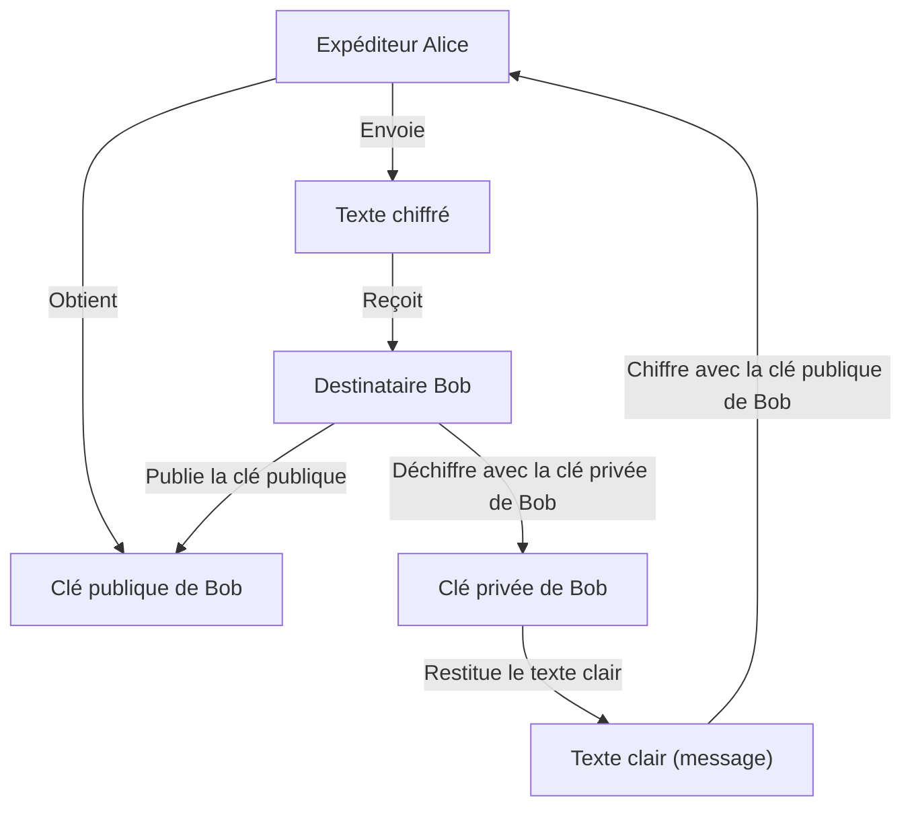
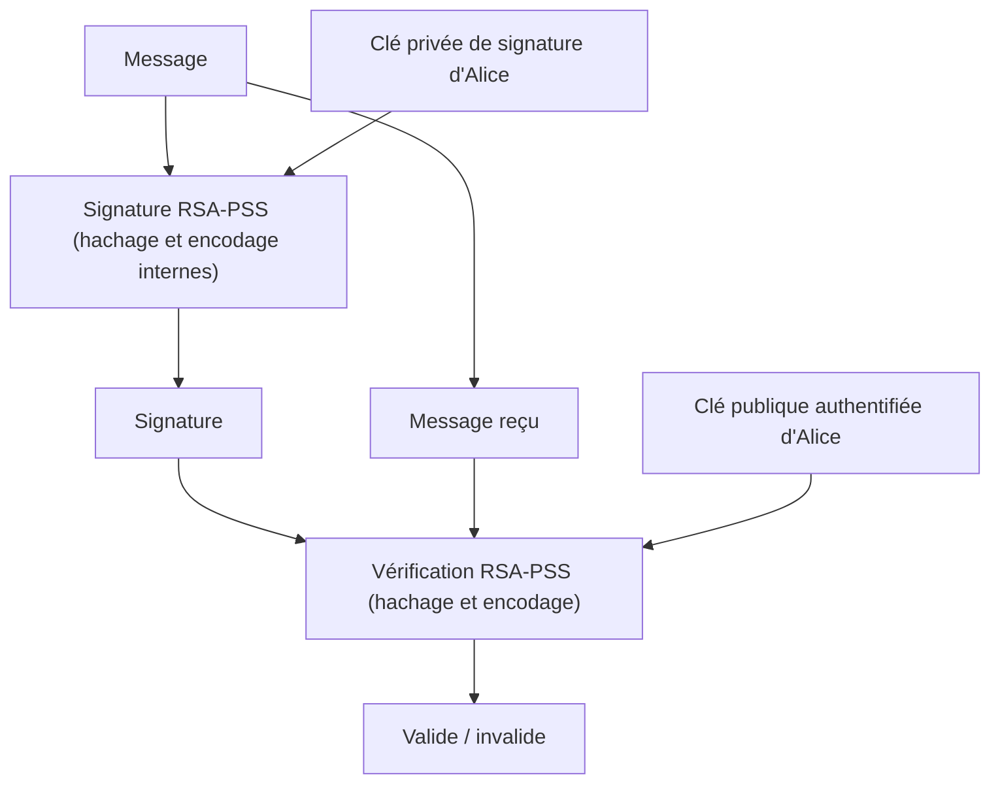
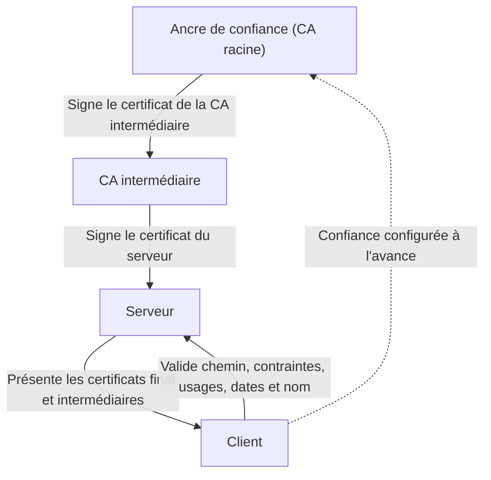

La cryptographie contribue à la confidentialité, à l'intégrité et à l'authentification. Elle ne garantit pas, à elle seule, tous les aspects de la sécurité de l'information, dont la disponibilité. Cet article présente les rôles des clés symétriques et publiques, les bases mathématiques de RSA et des courbes elliptiques, les fonctions de hachage, les signatures numériques et la PKI. Nous distinguons l'explication mathématique des conditions requises par les schémas et protocoles réellement utilisés.

## 1. Rôles des clés symétriques et publiques

### 1.1. Chiffrement symétrique et distribution des clés

Le **chiffrement symétrique** utilise une clé secrète partagée pour chiffrer et déchiffrer. AES est un exemple de chiffrement par blocs. Ces techniques conviennent aux volumes importants de données, mais les parties doivent partager la clé de façon sûre. Le chiffrement seul ne détecte pas nécessairement les modifications ; les communications réelles utilisent la protection exigée par leur protocole, comme le chiffrement authentifié.

### 1.2. Différentes opérations à clé publique

Les **techniques à clé publique** utilisent des paires de clés publique et privée, mais ne signifient pas toutes « chiffrer avec la clé publique et déchiffrer avec la clé privée ».

- **Chiffrement à clé publique** : chiffrer avec la clé publique du destinataire et déchiffrer avec la clé privée correspondante.
- **Signatures numériques** : signer avec la clé privée du signataire et vérifier avec la clé publique.
- **Accord de clés** : dériver un secret partagé à partir du matériel cryptographique des parties, puis générer les clés de communication selon le protocole.

Une clé publique n'exige pas de distribution secrète, mais **son association avec l'interlocuteur prévu doit être authentifiée**. Le diagramme suivant représente uniquement le chiffrement à clé publique. Réussir à déchiffrer ne suffit pas à authentifier l'expéditeur.



## 2. Bases mathématiques des techniques à clé publique

L'analyse de sécurité doit distinguer les hypothèses de difficulté calculatoire, les conditions de génération des clés et la construction du schéma. Les facteurs secrets de RSA permettent l'opération inverse, mais l'accord de clés et les signatures sur courbes elliptiques ne se réduisent pas à une même « opération inverse ».

### 2.1. Clés et opérations RSA

Rivest, Shamir et Adleman ont annoncé RSA en 1977. Il est lié à la difficulté de factoriser de grands entiers. Factoriser le module permet de retrouver une clé privée, mais l'équivalence de difficulté entre l'inversion générale de RSA et la factorisation n'est pas démontrée. La sécurité dépend aussi de l'aléa, de la génération des clés, du bourrage et de l'implémentation, pas seulement de la taille de la clé.

#### 2.1.1. Génération de clés : présentation pédagogique

1. Choisir de grands nombres premiers impairs distincts $p,q$ et calculer $N=pq$.
2. Calculer l'indicatrice d'Euler :

$$\phi(N)=(p-1)(q-1)$$

3. Choisir $e$ tel que $1<e<\phi(N)$ et $\gcd(e,\phi(N))=1$. L'exemple utilise $e=65537$.
4. Utiliser, par exemple, [l'algorithme d'Euclide](/fr/p/euclidean-algorithm/) étendu pour obtenir $1\le d<\phi(N)$ satisfaisant :

$$ed\equiv1\pmod{\phi(N)}$$

La clé publique est $(N,e)$ ; une représentation élémentaire de la clé privée est $(N,d)$. Les implémentations conservent aussi $p,q$ et les valeurs nécessaires au théorème des restes chinois (CRT) pour accélérer les calculs. Ces données sont également secrètes. Nous utilisons ici $\phi(N)$ pour l'explication. Le RFC 8017 exprime la condition d'inversion avec $\lambda(N)=\operatorname{lcm}(p-1,q-1)$ ; la construction ci-dessus la satisfait également.

#### 2.1.2. Opérations RSA et conditions de la démonstration

Pour un représentant entier du message $0\le M<N$, les opérations primitives sont :

$$C\equiv M^e\pmod N$$

$$M\equiv C^d\pmod N$$

Le théorème d'Euler s'applique directement **uniquement si $\gcd(M,N)=1$**. En écrivant $ed=1+t\phi(N)$, on obtient :

$$M^{ed}=M\left(M^{\phi(N)}\right)^t\equiv M\pmod N$$

Pour les messages tels que $\gcd(M,N)\ne1$, on considère séparément $r=p$ et $r=q$. Si $M\equiv0\pmod r$, alors $M^{ed}\equiv0\pmod r$. Sinon, le petit théorème de Fermat et $(r-1)\mid(ed-1)$ donnent $M^{ed}\equiv M\pmod r$. En combinant les deux congruences par le théorème des restes chinois, on démontre la restitution correcte pour tous les $0\le M<N$.

Par exemple, avec $p=61,q=53,e=17,d=2753$ et $M=61$, on a $M^{3120}\bmod3233=1220$ : l'étape utilisant le théorème d'Euler ne s'applique pas directement. RSA restitue pourtant 61 après chiffrement et déchiffrement. Cette minuscule clé sert à illustrer le calcul ; elle n'est pas sûre.

**Il ne faut pas utiliser l'exponentiation modulaire brute comme schéma de chiffrement.** Le chiffrement RSA réel exige un schéma tel que RSAES-OAEP. Avec RSA-2048 et SHA-256, l'exemple ci-dessous accepte au maximum 190 octets de texte clair (RFC 8017 §7.1.1) :

$$m_{\mathrm{len}}\le k_{\mathrm{bytes}}-2h_{\mathrm{len}}-2=256-2\cdot32-2=190$$

Les données volumineuses sont protégées par chiffrement symétrique authentifié dans un schéma hybride standard. Cet exemple ne chiffre pas directement des fichiers de longueur arbitraire avec RSA.

### 2.2. Courbes elliptiques et logarithme discret

Avec des paramètres appropriés, la **[cryptographie sur courbes elliptiques (ECC)](/fr/p/elliptic-curve-cryptography-math-cpp/)** peut viser une sécurité classique comparable avec des clés plus courtes que RSA. La longueur de la clé en bits n'est pas, à elle seule, le niveau de sécurité en bits.

Nous considérons ici la forme courte de Weierstrass sur le corps premier $\mathbb F_p$, avec $p>3$. Cela ne couvre pas toutes les représentations de courbes elliptiques :

$$y^2\equiv x^3+ax+b\pmod p$$

$$4a^3+27b^2\not\equiv0\pmod p$$

Une addition est définie sur les points de la courbe, avec le point à l'infini. Soit $G$ un générateur d'un sous-groupe d'ordre $n$, où $n$ est un grand nombre premier. Le scalaire secret est choisi uniformément dans $1\le k\le n-1$, avec un aléa cryptographiquement sûr. Le point public est :

$$P=kG$$

Retrouver $k$ à partir de $G,P$ est le problème du logarithme discret sur courbes elliptiques. Choisir simplement un « grand $k$ » ne suffit pas : la courbe, le sous-groupe, la validation des clés et l'aléa comptent. ECC désigne une famille de techniques ; ECDH sert à l'accord de clés et ECDSA aux signatures.

### 2.3. RSA-OAEP en Python

Les trois exemples Python sont exécutables séparément. Ils ont été vérifiés avec Python 3.12.14 et `cryptography` 50.0.2. Les clés sont générées en mémoire à chaque exécution, à des fins pédagogiques. Les exemples ne constituent pas des systèmes de production couvrant le stockage et la distribution des clés, l'authentification de l'interlocuteur et la gestion des erreurs.

```python
from cryptography.hazmat.primitives.asymmetric import rsa
from cryptography.hazmat.primitives.asymmetric import padding
from cryptography.hazmat.primitives import hashes
import base64

# 1. Génération de la paire de clés RSA
private_key = rsa.generate_private_key(
    public_exponent=65537,
    key_size=2048,
)
public_key = private_key.public_key()

# 2. Définition du message
message = b"Ceci est un message hautement confidentiel sur la cryptographie moderne."

# 3. Chiffrement à l'aide de la clé publique (utilisation du remplissage OAEP)
ciphertext = public_key.encrypt(
    message,
    padding.OAEP(
        mgf=padding.MGF1(algorithm=hashes.SHA256()),
        algorithm=hashes.SHA256(),
        label=None
    )
)
print("Texte chiffré (Base64) :", base64.b64encode(ciphertext).decode('utf-8'))

# 4. Déchiffrement à l'aide de la clé privée
decrypted_message = private_key.decrypt(
    ciphertext,
    padding.OAEP(
        mgf=padding.MGF1(algorithm=hashes.SHA256()),
        algorithm=hashes.SHA256(),
        label=None
    )
)
print("Message déchiffré :", decrypted_message.decode('utf-8'))
```

## 3. Fonctions de hachage cryptographiques

Une fonction de hachage calcule une empreinte de longueur fixe à partir d'une entrée. Elle est déterministe : la même entrée produit toujours le même résultat. Ce n'est ni un chiffrement ni, à elle seule, une génération de nombres aléatoires. La limite de longueur de l'entrée dépend de l'algorithme.

### 3.1. Trois propriétés de résistance

1. **Résistance à la préimage** : pour une valeur de hachage $h$ donnée, il est difficile de trouver une entrée telle que $H(m)=h$. Il ne s'agit pas de retrouver une unique entrée d'origine.
2. **Résistance à la seconde préimage** : pour un $m_1$ donné, il est difficile de trouver $m_2\ne m_1$ tel que $H(m_2)=H(m_1)$.
3. **Résistance aux collisions** : il est difficile de trouver deux entrées différentes ayant la même empreinte, même si l'attaquant peut choisir les deux.

Une empreinte seule n'authentifie pas sa source. Si un attaquant peut remplacer le message et son empreinte, une simple comparaison ne détecte pas la modification. Il faut une valeur de référence fiable ou un mécanisme d'authentification adapté.

### 3.2. SHA-2 et SHA-256

SHA-256 appartient à SHA-2 : sa sortie fait 256 bits et son entrée doit avoir moins de $2^{64}$ bits. Le message, avec le bourrage incluant sa longueur, est découpé en blocs de 512 bits puis traité depuis la valeur initiale prescrite. Une implémentation en flux peut ajouter le bourrage lorsqu'elle atteint les derniers blocs.

Une représentation schématique du traitement de type Merkle–Damgård, avec les blocs $M_i$ et les valeurs de chaînage $H_i$, est :

$$H_i=f(H_{i-1},M_i)$$

Cet aperçu ne signifie pas que l'on puisse omettre la fonction de compression ou le bourrage prescrits et obtenir un schéma sûr.

### 3.3. SHA-3 et la construction en éponge

SHA-3 est une norme fondée sur Keccak qui complète SHA-2. Cela ne signifie pas que toutes les attaques contre SHA-2 deviennent inefficaces, ni qu'il faille toujours remplacer SHA-2.

- **Absorption (absorb)** : les blocs d'entrée, avec le suffixe et le bourrage prescrits, sont combinés par XOR avec la partie de l'état correspondant au débit ; une permutation est ensuite appliquée.
- **Extraction (squeeze)** : on extrait la sortie de la partie correspondant au débit. Si davantage de sortie est nécessaire, on répète la permutation et l'extraction.

Les quatre fonctions de hachage SHA-3, telles que SHA3-256, ont des longueurs de sortie fixes. SHAKE128 et SHAKE256, dans le même FIPS 202, sont des XOF dont on spécifie la longueur de sortie. Le suffixe et le bourrage sont importants : le nom « Keccak-256 » ne suffit pas pour conclure que sa sortie est identique à celle de SHA3-256.

### 3.4. Hachage en Python

```python
from cryptography.hazmat.primitives import hashes

message = "La cryptographie moderne s'appuie fortement sur des fonctions de hachage sécurisées.".encode("utf-8")

# Génération SHA-256
digest_sha256 = hashes.Hash(hashes.SHA256())
digest_sha256.update(message)
hash_result_sha256 = digest_sha256.finalize()
print("SHA-256 :", hash_result_sha256.hex())

# Génération SHA-3 (SHA3-256)
digest_sha3 = hashes.Hash(hashes.SHA3_256())
digest_sha3.update(message)
hash_result_sha3 = digest_sha3.finalize()
print("SHA3-256 :", hash_result_sha3.hex())
```

## 4. Signatures numériques

Un schéma de signature numérique permet de **générer une signature** avec une clé privée et de **la vérifier** avec une clé publique. Avec une construction et une implémentation correctes, un lien fiable entre la clé et l'identité et une gestion adéquate de la clé privée, les signatures contribuent à l'intégrité et à l'authentification du signataire. Elles peuvent fournir des éléments de preuve pour la non-répudiation, mais ne démontrent pas inconditionnellement l'intention de la personne ni l'absence de compromission de la clé.

### 4.1. Différence entre signature et chiffrement

Généraliser les signatures comme « chiffrer avec la clé privée et déchiffrer avec la publique » est incorrect. RSA possède des schémas distincts de chiffrement et de signature ; l'exemple utilise **RSASSA-PSS**. Signer ne cache pas le message. La vérification contrôle si la clé publique, le message et la signature satisfont les conditions du schéma ; ce n'est pas un déchiffrement générique qui restitue une empreinte.

### 4.2. Génération et vérification : aperçu de RSA-PSS



1. Le signataire calcule le hachage du message et génère la signature avec l'encodage PSS, un sel et l'opération utilisant la clé privée. Il transmet le message et la signature.
2. Le vérificateur utilise une clé publique fiable et des paramètres correspondants pour vérifier le message et la signature reçus. Le hachage et l'encodage font partie du schéma ; l'API de l'exemple ne reçoit pas une empreinte calculée à l'avance.

### 4.3. RSA-PSS en Python

Nous générons une clé dédiée à la signature, distincte de celle de l'exemple de chiffrement. La longueur du sel est celle de l'empreinte SHA-256 (32 octets), et la vérification utilise le même réglage. L'authenticité de la clé publique doit être établie en dehors de cet exemple.

```python
import base64
from cryptography.exceptions import InvalidSignature
from cryptography.hazmat.primitives import hashes
from cryptography.hazmat.primitives.asymmetric import padding, rsa

# Générer une clé de signature dédiée, distincte de celle du chiffrement
signing_key = rsa.generate_private_key(public_exponent=65537, key_size=2048)
verification_key = signing_key.public_key()
doc_message = "Document contractuel : la partie A accepte de payer 1000 $ à la partie B.".encode("utf-8")
pss = padding.PSS(
    mgf=padding.MGF1(hashes.SHA256()),
    salt_length=padding.PSS.DIGEST_LENGTH,
)
signature = signing_key.sign(doc_message, pss, hashes.SHA256())
print("Signature (Base64) :", base64.b64encode(signature).decode("ascii"))

try:
    verification_key.verify(signature, doc_message, pss, hashes.SHA256())
    print("Signature VALIDE pour ce message et cette clé publique.")
except InvalidSignature:
    print("Signature INVALIDE pour ce message et cette clé publique.")
```

## 5. Infrastructure à clés publiques (PKI)

Accepter la clé d'un attaquant comme celle de l'interlocuteur peut conduire à communiquer avec la mauvaise partie, même si les opérations cryptographiques sont correctes. La **PKI** fournit des certificats, une configuration de confiance et des procédures de vérification pour établir les associations entre clés publiques et noms ou autres informations.

### 5.1. Autorités de certification et certificats X.509

Une autorité de certification (CA) vérifie le contrôle du domaine ou les informations du sujet selon sa politique, puis émet un certificat. Tous les certificats n'attestent pas dans la même mesure l'identité personnelle de l'exploitant d'un site.

Un certificat X.509 comprend version, numéro de série, algorithme de signature, émetteur, sujet, période de validité, clé publique du sujet, extensions et signature. La CA signe **l'encodage DER de TBSCertificate**, contenant les informations à signer, et non la clé publique seule.

### 5.2. Chaînes de certificats et TLS



Le diagramme montre un exemple : CA racine → CA intermédiaire → serveur. Le client construit un chemin vers une ancre de confiance configurée et valide notamment les signatures, les périodes de validité, les contraintes de CA, les usages des clés et les extensions critiques non prises en charge. Il ne vérifie pas simplement le certificat final directement avec la clé racine. Le traitement de la révocation suit le mécanisme et la politique applicables.

TLS exige aussi de vérifier l'identité du service. Pour les noms DNS, on compare le nom attendu aux entrées `dNSName` de `subjectAltName`, sans se rabattre sur Common Name (RFC 9525). Un certificat d'un autre site ne doit pas être accepté même si sa signature est correcte.

Valider le certificat ne suffit pas à établir une communication chiffrée. TLS 1.3 combine échange de clés, authentification et confirmation de clés pour dériver les clés de trafic, et protège les enregistrements par chiffrement authentifié. Le transport de clés RSA statique a été supprimé dans TLS 1.3. Les connexions PSK ou de reprise peuvent omettre les certificats ; le diagramme ne décrit donc pas toutes les connexions TLS.

## 6. Résumé

- Le chiffrement symétrique protège les données volumineuses. Il faut distinguer confidentialité et détection des modifications.
- Chiffrement à clé publique, accord de clés et signatures ont des rôles distincts. Il faut aussi authentifier les clés.
- Les fonctions de hachage produisent des empreintes. Elles n'authentifient pas seules la source.
- Les signatures contribuent à l'intégrité et à l'authentification, sous réserve de la gestion des clés et des conditions du schéma.
- Validation des chemins PKI, contrôle du nom du service et négociation TLS sont des traitements liés, mais distincts.

Ce sont des bases. En production, on utilise des bibliothèques maintenues et des protocoles standard, et on évalue la gestion des clés, les algorithmes, les paramètres et la migration vers la cryptographie post-quantique. Les exemples de cet article ne suffisent pas à déterminer la sécurité de tout un système.

### Références

- [RFC 8017: PKCS #1 — RSA Cryptography Specifications](https://www.rfc-editor.org/rfc/rfc8017.html) (§§3, 5–9)
- [cryptography 50.0.2: RSA](https://cryptography.io/en/50.0.2/hazmat/primitives/asymmetric/rsa/)
- [RFC 6090: Fundamental Elliptic Curve Cryptography Algorithms](https://www.rfc-editor.org/rfc/rfc6090.html) (§§3.3, 5.3.1)
- [NIST FIPS 180-4: Secure Hash Standard](https://nvlpubs.nist.gov/nistpubs/FIPS/NIST.FIPS.180-4.pdf) (§§5–6)
- [NIST FIPS 202: SHA-3 Standard](https://nvlpubs.nist.gov/nistpubs/FIPS/NIST.FIPS.202.pdf) (§§4–6)
- [NIST FIPS 186-5: Digital Signature Standard](https://csrc.nist.gov/pubs/fips/186-5/final)
- [RFC 5280: Internet X.509 PKI Certificate and CRL Profile](https://www.rfc-editor.org/rfc/rfc5280.html) (§§4.1, 6)
- [RFC 9525: Service Identity in TLS](https://www.rfc-editor.org/rfc/rfc9525.html)
- [RFC 8446: TLS 1.3](https://www.rfc-editor.org/rfc/rfc8446.html) (§§1.2, 2)
