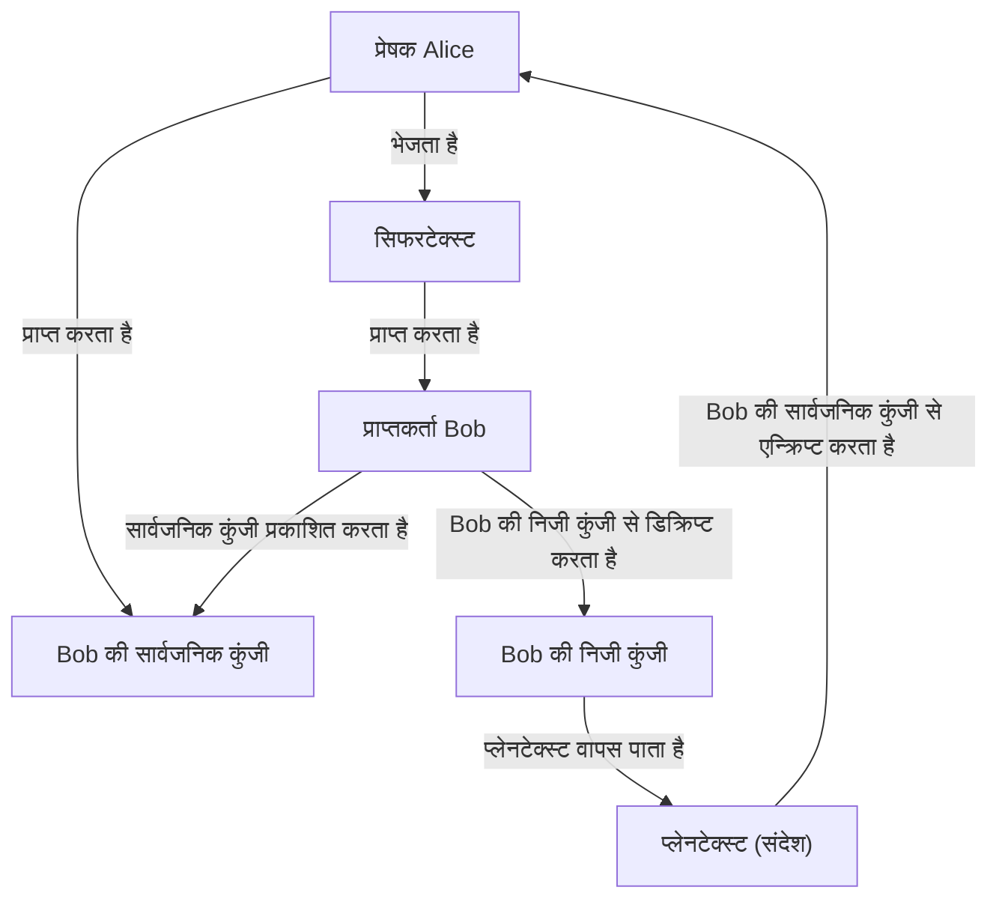
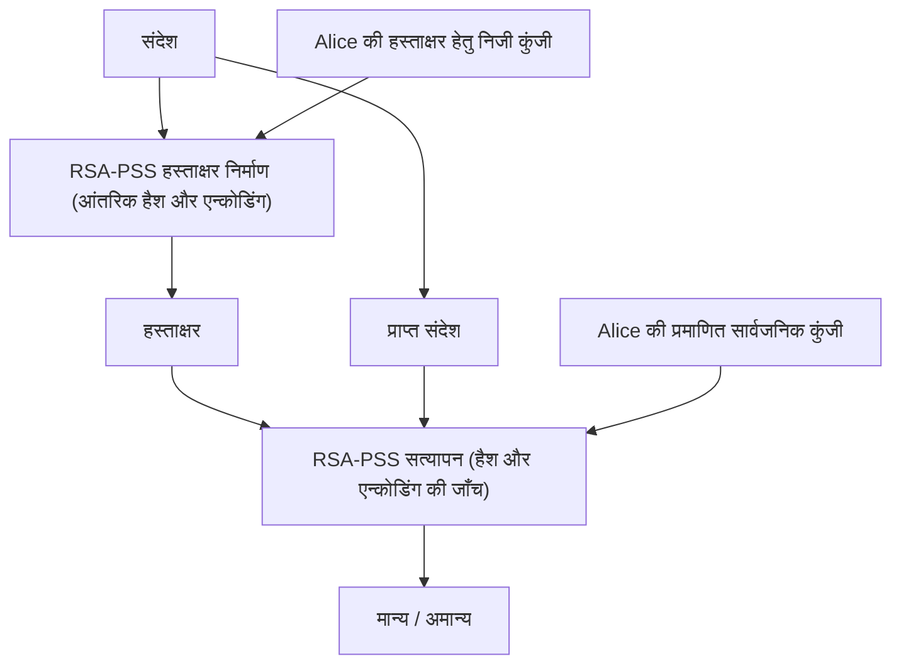
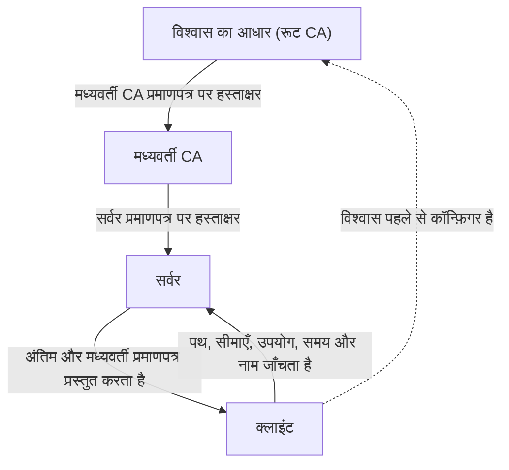

क्रिप्टोग्राफी गोपनीयता, अखंडता और प्रमाणीकरण में सहायता करती है। लेकिन अकेले इससे उपलब्धता सहित सूचना सुरक्षा के सभी पहलुओं की गारंटी नहीं मिलती। इस लेख में सममित और सार्वजनिक कुंजियों की भूमिका, RSA और इलिप्टिक कर्व की गणितीय बुनियाद, हैश फ़ंक्शन, डिजिटल हस्ताक्षर और PKI समझाए गए हैं। हम गणितीय व्याख्या और वास्तविक क्रिप्टोग्राफ़िक योजनाओं तथा प्रोटोकॉल की आवश्यक शर्तों को अलग रखते हैं।

## 1. सममित और सार्वजनिक कुंजियों की भूमिका

### 1.1. सममित एन्क्रिप्शन और कुंजी वितरण

**सममित एन्क्रिप्शन** में एन्क्रिप्शन और डिक्रिप्शन के लिए साझा गुप्त कुंजी इस्तेमाल होती है। AES एक प्रमुख ब्लॉक सिफर है। ये तकनीकें बड़ी मात्रा में डेटा सुरक्षित करने के लिए उपयुक्त हैं, लेकिन दोनों पक्षों को कुंजी सुरक्षित ढंग से साझा करनी होती है। केवल एन्क्रिप्शन से बदलाव का पता लगना आवश्यक नहीं है; वास्तविक संचार में प्रोटोकॉल द्वारा निर्धारित सुरक्षा विधि, जैसे प्रमाणीकृत एन्क्रिप्शन, इस्तेमाल होती है।

### 1.2. सार्वजनिक कुंजी की अलग-अलग क्रियाएँ

**सार्वजनिक-कुंजी तकनीकें** सार्वजनिक और निजी कुंजी का एक जोड़ा इस्तेमाल करती हैं। सभी तकनीकों का अर्थ «सार्वजनिक कुंजी से एन्क्रिप्ट और निजी कुंजी से डिक्रिप्ट करना» नहीं है।

- **सार्वजनिक-कुंजी एन्क्रिप्शन**: प्राप्तकर्ता की सार्वजनिक कुंजी से एन्क्रिप्ट करना और संबंधित निजी कुंजी से डिक्रिप्ट करना।
- **डिजिटल हस्ताक्षर**: हस्ताक्षरकर्ता की निजी कुंजी से हस्ताक्षर बनाना और सार्वजनिक कुंजी से सत्यापन करना।
- **कुंजी सहमति (key agreement)**: दोनों पक्षों की कुंजी सामग्री से साझा रहस्य निकालना और प्रोटोकॉल के अनुसार संचार कुंजियाँ बनाना।

सार्वजनिक कुंजी को गुप्त माध्यम से भेजना आवश्यक नहीं है, लेकिन **यह प्रमाणित करना ज़रूरी है कि वह अपेक्षित पक्ष की कुंजी है**। अगला आरेख केवल सार्वजनिक-कुंजी एन्क्रिप्शन दिखाता है। सफल डिक्रिप्शन अपने आप प्रेषक का प्रमाणीकरण नहीं करता।



## 2. सार्वजनिक-कुंजी तकनीकों की गणितीय बुनियाद

सुरक्षा की चर्चा में गणना की कठिनाई संबंधी धारणाएँ, कुंजी निर्माण की शर्तें और योजना की रचना अलग-अलग बातें हैं। RSA के गुप्त गुणनखंड उलटी क्रिया का रास्ता देते हैं, लेकिन इलिप्टिक कर्व पर कुंजी सहमति और हस्ताक्षर को उसी एक «उलटी गणना» से नहीं समझाया जा सकता।

### 2.1. RSA की कुंजियाँ और क्रियाएँ

Rivest, Shamir और Adleman ने 1977 में RSA प्रस्तुत किया। इसका संबंध बड़े पूर्णांकों के गुणनखंडन की कठिनाई से है। मॉड्यूलस का गुणनखंडन करने पर निजी कुंजी प्राप्त की जा सकती है, लेकिन सामान्य RSA उलटी क्रिया और गुणनखंडन की कठिनाई बराबर है, यह सिद्ध नहीं हुआ है। सुरक्षा केवल कुंजी की लंबाई पर नहीं, बल्कि यादृच्छिकता, कुंजी निर्माण, पैडिंग और कार्यान्वयन पर भी निर्भर करती है।

#### 2.1.1. पाठ्यपुस्तक के रूप में कुंजी निर्माण

1. अलग-अलग बड़ी विषम अभाज्य संख्याएँ $p,q$ चुनें और $N=pq$ निकालें।
2. यूलर का टॉटिएंट फ़ंक्शन निकालें:

$$\phi(N)=(p-1)(q-1)$$

3. ऐसा $e$ चुनें कि $1<e<\phi(N)$ और $\gcd(e,\phi(N))=1$ हों। उदाहरण में $e=65537$ है।
4. उदाहरण के लिए, विस्तारित [यूक्लिडियन एल्गोरिदम](/hi/p/euclidean-algorithm/) से ऐसा $1\le d<\phi(N)$ निकालें जो यह शर्त पूरी करे:

$$ed\equiv1\pmod{\phi(N)}$$

सार्वजनिक कुंजी $(N,e)$ है; निजी कुंजी का एक मूल निरूपण $(N,d)$ है। कार्यान्वयन तेज़ गणना के लिए $p,q$ और चीनी शेषफल प्रमेय (CRT) के मान भी रखते हैं। ये मान भी गुप्त हैं। यहाँ व्याख्या के लिए $\phi(N)$ लिया गया है। RFC 8017 में प्रतिलोम की शर्त $\lambda(N)=\operatorname{lcm}(p-1,q-1)$ से व्यक्त की गई है; ऊपर की रचना वह शर्त भी पूरी करती है।

#### 2.1.2. RSA की क्रियाएँ और प्रमाण की शर्तें

संदेश के पूर्णांक प्रतिनिधि $0\le M<N$ के लिए मूल क्रियाएँ हैं:

$$C\equiv M^e\pmod N$$

$$M\equiv C^d\pmod N$$

यूलर का प्रमेय सीधे **केवल $\gcd(M,N)=1$ होने पर** लागू होता है। $ed=1+t\phi(N)$ लिखने पर:

$$M^{ed}=M\left(M^{\phi(N)}\right)^t\equiv M\pmod N$$

मिलता है। $N$ के साथ सह-अभाज्य न होने वाले संदेशों के लिए $r=p$ और $r=q$ को अलग-अलग देखें। यदि $M\equiv0\pmod r$ है, तो $M^{ed}\equiv0\pmod r$ है। अन्यथा फ़र्मा के छोटे प्रमेय और $(r-1)\mid(ed-1)$ से $M^{ed}\equiv M\pmod r$ मिलता है। चीनी शेषफल प्रमेय से दोनों समशेषताओं को मिलाने पर सभी $0\le M<N$ के लिए सही पुनर्प्राप्ति सिद्ध होती है।

उदाहरण के लिए, $p=61,q=53,e=17,d=2753$ और $M=61$ पर $M^{3120}\bmod3233=1220$ है, इसलिए यूलर प्रमेय वाला चरण सीधे नहीं लगाया जा सकता। फिर भी RSA एन्क्रिप्शन और डिक्रिप्शन के बाद 61 लौटाता है। यह छोटी कुंजी केवल समझाने के लिए है, सुरक्षित कुंजी नहीं है।

**सिर्फ़ मॉड्यूलर घातांक गणना को एन्क्रिप्शन योजना के रूप में इस्तेमाल न करें।** वास्तविक RSA एन्क्रिप्शन के लिए RSAES-OAEP जैसी योजना चाहिए। RSA-2048 और SHA-256 वाले अगले उदाहरण में अधिकतम 190 बाइट प्लेनटेक्स्ट स्वीकार होता है (RFC 8017 §7.1.1):

$$m_{\mathrm{len}}\le k_{\mathrm{bytes}}-2h_{\mathrm{len}}-2=256-2\cdot32-2=190$$

बड़े डेटा को मानक हाइब्रिड योजना में सममित प्रमाणीकृत एन्क्रिप्शन से सुरक्षित किया जाता है। यह उदाहरण मनमानी लंबाई की फ़ाइलों को सीधे RSA से एन्क्रिप्ट नहीं करता।

### 2.2. इलिप्टिक कर्व और असतत लघुगणक

उचित प्राचल चुनने पर **[इलिप्टिक कर्व क्रिप्टोग्राफी (ECC)](/hi/p/elliptic-curve-cryptography-math-cpp/)** RSA से छोटी कुंजियों के साथ तुलनीय शास्त्रीय सुरक्षा का लक्ष्य रख सकती है। कुंजी की बिट लंबाई अपने आप बिट में व्यक्त सुरक्षा स्तर नहीं बताती।

यहाँ हम $p>3$ अभाज्य के लिए अभाज्य क्षेत्र $\mathbb F_p$ पर संक्षिप्त Weierstrass रूप देखते हैं। इसमें इलिप्टिक कर्व के सभी निरूपण शामिल नहीं हैं:

$$y^2\equiv x^3+ax+b\pmod p$$

$$4a^3+27b^2\not\equiv0\pmod p$$

वक्र के बिंदुओं और अनंत बिंदु पर जोड़ परिभाषित होता है। मान लें $G$ एक उपसमूह का जनक है जिसकी कोटि (order) बड़ी अभाज्य संख्या $n$ है। क्रिप्टोग्राफ़िक रूप से सुरक्षित यादृच्छिकता से गुप्त अदिश $1\le k\le n-1$ में समान संभावना के साथ चुना जाता है। सार्वजनिक बिंदु है:

$$P=kG$$

$G,P$ से $k$ खोजना इलिप्टिक कर्व पर असतत लघुगणक की समस्या है। केवल «बड़ा $k$» चुनना पर्याप्त नहीं है; वक्र, उपसमूह, कुंजी सत्यापन और यादृच्छिकता भी महत्त्वपूर्ण हैं। ECC तकनीकों का परिवार है; ECDH कुंजी सहमति के लिए और ECDSA हस्ताक्षर के लिए इस्तेमाल होता है।

### 2.3. Python में RSA-OAEP

तीनों Python उदाहरण अलग-अलग चलाए जा सकते हैं। उन्हें Python 3.12.14 और `cryptography` 50.0.2 पर जाँचा गया है। सीखने के उद्देश्य से हर बार कुंजियाँ मेमोरी में बनाई जाती हैं। ये कुंजी भंडारण और वितरण, दूसरे पक्ष का प्रमाणीकरण तथा त्रुटि प्रबंधन समेटने वाली उत्पादन प्रणालियाँ नहीं हैं।

```python
from cryptography.hazmat.primitives.asymmetric import rsa
from cryptography.hazmat.primitives.asymmetric import padding
from cryptography.hazmat.primitives import hashes
import base64

# 1. RSA कुंजी जोड़ी उत्पन्न करना
private_key = rsa.generate_private_key(
    public_exponent=65537,
    key_size=2048,
)
public_key = private_key.public_key()

# 2. संदेश को परिभाषित करना
message = b"This is a highly confidential message about modern cryptography."

# 3. सार्वजनिक कुंजी का उपयोग करके एन्क्रिप्शन (OAEP पैडिंग का उपयोग करके)
ciphertext = public_key.encrypt(
    message,
    padding.OAEP(
        mgf=padding.MGF1(algorithm=hashes.SHA256()),
        algorithm=hashes.SHA256(),
        label=None
    )
)
print("सिफरटेक्स्ट (Base64):", base64.b64encode(ciphertext).decode('utf-8'))

# 4. निजी कुंजी का उपयोग करके डिक्रिप्शन
decrypted_message = private_key.decrypt(
    ciphertext,
    padding.OAEP(
        mgf=padding.MGF1(algorithm=hashes.SHA256()),
        algorithm=hashes.SHA256(),
        label=None
    )
)
print("डिक्रिप्ट किया गया संदेश:", decrypted_message.decode('utf-8'))
```

## 3. क्रिप्टोग्राफ़िक हैश फ़ंक्शन

हैश फ़ंक्शन इनपुट से निश्चित लंबाई का डाइजेस्ट निकालता है। वह निर्धारक है: एक ही इनपुट हमेशा एक ही परिणाम देता है। यह न एन्क्रिप्शन है, न अपने आप यादृच्छिक संख्या निर्माण। इनपुट की अधिकतम लंबाई एल्गोरिदम पर निर्भर करती है।

### 3.1. प्रतिरोध के तीन गुण

1. **प्रीइमेज प्रतिरोध (preimage resistance)**: दिए गए हैश मान $h$ के लिए ऐसा इनपुट खोजना कठिन हो कि $H(m)=h$ हो। इसका अर्थ किसी एकमात्र मूल इनपुट को वापस पाना नहीं है।
2. **द्वितीय प्रीइमेज प्रतिरोध (second-preimage resistance)**: दिए गए $m_1$ के लिए ऐसा $m_2\ne m_1$ खोजना कठिन हो कि $H(m_2)=H(m_1)$ हो।
3. **टकराव प्रतिरोध (collision resistance)**: हमलावर दोनों इनपुट चुन सके, तब भी समान हैश वाले दो अलग इनपुट खोजना कठिन हो।

डाइजेस्ट अकेले स्रोत का प्रमाणीकरण नहीं करता। यदि हमलावर संदेश और डाइजेस्ट दोनों बदल सकता है, तो साधारण तुलना से बदलाव नहीं पता चलेगा। विश्वसनीय संदर्भ मान या उपयोग के अनुकूल प्रमाणीकरण व्यवस्था चाहिए।

### 3.2. SHA-2 और SHA-256

SHA-256, SHA-2 परिवार का सदस्य है। उसका आउटपुट 256 बिट का है और इनपुट $2^{64}$ बिट से कम होता है। लंबाई की जानकारी सहित पैडिंग वाला संदेश 512 बिट ब्लॉकों में बाँटा जाता है और निर्धारित प्रारंभिक मान से क्रमशः संसाधित होता है। स्ट्रीमिंग कार्यान्वयन आख़िरी ब्लॉकों तक पहुँचने पर पैडिंग जोड़ सकता है।

ब्लॉक $M_i$ और श्रृंखला मान $H_i$ से Merkle–Damgård प्रकार की प्रक्रिया का सार है:

$$H_i=f(H_{i-1},M_i)$$

इस सार का अर्थ यह नहीं है कि निर्धारित संपीड़न फ़ंक्शन या पैडिंग छोड़कर सुरक्षित योजना बनाई जा सकती है।

### 3.3. SHA-3 और स्पंज संरचना

SHA-3, Keccak पर आधारित मानक है जो SHA-2 का पूरक है। इसका अर्थ यह नहीं है कि SHA-2 पर सभी हमले निष्प्रभावी हो जाते हैं या SHA-2 को हमेशा बदलना चाहिए।

- **अवशोषण (absorb)**: निर्धारित प्रत्यय और पैडिंग वाले इनपुट ब्लॉकों को आंतरिक स्थिति के rate हिस्से के साथ XOR किया जाता है, फिर क्रमपरिवर्तन लागू किया जाता है।
- **निष्कर्षण (squeeze)**: rate हिस्से से आउटपुट निकाला जाता है। अधिक आउटपुट चाहिए तो क्रमपरिवर्तन और निष्कर्षण दोहराए जाते हैं।

SHA3-256 जैसे चार SHA-3 हैश फ़ंक्शन की आउटपुट लंबाई निश्चित है। उसी FIPS 202 के SHAKE128 और SHAKE256 ऐसे XOF हैं जिनकी आउटपुट लंबाई निर्धारित की जाती है। प्रत्यय और पैडिंग महत्त्वपूर्ण हैं: केवल «Keccak-256» नाम से यह नहीं मान सकते कि उसका आउटपुट SHA3-256 के बराबर है।

### 3.4. Python में हैश

```python
from cryptography.hazmat.primitives import hashes

message = b"Modern cryptography heavily relies on secure hash functions."

# SHA-256 उत्पन्न करना
digest_sha256 = hashes.Hash(hashes.SHA256())
digest_sha256.update(message)
hash_result_sha256 = digest_sha256.finalize()
print("SHA-256:", hash_result_sha256.hex())

# SHA-3 (SHA3-256) उत्पन्न करना
digest_sha3 = hashes.Hash(hashes.SHA3_256())
digest_sha3.update(message)
hash_result_sha3 = digest_sha3.finalize()
print("SHA3-256:", hash_result_sha3.hex())
```

## 4. डिजिटल हस्ताक्षर

डिजिटल हस्ताक्षर योजना निजी कुंजी से **हस्ताक्षर बनाने** और सार्वजनिक कुंजी से **हस्ताक्षर सत्यापित करने** की सुविधा देती है। सही रचना और कार्यान्वयन, कुंजी का विश्वसनीय संबंध तथा उचित निजी-कुंजी प्रबंधन होने पर हस्ताक्षर अखंडता और हस्ताक्षरकर्ता के प्रमाणीकरण में सहायता करते हैं। वे गैर-अस्वीकरण (non-repudiation) के लिए साक्ष्य दे सकते हैं, लेकिन व्यक्ति की मंशा या कुंजी के कभी लीक न होने का बिना शर्त प्रमाण नहीं हैं।

### 4.1. हस्ताक्षर और एन्क्रिप्शन का अंतर

हस्ताक्षर को सामान्य रूप से «निजी कुंजी से एन्क्रिप्ट और सार्वजनिक कुंजी से डिक्रिप्ट करना» कहना गलत है। RSA में एन्क्रिप्शन और हस्ताक्षर की अलग योजनाएँ हैं; उदाहरण में **RSASSA-PSS** है। हस्ताक्षर संदेश को गुप्त नहीं करता। सत्यापन जाँचता है कि सार्वजनिक कुंजी, संदेश और हस्ताक्षर योजना की शर्तों पर खरे उतरते हैं या नहीं; यह डाइजेस्ट वापस निकालने वाला सामान्य डिक्रिप्शन नहीं है।

### 4.2. निर्माण और सत्यापन का प्रवाह (RSA-PSS का सार)



1. हस्ताक्षरकर्ता संदेश का हैश निकालता है और PSS एन्कोडिंग, salt तथा निजी-कुंजी क्रिया से हस्ताक्षर बनाता है। संदेश और हस्ताक्षर भेजे जाते हैं।
2. सत्यापनकर्ता विश्वसनीय सार्वजनिक कुंजी और समान प्राचलों से प्राप्त संदेश और हस्ताक्षर जाँचता है। हैश और एन्कोडिंग हस्ताक्षर योजना का हिस्सा हैं; उदाहरण की API को पहले से निकाला हुआ डाइजेस्ट नहीं दिया जाता।

### 4.3. Python में RSA-PSS

हस्ताक्षर के लिए एन्क्रिप्शन उदाहरण से अलग समर्पित कुंजी बनाई जाती है। salt की लंबाई SHA-256 डाइजेस्ट की लंबाई (32 बाइट) है और सत्यापन में वही सेटिंग है। सार्वजनिक कुंजी की प्रामाणिकता इस उदाहरण के बाहर सुनिश्चित करनी होगी।

```python
import base64
from cryptography.exceptions import InvalidSignature
from cryptography.hazmat.primitives import hashes
from cryptography.hazmat.primitives.asymmetric import padding, rsa

# एन्क्रिप्शन उदाहरण से अलग हस्ताक्षर हेतु कुंजी बनाएँ
signing_key = rsa.generate_private_key(public_exponent=65537, key_size=2048)
verification_key = signing_key.public_key()
doc_message = b"Contract document: Party A agrees to pay Party B $1000."
pss = padding.PSS(
    mgf=padding.MGF1(hashes.SHA256()),
    salt_length=padding.PSS.DIGEST_LENGTH,
)
signature = signing_key.sign(doc_message, pss, hashes.SHA256())
print("हस्ताक्षर (Base64):", base64.b64encode(signature).decode("ascii"))

try:
    verification_key.verify(signature, doc_message, pss, hashes.SHA256())
    print("इस संदेश और सार्वजनिक कुंजी के लिए हस्ताक्षर मान्य है।")
except InvalidSignature:
    print("इस संदेश और सार्वजनिक कुंजी के लिए हस्ताक्षर अमान्य है।")
```

## 5. सार्वजनिक कुंजी अवसंरचना (PKI)

हमलावर की कुंजी को अपेक्षित पक्ष की कुंजी मान लेने पर सही क्रिप्टोग्राफ़िक क्रियाएँ भी गलत पक्ष के साथ हो सकती हैं। **PKI** प्रमाणपत्र, विश्वास संबंधी कॉन्फ़िगरेशन और सत्यापन प्रक्रियाओं से सार्वजनिक कुंजियों तथा नामों या अन्य जानकारी के बीच संबंध स्थापित करती है।

### 5.1. प्रमाणन प्राधिकरण और X.509 प्रमाणपत्र

प्रमाणन प्राधिकरण (CA) अपनी नीतियों के अनुसार डोमेन पर नियंत्रण या प्रमाणपत्र के विषय की जानकारी जाँचता है, फिर प्रमाणपत्र जारी करता है। सभी प्रमाणपत्र साइट संचालक की व्यक्तिगत पहचान को एक ही सीमा तक प्रमाणित नहीं करते।

X.509 प्रमाणपत्र में संस्करण, क्रम संख्या, हस्ताक्षर एल्गोरिदम, जारीकर्ता, विषय, वैधता अवधि, विषय की सार्वजनिक कुंजी, विस्तार और हस्ताक्षर आदि होते हैं। CA केवल सार्वजनिक कुंजी पर नहीं, बल्कि हस्ताक्षर की जाने वाली जानकारी वाले **TBSCertificate की DER एन्कोडिंग** पर हस्ताक्षर करता है।

### 5.2. प्रमाणपत्र श्रृंखला और TLS



आरेख एक उदाहरण है: रूट CA → मध्यवर्ती CA → सर्वर। क्लाइंट पहले से कॉन्फ़िगर किए गए विश्वास के आधार (trust anchor) तक पथ बनाता है और हस्ताक्षर, वैधता अवधि, CA की सीमाएँ, कुंजी का उपयोग तथा असमर्थित महत्त्वपूर्ण विस्तार आदि जाँचता है। यह केवल रूट कुंजी से सर्वर प्रमाणपत्र को सीधे सत्यापित करना नहीं है। निरस्तीकरण की प्रक्रिया लागू व्यवस्था और एप्लिकेशन की नीति के अनुसार होती है।

TLS में सेवा की पहचान भी जाँची जाती है। DNS नाम के लिए अपेक्षित सेवा नाम को प्रमाणपत्र के `subjectAltName` की `dNSName` प्रविष्टियों से मिलाया जाता है; Common Name को वैकल्पिक आधार नहीं बनाया जाता (RFC 9525)। हस्ताक्षर सही होने पर भी दूसरी साइट का प्रमाणपत्र स्वीकार नहीं करना चाहिए।

केवल प्रमाणपत्र सत्यापन से एन्क्रिप्टेड संचार स्थापित नहीं होता। TLS 1.3 कुंजी विनिमय, प्रमाणीकरण और कुंजी पुष्टि को मिलाकर संचार कुंजियाँ निकालता है तथा रिकॉर्ड को प्रमाणीकृत एन्क्रिप्शन से सुरक्षित करता है। TLS 1.3 से स्थिर RSA कुंजी परिवहन हटाया गया है। PSK या सत्र पुनःआरंभ वाले कनेक्शन में प्रमाणपत्र नहीं भी भेजे जा सकते, इसलिए आरेख सभी TLS कनेक्शन नहीं दर्शाता।

## 6. सारांश

- सममित एन्क्रिप्शन बड़ी मात्रा में डेटा सुरक्षित करता है। गोपनीयता और बदलाव पहचानने की शर्तें अलग हैं।
- सार्वजनिक-कुंजी एन्क्रिप्शन, कुंजी सहमति और हस्ताक्षर की भूमिकाएँ अलग हैं। कुंजियों का प्रमाणीकरण भी आवश्यक है।
- हैश डाइजेस्ट निकालते हैं। वे अकेले स्रोत का प्रमाणीकरण नहीं करते।
- हस्ताक्षर अखंडता और प्रमाणीकरण में सहायता करते हैं, लेकिन कुंजी प्रबंधन और योजना की शर्तें भी लागू होती हैं।
- PKI पथ सत्यापन, सेवा नाम की जाँच और TLS हैंडशेक संबंधित लेकिन अलग प्रक्रियाएँ हैं।

ये बुनियादी बातें हैं। उत्पादन प्रणालियाँ नियमित रूप से रखरखाव की जाने वाली लाइब्रेरी और मानक प्रोटोकॉल इस्तेमाल करती हैं तथा कुंजी प्रबंधन, एल्गोरिदम, प्राचल और पोस्ट-क्वांटम क्रिप्टोग्राफी की ओर संक्रमण का मूल्यांकन करती हैं। इस लेख के उदाहरण अकेले पूरी प्रणाली की सुरक्षा तय करने के लिए पर्याप्त नहीं हैं।

### संदर्भ

- [RFC 8017: PKCS #1 — RSA Cryptography Specifications](https://www.rfc-editor.org/rfc/rfc8017.html) (§§3, 5–9)
- [cryptography 50.0.2: RSA](https://cryptography.io/en/50.0.2/hazmat/primitives/asymmetric/rsa/)
- [RFC 6090: Fundamental Elliptic Curve Cryptography Algorithms](https://www.rfc-editor.org/rfc/rfc6090.html) (§§3.3, 5.3.1)
- [NIST FIPS 180-4: Secure Hash Standard](https://nvlpubs.nist.gov/nistpubs/FIPS/NIST.FIPS.180-4.pdf) (§§5–6)
- [NIST FIPS 202: SHA-3 Standard](https://nvlpubs.nist.gov/nistpubs/FIPS/NIST.FIPS.202.pdf) (§§4–6)
- [NIST FIPS 186-5: Digital Signature Standard](https://csrc.nist.gov/pubs/fips/186-5/final)
- [RFC 5280: Internet X.509 PKI Certificate and CRL Profile](https://www.rfc-editor.org/rfc/rfc5280.html) (§§4.1, 6)
- [RFC 9525: Service Identity in TLS](https://www.rfc-editor.org/rfc/rfc9525.html)
- [RFC 8446: TLS 1.3](https://www.rfc-editor.org/rfc/rfc8446.html) (§§1.2, 2)
