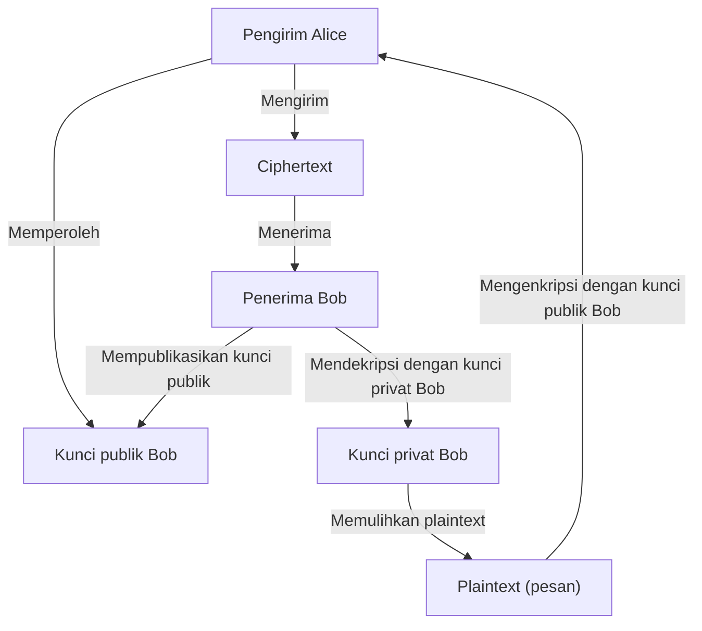
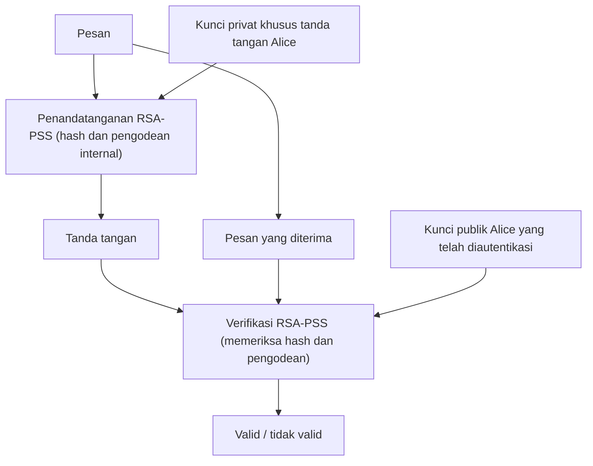
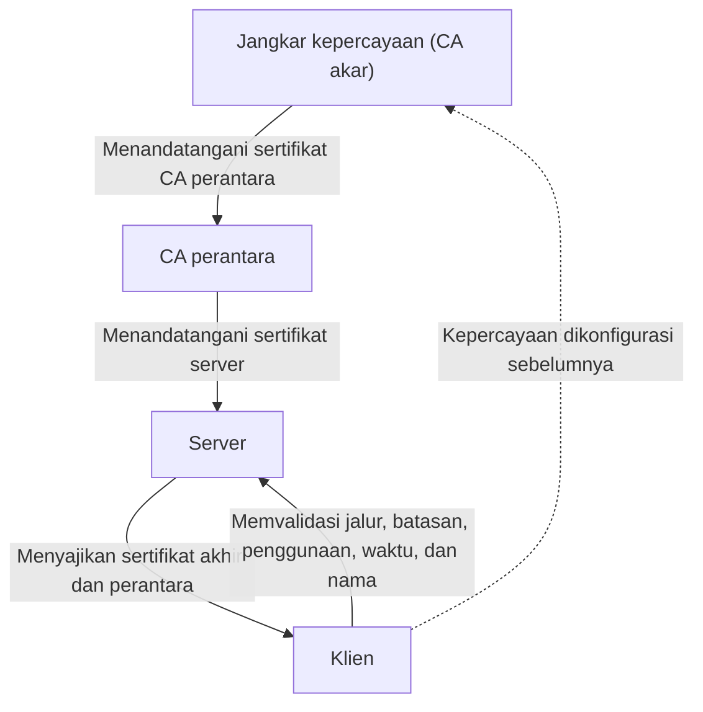

Kriptografi mendukung kerahasiaan, integritas, dan autentikasi. Namun, kriptografi saja tidak menjamin seluruh aspek keamanan informasi, termasuk ketersediaan. Artikel ini menjelaskan peran kunci simetris dan publik, dasar matematika RSA dan kurva eliptik, fungsi hash, tanda tangan digital, serta PKI. Kita membedakan penjelasan matematika dari syarat yang dibutuhkan skema dan protokol dalam penggunaan nyata.

## 1. Peran kunci simetris dan publik

### 1.1. Enkripsi simetris dan distribusi kunci

**Enkripsi simetris** menggunakan kunci rahasia bersama untuk enkripsi dan dekripsi. AES adalah salah satu contoh sandi blok. Teknik ini cocok untuk melindungi data dalam jumlah besar, tetapi kedua pihak harus memiliki cara yang aman untuk berbagi kunci. Enkripsi saja tidak selalu mendeteksi perubahan; komunikasi nyata menggunakan perlindungan yang diwajibkan protokol, misalnya enkripsi terautentikasi.

### 1.2. Membedakan operasi kunci publik

**Teknik kunci publik** menggunakan sepasang kunci publik dan privat, tetapi tidak semuanya berarti «mengenkripsi dengan kunci publik dan mendekripsi dengan kunci privat».

- **Enkripsi kunci publik**: mengenkripsi dengan kunci publik penerima dan mendekripsi dengan kunci privat pasangannya.
- **Tanda tangan digital**: menandatangani dengan kunci privat penanda tangan dan memverifikasi dengan kunci publik.
- **Kesepakatan kunci (key agreement)**: menurunkan rahasia bersama dari material kunci kedua pihak, lalu menghasilkan kunci komunikasi sesuai protokol.

Kunci publik tidak perlu didistribusikan secara rahasia, tetapi **keterkaitannya dengan pihak yang dituju harus diautentikasi**. Diagram berikut hanya menunjukkan enkripsi kunci publik. Keberhasilan dekripsi saja tidak mengautentikasi pengirim.



## 2. Dasar matematika teknik kunci publik

Pembahasan keamanan perlu membedakan asumsi kesulitan komputasi, syarat pembuatan kunci, dan konstruksi skema. Faktor rahasia RSA memungkinkan operasi invers, tetapi kesepakatan kunci dan tanda tangan berbasis kurva eliptik tidak semuanya dapat dijelaskan sebagai «perhitungan invers» yang sama.

### 2.1. Kunci dan operasi RSA

Rivest, Shamir, dan Adleman memperkenalkan RSA pada 1977. RSA berkaitan dengan kesulitan memfaktorkan bilangan bulat besar. Faktorisasi modulus memungkinkan pemulihan kunci privat, tetapi kesetaraan kesulitan antara inversi RSA secara umum dan faktorisasi belum terbukti. Keamanan juga bergantung pada keacakan, pembuatan kunci, padding, dan implementasi, bukan hanya panjang kunci.

#### 2.1.1. Pembuatan kunci untuk penjelasan

1. Pilih bilangan prima ganjil besar yang berbeda $p,q$, lalu hitung $N=pq$.
2. Hitung fungsi totien Euler:

$$\phi(N)=(p-1)(q-1)$$

3. Pilih $e$ dengan $1<e<\phi(N)$ dan $\gcd(e,\phi(N))=1$. Contoh menggunakan $e=65537$.
4. Gunakan, misalnya, [algoritma Euclid](/id/p/euclidean-algorithm/) yang diperluas untuk memperoleh $1\le d<\phi(N)$ yang memenuhi:

$$ed\equiv1\pmod{\phi(N)}$$

Kunci publik adalah $(N,e)$; salah satu representasi dasar kunci privat adalah $(N,d)$. Implementasi juga menyimpan $p,q$ dan nilai untuk Teorema Sisa Cina (CRT) agar perhitungan lebih cepat. Nilai-nilai itu juga rahasia. Di sini kita memakai $\phi(N)$ untuk penjelasan. RFC 8017 menyatakan syarat invers dengan $\lambda(N)=\operatorname{lcm}(p-1,q-1)$; konstruksi di atas juga memenuhi syarat tersebut.

#### 2.1.2. Operasi RSA dan syarat pembuktian

Untuk representasi pesan berupa bilangan bulat $0\le M<N$, operasi dasarnya adalah:

$$C\equiv M^e\pmod N$$

$$M\equiv C^d\pmod N$$

Teorema Euler dapat langsung digunakan **hanya jika $\gcd(M,N)=1$**. Dengan menulis $ed=1+t\phi(N)$, diperoleh:

$$M^{ed}=M\left(M^{\phi(N)}\right)^t\equiv M\pmod N$$

Untuk pesan yang tidak koprima dengan $N$, pertimbangkan $r=p$ dan $r=q$ secara terpisah. Jika $M\equiv0\pmod r$, maka $M^{ed}\equiv0\pmod r$. Jika tidak, Teorema Kecil Fermat dan $(r-1)\mid(ed-1)$ memberikan $M^{ed}\equiv M\pmod r$. Dengan menggabungkan kedua kongruensi menggunakan Teorema Sisa Cina, pemulihan yang benar terbukti untuk semua $0\le M<N$.

Misalnya, untuk $p=61,q=53,e=17,d=2753$ dan $M=61$, nilai $M^{3120}\bmod3233=1220$, sehingga langkah Teorema Euler tidak dapat langsung dipakai. Meskipun demikian, RSA tetap menghasilkan 61 setelah enkripsi dan dekripsi. Kunci kecil ini hanya untuk ilustrasi dan tidak aman.

**Jangan memakai perpangkatan modular mentah sebagai skema enkripsi.** Enkripsi RSA nyata membutuhkan skema seperti RSAES-OAEP. Dengan RSA-2048 dan SHA-256, contoh berikut menerima paling banyak 190 byte plaintext (RFC 8017 §7.1.1):

$$m_{\mathrm{len}}\le k_{\mathrm{bytes}}-2h_{\mathrm{len}}-2=256-2\cdot32-2=190$$

Data yang lebih besar dilindungi dengan enkripsi simetris terautentikasi dalam skema hibrida standar. Contoh ini tidak mengenkripsi berkas dengan panjang sembarang secara langsung menggunakan RSA.

### 2.2. Kurva eliptik dan logaritma diskrit

Dengan parameter yang tepat, **[kriptografi kurva eliptik (ECC)](/id/p/elliptic-curve-cryptography-math-cpp/)** dapat menargetkan keamanan klasik yang sebanding dengan kunci lebih pendek daripada RSA. Panjang kunci dalam bit tidak sama dengan kekuatan keamanan dalam bit.

Di sini kita membahas bentuk pendek Weierstrass pada lapangan prima $\mathbb F_p$ dengan $p>3$. Ini tidak mencakup semua representasi kurva eliptik:

$$y^2\equiv x^3+ax+b\pmod p$$

$$4a^3+27b^2\not\equiv0\pmod p$$

Penjumlahan didefinisikan pada titik-titik kurva beserta titik di tak hingga. Misalkan $G$ membangkitkan subgrup dengan orde prima besar $n$. Skalar rahasia dipilih secara seragam dari $1\le k\le n-1$, menggunakan keacakan yang aman secara kriptografis. Titik publiknya adalah:

$$P=kG$$

Mencari $k$ dari $G,P$ merupakan masalah logaritma diskrit pada kurva eliptik. Memilih «$k$ yang besar» saja tidak cukup: kurva, subgrup, validasi kunci, dan keacakan juga penting. ECC adalah keluarga teknik; ECDH digunakan untuk kesepakatan kunci, sedangkan ECDSA untuk tanda tangan.

### 2.3. RSA-OAEP dengan Python

Ketiga contoh Python dapat dijalankan secara terpisah. Semuanya diperiksa dengan Python 3.12.14 dan `cryptography` 50.0.2. Kunci dibuat di memori pada setiap eksekusi untuk pembelajaran. Contoh ini bukan sistem produksi yang mencakup penyimpanan dan distribusi kunci, autentikasi pihak lain, serta penanganan kesalahan.

```python
from cryptography.hazmat.primitives.asymmetric import rsa
from cryptography.hazmat.primitives.asymmetric import padding
from cryptography.hazmat.primitives import hashes
import base64

# 1. Pembuatan pasangan kunci RSA
private_key = rsa.generate_private_key(
    public_exponent=65537,
    key_size=2048,
)
public_key = private_key.public_key()

# 2. Definisi pesan
message = b"This is a highly confidential message about modern cryptography."

# 3. Enkripsi menggunakan kunci publik (menggunakan padding OAEP)
ciphertext = public_key.encrypt(
    message,
    padding.OAEP(
        mgf=padding.MGF1(algorithm=hashes.SHA256()),
        algorithm=hashes.SHA256(),
        label=None
    )
)
print("Ciphertext (Base64):", base64.b64encode(ciphertext).decode('utf-8'))

# 4. Dekripsi menggunakan kunci privat
decrypted_message = private_key.decrypt(
    ciphertext,
    padding.OAEP(
        mgf=padding.MGF1(algorithm=hashes.SHA256()),
        algorithm=hashes.SHA256(),
        label=None
    )
)
print("Pesan hasil dekripsi:", decrypted_message.decode('utf-8'))
```

## 3. Fungsi hash kriptografis

Fungsi hash menghitung digest dengan panjang tetap dari masukan. Fungsi ini deterministik: masukan yang sama selalu menghasilkan keluaran yang sama. Hash bukan enkripsi dan bukan pembangkitan bilangan acak itu sendiri. Batas panjang masukan bergantung pada algoritma.

### 3.1. Tiga sifat ketahanan

1. **Ketahanan preimage**: untuk nilai hash $h$ yang diberikan, sulit menemukan masukan dengan $H(m)=h$. Ini bukan pemulihan satu-satunya masukan asli.
2. **Ketahanan second preimage**: untuk $m_1$ yang diberikan, sulit menemukan $m_2\ne m_1$ dengan $H(m_2)=H(m_1)$.
3. **Ketahanan kolisi (collision resistance)**: sulit menemukan dua masukan berbeda dengan hash yang sama, sekalipun penyerang dapat memilih keduanya.

Digest saja tidak mengautentikasi sumbernya. Jika penyerang dapat mengganti pesan dan digest sekaligus, perbandingan sederhana tidak akan mendeteksi perubahan. Diperlukan nilai acuan tepercaya atau mekanisme autentikasi yang sesuai.

### 3.2. SHA-2 dan SHA-256

SHA-256 adalah anggota keluarga SHA-2, dengan keluaran 256 bit dan masukan kurang dari $2^{64}$ bit. Pesan yang telah diberi padding, termasuk informasi panjangnya, dipecah menjadi blok 512 bit dan diproses mulai dari nilai awal yang ditetapkan. Implementasi streaming dapat menambahkan padding ketika mencapai blok-blok terakhir.

Gambaran pemrosesan tipe Merkle–Damgård, dengan blok $M_i$ dan nilai rantai $H_i$, adalah:

$$H_i=f(H_{i-1},M_i)$$

Gambaran ini tidak berarti bahwa menghilangkan fungsi kompresi atau padding yang ditetapkan akan menghasilkan skema yang aman.

### 3.3. SHA-3 dan konstruksi sponge

SHA-3 adalah standar berbasis Keccak yang melengkapi SHA-2. Ini tidak berarti bahwa seluruh serangan terhadap SHA-2 menjadi tidak efektif, atau bahwa SHA-2 selalu harus diganti.

- **Penyerapan (absorb)**: blok masukan dengan sufiks dan padding yang ditetapkan digabungkan melalui XOR dengan bagian rate dari keadaan internal, lalu dikenai permutasi.
- **Ekstraksi (squeeze)**: keluaran diambil dari bagian rate. Jika dibutuhkan lebih banyak keluaran, permutasi dan ekstraksi diulang.

Empat fungsi hash SHA-3, seperti SHA3-256, memiliki panjang keluaran tetap. SHAKE128 dan SHAKE256 dalam FIPS 202 yang sama adalah XOF dengan panjang keluaran yang ditentukan. Sufiks dan padding penting: nama «Keccak-256» saja tidak membuktikan bahwa keluarannya sama dengan SHA3-256.

### 3.4. Hash dengan Python

```python
from cryptography.hazmat.primitives import hashes

message = b"Modern cryptography heavily relies on secure hash functions."

# Pembuatan SHA-256
digest_sha256 = hashes.Hash(hashes.SHA256())
digest_sha256.update(message)
hash_result_sha256 = digest_sha256.finalize()
print("SHA-256:", hash_result_sha256.hex())

# Pembuatan SHA-3 (SHA3-256)
digest_sha3 = hashes.Hash(hashes.SHA3_256())
digest_sha3.update(message)
hash_result_sha3 = digest_sha3.finalize()
print("SHA3-256:", hash_result_sha3.hex())
```

## 4. Tanda tangan digital

Skema tanda tangan digital menyediakan **pembuatan tanda tangan** dengan kunci privat dan **verifikasi tanda tangan** dengan kunci publik. Dengan konstruksi dan implementasi yang benar, keterkaitan kunci yang tepercaya, serta pengelolaan kunci privat yang tepat, tanda tangan mendukung integritas dan autentikasi penanda tangan. Tanda tangan dapat menjadi bukti untuk nirpenyangkalan, tetapi tidak membuktikan tanpa syarat niat seseorang ataupun tidak adanya kebocoran kunci.

### 4.1. Perbedaan penandatanganan dan enkripsi

Menggeneralisasi tanda tangan sebagai «enkripsi dengan kunci privat dan dekripsi dengan kunci publik» adalah keliru. RSA memiliki skema enkripsi dan tanda tangan yang berbeda; contoh berikut memakai **RSASSA-PSS**. Tanda tangan tidak merahasiakan pesan. Verifikasi memeriksa apakah kunci publik, pesan, dan tanda tangan memenuhi syarat skema; bukan dekripsi umum yang memulihkan digest.

### 4.2. Alur pembuatan dan verifikasi (ringkasan RSA-PSS)



1. Penanda tangan menghitung hash pesan, lalu menghasilkan tanda tangan menggunakan pengodean PSS, salt, dan operasi kunci privat. Pesan dan tanda tangan disampaikan kepada pemeriksa.
2. Pemeriksa menggunakan kunci publik tepercaya dan parameter yang sesuai untuk memverifikasi pesan dan tanda tangan yang diterima. Hash dan pengodean merupakan bagian skema; API pada contoh tidak menerima digest yang sudah dihitung sebelumnya.

### 4.3. RSA-PSS dengan Python

Kita membuat kunci khusus tanda tangan, terpisah dari kunci pada contoh enkripsi. Panjang salt ditetapkan sama dengan panjang digest SHA-256 (32 byte), dan verifikasi memakai pengaturan yang sama. Keaslian kunci publik harus dipastikan di luar contoh ini.

```python
import base64
from cryptography.exceptions import InvalidSignature
from cryptography.hazmat.primitives import hashes
from cryptography.hazmat.primitives.asymmetric import padding, rsa

# Buat kunci khusus tanda tangan, terpisah dari contoh enkripsi
signing_key = rsa.generate_private_key(public_exponent=65537, key_size=2048)
verification_key = signing_key.public_key()
doc_message = b"Contract document: Party A agrees to pay Party B $1000."
pss = padding.PSS(
    mgf=padding.MGF1(hashes.SHA256()),
    salt_length=padding.PSS.DIGEST_LENGTH,
)
signature = signing_key.sign(doc_message, pss, hashes.SHA256())
print("Tanda tangan (Base64):", base64.b64encode(signature).decode("ascii"))

try:
    verification_key.verify(signature, doc_message, pss, hashes.SHA256())
    print("Tanda tangan VALID untuk pesan dan kunci publik ini.")
except InvalidSignature:
    print("Tanda tangan TIDAK VALID untuk pesan dan kunci publik ini.")
```

## 5. Infrastruktur kunci publik (PKI)

Jika kunci penyerang diterima sebagai kunci pihak yang dituju, operasi kriptografi yang benar pun dapat diarahkan ke pihak yang salah. **PKI** menyediakan sertifikat, konfigurasi kepercayaan, dan prosedur verifikasi untuk menetapkan keterkaitan antara kunci publik dan nama atau informasi lain.

### 5.1. Otoritas sertifikasi dan sertifikat X.509

Otoritas sertifikasi (CA) memeriksa kendali domain atau informasi subjek berdasarkan kebijakannya, lalu menerbitkan sertifikat. Tidak semua sertifikat membuktikan identitas pribadi pengelola situs dalam cakupan yang sama.

Sertifikat X.509 memuat versi, nomor seri, algoritma tanda tangan, penerbit, subjek, masa berlaku, kunci publik subjek, ekstensi, dan tanda tangan. CA menandatangani **pengodean DER dari TBSCertificate**, yang memuat informasi untuk ditandatangani, bukan kunci publik saja.

### 5.2. Rantai sertifikat dan TLS



Diagram menunjukkan satu contoh: CA akar → CA perantara → server. Klien membangun jalur menuju jangkar kepercayaan (trust anchor) yang telah dikonfigurasi dan memvalidasi tanda tangan, masa berlaku, batasan CA, penggunaan kunci, serta ekstensi kritis yang tidak didukung, di antara persyaratan lain. Proses ini bukan sekadar memverifikasi sertifikat akhir langsung dengan kunci akar. Penanganan pencabutan mengikuti mekanisme dan kebijakan aplikasi yang berlaku.

TLS juga memerlukan pemeriksaan identitas layanan. Untuk nama DNS, nama yang diharapkan dibandingkan dengan entri `dNSName` pada `subjectAltName`, tanpa beralih ke Common Name sebagai alternatif (RFC 9525). Sertifikat situs lain tidak boleh diterima meskipun tanda tangannya benar.

Validasi sertifikat saja tidak membentuk komunikasi terenkripsi. TLS 1.3 menggabungkan pertukaran kunci, autentikasi, dan konfirmasi kunci untuk menurunkan kunci lalu lintas, serta melindungi record dengan enkripsi terautentikasi. Transportasi kunci RSA statis dihapus pada TLS 1.3. Koneksi PSK atau pelanjutan sesi dapat tidak mengirim sertifikat, sehingga diagram ini tidak menggambarkan setiap koneksi TLS.

## 6. Ringkasan

- Enkripsi simetris melindungi data dalam jumlah besar. Bedakan kerahasiaan dari deteksi perubahan.
- Enkripsi kunci publik, kesepakatan kunci, dan tanda tangan memiliki peran berbeda. Kunci juga perlu diautentikasi.
- Hash menghasilkan digest. Hash saja tidak mengautentikasi sumber.
- Tanda tangan mendukung integritas dan autentikasi, dengan syarat pengelolaan kunci dan skema tetap dipenuhi.
- Validasi jalur PKI, pemeriksaan nama layanan, dan handshake TLS saling berkaitan, tetapi merupakan proses yang berbeda.

Ini adalah dasar-dasarnya. Sistem produksi menggunakan pustaka yang dipelihara dan protokol standar, serta mengevaluasi pengelolaan kunci, algoritma, parameter, dan migrasi menuju kriptografi pascakuantum. Contoh artikel ini saja tidak cukup untuk menentukan keamanan seluruh sistem.

### Referensi

- [RFC 8017: PKCS #1 — RSA Cryptography Specifications](https://www.rfc-editor.org/rfc/rfc8017.html) (§§3, 5–9)
- [cryptography 50.0.2: RSA](https://cryptography.io/en/50.0.2/hazmat/primitives/asymmetric/rsa/)
- [RFC 6090: Fundamental Elliptic Curve Cryptography Algorithms](https://www.rfc-editor.org/rfc/rfc6090.html) (§§3.3, 5.3.1)
- [NIST FIPS 180-4: Secure Hash Standard](https://nvlpubs.nist.gov/nistpubs/FIPS/NIST.FIPS.180-4.pdf) (§§5–6)
- [NIST FIPS 202: SHA-3 Standard](https://nvlpubs.nist.gov/nistpubs/FIPS/NIST.FIPS.202.pdf) (§§4–6)
- [NIST FIPS 186-5: Digital Signature Standard](https://csrc.nist.gov/pubs/fips/186-5/final)
- [RFC 5280: Internet X.509 PKI Certificate and CRL Profile](https://www.rfc-editor.org/rfc/rfc5280.html) (§§4.1, 6)
- [RFC 9525: Service Identity in TLS](https://www.rfc-editor.org/rfc/rfc9525.html)
- [RFC 8446: TLS 1.3](https://www.rfc-editor.org/rfc/rfc8446.html) (§§1.2, 2)
