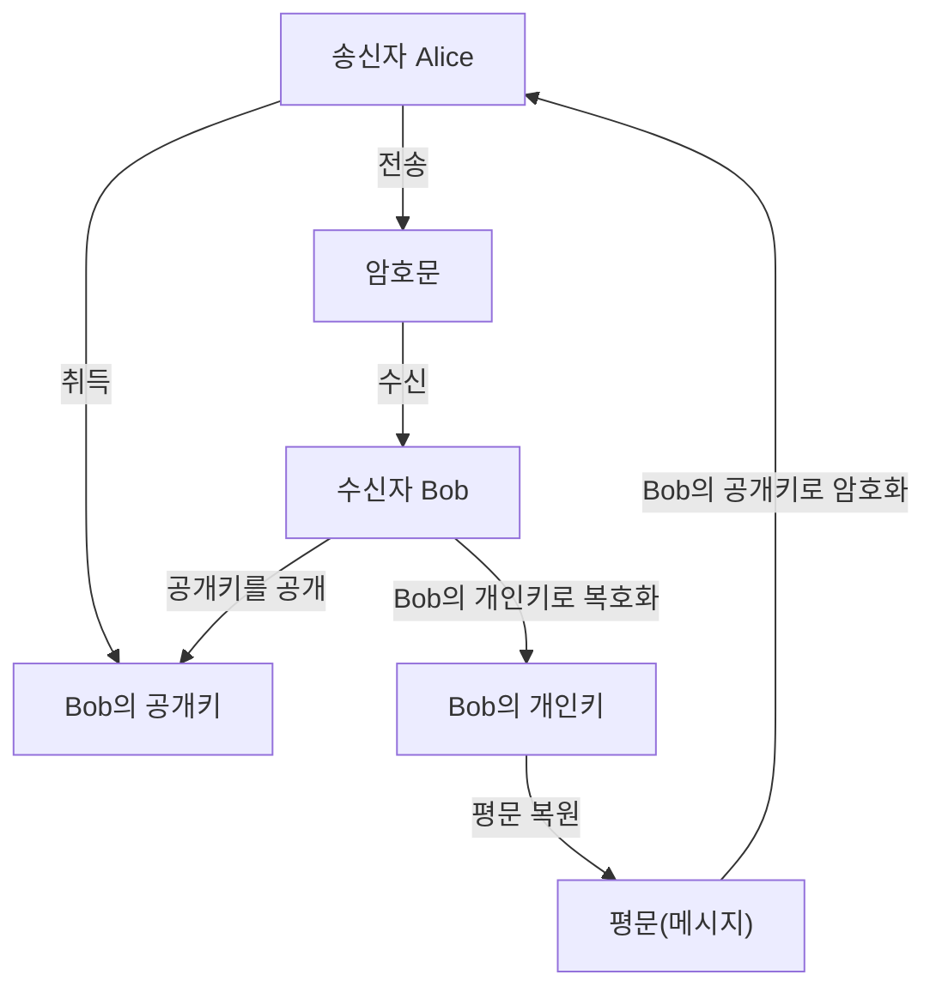
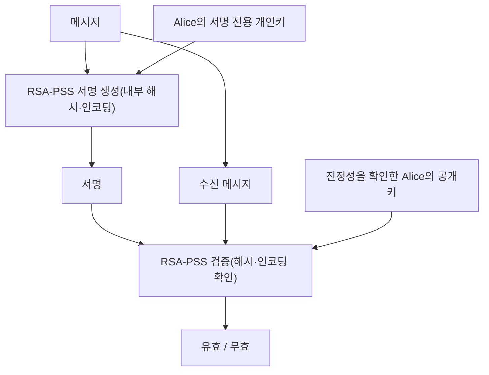
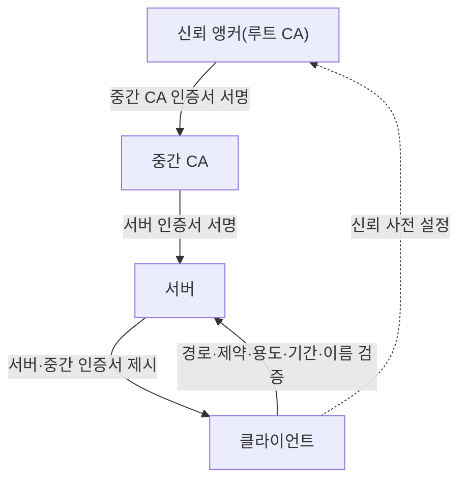

암호 기술은 기밀성, 무결성, 인증을 뒷받침합니다. 그러나 가용성을 포함한 정보 보안 전체를 암호만으로 보장할 수는 없습니다. 이 글에서는 대칭키와 공개키의 역할, RSA와 타원곡선의 수학적 기초, 해시 함수, 전자 서명, PKI를 설명합니다. 수학적 원리의 설명과 실제 암호 방식·프로토콜에 필요한 조건을 구분합니다.

## 1. 대칭키와 공개키의 역할

### 1.1. 대칭키 암호와 키 분배

**대칭키 암호**는 공유한 비밀 키로 암호화하고 복호화합니다. AES는 대표적인 블록 암호입니다. 대량의 데이터를 보호하는 데 적합하지만, 양측이 안전하게 키를 공유할 방법이 필요합니다. 암호화만으로 변조를 탐지할 수 있는 것은 아니므로 실제 통신에서는 인증 암호화 등 프로토콜이 정한 보호 방식을 사용합니다.

### 1.2. 공개키 기술의 구분

**공개키 기술**은 공개키와 개인키 쌍을 사용하지만, 모두가 ‘공개키로 암호화하고 개인키로 복호화’하는 것은 아닙니다.

- **공개키 암호화**: 수신자의 공개키로 암호화하고 대응하는 개인키로 복호화합니다.
- **전자 서명**: 서명자의 개인키로 서명하고 공개키로 검증합니다.
- **키 합의**: 양측의 키 자료에서 공유 비밀을 도출하고 프로토콜에 따라 통신 키를 생성합니다.

공개키를 비밀 경로로 배포할 필요는 없지만, **그 키가 의도한 상대의 키인지 확인**해야 합니다. 다음 그림은 공개키 암호화만 나타냅니다. 복호화에 성공했다는 사실만으로 송신자를 인증할 수는 없습니다.



## 2. 공개키 기술의 수학적 기초

안전성을 논할 때는 계산의 어려움에 관한 가정, 키 생성 조건, 암호 방식의 구성을 구분해야 합니다. RSA의 비밀 소인수는 역연산을 수행하는 단서가 되지만, 타원곡선 키 합의와 서명까지 같은 ‘역계산’으로 설명할 수는 없습니다.

### 2.1. RSA의 키와 연산

Rivest, Shamir, Adleman은 1977년에 RSA를 발표했습니다. RSA는 큰 정수의 소인수분해가 어렵다는 점과 관련이 있습니다. 모듈러스를 소인수분해하면 개인키를 구할 수 있지만, 일반적인 RSA 역연산과 소인수분해의 난이도가 동등하다고 증명된 것은 아닙니다. 안전성은 키 길이뿐 아니라 난수, 키 생성, 패딩, 구현에도 의존합니다.

#### 2.1.1. 교과서적인 키 생성

1. 서로 다른 큰 홀수 소수 $p,q$를 골라 $N=pq$를 계산합니다.
2. 오일러 피 함수를 계산합니다.

$$\phi(N)=(p-1)(q-1)$$

3. $1<e<\phi(N)$와 $\gcd(e,\phi(N))=1$을 만족하는 $e$를 고릅니다. 아래 구현에서는 $e=65537$을 사용합니다.
4. 확장 [유클리드 호제법](/ko/p/euclidean-algorithm/) 등으로 다음 식을 만족하는 $1\le d<\phi(N)$를 구합니다.

$$ed\equiv1\pmod{\phi(N)}$$

공개키는 $(N,e)$이며, 개인키의 기본 표현 중 하나는 $(N,d)$입니다. 구현에서는 속도를 높이기 위해 $p,q$와 중국인의 나머지 정리(CRT)에 필요한 값도 보관합니다. 이 값들도 비밀 정보입니다. 여기서는 설명을 위해 $\phi(N)$를 썼습니다. RFC 8017은 $\lambda(N)=\operatorname{lcm}(p-1,q-1)$에 관한 역원 조건으로 표현하며, 위 구성도 그 조건을 만족합니다.

#### 2.1.2. RSA 연산과 증명의 조건

정수 메시지 대표값 $0\le M<N$에 대한 기본 연산은 다음과 같습니다.

$$C\equiv M^e\pmod N$$

$$M\equiv C^d\pmod N$$

오일러 정리를 직접 적용할 수 있는 것은 **$\gcd(M,N)=1$인 경우뿐**입니다. $ed=1+t\phi(N)$로 쓰면,

$$M^{ed}=M\left(M^{\phi(N)}\right)^t\equiv M\pmod N$$

가 됩니다. 서로소가 아닌 메시지는 $r=p$와 $r=q$를 각각 생각하면 됩니다. $M\equiv0\pmod r$이면 $M^{ed}\equiv0\pmod r$입니다. 그렇지 않으면 페르마의 소정리와 $(r-1)\mid(ed-1)$에서 $M^{ed}\equiv M\pmod r$를 얻습니다. 두 합동식을 중국인의 나머지 정리로 결합하면 모든 $0\le M<N$에 대해 올바르게 복원됨을 증명할 수 있습니다.

예를 들어 $p=61,q=53,e=17,d=2753$, $M=61$이면 $M^{3120}\bmod3233=1220$이므로 오일러 정리의 위 단계를 그대로 적용할 수 없습니다. 그래도 RSA 왕복 연산은 61을 돌려줍니다. 이 작은 키는 설명용이며 안전한 키가 아닙니다.

**모듈러 거듭제곱을 그대로 암호화 방식으로 사용해서는 안 됩니다.** 실제 RSA 암호화에는 RSAES-OAEP 같은 방식이 필요합니다. 아래 RSA-2048·SHA-256 예시에서 평문은 최대 190바이트입니다(RFC 8017 §7.1.1).

$$m_{\mathrm{len}}\le k_{\mathrm{bytes}}-2h_{\mathrm{len}}-2=256-2\cdot32-2=190$$

큰 데이터는 표준 하이브리드 방식 안에서 대칭키 인증 암호화로 보호합니다. 이 예시는 임의 길이 파일을 RSA로 직접 암호화하는 코드가 아닙니다.

### 2.2. 타원곡선과 이산로그 문제

매개변수를 적절하게 선택하면 **[타원곡선 암호(ECC)](/ko/p/elliptic-curve-cryptography-math-cpp/)**는 RSA보다 짧은 키로 비슷한 고전적 안전성을 목표로 할 수 있습니다. 키의 비트 수와 안전성의 비트 수는 같지 않습니다.

여기서는 소수 $p>3$인 소체 $\mathbb F_p$ 위의 짧은 바이어슈트라스 형식을 다룹니다. 모든 타원곡선 표현을 포괄하는 것은 아닙니다.

$$y^2\equiv x^3+ax+b\pmod p$$

$$4a^3+27b^2\not\equiv0\pmod p$$

곡선 위의 점과 무한원점에 덧셈을 정의합니다. 위수가 큰 소수 $n$인 부분군을 생성하는 기준점 $G$를 사용하고, 암호학적으로 안전한 난수로 $1\le k\le n-1$에서 비밀 스칼라를 균일하게 선택하면 공개점은 다음과 같습니다.

$$P=kG$$

$G,P$로부터 $k$를 구하는 것이 타원곡선 이산로그 문제입니다. 단지 ‘큰 $k$’를 고르는 것만으로는 안전하지 않습니다. 곡선, 부분군, 키 검증, 난수 생성이 중요합니다. ECC는 기술의 총칭이며, ECDH는 키 합의에, ECDSA는 서명에 사용합니다.

### 2.3. Python의 RSA-OAEP 예시

이 글의 Python 예시 3개는 각각 단독으로 실행할 수 있습니다. Python 3.12.14와 `cryptography` 50.0.2에서 확인했습니다. 한글 문자열은 `b"한글"`로 쓰지 않고 `.encode("utf-8")`로 바이트열로 바꿉니다. 키는 실행할 때마다 메모리에서 생성하는 학습용 예시입니다. 키 저장·분배, 상대 인증, 오류 처리까지 포함하는 운영 시스템은 아닙니다.

```python
from cryptography.hazmat.primitives.asymmetric import rsa
from cryptography.hazmat.primitives.asymmetric import padding
from cryptography.hazmat.primitives import hashes
import base64

# 1. RSA 키 쌍 생성
private_key = rsa.generate_private_key(
    public_exponent=65537,
    key_size=2048,
)
public_key = private_key.public_key()

# 2. 메시지 정의
message = "이것은 현대 암호학에 대한 매우 기밀성이 높은 메시지입니다.".encode("utf-8")

# 3. 공개키를 이용한 암호화 (OAEP 패딩 사용)
ciphertext = public_key.encrypt(
    message,
    padding.OAEP(
        mgf=padding.MGF1(algorithm=hashes.SHA256()),
        algorithm=hashes.SHA256(),
        label=None
    )
)
print("암호문 (Base64):", base64.b64encode(ciphertext).decode('utf-8'))

# 4. 개인키를 이용한 복호화
decrypted_message = private_key.decrypt(
    ciphertext,
    padding.OAEP(
        mgf=padding.MGF1(algorithm=hashes.SHA256()),
        algorithm=hashes.SHA256(),
        label=None
    )
)
print("복호화된 메시지:", decrypted_message.decode('utf-8'))
```

## 3. 암호학적 해시 함수

해시 함수는 입력에서 고정 길이 다이제스트를 계산합니다. 같은 입력에는 같은 결과가 나오는 결정적 함수이며, 암호화도 난수 생성 자체도 아닙니다. 입력 길이의 상한은 알고리즘마다 다릅니다.

### 3.1. 세 가지 저항성

1. **역상 저항성(preimage resistance)**: 해시값 $h$가 주어졌을 때 $H(m)=h$인 입력을 찾기 어렵다는 뜻입니다. 유일한 원래 입력을 복원한다는 뜻이 아닙니다.
2. **제2역상 저항성(second-preimage resistance, 약한 충돌 내성)**: $m_1$이 주어졌을 때 $m_2\ne m_1$이면서 $H(m_2)=H(m_1)$인 입력을 찾기 어렵다는 뜻입니다.
3. **충돌 저항성(collision resistance, 강한 충돌 내성)**: 공격자가 두 입력을 모두 고를 수 있어도 해시값이 같은 서로 다른 입력을 찾기 어렵다는 뜻입니다.

다이제스트만으로 출처를 인증할 수는 없습니다. 공격자가 본문과 다이제스트를 모두 바꿀 수 있으면 단순 비교로 변조를 알아낼 수 없습니다. 신뢰할 수 있는 기준값이나 용도에 맞는 인증 방식이 필요합니다.

### 3.2. SHA-2와 SHA-256

SHA-256은 SHA-2 계열에 속하며 출력은 256비트, 입력 길이는 $2^{64}$비트 미만입니다. 길이 정보를 포함한 패딩을 추가한 메시지를 512비트 블록으로 나누어, 정해진 초기값부터 순서대로 처리합니다. 스트리밍 구현은 마지막 블록에 도달했을 때 패딩을 추가할 수 있습니다.

블록 $M_i$와 연결값 $H_i$를 사용한 Merkle–Damgård형 처리의 개요는 다음과 같습니다.

$$H_i=f(H_{i-1},M_i)$$

이 개요는 정해진 압축 함수나 패딩을 생략하고도 안전한 방식을 직접 만들 수 있다는 뜻이 아닙니다.

### 3.3. SHA-3와 스펀지 구조

SHA-3는 Keccak에 기반을 둔 표준으로 SHA-2를 보완합니다. SHA-2에 대한 모든 공격이 무효가 되거나 SHA-2를 항상 교체해야 한다는 뜻은 아닙니다.

- **흡수(absorb)**: 정해진 접미사와 패딩을 추가한 입력 블록을 내부 상태의 레이트 부분과 XOR한 뒤 순열을 적용합니다.
- **추출(squeeze)**: 상태의 레이트 부분에서 출력을 꺼냅니다. 더 필요하면 순열과 추출을 반복합니다.

SHA3-256 등 4개의 SHA-3 해시 함수는 출력 길이가 고정되어 있습니다. 같은 FIPS 202의 SHAKE128·SHAKE256은 출력 길이를 지정하는 XOF입니다. 접미사와 패딩 규칙이 중요하므로 ‘Keccak-256’이라는 이름만 보고 SHA3-256과 같은 출력을 낸다고 판단하면 안 됩니다.

### 3.4. Python 해시 예시

```python
from cryptography.hazmat.primitives import hashes

message = "현대 암호학은 안전한 해시 함수에 크게 의존합니다.".encode("utf-8")

# SHA-256 생성
digest_sha256 = hashes.Hash(hashes.SHA256())
digest_sha256.update(message)
hash_result_sha256 = digest_sha256.finalize()
print("SHA-256:", hash_result_sha256.hex())

# SHA-3 (SHA3-256) 생성
digest_sha3 = hashes.Hash(hashes.SHA3_256())
digest_sha3.update(message)
hash_result_sha3 = digest_sha3.finalize()
print("SHA3-256:", hash_result_sha3.hex())
```

## 4. 전자 서명

전자 서명 방식은 개인키로 **서명을 생성**하고 공개키로 **서명을 검증**합니다. 올바른 구성·구현, 신뢰할 수 있는 공개키 대응 관계, 적절한 개인키 관리를 전제로 무결성과 서명자 인증을 뒷받침합니다. 부인 방지의 증거가 될 수 있지만, 서명만으로 본인의 의사나 키가 유출되지 않았음을 무조건 보장할 수는 없습니다.

### 4.1. 서명과 암호화의 차이

서명을 ‘개인키로 암호화하고 공개키로 복호화하는 것’으로 일반화하면 잘못입니다. RSA에도 암호화용과 서명용 방식이 따로 있으며, 아래 예시는 **RSASSA-PSS**를 사용합니다. 서명은 메시지를 숨기지 않습니다. 검증은 공개키·메시지·서명의 조합이 방식의 조건을 만족하는지 판단하는 과정이며, 다이제스트를 복원하는 일반적인 복호화가 아닙니다.

### 4.2. 생성과 검증 흐름(RSA-PSS 개요)



1. 서명자는 메시지를 해시하고 PSS 인코딩, 솔트, 개인키 연산으로 서명을 생성합니다. 메시지와 서명을 전달합니다.
2. 검증자는 신뢰할 수 있는 공개키와 같은 매개변수로 받은 메시지와 서명을 검증합니다. 해시와 인코딩은 서명 방식의 일부입니다. 아래 API 예시는 미리 계산한 다이제스트를 그대로 전달하지 않습니다.

### 4.3. Python RSA-PSS 예시

암호화 예시와 별도의 서명 전용 키를 생성합니다. 솔트 길이는 SHA-256 다이제스트 길이인 32바이트로 지정하고, 검증에도 같은 설정을 사용합니다. 공개키의 진정성은 이 예시 밖에서 확인해야 합니다.

```python
import base64
from cryptography.exceptions import InvalidSignature
from cryptography.hazmat.primitives import hashes
from cryptography.hazmat.primitives.asymmetric import padding, rsa

# 암호화 예시와 별개의 서명 전용 키 생성
signing_key = rsa.generate_private_key(public_exponent=65537, key_size=2048)
verification_key = signing_key.public_key()
doc_message = "계약서: A는 B에게 1000달러를 지불하는 데 동의합니다.".encode("utf-8")
pss = padding.PSS(
    mgf=padding.MGF1(hashes.SHA256()),
    salt_length=padding.PSS.DIGEST_LENGTH,
)
signature = signing_key.sign(doc_message, pss, hashes.SHA256())
print("서명 (Base64):", base64.b64encode(signature).decode("ascii"))

try:
    verification_key.verify(signature, doc_message, pss, hashes.SHA256())
    print("이 메시지와 공개키에 대해 서명이 유효합니다.")
except InvalidSignature:
    print("이 메시지와 공개키에 대해 서명이 유효하지 않습니다.")
```

## 5. 공개키 기반 구조(PKI)

공격자의 키를 상대의 키라고 믿으면 암호 연산이 올바르더라도 통신 상대를 잘못 판단할 수 있습니다. **PKI**는 인증서, 신뢰 설정, 검증 절차를 통해 공개키와 이름 등 정보 사이의 대응 관계를 확인하는 체계입니다.

### 5.1. 인증 기관과 X.509 인증서

인증 기관(CA)은 정해진 정책에 따라 도메인 관리 권한이나 주체 정보를 확인하고 인증서를 발급합니다. 모든 인증서가 사이트 운영자 개인의 신원을 같은 범위로 입증하는 것은 아닙니다.

X.509 인증서에는 버전, 일련번호, 서명 알고리즘, 발급자, 주체, 유효 기간, 주체의 공개키, 확장 정보, 서명 등이 들어갑니다. CA가 서명하는 것은 공개키 자체가 아니라 서명 대상 정보를 포함하는 **TBSCertificate의 DER 인코딩**입니다.

### 5.2. 인증서 체인과 TLS



그림은 루트 CA→중간 CA→서버라는 한 가지 예입니다. 클라이언트는 설정된 신뢰 앵커까지의 경로를 구성하고, 각 인증서의 서명, 유효 기간, CA 제약, 키 용도, 지원하지 않는 중요 확장 등을 검증합니다. 루트 키로 서버 인증서를 직접 검증하기만 하는 것이 아닙니다. 폐기 처리는 적용되는 방식과 애플리케이션 정책을 따릅니다.

TLS에서는 서비스 신원도 확인해야 합니다. DNS 이름의 경우 예상한 접속 대상 이름을 인증서 `subjectAltName`의 `dNSName`과 비교하며, Common Name으로 대체하지 않습니다(RFC 9525). 서명이 올바르더라도 다른 사이트의 인증서를 받아들이면 안 됩니다.

인증서 검증만으로 암호화 통신이 완성되지는 않습니다. TLS 1.3은 키 교환, 인증, 키 확인을 결합해 통신 키를 도출하고 인증 암호화로 레코드를 보호합니다. 정적 RSA 키 전송은 TLS 1.3에서 제거되었습니다. PSK·재개 연결 등에서는 인증서를 보내지 않을 수도 있으므로, 위 그림이 모든 TLS 연결을 나타내는 것은 아닙니다.

## 6. 요약

- 대칭키 암호는 대량의 데이터를 보호합니다. 기밀성과 변조 탐지의 조건을 구분해야 합니다.
- 공개키 암호화, 키 합의, 서명은 역할이 다릅니다. 키의 진정성도 확인해야 합니다.
- 해시는 다이제스트를 계산합니다. 단독으로는 출처를 인증하지 못합니다.
- 서명은 무결성과 인증을 뒷받침하며, 키 관리와 방식의 조건에도 의존합니다.
- PKI 경로 검증, 서비스 이름 확인, TLS 핸드셰이크는 서로 관련되지만 별개의 처리입니다.

이 내용은 기초입니다. 운영 환경에서는 유지 관리되는 라이브러리와 표준 프로토콜을 사용하고, 키 관리, 알고리즘, 매개변수와 양자 내성 암호로의 전환까지 평가해야 합니다. 이 글의 예시만으로 시스템 전체의 안전성을 판단할 수는 없습니다.

### 참고 문헌

- [RFC 8017: PKCS #1 — RSA Cryptography Specifications](https://www.rfc-editor.org/rfc/rfc8017.html) (§§3, 5–9)
- [cryptography 50.0.2: RSA](https://cryptography.io/en/50.0.2/hazmat/primitives/asymmetric/rsa/)
- [RFC 6090: Fundamental Elliptic Curve Cryptography Algorithms](https://www.rfc-editor.org/rfc/rfc6090.html) (§§3.3, 5.3.1)
- [NIST FIPS 180-4: Secure Hash Standard](https://nvlpubs.nist.gov/nistpubs/FIPS/NIST.FIPS.180-4.pdf) (§§5–6)
- [NIST FIPS 202: SHA-3 Standard](https://nvlpubs.nist.gov/nistpubs/FIPS/NIST.FIPS.202.pdf) (§§4–6)
- [NIST FIPS 186-5: Digital Signature Standard](https://csrc.nist.gov/pubs/fips/186-5/final)
- [RFC 5280: Internet X.509 PKI Certificate and CRL Profile](https://www.rfc-editor.org/rfc/rfc5280.html) (§§4.1, 6)
- [RFC 9525: Service Identity in TLS](https://www.rfc-editor.org/rfc/rfc9525.html)
- [RFC 8446: TLS 1.3](https://www.rfc-editor.org/rfc/rfc8446.html) (§§1.2, 2)
