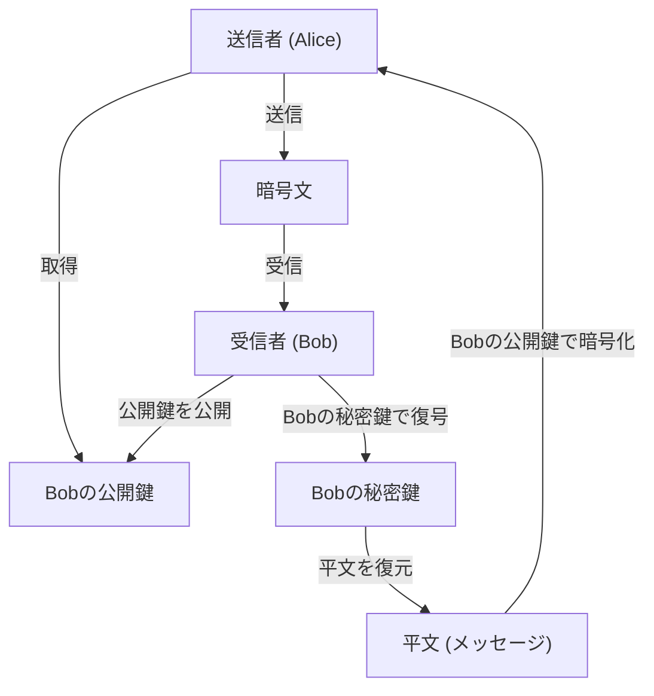
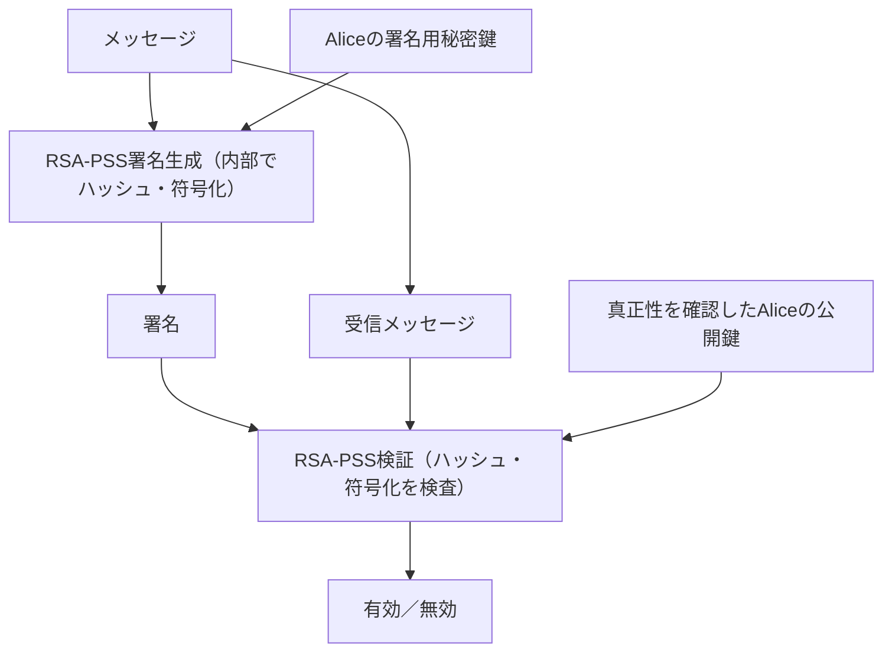
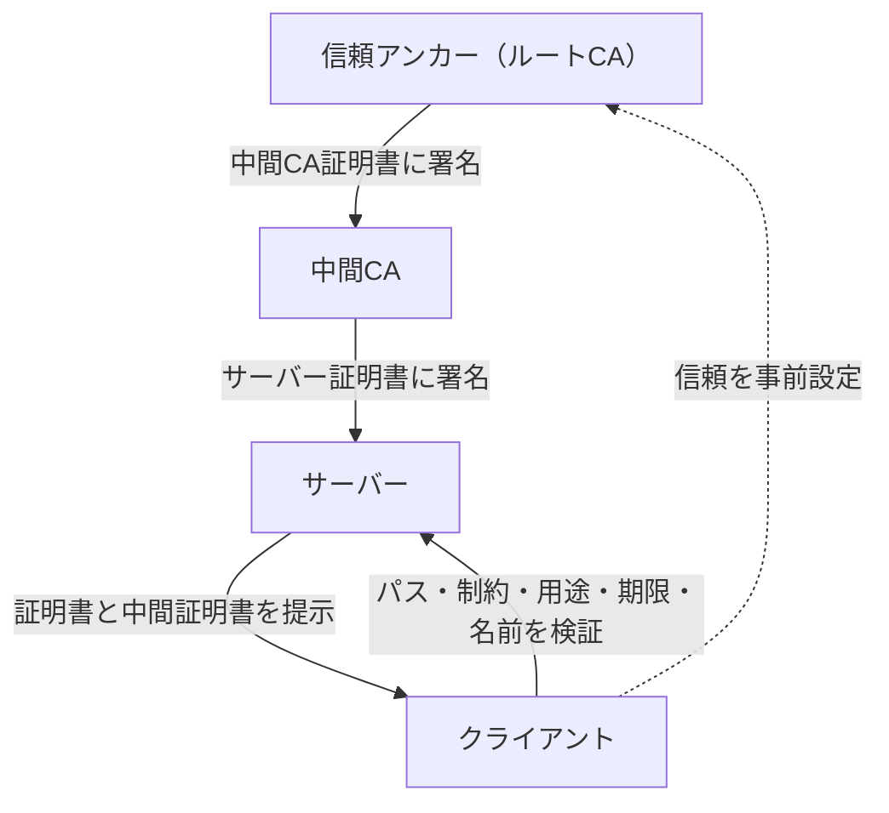

暗号技術は情報の機密性・完全性・認証を支える重要な道具です。ただし、可用性を含む情報セキュリティ全体を暗号だけで保証することはできません。本記事では、共通鍵と公開鍵の役割、RSAと楕円曲線の基礎、ハッシュ関数、電子署名、PKIを説明します。数式による仕組みの説明と、実用の暗号方式・プロトコルが必要とする条件を区別します。

## 1. 共通鍵と公開鍵の役割

### 1.1. 共通鍵暗号と鍵配送

**共通鍵暗号**は、暗号化と復号に共有した秘密鍵を使います。AESは代表的なブロック暗号です。大量のデータの保護に適していますが、相手と秘密鍵を安全に共有する方法が必要です。暗号化だけで改ざん検知が得られるとは限らず、実際の通信では認証付き暗号など、プロトコルが指定する方式を使います。

### 1.2. 公開鍵方式の使い分け

**公開鍵方式**は公開鍵と秘密鍵のペアを使いますが、すべてが「公開鍵で暗号化、秘密鍵で復号」を行うわけではありません。

- **公開鍵暗号化**：受信者の公開鍵で暗号化し、対応する秘密鍵で復号する。
- **電子署名**：署名者の秘密鍵で署名し、公開鍵で検証する。
- **鍵共有**：双方の鍵材料から共有秘密を導き、プロトコルに従って通信鍵を生成する。

公開鍵を秘密の経路で配送する必要はありませんが、**それが意図した相手の鍵であることの確認**は必要です。次の図は公開鍵暗号化だけを表します。暗号文の復号ができても、それだけでは送信者の本人確認にはなりません。



## 2. 公開鍵方式の数学的背景

安全性の議論では、ある計算の困難性、鍵の生成条件、方式の構成を区別します。RSAでは秘密の素因数が復号の手がかりになりますが、楕円曲線による鍵共有や署名まで同じ「逆計算」で説明することはできません。

### 2.1. RSAの鍵と演算

RSAはRivest、Shamir、Adlemanが1977年に発表した方式です。大きな整数の素因数分解の困難性と関係があります。素因数分解ができれば秘密鍵を求められますが、一般のRSA逆演算と素因数分解が同じ難しさだと証明されているわけではありません。安全性は鍵長だけでなく、乱数・鍵生成・パディング・実装にも依存します。

#### 2.1.1. 教科書的な鍵生成

1. 異なる大きな奇素数 $p,q$ を選び、$N=pq$ を計算する。
2. 次を計算する。

$$\phi(N)=(p-1)(q-1)$$

3. $1<e<\phi(N)$、$\gcd(e,\phi(N))=1$ を満たす $e$ を選ぶ。実装例では $e=65537$ を使う。
4. 拡張[ユークリッドの互除法](/p/euclidean-algorithm/)などで、次を満たす $1\le d<\phi(N)$ を求める。

$$ed\equiv1\pmod{\phi(N)}$$

公開鍵は $(N,e)$、秘密鍵の基本的な表現は $(N,d)$ です。実装では高速化のために $p,q$ やCRT用の値も保持します。これらも秘密情報です。ここでは説明のため $\phi(N)$ を使いました。RFC 8017の条件は $\lambda(N)=\operatorname{lcm}(p-1,q-1)$ に関する逆元で表され、上の構成はその条件も満たします。

#### 2.1.2. RSA演算と証明の条件

整数のメッセージ代表 $0\le M<N$ に対する基本演算は次のとおりです。

$$C\equiv M^e\pmod N$$

$$M\equiv C^d\pmod N$$

オイラーの定理を直接使えるのは **$\gcd(M,N)=1$ の場合**です。$ed=1+t\phi(N)$ とおくと、

$$M^{ed}=M\left(M^{\phi(N)}\right)^t\equiv M\pmod N$$

となります。互いに素でない場合も、$r=p$ と $r=q$ のそれぞれについて考えれば証明できます。$M\equiv0\pmod r$ なら $M^{ed}\equiv0\pmod r$。それ以外ではフェルマーの小定理と $(r-1)\mid(ed-1)$ から $M^{ed}\equiv M\pmod r$ です。両方の合同式を中国剰余定理で合わせると、すべての $0\le M<N$ について復号の正しさが得られます。

例えば $p=61,q=53,e=17,d=2753$ では、$M=61$ に対して $M^{3120}\bmod3233=1220$ であり、オイラーの定理の式をそのまま使えません。それでもRSAの往復結果は61です。この小さな鍵は説明用で、安全な鍵ではありません。

**この剰余べき乗をそのまま暗号化に使ってはいけません。** 実用のRSA暗号化にはRSAES-OAEPなどの方式が必要です。以下のRSA-2048・SHA-256の例で暗号化できる平文は最大190バイトです（RFC 8017 §7.1.1）。

$$m_{\mathrm{len}}\le k_{\mathrm{bytes}}-2h_{\mathrm{len}}-2=256-2\cdot32-2=190$$

大きなデータは、標準的なハイブリッド方式で共通鍵の認証付き暗号を使って保護します。RSAだけで任意長のファイルを直接暗号化する例ではありません。

### 2.2. 楕円曲線と離散対数問題

**[楕円曲線暗号（ECC）](/p/elliptic-curve-cryptography-math-cpp/)**は、適切なパラメーターを選ぶことで、RSAより短い鍵で同程度の古典的な安全性を目指せます。鍵のビット数をそのまま安全性のビット数として比較することはできません。

ここでは素数 $p>3$ の有限体 $\mathbb F_p$ 上の短いワイエルシュトラス形を扱います。これはすべての楕円曲線の表現を網羅するものではありません。

$$y^2\equiv x^3+ax+b\pmod p$$

$$4a^3+27b^2\not\equiv0\pmod p$$

曲線上の点と無限遠点に加法を定義します。大きな素数位数 $n$ の部分群の基点 $G$ を使い、暗号学的に安全な乱数で $1\le k\le n-1$ から偏りなく秘密スカラーを選ぶと、公開点は次のようになります。

$$P=kG$$

$G,P$ から $k$ を求めるのが楕円曲線離散対数問題です。単に「大きい $k$」を選ぶだけでは安全になりません。曲線・部分群・鍵の検証・乱数生成が重要です。ECCは方式の総称で、ECDHは鍵共有、ECDSAは署名に使われます。

### 2.3. PythonによるRSA-OAEPの例

以下の3つのPython例はそれぞれ単独で実行できます。Python 3.12.14・`cryptography` 50.0.2で確認しました。鍵は実行ごとにメモリ内で生成する学習用の例です。鍵の保存・配送、相手の認証、エラー処理を含む実運用システムではありません。

```python
from cryptography.hazmat.primitives.asymmetric import rsa
from cryptography.hazmat.primitives.asymmetric import padding
from cryptography.hazmat.primitives import hashes
import base64

# 1. RSA鍵ペアの生成
private_key = rsa.generate_private_key(
    public_exponent=65537,
    key_size=2048,
)
public_key = private_key.public_key()

# 2. メッセージの定義
message = b"This is a highly confidential message about modern cryptography."

# 3. 公開鍵を用いた暗号化 (OAEPパディングを使用)
ciphertext = public_key.encrypt(
    message,
    padding.OAEP(
        mgf=padding.MGF1(algorithm=hashes.SHA256()),
        algorithm=hashes.SHA256(),
        label=None
    )
)
print("Ciphertext (Base64):", base64.b64encode(ciphertext).decode('utf-8'))

# 4. 秘密鍵を用いた復号
decrypted_message = private_key.decrypt(
    ciphertext,
    padding.OAEP(
        mgf=padding.MGF1(algorithm=hashes.SHA256()),
        algorithm=hashes.SHA256(),
        label=None
    )
)
print("Decrypted Message:", decrypted_message.decode('utf-8'))
```

## 3. 暗号学的ハッシュ関数

ハッシュ関数は入力から固定長のダイジェストを計算します。同じ入力なら同じ結果となる決定的な関数であり、暗号化でも乱数生成そのものでもありません。入力長には方式ごとの上限があります。

### 3.1. 3つの耐性

1. **原像計算困難性（preimage resistance）**：与えられたハッシュ値 $h$ に対して、$H(m)=h$ となる入力を見つけるのが困難であること。「唯一の元の入力」を復元する性質ではない。
2. **第二原像計算困難性（second-preimage resistance、弱衝突耐性）**：与えられた $m_1$ に対して、$m_2\ne m_1$ かつ $H(m_2)=H(m_1)$ となる入力を見つけるのが困難であること。
3. **衝突困難性（collision resistance、強衝突耐性）**：攻撃者が両方を選べる場合にも、同じハッシュ値を持つ異なる2入力を見つけるのが困難であること。

ダイジェストだけでは送信元を認証できません。攻撃者が本文とダイジェストを両方置き換えられるなら、単純な比較では改ざんを見抜けません。信頼できる参照値や、用途に合った認証方式が必要です。

### 3.2. SHA-2とSHA-256

SHA-256はSHA-2ファミリーの一つで、出力は256ビット、入力長は $2^{64}$ ビット未満です。長さ情報を含むパディングを加えたメッセージを512ビットのブロックに分け、規定の初期値から順に処理します。ストリーミング実装では最後のブロックに到達した段階でパディングを加えられます。

Merkle–Damgård型の処理の概略を、ブロック $M_i$ と連鎖値 $H_i$ を使って表すと、

$$H_i=f(H_{i-1},M_i)$$

となります。これは概要であり、規定の圧縮関数やパディングを省略して安全な方式を自作できるという意味ではありません。

### 3.3. SHA-3とスポンジ構造

SHA-3はKeccakに基づく標準で、SHA-2を補完します。SHA-2の攻撃がすべて無効になる、あるいはSHA-2の置き換えが常に必要になる、という意味ではありません。

- **吸収（absorb）**：規定の接尾辞とパディングを加えた入力のブロックを、内部状態のレート部分とXORし、置換を適用する。
- **絞り出し（squeeze）**：状態のレート部分から出力を取り出す。さらに必要なら置換と抽出を繰り返す。

SHA3-256など4つのSHA-3ハッシュ関数は出力長が固定です。同じFIPS 202にあるSHAKE128・SHAKE256は出力長を指定できるXOFです。接尾辞・パディングを含む仕様が異なるため、「Keccak-256」という名前だけでSHA3-256と同じ出力だと判断してはいけません。

### 3.4. Pythonによるハッシュの例

```python
from cryptography.hazmat.primitives import hashes

message = b"Modern cryptography heavily relies on secure hash functions."

# SHA-256の生成
digest_sha256 = hashes.Hash(hashes.SHA256())
digest_sha256.update(message)
hash_result_sha256 = digest_sha256.finalize()
print("SHA-256:", hash_result_sha256.hex())

# SHA-3 (SHA3-256)の生成
digest_sha3 = hashes.Hash(hashes.SHA3_256())
digest_sha3.update(message)
hash_result_sha3 = digest_sha3.finalize()
print("SHA3-256:", hash_result_sha3.hex())
```

## 4. 電子署名

電子署名は、秘密鍵による**署名生成**と公開鍵による**署名検証**の方式です。正しく構成・実装され、公開鍵の対応関係を信頼でき、秘密鍵が適切に管理されていることを前提に、完全性と署名者の認証を支えます。否認防止のための証拠にもなりますが、署名だけで本人の意思や秘密鍵の非漏えいを無条件に保証することはできません。

### 4.1. 暗号化との違い

署名を「秘密鍵で暗号化し、公開鍵で復号する」と一般化するのは誤りです。RSAにも暗号化用と署名用の異なる方式があり、以下の署名例は **RSASSA-PSS** を使います。署名はメッセージを秘密にせず、検証は公開鍵・メッセージ・署名の組が方式の条件を満たすか判定します。メッセージのダイジェストを汎用的に「復号して取り出す」処理ではありません。

### 4.2. 署名生成と検証の流れ（RSA-PSSの概略）



1. 署名側はメッセージをハッシュし、PSSの符号化・ソルトと秘密鍵の演算で署名を生成する。メッセージと署名を渡す。
2. 検証側は信頼できる公開鍵と同じパラメーターを使い、受信メッセージと署名を検証する。ハッシュや符号化の処理は署名方式の一部であり、以下のAPIへ事前にハッシュした値をそのまま渡す例ではない。

### 4.3. PythonによるRSA-PSSの例

暗号化例とは別の署名用鍵を生成します。ソルト長はSHA-256のダイジェスト長（32バイト）を指定し、検証側も同じ設定にします。相手の公開鍵の真正性は、このサンプル外で確立する必要があります。

```python
import base64
from cryptography.exceptions import InvalidSignature
from cryptography.hazmat.primitives import hashes
from cryptography.hazmat.primitives.asymmetric import padding, rsa

# 暗号化用とは別の署名用鍵を生成する
signing_key = rsa.generate_private_key(public_exponent=65537, key_size=2048)
verification_key = signing_key.public_key()
doc_message = b"Contract document: Party A agrees to pay Party B $1000."
pss = padding.PSS(
    mgf=padding.MGF1(hashes.SHA256()),
    salt_length=padding.PSS.DIGEST_LENGTH,
)
signature = signing_key.sign(doc_message, pss, hashes.SHA256())
print("Signature (Base64):", base64.b64encode(signature).decode("ascii"))

try:
    verification_key.verify(signature, doc_message, pss, hashes.SHA256())
    print("Signature is VALID for this message and public key.")
except InvalidSignature:
    print("Signature is INVALID for this message and public key.")
```

## 5. 公開鍵基盤（PKI）

攻撃者の鍵を通信相手の鍵だと信じてしまえば、正しい暗号演算でも相手を取り違えます。**PKI**は、証明書や信頼の設定・検証手順を通じて、公開鍵と名前などの対応を確認する仕組みです。

### 5.1. 認証局とX.509証明書

認証局（CA）は、定められた方針に基づいてドメインの管理権限や主体の情報を確認し、証明書を発行します。すべての証明書が運営者個人の身元を同じ範囲で証明するわけではありません。

X.509証明書には、バージョン、シリアル番号、署名アルゴリズム、発行者、主体、有効期間、主体の公開鍵、拡張情報、署名などが含まれます。CAが署名するのは公開鍵単体ではなく、これらの署名対象情報を含む **TBSCertificateのDER符号化**です。

### 5.2. 証明書チェーンとTLS



図はルートCA→中間CA→サーバーという一例です。クライアントは、設定済みの信頼アンカーに至るパスを構築し、各証明書の署名、有効期間、CAとしての制約、鍵用途、未対応の重要拡張などを検証します。ルート鍵でサーバー証明書を直接検証するだけではありません。失効の扱いも、使用する方式とアプリケーションの方針に従います。

TLSのサーバー名の確認も必要です。DNS名では接続先として期待する名前と証明書の `subjectAltName` の `dNSName` を照合し、Common Nameへフォールバックしません（RFC 9525）。証明書の署名が正しくても、別のサイト向けなら受け入れてはいけません。

証明書の確認だけで暗号化通信が完成するわけではありません。TLS 1.3は鍵共有、認証、鍵確認を組み合わせて通信鍵を導き、レコードを認証付き暗号で保護します。静的RSAの鍵配送はTLS 1.3から削除されました。また、PSK・再開など証明書を送らない接続もあるため、上の図はすべてのTLS接続を表しません。

## 6. まとめ

- 共通鍵暗号は大量のデータの保護に使う。暗号化と改ざん検知の条件を区別する。
- 公開鍵暗号化、鍵共有、電子署名は役割が異なる。鍵の真正性も確認する。
- ハッシュは入力のダイジェストを求める。単独では送信元の認証にならない。
- 署名は完全性と認証を支える。安全性は鍵管理と方式の条件にも依存する。
- PKIのパス検証、接続先の名前確認、TLSのハンドシェイクは関連するが別々の処理である。

これらは暗号の基礎です。実運用では、保守されたライブラリと標準プロトコルを使い、鍵管理、方式・パラメーター、耐量子暗号への移行も含めて評価します。本記事の例だけでシステム全体の安全性を判断することはできません。

### 参考文献

- [RFC 8017: PKCS #1 — RSA Cryptography Specifications](https://www.rfc-editor.org/rfc/rfc8017.html) (§§3, 5–9)
- [cryptography 50.0.2: RSA](https://cryptography.io/en/50.0.2/hazmat/primitives/asymmetric/rsa/)
- [RFC 6090: Fundamental Elliptic Curve Cryptography Algorithms](https://www.rfc-editor.org/rfc/rfc6090.html) (§§3.3, 5.3.1)
- [NIST FIPS 180-4: Secure Hash Standard](https://nvlpubs.nist.gov/nistpubs/FIPS/NIST.FIPS.180-4.pdf) (§§5–6)
- [NIST FIPS 202: SHA-3 Standard](https://nvlpubs.nist.gov/nistpubs/FIPS/NIST.FIPS.202.pdf) (§§4–6)
- [NIST FIPS 186-5: Digital Signature Standard](https://csrc.nist.gov/pubs/fips/186-5/final)
- [RFC 5280: Internet X.509 PKI Certificate and CRL Profile](https://www.rfc-editor.org/rfc/rfc5280.html) (§§4.1, 6)
- [RFC 9525: Service Identity in TLS](https://www.rfc-editor.org/rfc/rfc9525.html)
- [RFC 8446: TLS 1.3](https://www.rfc-editor.org/rfc/rfc8446.html) (§§1.2, 2)
