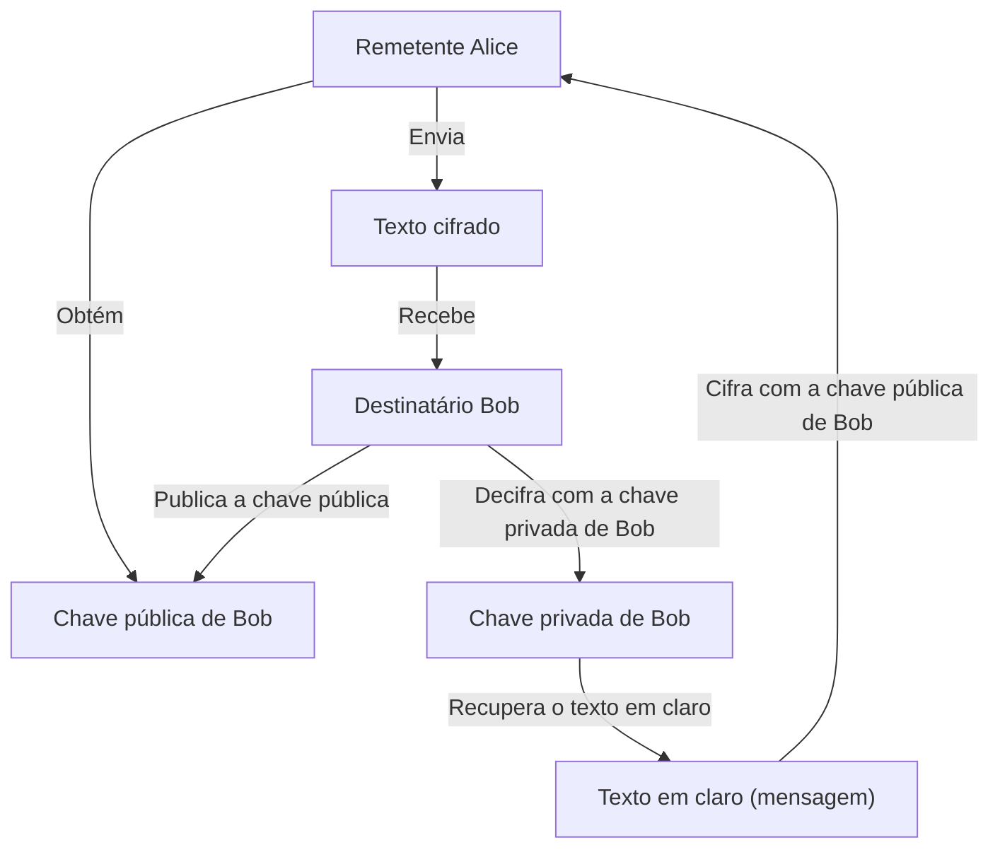
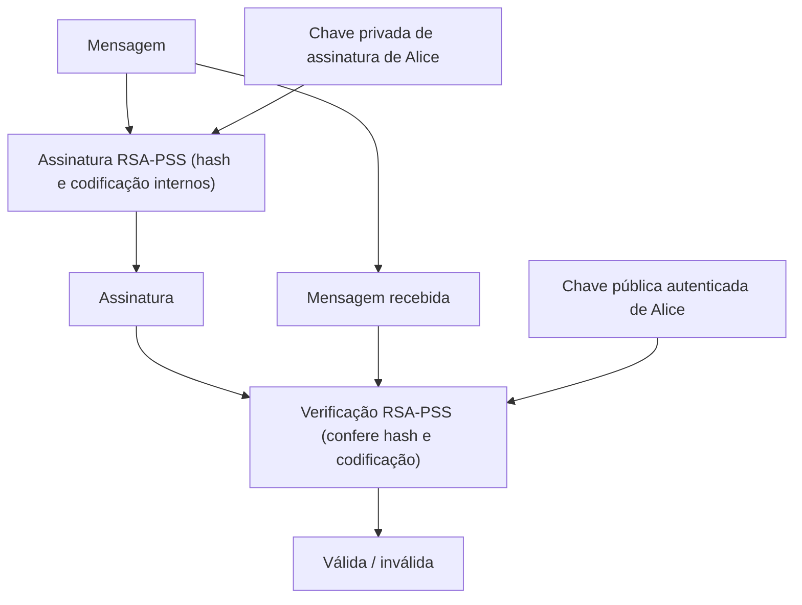
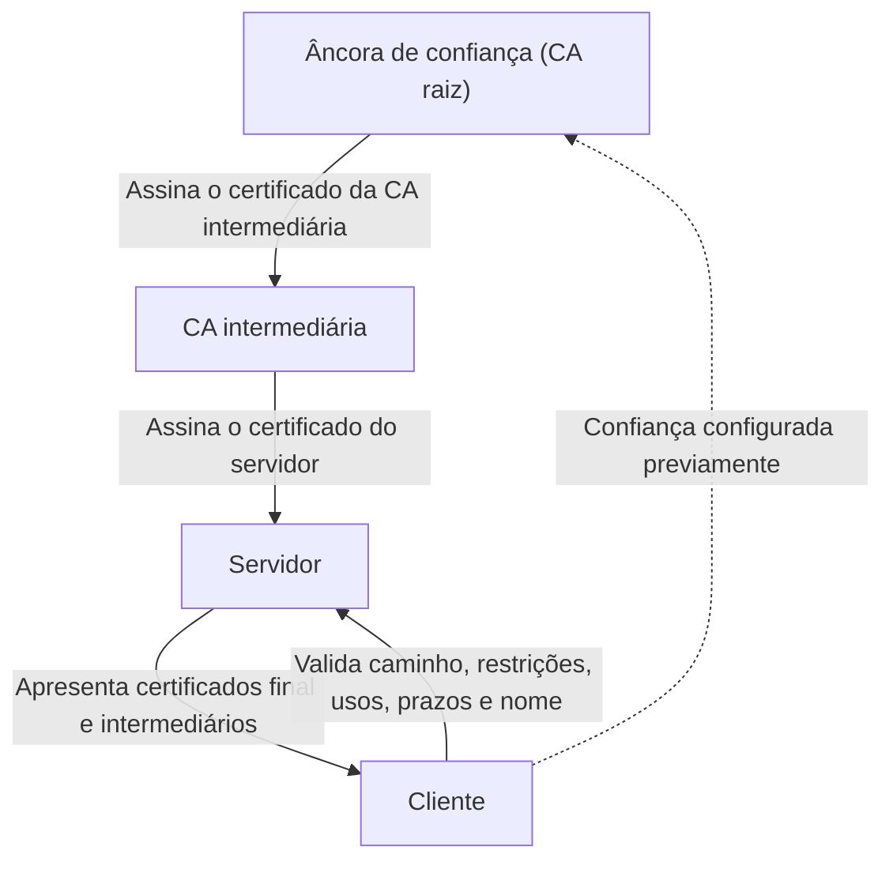

A criptografia contribui para a confidencialidade, a integridade e a autenticação. Sozinha, ela não garante todos os aspectos da segurança da informação, incluindo a disponibilidade. Este artigo explica as funções das chaves simétricas e públicas, as bases matemáticas do RSA e das curvas elípticas, as funções hash, as assinaturas digitais e a PKI. Distinguimos a explicação matemática das condições exigidas por esquemas e protocolos de uso real.

## 1. Funções das chaves simétricas e públicas

### 1.1. Cifração simétrica e distribuição de chaves

A **cifração simétrica** utiliza uma chave secreta compartilhada para cifrar e decifrar. O AES é um exemplo de cifra de bloco. Essas técnicas são adequadas para grandes volumes de dados, mas as partes precisam compartilhar a chave com segurança. Cifrar não necessariamente permite detectar alterações; as comunicações reais usam a proteção exigida pelo protocolo, como a cifração autenticada.

### 1.2. Diferentes operações de chave pública

As **técnicas de chave pública** usam pares de chaves pública e privada, mas nem todas significam «cifrar com a pública e decifrar com a privada».

- **Cifração de chave pública**: cifra-se com a chave pública do destinatário e decifra-se com a privada correspondente.
- **Assinaturas digitais**: assina-se com a chave privada do signatário e verifica-se com a pública.
- **Acordo de chaves**: as partes derivam um segredo compartilhado de seu material criptográfico e geram chaves de comunicação conforme o protocolo.

A chave pública não exige distribuição secreta, mas **sua associação com o interlocutor pretendido precisa ser autenticada**. O diagrama representa somente a cifração de chave pública. Decifrar com sucesso não autentica, por si só, o remetente.



## 2. Bases matemáticas das técnicas de chave pública

Ao analisar a segurança, é necessário distinguir hipóteses de dificuldade computacional, requisitos de geração de chaves e construção do esquema. Os fatores secretos do RSA permitem a operação inversa, mas o acordo de chaves e as assinaturas com curvas elípticas não se explicam todos pela mesma «operação inversa».

### 2.1. Chaves e operações RSA

Rivest, Shamir e Adleman anunciaram o RSA em 1977. Ele se relaciona à dificuldade de fatorar inteiros grandes. Fatorar o módulo permite recuperar uma chave privada, mas não foi demonstrado que inverter RSA em geral seja equivalente em dificuldade à fatoração. A segurança também depende da aleatoriedade, da geração de chaves, do preenchimento e da implementação, além do tamanho da chave.

#### 2.1.1. Geração didática de chaves

1. Escolher primos ímpares grandes e distintos $p,q$ e calcular $N=pq$.
2. Calcular a função totiente de Euler:

$$\phi(N)=(p-1)(q-1)$$

3. Escolher $e$ com $1<e<\phi(N)$ e $\gcd(e,\phi(N))=1$. O exemplo usa $e=65537$.
4. Usar, por exemplo, o [algoritmo de Euclides](/pt/p/euclidean-algorithm/) estendido para obter $1\le d<\phi(N)$ que satisfaça:

$$ed\equiv1\pmod{\phi(N)}$$

A chave pública é $(N,e)$; uma representação básica da privada é $(N,d)$. As implementações também mantêm $p,q$ e valores do teorema chinês dos restos (CRT) para acelerar os cálculos. Esses dados também são secretos. Aqui usamos $\phi(N)$ para explicar. O RFC 8017 expressa a condição do inverso por meio de $\lambda(N)=\operatorname{lcm}(p-1,q-1)$; a construção acima também satisfaz essa condição.

#### 2.1.2. Operações RSA e condições da demonstração

Para um representante inteiro da mensagem $0\le M<N$, as operações primitivas são:

$$C\equiv M^e\pmod N$$

$$M\equiv C^d\pmod N$$

O teorema de Euler se aplica diretamente **somente quando $\gcd(M,N)=1$**. Escrevendo $ed=1+t\phi(N)$, obtemos:

$$M^{ed}=M\left(M^{\phi(N)}\right)^t\equiv M\pmod N$$

Para mensagens não coprimas, consideramos separadamente $r=p$ e $r=q$. Se $M\equiv0\pmod r$, então $M^{ed}\equiv0\pmod r$. Caso contrário, o pequeno teorema de Fermat e $(r-1)\mid(ed-1)$ dão $M^{ed}\equiv M\pmod r$. Combinando as duas congruências pelo teorema chinês dos restos, demonstramos a recuperação correta para todos os $0\le M<N$.

Por exemplo, com $p=61,q=53,e=17,d=2753$ e $M=61$, temos $M^{3120}\bmod3233=1220$: o passo do teorema de Euler não pode ser aplicado diretamente. Mesmo assim, RSA retorna 61 após a cifração e a decifração. Essa chave minúscula serve como ilustração, não como chave segura.

**Não use apenas a exponenciação modular como esquema de cifração.** A cifração RSA real precisa de um esquema como RSAES-OAEP. Com RSA-2048 e SHA-256, o exemplo abaixo aceita no máximo 190 bytes de texto em claro (RFC 8017 §7.1.1):

$$m_{\mathrm{len}}\le k_{\mathrm{bytes}}-2h_{\mathrm{len}}-2=256-2\cdot32-2=190$$

Dados maiores são protegidos com cifração simétrica autenticada dentro de um esquema híbrido padrão. Este exemplo não cifra arquivos de comprimento arbitrário diretamente com RSA.

### 2.2. Curvas elípticas e logaritmo discreto

Com parâmetros adequados, a **[criptografia de curvas elípticas (ECC)](/pt/p/elliptic-curve-cryptography-math-cpp/)** permite buscar segurança clássica comparável com chaves menores que as do RSA. O número de bits da chave não é, por si só, a força de segurança em bits.

Aqui consideramos a forma curta de Weierstrass sobre o corpo primo $\mathbb F_p$, com $p>3$. Isso não abrange todas as representações de curvas elípticas:

$$y^2\equiv x^3+ax+b\pmod p$$

$$4a^3+27b^2\not\equiv0\pmod p$$

Define-se uma adição nos pontos da curva juntamente com o ponto no infinito. Seja $G$ um gerador de um subgrupo de ordem prima grande $n$. O escalar secreto é escolhido uniformemente em $1\le k\le n-1$, com aleatoriedade criptograficamente segura. O ponto público é:

$$P=kG$$

Encontrar $k$ a partir de $G,P$ é o problema do logaritmo discreto em curvas elípticas. Escolher apenas um «$k$ grande» não basta: a curva, o subgrupo, a validação das chaves e a aleatoriedade importam. ECC designa uma família de técnicas; ECDH é usado para acordo de chaves e ECDSA para assinaturas.

### 2.3. RSA-OAEP em Python

Os três exemplos de Python podem ser executados separadamente. Foram verificados com Python 3.12.14 e `cryptography` 50.0.2. As chaves são geradas em memória a cada execução, para fins didáticos. Os exemplos não constituem sistemas de produção que incluam armazenamento e distribuição de chaves, autenticação do interlocutor e tratamento de erros.

```python
from cryptography.hazmat.primitives.asymmetric import rsa
from cryptography.hazmat.primitives.asymmetric import padding
from cryptography.hazmat.primitives import hashes
import base64

# 1. Geração do par de chaves RSA
private_key = rsa.generate_private_key(
    public_exponent=65537,
    key_size=2048,
)
public_key = private_key.public_key()

# 2. Definição da mensagem
message = b"This is a highly confidential message about modern cryptography."

# 3. Cifração usando a chave pública (usando preenchimento OAEP)
ciphertext = public_key.encrypt(
    message,
    padding.OAEP(
        mgf=padding.MGF1(algorithm=hashes.SHA256()),
        algorithm=hashes.SHA256(),
        label=None
    )
)
print("Texto cifrado (Base64):", base64.b64encode(ciphertext).decode('utf-8'))

# 4. Decifração usando a chave privada
decrypted_message = private_key.decrypt(
    ciphertext,
    padding.OAEP(
        mgf=padding.MGF1(algorithm=hashes.SHA256()),
        algorithm=hashes.SHA256(),
        label=None
    )
)
print("Mensagem decifrada:", decrypted_message.decode('utf-8'))
```

## 3. Funções hash criptográficas

Uma função hash calcula um resumo de comprimento fixo a partir de uma entrada. Ela é determinística: a mesma entrada sempre produz o mesmo resultado. Não é cifração nem, por si só, geração de números aleatórios. O limite de comprimento da entrada depende do algoritmo.

### 3.1. Três propriedades de resistência

1. **Resistência à pré-imagem**: dado um valor hash $h$, é difícil encontrar uma entrada com $H(m)=h$. Não se trata de recuperar uma entrada original única.
2. **Resistência à segunda pré-imagem**: dado $m_1$, é difícil encontrar $m_2\ne m_1$ tal que $H(m_2)=H(m_1)$.
3. **Resistência a colisões**: é difícil encontrar duas entradas diferentes com o mesmo hash, mesmo quando o atacante pode escolher ambas.

Um resumo sozinho não autentica sua origem. Se o atacante puder substituir tanto a mensagem quanto o resumo, uma comparação simples não detectará a alteração. É necessário um valor de referência confiável ou um mecanismo de autenticação adequado.

### 3.2. SHA-2 e SHA-256

SHA-256 pertence à família SHA-2, tem saída de 256 bits e admite entradas de menos de $2^{64}$ bits. A mensagem, com o preenchimento que inclui seu comprimento, é dividida em blocos de 512 bits e processada a partir do valor inicial especificado. Uma implementação em fluxo pode acrescentar o preenchimento ao chegar aos blocos finais.

Uma representação esquemática do processamento do tipo Merkle–Damgård, com blocos $M_i$ e valores de encadeamento $H_i$, é:

$$H_i=f(H_{i-1},M_i)$$

Essa visão geral não significa que omitir a função de compressão ou o preenchimento especificados produza um esquema seguro.

### 3.3. SHA-3 e a construção de esponja

SHA-3 é um padrão baseado em Keccak que complementa SHA-2. Isso não significa que todos os ataques contra SHA-2 deixem de funcionar, nem que seja sempre necessário substituir SHA-2.

- **Absorção (absorb)**: os blocos de entrada, com o sufixo e o preenchimento prescritos, são combinados por XOR com a parte do estado correspondente à taxa; em seguida aplica-se uma permutação.
- **Extração (squeeze)**: a saída é obtida da parte correspondente à taxa. Se for necessário mais conteúdo, repetem-se a permutação e a extração.

As quatro funções hash SHA-3, como SHA3-256, têm comprimentos de saída fixos. SHAKE128 e SHAKE256, no mesmo FIPS 202, são XOFs cujo comprimento de saída é especificado. O sufixo e o preenchimento importam: o nome «Keccak-256» sozinho não permite concluir que sua saída é igual à de SHA3-256.

### 3.4. Hash em Python

```python
from cryptography.hazmat.primitives import hashes

message = b"Modern cryptography heavily relies on secure hash functions."

# Geração do SHA-256
digest_sha256 = hashes.Hash(hashes.SHA256())
digest_sha256.update(message)
hash_result_sha256 = digest_sha256.finalize()
print("SHA-256:", hash_result_sha256.hex())

# Geração do SHA-3 (SHA3-256)
digest_sha3 = hashes.Hash(hashes.SHA3_256())
digest_sha3.update(message)
hash_result_sha3 = digest_sha3.finalize()
print("SHA3-256:", hash_result_sha3.hex())
```

## 4. Assinaturas digitais

Um esquema de assinatura digital permite **gerar assinaturas** com uma chave privada e **verificá-las** com uma pública. Com construção e implementação corretas, uma associação confiável da chave e uma gestão adequada da chave privada, as assinaturas contribuem para a integridade e a autenticação do signatário. Podem fornecer evidências para o não repúdio, mas não comprovam incondicionalmente a intenção da pessoa nem a ausência de comprometimento da chave.

### 4.1. Diferença entre assinar e cifrar

É incorreto generalizar assinaturas como «cifrar com a chave privada e decifrar com a pública». RSA tem esquemas diferentes de cifração e assinatura; o exemplo usa **RSASSA-PSS**. Assinar não oculta a mensagem. A verificação avalia se a chave pública, a mensagem e a assinatura atendem às condições do esquema; não é uma decifração genérica que recupera um resumo.

### 4.2. Geração e verificação (visão geral de RSA-PSS)



1. O signatário calcula o hash da mensagem e gera a assinatura com a codificação PSS, um sal e a operação com a chave privada. Entrega a mensagem e a assinatura.
2. O verificador usa uma chave pública confiável e parâmetros correspondentes para verificar a mensagem e a assinatura recebidas. O hash e a codificação fazem parte do esquema; a API do exemplo não recebe um resumo calculado previamente.

### 4.3. RSA-PSS em Python

Geramos uma chave dedicada à assinatura, separada da chave do exemplo de cifração. O comprimento do sal é o do resumo SHA-256 (32 bytes), e a verificação usa a mesma configuração. A autenticidade da chave pública precisa ser estabelecida fora deste exemplo.

```python
import base64
from cryptography.exceptions import InvalidSignature
from cryptography.hazmat.primitives import hashes
from cryptography.hazmat.primitives.asymmetric import padding, rsa

# Gerar uma chave de assinatura dedicada, separada do exemplo de cifração
signing_key = rsa.generate_private_key(public_exponent=65537, key_size=2048)
verification_key = signing_key.public_key()
doc_message = b"Contract document: Party A agrees to pay Party B $1000."
pss = padding.PSS(
    mgf=padding.MGF1(hashes.SHA256()),
    salt_length=padding.PSS.DIGEST_LENGTH,
)
signature = signing_key.sign(doc_message, pss, hashes.SHA256())
print("Assinatura (Base64):", base64.b64encode(signature).decode("ascii"))

try:
    verification_key.verify(signature, doc_message, pss, hashes.SHA256())
    print("Assinatura VÁLIDA para esta mensagem e esta chave pública.")
except InvalidSignature:
    print("Assinatura INVÁLIDA para esta mensagem e esta chave pública.")
```

## 5. Infraestrutura de chaves públicas (PKI)

Se a chave de um atacante for aceita como a do interlocutor, até operações criptográficas corretas podem ser direcionadas à parte errada. A **PKI** oferece certificados, configuração de confiança e procedimentos de verificação para estabelecer associações entre chaves públicas e nomes ou outras informações.

### 5.1. Autoridades certificadoras e certificados X.509

Uma autoridade certificadora (CA) verifica o controle do domínio ou as informações do titular conforme suas políticas e emite um certificado. Nem todo certificado comprova, na mesma extensão, a identidade pessoal do operador de um site.

Um certificado X.509 inclui versão, número de série, algoritmo de assinatura, emissor, titular, período de validade, chave pública do titular, extensões e assinatura. A CA assina a **codificação DER de TBSCertificate**, que contém as informações a serem assinadas, e não somente a chave pública.

### 5.2. Cadeias de certificados e TLS



O diagrama mostra um exemplo: CA raiz → CA intermediária → servidor. O cliente constrói um caminho até uma âncora de confiança configurada e valida assinaturas, períodos de validade, restrições de CA, uso de chaves e extensões críticas não suportadas, entre outros requisitos. Não se limita a verificar diretamente o certificado final com a chave raiz. O tratamento da revogação segue o mecanismo e a política aplicáveis.

TLS também exige verificar a identidade do serviço. Para nomes DNS, compara-se o nome esperado com as entradas `dNSName` de `subjectAltName`, sem recorrer a Common Name como alternativa (RFC 9525). Um certificado de outro site não deve ser aceito, mesmo que sua assinatura seja correta.

Validar o certificado não basta para estabelecer a comunicação cifrada. TLS 1.3 combina troca de chaves, autenticação e confirmação de chaves para derivar as chaves de tráfego, e protege os registros com cifração autenticada. O transporte de chaves com RSA estático foi removido no TLS 1.3. Conexões com PSK ou retomada podem omitir certificados, portanto o diagrama não representa todas as conexões TLS.

## 6. Resumo

- A cifração simétrica protege grandes volumes de dados. É preciso distinguir confidencialidade e detecção de alterações.
- Cifração de chave pública, acordo de chaves e assinaturas têm funções diferentes. As chaves também precisam ser autenticadas.
- Hashes produzem resumos. Sozinhos, não autenticam a origem.
- Assinaturas contribuem para integridade e autenticação, sujeitas à gestão de chaves e às condições do esquema.
- Validação de caminhos PKI, verificação do nome do serviço e handshake TLS são processos relacionados, mas distintos.

Esses são os fundamentos. Sistemas de produção usam bibliotecas mantidas e protocolos padrão, e avaliam gestão de chaves, algoritmos, parâmetros e migração para criptografia pós-quântica. Os exemplos deste artigo não bastam para determinar a segurança de todo um sistema.

### Referências

- [RFC 8017: PKCS #1 — RSA Cryptography Specifications](https://www.rfc-editor.org/rfc/rfc8017.html) (§§3, 5–9)
- [cryptography 50.0.2: RSA](https://cryptography.io/en/50.0.2/hazmat/primitives/asymmetric/rsa/)
- [RFC 6090: Fundamental Elliptic Curve Cryptography Algorithms](https://www.rfc-editor.org/rfc/rfc6090.html) (§§3.3, 5.3.1)
- [NIST FIPS 180-4: Secure Hash Standard](https://nvlpubs.nist.gov/nistpubs/FIPS/NIST.FIPS.180-4.pdf) (§§5–6)
- [NIST FIPS 202: SHA-3 Standard](https://nvlpubs.nist.gov/nistpubs/FIPS/NIST.FIPS.202.pdf) (§§4–6)
- [NIST FIPS 186-5: Digital Signature Standard](https://csrc.nist.gov/pubs/fips/186-5/final)
- [RFC 5280: Internet X.509 PKI Certificate and CRL Profile](https://www.rfc-editor.org/rfc/rfc5280.html) (§§4.1, 6)
- [RFC 9525: Service Identity in TLS](https://www.rfc-editor.org/rfc/rfc9525.html)
- [RFC 8446: TLS 1.3](https://www.rfc-editor.org/rfc/rfc8446.html) (§§1.2, 2)
