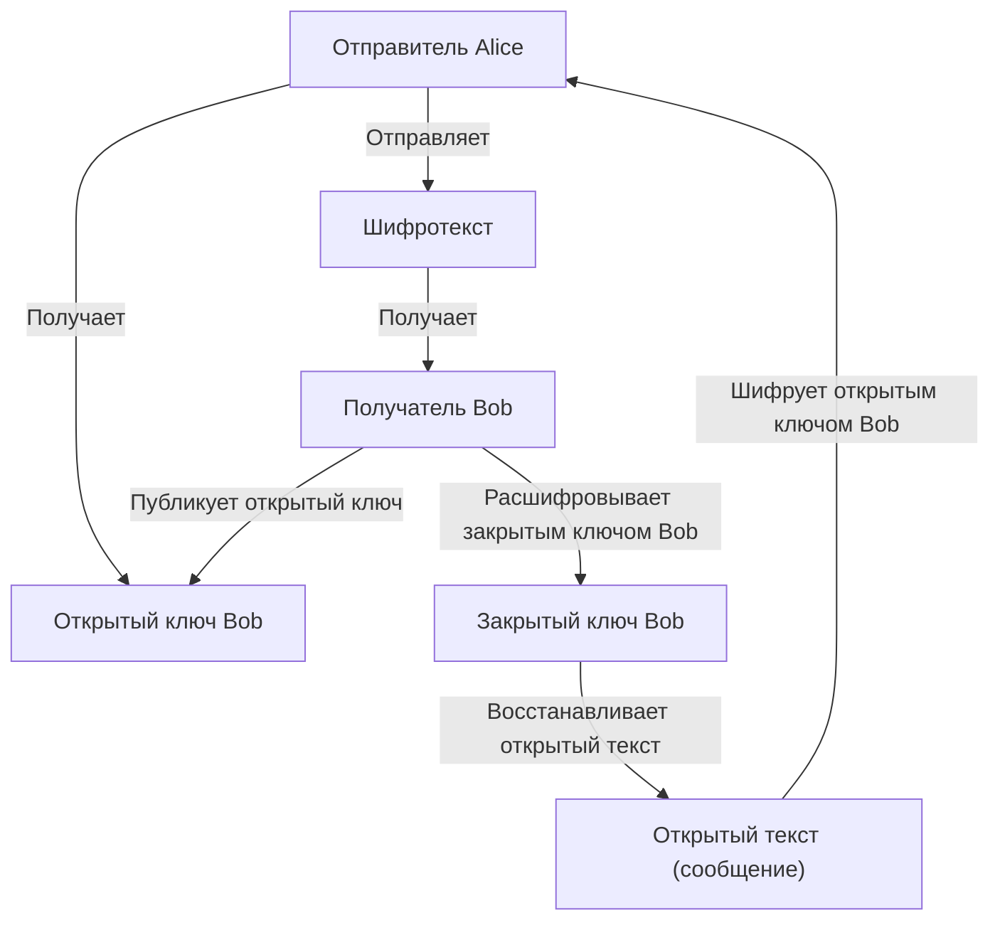
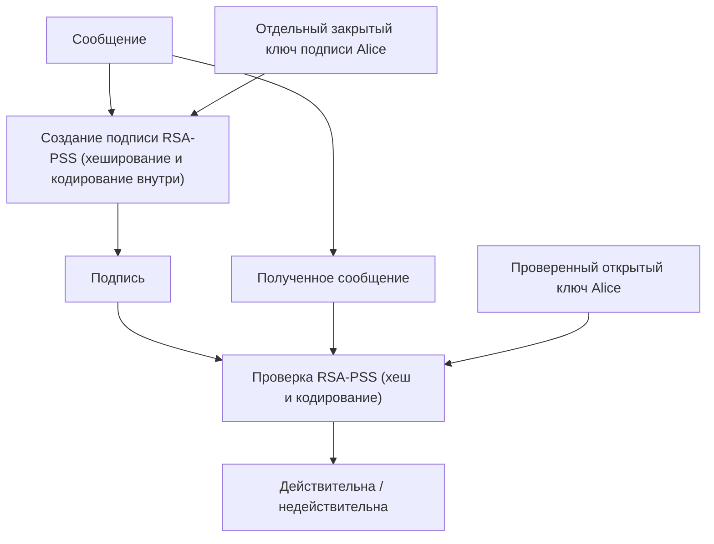
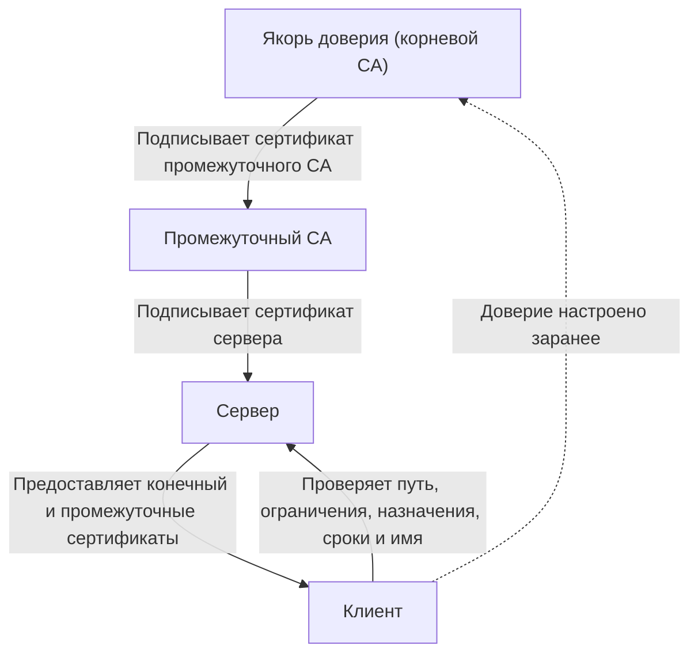

Криптография помогает обеспечивать конфиденциальность, целостность и аутентификацию. Сама по себе она не гарантирует все аспекты информационной безопасности, включая доступность. В статье рассматриваются роли симметричных и открытых ключей, математические основы RSA и эллиптических кривых, хеш-функции, цифровые подписи и PKI. Мы различаем математическое объяснение и условия, необходимые для практических схем и протоколов.

## 1. Роли симметричных и открытых ключей

### 1.1. Симметричное шифрование и распределение ключей

**Симметричное шифрование** использует общий секретный ключ для шифрования и расшифрования. AES — пример блочного шифра. Эти методы подходят для больших объёмов данных, но сторонам нужен безопасный способ получить общий ключ. Одно шифрование не обязательно обнаруживает изменения; в реальной связи используют защиту, предусмотренную протоколом, например аутентифицированное шифрование.

### 1.2. Разные операции с открытым ключом

**Методы с открытым ключом** используют пары открытых и закрытых ключей, но не все означают «шифровать открытым ключом и расшифровывать закрытым».

- **Шифрование с открытым ключом**: шифровать открытым ключом получателя и расшифровывать соответствующим закрытым ключом.
- **Цифровые подписи**: подписывать закрытым ключом подписанта и проверять открытым ключом.
- **Согласование ключей**: получать общий секрет из ключевого материала сторон, а затем вырабатывать ключи связи по правилам протокола.

Открытый ключ не требует секретного распространения, но **его связь с нужным участником должна быть подтверждена**. Следующая схема показывает только шифрование с открытым ключом. Успешное расшифрование само по себе не аутентифицирует отправителя.



## 2. Математические основы методов с открытым ключом

При анализе безопасности различают предположения о вычислительной сложности, условия генерации ключей и построение схемы. Секретные множители RSA позволяют выполнить обратную операцию, но согласование ключей и подписи на эллиптических кривых нельзя свести к тому же «обратному вычислению».

### 2.1. Ключи и операции RSA

Ривест, Шамир и Адлеман представили RSA в 1977 году. RSA связан со сложностью факторизации больших целых чисел. Факторизация модуля позволяет восстановить закрытый ключ, но равенство сложности общей задачи обращения RSA и факторизации не доказано. Безопасность зависит не только от длины ключа, но и от случайности, генерации ключей, дополнения и реализации.

#### 2.1.1. Учебное построение ключей

1. Выбрать различные большие нечётные простые числа $p,q$ и вычислить $N=pq$.
2. Вычислить функцию Эйлера:

$$\phi(N)=(p-1)(q-1)$$

3. Выбрать $e$ так, чтобы $1<e<\phi(N)$ и $\gcd(e,\phi(N))=1$. В примере используется $e=65537$.
4. Например, с помощью расширенного [алгоритма Евклида](/ru/p/euclidean-algorithm/) найти $1\le d<\phi(N)$, удовлетворяющее условию:

$$ed\equiv1\pmod{\phi(N)}$$

Открытый ключ — $(N,e)$; одна из основных форм закрытого ключа — $(N,d)$. Реализации также сохраняют $p,q$ и значения для китайской теоремы об остатках (CRT), чтобы ускорить вычисления. Эти данные тоже секретны. Для объяснения мы используем $\phi(N)$. RFC 8017 задаёт условие обратимости через $\lambda(N)=\operatorname{lcm}(p-1,q-1)$; приведённое построение удовлетворяет и ему.

#### 2.1.2. Операции RSA и условия доказательства

Для целочисленного представителя сообщения $0\le M<N$ примитивные операции имеют вид:

$$C\equiv M^e\pmod N$$

$$M\equiv C^d\pmod N$$

Теорему Эйлера можно непосредственно применять **только при $\gcd(M,N)=1$**. Записав $ed=1+t\phi(N)$, получаем:

$$M^{ed}=M\left(M^{\phi(N)}\right)^t\equiv M\pmod N$$

Для сообщений, не взаимно простых с $N$, отдельно рассмотрим $r=p$ и $r=q$. Если $M\equiv0\pmod r$, то $M^{ed}\equiv0\pmod r$. Иначе малая теорема Ферма и $(r-1)\mid(ed-1)$ дают $M^{ed}\equiv M\pmod r$. Китайская теорема об остатках объединяет оба сравнения и доказывает корректное восстановление для всех $0\le M<N$.

Например, при $p=61,q=53,e=17,d=2753$ и $M=61$ имеем $M^{3120}\bmod3233=1220$: шаг с теоремой Эйлера напрямую неприменим. Тем не менее после шифрования и расшифрования RSA возвращает 61. Такой маленький ключ служит иллюстрацией, а не безопасным ключом.

**Нельзя использовать простое модульное возведение в степень как схему шифрования.** Практическое шифрование RSA требует схемы вроде RSAES-OAEP. При RSA-2048 и SHA-256 следующий пример принимает не более 190 байт открытого текста (RFC 8017 §7.1.1):

$$m_{\mathrm{len}}\le k_{\mathrm{bytes}}-2h_{\mathrm{len}}-2=256-2\cdot32-2=190$$

Большие данные защищают симметричным аутентифицированным шифрованием в стандартной гибридной схеме. Этот пример не шифрует файлы произвольной длины непосредственно с помощью RSA.

### 2.2. Эллиптические кривые и дискретный логарифм

При подходящих параметрах **[криптография на эллиптических кривых (ECC)](/ru/p/elliptic-curve-cryptography-math-cpp/)** позволяет стремиться к сопоставимой классической безопасности с более короткими ключами, чем у RSA. Длина ключа в битах не равна уровню стойкости в битах.

Здесь рассматривается короткая форма Вейерштрасса над простым полем $\mathbb F_p$ при простом $p>3$. Это не охватывает все представления эллиптических кривых:

$$y^2\equiv x^3+ax+b\pmod p$$

$$4a^3+27b^2\not\equiv0\pmod p$$

На точках кривой вместе с точкой на бесконечности определяется сложение. Пусть $G$ порождает подгруппу большого простого порядка $n$. Секретный скаляр выбирается равномерно из $1\le k\le n-1$ с помощью криптографически безопасной случайности. Точка открытого ключа равна:

$$P=kG$$

Нахождение $k$ по $G,P$ — задача дискретного логарифмирования на эллиптической кривой. Просто выбрать «большое $k$» недостаточно: важны кривая, подгруппа, проверка ключей и источник случайности. ECC — семейство методов; ECDH служит согласованию ключей, а ECDSA — созданию подписей.

### 2.3. RSA-OAEP на Python

Каждый из трёх примеров Python можно запускать независимо. Они проверены с Python 3.12.14 и `cryptography` 50.0.2. Ключи для учебных целей создаются в памяти при каждом запуске. Примеры не являются производственными системами, охватывающими хранение и распространение ключей, аутентификацию собеседника и обработку ошибок.

```python
from cryptography.hazmat.primitives.asymmetric import rsa
from cryptography.hazmat.primitives.asymmetric import padding
from cryptography.hazmat.primitives import hashes
import base64

# 1. Генерация пары ключей RSA
private_key = rsa.generate_private_key(
    public_exponent=65537,
    key_size=2048,
)
public_key = private_key.public_key()

# 2. Определение сообщения
message = b"This is a highly confidential message about modern cryptography."

# 3. Шифрование с использованием открытого ключа (с использованием OAEP паддинга)
ciphertext = public_key.encrypt(
    message,
    padding.OAEP(
        mgf=padding.MGF1(algorithm=hashes.SHA256()),
        algorithm=hashes.SHA256(),
        label=None
    )
)
print("Шифротекст (Base64):", base64.b64encode(ciphertext).decode('utf-8'))

# 4. Расшифрование с использованием закрытого ключа
decrypted_message = private_key.decrypt(
    ciphertext,
    padding.OAEP(
        mgf=padding.MGF1(algorithm=hashes.SHA256()),
        algorithm=hashes.SHA256(),
        label=None
    )
)
print("Расшифрованное сообщение:", decrypted_message.decode('utf-8'))
```

## 3. Криптографические хеш-функции

Хеш-функция вычисляет дайджест фиксированной длины по входным данным. Она детерминирована: одинаковый вход всегда даёт одинаковый результат. Это не шифрование и не самостоятельная генерация случайных чисел. Максимальная длина входа зависит от алгоритма.

### 3.1. Три свойства стойкости

1. **Стойкость к нахождению прообраза (preimage resistance)**: по заданному хеш-значению $h$ трудно найти вход с $H(m)=h$. Речь не о восстановлении единственного исходного сообщения.
2. **Стойкость к нахождению второго прообраза (second-preimage resistance)**: для заданного $m_1$ трудно найти $m_2\ne m_1$ с $H(m_2)=H(m_1)$.
3. **Стойкость к коллизиям (collision resistance)**: трудно найти два разных входа с одинаковым хешем, даже если атакующий выбирает оба.

Один дайджест не аутентифицирует источник. Если атакующий может заменить и сообщение, и дайджест, простое сравнение не выявит изменения. Нужны доверенное эталонное значение или подходящий механизм аутентификации.

### 3.2. SHA-2 и SHA-256

SHA-256 относится к семейству SHA-2, выдаёт 256 бит и принимает вход длиной менее $2^{64}$ бит. Сообщение с дополнением, включающим длину, разбивается на 512-битные блоки и последовательно обрабатывается от заданного начального значения. Потоковая реализация может добавлять дополнение при достижении последних блоков.

Схематически обработка типа Меркла—Дамгорда с блоками $M_i$ и значениями сцепления $H_i$ записывается так:

$$H_i=f(H_{i-1},M_i)$$

Этот обзор не означает, что можно опустить предписанную функцию сжатия или дополнение и получить безопасную схему.

### 3.3. SHA-3 и конструкция «губка»

SHA-3 — стандарт на основе Keccak, дополняющий SHA-2. Это не означает, что все атаки на SHA-2 становятся неэффективными или что SHA-2 всегда требуется заменить.

- **Поглощение (absorb)**: входные блоки с предписанными суффиксом и дополнением объединяются по XOR с частью состояния, соответствующей rate, затем применяется перестановка.
- **Выдача (squeeze)**: из части rate извлекаются выходные данные. Если нужны ещё данные, перестановка и извлечение повторяются.

Четыре хеш-функции SHA-3, например SHA3-256, имеют фиксированную длину выхода. SHAKE128 и SHAKE256 в том же FIPS 202 — XOF с задаваемой длиной выхода. Суффикс и дополнение важны: одно название «Keccak-256» не означает, что выход совпадает с SHA3-256.

### 3.4. Хеширование на Python

```python
from cryptography.hazmat.primitives import hashes

message = b"Modern cryptography heavily relies on secure hash functions."

# Генерация SHA-256
digest_sha256 = hashes.Hash(hashes.SHA256())
digest_sha256.update(message)
hash_result_sha256 = digest_sha256.finalize()
print("SHA-256:", hash_result_sha256.hex())

# Генерация SHA-3 (SHA3-256)
digest_sha3 = hashes.Hash(hashes.SHA3_256())
digest_sha3.update(message)
hash_result_sha3 = digest_sha3.finalize()
print("SHA3-256:", hash_result_sha3.hex())
```

## 4. Цифровые подписи

Схема цифровой подписи позволяет **создать подпись** закрытым ключом и **проверить её** открытым. При корректной конструкции и реализации, доверенной связи ключа с личностью и надлежащем управлении закрытым ключом подписи поддерживают целостность и аутентификацию подписанта. Они могут служить доказательствами для неотказуемости (non-repudiation), но не доказывают безусловно намерение человека или отсутствие компрометации ключа.

### 4.1. Отличие подписи от шифрования

Обобщать подпись как «шифрование закрытым ключом и расшифрование открытым» неверно. У RSA разные схемы шифрования и подписи; пример использует **RSASSA-PSS**. Подпись не скрывает сообщение. Проверка устанавливает, удовлетворяют ли открытый ключ, сообщение и подпись условиям схемы; это не общее расшифрование, восстанавливающее дайджест.

### 4.2. Создание и проверка: обзор RSA-PSS



1. Подписант хеширует сообщение и создаёт подпись с помощью кодирования PSS, соли и операции с закрытым ключом. Он передаёт сообщение и подпись.
2. Проверяющий использует доверенный открытый ключ и согласованные параметры для полученных сообщения и подписи. Хеширование и кодирование входят в схему; API примера не получает заранее вычисленный дайджест.

### 4.3. RSA-PSS на Python

Для подписи создаётся отдельный ключ, не используемый в примере шифрования. Длина соли равна длине дайджеста SHA-256 (32 байта); проверка использует ту же настройку. Подлинность открытого ключа должна быть установлена за пределами этого примера.

```python
import base64
from cryptography.exceptions import InvalidSignature
from cryptography.hazmat.primitives import hashes
from cryptography.hazmat.primitives.asymmetric import padding, rsa

# Создать отдельный ключ подписи, не связанный с примером шифрования
signing_key = rsa.generate_private_key(public_exponent=65537, key_size=2048)
verification_key = signing_key.public_key()
doc_message = b"Contract document: Party A agrees to pay Party B $1000."
pss = padding.PSS(
    mgf=padding.MGF1(hashes.SHA256()),
    salt_length=padding.PSS.DIGEST_LENGTH,
)
signature = signing_key.sign(doc_message, pss, hashes.SHA256())
print("Подпись (Base64):", base64.b64encode(signature).decode("ascii"))

try:
    verification_key.verify(signature, doc_message, pss, hashes.SHA256())
    print("Подпись ДЕЙСТВИТЕЛЬНА для этого сообщения и открытого ключа.")
except InvalidSignature:
    print("Подпись НЕДЕЙСТВИТЕЛЬНА для этого сообщения и открытого ключа.")
```

## 5. Инфраструктура открытых ключей (PKI)

Если принять ключ атакующего за ключ нужного участника, даже корректные криптографические операции могут быть направлены не тому адресату. **PKI** предоставляет сертификаты, настройки доверия и процедуры проверки для установления связей открытых ключей с именами и другой информацией.

### 5.1. Удостоверяющие центры и сертификаты X.509

Удостоверяющий центр (CA) проверяет контроль над доменом или сведения о субъекте согласно своей политике и выпускает сертификат. Не все сертификаты одинаково подтверждают личность оператора сайта.

Сертификат X.509 содержит версию, серийный номер, алгоритм подписи, издателя, субъекта, срок действия, открытый ключ субъекта, расширения и подпись. CA подписывает **DER-кодировку TBSCertificate**, содержащую подписываемые сведения, а не только открытый ключ.

### 5.2. Цепочки сертификатов и TLS



Диаграмма показывает один пример: корневой CA → промежуточный CA → сервер. Клиент строит путь к настроенному якорю доверия (trust anchor) и проверяет, в частности, подписи, сроки действия, ограничения CA, назначение ключей и обработку критических расширений. Это не просто проверка конечного сертификата непосредственно корневым ключом. Обработка отзыва следует применимому механизму и политике приложения.

TLS также требует проверки идентичности службы. Для DNS-имён ожидаемое имя сравнивается с записями `dNSName` в `subjectAltName`, без перехода к Common Name как запасному варианту (RFC 9525). Сертификат другого сайта нельзя принимать даже при корректной подписи.

Проверка сертификата сама по себе не устанавливает шифрованную связь. TLS 1.3 сочетает обмен ключами, аутентификацию и подтверждение ключей, получает ключи трафика и защищает записи аутентифицированным шифрованием. Статический транспорт ключей RSA удалён из TLS 1.3. Соединения с PSK или возобновлением сеанса могут обходиться без передачи сертификатов, поэтому схема описывает не все соединения TLS.

## 6. Итоги

- Симметричное шифрование защищает большие объёмы данных. Конфиденциальность и обнаружение изменений — разные свойства.
- Шифрование с открытым ключом, согласование ключей и подписи имеют разные роли. Ключи тоже требуют аутентификации.
- Хеш-функции вычисляют дайджесты. Сами по себе они не аутентифицируют источник.
- Подписи поддерживают целостность и аутентификацию при соблюдении условий схемы и управления ключами.
- Проверка пути PKI, имени службы и рукопожатие TLS связаны, но являются разными процедурами.

Это основы. В рабочих системах используют поддерживаемые библиотеки и стандартные протоколы, оценивают управление ключами, алгоритмы, параметры и переход к постквантовой криптографии. Одних примеров из статьи недостаточно для оценки безопасности всей системы.

### Источники

- [RFC 8017: PKCS #1 — RSA Cryptography Specifications](https://www.rfc-editor.org/rfc/rfc8017.html) (§§3, 5–9)
- [cryptography 50.0.2: RSA](https://cryptography.io/en/50.0.2/hazmat/primitives/asymmetric/rsa/)
- [RFC 6090: Fundamental Elliptic Curve Cryptography Algorithms](https://www.rfc-editor.org/rfc/rfc6090.html) (§§3.3, 5.3.1)
- [NIST FIPS 180-4: Secure Hash Standard](https://nvlpubs.nist.gov/nistpubs/FIPS/NIST.FIPS.180-4.pdf) (§§5–6)
- [NIST FIPS 202: SHA-3 Standard](https://nvlpubs.nist.gov/nistpubs/FIPS/NIST.FIPS.202.pdf) (§§4–6)
- [NIST FIPS 186-5: Digital Signature Standard](https://csrc.nist.gov/pubs/fips/186-5/final)
- [RFC 5280: Internet X.509 PKI Certificate and CRL Profile](https://www.rfc-editor.org/rfc/rfc5280.html) (§§4.1, 6)
- [RFC 9525: Service Identity in TLS](https://www.rfc-editor.org/rfc/rfc9525.html)
- [RFC 8446: TLS 1.3](https://www.rfc-editor.org/rfc/rfc8446.html) (§§1.2, 2)
