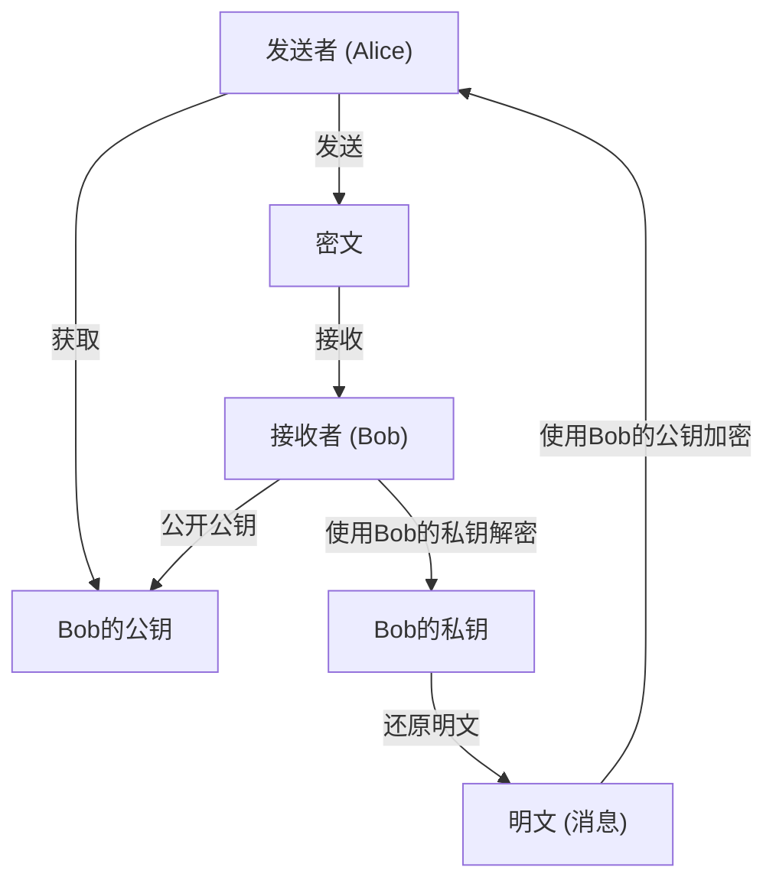
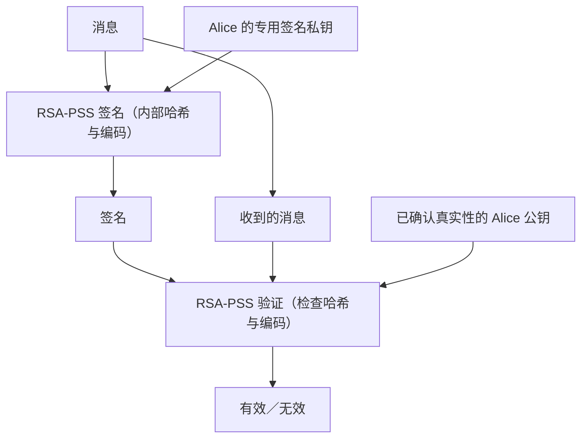
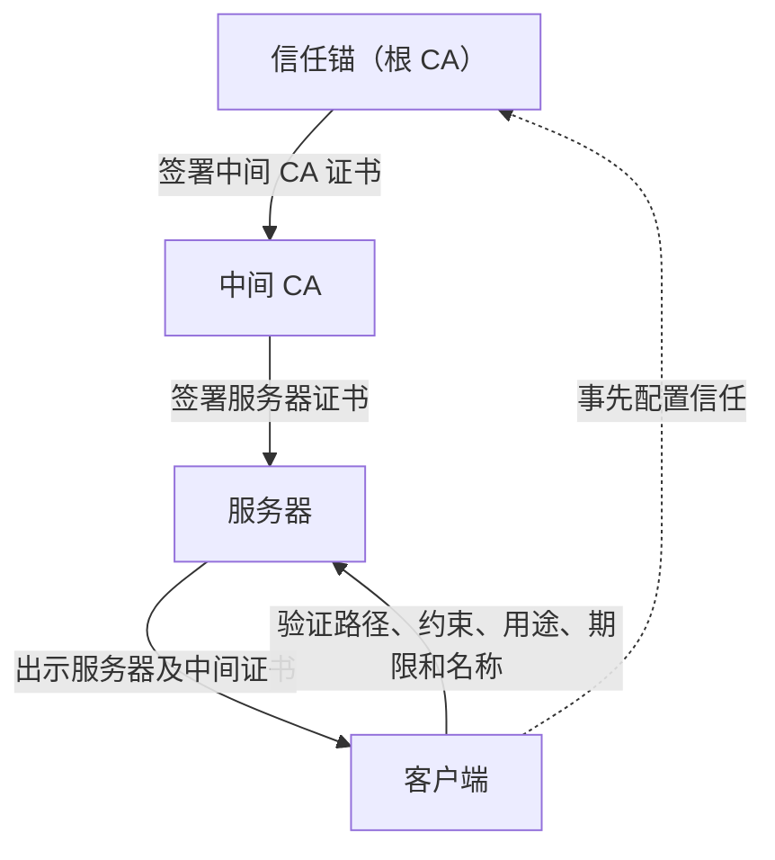

密码技术支持信息的机密性、完整性和身份认证，但不能单独保证包括可用性在内的全部信息安全。本文介绍对称密钥与公钥的作用、RSA 和椭圆曲线的数学基础、哈希函数、数字签名及 PKI，并区分数学上的原理说明与实际密码方案、协议所需的条件。

## 1. 对称密钥与公钥的作用

### 1.1. 对称加密与密钥分发

**对称加密**使用共享的秘密密钥进行加密和解密。AES 是典型的分组密码，适合保护大量数据，但通信双方需要安全共享密钥的方法。仅有加密不一定能检测篡改；实际通信应使用协议规定的保护方式，例如认证加密。

### 1.2. 区分不同的公钥技术

**公钥技术**使用公钥与私钥对，但并非所有技术都是“公钥加密、私钥解密”。

- **公钥加密**：用接收方的公钥加密，用对应的私钥解密。
- **数字签名**：用签名者的私钥签名，用公钥验证。
- **密钥协商**：由双方的密钥材料导出共享秘密，再按协议生成通信密钥。

公钥不需要保密分发，但必须**确认它确实属于预期的通信对象**。下图仅表示公钥加密。能成功解密，并不等于已经验证了发送者的身份。



## 2. 公钥技术的数学基础

讨论安全性时，应区分计算困难性假设、密钥生成条件与方案构造。RSA 的秘密素因数提供了逆运算的途径，但不能把椭圆曲线密钥协商和签名也一概解释为同一种“逆运算”。

### 2.1. RSA 的密钥与运算

Rivest、Shamir 和 Adleman 于1977年公布了 RSA。它与大整数分解的困难性有关。分解模数即可求出私钥，但一般的 RSA 逆运算与整数分解在困难程度上等价，尚未得到证明。安全性还取决于随机数、密钥生成、填充和实现，而不仅是密钥长度。

#### 2.1.1. 教科书式密钥生成

1. 选择不同的大奇素数 $p,q$，计算 $N=pq$。
2. 计算：

$$\phi(N)=(p-1)(q-1)$$

3. 选择满足 $1<e<\phi(N)$ 且 $\gcd(e,\phi(N))=1$ 的 $e$。下面的实现使用 $e=65537$。
4. 用扩展[欧几里得算法](/zh-cn/p/euclidean-algorithm/)等方法，求出满足下式的 $1\le d<\phi(N)$：

$$ed\equiv1\pmod{\phi(N)}$$

公钥为 $(N,e)$，私钥的一种基本表示是 $(N,d)$。实现通常还保留 $p,q$ 和 CRT 参数以提高效率；这些也是秘密信息。这里为说明使用 $\phi(N)$。RFC 8017 用 $\lambda(N)=\operatorname{lcm}(p-1,q-1)$ 表述逆元条件，上述构造也满足该条件。

#### 2.1.2. RSA 运算与证明条件

对整数消息代表 $0\le M<N$，基本运算为：

$$C\equiv M^e\pmod N$$

$$M\equiv C^d\pmod N$$

**只有在 $\gcd(M,N)=1$ 时，才能直接应用欧拉定理。** 令 $ed=1+t\phi(N)$，则：

$$M^{ed}=M\left(M^{\phi(N)}\right)^t\equiv M\pmod N$$

对于不互素的消息，可以分别考虑 $r=p$ 与 $r=q$。若 $M\equiv0\pmod r$，则 $M^{ed}\equiv0\pmod r$；否则，由费马小定理及 $(r-1)\mid(ed-1)$ 得到 $M^{ed}\equiv M\pmod r$。用中国剩余定理合并这两个同余式，即可证明所有 $0\le M<N$ 都能正确还原。

例如 $p=61,q=53,e=17,d=2753$，当 $M=61$ 时，$M^{3120}\bmod3233=1220$，不能直接套用上述欧拉定理的步骤，但 RSA 往返运算仍得到61。这把很小的密钥只用于说明，并不安全。

**不能直接将模幂运算当作加密方案。** 实际 RSA 加密需要 RSAES-OAEP 等方案。下面 RSA-2048 与 SHA-256 的组合最多加密190字节明文（RFC 8017 §7.1.1）：

$$m_{\mathrm{len}}\le k_{\mathrm{bytes}}-2h_{\mathrm{len}}-2=256-2\cdot32-2=190$$

较大数据应通过标准混合方案，使用对称认证加密来保护。这个示例不能直接用 RSA 加密任意长度的文件。

### 2.2. 椭圆曲线与离散对数问题

采用合适的参数时，**[椭圆曲线密码（ECC）](/zh-cn/p/elliptic-curve-cryptography-math-cpp/)**可以用比 RSA 更短的密钥达到相近的经典安全强度。不能把密钥的比特数直接当作安全强度的比特数。

这里仅讨论素数 $p>3$ 的有限域 $\mathbb F_p$ 上的短 Weierstrass 形式，不涵盖所有椭圆曲线表示：

$$y^2\equiv x^3+ax+b\pmod p$$

$$4a^3+27b^2\not\equiv0\pmod p$$

在曲线上的点及无穷远点上定义加法。设基点 $G$ 生成一个大素数阶 $n$ 的子群，使用密码学安全的随机数，从 $1\le k\le n-1$ 中均匀选择秘密标量，则公钥点为：

$$P=kG$$

由 $G,P$ 求 $k$，就是椭圆曲线离散对数问题。仅选择一个“很大的 $k$”并不能确保安全；曲线、子群、密钥验证和随机数生成同样重要。ECC 是一类技术的总称，ECDH 用于密钥协商，ECDSA 用于签名。

### 2.3. Python 中的 RSA-OAEP 示例

本文3个 Python 示例都可以单独运行，已在 Python 3.12.14、`cryptography` 50.0.2 下检查。每次运行都在内存中新生成密钥，仅供学习；并不是包含密钥存储与分发、对端身份认证和错误处理的生产系统。

```python
from cryptography.hazmat.primitives.asymmetric import rsa
from cryptography.hazmat.primitives.asymmetric import padding
from cryptography.hazmat.primitives import hashes
import base64

# 1. 生成 RSA 密钥对
private_key = rsa.generate_private_key(
    public_exponent=65537,
    key_size=2048,
)
public_key = private_key.public_key()

# 2. 定义消息
message = b"This is a highly confidential message about modern cryptography."

# 3. 使用公钥进行加密 (使用 OAEP 填充)
ciphertext = public_key.encrypt(
    message,
    padding.OAEP(
        mgf=padding.MGF1(algorithm=hashes.SHA256()),
        algorithm=hashes.SHA256(),
        label=None
    )
)
print("Ciphertext (Base64):", base64.b64encode(ciphertext).decode('utf-8'))

# 4. 使用私钥进行解密
decrypted_message = private_key.decrypt(
    ciphertext,
    padding.OAEP(
        mgf=padding.MGF1(algorithm=hashes.SHA256()),
        algorithm=hashes.SHA256(),
        label=None
    )
)
print("Decrypted Message:", decrypted_message.decode('utf-8'))
```

## 3. 密码学哈希函数

哈希函数从输入计算固定长度的摘要，是同一输入始终得到同一结果的确定性函数。它既不是加密，也不是随机数生成本身。输入长度上限由具体算法规定。

### 3.1. 三种安全性质

1. **原像抗性（preimage resistance）**：给定哈希值 $h$，难以找到满足 $H(m)=h$ 的输入；并不是恢复“唯一的原始输入”。
2. **第二原像抗性（second-preimage resistance，弱抗碰撞性）**：给定 $m_1$，难以找到 $m_2\ne m_1$ 且 $H(m_2)=H(m_1)$ 的输入。
3. **抗碰撞性（collision resistance，强抗碰撞性）**：即使攻击者可以同时选择两个输入，也难以找到哈希值相同的两个不同输入。

摘要本身不能验证来源。如果攻击者可以同时替换正文和摘要，简单比较就无法识别篡改；需要可信的参考值或适合用途的认证机制。

### 3.2. SHA-2 与 SHA-256

SHA-256 是 SHA-2 系列的成员，输出256比特，输入长度小于 $2^{64}$ 比特。添加包含长度信息的填充后，将消息划分为512比特分组，从规定的初始值开始依次处理。流式实现可在处理最后几个分组时添加填充。

用消息分组 $M_i$ 与链接值 $H_i$ 表示 Merkle–Damgård 型处理的概略：

$$H_i=f(H_{i-1},M_i)$$

这只是概述，并不意味着可以省略规定的压缩函数或填充，自行构造安全方案。

### 3.3. SHA-3 与海绵结构

SHA-3 是基于 Keccak 的标准，用于补充 SHA-2。不能因此认为所有针对 SHA-2 的攻击都对它无效，也不能认为总是需要替换 SHA-2。

- **吸收（absorb）**：将加有规定后缀和填充的输入分组，与内部状态的速率部分进行异或，然后应用置换。
- **挤出（squeeze）**：从状态的速率部分提取输出；需要更多输出时，继续置换和提取。

SHA3-256 等4个 SHA-3 哈希函数的输出长度固定。同一 FIPS 202 中的 SHAKE128、SHAKE256 是可以指定输出长度的 XOF。后缀和填充规范很重要，不能仅凭“Keccak-256”这个名称就认为其输出与 SHA3-256 相同。

### 3.4. Python 哈希示例

```python
from cryptography.hazmat.primitives import hashes

message = b"Modern cryptography heavily relies on secure hash functions."

# 生成 SHA-256
digest_sha256 = hashes.Hash(hashes.SHA256())
digest_sha256.update(message)
hash_result_sha256 = digest_sha256.finalize()
print("SHA-256:", hash_result_sha256.hex())

# 生成 SHA-3 (SHA3-256)
digest_sha3 = hashes.Hash(hashes.SHA3_256())
digest_sha3.update(message)
hash_result_sha3 = digest_sha3.finalize()
print("SHA3-256:", hash_result_sha3.hex())
```

## 4. 数字签名

数字签名方案使用私钥**生成签名**，使用公钥**验证签名**。在构造与实现可靠、公钥对应关系可信、私钥管理妥当的前提下，签名支持完整性与签名者身份认证。它可以为不可否认性提供证据，但不能无条件证明本人意愿或私钥从未泄露。

### 4.1. 签名与加密的区别

不能把签名概括成“用私钥加密、用公钥解密”。RSA 的加密方案和签名方案不同；下面使用 **RSASSA-PSS**。签名不会隐藏消息，验证是检查公钥、消息与签名的组合是否满足方案条件，并非通过通用解密恢复摘要。

### 4.2. 生成与验证流程（RSA-PSS 概略）



1. 签名方计算消息的哈希，通过 PSS 编码、盐值及私钥运算生成签名，传递消息与签名。
2. 验证方使用可信公钥和相同参数验证收到的消息与签名。哈希和编码属于签名方案的内部处理；下面的 API 示例并不是直接传入预先计算的摘要。

### 4.3. Python RSA-PSS 示例

这里生成独立于加密示例的专用签名密钥。盐长度设为 SHA-256 的摘要长度（32字节），验证时使用相同设置。公钥的真实性必须在此示例之外建立。

```python
import base64
from cryptography.exceptions import InvalidSignature
from cryptography.hazmat.primitives import hashes
from cryptography.hazmat.primitives.asymmetric import padding, rsa

# 生成专用签名密钥，与加密示例分开
signing_key = rsa.generate_private_key(public_exponent=65537, key_size=2048)
verification_key = signing_key.public_key()
doc_message = b"Contract document: Party A agrees to pay Party B $1000."
pss = padding.PSS(
    mgf=padding.MGF1(hashes.SHA256()),
    salt_length=padding.PSS.DIGEST_LENGTH,
)
signature = signing_key.sign(doc_message, pss, hashes.SHA256())
print("Signature (Base64):", base64.b64encode(signature).decode("ascii"))

try:
    verification_key.verify(signature, doc_message, pss, hashes.SHA256())
    print("Signature is VALID for this message and public key.")
except InvalidSignature:
    print("Signature is INVALID for this message and public key.")
```

## 5. 公钥基础设施（PKI）

如果把攻击者的密钥误认成对方的密钥，即使密码运算正确，也可能把错误对象当作通信对端。**PKI**通过证书、信任配置和验证过程，确认公钥与名称等信息的对应关系。

### 5.1. 证书颁发机构与 X.509 证书

证书颁发机构（CA）按既定策略检查域名控制权或主体信息并颁发证书。并不是每种证书都以相同范围证明网站运营者个人的身份。

X.509 证书包含版本、序列号、签名算法、颁发者、主体、有效期、主体公钥、扩展信息和签名等。CA 签署的是包含待签名信息的 **TBSCertificate 的 DER 编码**，而不是公钥本身。

### 5.2. 证书链与 TLS



图中是根 CA→中间 CA→服务器的一个例子。客户端构建通往已配置信任锚的路径，验证各证书的签名、有效期、CA 约束、密钥用途及不支持的关键扩展等，而不是只用根密钥直接验证服务器证书。撤销处理也应遵循适用机制与应用策略。

TLS 还需要检查服务身份。对于 DNS 名称，应把预期连接的服务名称与证书 `subjectAltName` 中的 `dNSName` 比较，不回退到 Common Name（RFC 9525）。即使签名正确，也不能接受属于其他网站的证书。

仅验证证书不能完成加密通信。TLS 1.3 结合密钥交换、身份认证和密钥确认导出通信密钥，并用认证加密保护记录。TLS 1.3 已移除静态 RSA 密钥传输。PSK 或会话恢复等连接可能不发送证书，因此上图并不适用于所有 TLS 连接。

## 6. 总结

- 对称加密适合大量数据保护；应区分保密性与篡改检测。
- 公钥加密、密钥协商、签名的作用不同；还要确认密钥的真实性。
- 哈希生成摘要，本身不能认证来源。
- 签名支持完整性和身份认证，也依赖密钥管理与方案条件。
- PKI 路径验证、服务名称检查和 TLS 握手彼此相关，但属于不同处理。

这些只是基础。生产系统应使用持续维护的库和标准协议，并评估密钥管理、算法、参数以及向后量子密码迁移等问题。不能仅凭本文示例判断整个系统的安全性。

### 参考文献

- [RFC 8017: PKCS #1 — RSA Cryptography Specifications](https://www.rfc-editor.org/rfc/rfc8017.html) (§§3, 5–9)
- [cryptography 50.0.2: RSA](https://cryptography.io/en/50.0.2/hazmat/primitives/asymmetric/rsa/)
- [RFC 6090: Fundamental Elliptic Curve Cryptography Algorithms](https://www.rfc-editor.org/rfc/rfc6090.html) (§§3.3, 5.3.1)
- [NIST FIPS 180-4: Secure Hash Standard](https://nvlpubs.nist.gov/nistpubs/FIPS/NIST.FIPS.180-4.pdf) (§§5–6)
- [NIST FIPS 202: SHA-3 Standard](https://nvlpubs.nist.gov/nistpubs/FIPS/NIST.FIPS.202.pdf) (§§4–6)
- [NIST FIPS 186-5: Digital Signature Standard](https://csrc.nist.gov/pubs/fips/186-5/final)
- [RFC 5280: Internet X.509 PKI Certificate and CRL Profile](https://www.rfc-editor.org/rfc/rfc5280.html) (§§4.1, 6)
- [RFC 9525: Service Identity in TLS](https://www.rfc-editor.org/rfc/rfc9525.html)
- [RFC 8446: TLS 1.3](https://www.rfc-editor.org/rfc/rfc8446.html) (§§1.2, 2)
