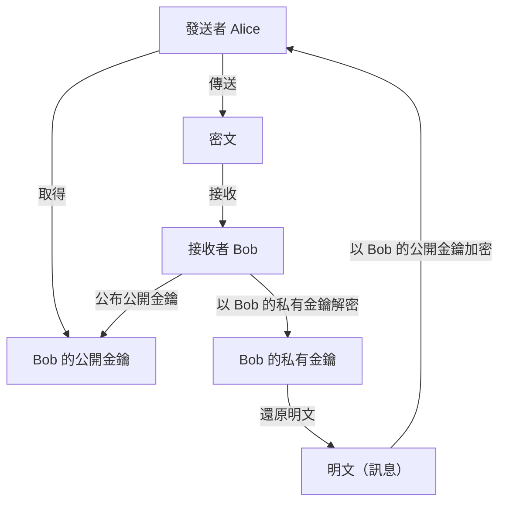
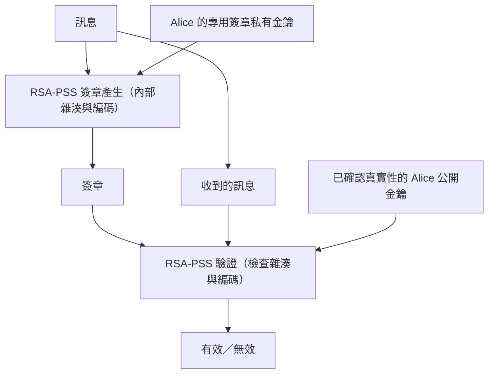
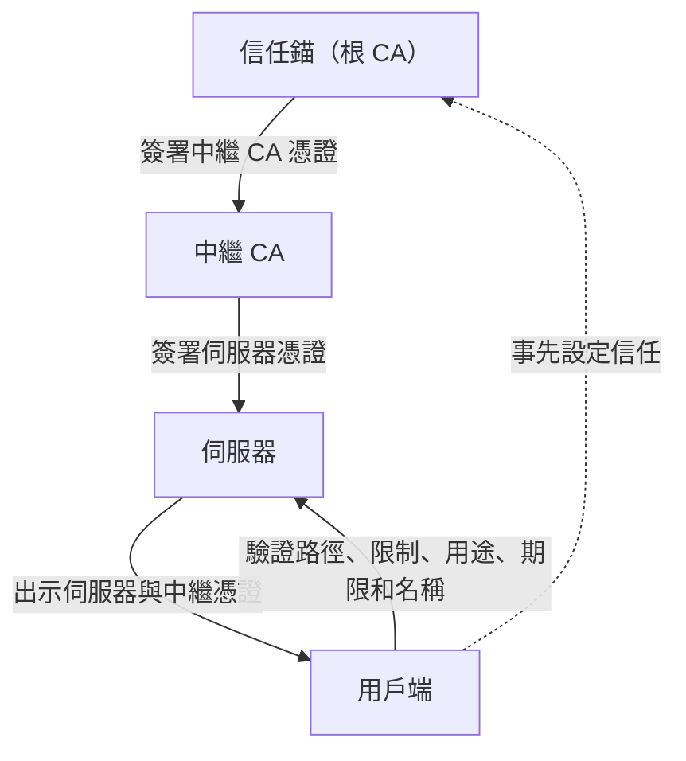

密碼技術支援資訊的機密性、完整性與身分驗證，但無法單獨保證包括可用性在內的所有資訊安全。本文介紹對稱金鑰與公開金鑰的作用、RSA 與橢圓曲線的數學基礎、雜湊函數、數位簽章及 PKI，並區分數學原理的說明與實際密碼方案、通訊協定所需的條件。

## 1. 對稱金鑰與公開金鑰的作用

### 1.1. 對稱式加密與金鑰配送

**對稱式加密**使用共享的祕密金鑰進行加密與解密。AES 是典型的區塊密碼，適合保護大量資料，但通訊雙方需要安全共享金鑰的方法。只有加密不一定能偵測竄改；實際通訊應採用協定規定的保護方式，例如具驗證的加密（authenticated encryption）。

### 1.2. 區分不同的公開金鑰技術

**公開金鑰技術**使用公開金鑰與私有金鑰對，但並非全部都是「公開金鑰加密、私有金鑰解密」。

- **公開金鑰加密**：用接收者的公開金鑰加密，以對應的私有金鑰解密。
- **數位簽章**：用簽署者的私有金鑰簽署，以公開金鑰驗證。
- **金鑰協議（key agreement）**：由雙方的金鑰材料導出共享祕密，再依通訊協定產生通訊金鑰。

公開金鑰不需要祕密配送，但必須**確認它確實屬於預期的通訊對象**。下圖只表示公開金鑰加密。能成功解密，不代表已經驗證了發送者的身分。



## 2. 公開金鑰技術的數學基礎

討論安全性時，應區分計算困難性假設、金鑰產生條件與方案構造。RSA 的祕密質因數提供逆運算的途徑，但不能把橢圓曲線金鑰協議和簽章也一概解釋為同一種「逆運算」。

### 2.1. RSA 的金鑰與運算

Rivest、Shamir 與 Adleman 於1977年公布 RSA。它與大整數質因數分解的困難性有關。分解模數就能求出私有金鑰，但一般 RSA 逆運算與質因數分解在困難程度上等價，尚未獲得證明。安全性還取決於亂數、金鑰產生、填充與實作，不只是金鑰長度。

#### 2.1.1. 教科書式金鑰產生

1. 選擇不同的大奇質數 $p,q$，計算 $N=pq$。
2. 計算尤拉φ函數（Euler's totient function）：

$$\phi(N)=(p-1)(q-1)$$

3. 選擇滿足 $1<e<\phi(N)$ 且 $\gcd(e,\phi(N))=1$ 的 $e$。下方實作使用 $e=65537$。
4. 使用擴展[歐幾里得演算法](/zh-tw/p/euclidean-algorithm/)等方法，求出滿足下式的 $1\le d<\phi(N)$：

$$ed\equiv1\pmod{\phi(N)}$$

公開金鑰為 $(N,e)$，私有金鑰的一種基本表示是 $(N,d)$。實作通常也保留 $p,q$ 與 CRT 參數以提高效率；這些也必須保密。此處為說明使用 $\phi(N)$。RFC 8017 用 $\lambda(N)=\operatorname{lcm}(p-1,q-1)$ 表示反元素條件，上述構造也滿足該條件。

#### 2.1.2. RSA 運算與證明條件

對整數訊息代表 $0\le M<N$，基本運算為：

$$C\equiv M^e\pmod N$$

$$M\equiv C^d\pmod N$$

**只有在 $\gcd(M,N)=1$ 時，才能直接套用尤拉定理。** 令 $ed=1+t\phi(N)$，則：

$$M^{ed}=M\left(M^{\phi(N)}\right)^t\equiv M\pmod N$$

對於不互質的訊息，可以分別考慮 $r=p$ 與 $r=q$。若 $M\equiv0\pmod r$，則 $M^{ed}\equiv0\pmod r$；否則，利用費馬小定理與 $(r-1)\mid(ed-1)$，得到 $M^{ed}\equiv M\pmod r$。透過中國餘數定理合併這兩個同餘式，即可證明所有 $0\le M<N$ 都能正確還原。

例如 $p=61,q=53,e=17,d=2753$，當 $M=61$ 時，$M^{3120}\bmod3233=1220$，不能直接套用上述尤拉定理的步驟，但 RSA 往返運算仍得到61。這把很小的金鑰僅供說明，並不安全。

**不能直接把模冪運算當成加密方案。** 實際 RSA 加密需要 RSAES-OAEP 等方案。以下 RSA-2048 與 SHA-256 的組合最多加密190位元組明文（RFC 8017 §7.1.1）：

$$m_{\mathrm{len}}\le k_{\mathrm{bytes}}-2h_{\mathrm{len}}-2=256-2\cdot32-2=190$$

較大資料應透過標準混合方案，以對稱式的具驗證加密保護。此範例不能直接用 RSA 加密任意長度的檔案。

### 2.2. 橢圓曲線與離散對數問題

參數選擇適當時，**[橢圓曲線密碼（ECC）](/zh-tw/p/elliptic-curve-cryptography-math-cpp/)**可用比 RSA 更短的金鑰達到相近的古典安全強度。不能把金鑰的位元數直接視為安全強度的位元數。

此處只討論質數 $p>3$ 的有限體 $\mathbb F_p$ 上的短 Weierstrass 形式，不涵蓋所有橢圓曲線表示法：

$$y^2\equiv x^3+ax+b\pmod p$$

$$4a^3+27b^2\not\equiv0\pmod p$$

在曲線上的點與無窮遠點上定義加法。設基點 $G$ 生成一個大質數階 $n$ 的子群，以密碼學安全的亂數，從 $1\le k\le n-1$ 中均勻選取祕密純量，則公開點為：

$$P=kG$$

由 $G,P$ 求 $k$，就是橢圓曲線離散對數問題。僅選取「很大的 $k$」並不能確保安全；曲線、子群、金鑰驗證和亂數產生同樣重要。ECC 是一類技術的總稱，ECDH 用於金鑰協議，ECDSA 用於簽章。

### 2.3. Python 的 RSA-OAEP 範例

本文3個 Python 範例都能單獨執行，已在 Python 3.12.14、`cryptography` 50.0.2 下檢查。每次執行都在記憶體中重新產生金鑰，僅供學習；並非包含金鑰儲存與配送、對端身分驗證和錯誤處理的正式系統。

```python
from cryptography.hazmat.primitives.asymmetric import rsa
from cryptography.hazmat.primitives.asymmetric import padding
from cryptography.hazmat.primitives import hashes
import base64

# 1. 產生RSA金鑰對
private_key = rsa.generate_private_key(
    public_exponent=65537,
    key_size=2048,
)
public_key = private_key.public_key()

# 2. 定義訊息
message = b"This is a highly confidential message about modern cryptography."

# 3. 使用公開金鑰進行加密 (使用OAEP填充)
ciphertext = public_key.encrypt(
    message,
    padding.OAEP(
        mgf=padding.MGF1(algorithm=hashes.SHA256()),
        algorithm=hashes.SHA256(),
        label=None
    )
)
print("Ciphertext (Base64):", base64.b64encode(ciphertext).decode('utf-8'))

# 4. 使用私有金鑰進行解密
decrypted_message = private_key.decrypt(
    ciphertext,
    padding.OAEP(
        mgf=padding.MGF1(algorithm=hashes.SHA256()),
        algorithm=hashes.SHA256(),
        label=None
    )
)
print("Decrypted Message:", decrypted_message.decode('utf-8'))
```

## 3. 密碼學雜湊函數

雜湊函數從輸入計算固定長度的摘要，是相同輸入必定得到相同結果的確定性函數。它不是加密，也不是亂數產生本身。輸入長度上限由具體演算法規定。

### 3.1. 三種安全性質

1. **原像抗性（preimage resistance）**：給定雜湊值 $h$，難以找到滿足 $H(m)=h$ 的輸入；並非還原「唯一的原始輸入」。
2. **第二原像抗性（second-preimage resistance，弱抗碰撞性）**：給定 $m_1$，難以找到 $m_2\ne m_1$ 且 $H(m_2)=H(m_1)$ 的輸入。
3. **抗碰撞性（collision resistance，強抗碰撞性）**：即使攻擊者能同時選擇兩個輸入，也難以找到雜湊值相同的兩個不同輸入。

摘要本身無法驗證來源。若攻擊者能同時替換本文與摘要，單純比對就無法辨識竄改；需要可信的參考值，或符合用途的驗證機制。

### 3.2. SHA-2 與 SHA-256

SHA-256 是 SHA-2 家族的一員，輸出256位元，輸入長度小於 $2^{64}$ 位元。加入包含長度資訊的填充後，將訊息分為512位元區塊，從規定的初始值依序處理。串流實作可在處理最後幾個區塊時加入填充。

以訊息區塊 $M_i$ 與鏈結值 $H_i$ 表示 Merkle–Damgård 型處理的概略：

$$H_i=f(H_{i-1},M_i)$$

這只是概述，不表示可以省略規定的壓縮函數或填充，自行構造安全方案。

### 3.3. SHA-3 與海綿結構

SHA-3 是以 Keccak 為基礎的標準，用以補充 SHA-2。不能因此認為所有針對 SHA-2 的攻擊都無效，也不能認為總是必須替換 SHA-2。

- **吸收（absorb）**：將加上規定後綴與填充的輸入區塊，與內部狀態的速率部分進行 XOR，再套用置換。
- **擠出（squeeze）**：從狀態的速率部分擷取輸出；需要更多輸出時，繼續置換與擷取。

SHA3-256 等4個 SHA-3 雜湊函數的輸出長度固定。同一 FIPS 202 中的 SHAKE128、SHAKE256 是能指定輸出長度的 XOF。後綴與填充規範很重要，不能僅憑「Keccak-256」這個名稱就認為其輸出與 SHA3-256 相同。

### 3.4. Python 雜湊範例

```python
from cryptography.hazmat.primitives import hashes

message = b"Modern cryptography heavily relies on secure hash functions."

# 產生SHA-256
digest_sha256 = hashes.Hash(hashes.SHA256())
digest_sha256.update(message)
hash_result_sha256 = digest_sha256.finalize()
print("SHA-256:", hash_result_sha256.hex())

# 產生SHA-3 (SHA3-256)
digest_sha3 = hashes.Hash(hashes.SHA3_256())
digest_sha3.update(message)
hash_result_sha3 = digest_sha3.finalize()
print("SHA3-256:", hash_result_sha3.hex())
```

## 4. 數位簽章

數位簽章方案使用私有金鑰**產生簽章**，以公開金鑰**驗證簽章**。在構造與實作可靠、公開金鑰對應關係可信、私有金鑰管理妥當的前提下，簽章支援完整性與簽署者身分驗證。它能為不可否認性提供證據，但無法無條件證明本人意願或私有金鑰從未外洩。

### 4.1. 簽章與加密的差別

不能把簽章概括成「用私有金鑰加密、用公開金鑰解密」。RSA 的加密方案與簽章方案不同；下方使用 **RSASSA-PSS**。簽章不會隱藏訊息，驗證是檢查公開金鑰、訊息與簽章的組合是否符合方案條件，而不是以通用解密還原摘要。

### 4.2. 產生與驗證流程（RSA-PSS 概略）



1. 簽署方計算訊息的雜湊，透過 PSS 編碼、鹽值及私有金鑰運算產生簽章，傳遞訊息與簽章。
2. 驗證方使用可信公開金鑰與相同參數，驗證收到的訊息與簽章。雜湊及編碼屬於簽章方案的內部處理；以下 API 範例並不是直接傳入預先計算的摘要。

### 4.3. Python RSA-PSS 範例

此處產生獨立於加密範例的專用簽章金鑰。鹽值長度設為 SHA-256 的摘要長度（32位元組），驗證時使用相同設定。公開金鑰的真實性必須在此範例之外建立。

```python
import base64
from cryptography.exceptions import InvalidSignature
from cryptography.hazmat.primitives import hashes
from cryptography.hazmat.primitives.asymmetric import padding, rsa

# 產生專用簽章金鑰，與加密範例分開
signing_key = rsa.generate_private_key(public_exponent=65537, key_size=2048)
verification_key = signing_key.public_key()
doc_message = b"Contract document: Party A agrees to pay Party B $1000."
pss = padding.PSS(
    mgf=padding.MGF1(hashes.SHA256()),
    salt_length=padding.PSS.DIGEST_LENGTH,
)
signature = signing_key.sign(doc_message, pss, hashes.SHA256())
print("Signature (Base64):", base64.b64encode(signature).decode("ascii"))

try:
    verification_key.verify(signature, doc_message, pss, hashes.SHA256())
    print("Signature is VALID for this message and public key.")
except InvalidSignature:
    print("Signature is INVALID for this message and public key.")
```

## 5. 公開金鑰基礎建設（PKI）

若把攻擊者的金鑰誤認成對方的金鑰，即使密碼運算正確，也可能認錯通訊對象。**PKI**透過憑證、信任設定與驗證程序，確認公開金鑰與名稱等資訊的對應關係。

### 5.1. 憑證授權中心與 X.509 憑證

憑證授權中心（CA）依既定政策檢查網域控制權或主體資訊，並核發憑證。不是每種憑證都以相同範圍證明網站經營者個人的身分。

X.509 憑證包含版本、序號、簽章演算法、發行者、主體、有效期間、主體公開金鑰、擴充資訊及簽章等。CA 簽署的是包含待簽署資訊的 **TBSCertificate 的 DER 編碼**，而不是公開金鑰本身。

### 5.2. 憑證鏈與 TLS



圖中是根 CA→中繼 CA→伺服器的一個例子。用戶端建立通往已設定信任錨的路徑，驗證各憑證的簽章、有效期間、CA 限制、金鑰用途及不支援的關鍵擴充等，而不是只用根金鑰直接驗證伺服器憑證。撤銷的處理也應依適用機制與應用程式政策進行。

TLS 也需要檢查服務身分。對於 DNS 名稱，應將預期連線的服務名稱與憑證 `subjectAltName` 中的 `dNSName` 比對，不退回使用 Common Name（RFC 9525）。即使簽章正確，也不能接受屬於其他網站的憑證。

只有驗證憑證無法完成加密通訊。TLS 1.3 結合金鑰交換、身分驗證與金鑰確認，導出通訊金鑰，並以具驗證的加密保護紀錄。TLS 1.3 已移除靜態 RSA 金鑰傳輸。PSK 或工作階段恢復等連線可能不傳送憑證，因此上圖不適用於所有 TLS 連線。

## 6. 總結

- 對稱式加密適合大量資料保護；應區分機密性與竄改偵測。
- 公開金鑰加密、金鑰協議與簽章的作用不同；也要確認金鑰真實性。
- 雜湊產生摘要，本身無法驗證來源。
- 簽章支援完整性與身分驗證，也依賴金鑰管理與方案條件。
- PKI 路徑驗證、服務名稱檢查與 TLS 交握互有關聯，但屬於不同處理。

這些只是基礎。正式系統應使用持續維護的函式庫與標準協定，評估金鑰管理、演算法、參數及移轉至後量子密碼等問題。不能僅憑本文範例判斷整個系統的安全性。

### 參考文獻

- [RFC 8017: PKCS #1 — RSA Cryptography Specifications](https://www.rfc-editor.org/rfc/rfc8017.html) (§§3, 5–9)
- [cryptography 50.0.2: RSA](https://cryptography.io/en/50.0.2/hazmat/primitives/asymmetric/rsa/)
- [RFC 6090: Fundamental Elliptic Curve Cryptography Algorithms](https://www.rfc-editor.org/rfc/rfc6090.html) (§§3.3, 5.3.1)
- [NIST FIPS 180-4: Secure Hash Standard](https://nvlpubs.nist.gov/nistpubs/FIPS/NIST.FIPS.180-4.pdf) (§§5–6)
- [NIST FIPS 202: SHA-3 Standard](https://nvlpubs.nist.gov/nistpubs/FIPS/NIST.FIPS.202.pdf) (§§4–6)
- [NIST FIPS 186-5: Digital Signature Standard](https://csrc.nist.gov/pubs/fips/186-5/final)
- [RFC 5280: Internet X.509 PKI Certificate and CRL Profile](https://www.rfc-editor.org/rfc/rfc5280.html) (§§4.1, 6)
- [RFC 9525: Service Identity in TLS](https://www.rfc-editor.org/rfc/rfc9525.html)
- [RFC 8446: TLS 1.3](https://www.rfc-editor.org/rfc/rfc8446.html) (§§1.2, 2)
