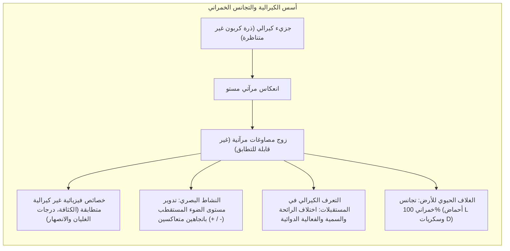
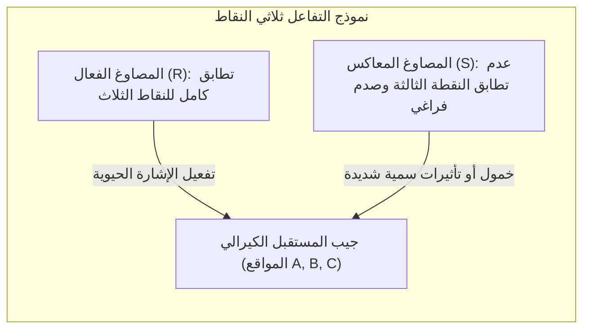
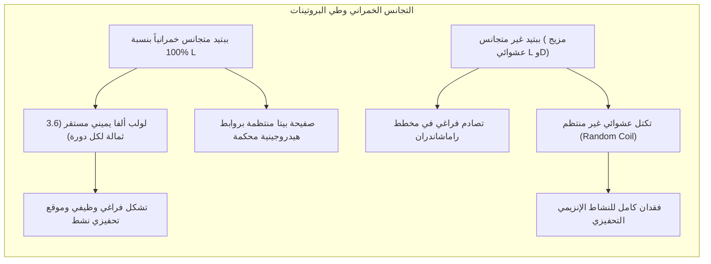
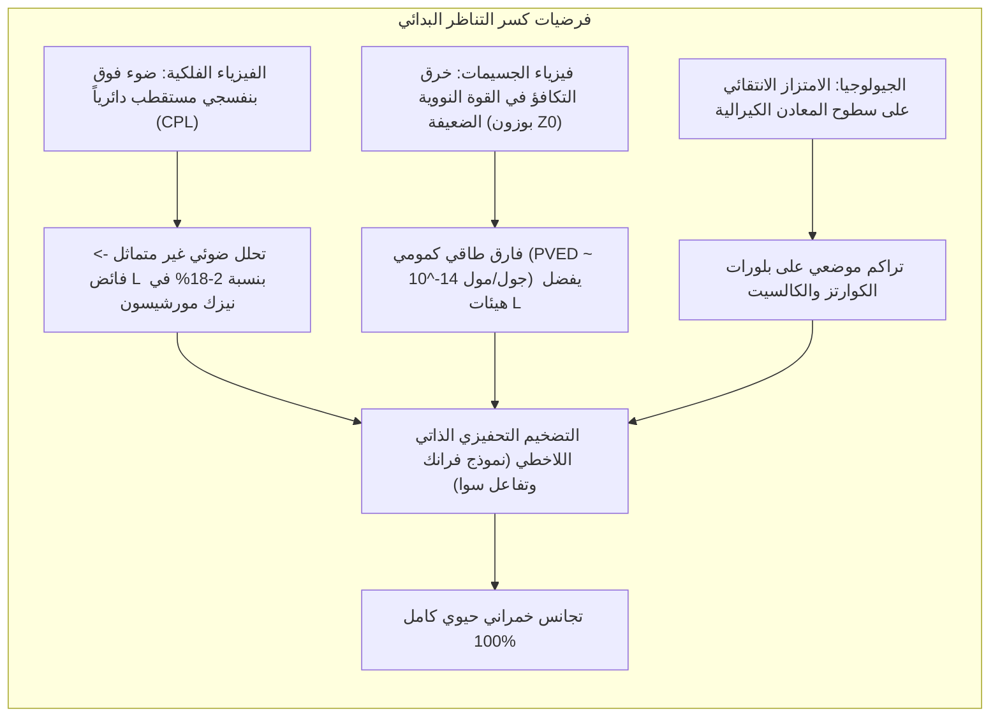
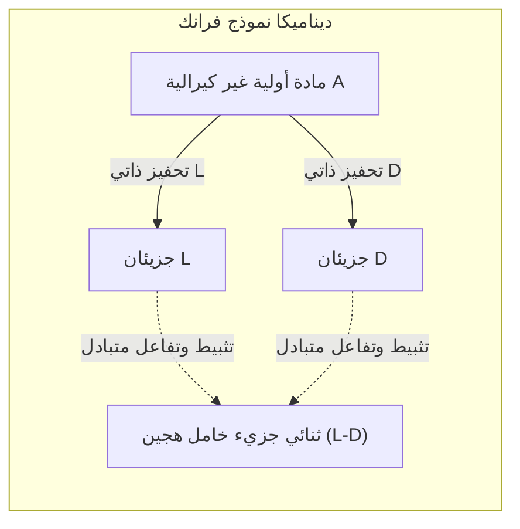

تأمل يديك بعناية. تمتلك يدك اليسرى ويدك اليمنى المكونات التشريحية ذاتها بدقة: خمسة أصابع، والمفاصل ذاتها، والنسب الهندسية عينها. ومع ذلك، مهما حاولت تدوير يدك اليسرى في الفضاء ثلاثي الأبعاد، فلن تتمكن أبداً من مطابقتها كلياً فوق يدك اليمنى بحيث تتجه راحتا اليدين إلى الاتجاه ذاته. إنهما صورتان متطابقتان في المرآة، غير قابلتين للتراكب. تسمى هذه الخاصية الهندسية في الفيزياء والكيمياء باسم <strong>الكيرالية (Chirality)</strong>، وهي كلمة مشتقة من اليونانية *cheir* وتعني «اليد».

عندما يقوم الكيميائي بتخليق جزيئات كيرالية في المختبر انطلاقاً من مواد أولية غير كيرالية، تفرض الديناميكا الحرارية إنتاج خليط متساو بنسبة 50% للجزيء الأيمن و50% للجزيء الأيسر، وهو ما يُعرف باسم <strong>الخليط الراسيمي (Racemate)</strong> الخامل بصرياً.

غير أن الحياة على كوكب الأرض كسرت هذا التناظر بشكل مطلق منذ 3.8 مليار سنة على الأقل، فيما يُعرف باسم <strong>التجانس الخمراني البيولوجي (Biological Homochirality)</strong>:
- <strong>البروتينات:</strong> جميع الإنزيمات والبروتينات في الكائنات الحية مبنية حصرياً من <strong>أحماض أمينية من النمط L</strong> (اليسارية).
- <strong>الأحماض النووية:</strong> يتكون الهيكل السكري للدنا (DNA) والرنا (RNA) حصرياً من <strong>سكريات من النمط D</strong> (دي-ريبوز ودي-ديوكسي ريبوز، اليمينية).

لماذا اختار التطور الكيميائي المبكر أحماض L وسكريات D، ورفض النظام المرآتي المعاكس؟



---

## 1. ولادة الكيمياء الفراغية: لويس باستور وبلورات حمض الطرطريك

بدأت قصة الكيرالية الجزيئية عام 1848 على يد العالم الفرنسي الشاب <strong>لويس باستور</strong>. كان الكيميائيون آنذاك في حيرة أمام حمض الطرطريك المستخرج من براميل النبيذ، والذي كان يدير مستوى الضوء المستقطب إلى اليمين ($(+)$). وفي المقابل، كان حمض الباراتارترك (الراسيمي) المخلق اصطناعياً بتركيبه الكيميائي المطابق عاجزاً عن تدوير الضوء.

قام باستور ببلورة ملح طرطرات الصوديوم والأمونيوم المزدوج عند درجة حرارة أقل من 28 مئوية. وعند فحص البلورات تحت المجهر، لاحظ أنها تحمل أوجه أشكال نصفية غير متناظرة تنقسم إلى مجموعتين متعاكستين كالمرآة.

باستخدام ملقط وعدسة مكبرة، فصل باستور البلورات بصبر:
1. محلول البلورات "اليمينية" أدار الضوء المستقطب مع عقارب الساعة ($+$).
2. محلول البلورات "اليسارية" أدار الضوء بالمقدار ذاته تماماً عكس عقارب الساعة ($-$).
3. وعند مزج المحلولين بنسب متساوية، اختفت الفعالية البصرية تماماً وتجدد الخليط الراسيمي الخامل.

استنتج باستور بعبقرية أن اللاتناظر البلوري العياني هو انعكاس للاتناظر فراغي خفي داخل بنية الجزيئات ذاتها، ليعلن مقولته الشهيرة: *«اللاتناظر هو السمة الجوهرية للحياة»*.

```
   قانون بيو للتدوير البصري النوعي:
   [α]_λ^T = θ / (c · l)
   
   حيث:
   θ = زاوية الدوران المقاسة (بالدرجات)
   c = تركيز المحلول (غرام/ملل)
   l = طول مسار خلية القياس (دسم)
```

---

## 2. نموذج التفاعل ثلاثي النقاط ومأساة الثاليدوميد

لماذا يستجيب الجسم البشري بفارق هائل بين متصاوغين يتشابهان تماماً في الوزن الجزيئي ونقاط الغليان؟ لأن المستقبلات الحيوية في الخلايا مكونة من أحماض أمينية يسارية، ما يجعلها جيوباً ثلاثية الأبعاد غير متناظرة.

يوضح <strong>نموذج النقاط الثلاث لإيسون وستيدمان (1933)</strong> أنه لحدوث استجابة حيوية محددة، يجب أن تتطابق ثلاث مجموعات وظيفية من الدواء في آن واحد مع ثلاثة مواقع متكاملة في جيب المستقبل. أما المصاوغ المرآتي فلا يستطيع مواءمة سوى موقعين فقط، بينما يصطدم الموقع الثالث فراغياً أو يتجه نحو الفراغ.



### أمثلة الروائح الكيرالية
- يمنح المصاوغ <strong>(R)-(-)-كارفون</strong> رائحة النعناع الأخضر المنعش (*Spearmint*).
- بينما ينشط المصاوغ <strong>(S)-(+)-كارفون</strong> مستقبلات مختلفة ليطلق رائحة بذور الكراوية.
- وبالمثل، يفوح <strong>(R)-(+)-ليمونين</strong> برائحة البرتقال، بينما يعطي <strong>(S)-(-)-ليمونين</strong> رائحة الصنوبر وزيت التربنتين.

### كارثة الثاليدوميد ومستقبل السيريبلون
كانت كارثة دواء <strong>الثاليدوميد</strong> في أواخر خمسينيات القرن الماضي أكثر الحوادث المأساوية الناتجة عن إهمال الكيمياء الفراغية في الطب. تم تسويق الدواء كمهدئ راسيمي لعلاج الغثيان الصباحي لدى الحوامل، مما تسبب في ولادة أكثر من 10,000 طفل بتشوهات جنينية فادحة في الأطراف (الفقمية).

أثبتت أبحاث البيولوجيا الجزيئية الحديثة أن:
- المصاوغ <strong>(R)</strong> مهدئ آمن وفعال.
- المصاوغ <strong>(S)</strong> يرتبط بقوة ببروتين <strong>السيريبلون (CRBN)</strong>، وهو جزء من إنزيم E3 يوبيكويتين ليغيز، مما يؤدي إلى تدمير عامل النسخ الجنيني <strong>SALL4</strong> الضروري لنمو الأطراف.

وحتى لو تم إعطاء المصاوغ (R) نقياً، لما تم تجنب الكارثة، لأن ذرة الهيدروجين عند المركز الكيرالي تخضع في دم الإنسان عند درجة الحموضة الفسيولوجية ($7.4$) لتصاوغ كيتو-إينول سريع يؤدي إلى إعادة التحول الراسيمي الكامل في الجسم خلال 4 إلى 5 ساعات فقط.

---

## 3. لماذا تحتاج الحياة إلى التجانس الخمراني؟ الحتمية البيوفيزيائية

هل كان بإمكان الحياة البدائية أن تنشأ من خليط هجين غير متجانس من أحماض L وD؟ تجيب الفيزياء الحيوية الجزيئية بحسم: <strong>مستحيل</strong>.



### مخطط راماشاندران ولولب ألفا
تتحدد بنية السلاسل البروتينية من خلال زوايا الالتواء ثنائية الوجوه $\phi$ و $\psi$. في <strong>مخطط راماشاندران</strong>، تشغل الأحماض الأمينية L نطاقاً طاقياً مفضلاً يشكل لولب $\alpha$ اليميني المنتظم، والمثبت بروابط هيدروجينية محكمة بين كربونيل الثمالة $i$ وأمين الثمالة $i+4$.

إن إدخال حمض أميني واحد من النمط D داخل سلسلة من النمط L يؤدي إلى توجيه سلسلته الجانبية نحو منطقة اصطدام فراغي محظورة، مما يمزق الروابط الهيدروجينية ويهدم البنية التحتية للبروتين، ويحرم الإنزيم من تشكيل موقعه الفعال.

### التثبيط التقاطعي في تضاعف الرنا
في أبحاث أصل الحياة التي قادها ليزلي أورغل، تم اكتشاف ظاهرة <strong>التثبيط التقاطعي الكيرالي (Chiral Cross-Inhibition)</strong>. فعند محاولة نسخ شريط رنا مكون من سكريات D في وجود نيوكليوتيدات راسيمية، ترتبط نيوكليوتيدات L بنهاية الشريط النامي ولكنها تعطل استمرار البلمرة بسبب التوجيه الفراغي المعاكس. إن غياب التجانس الخمراني التام يوقف التكاثر الجيني الذاتي تماماً.

---

## 4. نظريات كسر التناظر الأولي

كيف نشأ الفائض الأولي لصالح أحماض L وسكريات D قبل ولادة الخلية الأولى؟ تبرز نظريتان رئيسيتان:



### الفرضية الكونية: الضوء المستقطب دائرياً في الفضاء بين النجمي
في عام 1969، سقط نيزك <strong>مورشيسون</strong> الكربوني في أستراليا. أظهرت الفحوص احتواءه على أكثر من 70 حمضاً أمينياً، وتم قياس <strong>فائض كيرالي مستمر للأحماض الأمينية L بنسبة تتراوح بين 2% إلى 18%</strong> في الأحماض غير البروتينية (مثل الإيزوفالين) التي لا تخضع للتحول الراسيمي.

في سدم تشكل النجوم العملاقة، يتشتت الضوء النجمي عبر حبيبات الغبار الموجهة بالمجالات المغناطيسية، مما يولد <strong>ضوءاً مستقطباً دائرياً (CPL)</strong>. يقوم هذا الضوء بهدم أحد المتصاوغين ضوئياً بمعدل أسرع من الآخر، مما خلق فائضاً حيوياً تم نقله إلى الأرض عبر المذنبات والنيازك.

### فرضية فيزياء الجسيمات: خرق التكافؤ في التفاعل الضعيف
أثبتت تجربة شين-شيونغ وو عام 1957 أن <strong>القوة النووية الضعيفة تخرق تناظر التكافؤ (Parity Violation)</strong>. وبسبب تبادل بوزونات $Z^0$، ينشأ فارق طاقي مجهري بين المتصاوغين المرآتيين يُعرف باسم <strong>فارق الطاقة الخارق للتكافؤ (PVED)</strong>. تشير الحسابات الكمومية إلى أن أحماض L وسكريات D أكثر استقراراً بمقدار ضئيل:
$$\Delta E_{\text{PVED}} \approx 10^{-14} \text{ إلى } 10^{-16} \, \text{جول/مول}$$
ورغم ضآلة هذا الفارق، فإنه في الأنظمة المفتوحة البعيدة عن التوازن الحراري كافٍ لتوجيه مسار التضخيم نحو الهيئة السائدة اليوم.

---

## 5. آليات التضخيم اللاخطي: نموذج فرانك وتفاعل سوا

لا يكفي فائض كيرالي أولي بنسبة ضئيلة لبناء الأنظمة الحية. كان لا بد من وجود آلية كيميائية تضخم هذا الخلل الصغير إلى نقاء بنسبة 100%.

### نموذج فرانك الرياضي (1953)
صاغ الفيزيائي البريطاني <strong>فريدريك تشارلز فرانك</strong> نموذجاً حركياً يقوم على مبدأين:
1. <strong>التحفيز الذاتي:</strong> يقوم كل مصاوغ بتحفيز تخليق نسخ جديدة من نفسه ($A + L \rightarrow 2L$).
2. <strong>التثبيط المتبادل:</strong> عندما يلتقي مصاوغ L بمصاوغ D، يتحدان لتشكيل ثنائي جزيء خامل ($L + D \rightarrow LD$).

رياضياً، تخضع معادلة الفارق $\Delta = [L] - [D]$ للعلاقة:
$$\frac{d\Delta}{dt} = k_1 [A] \Delta$$
الحالة الراسيمية ($\Delta = 0$) هي حالة توازن غير مستقر، وأي اضطراب عشوائي طفيف يؤدي إلى مضاعفة سريعة للشكل المتفوق حتى يقضي تماماً على منافسه.



### تفاعل سوا: الإثبات المعملي الملموس
في عام 1995، حقق الكيميائي الياباني <strong>كينسو سوا</strong> إنجازاً تاريخياً بتطبيق نموذج فرانك عملياً. ففي تفاعل إضافة ثنائي إيزوبروبيل الخارصين إلى بيريميدين-5-كاربالدهيد، يعمل الكوكسيد الخارصين الكيرالي الناتج كمحفز ذاتي لتخليق نفسه. وعند إضافة بادئ كيرالي بفائض أولي لا يتعدى <strong>$0.00005\%$ (50 جزءاً في المليار)</strong>، يضخم النظام نفسه تلقائياً عبر دورات متتالية ليصل إلى نقاء بصري يفوق <strong>$99.5\%$ ee</strong>!

---

## 6. البيولوجيا التخليقية: آفاق وأخطار «الحياة المرآتية» (Mirror Life)

ماذا لو نجح العلماء في بناء خلية حية متكاملة تعتمد كلياً على <strong>أحماض D وسكريات L</strong>؟

### الإنجازات الراهنة
نجحت فرق بحثية رائدة بقيادة تينغ تشو في تخليق إنزيمات بلمرة دنا مصنوعة بالكامل من أحماض D قادرة على نسخ وتضخيم لولب L-DNA في المختبر.

### التطبيقات العلاجية والمخاطر البيئية
- <strong>الفوائد الدوائية:</strong> الجزيئات المرآتية مثل <strong>السبيجلمرات (Spiegelmers)</strong> والببتيدات اليمينية لا تتعرف عليها إنزيمات التفكيك في الجسم البشري، مما يجعلها أدوية فائقة الاستقرار وطويلة الأمد لعلاج الأورام.
- <strong>التهديدات الحيوية الكارثية:</strong> البكتيريا المرآتية المستقلة القادرة على التكاثر الذاتي ستكون عصية على الجهاز المناعي للثدييات، ومنيعة ضد الفيروسات البكتيرية الطبيعية. وإذا تسربت إلى البيئة الطبيعية، فقد تلتهم الموارد غير الكيرالية وتسبب اضطراباً لا رجعة فيه للنظام البيئي العالمي.

---

## الخلاصة

إن التجانس الخمراني ليس مصادفة هامشية في تاريخ التطور، بل هو الدعامة الهندسية التي لا غنى عنها لبناء الآلات الإنزيمية الدقيقة وشفرة الوراثة. وتكشف رحلة البحث عن أصل هذه اليد البيولوجية عن تناغم وثيق يربط ضوء السدم الكونية بقوانين فيزياء الجسيمات وبدايات الحياة على كوكبنا.
