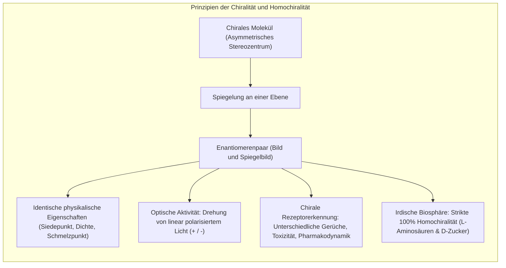
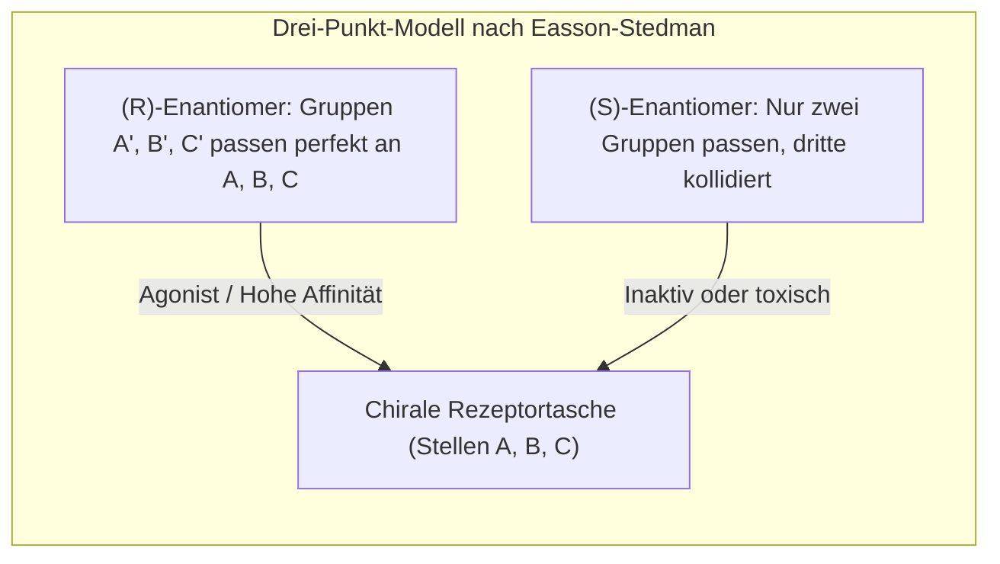
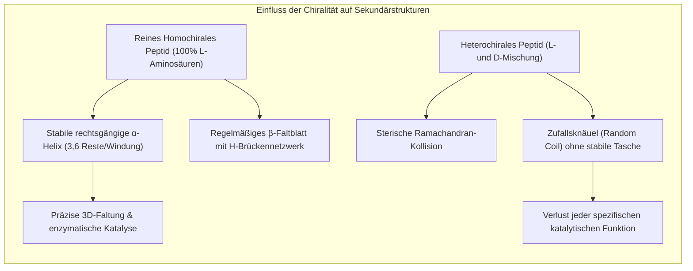
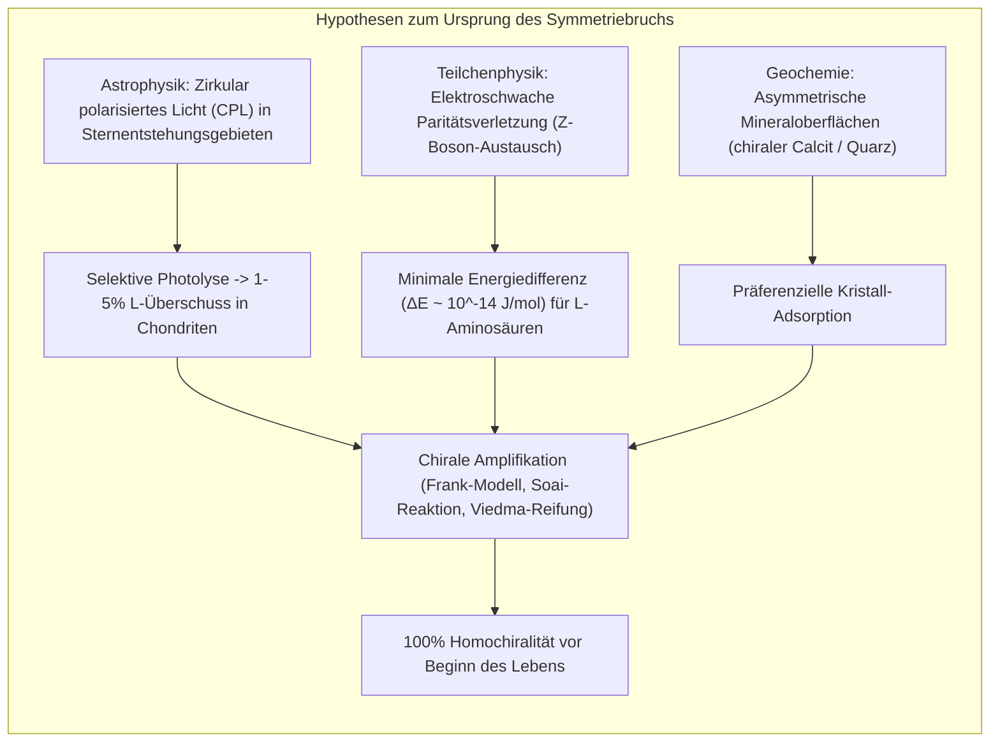
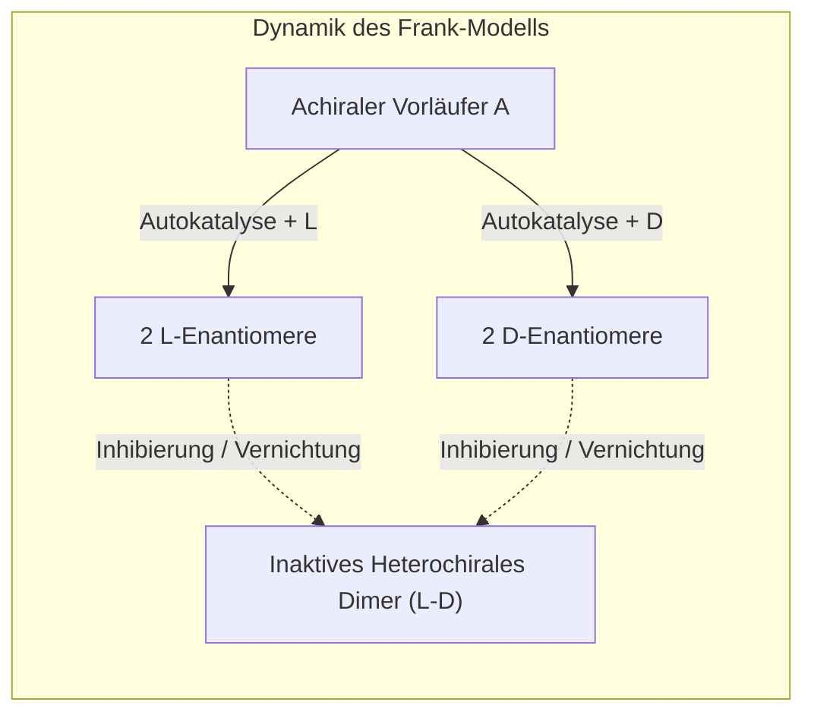

Betrachten Sie Ihre Hände. Ihre linke und Ihre rechte Hand besitzen identische Komponenten: fünf Finger, dieselben Gelenke, dieselben Proportionen. Dennoch können Sie Ihre linke Hand im dreidimensionalen Raum drehen und wenden, wie Sie wollen – sie lässt sich niemals perfekt mit Ihrer rechten Hand zur Deckung bringen. Sie verhalten sich wie Bild und Spiegelbild. Diese fundamentale geometrische Eigenschaft, nicht mit dem eigenen Spiegelbild deckungsgleich zu sein, bezeichnet man in der Chemie als <strong>Chiralität</strong> (vom griechischen Wort *cheir* für Hand).

Wenn Chemiker chirale Moleküle im Labor aus achiralen Vorläufern synthetisieren, entsteht unter gewöhnlichen thermodynamischen Bedingungen stets ein 1:1-Gemisch aus beiden Spiegelbildformen – ein sogenanntes <strong>Racemat</strong>. Die Bildungsenthalpien und freien Energien beider Enantiomere sind im achiralen Raum vollkommen identisch.

Doch das irdische Leben bricht diese thermodynamische Symmetrie seit mindestens 3,8 Milliarden Jahren auf absolut radikale Weise:
- <strong>Proteine:</strong> Nahezu alle Enzyme und Strukturproteine sämtlicher Lebewesen bestehen ausschließlich aus <strong>L-Aminosäuren</strong> (linksdrehend).
- <strong>Nukleinsäuren:</strong> Das informationstragende Rückgrat von DNA und RNA baut ausschließlich auf <strong>D-Zuckern</strong> (D-Ribose und D-Desoxyribose, rechtsdrehend) auf.

Dieses Phänomen, dass biologische Systeme ausschließlich eine einzige Enantiomerenform verwenden, nennt man <strong>biologische Homochiralität</strong>. Es ist eines der tiefsten ungelösten Rätsel der modernen Naturwissenschaften: Warum wählte die präbiotische Chemie genau L-Aminosäuren und D-Zucker und nicht das umgekehrte Spiegeluniversum?



---

## 1. Die Geburtsstunde der Stereochemie: Louis Pasteur und die Weinsäure

Die Entdeckung der molekularen Asymmetrie geht auf das Jahr 1848 und den jungen französischen Chemiker <strong>Louis Pasteur</strong> zurück. Pasteur untersuchte Salze der Weinsäure (Tartrate), die sich als Nebenprodukt bei der Weinherstellung in Fässern ablagerten. 

Physiker hatten zuvor festgestellt, dass aus Weintrestern gewonnene Weinsäurelösungen die Polarisationsebene des Lichts im Uhrzeigersinn nach rechts drehten (dextrorotatorisch, $(+)$). Synthetisch hergestellte "Traubensäure" (Paratartratsäure) mit exakt derselben chemischen Formel erwies sich dagegen als optisch inaktiv.

Pasteur kristallisierte das Natrium-Ammonium-Salz der Traubensäure unterhalb von 28 °C aus. Unter dem Mikroskop erkannte er verblüfft, dass die Kristalle asymmetrische Facetten (hemihedrische Flächen) besaßen, die in zwei spiegelbildlichen Formen auftraten. 

Mit einer Pinzette trennte Pasteur geduldig Kristall für Kristall in zwei Häufchen. Als er beide Fraktionen separat in Wasser löste, geschah das historische Wunder:
1. Die eine Lösung drehte linear polarisiertes Licht exakt nach rechts ($+$).
2. Die andere Lösung drehte das Licht im genau gleichen Betrag nach links ($-$).
3. Mischte man beide Lösungen zu gleichen Teilen, hob sich die Drehung auf – das optisch inaktive Racemat war wiederhergestellt.

Pasteur schloss daraus messerscharf: Die makroskopische Asymmetrie der Kristalle reflektiert eine innere, unsichtbare Asymmetrie der Moleküle selbst. Pasteur formulierte später die kühne Hypothese, dass Asymmetrie das universelle Kennzeichen des lebendigen Universums sei (*L'asymétrie, c'est la vie*).

```
   Pasteurs optische Drehung:
   [α]_λ^T = θ / (c · l)
   
   wobei:
   θ = gemessener Drehwinkel in Grad
   c = Konzentration der Lösung (g/mL)
   l = Schichtdicke der Messküvette (dm)
```

---

## 2. Der biologische Schlüssel-Schloss-Mechanismus und die Thalidomid-Katastrophe

Warum reagiert der biologische Organismus so extrem unterschiedlich auf zwei Moleküle, die sich physikalisch wie Bild und Spiegelbild gleichen? Die Antwort liegt in der Chiralität der zellulären Rezeptoren selbst. Da Rezeptoren aus L-Aminosäuren aufgebaut sind, bilden sie asymmetrische dreidimensionale Bindungstaschen.

Das klassische <strong>Dreipunkt-Interaktionsmodell nach Easson und Stedman (1933)</strong> verdeutlicht dies: Damit ein Molekül ein spezifisches biologisches Signal auslöst, müssen drei funktionelle Gruppen (z. B. eine hydrophobe Tasche, ein Wasserstoffbrücken-Donor und eine ionische Bindung) gleichzeitig an drei komplementäre Bindungsstellen des Rezeptors andocken. Dreht man das Molekül in seine Spiegelform um, können maximal zwei der drei Gruppen andocken – das Signal bleibt aus oder bindet an vollkommen andere Rezeptoren.



### Die Geruchsmoleküle: Carvon und Limonen
Ein alltägliches Beispiel für chirale Rezeptorunterscheidung ist <strong>Carvon</strong>:
- <strong>(S)-(+)-Carvon</strong> riecht intensiv nach Kümmel.
- <strong>(R)-(-)-Carvon</strong> riecht frisch nach grüner Minze (Spearmint).
Ebenso duftet <strong>(R)-(+)-Limonen</strong> nach Orangen, während <strong>(S)-(-)-Limonen</strong> nach Terpentin und Zitronenschalen riecht.

### Die Contergan-Tragödie: Thalidomid und das Cereblon-Protein
Die schrecklichste Konsequenz chiraler Blindheit in der Pharmakologie war die <strong>Thalidomid-Katastrophe (Contergan)</strong> Ende der 1950er und Anfang der 1960er Jahre. Thalidomid wurde als beruhigendes und schlafförderndes Mittel speziell für schwangere Frauen gegen Morgenübelkeit vertrieben – als 50:50-Racemat.

Jahrzehnte später klärte die molekulare Kristallographie den exakten Mechanismus auf:
- Das <strong>(R)-Enantiomer</strong> entfaltet die gewünschte sedierende und schlaffördernde Wirkung ohne teratogene Schäden.
- Das <strong>(S)-Enantiomer</strong> bindet mit hoher Affinität an das Protein <strong>Cereblon (CRBN)</strong>, das Teil eines E3-Ubiquitin-Ligase-Komplexes ist. Diese Bindung verändert die Substratspezifität der Ligase, was zum gezielten Abbau lebenswichtiger Transkriptionsfaktoren wie <strong>SALL4</strong> in embryonalen Extremitätenknospen führt. Die Folge waren schwere Fehlbildungen (Phokomelie, Amelie) bei über 10.000 Neugeborenen weltweit.

Selbst wenn man damals nur reines (R)-Thalidomid verabreicht hätte, wäre die Tragödie nicht verhindert worden: Das asymmetrische Proton am chiralen Zentrum von Thalidomid tauscht sich im menschlichen Blutplasma bei physiologischem pH-Wert (7,4) durch Tautomerie spontan aus. Die Halbwertszeit der Racemisierung *in vivo* beträgt lediglich 4 bis 5 Stunden.

---

## 3. Warum benötigt das Leben Homochiralität? Biophysikalische Notwendigkeit

Könnte ein primitives Lebewesen nicht einfach aus einer heterochiralen Mischung von L- und D-Aminosäuren bestehen? Die biophysikalische Antwort lautet unmissverständlich: <strong>Nein</strong>. 



### Das Ramachandran-Diagramm und Helix-Architekturen
In einer Proteinkette hängen die erlaubten Raumstrukturen von den Torsionswinkeln $\phi$ (Phi) und $\psi$ (Psi) um die $C_\alpha$-Kohlenstoffatome ab. Im <strong>Ramachandran-Diagramm</strong> belegen L-Aminosäuren bevorzugt den linken Quadranten für rechtsgängige $\alpha$-Helices ($\phi \approx -57^\circ, \psi \approx -47^\circ$).

Wird an einer einzigen Stelle einer L-Peptidkette eine D-Aminosäure eingebaut, zeigt deren Seitenkette in eine räumlich verbotene Richtung. Die ideale Wasserstoffbrücke zwischen der $C=O$-Gruppe des Rests $i$ und der $N-H$-Gruppe des Rests $i+4$ wird zerrissen. Die geordnete Sekundärstruktur bricht lokal zusammen. Ohne rigide Sekundärstrukturen gibt es keine definierten katalytischen Zentren in Enzymen.

### Die DNA-Doppelhelix und Chiralitäts-Gift
Das Rückgrat der DNA besteht aus D-2-Desoxyribose, die sich in einer $C2'$-endo oder $C3'$-endo Konformation anordnet und so die berühmte rechtsgängige <strong>B-DNA-Doppelhelix</strong> mit Watson-Crick-Basenpaarung ermöglicht.

Ersetzt man in einem DNA-Strang stochastisch D-Zucker durch L-Zucker, können sich die komplementären Basen nicht mehr koplanar anordnen. Die Stapelwechselwirkung (Pi-Pi-Stacking) bricht ab. In präbiotischen Replikationsexperimenten von Leslie Orgel zeigte sich das Phänomen der <strong>Enantiomeren-Vergiftung (Chiral Cross-Inhibition)</strong>: Wenn eine Template-Kette aus reinem D-RNA-Polymer vorliegt, lagern sich monomere L-Nukleotide an das Kettenende an, können aber die nächste Phosphodiesterbindung nicht ausbilden. Der Replikationsprozess erstirbt schlagartig.

Um Leben hervorzubringen, musste das chemische System daher vor dem Start der replizierenden Evolution eine nahezu 100-prozentige Homochiralität erreicht haben.

---

## 4. Theorien zum Ursprung: Wie brach die kosmische und irdische Symmetrie?

Wie konnte in einer ursprünglich symmetrischen präbiotischen Welt eine Überzahl für L-Aminosäuren und D-Zucker entstehen? Wissenschaftler unterscheiden zwei Phasen:
1. <strong>Der deterministische oder stochastische Ursprungsimpuls (Symmetriebruch)</strong>: Erzeugung eines winzigen Enantiomerenüberschusses ($ee = |R-S|/(R+S)$).
2. <strong>Die chirale Verstärkung (Amplifikation)</strong>: Vergrößerung dieses winzigen Ungleichgewichts von z. B. $0{,}01\%$ auf über $99{,}9\%$.



### Hypothese A: Kosmische Bestrahlung durch zirkular polarisiertes UV-Licht
1969 stürzte in Australien der <strong>Murchison-Meteorit</strong> ab, ein kohlenstoffhaltiger Chondrit. Analysen ergaben, dass dieser Meteorit über 70 verschiedene Aminosäuren enthielt – darunter viele, die auf der Erde biologisch gar nicht vorkommen (wie Isovalin oder $\alpha$-Methylalanin). Das sensationelle Ergebnis: Bei mehreren nicht-proteinogenen Aminosäuren wurde ein konstanter <strong>L-Enantiomerenüberschuss von 2 % bis 18 %</strong> nachgewiesen. Da diese Aminosäuren kein asymmetrisches $\alpha$-Wasserstoffatom besitzen, können sie nicht racemisieren; der Überschuss stammt direkt aus dem interstellaren Raum.

In massereichen Sternentstehungsgebieten wie dem Orion-Nebel wird infrarotes und ultraviolettes Licht an ausgerichteten interstellaren Staubkörnern gestreut, wodurch bis zu 17 % <strong>zirkular polarisiertes Licht (CPL)</strong> entsteht. Zirkular polarisiertes Licht absorbiert chiral: Rechtsdrehendes Licht (R-CPL) zerstört bevorzugt das eine Enantiomer durch Photodissoziation, während das andere Enantiomer überproportional überlebt (asymmetrische Photolyse). Meteoriten brachten dieses chirale Material auf die junge Erde.

### Hypothese B: Die elektroschwache Wechselwirkung und Paritätsverletzung
In der fundamentalen Physik galt bis 1956 die Annahme, dass alle Naturgesetze spiegelsymmetrisch seien (Paritätserhaltung). Chien-Shiung Wu bewies jedoch 1957 beim Betazerfall von Kobalt-60, dass die <strong>schwache Kernkraft die Paritätssymmetrie maximal verletzt</strong>. Elektronen aus dem Betazerfall sind stets linkshändig spinpolarisiert.

Durch den Austausch virtueller $Z^0$-Bosonen zwischen Elektronen und Atomkernen entsteht eine mikroskopische elektro-schwache paritätsverletzende Energiedifferenz (<strong>PVED</strong>: *Parity-Violating Energy Difference*). Berechnungen der Quantenchemie zeigen, dass natürliche L-Aminosäuren und D-Zucker um eine winzige Winzigkeit thermodynamisch stabiler sind als ihre Spiegelbilder:
$$\Delta E_{\text{PVED}} \approx 10^{-14} \text{ bis } 10^{-17} \, \text{J/mol}$$
Dieser Unterschied ist extrem gering (ein Unterschied von nur 1 Molekül pro $10^{17}$ Molekülen), doch in Systemen fern des thermodynamischen Gleichgewichts könnte dieser infinitesimale Bias als Auslöser für eine makroskopische Phasenverschiebung gedient haben.

---

## 5. Nichtlineare Verstärkungsmechanismen: Das Frank-Modell und die Soai-Reaktion

Ein Enantiomerenüberschuss von wenigen Prozent reicht bei weitem nicht aus, um Leben zu ermöglichen. Wie konnte das Universum diesen Hauch von Asymmetrie auf $100\%$ verstärken?

### Das mathematische Frank-Modell (1953)
Der britische Physiker <strong>Frederick Charles Frank</strong> formulierte 1953 ein wegweisendes mathematisches Modell der spontanen asymmetrischen Synthese. Frank postulierte zwei Grundregeln:
1. <strong>Autokatalyse:</strong> Jedes Enantiomer katalysiert die Bildung seiner eigenen Moleküle ($A + L \rightarrow 2L$ und $A + D \rightarrow 2D$).
2. <strong>Gegenseitige Antagonisierung (Mutual Inhibition):</strong> Treffen L und D aufeinander, reagieren sie irreversibel zu einem inaktiven Dimer ($L + D \rightarrow LD$), das für den autokatalytischen Zyklus verloren ist.

Die Differentialgleichungen des Frank-Systems lauten:
$$\frac{d[L]}{dt} = k_1 [A][L] - k_2 [L][D]$$
$$\frac{d[D]}{dt} = k_1 [A][D] - k_2 [L][D]$$

Subtrahiert man beide Gleichungen und setzt $\Delta = [L] - [D]$, so ergibt sich:
$$\frac{d\Delta}{dt} = k_1 [A] \Delta$$
Der Zustand des perfekten Racemats ($[L] = [D]$ bzw. $\Delta = 0$) ist ein instabiler Sattelpunkt. Jede noch so winzige Fluktuation führt dazu, dass die im leichten Vorsprung liegende Spezies die andere durch Dimerisierung auslöscht und den gesamten Reaktandenpool übernimmt.



### Die Soai-Reaktion: Der experimentelle Beweis
Jahrzehntelang galt Franks Idee als reine theoretische Spielerei. Doch 1995 gelang dem japanischen Chemiker <strong>Kenso Soai</strong> (Tokyo University of Science) ein epochaler Durchbruch.

Bei der Alkylierung von Pyrimidin-5-carbaldehyden mit Diisopropylzink fungiert das resultierende chirale Zink-Alkoxid als autokatalytischer Beschleuniger für seine eigene Synthese. Gibt man dem Reaktionsgemisch winzige Spuren eines chiralen Initiators mit einem Enantiomerenüberschuss von nur <strong>$0{,}00005\%$ (50 ppb)</strong> bei, amplifiziert sich das System über mehrere Zyklen zu einem optisch reinen Produkt mit einem Überschuss von über <strong>$99{,}5\%$ ee</strong>! 

Sogar chirale anorganische Mineralien (wie enantiomorphe Quarzkristalle) oder links- und rechtszirkular polarisiertes Licht reichen als initialer Soai-Trigger aus.

### Die Viedma-Reifung
2005 entdeckte der spanische Geologe <strong>Cristobal Viedma</strong> einen physikalischen Weg zur vollständigen Homochiralität durch Reiben von Kristallen (*Attrition-enhanced deracemization*). Mahlt man eine gesättigte Lösung chiral kristallisierender Verbindungen (wie Natriumchlorat) mit Glaskugeln, wandeln sich durch kontinuierliches Auflösen und Neukristallisieren winzige Kristalle in makroskopische Einkristalle derselben Händigkeit um. Am Ende bleibt nur noch ein einziges Enantiomer übrig.

---

## 6. Synthetische Biologie: Das Wagnis des 'Spiegel-Lebens' (Mirror Life)

Was würde passieren, wenn wir im Labor ein vollwertiges künstliches Lebewesen erschaffen, das vollständig aus <strong>D-Aminosäuren und L-Zuckern</strong> besteht? Dieses Konzept nennt man <strong>Spiegel-Leben (Mirror-Image Life)</strong>.

### Der aktuelle Stand der Forschung
Forschungsgruppen um Ting Zhu (Tsinghua-Universität) und George Church (Harvard University) synthetisieren schrittweise die Schlüsselkomponenten einer spiegelbildlichen Molekularbiologie:
- <strong>D-Polymerasen:</strong> Aus rein synthetischen D-Aminosäuren zusammengesetzte Enzyme, die in der Lage sind, L-DNA zu replizieren und L-RNA zu transkribieren.
- <strong>Spiegel-Ribosomen:</strong> Die monumentale Hürde besteht im Zusammenbau eines ribosomalen Komplexes aus über 50 D-Proteinen und mehreren L-rRNA-Strängen.

### Chancen und fundamentale Bio-Sicherheitsrisiken
Die biomedizinischen Verheißungen von Spiegelmolekülen sind gewaltig: <strong>L-DNA-Aptamere (Spiegelmere)</strong> und D-Peptidtherapeutika werden von den Proteasen und Nukleasen unseres Körpers nicht erkannt und besitzen deshalb eine enorm lange Halbwertszeit ohne Abbau.

Doch die Erschaffung eines sich autonom teilenden Spiegel-Bakteriums birgt unkalkulierbare ökologische Risiken:
1. <strong>Immunologisches Vakuum:</strong> Unsere Phagozyten, T-Zell-Rezeptoren und Antikörper basieren auf L-Aminosäuren. Ein infektiöses Spiegel-Bakterium wäre für das adaptive Immunsystem von Tieren und Menschen unsichtbar.
2. <strong>Ökologische Unangreifbarkeit:</strong> Natürliche Viren (Bakteriophagen) und Fressfeinde könnten Spiegel-Bakterien nicht infizieren oder lysieren.
3. <strong>Konkurrenz um achirale Ressourcen:</strong> Da Spiegelbakterien Phosphat, Stickstoff, Ammoniak und achirale Kohlenstoffquellen konsumieren könnten, ohne in die Nahrungskette zurückgeführt zu werden, könnten sie bestehende Ökosysteme irreversibel stören.

---

## Fazit: Die Handschrift des Universums

Die Homochiralität des Lebens ist kein zufälliges Ornament der Evolution, sondern die unabdingbare physikalische Voraussetzung für die Architektur des Erbguts und die Präzision enzymatischer Maschinen. 

Ob der fundamentale Anstoß aus dem ultravioletten Leuchten zirkular polarisierter interstellarer Nebel kam oder in den Tiefen der paritätsverletzenden schwachen Wechselwirkung verwurzelt ist – das Phänomen demonstriert eindrucksvoll, wie kosmische Physik, nichtlineare chemische Netzwerke und biologische Makromoleküle ineinandergreifen, um die unverwechselbare 'Händigkeit' des irdischen Lebens zu formen.
