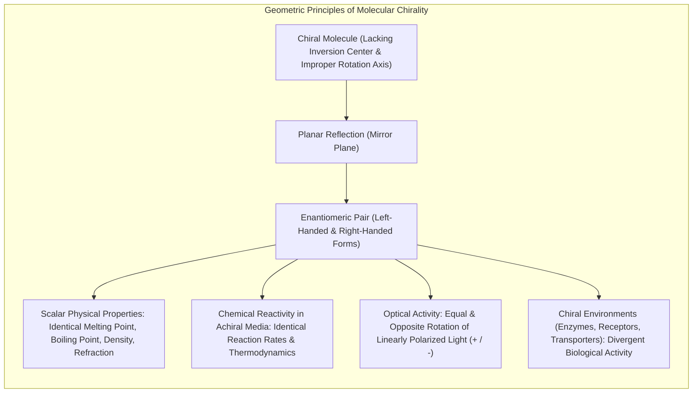
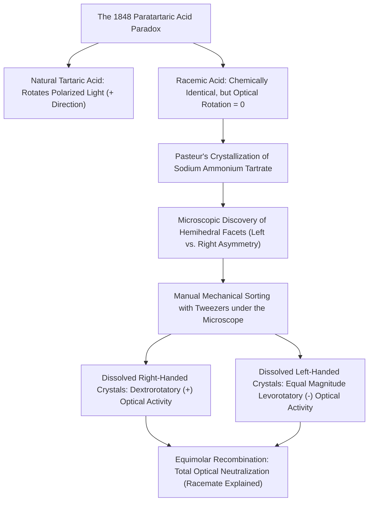
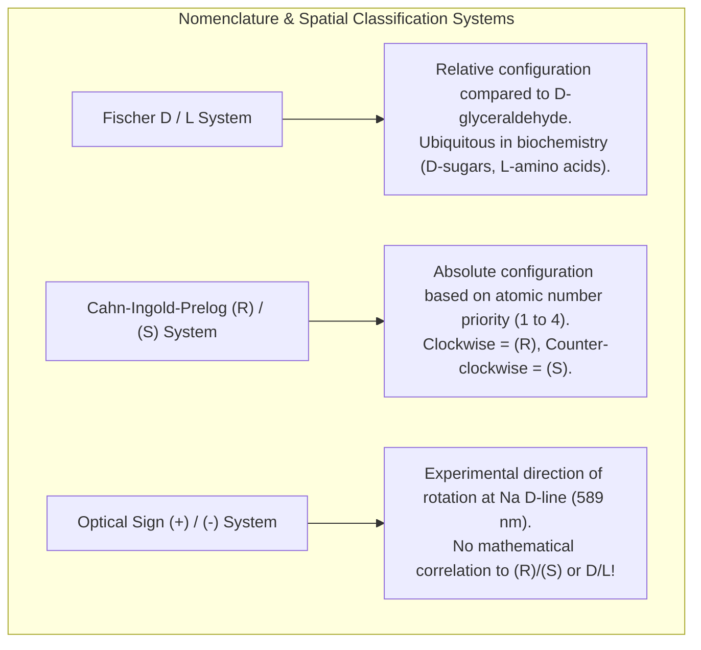
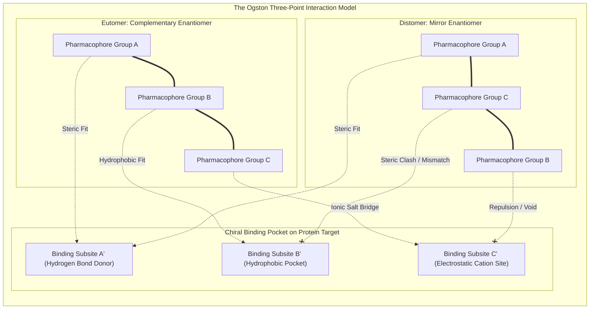
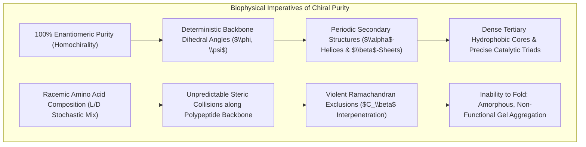
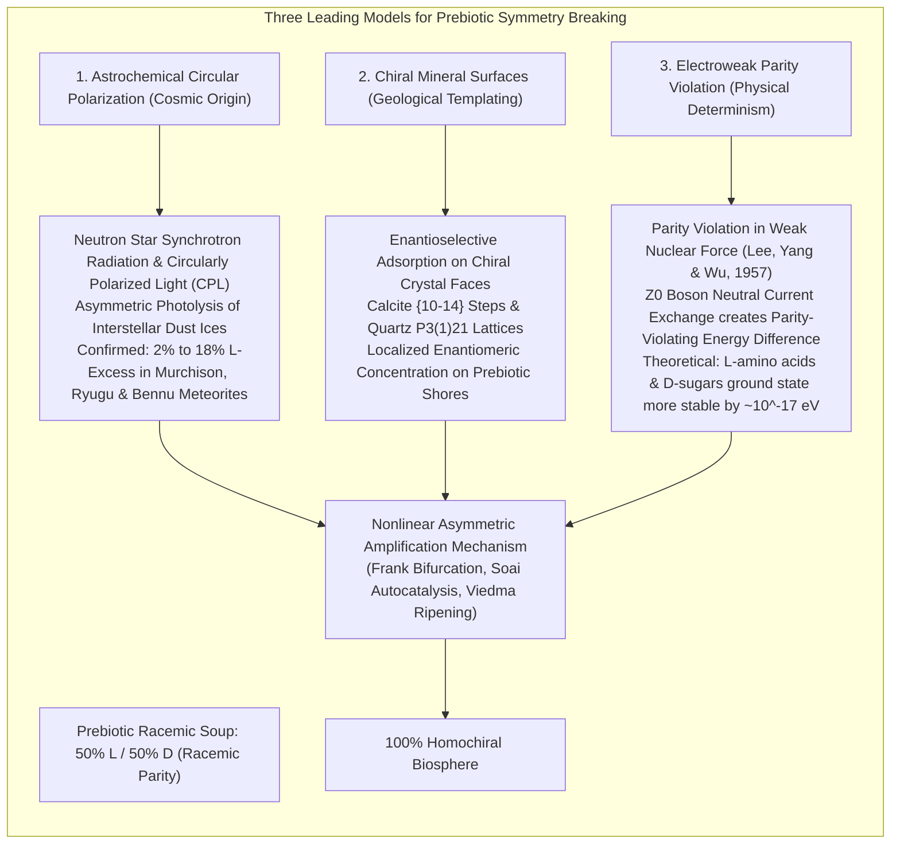
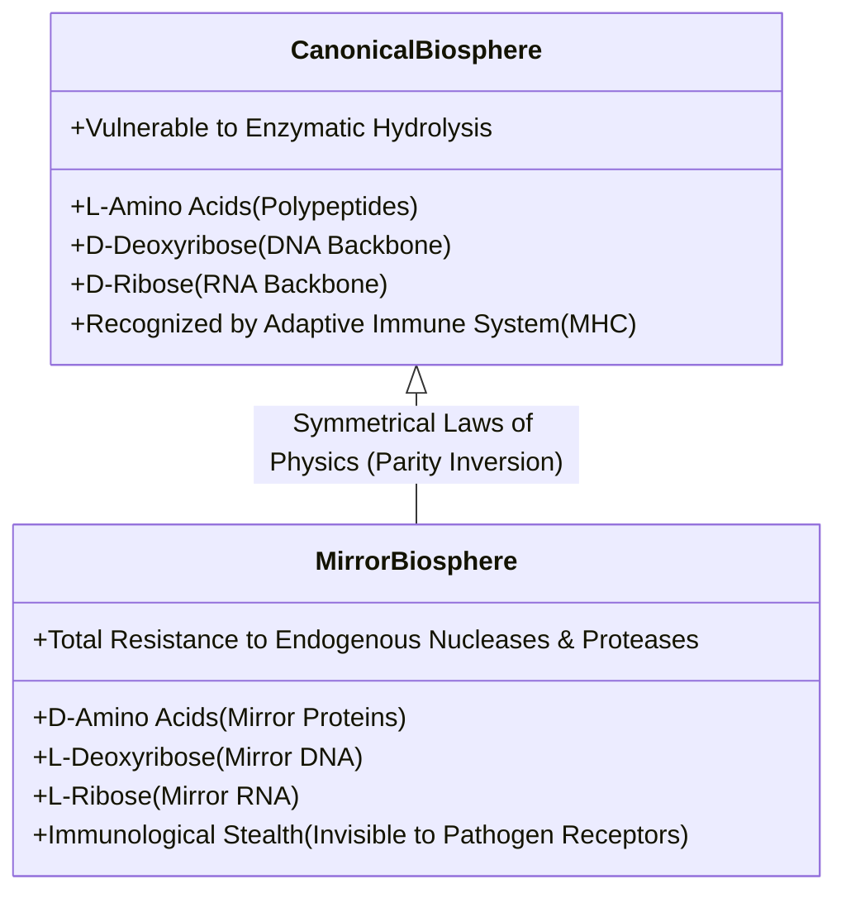

Hold both hands before you, palms facing inward. The left hand and the right hand are composed of identical anatomical components: five digits arranged in homologous sequence, equivalent skeletal geometries, and mirrored articulatory ranges. Yet, if you attempt to place your right hand into a left-handed leather glove, it will not fit. The two hands are non-superimposable mirror images of one another.

This fundamental geometric property is known as <strong>chirality</strong> (derived from the Greek *cheir*, meaning "hand"). In chemistry, molecules that possess this non-superimposable mirror-image relationship are designated <strong>enantiomers</strong>.



In the ordinary abiotic chemistry of an industrial or academic laboratory, the synthesis of a chiral organic compound from achiral starting reagents invariably produces an equimolar, 50:50 mixture of both enantiomers—a state known as a <strong>racemate (or racemic mixture)</strong>. Because the transition-state free energies ($\Delta G^\ddagger$) for the formation of the left-handed and right-handed isomers are mathematically identical in an isotropic, achiral universe, thermal fluctuations ensure absolute thermodynamic parity.

Yet, when we examine terrestrial biology, this thermodynamic symmetry is annihilated. 

Across every domain of life—from ancient deep-sea archaea and extremophilic bacteria to sequoia trees and human beings—terrestrial biochemistry is defined by <strong>homochirality (single handedness)</strong>:
- <strong>Proteins:</strong> The primary structural, catalytic, and signaling machinery of life is constructed exclusively from <strong>L-enantiomers of $\alpha$-amino acids</strong> (with the sole exception of achiral glycine).
- <strong>Nucleic Acids:</strong> The genetic data tape of the biosphere—RNA and DNA—is composed exclusively of <strong>D-enantiomers of ribose and 2-deoxyribose</strong>.

Life does not merely tolerate homochirality; it *demands* it. A peptide chain synthesized from an arbitrary, racemic mixture of L- and D-amino acids cannot fold into stable $\alpha$-helices or $\beta$-pleated sheets; its hydrogen-bonding networks collapse beneath insurmountable steric collisions. A racemic nucleic acid strand cannot assemble into a Watson-Crick double helix; the spatial periodicity required for base stacking vanishes into an amorphous, non-replicable precipitate.

How did the prebiotic Earth transition from an intrinsically racemic primordial soup into a biosphere governed by 100% enantiomeric purity? Did extraterrestrial circular polarization from neutron stars imprint an initial asymmetric bias upon cosmic dust? Did the fundamental electroweak force of the standard model, which violates parity symmetry, subtly favor left-handed amino acids by a quadrillionth of an electron-volt? And how did that infinitesimal initial disparity amplify into the absolute single-handedness that sustains life today?

---

## 1. Louis Pasteur and the Genesis of Stereochemistry

The scientific discovery of molecular asymmetry began in 1848 in the laboratory of a twenty-five-year-old French chemist, <strong>Louis Pasteur (1822–1895)</strong>, at the École Normale Supérieure in Paris.

### 1.1 The Enigma of the Two Tartaric Acids

In the early nineteenth century, winemakers frequently noticed an insoluble crystalline crust depositing along the inner walls of oak fermentation casks. This substance was <strong>tartaric acid</strong> (specifically, potassium bitartrate). When purified and dissolved in water, this natural tartaric acid exhibited <strong>optical activity</strong>: it rotated the oscillation plane of plane-polarized light clockwise (dextrorotatory).

However, during industrial wine manufacturing, an obscure byproduct occasionally crystallized: <strong>paratartaric acid</strong> (later named <strong>racemic acid</strong>, from the Latin *racemus*, meaning "a cluster of grapes"). Chemical analysis conducted by Jöns Jacob Berzelius and Eilhard Mitscherlich demonstrated that natural tartaric acid and racemic acid shared the exact same elemental composition, identical chemical empirical formulas ($\text{C}_4\text{H}_6\text{O}_6$), identical molecular weights, and indistinguishable chemical reactions. Yet, in polarized light, racemic acid was <strong>optically inactive</strong>: it exerted zero rotational torque upon the plane of polarization.



### 1.2 The Manual Mechanical Sorting of 1848

Pasteur prepared crystals of the double salt <strong>sodium ammonium tartrate</strong> ($\text{NaNH}_4\text{C}_4\text{H}_4\text{O}_6 \cdot 4\text{H}_2\text{O}$) and examined them under a compound microscope.

Because the crystallization occurred below $28^\circ\text{C}$, the salt crystallized not as a racemic compound (where both enantiomers co-exist within the same unit cell), but as a <strong>racemic conglomerate</strong> (a physical mixture of enantiopure crystals). Pasteur noticed that the crystals exhibited asymmetric hemihedral facets—slanted faces that broke the mirror symmetry of the crystal form.

Crucially, Pasteur observed that the crystals were not identical:
- Approximately half of the crystals possessed hemihedral facets slanting toward the <strong>right</strong>.
- The remaining half possessed hemihedral facets slanting toward the <strong>left</strong>.

With surgical patience, using a fine pair of tweezers and a pocket magnifier, Pasteur painstakingly separated the right-handed crystals from the left-handed crystals into two distinct piles. When he dissolved the right-handed crystals in water and placed the solution in a polarimeter, the light rotated to the right, exactly matching natural wine tartrate. When he dissolved the left-handed crystals, <strong>the plane of polarized light rotated to the left by an identical angular magnitude</strong>.

When he mixed equal volumes of the two solutions together, the optical activity vanished entirely; the mixture was once again optically inert racemic acid.

Pasteur deduced that the macroscopic asymmetric morphology of the crystals was the external manifestation of an internal, submicroscopic property: <strong>the molecules themselves were asymmetric, existing as non-superimposable mirror pairs</strong>. In that moment, stereochemistry was born. Pasteur later wrote:

> "The universe is an asymmetric whole. I am inclined to think that life, as it is manifested to us, must be a function of the asymmetry of the universe or of the consequences that it produces."

---

## 2. Physical Chemistry of Optical Activity and Nomenclature

To understand the interaction between chiral molecules and physical forces, we must examine the electromagnetic nature of light and the mathematical definitions of absolute spatial configuration.



### 2.1 The Electromagnetic Physics of Biot's Law

Linearly polarized light consists of an electromagnetic wave whose electric field vector $\vec{E}$ oscillates within a single geometric plane. Mathematically, any linear polarization vector can be decomposed into the vector sum of two counter-rotating circularly polarized waves of equal amplitude and frequency: a <strong>right circularly polarized wave ($\vec{E}_R$)</strong> and a <strong>left circularly polarized wave ($\vec{E}_L$)</strong>.

When this wave enters an isotropic, achiral medium, both circular components experience identical refractive indices ($n_R = n_L$) and identical propagation velocities ($v = c/n$). Consequently, they exit the medium with their relative phase relationship intact, and the orientation of the linear polarization axis remains unchanged.

However, when linearly polarized light traverses a chiral medium, the helical spatial distribution of the molecular electron cloud interacts differently with the right-handed and left-handed circular field vectors. This results in two distinct phenomena:
1. <strong>Circular Birefringence:</strong> The refractive index for right circularly polarized light differs from that for left circularly polarized light ($n_R \neq n_L$). Because the two components travel at different phase velocities, a phase shift accumulates across the optical path length, rotating the resultant linear polarization plane by an angle $\alpha$.
2. <strong>Circular Dichroism (CD):</strong> The molar absorption coefficients for right and left circularly polarized light differ ($\epsilon_L \neq \epsilon_R$). This differential absorption converts the linearly polarized light into elliptically polarized light.

The observed optical rotation $\alpha$ is governed by <strong>Biot's Law</strong>:

$$[\alpha]_\lambda^T = \frac{\alpha}{l \cdot c}$$

where:
- $[\alpha]_\lambda^T$ is the <strong>specific optical rotation</strong> at temperature $T$ and wavelength $\lambda$ (typically the sodium D-line, $\lambda = 589.3 \text{ nm}$);
- $\alpha$ is the observed angle of rotation in degrees;
- $l$ is the path length through the sample cell in decimeters ($1 \text{ dm} = 10 \text{ cm}$);
- $c$ is the concentration of the enantiomer in grams per cubic centimeter ($\text{g/cm}^3$).

### 2.2 Absolute Stereochemical Notation: D/L versus (R)/(S)

Two distinct linguistic architectures govern chiral categorization:

1. <strong>The Fischer D/L System:</strong> Introduced by Emil Fischer, this system defines stereochemistry relative to the arbitrary standard molecule <strong>glyceraldehyde</strong>. Drawn in a standard Fischer projection (carbon backbone vertical, most oxidized carbon at the top):
   - If the key heteroatom group ($-OH$ in sugars, $-NH_2$ in amino acids) attached to the bottommost chiral center projects to the <strong>right</strong>, it is designated <strong>D</strong>.
   - If it projects to the <strong>left</strong>, it is designated <strong>L</strong>.
2. <strong>The Cahn-Ingold-Prelog (CIP) System:</strong> Established in 1966 by Robert Cahn, Christopher Ingold, and Vladimir Prelog, this system assigns an unambiguous absolute configuration:
   - Priority numbers ($1 > 2 > 3 > 4$) are assigned to the four substituents bonded to the chiral stereocenter based on descending atomic number.
   - The molecule is oriented such that the lowest-priority substituent (4) projects directly away from the observer.
   - If the sequence $1 \to 2 \to 3$ traces a <strong>clockwise arc</strong>, the center is configured <strong>$(R)$</strong> (*rectus*, right).
   - If the sequence traces a <strong>counter-clockwise arc</strong>, it is configured <strong>$(S)$</strong> (*sinister*, left).

> <strong>Critical Distinction:</strong> The sign of optical rotation, $(+)$ for dextrorotatory and $(-)$ for levorotatory, is an experimentally measured macroscopic physical observable. It bears no straightforward mathematical correlation to $(R)/(S)$ or D/L. For instance, natural L-alanine is configured $(S)$ under the CIP rules, yet rotates polarized light in the $(+)$ clockwise direction in acidic aqueous solution.
---

## 3. Biological Molecular Recognition and the Thalidomide Tragedy

Why are biological systems so exquisitely sensitive to molecular chirality? The answer lies in the fundamental geometry of the proteinaceous and nucleic architecture of the cell.



### 3.1 The Three-Point Interaction Model

In 1948, Alexander Ogston formulated the <strong>Three-Point Interaction Model</strong> to explain how asymmetric enzymes selectively recognize specific chiral configurations. 

Because an enzyme’s active site is constructed from homochiral L-amino acids, the binding cavity is an asymmetric, three-dimensional pocket. For a small molecule (ligand) to dock with high affinity and elicit a conformational cascade, at least three pharmacophoric groups ($A, B, C$) on the ligand must interact simultaneously with three complementary receptor subsites ($A', B', C'$).

As illustrated above:
- The active enantiomer (<strong>eutomer</strong>) presents groups $A, B$, and $C$ in a spatial orientation that aligns with subsites $A', B'$, and $C'$.
- Its mirror-image enantiomer (<strong>distomer</strong>), when oriented such that group $A$ aligns with subsite $A'$, forces group $B$ toward subsite $C'$ and group $C$ toward subsite $B'$. This geometric inversion eliminates productive binding, producing either pharmacological silence or off-target toxicity.

### 3.2 The Thalidomide Catastrophe and in vivo Racemization

The catastrophic importance of stereochemistry in human medicine was revealed between 1957 and 1961 by the <strong>thalidomide disaster</strong>.

Marketed by the German pharmaceutical company CIBA/Grünenthal as *Contergan*, thalidomide (2-(2,6-dioxopiperidin-3-yl)-1H-isoindole-1,3(2H)-dione) was prescribed as a non-barbiturate sedative and anti-emetic to alleviate morning sickness in pregnant women across more than forty nations. The drug was formulated and sold as a <strong>racemic mixture</strong> of $(R)$- and $(S)$-enantiomers.

Tragically, thalidomide caused widespread teratogenic deformities, resulting in the birth of over 10,000 infants with severe congenital malformations, most notably <strong>phocomelia</strong> (the severe stunting, seal-like shortening, or complete absence of the long bones of the limbs), alongside amelia, ocular defects, and internal organ failure.

| Enantiomer | Primary Physiological Activity | Molecular Mechanism of Action |
|---|---|---|
| <strong>$(R)$-Thalidomide</strong> | Potent, safe sedative and hypnotic | Modulates forebrain GABAergic pathways without inducing teratogenesis |
| <strong>$(S)$-Thalidomide</strong> | Severe teratogen; disrupts embryonic limb bud morphogenesis | Binds <strong>Cereblon (CRBN)</strong>, part of the CRL4$^{CRBN}$ E3 ubiquitin ligase; recruits neo-substrates (SALL4, p63) for proteasomal degradation |

Modern biochemical investigations (pioneered by Hiroshi Handa in 2010 and subsequent structural biology teams) revealed that $(S)$-thalidomide inserts its glutarimide ring into a conserved hydrophobic tri-tryptophan pocket within the human protein <strong>Cereblon (CRBN)</strong>. This binding alters the surface geometry of the E3 ligase, creating a non-physiological "sticky patch" that recruits the developmental transcription factor <strong>SALL4</strong> (Spalt-Like Transcription Factor 4). SALL4 is subsequently polyubiquitinated and degraded by the 26S proteasome, destroying the genetic signaling cascade required for limb bud outgrowth and auditory development.

```mermaid
graph TD
    subgraph RACEMIZATION_MECH ["In Vivo Keto-Enol Racemization of Thalidomide"]
        R_THAL["(R)-Thalidomide<br>(Therapeutic Sedative)"] <-->|Deprotonation by Base (OH-)| ENOL["Achiral Planar Enol Intermediate<br>(Sp2-Hybridized Carbonyl)"]
        ENOL <-->|Non-Stereoselective Reprotonation| S_THAL["(S)-Thalidomide<br>(Teratogenic Destroyer of SALL4)"]
        
        S_THAL --> CRBN["Binds Cereblon (CRBN) Pocket"]
        CRBN --> SALL4["Recruits & Degrades SALL4 Transcription Factor"]
        SALL4 --> PHOCOMELIA["Limb Bud Stunting & Phocomelia"]
    end
```

> <strong>The Impossibility of Enantiopure Administration:</strong>
> A persistent lay misconception suggests that had the pharmaceutical industry isolated pure $(R)$-thalidomide, the disaster would have been averted. Chemical kinetics disproves this: the chiral hydrogen atom bonded to the C3 carbon of the glutarimide ring is positioned between two electron-withdrawing carbonyl groups. Under physiological conditions ($\text{pH} = 7.4$, $37^\circ\text{C}$ in human plasma), this proton possesses high thermodynamic acidity and undergoes rapid <strong>keto-enol tautomerization</strong>, passing through a planar achiral enol intermediate. The half-life of racemization in human blood is approximately 4 to 5 hours. Even if 100% pure $(R)$-enantiomer is administered, it equilibrates into an equal mixture of both $(R)$ and $(S)$ isomers within the human bloodstream long before systemic clearance.

---

## 4. The Structural Biology of Homochirality: Why Life Demands 100% Purity

Could a living organism operate with a 50:50 racemic mixture of L- and D-amino acids in its proteins, or a mixture of D- and L-ribose in its genetic code? Structural biophysics proves that <strong>a racemic proteome and genome is a biochemical impossibility</strong>.



### 4.1 The Ramachandran Impossibility of Racemic Protein Folding

The secondary and tertiary folding of any polypeptide chain is dictated by the torsional rotation permitted around two covalent bonds per residue:
- The bond between the amide nitrogen and the alpha carbon: the <strong>$\phi$ (phi) angle</strong>;
- The bond between the alpha carbon and the carbonyl carbon: the <strong>$\psi$ (psi) angle</strong>.

In 1963, G. N. Ramachandran demonstrated that the allowed combinations of $\phi$ and $\psi$ are severely constrained by steric repulsions between the carbonyl oxygen, amide hydrogen, and the amino acid side chain ($C_\beta$). In a homochiral polypeptide composed solely of L-amino acids, the allowed conformations cluster into distinct energy minima: the right-handed $\alpha$-helix region ($\phi \approx -57^\circ, \psi \approx -47^\circ$) and the $\beta$-strand sheet region ($\phi \approx -120^\circ, \psi \approx +120^\circ$).

If an amino acid of the opposite chirality (a D-amino acid) is inserted into this L-chain, its side chain ($C_\beta$) is reflected through the backbone plane. The side chain crashes directly into the carbonyl oxygen of the preceding turn. To relieve this fatal steric clash, the backbone must distort its $\phi$ and $\psi$ angles into unoccupied quadrants of the Ramachandran plot, breaking the hydrogen-bonding bridge ($C=O \cdots H-N$). A single enantiomeric defect breaks the helix. A polypeptide containing a random distribution of L- and D-residues cannot fold into a compact, functional tertiary enzyme; it remains an unresolved, flexible random coil that precipitates into insoluble aggregates.

### 4.2 Nucleic Acid Geometry and Stereochemical Inversion

The canonical B-form double helix of DNA depends upon a uniform helical pitch ($3.4 \text{ nm}$ per turn) and regular base-pair stacking distance ($0.34 \text{ nm}$). This spatial regularity is determined by the stereochemistry of <strong>D-2-deoxyribose</strong>:
- The furanose ring adopts a specific puckering mode (predominantly $C2'$-endo in B-DNA);
- The glycosidic bond linking the ribose $C1'$ carbon to the purine or pyrimidine base occupies an anti-conformation.

If an L-ribonucleotide is incorporated into an elongating D-RNA or D-DNA duplex, the phosphodiester linkage is subjected to a spatial inversion. The incoming base cannot participate in Watson-Crick hydrogen bonding while simultaneously maintaining the inter-strand phosphate-to-phosphate distance ($2.0 \text{ nm}$). In vitro template-directed RNA replication experiments conducted by Leslie Orgel demonstrated that <strong>the presence of L-nucleotides in a D-template polymerization mixture causes total chain termination</strong>—a lethal phenomenon termed <strong>enantiomeric cross-inhibition</strong>.

Therefore, the emergence of enzymatic catalysts and faithful genetic replication could not occur incrementally within a racemic environment; life had to establish enantiomeric purity as a prerequisite for self-sustaining replication.
---

## 5. Origin Hypotheses: How Did Prebiotic Asymmetry Emerge?

The central paradox of chemical evolution can be stated succinctly: <strong>Life requires homochirality to function, but homochiral molecules are ordinarily produced only by living systems.</strong> 

How did the prebiotic Earth break this cyclic impasse? Contemporary physical chemistry, astrochemistry, and cosmology offer three major paradigms for the primordial "symmetry-breaking" event.



### 5.1 The Cosmic Origin: Circularly Polarized Light and Carbonaceous Meteorites

The astrochemical model is anchored by tangible extraterrestrial physical evidence: the chemical analysis of <strong>carbonaceous chondrite meteorites</strong>.

#### Evidence from the Murchison Meteorite and Sample-Return Missions
On September 28, 1969, a massive carbonaceous chondrite exploded over Murchison, Victoria, Australia. Analytical chemistry conducted across the subsequent five decades (using multidimensional gas chromatography coupled to isotope-ratio mass spectrometry) yielded a stunning discovery:
- Non-proteinogenic $\alpha$-methyl-$\alpha$-amino acids that do not exist in terrestrial biological metabolic pathways—such as <strong>isovaline, $\alpha$-methylvaline, and $\alpha$-methylnorvaline</strong>—exhibit consistent, non-terrestrial <strong>L-enantiomeric excesses ranging from 2% to 18%</strong>.
- Carbon ($^{13}\text{C}$) and hydrogen ($\text{D}/\text{H}$) isotopic ratios proved conclusively that these amino acids were synthesized prior to the formation of the solar system, excluding terrestrial biological contamination.

This discovery was reaffirmed by the JAXA <strong>Hayabusa2</strong> sample-return mission from asteroid Ryugu (2020) and NASA’s <strong>OSIRIS-REx</strong> mission from asteroid Bennu (2023), confirming that pristine asteroidal regolith contains prebiotic amino acids harboring measurable chiral imbalances.

#### Synchrotron Radiation and Asymmetric Photolysis
Why were prebiotic interstellar molecules skewed toward the L-configuration? The prevailing astrochemical mechanism is <strong>asymmetric photolysis induced by Circularly Polarized Light (CPL)</strong>.

In massive star-forming complexes, such as the Orion Nebula (OMC-1), near-infrared and ultraviolet polarimetry conducted by James Hough and colleagues revealed regions where <strong>circularly polarized light extends over volumes exceeding hundreds of astronomical units</strong>, exhibiting degrees of circular polarization up to 17%.

This helical light is generated when intense synchrotron radiation emitted by rapidly rotating neutron stars (pulsars) is scattered through magnetically aligned dust grains in circumstellar nebulae.

When chiral molecules deposited within the dirty ice mantles of interstellar dust grains are irradiated by ultraviolet circular light:
- Because the molecular extinction coefficient differs for right- and left-circularly polarized photons ($\epsilon_L \neq \epsilon_R$), one enantiomer absorbs photons at a higher rate.
- This preferential excitation leads to <strong>chiral photolytic destruction (photodecomposition)</strong>: the more absorbent enantiomer is selectively cleaved, leaving behind a persistent enantiomeric excess of the surviving mirror isomer.

### 5.2 The Chiral Mineral Surface Hypothesis

The second paradigm posits that symmetry was broken locally through stereoselective interactions with <strong>chiral inorganic mineral templates</strong> upon the prebiotic Earth.

Although the vast majority of rock-forming minerals are achiral, specific mineral surfaces display intrinsically chiral atomic topographies:
- <strong>Calcite ($\text{CaCO}_3$):</strong> The dominant crystal form of calcium carbonate is the scalenohedron or rhombohedron. While the bulk crystal belongs to the achiral space group $R\bar{3}c$, the cleavage surfaces—specifically the stepped growth terraces on the $\{10\bar{1}4\}$ planes—feature kink sites that lack mirror symmetry. Robert Hazen and colleagues demonstrated experimentally that D- and L-aspartic acid exhibit differential adsorption affinities when exposed to opposing stepped terraces on calcite, producing local chiral separations.
- <strong>Quartz ($\text{SiO}_2$):</strong> Quartz crystallizes in enantiomorphic chiral space groups ($P3_1 21$ for right-handed quartz and $P3_2 21$ for left-handed quartz). Crushed quartz sands selectively adsorb amino acids, providing a prebiotic chiral chromatographic column.

### 5.3 The Fundamental Physics Hypothesis: Electroweak Parity Violation

The third, most reductionist hypothesis seeks the origin of homochirality in the fundamental symmetries of particle physics.

Prior to 1956, physics assumed that all natural phenomena obeyed <strong>parity conservation</strong> (the postulate that physical laws are invariant under spatial coordinate inversion: $(x,y,z) \to (-x,-y,-z)$). In 1956, Tsung-Dao Lee and Chen-Ning Yang recognized that while the electromagnetic and strong nuclear forces conserve parity, no experimental evidence proved parity conservation in the <strong>weak nuclear force</strong> (which governs beta decay). In 1957, Chien-Shiung Wu confirmed their prediction: during the beta decay of polarized cobalt-60 nuclei, emitted electrons are preferentially ejected in a direction opposite to the nuclear spin vector.

In 1983, theoretical chemists demonstrated that the unification of the electromagnetic and weak forces via the Glashow-Weinberg-Salam model implies that chiral enantiomers are <strong>not truly degenerate in energy</strong>.

The exchange of massive neutral intermediate vector bosons ($Z^0$) between atomic nuclei and orbiting electrons produces an electroweak perturbation Hamiltonian that violates parity. Consequently, there exists a tiny <strong>Parity-Violating Energy Difference (PVED)</strong> between mirror isomers:

$$\Delta E_{\text{PVED}} = E(D) - E(L) \approx 10^{-17} \text{ eV} \quad (\sim 10^{-12} \text{ J/mol})$$

Calculations indicate that for standard biological L-amino acids and D-sugars, the ground-state conformational energy is slightly lower (more stable) than that of their hypothetical D-amino acid and L-sugar counterparts by approximately $10^{-17} \text{ eV}$.

At room temperature ($298 \text{ K}$), the thermal energy $k_B T \approx 2.5 \times 10^{-2} \text{ eV}$ dwarfs this electroweak energy difference by fifteen orders of magnitude ($10^{15}$). In an isolated thermal system, such an energy disparity would yield an unmeasurably small Boltzmann excess ($ee \sim 10^{-17}$). 

However, theoretical physicist Abdus Salam proposed that in macroscopic, dense prebiotic condensates over geological epochs, cooperative phase transitions (analogous to ferromagnetism or Bose-Einstein condensation) could have amplified this minute electroweak bias into macroscopic homochirality.
---

## 6. The Mathematics of Asymmetric Amplification: From Infinitesimal Bias to 100% Purity

Whether originating from cosmic circularly polarized light, mineral interfaces, or electroweak parity violation, the initial enantiomeric excess provided by physical mechanisms was minuscule—perhaps between $0.0001\%$ and a few percent. 

How did this faint whisper of asymmetry transform into the absolute, 100% homochiral purity demanded by living systems? The answer lies in <strong>nonlinear chemical kinetics</strong>.

```mermaid
flowchart TD
    subgraph FRANK_KINETICS ["The Frank Dynamical System (1953)"]
        direction TB
        REAGENTS["Achiral Precursors: A + B"]
        
        REAGENTS -->|Spontaneous Initiation (k0)| L["Enantiomer L"]
        REAGENTS -->|Spontaneous Initiation (k0)| D["Enantiomer D"]
        
        L -->|Autocatalytic Generation: A + B + L -> 2L (k1)| L_EXP["Exponential Expansion of L"]
        D -->|Autocatalytic Generation: A + B + D -> 2D (k1)| D_EXP["Exponential Expansion of D"]
        
        L & D -->|Mutual Antagonistic Quenching: L + D -> LD (k2)| INERT["Inert Heterochiral Dimer (LD)<br>(Irreversible Sieve / Dead-End)"]
        
        L_EXP & D_EXP & INERT --> SADDLE["Dynamic Instability of Racemic Fixed Point ($[L]=[D]$)"]
        SADDLE --> BIFURCATION["Spontaneous Symmetry Breaking (Bifurcation)<br>Inevitably Drives System to 100% L or 100% D"]
    end
```

### 6.1 The Charles Frank Autocatalytic Model (1953)

In 1953, the British physicist <strong>Frederick Charles Frank</strong> published an immortal two-page paper in *Biochimica et Biophysica Acta* entitled *"On Spontaneous Asymmetric Synthesis"*. Long before experimental evidence existed, Frank demonstrated mathematically that an open chemical system can spontaneously break chiral symmetry through two elementary kinetic conditions:

1. <strong>Autocatalysis (Positive Feedback):</strong> Each enantiomer acts as an autocatalyst for its own formation:
   $$\frac{d[L]}{dt} \propto [L], \quad \frac{d[D]}{dt} \propto [D]$$
2. <strong>Mutual Antagonism (Negative Feedback):</strong> The two enantiomers react irreversibly with one another to form an inactive heterochiral dimer ($LD$) that is removed from the catalytic network:
   $$L + D \xrightarrow{k_2} LD \quad (\text{inactive})$$

The complete coupled differential equations governing the concentrations of $L$ and $D$ in a reservoir of constant precursor concentrations $[A][B] = c$ are:

$$\frac{d[L]}{dt} = k_0 c + k_1 c [L] - k_2 [L][D]$$

$$\frac{d[D]}{dt} = k_0 c + k_1 c [D] - k_2 [L][D]$$

Subtracting the two equations yields the time evolution of the difference variable $\Delta = [L] - [D]$:

$$\frac{d\Delta}{dt} = k_1 c \Delta$$

Because $k_1 c > 0$, any non-zero initial asymmetry—no matter how microscopically tiny ($\Delta_0 = 10^{-15}$)—<strong>grows exponentially over time</strong>.

Concurrently, the mutual annihilation term ($-k_2[L][D]$) acts as a mathematical sieve: it consumes the minority enantiomer at an accelerated relative rate, permanently sequestering it in the catalytically dead heterochiral sink ($LD$). Stability analysis reveals that the symmetric racemic state ($[L] = [D]$) is an <strong>unstable saddle point (bifurcation)</strong>. The system is mathematically forbidden from remaining racemic; the slightest perturbation drives it irreversibly toward pure homochirality ($ee \to 100\%$).

### 6.2 The Experimental Verification: The Soai Reaction (1995)

For forty-two years, Frank’s model remained an abstract mathematical curiosity. Then, in 1995, <strong>Kenzou Soai</strong> and colleagues at the Tokyo University of Science achieved one of the landmark breakthroughs of modern chemistry: the discovery of the <strong>Soai Asymmetric Autocatalytic Reaction</strong>.

```mermaid
graph LR
    subgraph SOAI_REACTION ["The Soai Asymmetric Autocatalysis (1995)"]
        ALDEHYDE["Pyrimidine-5-carbaldehyde"] + ZINC["Diisopropylzinc"] --> ALCOHOL["Chiral Pyrimidyl Alcohol Product"]
        ALCOHOL -.->|Autocatalytic Positive Feedback| REACTION["Reaction Intermediate:<br>Chiral Tetrameric Zinc-Alkoxide Complex"]
        REACTION ==> AMPLIFIED["Product with Astronomically Amplified Enantiomeric Excess"]
    end
```

In the Soai reaction:
- <strong>Pyridine-5-carbaldehyde</strong> reacts with <strong>diisopropylzinc</strong> in toluene to form a chiral secondary alcohol: <strong>2-(2-tert-butylethynyl)pyrimidyl alcohol</strong>.
- The product alcohol is itself the <strong>chiral asymmetric catalyst</strong> for the addition reaction.

The kinetic amplification observed in the Soai reaction is unprecedented in the annals of synthetic organic chemistry:
- When the reaction is initiated with a catalyst possessing an infinitesimal enantiomeric excess of <strong>only $0.00005\%$ ($ee = 5 \times 10^{-7}$)</strong>, three successive rounds of autocatalysis amplify the optical purity to <strong>$>99.5\%$ enantiomeric excess</strong>!
- Even more profoundly, Soai demonstrated that this chemical amplifier is sensitive enough to register:
  - Irradiation with right- or left-circularly polarized light;
  - The presence of single crystals of chiral quartz or chiral sodium chlorate;
  - Chiral organic crystals composed of achiral molecules;
  - The isotopic chirality produced by replacing a $^{12}\text{C}$ atom with a $^{13}\text{C}$ atom.

The Soai reaction proved that physical chemistry possesses an operational, real-world engine capable of taking a negligible statistical fluctuation or cosmic physical bias and amplifying it into total homochiral dominance.

### 6.3 Physical Amplification: Viedma Ripening

Asymmetric amplification is not confined to homogeneous liquid-phase catalysis; it occurs with equal ferocity in <strong>heterogeneous crystal slurries</strong>.

In 2005, the Spanish crystallographer <strong>Cristobal Viedma</strong> discovered an astonishing physical phenomenon now known as <strong>Viedma Ripening</strong>:
- When a saturated aqueous solution containing a racemic conglomerate of sodium chlorate ($\text{NaClO}_3$) crystals—consisting of a 50:50 mixture of right-handed and left-handed microcrystals—is subjected to vigorous, continuous mechanical grinding with glass beads, <strong>the entire solid phase converts spontaneously and irreversibly into a 100% enantiopure crystalline phase</strong>.

The mechanism relies upon a non-equilibrium interplay between mechanical fracture and <strong>Ostwald ripening</strong> (where smaller crystals dissolve faster than larger ones due to their higher surface curvature and surface free energy). A tiny initial imbalance in crystal surface area causes the larger population of crystals to grow at the expense of the smaller, while mechanical grinding continuously shatters the growing crystals, generating a vast population of chiral sub-micron nuclei. Within hours, the minority crystalline handedness dissolves completely, leaving a solitary, pure chiral phase.

Prebiotic tidal beaches, where waves continuously tumbled and crushed evaporite mineral crystals over millions of years, would have served as natural Viedma reactors, churning out enantiopure crystalline substrates.
---

## 7. The Frontier of Synthetic Biology: Engineering "Mirror Life"

Having unraveled the mechanisms that enforce terrestrial homochirality, human ingenuity has reached the ultimate synthetic frontier: <strong>Can we engineer an artificial living cell whose molecular chirality is inverted—composed entirely of D-amino acids and L-sugars?</strong>

This emerging discipline, known as <strong>Mirror Biology (or Chiral Synthetic Biology)</strong>, seeks to construct an inverted, parallel biosphere from the bottom up.



### 7.1 De Novo Chemical Synthesis of the Mirror Central Dogma

Because biological ribosomes cannot process D-amino acids, mirror macromolecules cannot be cultured within standard living hosts; they must be constructed through <strong>total chemical synthesis</strong>:

1. <strong>The Mirror DNA Polymerase:</strong> In 2016, Ting Zhu and colleagues at Tsinghua University achieved the chemical synthesis of an active, 174-residue mirror-image DNA polymerase (African Swine Fever Virus Polymerase X) constructed entirely from D-amino acids via solid-phase peptide synthesis and native chemical ligation. This mirror enzyme successfully replicated an <strong>L-DNA template</strong> using L-deoxynucleotide triphosphates (L-dNTPs). Subsequently, in 2021, Zhu's laboratory synthesized a functional mirror Pfu DNA polymerase (over 700 amino acids), demonstrating high-fidelity mirror-image PCR amplification of long L-DNA genes.
2. <strong>Mirror Transcription:</strong> Synthetic mirror T7 RNA polymerases have been assembled, successfully transcribing mirror L-DNA promoters into functional <strong>mirror L-RNA molecules</strong>.
3. <strong>The Ultimate Hurdle: The Mirror Ribosome:</strong> The crowning milestone of mirror biology is the assembly of a functional <strong>mirror ribosome</strong>. The bacterial ribosome is an immense molecular machine comprising three ribosomal RNAs (totaling over 4,500 L-ribonucleotides) and more than fifty D-amino acid ribosomal proteins. Achieving the total in vitro synthesis and self-assembly of this inverted translation engine represents the final barrier to birthing the first autonomous <strong>Mirror Bacterium</strong>.

### 7.2 Biomedical Revolution: Spiegelmers and Protease Immunity

Long before a replicating mirror cell is finalized, mirror macromolecules are revolutionizing modern pharmacology:

- <strong>Spiegelmers (L-RNA Aptamers):</strong> Derived from the German *Spiegel* (mirror), Spiegelmers are artificial L-ribonucleic acid sequences that bind disease targets with nanomolar affinity. Because endogenous ribonucleases (such as human RNase A) possess chiral active sites evolved exclusively to dock with D-RNA, <strong>they cannot recognize or hydrolyze L-RNA</strong>. Consequently, Spiegelmers exhibit extraordinary pharmacokinetic stability in human serum, with biological half-lives measured in days rather than minutes.
- <strong>Mirror D-Peptide Therapeutics:</strong> Synthetic peptides composed of D-amino acids are completely recalcitrant to degradation by gastric pepsin, trypsin, and serum proteases. They can be administered orally rather than intravenously, opening unprecedented avenues for treating autoimmune pathologies and cancer.
- <strong>Deep-Time Digital Data Storage:</strong> In 2022, researchers demonstrated that digital data encoded into synthetic L-DNA is immune to degradation by ambient environmental microbes and nucleases, creating an ultra-dense, non-degradable archival storage medium capable of preserving civilizational records across geological millennia.

### 7.3 Ecological Hazards and the "Mirror Biosphere" Dilemma

The prospect of generating an autonomous, self-replicating mirror organism raises profound biosafety questions that have captured the attention of synthetic biologists, evolutionary theorists, and international defense organizations:

- <strong>Immunity from Natural Predation:</strong> In the natural environment, bacterial populations are constrained by bacteriophages (viruses) and predatory protozoa (such as paramecia and amoebae). A mirror bacterium would be completely refractory to viral infection; no phage tail fiber could dock with mirror surface polysaccharides, and no viral endolysin could hydrolyze mirror peptidoglycan walls.
- <strong>Evasion of the Mammalian Immune System:</strong> The vertebrate adaptive immune system relies upon Major Histocompatibility Complex (MHC Class I and II) molecules to present foreign peptide fragments to T-cell receptors. Because MHC proteins are chiral L-receptors, they are biochemically blind to D-peptides. A mirror pathogen could traverse the human bloodstream as an immunological ghost, undetected by cellular surveillance.
- <strong>Asymmetric Resource Depletion:</strong> While mirror organisms cannot metabolize chiral D-glucose or L-amino acids, they can consume <strong>achiral nutrients</strong>—including atmospheric nitrogen, phosphate, sulfate, ammonia, and metal trace elements. If released into the wild, mirror autotrophs could compete aggressively against natural flora, destabilizing biogeochemical cycles while remaining uncoupled from the ecological food web.

Recognizing these existential risks, the synthetic biology community has advocated for strict biosecurity protocols: mirror organisms must be engineered with synthetic nutritional auxotrophies (dependent on complex, laboratory-synthesized mirror nutrients unavailable in nature) to ensure absolute physical and biological containment.

---

## 8. Epilogue: The Asymmetric Cosmos and the Poetics of Life

More than 170 years after Louis Pasteur painstakingly separated tiny tartrate crystals with a pair of brass tweezers, humanity’s exploration of molecular chirality has led us to the threshold of synthesizing parallel biological universes.

Why did life choose left over right? 

Perhaps the initial shove was provided by the swirling magnetic fields of dying neutron stars, sweeping the prebiotic cosmos with circular light that gently pruned the molecular soup of our ancestral nebula. Perhaps it was guided by the subtle, parity-violating current of the weak nuclear force, which whispered a quadrillionth-of-an-electron-volt preference into the foundation of matter. Or perhaps it was a frozen accident—a spontaneous bifurcation in a primordial tidal pool where a single, random fluctuation was caught in the exponential engine of Frank autocatalysis and locked into the genetic fabric of our first common ancestor.

Yet, whichever mechanism ignited the spark, the fundamental lesson of chirality is that <strong>life is intrinsically an art of broken symmetry</strong>. 

A universe of absolute thermodynamic equilibrium is a dead universe: uniform, homogeneous, and sterile. It was the rupture of symmetry—the selection of the left hand over the right—that allowed proteins to fold, helices to wind, and chemistry to awaken into consciousness. As we gaze into the mirror of molecular geometry, we see not merely the mechanics of the cell, but the profound architectural principle that animates the living cosmos.
