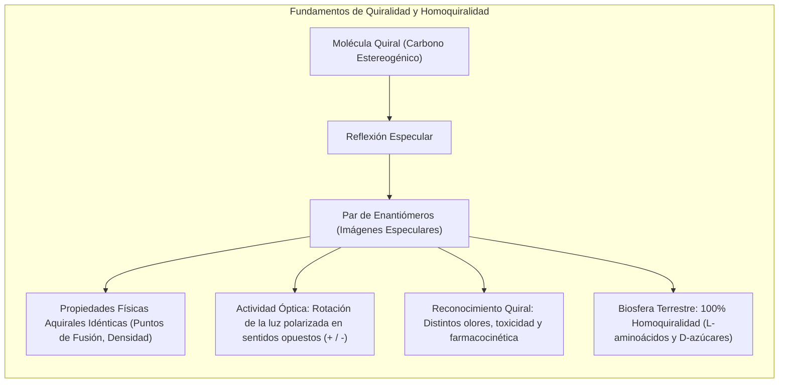
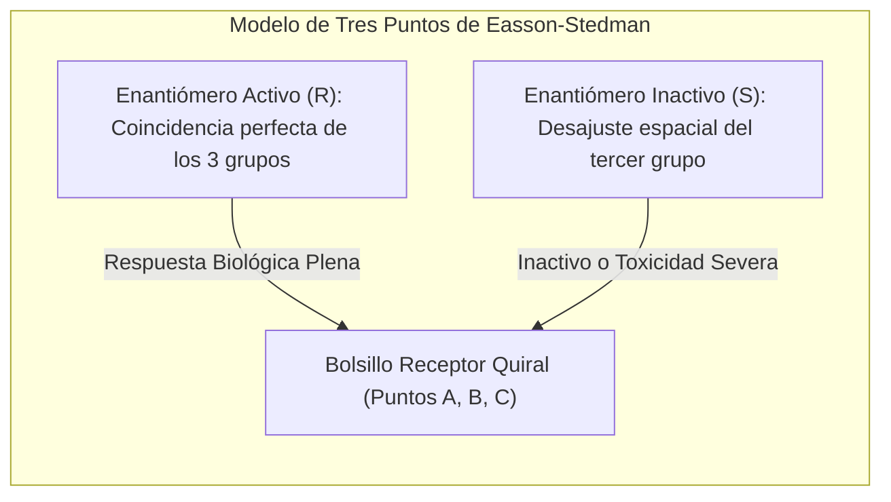
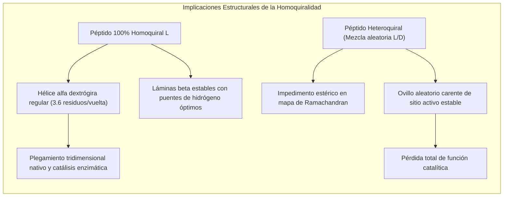
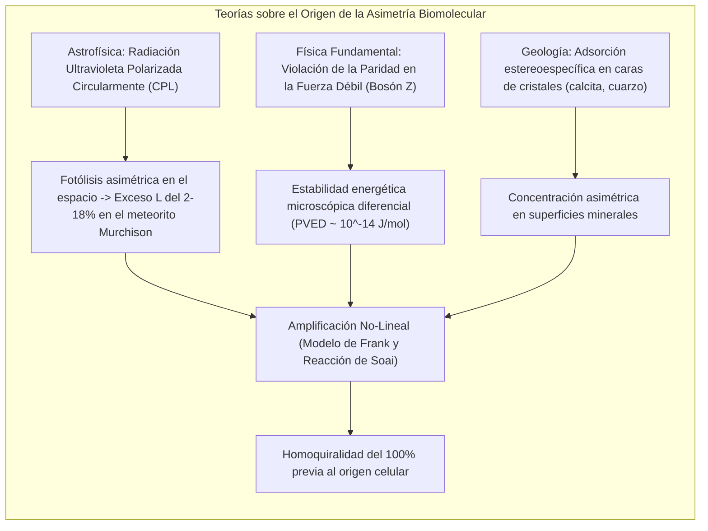
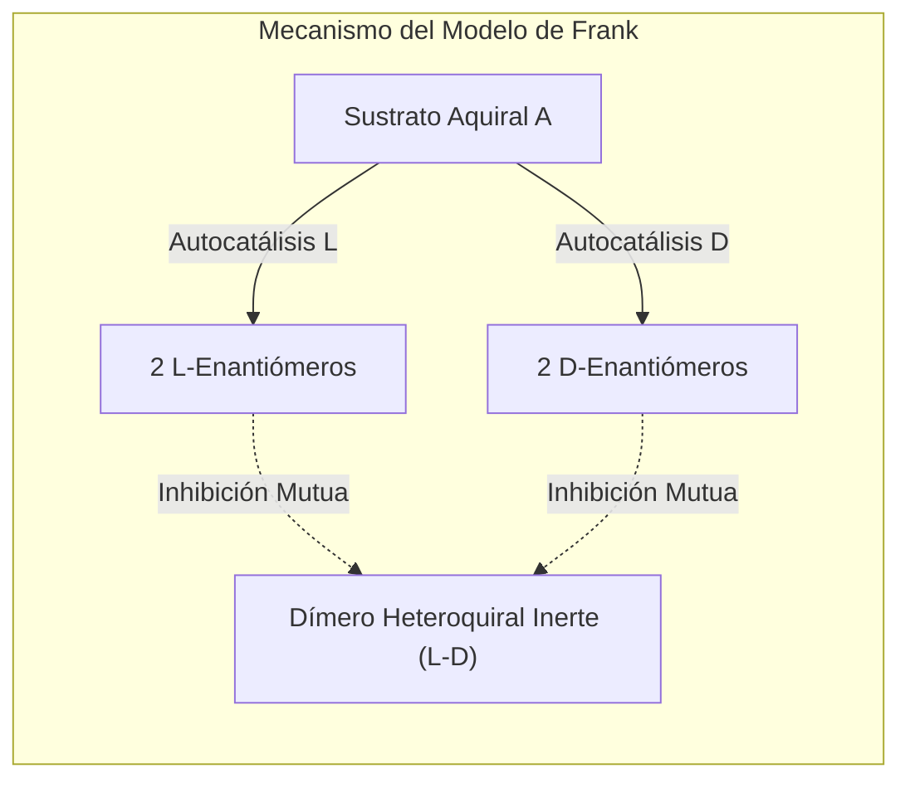

Observe sus manos. Su mano izquierda y su mano derecha poseen exactamente las mismas partes: cinco dedos, idénticas proporciones, las mismas articulaciones. Sin embargo, no importa cómo las gire o traslade en el espacio tridimensional, jamás podrá superponerlas de forma exacta una sobre otra con las palmas orientadas en la misma dirección. Son imágenes especulares mutuas no superponibles. Esta propiedad geométrica recibe el nombre de <strong>quiralidad</strong>, término derivado del griego *cheir* (mano).

Cuando un químico sintetiza moléculas quirales en el laboratorio a partir de reactivos no quirales, la termodinámica dicta una distribución estadística perfecta: se forma un 50 % de moléculas derechas y un 50 % de moléculas izquierdas. Esta mezcla equimolar se conoce como <strong>racemato</strong> y es completamente inactiva ante la luz polarizada.

Sin embargo, la biosfera terrestre ha roto de manera categórica esta simetría desde hace más de 3.800 millones de años:
- <strong>Proteínas:</strong> Todos los enzimas y estructuras proteicas de los seres vivos están formados exclusivamente por <strong>L-aminoácidos</strong> (levógiros).
- <strong>Ácidos nucleicos:</strong> El esqueleto del ADN y del ARN está compuesto de manera exclusiva por <strong>D-azúcares</strong> (D-ribosa y D-desoxirribosa, dextrógiros).

Esta estricta uniformidad enantiomérica se denomina <strong>homoquiralidad biológica</strong>. ¿Por qué la sopa primordial eligió L-aminoácidos y D-azúcares en lugar de un sistema espejo alternativo?



---

## 1. El nacimiento de la estereoquímica: Louis Pasteur y el ácido tartárico

El descubrimiento de la asimetría molecular tuvo lugar en 1848 de la mano del científico francés <strong>Louis Pasteur</strong>. Los viticultores observaban que en los toneles de fermentación se depositaba ácido tartárico, cuya solución desviaba el plano de la luz polarizada hacia la derecha (dextrógiro, $(+)$). No obstante, el ácido racémico sintetizado artificialmente, a pesar de poseer una composición química idéntica, resultaba completamente inactivo a la polarimetría.

Pasteur cristalizó la sal doble de tartrato de sodio y amonio por debajo de los 28 °C. Al inspeccionar minuciosamente los cristales con un microscopio, advirtió con asombro que las facetas asimétricas de los cristales presentaban dos orientaciones especulares disimétricas.

Con pinzas y una lupa, Pasteur separó pacientemente los cristales en dos grupos:
1. Al disolver los cristales con facetas "hacia la derecha", la disolución rotó la luz polarizada en sentido horario ($+$).
2. Los cristales con facetas "hacia la izquierda" desviaron la luz con idéntica magnitud en sentido antihorario ($-$).
3. Al mezclar ambas soluciones a partes iguales, la rotación neta se canceló por completo, recreando la inactividad del racemato.

Pasteur dedujo que la asimetría macroscópica de los cristales era el reflejo directo de la asimetría interna de las moléculas. Más adelante formularía su célebre aforismo: *«La disimetría es la línea de demarcación entre el mundo mineral y el mundo viviente»*.

```
   Ecuación de Biot para la rotación óptica específica:
   [α]_λ^T = θ / (c · l)
   
   donde:
   θ = ángulo de rotación observado (grados)
   c = concentración de la muestra (g/mL)
   l = longitud del tubo del polarímetro (dm)
```

---

## 2. El modelo de interacción en tres puntos y la tragedia de la talidomida

¿Por qué los organismos responden de forma tan drástica ante dos enantiómeros que comparten peso molecular, solubilidad y punto de fusión? Porque los receptores biológicos están formados por L-aminoácidos, constituyendo cavidades de unión quirales y asimétricas.

El <strong>modelo de tres puntos de Easson y Stedman (1933)</strong> demuestra que para desencadenar una respuesta biológica es necesario que tres grupos funcionales específicos de la molécula encajen simultáneamente en tres regiones complementarias del receptor. El enantiómero especular solo podrá alinear dos de los tres grupos, quedando el tercero orientado hacia el espacio vacío o colisionando desfavorablemente.



### Olores y sabores quirales
- La <strong>(R)-(-)-carvona</strong> huele y sabe a menta verde (*hierbabuena*).
- La <strong>(S)-(+)-carvona</strong> evoca el aroma característico de las semillas de alcaravea y comino.
- De igual modo, el <strong>(R)-(+)-limoneno</strong> desprende olor a naranja, mientras que el <strong>(S)-(-)-limoneno</strong> recuerda al aguarrás y al pino.

### La catástrofe de la talidomida y el receptor cereblon
La consecuencia médica más desgarradora del desconocimiento estereoquímico fue el <strong>desastre de la talidomida</strong> a finales de la década de 1950. Comercializada como sedante y antiemético para aliviar las náuseas del embarazo bajo forma racémica, provocó malformaciones congénitas gravísimas (focomelia) en más de 10.000 bebés en todo el mundo.

La biología estructural moderna demostró que:
- El enantiómero <strong>(R)</strong> ejerce el efecto sedante beneficioso sin toxicidad embrionaria.
- El enantiómero <strong>(S)</strong> se une con altísima afinidad a la proteína <strong>Cereblon (CRBN)</strong>, componente de la ligasa de ubiquitina E3. Esta interacción induce la degradación del factor de transcripción <strong>SALL4</strong>, fundamental para el desarrollo de las extremidades fetales.

Incluso si se hubiera purificado y prescrito únicamente el enantiómero (R), la catástrofe no se habría evitado: en la sangre humana, a pH fisiológico ($7{,}4$), el átomo de hidrógeno unido al carbono estereogénico sufre una rápida tautomery ceto-enólica, provocando una racemización completa *in vivo* en apenas 4 o 5 horas.

---

## 3. ¿Por qué la vida requiere homoquiralidad? El imperativo biofísico

¿Podría haber surgido un organismo primitivo con un ensamblaje aleatorio de L- y D-aminoácidos? La física macromolecular demuestra que <strong>no</strong>.



### El mapa de Ramachandran y la hélice alfa
La conformación espacial de las cadenas polipeptídicas depende de los ángulos diedros $\phi$ y $\psi$. En el <strong>mapa de Ramachandran</strong>, los L-aminoácidos se agrupan en regiones de mínima energía que facilitan la hélice $\alpha$ regular dextrógira. Si se introduce un D-aminoácido aislado en una secuencia de L-péptidos, su cadena lateral colisiona estéricamente con los grupos contiguos, rompiendo los puentes de hidrógeno indispensables para la estabilidad. Sin conformaciones rígidas y reproducibles, las proteínas no pueden actuar como enzimas catalíticos.

### La inhibición cruzada en la replicación del ARN
En experimentos clásicos sobre el origen de la vida dirigidos por Leslie Orgel, se comprobó que si se intenta polimerizar una cadena de ARN usando un molde de D-ribosa en presencia de nucleótidos racémicos, los monómeros con L-ribosa se acoplan al extremo de la cadena pero actúan como finalizadores de cadena. Este fenómeno, denominado <strong>inhibición cruzada quiral (Chiral Cross-Inhibition)</strong>, paraliza por completo la replicación génica antes de que pueda iniciarse la evolución biológica.

---

## 4. Hipótesis sobre la rotura de simetría primordial

¿Cómo se generó el desequilibrio inicial a favor de los L-aminoácidos y D-azúcares en el planeta prebiótico? Existen dos corrientes científicas preponderantes:



### Hipótesis cósmica: Luz polarizada circularmente en el medio interestelar
En 1969 cayó en Australia el célebre meteorito <strong>Murchison</strong>. Los análisis confirmaron la presencia de más de 70 aminoácidos extraterrestres. De forma reveladora, varios aminoácidos no biológicos (como la isovalina) presentaron un <strong>exceso enantiomérico L persistente del 2 % al 18 %</strong>.

En regiones densas de formación estelar, como la nebulosa de Orión, la radiación estelar es dispersada por granos de polvo interestelar alineados magnéticamente, produciendo abundante <strong>luz polarizada circularmente (CPL)</strong>. La absorción diferencial de esta radiación destruye mediante fotólisis un enantiómero más rápidamente que el otro, generando un remanente neto que viajó a la Tierra a bordo de cometas y meteoritos.

### Hipótesis física: Violación de paridad en la interacción nuclear débil
En 1957, Chien-Shiung Wu demostró que la fuerza nuclear débil viola la simetría de paridad. Debido a la interacción con bosones $Z^0$, existe una minúscula diferencia de energía entre dos enantiómeros, conocida como <strong>diferencia energética por violación de paridad (PVED)</strong>. Los cálculos teóricos revelan que los L-aminoácidos naturales son ligeramente más estables termodinámicamente que sus homólogos D por un margen de:
$$\Delta E_{\text{PVED}} \approx 10^{-14} \text{ a } 10^{-16} \, \text{J/mol}$$
Aunque microscópica, esta constante presión energética pudo actuar como un sesgo direccional determinante durante procesos de cristalización fuera del equilibrio.

---

## 5. Amplificación no lineal: El modelo de Frank y la reacción de Soai

Un pequeño exceso enantiomérico inicial de un $1\%$ o un $5\%$ resulta insuficiente para permitir la vida. Se requería un mecanismo cinético para amplificarlo hasta la pureza absoluta.

### El modelo teórico de Frank (1953)
El físico británico <strong>Frederick Charles Frank</strong> diseñó un sistema cinético basado en dos principios:
1. <strong>Autocatálisis:</strong> Cada enantiómero actúa como catalizador para formar más copias de sí mismo ($A + L \rightarrow 2L$).
2. <strong>Inhibición mutua:</strong> Cuando un enantiómero L colisiona con un D, ambos se combinan irreversiblemente formando un dímero inactivo ($L + D \rightarrow LD$).

Matemáticamente, la diferencia $\Delta = [L] - [D]$ obedece a:
$$\frac{d\Delta}{dt} = k_1 [A] \Delta$$
El estado racémico es inestable. Cualquier fluctuación aleatoria hace que el enantiómero con una ligera ventaja consuma a su rival hasta erradicarlo por completo del medio.



### La reacción de Soai: Evidencia experimental definitiva
En 1995, el químico japonés <strong>Kenso Soai</strong> logró por primera vez en la historia recrear el modelo de Frank en el laboratorio. En la adición de diisopropilcinc a pirimidina-5-carbaldehídos, el producto alcóxido resultante actúa como autocatalizador quiral. Introduciendo una traza inicial de enantiómero con un exceso de apenas <strong>$0{,}00005\%$ ee (50 partes por billón)</strong>, el sistema amplifica la mezcla espontáneamente a lo largo de sucesivas adiciones hasta alcanzar una pureza óptica superior al <strong>$99{,}5\%$ ee</strong>.

---

## 6. Biología sintética: La frontera de la 'Vida Espejo' (Mirror Life)

¿Qué ocurriría si los científicos crearan una célula viva construida íntegramente con <strong>D-aminoácidos y L-azúcares</strong>?

### Logros actuales
Equipos de investigación liderados por Ting Zhu y George Church han logrado sintetizar polimerasas artificiales de D-aminoácidos capaces de amplificar y transcribir L-ADN en el tubo de ensayo.

### Oportunidades y riesgos biológicos
- <strong>Ventajas farmacológicas:</strong> Los oligonucleótidos espejo (<strong>Spiegelmers</strong>) y los péptidos D son completamente invulnerables a las enzimas de degradación del cuerpo humano (nucleasas y proteasas), permitiendo fármacos orales de duración prolongada.
- <strong>Riesgos biológicos extremos:</strong> Un microorganismo espejo autónomo no podría ser infectado por ningún virus conocido ni fagocitado por los macrófagos del sistema inmunológico humano. Si una bacteria espejo escapara al medio ambiente, podría competir por los recursos inorgánicos globales sin ningún freno ecológico natural.

---

## Conclusión: El legado de la asimetría

La homoquiralidad de la vida no es un accidente trivial, sino el requisito biofísico irrenunciable que permite la arquitectura tridimensional de las proteínas y la replicación del genoma. Comprender sus raíces interconecta la astrofísica molecular, la física subatómica y la química del origen de la vida en una sola narrativa universal.
