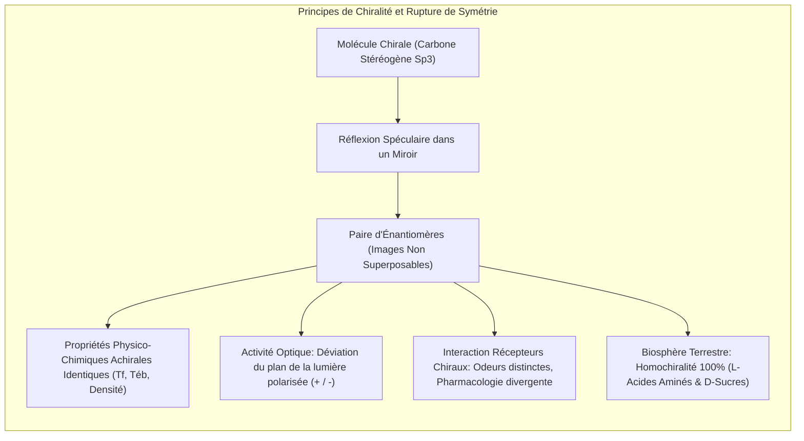
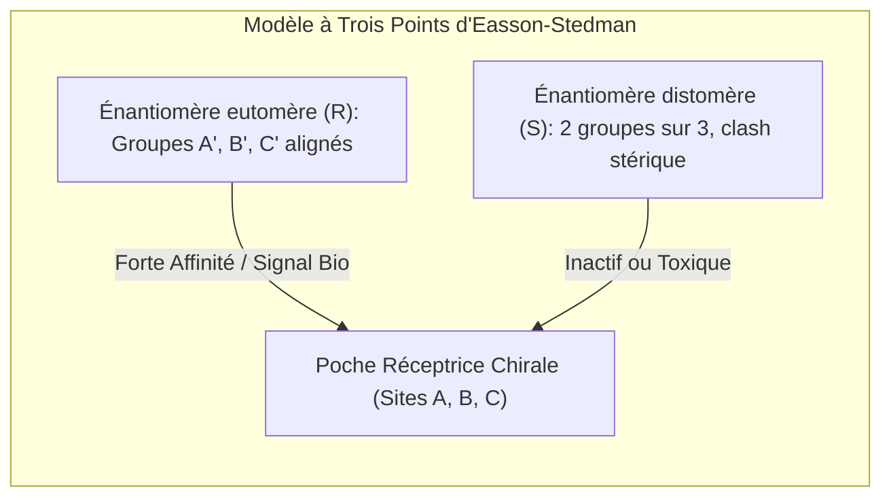
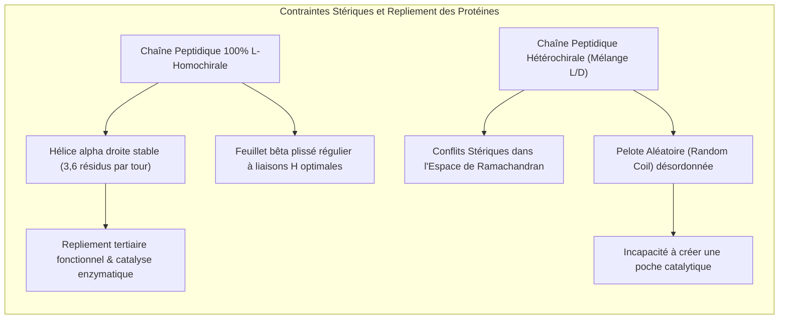
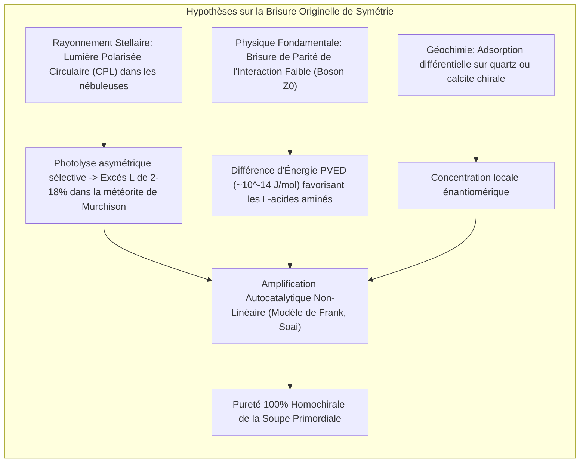
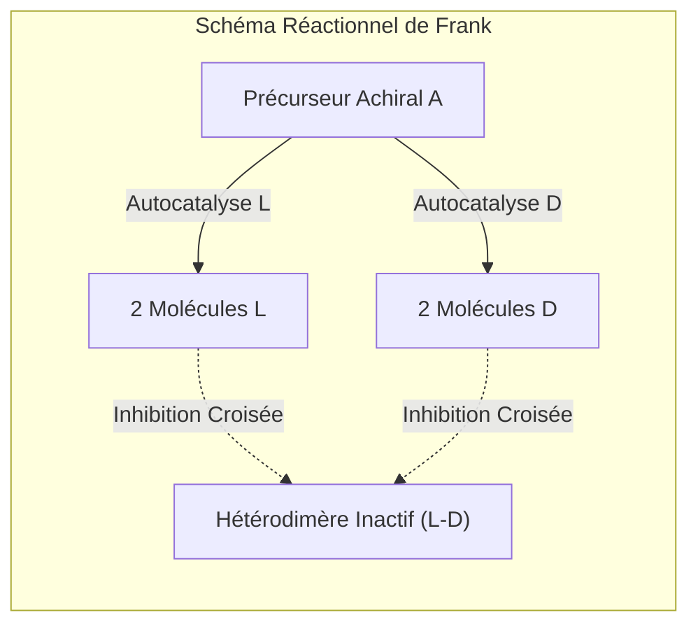

Regardez attentivement vos deux mains. Votre main gauche et votre main droite possèdent exactement les mêmes composants : cinq doigts, la même structure osseuse, les mêmes proportions. Pourtant, quelle que soit la rotation que vous appliquez dans l'espace tridimensionnel, vous ne pourrez jamais superposer parfaitement votre main gauche sur votre main droite. Elles sont l'image l'une de l'autre dans un miroir, mais non superposables. Cette propriété géométrique fondamentale porte le nom de <strong>chiralité</strong>, un mot forgé à partir du grec *cheir* (la main).

Dans un ballon de laboratoire classique, lorsqu'un chimiste synthétise des molécules chirales à partir de précurseurs achiraux, les lois de la thermodynamique imposent une parité absolue : il se forme exactement 50 % de molécules gauches et 50 % de molécules droites, formant un mélange optiquement inactif appelé <strong>racémate</strong>.

Pourtant, depuis plus de 3,8 milliards d'années, l'ensemble des formes de vie sur Terre viole cette symétrie avec une rigueur absolue. C'est le principe fondamental de <strong>l'homochiralité biologique</strong> :
- <strong>Protéines :</strong> Tous les enzymes et édifices protéiques du monde vivant sont constitués exclusivement d'<strong>acides aminés de configuration L</strong> (lévogyres).
- <strong>Acides nucléiques :</strong> La charpente de l'ADN et de l'ARN repose exclusivement sur des <strong>sucres de configuration D</strong> (D-ribose et D-désoxyribose, dextrogyres).

Pourquoi la matière prébiotique primitive a-t-elle opéré une telle sélection ? Pourquoi la nature a-t-elle rejeté le monde miroir symétrique ?



---

## 1. La naissance de la stéréochimie : Louis Pasteur et les cristaux de tartrate

L'histoire de la chiralité moléculaire commence en 1848 grâce au génie intuitif d'un jeune chimiste français de 26 ans, <strong>Louis Pasteur</strong>. À cette époque, l'énigme de l'acide tartrique intriguait les plus grands esprits scientifiques. L'acide tartrique extrait des cuves de vinification déviait la lumière polarisée vers la droite (dextrogyre, $(+)$). En revanche, l'acide racémique (ou acide paratartrique), de formule chimique rigoureusement identique, était optiquement inactif.

Pasteur prépara un sel double de tartrate d'ammonium et de sodium et laissa s'évaporer la solution en dessous de 28 °C. En observant les cristaux obtenus au microscope, il fit une découverte monumentale : ces cristaux présentaient de petites facettes hémiédriques dissymétriques. Loin d'être tous identiques, ils se divisaient en deux populations distinctes, symétriques l'une de l'autre comme deux gants.

À l'aide d'une pince fine et d'une loupe, Pasteur sépara laborieusement les cristaux droits et les cristaux gauches :
1. La solution formée par les cristaux "droits" déviait le plan de polarisation de la lumière vers la droite ($+$).
2. La solution formée par les cristaux "gauches" déviait la lumière d'un angle exactement opposé vers la gauche ($-$).
3. Le mélange à parts égales des deux solutions redonnait une solution optiquement inactive.

Pasteur conclut avec audace que la dissymétrie macroscopique des cristaux résultait d'une dissymétrie interne des molécules elles-mêmes. Il déclara plus tard avec conviction : *« L'asymétrie, c'est la vie »*.

```
   Loi de Biot pour le pouvoir rotatoire spécifique :
   [α]_λ^T = θ / (c · l)
   
   où :
   θ = angle de déviation mesuré au polarimètre (degrés)
   c = concentration massique de l'échantillon (g/mL)
   l = longueur du tube polarimétrique (dm)
```

---

## 2. Le modèle clé-serrure et la tragédie de la thalidomide

Pourquoi les systèmes vivants différencient-ils avec tant de virulence deux molécules qui partagent la même masse, la même densité et les mêmes points d'ébullition ? Parce que les récepteurs biologiques, étant eux-mêmes chiraux (formés de L-acides aminés), constituent des poches tridimensionnelles asymétriques.

Le <strong>modèle d'interaction à trois points d'Easson et Stedman (1933)</strong> illustre parfaitement ce phénomène : pour qu'une molécule déclenche un effet pharmacologique donné, au moins trois groupements fonctionnels distincts doivent interagir simultanément avec trois sites complémentaires de la poche réceptrice. L'énantiomère miroir ne peut aligner que deux groupements sur trois ; la troisième interaction est stériquement impossible ou entre en collision avec un motif indésirable.



### Exemples olfactifs : La carvone et le limonène
- La <strong>(R)-(-)-carvone</strong> active les récepteurs olfactifs nasaux pour délivrer l'arôme caractéristique de la menthe verte.
- La <strong>(S)-(+)-carvone</strong> se lie différemment et produit l'odeur piquante du carvi et du cumin.
- De même, le <strong>(R)-(+)-limonène</strong> sent l'orange douce, tandis que son énantiomère <strong>(S)-(-)-limonène</strong> évoque la térébenthine et le pin.

### Le drame de la thalidomide et le récepteur céréblon
La conséquence la plus tragique de la négligence stéréochimique fut le <strong>scandale de la thalidomide</strong> à la fin des années 1950. Prescrite sous forme de mélange racémique aux femmes enceintes pour soulager les nausées matinales, cette molécule entraîna la naissance de milliers d'enfants atteints de phocomélie (atrophie sévère des membres).

La cristallographie moderne a révélé le mécanisme exact :
- L'énantiomère <strong>(R)</strong> est un sédatif doux parfaitement efficace et dépourvu de tératogénicité.
- L'énantiomère <strong>(S)</strong> s'insère au cœur de la protéine <strong>Céréblon (CRBN)</strong>, composant clé du complexe E3 ubiquitine ligase. Cette liaison reprogramme l'activité de l'enzyme et provoque la dégradation protéasomique ciblée du facteur de transcription embryonnaire <strong>SALL4</strong>, indispensable au développement des membres.

Même si les laboratoires avaient isolé et administré l'énantiomère (R) pur, la catastrophe n'aurait pas été évitée : à pH physiologique sanguin ($7{,}4$), le proton fixé sur le carbone chiral s'échange rapidement par tautomérie céto-énolique, entraînant une racémisation complète *in vivo* en quelques heures seulement.

---

## 3. Pourquoi la vie exige-t-elle l'homochiralité ? La contrainte biophysique

La vie aurait-elle pu émerger à partir d'un cocktail aléatoire d'acides aminés L et D ? La biophysique structurale apporte une réponse catégorique : <strong>c'est impossible</strong>.



### Le diagramme de Ramachandran et l'hélice alpha
La conformation d'une chaîne polypeptidique est régie par les angles de torsion dièdres $\phi$ (Phi) et $\psi$ (Psi). Dans le <strong>diagramme de Ramachandran</strong>, les acides aminés L occupent des zones de basse énergie très spécifiques, permettant la formation de l'hélice $\alpha$ droite stabilisée par des ponts hydrogène entre le groupe $C=O$ du résidu $i$ et le groupe $N-H$ du résidu $i+4$.

L'incorporation d'un seul acide aminé D au sein d'une chaîne de L-peptides projette sa chaîne latérale dans une zone d'encombrement stérique prohibitif, rompant brutalement la continuité des liaisons hydrogène. La structure tridimensionnelle s'effondre. Sans géométrie rigide, aucune catalyse enzymatique hautement sélective n'est possible.

### L'inhibition croisée chirale de l'ARN (Chiral Cross-Inhibition)
Dans le cadre de l'hypothèse du monde à ARN, Leslie Orgel a démontré expérimentalement un écueil redoutable : lorsqu'une matrice d'ARN homochirale (poly-D) est immergée dans un bain de nucléotides racémiques, les monomères de L-nucléotides s'associent aux extrémités en croissance. Cependant, en raison de leur mauvaise orientation spatiale, ils bloquent la poursuite de la polymérisation. Cette <strong>inhibition croisée énantiomérique</strong> empoisonne la réplication. La pureté chirale était donc une condition préalable indispensable avant toute amplification génétique autonome.

---

## 4. Les mécanismes de rupture originelle : Comment le biais initial est-il apparu ?

Pour briser la symétrie racémique primordiale, deux grandes hypothèses s'affrontent : l'origine astrophysique et l'origine liée à la physique des particules élémentaires.



### Hypothèse 1 : La lumière polarisée circulaire interstellaire
En 1969, la météorite carbonée de <strong>Murchison</strong> est tombée en Australie. Les analyses modernes y ont identifié des dizaines d'acides aminés, dont des formes non protéinogènes rares (comme l'isovaline). De manière sensationnelle, les chercheurs ont mesuré un <strong>excès énantiomérique en forme L de 2 % à 18 %</strong>. Ces acides aminés ne possédant pas d'hydrogène en position alpha ne peuvent pas racémiser : cet excès est authentiquement prébiotique et extraterrestre.

Dans les régions de formation stellaire géantes (telle la nébuleuse d'Orion), la lumière UV non polarisée est diffusée par des grains de poussière interstellaire alignés par les champs magnétiques, générant une fraction substantielle de <strong>lumière polarisée circulaire (CPL)</strong>. La photolyse asymétrique induite par cette lumière détruit préférentiellement un énantiomère par rapport à l'autre, laissant un surplus persistant de L-acides aminés qui a ensuite ensemencé la Terre primitive.

### Hypothèse 2 : L'interaction faible et la brisure de parité
En physique des particules, l'expérience historique de Chien-Shiung Wu en 1957 a prouvé que l'<strong>interaction nucléaire faible viole la parité</strong>. Les électrons émis lors de la désintégration bêta ont une hélicité intrinsèquement gauche.

Au niveau moléculaire, le couplage électrofaible médié par les bosons $Z^0$ induit une infime différence d'énergie entre deux énantiomères, appelée <strong>différence d'énergie brisant la parité (PVED)</strong>. Les calculs quantiques indiquent que les L-acides aminés et les D-sucres sont énergétiquement favorisés par une marge d'environ :
$$\Delta E_{\text{PVED}} \approx 10^{-14} \text{ à } 10^{-16} \, \text{J/mol}$$
Bien que minime, ce biais permanent pourrait avoir agi comme une boussole thermodynamique guidant la sélection lors de transitions de phase hors équilibre.

---

## 5. L'amplification asymétrique : Le modèle de Frank et la réaction de Soai

Un excès initial de quelques pourcents ne suffit pas à bâtir une biologie fonctionnelle. Il fallait un mécanisme capable de démultiplier cet infime déséquilibre jusqu'à atteindre $100\%$ de pureté optique.

### Le modèle théorique de Frank (1953)
Le physicien <strong>Frederick Charles Frank</strong> a conçu un modèle mathématique élégant reposant sur deux postulats :
1. <strong>Autocatalyse positive :</strong> Chaque énantiomère catalyse la production de ses propres copies ($A + L \rightarrow 2L$).
2. <strong>Inhibition mutuelle :</strong> La rencontre d'un énantiomère L et d'un énantiomère D conduit irréversiblement à la formation d'un hétérodimère inactif ($L + D \rightarrow LD$).

```
   Système différentiel de Frank :
   d[L]/dt = k1 [A][L] - k2 [L][D]
   d[D]/dt = k1 [A][D] - k2 [L][D]
   
   En posant Δ = [L] - [D] :
   dΔ/dt = k1 [A] Δ
```
L'état racémique ($\Delta = 0$) est un équilibre instable. Dès qu'une infime fluctuation intervient, la forme majoritaire consomme la forme minoritaire dans des complexes morts, amplifiant de manière exponentielle sa propre prédominance jusqu'à élimination totale du rival.



### La découverte de la réaction de Soai (1995)
En 1995, le chimiste japonais <strong>Kenso Soai</strong> a concrétisé expérimentalement le modèle de Frank. En faisant réagir du diisopropylzinc avec des pyrimidine-5-carbaldéhydes, l'alcoolate de zinc chiral formé catalyse sa propre synthèse. En introduisant une amorce chirale avec un excès initial infinitésimal de seulement <strong>$0{,}00005\%$ ee (50 parties par milliard)</strong>, le système s'amplifie spontanément au fil des cycles pour atteindre une pureté optique supérieure à <strong>$99{,}5\%$ ee</strong> !

---

## 6. Biologie de synthèse : Les promesses et périls du 'Monde Miroir' (Mirror Life)

Si le vivant n'utilise que des L-acides aminés et des D-sucres, que se passerait-il si nous créions en laboratoire un organisme complet fonctionnant entièrement en miroir (avec des D-acides aminés et de la L-ADN) ?

### État de l'art
Des laboratoires pionniers (notamment l'équipe de Ting Zhu en Chine) synthétisent déjà des <strong>D-ADN polymérases</strong> capables de recopier de l'ADN miroir (L-ADN). La prochaine étape est la construction d'un ribosome miroir complet capable de traduire des protéines D à partir d'ARN L.

### Avantages biomédicaux et risques écologiques
- <strong>Applications thérapeutiques :</strong> Les oligonucléotides miroir (<strong>Spiegelmers</strong>) et les peptides D échappent complètement à la dégradation par les nucléases et protéases humaines. Ils constituent des médicaments d'une stabilité pharmacocinétique exceptionnelle.
- <strong>Dangers de biosécurité majeurs :</strong> Une bactérie miroir vivante capable de s'autorépliquer poserait un risque écologique sans précédent. Notre système immunitaire inné et adaptatif (anticorps, récepteurs TLR) est calibré pour reconnaître des antigènes standard. Un agent pathogène miroir serait totalement invisible pour les défenses immunitaires de la biosphère et ne pourrait être régulé par aucun prédateur ou bactériophage naturel.

---

## Conclusion : L'asymétrie comme fondement du réel

L'homochiralité du vivant n'est pas un accident de parcours insignifiant, mais le pilier géométrique sans lequel l'auto-assemblage des macromolécules et la transmission fidèle de l'information génétique eussent été rigoureusement impossibles. 

De la lumière stellaire polarisée des nébuleuses cosmiques jusqu'aux subtilités des forces fondamentales de la physique, la quête de l'origine de notre "main biologique" révèle l'intime continuité entre l'histoire de l'Univers et l'éclosion de la vie.
