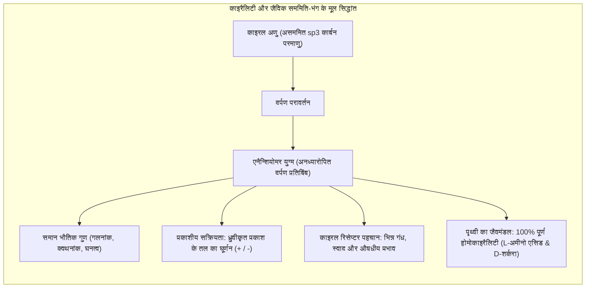
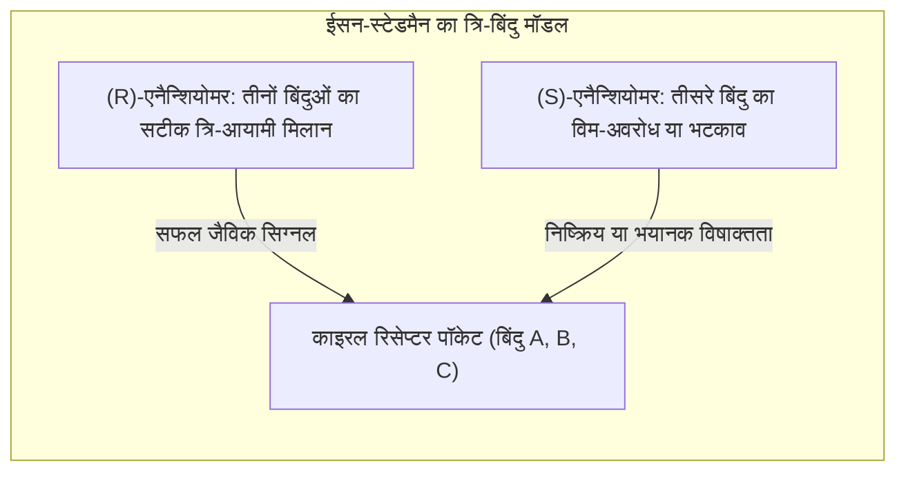
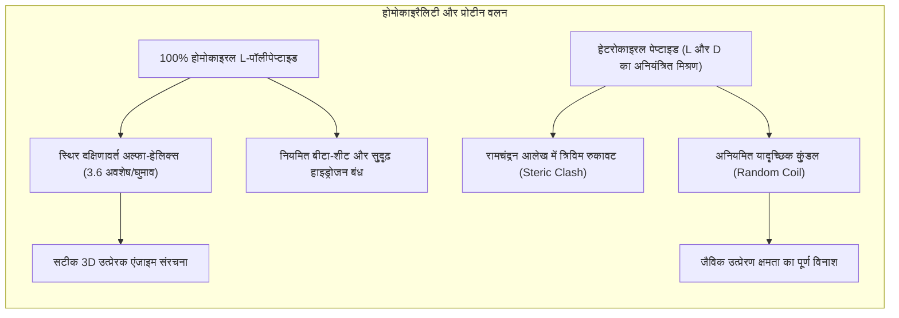
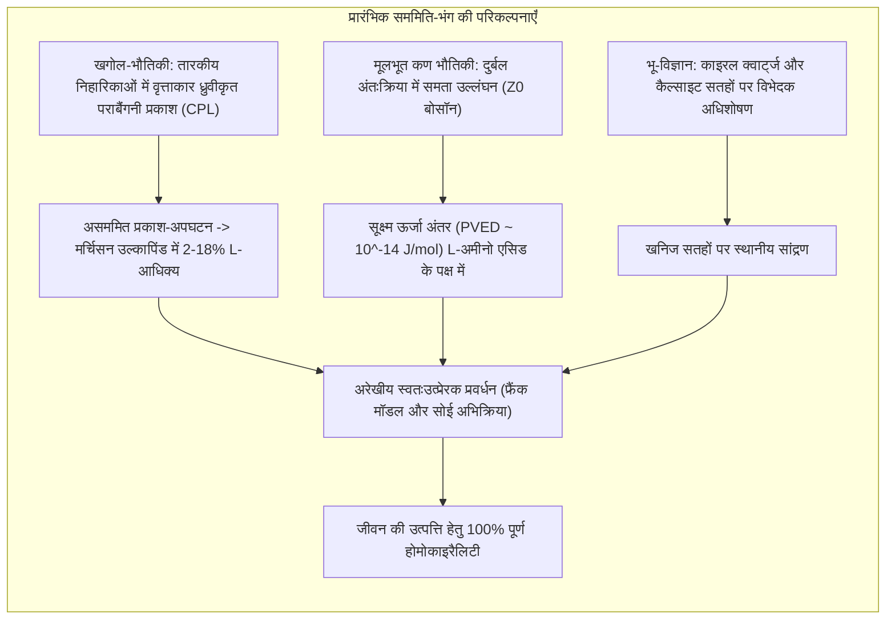
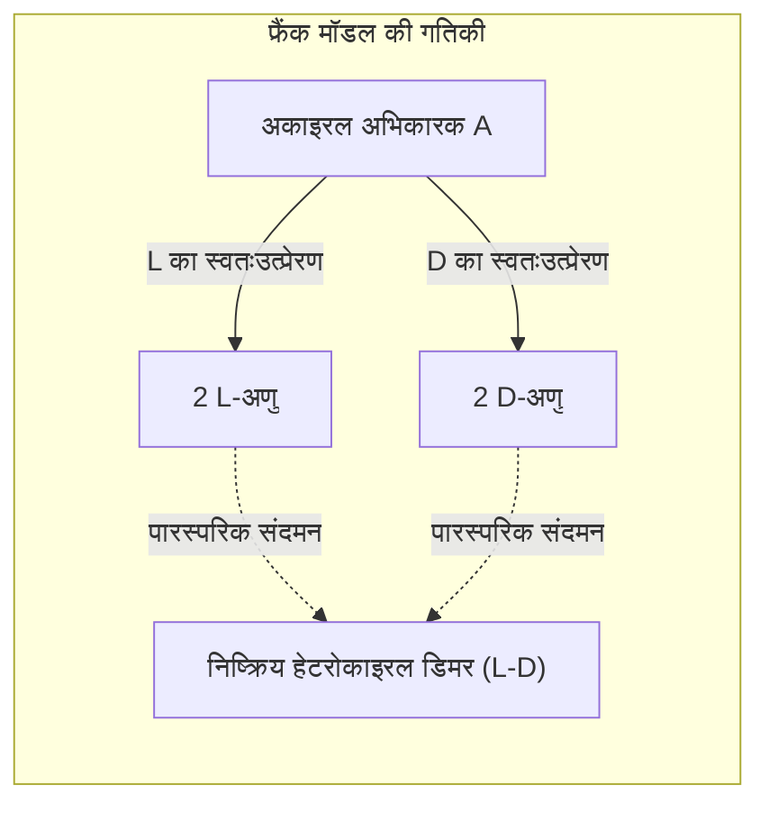

अपने दोनों हाथों को ध्यान से देखिए। आपके बाएँ और दाएँ हाथ में एक समान घटक हैं: पाँच उंगलियाँ, समान जोड़ और समान अनुपात। फिर भी, आप त्रिविमीय अंतरिक्ष में अपने बाएँ हाथ को चाहे जैसे भी घुमाएँ, आप उसे अपने दाएँ हाथ के ऊपर इस प्रकार कभी संपाती (Superimpose) नहीं कर सकते कि दोनों हथेलियाँ एक ही दिशा में हों। वे एक-दूसरे के दर्पण प्रतिबिंब हैं जो परस्पर अध्यारोपित नहीं हो सकते। इस ज्यामितीय गुण को यूनानी भाषा के शब्द *cheir* (हाथ) के आधार पर <strong>काइरैलिटी (Chirality: काइरलता या विम-असममिति)</strong> कहा जाता है।

जब कोई रसायनज्ञ प्रयोगशाला में गैर-काइरल पदार्थों से काइरल अणुओं का संश्लेषण करता है, तो ऊष्मागतिकी के नियमानुसार दाएँ और बाएँ हाथ वाले अणुओं का बराबर 50:50 मिश्रण बनता है, जिसे <strong>रेसिमिक मिश्रण (Racemate)</strong> कहते हैं।

किंतु पृथ्वी पर जीवन ने पिछले 3.8 अरब वर्षों से इस सममिति को पूरी तरह तोड़कर <strong>जैविक होमोकाइरैलिटी (Homochirality: एकल-काइरलता)</strong> को अपनाया हुआ है:
- <strong>प्रोटीन:</strong> जीवित कोशिकाओं के सभी एंजाइम और संरचनात्मक प्रोटीन विशेष रूप से केवल <strong>L-अमीनो एसिड</strong> (वामवर्ती) से बने होते हैं।
- <strong>न्यूक्लिक एसिड:</strong> डीएनए और आरएनए का रीढ़-ढाँचा पूरी तरह से <strong>D-शर्करा</strong> (D-राइबोज और D-डीऑक्सीराइबोज, दक्षिणवर्ती) से निर्मित है।

प्राचीन पृथ्वी के रासायनिक सूप में जीवन ने केवल L-अमीनो एसिड और D-शर्करा को ही क्यों चुना, और विपरीत दर्पण-दुनिया को क्यों छोड़ दिया?



---

## 1. त्रिविम रसायन का जन्म: लुई पाश्चर और टार्टरिक एसिड के क्रिस्टल

आणविक काइरैलिटी की खोज का श्रेय 1848 में 26 वर्षीय फ्रांसीसी वैज्ञानिक <strong>लुई पाश्चर (Louis Pasteur)</strong> को जाता है। उस समय वाइन की बोतलों में जमने वाले टार्टरिक एसिड को लेकर वैज्ञानिक चकित थे। प्राकृतिक टार्टरिक एसिड का घोल ध्रुवीकृत प्रकाश को दाईं ओर घुमाता था (दक्षिण-ध्रुवण घूर्णक, $(+)$)। जबकि समान रासायनिक सूत्र वाला कृत्रिम टार्टरिक एसिड प्रकाशीय रूप से निष्क्रिय था।

पाश्चर ने सोडियम अमोनियम टार्टरेट लवण को 28 °C से कम तापमान पर क्रिस्टलीकृत किया। सूक्ष्मदर्शी से देखने पर उन्होंने पाया कि इन क्रिस्टलों में दो विपरीत प्रकार के असममित फलक थे, जो एक-दूसरे के दर्पण प्रतिबिंब थे।

पाश्चर ने चिमटी की सहायता से दोनों प्रकार के क्रिस्टलों को अलग किया:
1. दाएँ हाथ वाले क्रिस्टलों के घोल ने प्रकाश को दक्षिणावर्त ($+$) घुमाया।
2. बाएँ हाथ वाले क्रिस्टलों के घोल ने प्रकाश को बिल्कुल समान कोण से वामावर्त ($-$) घुमाया।
3. दोनों घोलों को समान मात्रा में मिलाने पर प्रकाशीय घूर्णन शून्य हो गया और निष्क्रिय रेसिमिक मिश्रण बन गया।

पाश्चर ने निष्कर्ष निकाला कि क्रिस्टलों की बाह्य विषमता वास्तव में अणुओं के आंतरिक परमाणुओं की त्रिविम विम-असममिति का परिणाम है। पाश्चर ने प्रसिद्ध रूप से कहा था: *«असममिति ही जीवन की वास्तविक पहचान है»*।

```
   बायट का विशिष्ट प्रकाशीय घूर्णन नियम:
   [α]_λ^T = θ / (c · l)
   
   जहाँ:
   θ = प्रेक्षित घूर्णन कोण (डिग्री)
   c = विलयन की सांद्रता (g/mL)
   l = पोलारिमीटर नली की लंबाई (dm)
```

---

## 2. त्रि-बिंदु अंतःक्रिया मॉडल और थैलिडोमाइड त्रासदी

जीवधारी उन दो अणुओं में इतना भारी अंतर क्यों करते हैं जिनका आणविक भार और गलनांक बिल्कुल एक समान होता है? इसका कारण यह है कि मानव शरीर के जैविक रिसेप्टर स्वयं L-अमीनो एसिड से बने होते हैं, जिसके कारण वे असममित त्रिविम खांचे बनाते हैं।

<strong>ईसन और स्टेडमैन का त्रि-बिंदु मॉडल (1933)</strong> समझाता है कि औषधीय प्रभाव उत्पन्न करने के लिए अणु के तीन विशिष्ट कार्यात्मक समूहों को रिसेप्टर के तीन पूरक बिंदुओं से एक साथ जुड़ना आवश्यक है। विपरीत एनैन्शियोमर केवल दो समूहों का ही मिलान कर पाता है, जबकि तीसरा समूह खाली स्थान में रहता है या रुकावट पैदा करता है।



### काइरल गंध और स्वाद
- <strong>(R)-(-)-कार्वोन</strong> नाक के रिसेप्टर से जुड़कर पुदीने (*Spearmint*) की ताज़ा सुगंध देता है।
- <strong>(S)-(+)-कार्वोन</strong> भिन्न सिग्नल देकर जीरे और अजवाइन की गंध उत्पन्न करता है।
- इसी प्रकार, <strong>(R)-(+)-लिमोनेन</strong> संतरे की खुशबू देता है, जबकि <strong>(S)-(-)-लिमोनेन</strong> तारपीन और चीड़ की महक पैदा करता है।

### थैलिडोमाइड त्रासदी और सेरेब्लोन प्रोटीन
चिकित्सा विज्ञान में स्टीरियोकेमिस्ट्री की अनदेखी का सबसे भयानक परिणाम 1950 के दशक के उत्तरार्ध में <strong>थैलिडोमाइड त्रासदी</strong> के रूप में सामने आया। गर्भवती महिलाओं में उल्टी और बेचैनी रोकने के लिए रेसिमिक मिश्रण के रूप में बेची गई इस दवा के कारण दुनिया भर में 10,000 से अधिक बच्चे अंगों के विकृत विकास (फोकोमेलिया) के साथ पैदा हुए।

आधुनिक आणविक जीवविज्ञान ने स्पष्ट किया:
- <strong>(R)-एनैन्शियोमर</strong> सुरक्षित शामक और सुखदायक प्रभाव देता है।
- <strong>(S)-एनैन्शियोमर</strong> कोशिका के <strong>सेरेब्लोन (CRBN)</strong> प्रोटीन से जुड़ जाता है, जो E3 यूबिक्विटिन लाइगेज का हिस्सा है। इससे भ्रूण के अंगों के निर्माण के लिए आवश्यक प्रतिलेखन कारक <strong>SALL4</strong> नष्ट हो जाता है।

यदि केवल शुद्ध (R)-थैलिडोमाइड भी दिया जाता, तब भी आपदा को नहीं रोका जा सकता था: मानव रक्त के शारीरिक pH ($7.4$) पर काइरल कार्बन का हाइड्रोजन परमाणु स्वतः कीटो-इनोल टोटोमेरिज़्म से गुजरता है, जिससे शरीर के भीतर मात्र 4 से 5 घंटे में पूरा रेसिमीकरण हो जाता है।

---

## 3. जीवन को होमोकाइरैलिटी की आवश्यकता क्यों है? जैव-भौतिकीय अनिवार्यता

क्या कोई प्रारंभिक कोशिका L- और D-अमीनो एसिड के यादृच्छिक मिश्रण से कार्य कर सकती थी? जैव-भौतिकी इसका स्पष्ट उत्तर देती है: <strong>कदापि नहीं</strong>।



### रामचंद्रन आलेख और अल्फा-हेलिक्स संरचना
प्रोटीन श्रृंखला की ज्यामिति $\phi$ (फाई) और $\psi$ (साई) कोणों पर निर्भर करती है। <strong>रामचंद्रन आलेख</strong> में L-अमीनो एसिड ऊर्जा के उस न्यूनतम क्षेत्र में आते हैं जो दक्षिणावर्त $\alpha$-हेलिक्स को सुदृढ़ बनाते हैं। यदि L-श्रृंखला में एक भी D-अमीनो एसिड प्रवेश कर जाए, तो उसकी पार्श्व श्रृंखला विपरीत दिशा में मुड़कर हाइड्रोजन बंधों को तोड़ देती है। बिना कठोर द्वितीयक संरचनाओं के एंजाइम उत्प्रेरण असंभव है।

### आरएनए प्रतिकृति में काइरल क्रॉस-अवरोध
लेस्ली ऑर्गेल के प्रयोगों में सिद्ध हुआ कि यदि शुद्ध D-आरएनए खांचे पर रेसिमिक न्यूक्लियोटाइड्स से प्रतिकृति बनाने का प्रयास किया जाए, तो L-न्यूक्लियोटाइड श्रृंखला के सिरे पर जुड़ तो जाते हैं, किंतु अपने उल्टे विन्यास के कारण श्रृंखला के आगे बढ़ने को स्थायी रूप से रोक देते हैं। इसे <strong>काइरल क्रॉस-इनहिबिशन (Chiral Cross-Inhibition)</strong> कहते हैं। अतः जीवन के उदय से पहले रासायनिक शुद्धता अपरिहार्य थी।

---

## 4. प्रारंभिक सममिति-भंग के सिद्धांत: अंतरिक्ष और भौतिकी के संकेत

पृथ्वी पर L-अमीनो एसिड और D-शर्करा का प्रारंभिक झुकाव कैसे उत्पन्न हुआ? दो प्रमुख वैज्ञानिक परिकल्पनाएँ हैं:



### खगोलीय परिकल्पना: अंतरिक्षीय वृत्ताकार ध्रुवीकृत प्रकाश (CPL)
1969 में ऑस्ट्रेलिया में गिरे <strong>मर्चिसन उल्कापिंड</strong> के विश्लेषण से 70 से अधिक अमीनो एसिड मिले। गैर-प्रोटीन अमीनो एसिड (जैसे आइसोवैलिन) में <strong>2% से 18% तक का निरंतर L-एनैन्शियोमेरिक आधिक्य</strong> पाया गया। विशाल तारा निर्माण क्षेत्रों में चुंबकीय धूल कणों से परावर्तित होकर तीव्र <strong>वृत्ताकार ध्रुवीकृत प्रकाश (CPL)</strong> उत्पन्न होता है। यह प्रकाश एक एनैन्शियोमर को दूसरे की तुलना में तेजी से नष्ट कर देता है, जिससे बचे हुए L-अणु उल्कापिंडों द्वारा पृथ्वी पर पहुंचे।

### कण भौतिकी: दुर्बल बल में समता (पैरिटी) का उल्लंघन
1957 में चिएन-शिउंग वू के प्रयोग ने सिद्ध किया कि <strong>दुर्बल परमाणु बल समता संरक्षण का उल्लंघन करता है</strong>। न्यूट्रल $Z^0$ बोसॉन के विनिमय के कारण दोनों एनैन्शियोमरों के बीच एक अति-सूक्ष्म ऊर्जा अंतर (<strong>PVED: Parity-Violating Energy Difference</strong>) होता है। क्वांटम गणनाएँ दर्शाती हैं कि प्राकृतिक L-अमीनो एसिड और D-शर्करा अपने दर्पण रूपों की तुलना में थोड़े अधिक स्थिर हैं:
$$\Delta E_{\text{PVED}} \approx 10^{-14} \text{ से } 10^{-16} \, \text{J/mol}$$
यद्यपि यह अंतर नगण्य प्रतीत होता है, किंतु गैर-संतुलन परिस्थितियों में यह सूक्ष्म झुकाव वैश्विक सममिति-भंग का निर्णायक आधार बन सकता है।

---

## 5. अरेखीय प्रवर्धन तंत्र: फ्रैंक मॉडल और सोई अभिक्रिया

प्रारंभिक कुछ प्रतिशत का आधिक्य जीवन निर्माण के लिए पर्याप्त नहीं था। इसे 100% तक प्रवर्धित करने के लिए एक रासायनिक तंत्र की आवश्यकता थी।

### फ्रैंक का गणितीय मॉडल (1953)
ब्रिटिश भौतिक विज्ञानी <strong>फ्रेडरिक चार्ल्स फ्रैंक</strong> ने दो नियमों पर आधारित एक मॉडल प्रस्तावित किया:
1. <strong>स्वतःउत्प्रेरण:</strong> प्रत्येक एनैन्शियोमर अपने ही जैसे अणुओं के निर्माण को उत्प्रेरित करता है ($A + L \rightarrow 2L$)।
2. <strong>पारस्परिक अवरोध:</strong> जब L और D अणु मिलते हैं, तो वे एक निष्क्रिय डिमर बनाते हैं ($L + D \rightarrow LD$)।

असममिति अंतर $\Delta = [L] - [D]$ का अवकल समीकरण है:
$$\frac{d\Delta}{dt} = k_1 [A] \Delta$$
रेसिमिक अवस्था अस्थिर होती है। ज़रा सा भी यादृच्छिक उतार-चढ़ाव बढ़त हासिल करने वाले एनैन्शियोमर को विस्फोटक गति से बढ़ाकर प्रतिद्वंद्वी को पूरी तरह समाप्त कर देता है।



### सोई अभिक्रिया: प्रयोगात्मक प्रमाण
1995 में जापानी रसायनज्ञ <strong>केंसो सोई</strong> ने प्रयोगशाला में इसे सिद्ध कर दिखाया। पाइरीमिडीन-5-कार्बाल्डिहाइड की डाइआइसोप्रोपिलजिंक के साथ अभिक्रिया में बनने वाला जिंक एल्कोक्साइड अपने ही निर्माण के लिए उत्प्रेरक बन जाता है। मात्र <strong>$0.00005\%$ ee (50 ppb)</strong> की सूक्ष्म काइरल मिलावट से शुरू करके यह प्रणाली कुछ ही चक्रों में उत्पाद को <strong>$99.5\%$ ee</strong> से अधिक शुद्ध कर देती है!

---

## 6. सिंथेटिक बायोलॉजी: 'दर्पण जीवन' (Mirror Life) की संभावनाएँ और खतरे

यदि वैज्ञानिक प्रयोगशाला में पूरी तरह से <strong>D-अमीनो एसिड और L-शर्करा</strong> पर आधारित एक जीवित कोशिका बना लें, तो क्या होगा?

### वर्तमान प्रगति
त्सिंगहुआ विश्वविद्यालय में टिंग झू की टीम ने कृत्रिम D-डीएनए पोलीमरेज़ का निर्माण किया है जो L-डीएनए की प्रतिकृति और L-आरएनए का प्रतिलेखन करने में सक्षम हैं।

### चिकित्सीय लाभ और जैव-सुरक्षा संकट
- <strong>चिकित्सीय उपयोग:</strong> दर्पण अणु जैसे <strong>स्पीगेलमर्स (Spiegelmers)</strong> और D-पेप्टाइड्स मानव शरीर के एंजाइमों द्वारा नष्ट नहीं किए जा सकते, जिससे वे कैंसर और गंभीर बीमारियों के लिए अत्यंत स्थिर और दीर्घकालिक दवाएँ बनते हैं।
- <strong>पारिस्थितिक संकट:</strong> यदि एक आत्मनिर्भर दर्पण बैक्टीरिया पर्यावरण में बच निकलता है, तो स्तनधारियों की प्रतिरक्षा प्रणाली उसे पहचान नहीं पाएगी और कोई प्राकृतिक वायरस उसे नष्ट नहीं कर सकेगा। यह संपूर्ण पारिस्थितिकी तंत्र के लिए विनाशकारी सिद्ध हो सकता है।

---

## निष्कर्ष

जीवन की होमोकाइरैलिटी केवल एक संयोग नहीं, बल्कि जीवन की आणविक मशीनरी और आनुवंशिक निरंतरता की अनिवार्य ज्यामितीय नींव है। ब्रह्मांडीय तारों के प्रकाश से लेकर उप-परमाण्विक बलों तक, काइरैलिटी की यह यात्रा साबित करती है कि ब्रह्मांड और जीवन के नियम आपस में कितनी गहराई से जुड़े हुए हैं।
