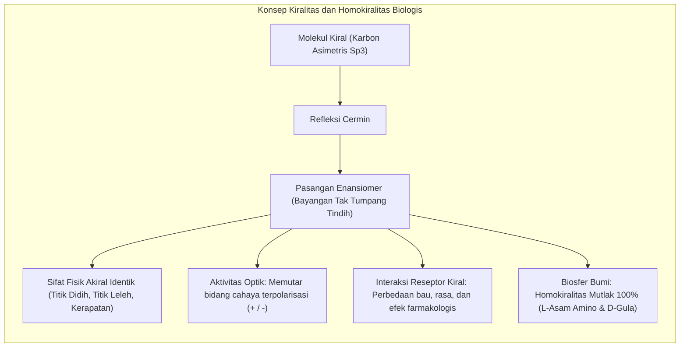
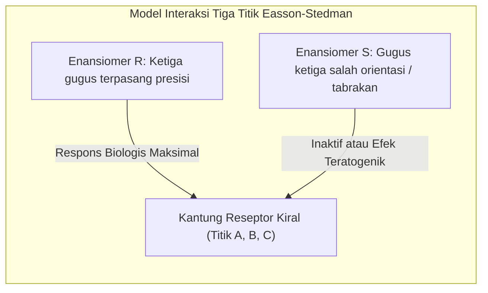
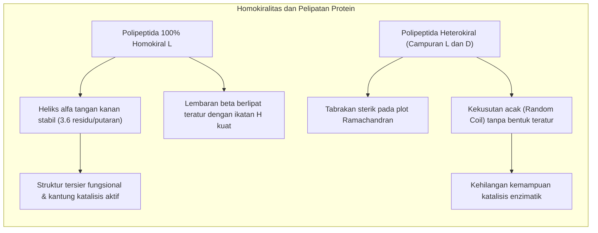
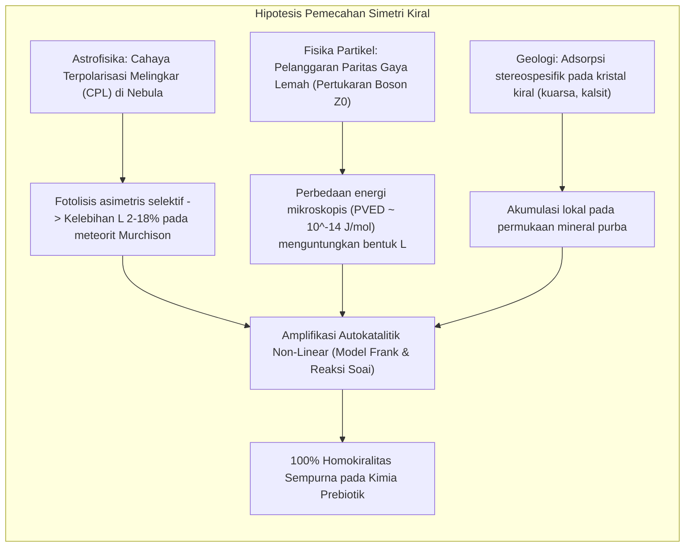
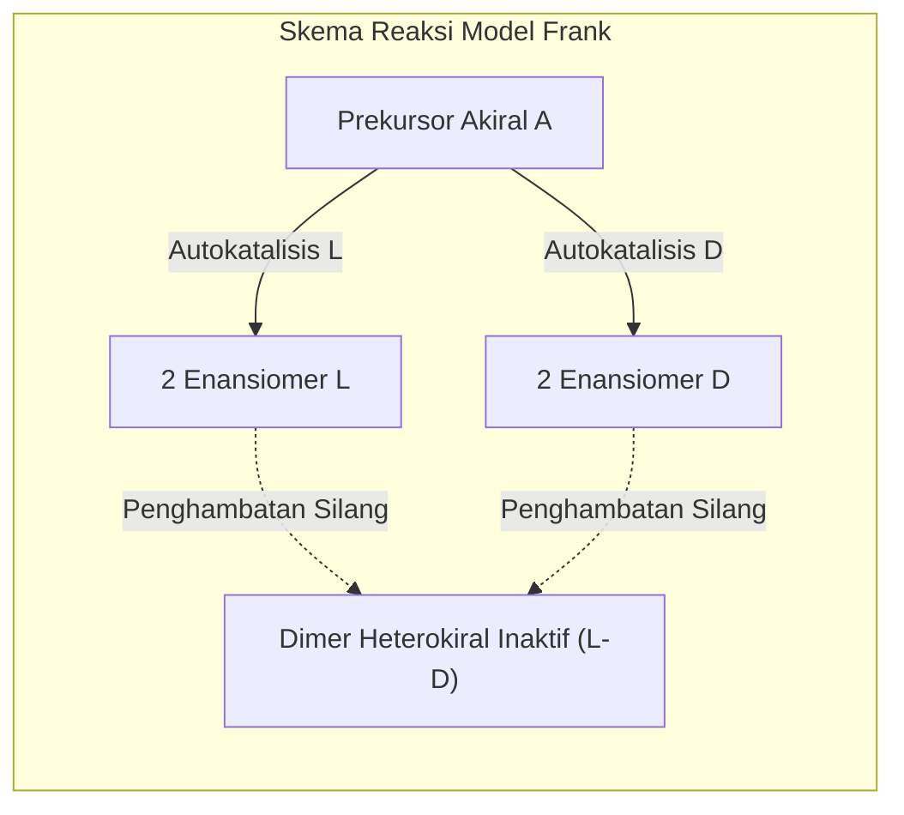

Perhatikan kedua tangan Anda. Tangan kiri dan tangan kanan Anda tersusun atas komponen yang persis sama: lima jari, buku-buku tulang yang serupa, dan proporsi yang identik. Namun, bagaimanapun Anda memutar tangan kiri Anda di dalam ruang tiga dimensi, tangan kiri tidak akan pernah bisa ditumpuk tepat secara sempurna di atas tangan kanan dengan telapak menghadap ke arah yang sama. Keduanya adalah bayangan cermin yang tidak dapat saling berhimpit (*non-superimposable mirror images*). Sifat geometris fundamental ini disebut <strong>kiralitas</strong> (berasal dari bahasa Yunani *cheir* yang berarti tangan).

Dalam reaksi kimia sintesis standar dari bahan awal yang akiral, hukum termodinamika secara alamiah menghasilkan campuran 50% molekul tangan kanan dan 50% tangan kiri, yang dikenal sebagai <strong>rasemat</strong>. Campuran rasemat bersifat tidak aktif secara optik.

Namun, dunia kehidupan di Bumi selama 3,8 miliar tahun secara radikal melanggar simetri ini melalui fenomena <strong>homokiralitas biologis</strong>:
- <strong>Protein:</strong> Seluruh enzim dan mesin molekuler penyusun sel hidup dibangun secara eksklusif oleh <strong>L-asam amino</strong> (bentuk kidal).
- <strong>Asam Nukleat:</strong> Rangka heliks DNA dan RNA tersusun murni oleh <strong>D-gula</strong> (D-ribosa dan D-deoksiribosa, bentuk tangan kanan).

Mengapa sup purba kehidupan di Bumi purba menetapkan pilihan tunggal pada L-asam amino dan D-gula, menyingkirkan dunia cermin sebaliknya?



---

## 1. Kelahiran Stereokimia: Louis Pasteur dan Kristal Asam Tartrat

Sejarah kiralitas molekuler bermula pada tahun 1848 lewat kecermatan ilmuwan muda Prancis berusia 26 tahun, <strong>Louis Pasteur</strong>. Pada masa itu, para kimiawan bingung menghadapi keanehan asam tartrat. Asam tartrat yang mengendap pada tong fermentasi anggur mampu memutar bidang cahaya terpolarisasi ke arah kanan (dekstrorotatori, $(+)$). Sementara itu, asam rasemat sintetis yang berumus kimia identik sama sekali tidak memutar cahaya.

Pasteur mengkristalkan garam natrium amonium paratartrat di bawah suhu 28 °C. Di bawah mikroskop, ia mengamati bahwa kristal-kristal tersebut memiliki bidang asimetris (hemihedral) yang terbagi menjadi dua kelompok berlawanan arah.

Dengan bantuan pinset dan kaca pembesar, Pasteur memilah kristal-kristal tersebut menjadi dua tumpukan:
1. Larutan kristal "tangan kanan" memutar cahaya ke arah kanan ($+$).
2. Larutan kristal "tangan kiri" memutar cahaya dengan sudut yang persis sama ke arah kiri ($-$).
3. Ketika kedua larutan dicampur dalam proporsi seimbang, rotasi optik saling meniadakan, menghasilkan campuran rasemat.

Pasteur menyimpulkan bahwa asimetri bentuk kristal makroskopis mencerminkan asimetri internal susunan atom di dalam molekul itu sendiri. Pasteur menegaskan: *«Asimetri adalah tanda khas kehidupan»*.

```
   Hukum Biot untuk rotasi optik spesifik:
   [α]_λ^T = θ / (c · l)
   
   di mana:
   θ = sudut rotasi yang terukur (derajat)
   c = konsentrasi larutan (g/mL)
   l = panjang tabung polarimeter (dm)
```

---

## 2. Model Tiga Titik dan Tragedi Thalidomide

Mengapa sistem biologi merespons secara amat kontras terhadap dua molekul enansiomer yang memiliki bobot molekul dan kelarutan identik? Hal ini disebabkan oleh sifat kiral reseptor biologis di dalam tubuh manusia yang tersusun dari L-asam amino.

<strong>Model interaksi tiga titik Easson-Stedman (1933)</strong> menjelaskan bahwa untuk memicu respons farmakologis, tiga gugus fungsi tertentu pada obat harus menempati tiga kantung komplementer pada reseptor. Enansiomer pasangannya hanya mampu mencocokkan dua gugus, sementara gugus ketiga bertabrakan atau mengarah ke ruang kosong.



### Bau dan Rasa Enansiomer
- <strong>(R)-(-)-karvon</strong> berinteraksi dengan reseptor penciuman hidung menimbulkan sensasi aroma segar *spearmint*.
- <strong>(S)-(+)-karvon</strong> menghasilkan aroma jintan manis (*caraway*).
- Demikian pula, <strong>(R)-(+)-limonen</strong> beraroma jeruk manis, sedangkan <strong>(S)-(-)-limonen</strong> berbau tajam seperti getah pinus dan terpentin.

### Tragedi Thalidomide dan Reseptor Cereblon
Contoh paling memilukan dari kekeliruan stereokimia dalam dunia medis adalah <strong>tragedi thalidomide</strong> pada akhir era 1950-an. Dipasarkan sebagai obat penenang racemat untuk meredakan mual kehamilan, thalidomide menyebabkan kelahiran lebih dari 10.000 bayi dengan cacat bawaan berat (fokomelia).

Studi biologi struktural modern mengungkap:
- Bentuk <strong>(R)</strong> berkhasiat sebagai sedatif penenang yang aman.
- Bentuk <strong>(S)</strong> mengikat protein <strong>Cereblon (CRBN)</strong> yang merupakan subunit enzim E3 ubiquitin ligase. Ikatan ini memicu degradasi faktor transkripsi <strong>SALL4</strong> yang krusial bagi pertumbuhan anggota tubuh janin.

Bahkan andai produsen saat itu hanya memberikan isomer (R) murni, bencana tetap tak terhindarkan: pada pH darah manusia ($7{,}4$), atom hidrogen pada karbon kiral mengalami tautomeri cepat yang menyebabkan rasemisasi lengkap *in vivo* dalam waktu 4 hingga 5 jam.

---

## 3. Mengapa Kehidupan Membutuhkan Homokiralitas? Kendala Biofisika

Bisakah sebuah sel hidup purba bertahan hidup menggunakan campuran acak L- dan D-asam amino? Biofisika molekuler menjawab dengan tegas: <strong>mustahil</strong>.



### Diagram Ramachandran dan Heliks Alfa
Sudut ikatan dihedral peptida $\phi$ (phi) dan $\psi$ (psi) membatasi pelipatan rantai protein. Dalam <strong>diagram Ramachandran</strong>, L-asam amino secara alami mengisi area energi terendah yang membentuk struktur heliks $\alpha$ tangan kanan, ditopang oleh ikatan hidrogen antara gugus $C=O$ residu $i$ dan gugus $N-H$ residu $i+4$.

Penyisipan satu D-asam amino ke dalam rantai L memproyeksikan rantai samping ke ruang terlarang, memutus kontinuitas ikatan hidrogen dan meruntuhkan struktur sekunder. Tanpa bentuk tiga dimensi yang kaku dan teratur, enzim tidak memiliki spesifisitas katalitik.

### Hambatan Silang Kiral pada Replikasi RNA
Dalam eksperimen asal usul kehidupan oleh Leslie Orgel, ditemukan fenomena <strong>penghambatan silang kiral (Chiral Cross-Inhibition)</strong>. Ketika cetakan RNA D murni dicoba direplikasi menggunakan campuran nukleotida rasemat, nukleotida L menempel pada ujung rantai tetapi menghentikan reaksi elongasi lebih lanjut. Ketiadaan kemurnian kiral secara total mematikan proses replikasi genetik non-enzimatik.

---

## 4. Teori Pemecah Simetri Purba

Bagaimana kelebihan awal enantiomer L terbentuk di Bumi sebelum kehidupan bermula? Terdapat dua hipotesis utama:



### Hipotesis Kosmis: Cahaya Terpolarisasi Melingkar Antarbintang
Pada tahun 1969, meteorit karbonat <strong>Murchison</strong> mendarat di Australia. Uji spektrometri mengungkap lebih dari 70 jenis asam amino. Menariknya, asam amino non-biologis seperti isovalin menunjukkan <strong>kelebihan enantiomer L sebesar 2% hingga 18%</strong>.

Di daerah pembentukan bintang raksasa, radiasi ultraviolet dihamburkan oleh debu antarbintang yang teratur oleh medan magnet kosmik, menciptakan <strong>cahaya terpolarisasi melingkar (CPL)</strong>. Fotolisis asimetris oleh radiasi CPL ini menghancurkan salah satu enantiomer lebih cepat dibandingkan pasangannya, meninggalkan residu L-asam amino yang kemudian jatuh ke Bumi purba melalui komet dan meteorit.

### Hipotesis Gaya Lemah: Pelanggaran Paritas Fisika Subatomik
Eksperimen Chien-Shiung Wu pada tahun 1957 membuktikan bahwa <strong>gaya nuklir lemah melanggar simetri paritas</strong>. Pertukaran boson $Z^0$ antara elektron dan inti atom menimbulkan perbedaan energi elektro-lemah (<strong>PVED: Parity-Violating Energy Difference</strong>). Perhitungan kimia kuantum memprediksi bahwa L-asam amino dan D-gula sedikit lebih stabil secara termodinamika sebesar:
$$\Delta E_{\text{PVED}} \approx 10^{-14} \text{ hingga } 10^{-16} \, \text{J/mol}$$
Meski selisih ini teramat kecil, dalam sistem terbuka non-ekuilibrium, bias konstan ini dapat memicu transisi fase makroskopis global.

---

## 5. Mekanisme Penguatan Asimetri: Model Frank dan Reaksi Soai

Kelebihan awal sebesar beberapa persen belum cukup untuk melahirkan kehidupan. Diperlukan penguatan non-linear hingga mencapai kemurnian 100%.

### Model Teori Frank (1953)
Fisikawan <strong>Frederick Charles Frank</strong> menyusun model kinetika yang memukau:
1. <strong>Autokatalisis Asimetris:</strong> Masing-masing enantiomer mempercepat sintesis dirinya sendiri ($A + L \rightarrow 2L$).
2. <strong>Penghambatan Bersama:</strong> Bila molekul L bertumbukan dengan D, keduanya bergabung secara ireversibel membentuk dimer inaktif ($L + D \rightarrow LD$).

Secara matematis, perbedaan konsentrasi $\Delta = [L] - [D]$ memenuhi:
$$\frac{d\Delta}{dt} = k_1 [A] \Delta$$
Keadaan rasemat bersifat labil. Fluktuasi sekecil apa pun akan menyebabkan spesies yang unggul memusnahkan rivalnya hingga habis total.



### Reaksi Soai: Pembuktian Eksperimental
Pada tahun 1995, kimiawan Jepang <strong>Kenso Soai</strong> berhasil membuktikan model Frank di laboratorium. Dalam alkilasi pirimidin-5-karbaldehida dengan diisopropilzink, produk seng alkoksida bertindak sebagai autokatalis kiral. Dengan memberikan pemantik enantiomer berlebih awal hanya sebesar <strong>$0{,}00005\%$ ee (50 ppb)</strong>, sistem secara mandiri memperkuat kemurnian optik hingga melampaui <strong>$99{,}5\%$ ee</strong>!

---

## 6. Biologi Sintesis: Harapan dan Ancaman 'Kehidupan Cermin' (Mirror Life)

Apa yang akan terjadi bila ilmuwan berhasil menciptakan sel hidup fungsional yang sepenuhnya tersusun atas <strong>D-asam amino dan L-gula</strong>?

### Pencapaian Terkini
Tim peneliti di bawah pimpinan Ting Zhu telah memproduksi enzim D-DNA polimerase sintetis yang mampu mereplikasi L-DNA dan mentranskripsi L-RNA dalam tabung reaksi.

### Manfaat Terapi dan Ancaman Biosafety
- <strong>Potensi Medis:</strong> Molekul cermin seperti <strong>Spiegelmer</strong> (aptamer L-RNA) dan D-peptida sama sekali tidak dikenali oleh enzim protease tubuh, menjadikannya kandidat obat kanker dan autoimun yang sangat tahan lama.
- <strong>Bahaya Keamanan Hayati:</strong> Bakteri cermin yang lepas ke alam bebas berpotensi menjadi ancaman kepunahan ekologis. Sistem kekebalan tubuh mamalia tidak mampu mendeteksi antigen cermin, dan tidak ada bakteriofag alami yang dapat memangsanya, sehingga mikroba cermin dapat mengonsumsi sumber daya alam tanpa kendali ekologis.

---

## Kesimpulan

Homokiralitas bukanlah kebetulan sejarah, melainkan prasyarat fisik mutlak bagi arsitektur molekuler kehidupan. Menelusuri jejak tangan biologis ini mengantarkan kita pada pemahaman mendalam tentang bagaimana hukum fisika alam semesta menenun tatanan kehidupan dari kekacauan materi purba.
