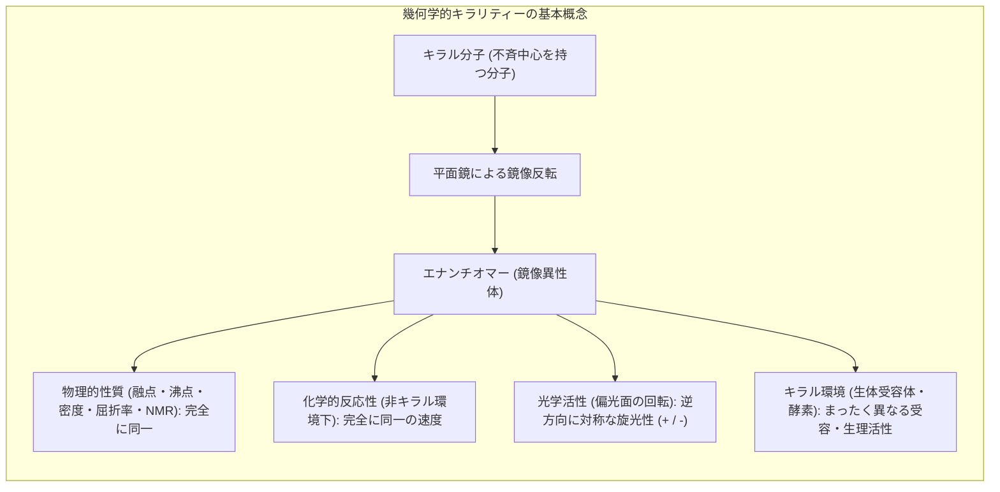
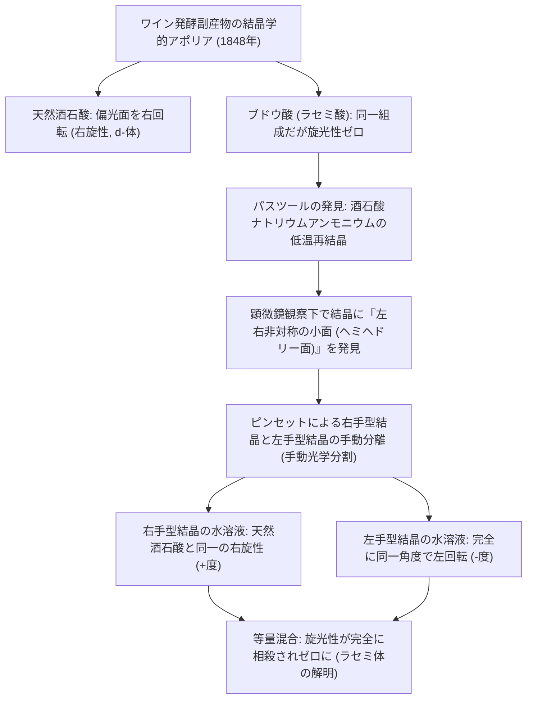
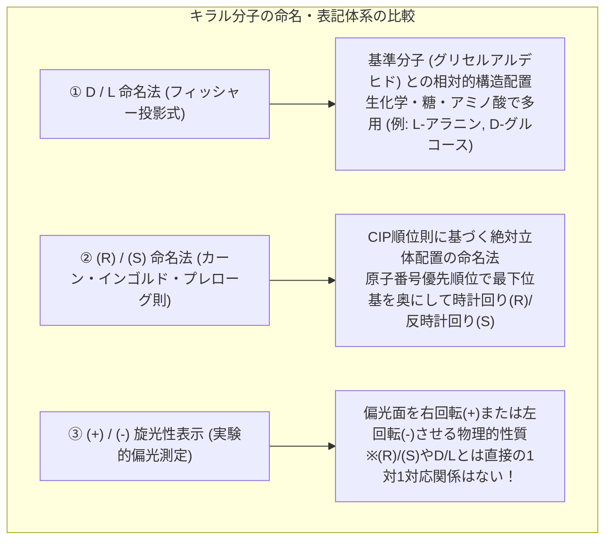
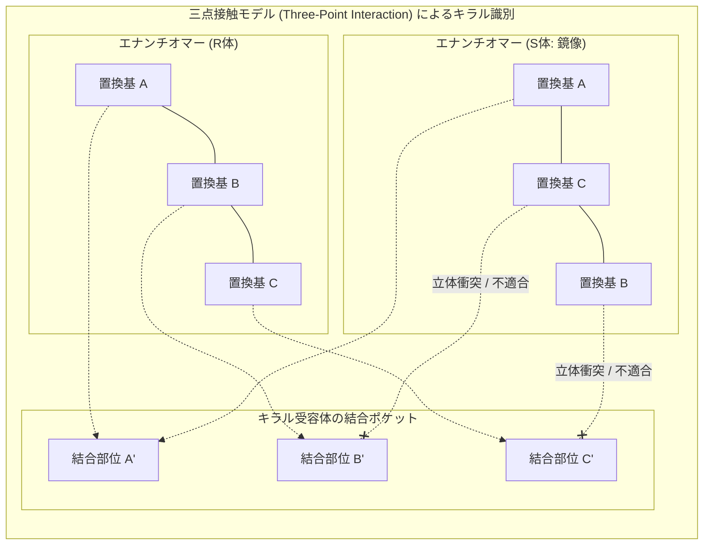
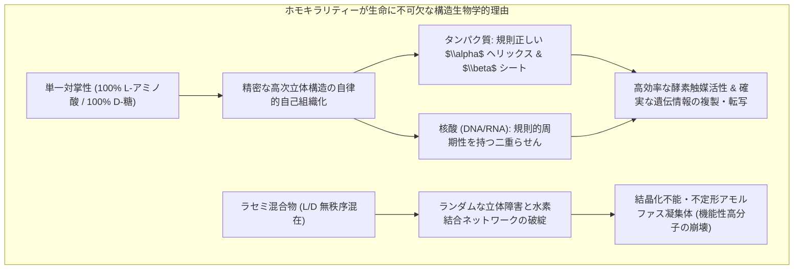
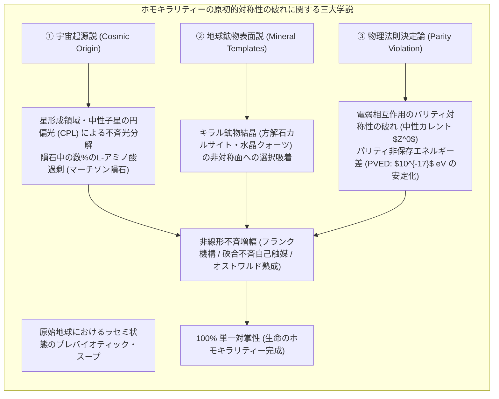
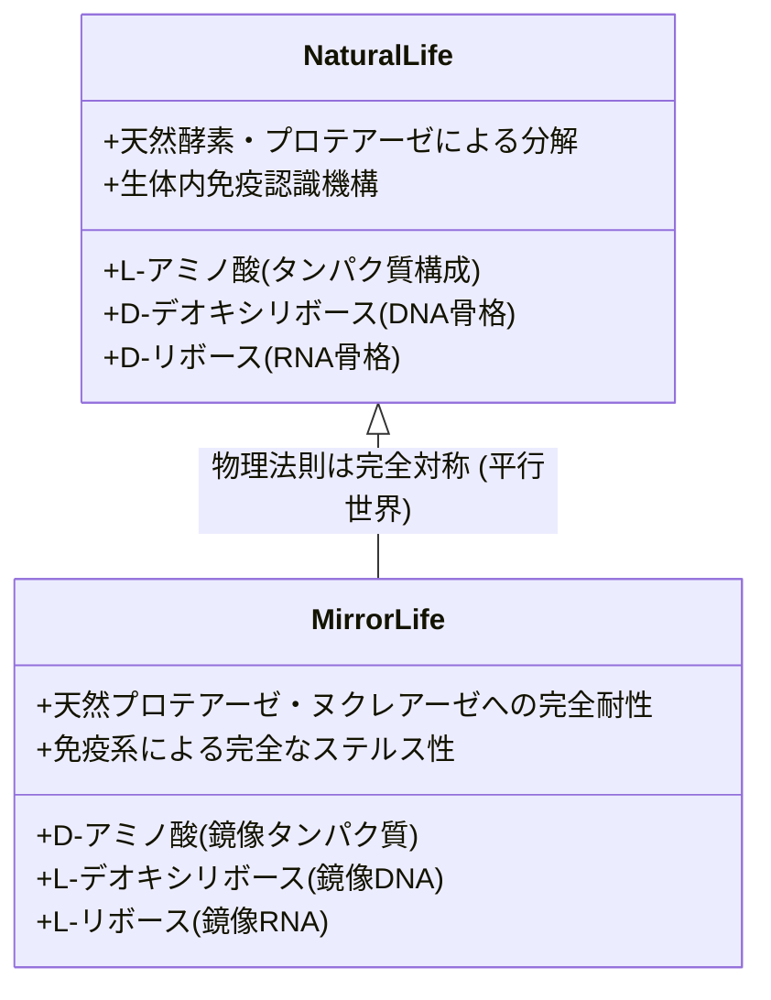

両手を胸の前に掲げ、手のひらを自分に向けて見つめてみてください。右手と左手は、親指から小指に至る骨格の配置、関節の可動域、皮膚の質感に至るまで、幾何学的に全く同一の構成要素を持っています。しかし、右手を手袋にはめるとき、左手用の手袋には決して収まりません。右手と左手は、鏡に映した像（鏡像）とは完全に重なり合いますが、3次元空間のいかなる回転操作を行っても、実物同士を完全に重ね合わせる（重なり合う / Superimpose）ことはできません。

この性質を、ギリシャ語で「手」を意味する *cheir* に由来して<strong>「キラリティー（Chirality：対掌性 / 掌性）」</strong>と呼びます。そして、右手と左手のように互いに鏡像の関係にありながら重なり合わない一対の立体異性体を<strong>「エナンチオマー（Enantiomer：鏡像異性体）」</strong>といいます。



この幾何学的対称性の破れは、単なる化学の教科書に載っている微視的なパズルにとどまりません。現代の生物学、天文学、そして素粒子物理学が直面する最大の未解決問題の一つ――<strong>「生命のホモキラリティー（Homochirality：単一対掌性）」</strong>の起源へと直結しています。

地球上に存在するすべての生物において：
- タンパク質を構成する20種類の標準アミノ酸（グリシンを除く）は、ほぼ例外なく<strong>「L型（左手型）」</strong>である。
- DNAおよびRNAの遺伝情報のバックボーンを担うリボースおよびデオキシリボース（糖）は、例外なく<strong>「D型（右手型）」</strong>である。

通常の実験室で有機化合物を化学合成すれば、右手型と左手型は熱力学的に等しい確率（50:50）で生成し、旋光性を持たない<strong>「ラセミ混合物（Racemate）」</strong>となります。しかし、地球上の生命システムは、38億年以上にわたり、このラセミ平衡から極限まで隔絶した「100%の鏡像純度」を厳密に維持し続けています。

生命はなぜ、右手と左手のどちらか一方のみを頑なに選び取ったのでしょうか？ もし別の惑星に生命が存在するならば、その生体分子は我々と正反対の「D型アミノ酸とL型糖」でできた「鏡像生命」なのでしょうか？ それとも、宇宙の物理法則そのものが、あらかじめ「左手」を選ぶようにプログラムされていたのでしょうか？

本稿では、ルイ・パスツールによる酒石酸結晶の奇跡的な光学分割から、サリドマイド禍が暴いた生体受容体のキラル認識機構、天体物理学が示唆する宇宙の円偏光照射、素粒子電弱相互作用のパリティ対称性の破れ、フランクの自己触媒動力学モデルと硤合不斉増幅、そして現代の合成生物学が切り拓く人工「ミラー生命」の最前線まで、分子の左右が紡ぎ出す深遠なる謎を完全解読します。

---

## 1. 歴史の幕開け：パスツールの酒石酸と光学活性の発見

分子の左右非対称性が自然界の根源的現象として認識されたのは、19世紀中葉のフランスにおける、近代細菌学の祖<strong>ルイ・パスツール（Louis Pasteur, 1822–1895）</strong>の驚くべき観察に始まります。

### 1.1 ワインの沈殿物と二つの「酒石酸」の謎

当時、ワインの醸造樽の内壁には、ブドウ果汁の発酵副産物として<strong>酒石酸水素カリウム（酒石）</strong>が析出することが知られていました。この天然の酒石酸の水溶液に直線偏光を通過させると、偏光の振動面が時計回り（右）に回転する<strong>「旋光性（Optical Activity）」</strong>を示しました。

ところが、ワインの過剰加熱濃縮によって偶然副生する「ブドウ酸（ラセミ酸 / Racemic Acid）」と呼ばれる物質は、元素分析値も化学組成も天然酒石酸と完全に一致（異性体）しているにもかかわらず、<strong>偏光面をまったく回転させない（旋光性ゼロ）</strong>という不可解な性質を示していました。当時の高名な物理学者ジャン＝バティスト・ビオや化学者エイルハルト・ミチェルリヒは、この謎の前に頭を抱えていました。



### 1.2 ピンセットによる結晶の選別と立体化学の黎明

1848年、若干25歳のエコール・ノルマル・シュペリウール（高等師範学校）の大学院生であったパスツールは、<strong>酒石酸ナトリウムアンモニウム</strong>の結晶を作製し、顕微鏡下で観察しました。

パスツールは、結晶の角に存在する微小な小面（ヘミヘドリー面：半面像）の向きに着目しました。驚くべきことに、結晶群の中には「右下がりに面が削れた結晶」と「左下がりに面が削れた結晶」という、<strong>互いに鏡像関係にある二種類の結晶形態が1:1の割合で混在</strong>していたのです。

パスツールは顕微鏡を覗き込みながら、ピンセットを用いて右手型結晶と左手型結晶をひとつひとつ丹念に選り分け、別々のビーカーで水に溶解させました。そして偏光計にかけた瞬間、歴史的発見が訪れました：
1. 右手型結晶を溶かした溶液は、偏光面を正確に右へ回転させた（天然の酒石酸と同一）。
2. 左手型結晶を溶かした溶液は、<strong>全く同一の角度で偏光面を左へ回転させた</strong>。
3. 両方の溶液を等量混合すると、旋光性は完全に消失し、元のブドウ酸と同一の無旋光性溶液に戻った。

興奮のあまり実験室を飛び出したパスツールは、廊下にいた物理教授アンリ・ド・セナルモンを抱き締め、「私は今、偉大な発見をした！ あまりの喜びに震えが止まらない！」と叫んだと伝えられています。

パスツールは、巨視的な結晶の外形に現れた左右の非対称性は、<strong>分子そのものが3次元空間において非対称な立体構造を持っていることの直接の反映</strong>であると直観しました。この瞬間、分子を平面的・平坦な原子の集合体として捉えていた従来の化学から、空間的配置を探求する<strong>「立体化学（Stereochemistry）」</strong>が産声を上げたのです。

パスツールは晩年、次のような予見的な言葉を残しています：
> 「宇宙は非対称な全体である。私は、生命がそのすべての現れにおいて、宇宙的非対称性の関数であると確信している。」

---

## 2. キラリティーの物理化学的基礎：光学活性と命名法

分子がキラリティーを持つための幾何学的必要十分条件は、<strong>「反転中心（$i$）および回映軸（$S_n$）を持たないこと」</strong>です。有機化学において最も一般的なキラル構造は、炭素原子の四つの結合手にすべて異なる原子または原子団が結合した<strong>「不斉炭素原子（Asymmetric Carbon Atom / 不斉中心）」</strong>です。

1874年、オランダの<strong>ヤコブス・ヘンリクス・ファント・ホッフ（Jacobus Henricus van 't Hoff）</strong>とフランスの<strong>ジョセフ・アシル・ル・ベル（Joseph Achille Le Bel）</strong>は、炭素の4つの共有結合手は平面正方形ではなく、<strong>正四面体（Tetrahedron）</strong>の頂点に向かって伸びていることを独立に提唱しました。炭素が正四面体構造をとるからこそ、4つの異なる置換基（$A, B, C, D$）が結合したとき、鏡像と重なり合わない2種類のエナンチオマーが生じるのです。



### 2.1 偏光とビオの法則

直線偏光とは、電場ベクトルが一つの平面内でのみ振動する光です。キラル分子の溶液中を直線偏光が伝播するとき、直線偏光は互いに逆方向に回転する「右円偏光」と「左円偏光」の重ね合わせとして分解できます。キラル媒体中では、分子の非対称な電子雲との相互作用により、右円偏光に対する屈折率（$n_R$）と左円偏光に対する屈折率（$n_L$）に微小な差が生じます（<strong>円複屈折 / Circular Birefringence</strong>）。

二つの円偏光成分の位相速度に差が生じる結果、媒質を通過した後の合成電場ベクトルの振動面は一定の角度 $\alpha$ だけ回転します。これが旋光性です。

旋光度 $\alpha$ は、光路長 $l$ および試料濃度 $c$ に比例し、<strong>ビオの法則（Biot's Law）</strong>に従います：

$$[\alpha]_\lambda^T = \frac{\alpha}{l \cdot c}$$

ここで：
- $[\alpha]_\lambda^T$：測定温度 $T$、波長 $\lambda$（通常はナトリウムD線 $589.3 \text{ nm}$）における<strong>比旋光度（Specific Rotation）</strong>
- $\alpha$：測定された旋光角（度）
- $l$：セル長（$\text{dm} = 10 \text{ cm}$）
- $c$：試料濃度（$\text{g/cm}^3$ または溶液 $100 \text{ mL}$ 中のグラム数）

また、左右の円偏光に対するモル吸光係数の差（$\Delta \epsilon = \epsilon_L - \epsilon_R$）によって直線偏光が楕円偏光へと変化する現象を<strong>「円二色性（CD: Circular Dichroism）」</strong>と呼び、タンパク質の二次構造解析（$\alpha$ヘリックスや$\beta$シートの割合）の極めて強力な分光学的測定手段となっています。

### 2.2 立体配置の表記体系：D/L則と(R)/(S)則

歴史的に生化学で広く用いられているのは、エミール・フィッシャーが提案した<strong>D/L表記法</strong>です。最も単純なキラル糖である<strong>グリセルアルデヒド</strong>を基準とし、最も酸化された炭素（アルデヒド基など）を上にしてフィッシャー投影式を描いたとき、主鎖下端の不斉炭素に結合したヒドロキシ基（$-OH$）またはアミノ基（$-NH_2$）が<strong>右側にあればD型、左側にあればL型</strong>と定義されます。

一方、現代の有機化学で万国共通の絶対配置記述法として用いられるのが、<strong>カーン・インゴルド・プレローグ則（CIP順位則 / Cahn-Ingold-Prelog priority rules）</strong>による <strong>$(R)/(S)$ 表示法</strong>です：
1. 不斉炭素原子に結合した4つの置換基に、原子番号の大きい順に優先順位（$1 > 2 > 3 > 4$）を付与する。
2. 同位体の場合は質量数の大きい方を優先し、同じ原子が直接結合している場合は次の結合先原子の原子番号を比較する。
3. 最低優先順位（4）の置換基を視線の奥（裏側）に向け、残る1から3の置換基を眺める。
4. 優先順位 $1 \to 2 \to 3$ の進行方向が<strong>時計回りであれば $(R)$（Rectus：ラテン語で「右」）</strong>、<strong>反時計回りであれば $(S)$（Sinister：ラテン語で「左」）</strong>と命名する。

> <strong>重要な注意点：</strong>
> $(R)/(S)$ 配置や $\text{D/L}$ 配置は「分子の幾何学的空間配置（絶対配置）」を示すものであり、実験室で測定される旋光性の向きである $(+)$（右旋性 / dextrorotatory）や $(-)$（左旋性 / levorotatory）と直接の対応関係はありません。例えば、生体内に存在する天然の「L-アラニン」は $(S)$ 配置を持ち、かつ $(+)$ 右旋性を示します。
---

## 3. 生体受容体と分子認識：サリドマイドの悲劇と薬理学

なぜ生体は、わずかな立体的違いに過ぎない鏡像分子をこれほどまでに劇的に識別するのでしょうか？

### 3.1 「鍵と鍵穴」モデルと三点接触モデル

1894年、ノーベル化学賞受賞者<strong>エミール・フィッシャー（Emil Fischer）</strong>は、酵素と基質の結合特異性を説明するために<strong>「鍵と鍵穴（Lock and Key）」モデル</strong>を提唱しました。生体を構成するタンパク質（受容体、酵素、輸送体）は、それ自体が純粋なL型アミノ酸で構成された<strong>高度にキラルな3次元空間</strong>を形成しています。

キラルな受容体がエナンチオマーを識別する物理的機構は、<strong>オグストン（Ogston）の「三点接触モデル（Three-Point Interaction Model）」</strong>によって明快に説明されます。



分子が受容体に強く結合して生理作用を発現するためには、分子上の少なくとも3つの異なる官能基（$A, B, C$）が、受容体上の対応する結合ポケット（$A', B', C'$）と同時に水素結合、静電相互作用、疎水性相互作用を形成する必要があります。
- 一方のエナンチオマー（ユーメラ：Eumer）は、3つの官能基が完璧に結合ポケットと一致して強い薬理活性を示します。
- しかし、その鏡像異性体（ディストマー：Distomer）を同じ結合部位に当てはめようとすると、2つの基を合わせても3つ目の基は空間的に全く逆を向いてしまい、結合できないか、あるいは別の意図せぬ受容体に結合して毒性を発現します。

### 3.2 サリドマイドの薬理と悲劇的教訓

分子キラリティーが生体に対して持つ致命的な重要性を、世界的な悲劇とともに人類に焼き付けたのが、1950年代末から1960年代初頭にかけて発生した<strong>サリドマイド禍（Thalidomide Catastrophe）</strong>です。

西ドイツのグリュネンタール社によって開発されたサリドマイド（Thalidomide）は、安全な非バルビツール酸系の睡眠薬・鎮静薬として、特に妊婦のつわり（妊娠悪阻）防止薬として世界40カ国以上でラセミ体（$R$体と$S$体の50:50混合物）として販売されました。しかし、服用した妊婦から、四肢の長管骨が著しく短縮または欠損する「アザラシ肢症（Phocomelia）」をはじめとする重篤な先天奇形を持つ新生児が世界中で1万人以上出生するという、薬害史上最大の悲劇を引き起こしました。

| エナンチオマー | 主な生理・薬理活性 | 標的受容体と作用機序 |
|---|---|---|
| <strong>$(R)$-サリドマイド</strong> | 有効かつ安全な<strong>催眠・鎮静作用</strong> | 中枢神経系のGABA受容体経路等の鎮静化 |
| <strong>$(S)$-サリドマイド</strong> | 強力な<strong>催奇形性・胎児毒性</strong> | ユビキチンリガーゼ複合体<strong>セレブロン（CRBN）</strong>に結合し、胎児発生に必須の転写因子（SALL4等）を異常分解 |

近年の分子生物学的研究（2010年代以降）により、$(S)$-サリドマイドがE3ユビキチンリガーゼの構成タンパク質である<strong>セレブロン（Cereblon: CRBN）</strong>のポケットに特異的に嵌まり込み、肢芽形成に関わる転写因子SALL4やTP63をネオ基質として誘導分解することが解明されました。

> <strong>生体内ラセミ化の罠：</strong>
> 「それでは、$R$体だけを光学分割して純粋に投与すれば安全だったのか？」という問いがしばしばなされます。結論から言えば、サリドマイドの場合、それは不可能です。サリドマイドの不斉炭素に結合した水素原子は、隣接する二つのカルボニル基によって強く活性化（酸性度上昇）されており、<strong>人体の生理的pH（約7.4）の血液中において、ケト・エノール互変異性化を通じてわずか数時間の半減期で自発的にラセミ化（$R \rightleftharpoons S$ 相互変換）してしまう</strong>からです。
> この悲劇を契機に、世界各国の薬事規制当局（米FDA、日本のPMDA等）は、キラル医薬品の開発において両エナンチオマーの薬効、毒性、体内動態、および生体内相互変換速度を個別に評価することを厳格に義務付けるようになりました。

### 3.3 香りと味覚に見るキラル認識

生体受容体がキラル空間であることを示す、より日常的で魅力的な例が<strong>嗅覚・味覚</strong>です：

- <strong>カルボン（Carvone）：</strong>
  - $(R)-(-)$-カルボン：爽快で甘みのある<strong>スペアミント</strong>の香り。
  - $(S)-(+)$-カルボン：香辛料<strong>キャラウェイ（ヒメウイキョウ）</strong>やライ麦パンの香り。
- <strong>リモネン（Limonene）：</strong>
  - $(R)-(+)$-リモネン：甘酸っぱい<strong>オレンジ</strong>や温州ミカンの香り。
  - $(S)-(-)$-リモネン：鋭くシャープな<strong>レモン</strong>、ライム、松ヤニの香り。
- <strong>グルタミン酸ナトリウム：</strong>
  - $\text{L}$-体：力強い「うま味」の主成分（味の素）。
  - $\text{D}$-体：味をほとんど感じないか、わずかに不快な苦味を伴う。

鼻腔粘膜に並ぶ数百種類の嗅覚受容体（Gタンパク質共役受容体：GPCR）が精密なキラルポケットを持っているため、同一の官能基配置を持ちながら鏡像関係にある分子を、私たちの脳は全く異なる情動・風味として知覚するのです。

---

## 4. 生命のホモキラリティー：その構造生物学的必然性

現代の生化学が明らかにした最も驚くべき事実の一つは、<strong>生命が「アミノ酸＝L型」「リボース＝D型」という単一対掌性を100%徹底している</strong>という点です。

なぜ生命は、右と左が混ざり合った「ラセミ体のスープ」で満足できなかったのでしょうか？



### 4.1 二次構造形成における立体障害の破綻

タンパク質の最も代表的な二次構造である<strong>$\alpha$ヘリックス（$\alpha$-Helix）</strong>は、アミノ酸3.6残基ごとに1回転し、主鎖のペプチド結合間（$C=O \cdots H-N$）に強固な平行水素結合を形成することで極めて安定ならせん円柱を構築します。

もし、このポリペプチド鎖の中に<strong>たった1分子でもD-アミノ酸が混入</strong>すると、その側鎖（R基）は正常な外側ではなく、らせん骨格の内部または隣接する残基と激しく立体衝突（Steric Clash）を起こします。その結果、ペプチド主鎖の二面角（ラーマチャンドラン・プロットにおける $\phi, \psi$ 角）が許容領域から大きく外れ、<strong>水素結合ネットワークが連鎖的に崩壊してヘリックス構造が即座に瓦解</strong>します。

同様に、DNAやRNAの二重らせん構造も、構成単位であるヌクレオチドのD-デオキシリボース（またはD-リボース）が統一されたキラリティーを持っているからこそ、糖-リン酸骨格が一定の曲率と螺旋ピッチを保ち、相補的塩基対（A-T, G-C）の水素結合面を完璧な幾何学的平行度で積み重ねる（スタッキング相互作用）ことができます。ラセミ体の糖から合成された核酸鎖は、規則正しい二重らせんを形成できず、遺伝情報の正確な複製や転写は熱力学的に不可能です。

すなわち、<strong>「ホモキラリティーの獲得」は、高度な機能を持つ生体高分子（触媒としての酵素、情報担体としての核酸）が自己組織化するための絶対的かつ不可欠な前提条件</strong>だったのです。
---

## 5. ホモキラリティーの起源をめぐる三大学説

では、地球の原始海洋において、生命の誕生以前に「最初の左右の偏り（キラル対称性の破れ）」はいかにして生じたのでしょうか？ 現代の科学界では、大きく分けて<strong>三つの学説（宇宙起源説・鉱物表面説・物理法則決定論）</strong>が激しい論争を繰り広げています。



### 5.1 宇宙起源説：中性子星の円偏光とマーチソン隕石

現在、最も多くの実験的・観測的証拠に支えられているのが<strong>「宇宙起源説（Cosmic Origin / Extraterrestrial Hypothesis）」</strong>です。

#### マーチソン隕石がもたらした衝撃
1969年9月、オーストラリアのビクトリア州マーチソンに落下した炭素質コンドライト隕石（<strong>マーチソン隕石</strong>）の内部から、地球外起源の多様なアミノ酸が検出されました。地球上の生物による汚染（コンタミネーション）の可能性を徹底的に排除した最新の超高分解能クロマトグラフィー分析により、地球の生命には使われていない非タンパク質性アミノ酸（$\alpha$-メチルバリン、イソバリンなど）において、<strong>明確な「L体過剰（Enantiomeric Excess: ee = 2〜18%）」</strong>が確認されたのです。

さらに、小惑星探査機「はやぶさ2」が小惑星リュウグウから持ち帰ったサンプル、およびNASAの「オシリス・レックス」が小惑星ベンヌから持ち帰ったカプセルの分析においても、太陽系形成以前の星間分子雲で合成された有機分子群の中に有意なL体過剰が存在することが報告されています。

#### 星形成領域における円偏光（CPL）照射
では、宇宙空間においてなぜL体が優勢になったのでしょうか？ 天文学の観測により、オリオン大星雲（Orion OMC-1）などの大質量星形成領域から、広大な空間にわたって<strong>強い円偏光（Circularly Polarized Light: CPL）</strong>が放射されていることが確認されました。

中性子星（パルサー）から放出されるシンクロトロン放射が星間塵によって散乱されると、特定の回転方向を持つ円偏光が発生します。有機分子に円偏光を照射すると、円二色性（CD）の吸収強度の違いにより、一方のエナンチオマーが優先的に光分解（不斉光分解 / Asymmetric Photodestruction）されます。

星間塵に付着した氷マントル中でラセミ体として合成されたアミノ酸が、数十万年にわたり一方向の円偏光を浴び続けた結果、わずか数パーセントの「L体過剰」が生じ、それが彗星や隕石に乗って初期の地球へと運ばれてきた（パンスペルミア的供給）というシナリオです。

### 5.2 鉱物表面吸着説：方解石と水晶のキラルテンプレート

第二の有力仮説は、地球上の<strong>キラルな鉱物結晶の表面</strong>が分子の鏡像を選別したという「無機テンプレート仮説」です。

鉱物の中には、構成原子（カルシウム、炭素、酸素、ケイ素など）自体は非キラルであっても、結晶格子として組み上がった際に左右の対称性を持たないキラル空間群に属する結晶が存在します：
- <strong>方解石（カルサイト：$\text{CaCO}_3$）：</strong> 最も一般的な炭酸塩鉱物であり、原始海洋の熱水噴出孔や沿岸部に豊富に存在しました。方解石の菱面体結晶劈開面（例えば $\{10\bar{1}4\}$ 面）には、原子配列が鏡像関係にあるステップエッジが存在し、D-アミノ酸とL-アミノ酸に対して異なる吸着エネルギーを示します。実験室での検証により、方解石表面でアスパラギン酸やグルタミン酸が特定の面に選択的に吸着・濃縮されることが実証されています。
- <strong>水晶（クォーツ：$\text{SiO}_2$）：</strong> 結晶構造自体が右水晶（$P3_1 21$）と左水晶（$P3_2 21$）の鏡像関係を持ち、その破砕面においてアミノ酸の不斉吸着が起こることが確認されています。

### 5.3 物理法則決定論：弱い相互作用のパリティ対称性の破れ

三つ目の仮説は、物理学の最も深遠な基本法則に起源を求める<strong>「電弱相互作用決定論」</strong>です。

1956年、李政道（T. D. Lee）と楊振寧（C. N. Yang）は、素粒子の「弱い相互作用（Weak Interaction）」においては空間反転に対する対称性（<strong>パリティ対称性 / Parity</strong>）が破れている可能性を予言し、翌1957年に呉健雄（Chien-Shiung Wu）らによるコバルト60のベータ崩壊実験によって実証されました（1957年ノーベル物理学賞）。自然界は、素粒子のレベルで「左巻き」と「右巻き」を平等には扱っていません（ベータ線として放出される電子は常に左巻きスピンを持つ）。

電弱統一理論によれば、$Z^0$ ボソンを介した中性カレント相互作用により、電子と原子核の間に極微のキラル相互作用が働きます。その結果、互いに鏡像関係にあるエナンチオマー同士の基底状態エネルギーには、厳密には<strong>極微のエネルギー差（パリティ非保存エネルギー差 / PVED: Parity-Violating Energy Difference）</strong>が存在することが量子化学計算によって示されました：

$$\Delta E_{\text{PVED}} = E(D) - E(L) \approx 10^{-17} \text{ eV} \quad (\sim 10^{-12} \text{ J/mol})$$

この値は、室温の熱エネルギー（$k_B T \approx 2.5 \times 10^{-2} \text{ eV}$）に比べれば約15桁も小さい、途方もなく微小な差です。しかし、理論物理学者アブドゥス・サラム（Abdus Salam）らは、この極微のエネルギー差が、地質学的時間スケール（数億年）と莫大な分子数の平衡状態において、相転移現象（ボース＝アインシュタイン凝縮に類似した巨視的協同現象）を通じて増幅され、最終的にL-アミノ酸の優位を決定づけたのではないかという仮説を提唱しています。

---

## 6. 不斉増幅の非線形ダイナミクス：極微の揺らぎから100%への跳躍

宇宙の円偏光であれ、パリティの破れであれ、初期に生じた左右の偏りはせいぜい<strong>「0.001%から数%の光学純度（エナンチオマー過剰率：$ee$）」</strong>に過ぎません。

$$ee = \frac{[L] - [D]}{[L] + [D]} \times 100 \quad [\%]$$

この極微の偏りから、いかにして生命が要求する<strong>「100%の単一対掌性（$ee = 100\%$）」</strong>への爆発的な増幅が達成されたのでしょうか？ このミッシングリンクを解明したのが、<strong>非線形化学動力学（Nonlinear Chemical Kinetics）</strong>です。

```mermaid
flowchart TD
    subgraph FRANK_MODEL ["フランクの自己触媒モデル (1953年) による対称性の自発的破れ"]
        direction TB
        A["前駆体 A + B"] -->|自然生成| L["L-エナンチオマー"]
        A -->|自然生成| D["D-エナンチオマー"]
        
        L -->|正の自己触媒作用| L_GROWTH["L の指数関数的増殖 ($A + B + L \\to 2L$)"]
        D -->|正の自己触媒作用| D_GROWTH["D の指数関数的増殖 ($A + B + D \\to 2D$)"]
        
        L & D -->|相互抑制 (ヘテロキラル二量化)| INACTIVE["不活性ヘテロ二量体 L-D (デッドエンド生成物)"]
        
        L_GROWTH & D_GROWTH & INACTIVE --> BIFURCATION["非線形分岐 (Bifurcation): わずかに多い側の独占的完全勝利 ($ee \\to 100\\%$)"]
    end
```

### 6.1 チャールズ・フランクの自己触媒モデル（1953年）

イギリスの物理学者<strong>チャールズ・フランク（Frederick Charles Frank, 1911–1998）</strong>は、1953年に科学雑誌『Biochimica et Biophysica Acta』にわずか2ページの極めて革新的な論文を発表しました。フランクは、次の3つの反応素過程を持つ開放系を想定しました：

1. <strong>自己触媒生成反応：</strong> エナンチオマー自身が自らの生成を触媒する。
   $$A + B + L \xrightarrow{k_1} 2L$$
   $$A + B + D \xrightarrow{k_1} 2D$$
2. <strong>相互抑制反応（相互不活性化）：</strong> 逆の符号を持つエナンチオマー同士が結合すると、触媒活性を持たない不活性なヘテロキラル二量体（$LD$）を形成して反応系から脱落する。
   $$L + D \xrightarrow{k_2} LD \quad (\text{触媒能ゼロ})$$

この微分方程式系を解析すると、ラセミ状態（$[L] = [D]$）は<strong>数学的に不安定な鞍点（Saddle Point）</strong>となります。系にランダムな熱揺らぎや外部からのわずか $0.001\%$ の不斉バイアスが加わると、<strong>多い側のエナンチオマーが自己増殖によって指数関数的に増大する一方で、少ない側のエナンチオマーは相互抑制によって完全に消費し尽くされ、最終状態は必然的にどちらか一方のみの「純度100%」へと分岐（Bifurcation）</strong>します。

### 6.2 硤合不斉自己触媒反応（Soai Reaction）の衝撃

フランクのモデルは長年、理論上の美しい数理モデルに過ぎないと考えられていました。しかし1995年、東京理科大学の<strong>硤合憲三（Kenzou Soai）教授</strong>らは、世界で初めてフランク機構を実証する有機化学反応<strong>「硤合不斉自己触媒反応（Soai Asymmetric Autocatalytic Reaction）」</strong>を発見し、世界中に衝撃を与えました。

ピリミジン-5-カルバルデヒドに対してジイソプロピル亜鉛を付加させ、キラルなピリミジルアルコールを合成する反応において、生成物であるアルコール自身が極めて強力な不斉自己触媒として機能します。

驚くべきことに、反応開始時に<strong>わずか $0.00005\%$（500万分の1の偏り）</strong>という、現代の最先端分析機器でも検出限界ギリギリの微小な光学過剰率のキラル化合物を添加するだけで、自己触媒サイクルを数回繰り返すうちに、生成物の光学純度は<strong>$99.5\%$ 以上（ほぼ100% ee）</strong>へと爆発的に跳ね上がることが実証されたのです。

さらに硤合らは、アミノ酸や円偏光、さらにはキラルな水晶結晶片、炭素同位体（$^{12}\text{C}$ と $^{13}\text{C}$）による極微のキラル差でさえも不斉源として感知・増幅できることを次々と証明し、「初期の極微の不斉バイアスがいかにして100%のホモキラリティーへ進化したか」という謎に決定的な実験的回答を与えました。

### 6.3 結晶化によるオストワルド熟成（ヴィーダマン熟成）

液相の化学反応だけでなく、<strong>結晶化プロセス</strong>においても自発的非対称増幅が起こることが明らかになっています。

2005年、クリストバル・ヴィーダマン（Cristobal Viedma）は、ラセミ体を形成せず右手型と左手型の単結晶が別々に析出する「コングロメレート（集積体）」結晶の懸濁液を激しく攪拌し粉砕し続けると、結晶の溶解・再結晶化プロセス（<strong>オストワルド熟成 / Ostwald Ripening</strong>）を通じて、最終的に<strong>系全体の固相結晶が100%単一のキラル結晶へと不可逆的に統一される現象（Viedma熟成）</strong>を発見しました。

原始地球の干潟や波打ち際で、結晶の生成・再溶解・粉砕が繰り返される物理的環境そのものが、巨大な不斉増幅リアクターとして機能していた可能性が極めて濃厚となっています。
---

## 7. 現代合成生物学のフロンティア：人工「鏡像生命（Mirror Life）」への挑戦

ホモキラリティーの謎を探求する人類の知性は、現在、究極の工学的フロンティアへと到達しています。すなわち、<strong>「自然界とは正反対のD-アミノ酸とL-糖だけで構成された、鏡像生命システム（Mirror Life System）を人工合成できるか？」</strong>という挑戦です。



### 7.1 鏡像転写・翻訳システムの構築

清華大学のジュ・ティン（Ting Zhu）教授やジョージ・チャーチ（George Church）教授らの国際的チームは、天然の酵素が一切作用しない完全な「鏡像遺伝情報システム」の構築を進めています：
1. <strong>化学合成による鏡像DNAポリメラーゼの作製：</strong> 全長300残基を超えるD-アミノ酸からなるアフリカ豚熱ウイルス由来のDNAポリメラーゼXを固相ペプチド合成で完全に人工合成し、L-DNA（鏡像DNA）を正確に複製・PCR増幅することに成功。
2. <strong>鏡像転写反応：</strong> 鏡像T7 RNAポリメラーゼを用いて、鏡像DNAプロモーターから鏡像RNAを転写。
3. <strong>鏡像リボソームへの道：</strong> 最終目標は、D-アミノ酸とL-rRNAから構成される完全人工の「鏡像リボソーム」を組み立て、鏡像mRNAから鏡像タンパク質を自律翻訳させることです。

### 7.2 鏡像生体分子の産業・医療応用

完全な鏡像細胞の誕生を待たずとも、すでに部分的な鏡像分子はバイオテクノロジーと創薬に革命を起こしています：
- <strong>鏡像アプタマー（スピーゲルマー / Spiegelmer）：</strong> L-RNAから作られた核酸アプタマーは、標的タンパク質に強固に結合しますが、生体内の一般的なRNA分解酵素（RNase）は右巻きのD-RNAしか認識・切断できないため、<strong>生体内で分解されず極めて長い血中半減期</strong>を誇ります。
- <strong>鏡像ペプチド医薬品：</strong> D-アミノ酸で構成されたペプチドは、胃腸や血液中のペプチダーゼによる消化分解を受けず、経口投与可能な抗体代替薬として臨床開発が進んでいます。
- <strong>究極のデータストレージ：</strong> L-DNAは、あらゆる土壌微生物や環境中のヌクレアーゼから完全に不可視であるため、数万年にわたって劣化しない究極の超長期デジタルアーカイブ媒体として期待されています。

### 7.3 バイオセーフティと生態学的リスク（鏡像エコシステム）

一方で、完全な自律増殖能を持つ「鏡像細菌（Mirror Bacterium）」が環境中に漏出した場合、破滅的な生態系崩壊を引き起こすのではないかという深刻な倫理的・安全保障上の懸念が提起されています：
- <strong>捕食者の不在：</strong> 自然界のいかなるウイルス（バクテリオファージ）も鏡像細菌に感染できず、原生動物やアメーバも鏡像細胞を分解・捕食してエネルギー源とすることができません。
- <strong>免疫系の盲点：</strong> 人体や哺乳類の獲得免疫系（MHCクラスI/II分子による抗原提示）はL-ペプチドに特化しているため、鏡像病原体が侵入した場合、免疫系が完全に感知できない「見えない病原体」となる恐れがあります。
- <strong>非対称な資源競合：</strong> 鏡像生物は非キラルな栄養素（リン酸、アンモニア、金属イオン）を天然生物と競合して消費し、生態系ピラミッドの外側で制御不能に増殖する可能性があります。

このため、合成生物学界では鏡像生命の研究に対して、最高レベルの物理的・生物学的封じ込め基準を義務付ける国際的バイオセーフティ枠組みの策定が急ピッチで進められています。

---

## 8. 結論：宇宙の非対称性と生命の美学

パスツールが酒石酸の小さな結晶に見た左右の面から始まった探求は、170年以上の歳月を経て、星間分子雲の偏光から素粒子の弱い相互作用、そして現代の鏡像生命工学に至る壮大な知の円環を結びました。

生命が左右のどちらか一方を選び取ったこと――それは、単なる無機的な偶然の産物だったのでしょうか、それとも物理法則の根底に刻まれた必然だったのでしょうか？

確かなことは、<strong>もし原始地球のスープが完全な左右対称のまま留まっていたならば、生命の複雑で精巧な高次構造は決して生まれ得なかった</strong>ということです。対称性の破れ、調和を乱すわずかな不均衡、そしてそれを指数関数的に増幅する非線形の協同現象――それこそが、物質が生命へと昇華するための不可欠な着火剤でした。

夜空を見上げるとき、私たちはそこに広がる無数の恒星系を想います。遠く離れた系外惑星の海で蠢く生命体もまた、中性子星の円偏光を浴びて、我々と同じように「左手のアミノ酸」を選んだのでしょうか。それとも、そこには我々と完璧に鏡像反転した、もう一つの美しい「右手の手袋」が広がっているのでしょうか。分子の左右が紡ぎ出す壮麗なる詩篇は、生命とは何かという根源の問いを、今日も私たちに投げかけ続けています。
