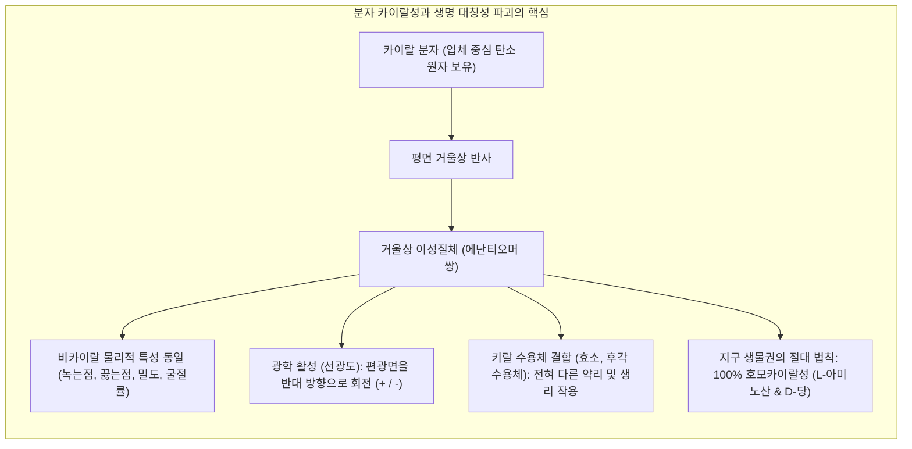
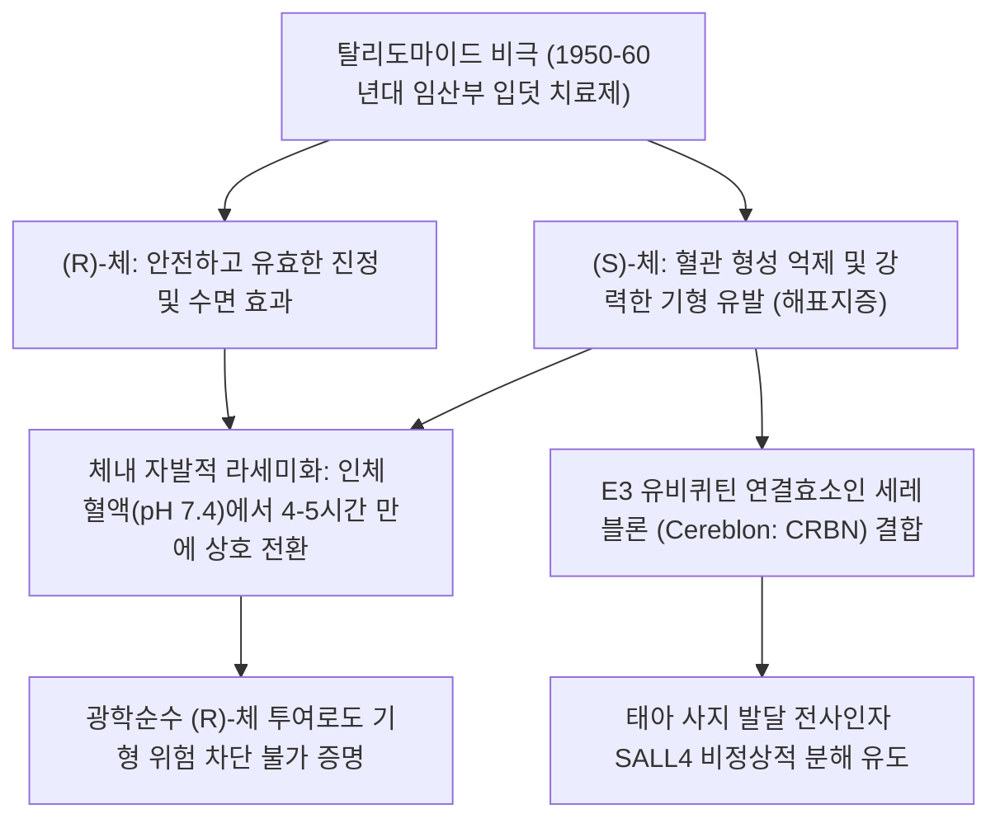
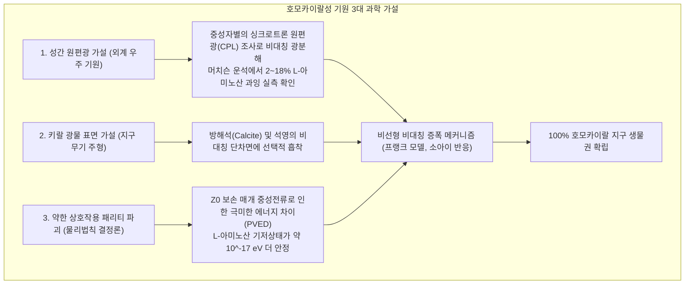

자신의 양손을 마주 보십시오. 오른손과 왼손은 다섯 개의 손가락, 관절의 배열, 전체적인 윤곽에 이르기까지 완벽하게 동일한 구성 요소를 지니고 있습니다. 그러나 3차원 공간에서 오른손을 아무리 회전시켜도 왼손과 완전히 겹쳐질(Superimpose) 수는 없습니다. 거울에 비춘 상(거울상)과는 겹치지만, 실물끼리는 결코 겹쳐지지 않는 이 기하학적 성질을 그리스어로 손을 뜻하는 *cheir*에서 유래하여 <strong>'카이랄성(Chirality: 대장성 / 거울상 이성질성)'</strong>이라고 부릅니다.

일반적인 화학 실험실에서 비카이랄성 물질로부터 화합물을 합성하면, 열역학적 확률에 따라 오른손 분자와 왼손 분자가 50:50으로 균등하게 섞인 <strong>라세미 혼합물(Racemate)</strong>이 생성됩니다.

그러나 지구상의 모든 생명체는 38억 년 동안 이 대칭성을 철저히 깨뜨린 <strong>'호모카이랄성(Homochirality: 단일대칭성)'</strong>을 완벽하게 고수하고 있습니다:
- <strong>단백질:</strong> 모든 생명 활동을 매개하는 효소와 단백질은 오직 <strong>L형(왼손형) 아미노산</strong>으로만 구성됩니다.
- <strong>핵산:</strong> 유전 정보를 저장하는 DNA와 RNA의 골격을 이루는 당(리보오스 및 디옥시리보오스)은 오직 <strong>D형(오른손형)</strong>으로만 이루어져 있습니다.

원시 지구의 무기물 농탕에서 출발한 생명은 왜 하필 'L-아미노산과 D-당'이라는 한쪽 손만을 선택했을까요?

---

## 1. 입체화학의 탄생: 파스퇴르의 타르타르산 결정 분할

분자의 거울상 비대칭성을 인류 역사상 최초로 발견한 인물은 프랑스의 천재 과학자 <strong>루이 파스퇴르(Louis Pasteur, 1848년)</strong>였습니다.

와인 양조 과정에서 오크통 내벽에 침전되는 천연 타르타르산(주석산)은 편광면을 오른쪽으로 회전시키는 광학 활성을 보였습니다. 반면, 합성과정에서 부산물로 얻어지는 '포도산(라세미산)'은 화학 조성과 분자량이 동일함에도 광학 활성이 전혀 없었습니다.

25세의 청년 파스퇴르는 <strong>타르타르산 나트륨암모늄</strong>의 결정을 현미경으로 관찰하던 중, 미세한 결정면에 좌우가 거울 대칭을 이루는 '비대칭 반면상'이 존재함을 발견했습니다. 그는 핀셋으로 오른손형 결정과 왼손형 결정을 하나하나 수동으로 분리하여 각각 물에 녹였습니다. 그 결과:
- 오른손형 결정 용액은 천연 타르타르산과 동일하게 편광을 오른쪽(+)으로 회전시켰습니다.
- 왼손형 결정 용액은 <strong>정확히 동일한 각도로 편광을 왼쪽(-)</strong>으로 회전시켰습니다.
- 두 용액을 1:1로 섞자 편광 회전이 상쇄되어 광학 활성이 사라졌습니다.

파스퇴르는 거시적 결정의 형태학적 비대칭성이 바로 <strong>분자 자체의 3차원적 거울상 비대칭성</strong>에서 기인한다는 혁명적 결론을 내렸고, 이로써 현대 <strong>입체화학(Stereochemistry)</strong>이 시작되었습니다.

---

## 2. 3점 접촉 모델과 탈리도마이드의 비극

생체 수용체가 거울상 분자를 구별하는 원리는 옥스턴(Ogston)의 <strong>'3점 접촉 모델(Three-Point Interaction Model)'</strong>로 설명됩니다. L-아미노산으로 이루어진 생체 효소의 활성 부위는 고유한 비대칭 주머니를 형성하고 있어, 약물 분자의 세 작용기($A, B, C$)가 수용체의 상응 부위($A', B', C'$)와 완벽히 맞아떨어져야만 생리 활성을 일으킵니다. 거울상 이성질체는 공간 배열의 반전으로 인해 3점이 동시에 결합할 수 없습니다.

1950년대 후반 임산부의 입덧 치료제로 판매된 <strong>탈리도마이드(Thalidomide)</strong>는 라세미체로 투여되어 전 세계 1만 명 이상의 신생아에게 사지 결손 기형(해표지증)을 초래했습니다. $(R)$-체는 안전한 진정제였으나, 거울상인 $(S)$-체는 E3 유비퀴틴 연결효소인 <strong>세레블론(CRBN)</strong>에 결합하여 태아 발달에 필수적인 단백질 SALL4를 파괴하는 치명적인 기형 유발 인자였습니다. 더욱이 탈리도마이드는 체내 생리적 환경에서 케토-에놀 토토머화를 통해 스스로 $(R) \rightleftharpoons (S)$로 라세미화되므로, 한쪽만을 투여해도 비극을 막을 수 없었습니다.

---

## 3. 호모카이랄성의 생물물리학적 필연성

생명체가 라세미 혼합물을 거부하고 100% 단일대칭성을 추구한 이유는 <strong>고분자 입체 구조의 물리적 붕괴</strong> 때문입니다.

단백질의 핵심 2차 구조인 <strong>$\alpha$-나선(Alpha-Helix)</strong>은 3.6개 잔기마다 규칙적인 수소결합을 형성합니다. 만약 L-아미노산 사슬 중간에 단 하나의 D-아미노산이 섞이면, 곁사슬($C_\beta$)이 인접 원자와 격렬한 입체 장애(Steric Clash)를 일으켜 라마찬드란 허용 각도를 벗어나게 됩니다. 그 결과 수소결합 망이 즉각 파괴되어 나선 구조 전체가 붕괴합니다.

DNA와 RNA의 이중나선 역시 D-당의 고정된 입체형태가 일정한 나선 피치(3.4 nm)를 부여하기 때문에 유지됩니다. 라세미체 당으로 합성된 핵산은 규칙적인 염기쌍 적층을 이루지 못하고 복제가 중단(거울상 교차 억제)됩니다. 즉, <strong>호모카이랄성은 생명 고분자가 기능을 갖기 위한 절대적 전제 조건</strong>입니다.

---

## 4. 호모카이랄성 기원의 3대 가설

원시 지구의 화학적 진화 단계에서 최초의 대칭성 깨짐은 어디서 유래했을까요?

1. <strong>우주 기원설 (머치슨 운석의 증거):</strong> 1969년 호주에 떨어진 머치슨 탄소질 운석에서 생물권에 없는 아미노산(이소발린 등)이 <strong>2~18%의 L-과잉(enantiomeric excess)</strong>을 나타냄이 확인되었습니다. 오리온 대성운 등 거대 항성 형성 영역에서 방출되는 강한 <strong>원편광(Circularly Polarized Light: CPL)</strong>이 성간 먼지 속 유기물을 한쪽만 선택적으로 광분해(비대칭 광분해)시켜 초기 불균형을 만들었다는 이론입니다.
2. <strong>광물 표면 주형설:</strong> 방해석(Calcite)의 특정 결정 단차면이나 석영(Quartz)의 키랄 격자가 L형과 D형 분자를 다르게 흡착하여 국소적 농축을 일으켰다는 가설입니다.
3. <strong>약한 상호작용의 패리티 위반 (물리 법칙 결정론):</strong> 이정도-양진녕의 예견과 우젠슝의 실험으로 입증된 약한 상호작용의 패리티 대칭성 파괴는, $Z^0$ 보손을 통해 L-아미노산이 D-아미노산보다 약 $10^{-17} \text{ eV}$ 만큼 미세하게 열역학적으로 더 안정하다는 <strong>패리티 비보존 에너지 차이(PVED)</strong>를 만듭니다.

---

## 5. 비선형 비대칭 증폭: 0.0001%에서 100%로

초기의 불균형이 아무리 미세했더라도, 생명은 100%의 순도를 요구합니다. 이 비약적 도약을 설명한 것이 <strong>비선형 화학동역학</strong>입니다.

### 프랭크의 자기촉매 모델(1953)과 소아이 반응(1995)
영국 물리학자 찰스 프랭크는 생성물이 자신을 합성하는 촉매로 작용하는 <strong>'자기촉매 작용'</strong>과 반대 거울상 분자끼리 만나면 불활성 침전물을 형성하는 <strong>'상호 억제 작용'</strong>이 결합할 때, 수학적 분기(Bifurcation)에 의해 계가 100% 단일 거울상으로 수렴함을 증명했습니다.

1995년 도쿄이과대학 <strong>소아이 겐조(Kenzou Soai) 교수</strong>는 피리미딘 알데하이드 알킬화 반응에서 생성물 알코올이 자기촉매로 작용하여, <strong>초기 0.00005%의 미세한 불균형이 몇 번의 반응 순환만에 99.5% 이상의 광학 순도로 폭발적 증폭</strong>되는 현상을 최초로 실험 입증했습니다.

---

## 6. 합성생물학의 극한: 인공 '거울상 생명(Mirror Life)'

오늘날 인류는 D-아미노산과 L-당만으로 작동하는 <strong>'거울상 생명체'</strong>를 실험실에서 창조하는 극한의 합성에 도전하고 있습니다.

- <strong>장점 및 응용:</strong> L-RNA로 만든 압타머(<strong>슈피겔머: Spiegelmer</strong>)나 D-펩타이드는 체내 단백질 분해효소의 공격을 받지 않아 혈중 반감기가 매우 길며, 차세대 경구용 항체 치료제로 개발되고 있습니다.
- <strong>생태학적 위험:</strong> 완전한 자율 증식 거울상 박테리아가 유출될 경우, 기존 생태계의 포식자(원생동물)나 바이러스(박테리오파지)가 이를 감염·분해하지 못하고, 포유류의 면역계(MHC) 또한 D-펩타이드를 인식하지 못해 제어 불가능한 '보이지 않는 침략자'가 될 수 있다는 엄중한 경고가 제기되고 있습니다.

---

## 7. 맺음말: 대칭성의 붕괴가 잉태한 생명의 아름다움

완벽한 대칭성은 물리학적으로 아름답지만, 화학적으로는 균일하고 정체된 평형에 불과합니다. 우주의 근본 법칙과 성간 원편광이 남긴 미세한 대칭성의 균열, 그리고 이를 증폭시킨 자기촉매의 도약이 있었기에 비로소 복잡하고 경이로운 생명의 거대한 나선이 회전하기 시작했습니다. 분자의 좌우가 던지는 질문은, 물질이 어떻게 스스로를 인식하는 의식으로 진화했는가를 묻는 가장 심오한 과학적 서사시입니다.
