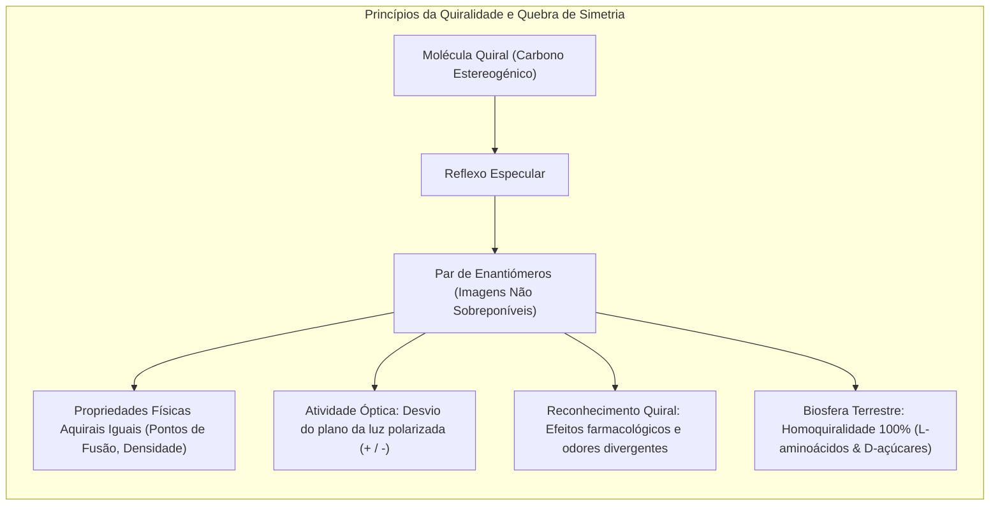
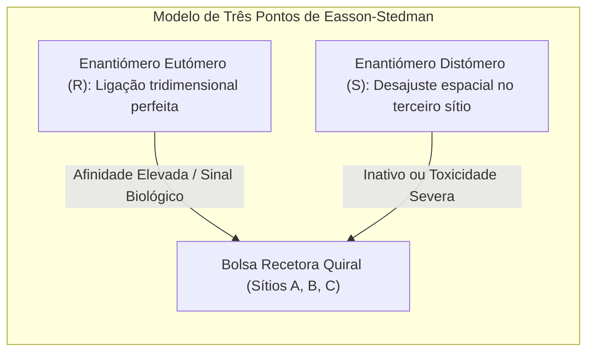
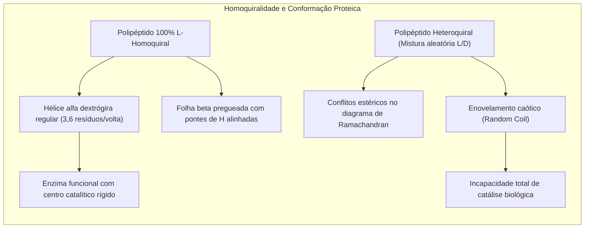
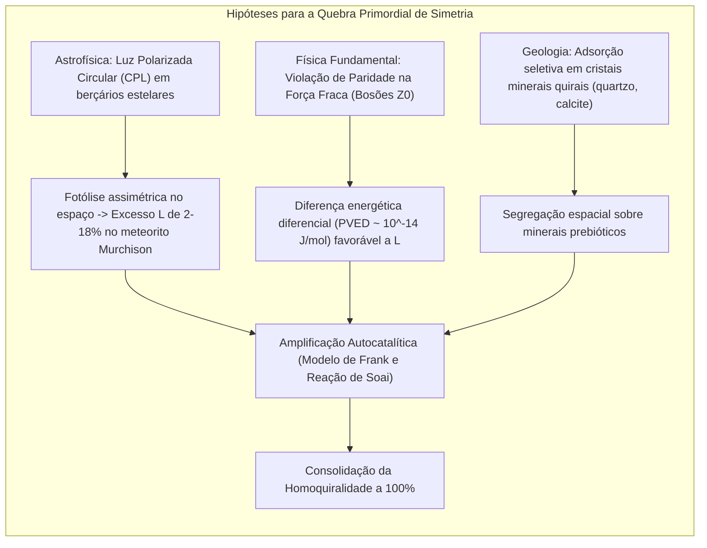
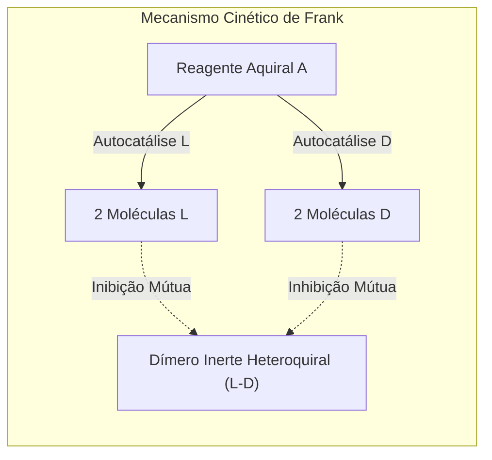

Olhe para as suas mãos. A sua mão esquerda e a sua mão direita têm rigorosamente os mesmos elementos: cinco dedos, as mesmas articulações, a mesma geometria geral. Contudo, por mais que tente rodá-las no espaço tridimensional, jamais conseguirá sobrepô-las de forma perfeita com as palmas voltadas para a mesma direção. Elas são imagens especulares mútuas que não se sobrepõem. Na química e na física, esta propriedade geométrica chama-se <strong>quiralidade</strong>, termo com raiz no grego *cheir* (mão).

Quando um químico sintetiza compostos quirais no laboratório a partir de reagentes aquirais, as leis da termodinâmica produzem invariavelmente uma proporção idêntica de 50 % de moléculas esquerdas e 50 % de moléculas direitas. Esta mistura equimolar designa-se <strong>racemato</strong> e não manifesta rotação da luz polarizada.

No entanto, a vida na Terra quebrou radicalmente esta simetria há pelo menos 3,8 mil milhões de anos:
- <strong>Proteínas:</strong> Todos os enzimas e estruturas celulares são construídos exclusivamente com <strong>L-aminoácidos</strong> (levógiros).
- <strong>Ácidos nucleicos:</strong> O esqueleto informacional do DNA e do RNA é formado unicamente por <strong>D-açúcares</strong> (D-ribose e D-desoxirribose, dextrógiros).

Este fenómeno biológico universal denomina-se <strong>homoquiralidade biológica</strong>. Por que razão a sopa orgânica primitiva adotou L-aminoácidos e D-açúcares e não o universo especular oposto?



---

## 1. O nascimento da estereoquímica: Louis Pasteur e o ácido tartárico

A descoberta da assimetria molecular remonta a 1848 e ao jovem cientista francês <strong>Louis Pasteur</strong>. Os produtores vinícolas observavam nas paredes dos tonéis a acumulação de sais de ácido tartárico, cujas soluções aquosas desviavam a luz polarizada para a direita (dextrógiro, $(+)$). Em contraste, o ácido racémico obtido sinteticamente possuía exatamente a mesma composição química, mas era opticamente inativo.

Pasteur cristalizou o sal de tartarato duplo de sódio e amónio a temperaturas inferiores a 28 °C. Ao examinar os cristais microscópicos, percebeu que as pequenas faces hemiédricas não eram idênticas: apresentavam duas formas dissimétricas, uma correspondendo à imagem refletida da outra no espelho.

Munido de pinças finas, separou os cristais em duas frações:
1. A fração com cristais "à direita" desviava a luz polarizada para o sentido horário ($+$).
2. A fração com cristais "à esquerda" provocava um desvio exatamente igual no sentido anti-horário ($-$).
3. Ao juntar as duas soluções em partes iguais, a rotação anulava-se, reconstituindo o racemato inativo.

Pasteur concluiu brilhantemente que a forma externa assimétrica dos cristais decorria de uma assimetria espacial invisível no seio das próprias moléculas. Foi nessa fase que cunhou a sua célebre intuição: *«A assimetria é a linha divisória essencial da vida»*.

```
   Lei de Biot para o poder rotatório específico:
   [α]_λ^T = θ / (c · l)
   
   onde:
   θ = ângulo de desvio angular (graus)
   c = concentração mássica da amostra (g/mL)
   l = percurso ótico do polarímetro (dm)
```

---

## 2. O modelo de três pontos e a tragédia da talidomida

Por que razão o organismo vivo reage de forma tão diferente perante moléculas que partilham rigorosamente a mesma massa molecular e os mesmos pontos de ebulição? Porque os recetores e enzimas celulares são eles próprios compostos por L-aminoácidos, gerando cavidades tridimensionais assimétricas.

O <strong>modelo de três pontos de Easson e Stedman (1933)</strong> sintetiza a interação: para desencadear uma resposta fisiológica correta, três sítios específicos do ligante devem emparelhar simultaneamente com três sítios complementares da bolsa recetora. O enantiómero especular apenas consegue fazer coincidir dois sítios, deixando o terceiro em conflito estérico ou desencontrado.



### Odores enantioméricos
- A <strong>(R)-(-)-carvona</strong> liga-se a recetores olfativos gerando o odor fresco a hortelã-verde.
- A <strong>(S)-(+)-carvona</strong> desencadeia a perceção aromática quente de cominho e alcaravia.
- Da mesma forma, o <strong>(R)-(+)-limoneno</strong> tem odor cítrico a laranja, enquanto o <strong>(S)-(-)-limoneno</strong> exala notas a resina e pinho.

### O drama da talidomida e a proteína cereblon
O caso mais emblemático dos riscos da quiralidade na farmacologia foi a <strong>tragédia da talidomida</strong> no final dos anos 1950. Vendida sob a forma de mistura racémica para aliviar os enjoos matinais em grávidas, provocou deformações fetais gravíssimas (focomelia) em mais de dez mil recém-nascidos.

A elucidação molecular revelou que:
- O enantiómero <strong>(R)</strong> assegura a ação sedativa e calmante pretendida sem perigo teratogénico direto.
- O enantiómero <strong>(S)</strong> liga-se com afinidade elevada à proteína <strong>Cereblon (CRBN)</strong>, um módulo da enzima E3 ubiquitina ligase. Esta ligação induz a destruição proteassomal do fator de transcrição <strong>SALL4</strong>, indispensável à génese dos membros no feto.

Mesmo que a indústria tivesse isolado o enantiómero (R) puro, o desfecho teria sido idêntico: no plasma sanguíneo humano, a pH neutro ($7{,}4$), o hidrogénio no centro quiral sofre interconversão tautomérica rápida, provocando racemização completa *in vivo* em apenas 4 a 5 horas.

---

## 3. Por que razão a vida exige homoquiralidade? A restrição biofísica

Poderia a biologia funcionar com polímeros formados por uma mistura aleatória de L- e D-aminoácidos? A biofísica estrutural fornece uma resposta categórica: <strong>não</strong>.



### O diagrama de Ramachandran e a estabilidade da hélice alfa
A geometria de uma cadeia polipeptídica assenta nos ângulos diedros $\phi$ e $\psi$. No <strong>diagrama de Ramachandran</strong>, os resíduos de L-aminoácidos ocupam quadrantes de baixa energia que viabilizam a rotação contínua da hélice $\alpha$ dextrógira, ligada por pontes de hidrogénio entre o carbonilo da posição $i$ e o grupo amino da posição $i+4$.

A introdução de um único D-aminoácido numa cadeia de L-resíduos projeta a sua cadeia lateral de modo desfavorável, desmantelando a estabilidade da hélice. Sem estabilidade conformacional, o centro ativo das enzimas perde a precisão atómica necessária para acelerar reações bioquímicas.

### A inibição cruzada quiral no RNA
Nos ensaios clássicos liderados por Leslie Orgel para estudar a origem do RNA, constatou-se que monómeros de ribonucleótidos L incorporam-se nas extremidades de moldes homoquírais de D-RNA. Porém, por apresentarem a geometria invertida, bloqueiam a adição dos nucleótidos seguintes. Esta <strong>inibição cruzada quiral (Chiral Cross-Inhibition)</strong> paralisa a replicação não enzimática, demonstrando que a pureza enantiomérica tinha de preceder a emergência do código genético.

---

## 4. Como surgiu a quebra original de simetria?

Para explicar o surgimento do desequilíbrio enantiomérico primordial, a ciência desenvolveu duas grandes vertentes:



### Hipótese cósmica: Fotólise por radiação polarizada circularmente
A queda do meteorito carbonáceo de <strong>Murchison</strong> na Austrália em 1969 trouxe amostras intocadas de matéria extraterrestre. Entre dezenas de aminoácidos identificados, vários compostos não biológicos (como a isovalina) acusaram um <strong>excesso enantiomérico L constante entre 2 % e 18 %</strong>.

Em regiões de nascimento de estrelas massivas, a radiação ultravioleta é dispersa por partículas de poeira orientadas por campos magnéticos galácticos, gerando feixes intensos de <strong>luz polarizada circularmente (CPL)</strong>. Este tipo de radiação destrói preferencialmente um dos enantiómeros através de fotólise seletiva, originando um superavit do outro isómero que foi posteriormente transportado para a Terra jovem por cometas e asteroides.

### Hipótese física: Violação de paridade na força nuclear fraca
Desde a experiência seminal de Chien-Shiung Wu em 1957, sabe-se que a <strong>interação fraca quebra a simetria de paridade</strong>. A troca de bosões neutros $Z^0$ induz uma pequena assimetria energética intrínseca entre moléculas quirais, designada <strong>diferença de energia com quebra de paridade (PVED)</strong>. A mecânica quântica prevê que os L-aminoácidos e D-açúcares são ligeiramente mais estáveis do que os seus equivalentes espelho:
$$\Delta E_{\text{PVED}} \approx 10^{-14} \text{ a } 10^{-16} \, \text{J/mol}$$
Mesmo tratando-se de uma diferença ínfima, em cenários longe do equilíbrio termodinâmico, esta inclinação persistente pôde desencadear uma transição de fase macroscópica em favor da configuração que hoje domina a biosfera.

---

## 5. Amplificação autocatalítica: O modelo de Frank e a reação de Soai

Um excedente inicial de alguns pontos percentuais é manifestamente insuficiente para sustentar a maquinaria molecular da vida. Tornava-se imperativo encontrar um mecanismo de amplificação não linear.

### O modelo de Frank (1953)
O físico britânico <strong>Frederick Charles Frank</strong> formulou um modelo matemático inovador assente em dois princípios fundamentais:
1. <strong>Autocatálise assimétrica:</strong> Cada enantiómero atua como catalisador da sua própria criação ($A + L \rightarrow 2L$).
2. <strong>Inibição mútua recíproca:</strong> Quando uma molécula L colide com uma D, forma-se irreversivelmente um dímero inativo ($L + D \rightarrow LD$).

Matematicamente, a evolução da assimetria $\Delta = [L] - [D]$ expressa-se por:
$$\frac{d\Delta}{dt} = k_1 [A] \Delta$$
O estado racémico ($\Delta = 0$) é um equilíbrio instável. Qualquer flutuação pontual induz o crescimento exponencial da espécie em ligeira vantagem, que aniquila o competidor até à extinção da forma minoritária.



### A reação de Soai: Demonstração prática
Em 1995, o químico japonês <strong>Kenso Soai</strong> comprovou experimentalmente a exequibilidade do modelo de Frank. Na adição de di-isopropilzinco a pirimidina-5-carbaldeídos, o alcóxido formado comporta-se como autocatalisador da sua própria formação. Partindo de um excesso inicial microscópico de apenas <strong>$0{,}00005\%$ ee (50 ppb)</strong>, a reação amplifica o produto até alcançar uma pureza óptica superior a <strong>$99{,}5\%$ ee</strong> em ciclos consecutivos.

---

## 6. Biologia sintética: O limiar da 'Vida Espelho' (Mirror Life)

Que sucederia se os cientistas concebessem em laboratório um organismo vivo funcional baseado exclusivamente em <strong>D-aminoácidos e L-açúcares</strong>?

### O estado atual das pesquisas
Equipas na Universidade de Tsinghua (lideradas por Ting Zhu) já sintetizaram polimerases artificiais feitas de D-aminoácidos, capazes de transcrever L-RNA e replicar L-DNA *in vitro*.

### Potencial clínico e preocupações de biossegurança
- <strong>Vantagens terapêuticas:</strong> Moléculas espelho como os <strong>Spiegelmers</strong> (aptâmeros de L-RNA) e péptidos D não são degradados pelas enzimas proteolíticas do organismo humano, conferindo uma durabilidade ímpar no tratamento de doenças oncológicas e inflamatórias.
- <strong>Riscos ecológicos catastróficos:</strong> Uma bactéria espelho autónoma escapada para a natureza seria invisível para o sistema imunitário dos mamíferos (incapaz de processar antigénios invertidos) e imune à lise por vírus bacteriófagos. Sem predadores biológicos naturais, poderia drenar recursos inorgânicos essenciais com consequências irreversíveis para os ecossistemas globais.

---

## Conclusão: A geometria profunda da vida

A homoquiralidade da matéria viva não é um mero capricho estético, mas a base estrutural insubstituível que torna possível o dobramento de enzimas e a fidelidade da herança biológica. O seu esclarecimento integra a astrofísica, a física quântica e a bioquímica na busca pelas origens da ordem no cosmos.
