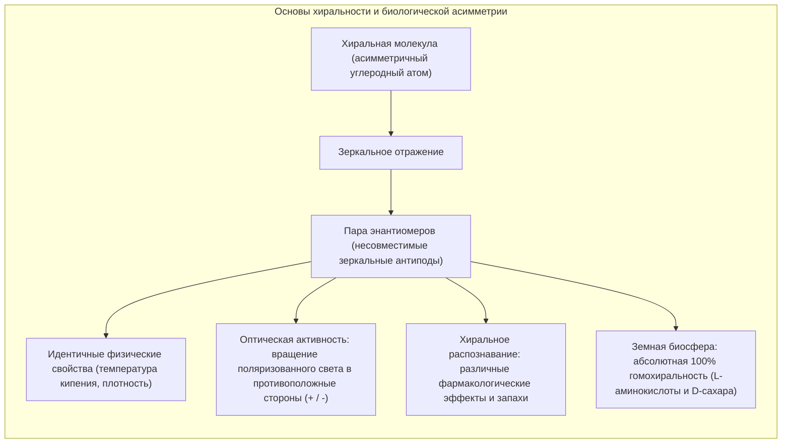
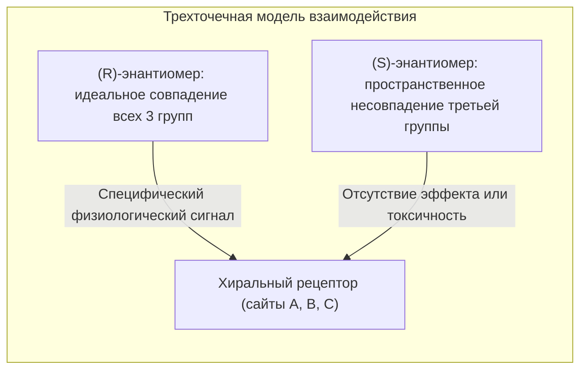
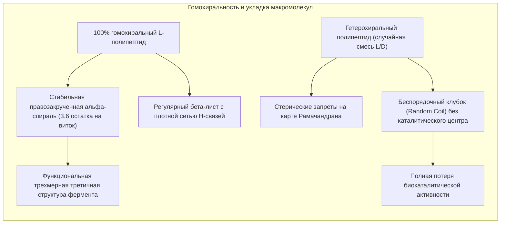
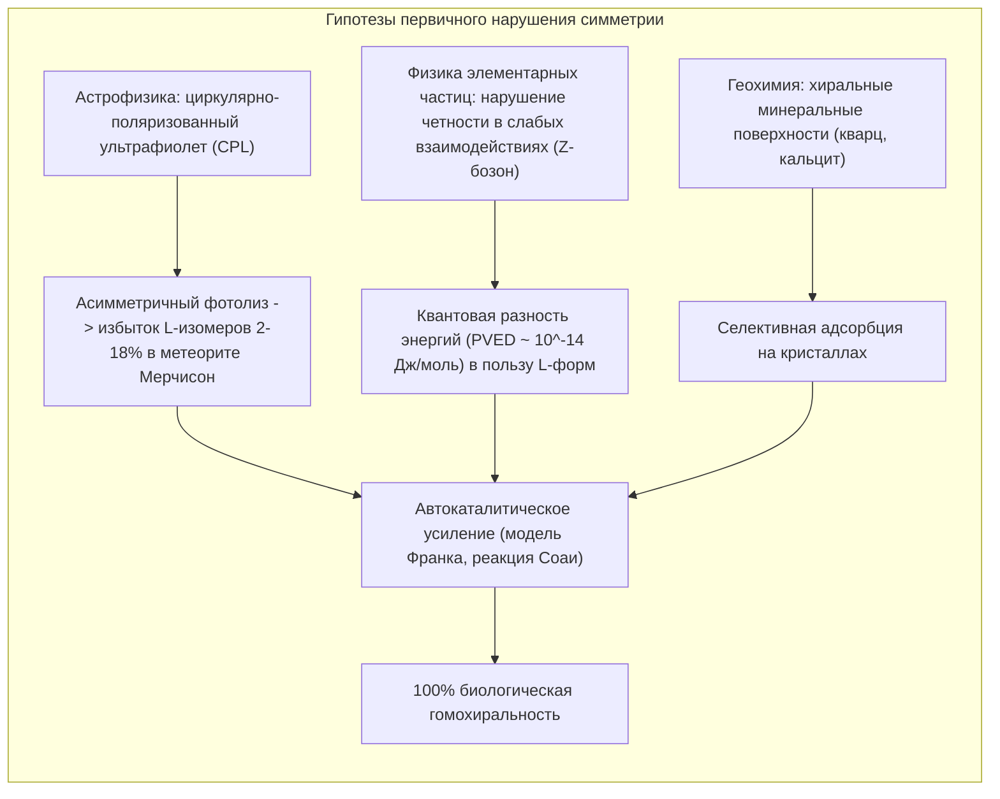
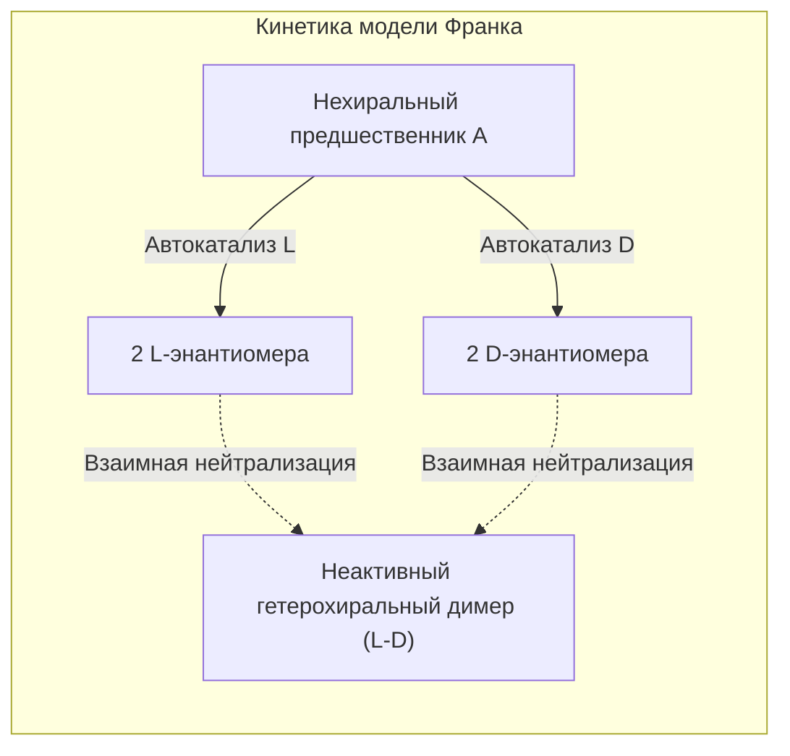

Посмотрите на свои руки. Ваша левая и правая ладони состоят из одних и тех же анатомических элементов: пять пальцев, одинаковые фаланги, равные пропорции. Однако, как бы вы ни поворачивали левую руку в трехмерном пространстве, вы никогда не сможете идеально совместить её с правой рукой так, чтобы ладони смотрели в одном направлении. Они соотносятся как зеркальные отражения, несовместимые в пространстве. В химии и физике это фундаментальное геометрическое свойство называется <strong>хиральностью</strong> (от древнегреческого слова *cheir* — «рука»).

Когда химик синтезирует хиральные соединения в лаборатории из нехирального исходного сырья, законы термодинамики неумолимо создают равную смесь: 50% правых и 50% левых молекул. Такая эквимолярная смесь называется <strong>рацематом</strong> и не вращает плоскость поляризации света.

Тем не менее биосфера Земли на протяжении 3,8 миллиарда лет демонстрирует абсолютное нарушение этой симметрии:
- <strong>Белки:</strong> Все ферменты и структурные белки живых организмов построены исключительно из <strong>L-аминокислот</strong> (левовращающих).
- <strong>Нуклеиновые кислоты:</strong> Углеводный остов ДНК и РНК состоит исключительно из <strong>D-сахаров</strong> (D-рибозы и D-дезоксирибозы, правовращающих).

Это свойство называется <strong>биологической гомохиральностью</strong>. Почему первичная биохимия Земли выбрала именно L-аминокислоты и D-сахара, а не обратную зеркальную конфигурацию?



---

## 1. Рождение стереохимии: Луи Пастер и кристаллы винной кислоты

Открытие молекулярной хиральности произошло в 1848 году благодаря гению 26-летнего французского химика <strong>Луи Пастера</strong>. В то время исследователи безуспешно пытались объяснить парадокс винной кислоты. Природная винная кислота, осаждавшаяся на стенках винных бочек, поворачивала плоскость поляризованного света вправо (правовращающая, $(+)$). Синтетическая «виноградная кислота» с тем же химическим составом была оптически неактивной.

Пастер кристаллизовал натриево-аммониевую соль виноградной кислоты при температуре ниже 28 °C. Разглядывая кристаллы под микроскопом, он заметил поразительную деталь: грани кристаллов обладали гемиэдрической асимметрией двух зеркально противоположных типов.

С помощью пинцета и увеличительного стекла Пастер вручную рассортировал кристаллы на две группы:
1. Раствор кристаллов первого типа вращал поляризованный свет по часовой стрелке ($+$).
2. Раствор зеркальных кристаллов вращал свет на точно такой же угол против часовой стрелки ($-$).
3. Смешение двух растворов в равных долях приводило к полной взаимной нейтрализации вращения — оптически неактивному рацемату.

Пастер сделал вывод: внешняя кристаллическая асимметрия обусловлена невидимой пространственной асимметрией самих молекул. Пастер вдохновенно утверждал: *«Асимметрия — это великая граница, разделяющая неживую материю и жизнь»*.

```
   Закон Био для удельного оптического вращения:
   [α]_λ^T = θ / (c · l)
   
   где:
   θ = измеренный угол вращения (градусы)
   c = концентрация вещества в растворе (г/мл)
   l = оптическая длина кюветы (дм)
```

---

## 2. Модель трехточечного взаимодействия и трагедия талидомида

Почему живой организм столь кардинально различает молекулы, которые физически идентичны по массе и температуре плавления? Причина кроется в хиральности биологических рецепторов. Поскольку клеточные белки состоят из L-аминокислот, их связывающие карманы представляют собой трехмерные асимметричные матрицы.

<strong>Модель трехточечного связывания Иссона и Стедмана (1933)</strong> показывает: чтобы вызвать биологический отклик, три функциональные группы молекулы должны одновременно соединиться с тремя комплементарными сайтами рецептора. Зеркальный энантиомер может сопоставить максимум две группы из трех; третья неизбежно оказывается направлена в пустоту или вызывает стерический конфликт.



### Хиральные запахи
- <strong>(R)-(-)-карвон</strong> связывается с обонятельными рецепторами и воспринимается как свежий аромат кудрявой мяты.
- <strong>(S)-(+)-карвон</strong> активирует другие сигнальные пути и пахнет тмином.
- <strong>(R)-(+)-лимонен</strong> пахнет сочным апельсином, тогда как <strong>(S)-(-)-лимонен</strong> имеет резкий запах скипидара и сосны.

### Талидомидовая катастрофа и белок цереблон
Самым мрачным уроком пренебрежения стереохимией стала катастрофа с препаратом <strong>талидомид</strong> на рубеже 1950–60-х годов. Назначение рацемической смеси беременным женщинам для купирования токсикоза привело к рождению более 10 000 детей с тяжелейшими пороками развития конечностей (фокомелией).

Современная структурная биология установила:
- <strong>(R)-энантиомер</strong> оказывает мягкое седативное действие и безопасен для плода.
- <strong>(S)-энантиомер</strong> связывается с белком <strong>Цереблоном (CRBN)</strong> — компонентом убиквитинлигазного комплекса E3. Это приводит к преждевременной деградации транскрипционного фактора <strong>SALL4</strong>, регулирующего рост зачатков конечностей эмбриона.

Даже использование исключительно чистого (R)-энантиомера не предотвратило бы трагедию: в крови человека при pH 7,4 водород у хирального центра подвергается спонтанной кето-енольной таутомерии, приводя к полной рацемизации *in vivo* всего за 4–5 часов.

---

## 3. Зачем жизни нужна гомохиральность? Биофизическая необходимость

Могла ли примитивная протобиология функционировать на основе гетерохиральной смеси L- и D-аминокислот? Биофизика дает категоричный ответ: <strong>нет</strong>.



### Карта Рамачандрана и альфа-спирали
Конформация полипептидной цепи определяется двугранными углами $\phi$ (фи) и $\psi$ (пси). На <strong>карте Рамачандрана</strong> L-аминокислоты формируют устойчивую область минимальной энергии для правозакрученной $\alpha$-спирали, удерживаемой водородными связями между карбонилом остатка $i$ и амидной группой остатка $i+4$. Внедрение даже одной D-аминокислоты вызывает катастрофическое стерическое отталкивание боковой цепи, разрушая регулярность водородных мостиков. Без жестких вторичных структур ферменты теряют избирательность.

### Хиральное перекрестное ингибирование в РНК
В опытах Лесли Оргела по репликации РНК без участия ферментов было открыто явление <strong>хирального перекрестного ингибирования (Chiral Cross-Inhibition)</strong>. Если матрица состоит из чистой D-РНК, а в растворе присутствуют мономеры L-нуклеотидов, они присоединяются к растущей цепи, но из-за неверной геометрии блокируют присоединение следующего звена. Процесс репликации необратимо обрывается. Следовательно, достижение оптической чистоты было абсолютным пререквизитом для зарождения генетического кода.

---

## 4. Происхождение исходной асимметрии: космический и физический след

Как возник исходный перевес в пользу L-аминокислот и D-сахаров на первобытной Земле? Современная наука рассматривает две главные концепции:



### Космическая гипотеза: Поляризованный свет в звездных колыбелях
В 1969 году в Австралии упал углистый хондрит <strong>Мерчисон</strong>. Исследования показали наличие более 70 аминокислот. Непротеиногенные аминокислоты, такие как изовалин (не способные к рацемизации), содержали устойчивый <strong>энантиомерный избыток L-формы от 2% до 18%</strong>.

В областях звездообразования излучение рассеивается на частицах межзвездной пыли, выстроенных магнитным полем галактики, генерируя <strong>циркулярно-поляризованный свет (CPL)</strong>. Фотолиз под действием CPL селективно разрушает один энантиомер быстрее другого, создавая устойчивый перевес L-аминокислот, доставленных на Землю кометами и метеоритами.

### Физическая гипотеза: Нарушение четности в слабом взаимодействии
Опыт Цзяньсюн У 1957 года доказал, что <strong>слабое ядерное взаимодействие нарушает пространственную четность</strong>. Электроны бета-распада обладают левой спиральностью. Вследствие обмена виртуальными $Z^0$-бозонами между электронами и ядрами возникает микроскопическая разность энергий энантиомеров (<strong>PVED</strong>). Квантовохимические расчеты показывают, что L-аминокислоты термодинамически стабильнее своих D-антиподов на величину:
$$\Delta E_{\text{PVED}} \approx 10^{-14} \text{ – } 10^{-16} \, \text{Дж/моль}$$
В неравновесных открытых системах эта микроскопическая константа могла служить катализатором глобальной фазовой бифуркации.

---

## 5. Механизмы нелинейного усиления: Модель Франка и реакция Соаи

Первичного избытка в несколько процентов недостаточно для биогенеза. Требовался динамический механизм, способный довести микроскопический перекос до абсолютных 100%.

### Математическая модель Франка (1953)
Британский физик <strong>Фредерик Чарльз Франк</strong> предложил кинетическую схему, основанную на двух постулатах:
1. <strong>Асимметричный автокатализ:</strong> каждый энантиомер катализирует собственное воспроизводство ($A + L \rightarrow 2L$).
2. <strong>Взаимное уничтожение (Mutual Antagonism):</strong> при встрече молекулы L и D необратимо образуют неактивный димер ($L + D \rightarrow LD$).

Уравнение динамики асимметрии $\Delta = [L] - [D]$ имеет вид:
$$\frac{d\Delta}{dt} = k_1 [A] \Delta$$
Рацемическое состояние ($\Delta = 0$) нестабильно. Малейшая случайная флуктуация приводит к лавинообразному подавлению меньшинства и абсолютной монополии доминирующего энантиомера.



### Реакция Соаи: Экспериментальное подтверждение
В 1995 году японский химик <strong>Кэнсо Соаи</strong> впервые реализовал схему Франка на практике. При алкилировании пиримидин-5-карбальдегидов диизопропилцинком образующийся хиральный алкоголят цинка катализирует собственный синтез. При добавлении затравочного энантиомера с избытком всего <strong>$0{,}00005\%$ ee (50 ppb)</strong> реакционная система в ходе последовательных циклов самопроизвольно увеличивает оптическую чистоту продукта до <strong>более чем $99{,}5\%$ ee</strong>!

---

## 6. Синтетическая биология: Перспективы и угрозы «Зеркальной жизни»

Что произойдет, если ученые создадут полноценную живую клетку, работающую целиком на <strong>D-аминокислотах и L-сахарах</strong>?

### Современное состояние разработок
Команды исследователей под руководством Тин Чжу (Университет Цинхуа) синтезировали функциональные Д-полимеразы, способные реплицировать L-ДНК и транскрибировать L-РНК.

### Практическая польза и глобальные биориски
- <strong>Терапевтический потенциал:</strong> Зеркальные молекулы (<strong>шпигельмеры</strong> — аптамеры L-РНК) и D-пептиды не распознаются ферментами человеческого организма и обладают фантастической стабильностью в кровотоке, открывая новую эру в лечении рака.
- <strong>Экологическая угроза:</strong> Автономная зеркальная бактерия была бы абсолютно невидима для адаптивного и врожденного иммунитета млекопитающих и устойчива к атакам бактериофагов. Попадание такой формы жизни в дикую природу чревато неконтролируемым поглощением ресурсов и коллапсом биосферы.

---

## Заключение

Гомохиральность живого мира — это не прихоть эволюции, а фундамент геометрии жизни. Разгадка тайны ее происхождения объединяет квантовую физику, космическую астрохимию и молекулярную биологию, напоминая о глубоком единстве законов Вселенной.
