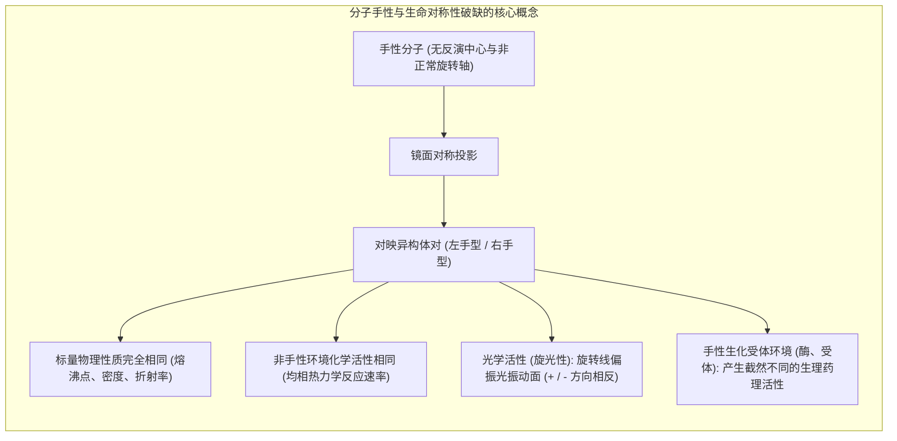
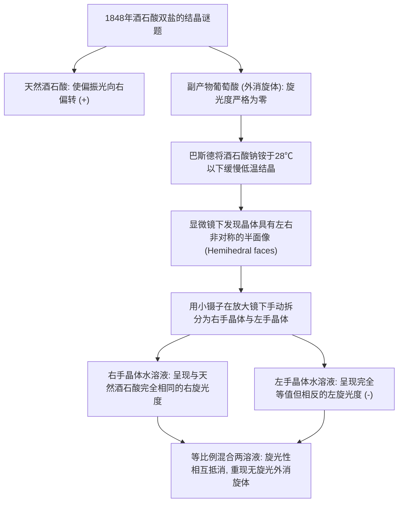
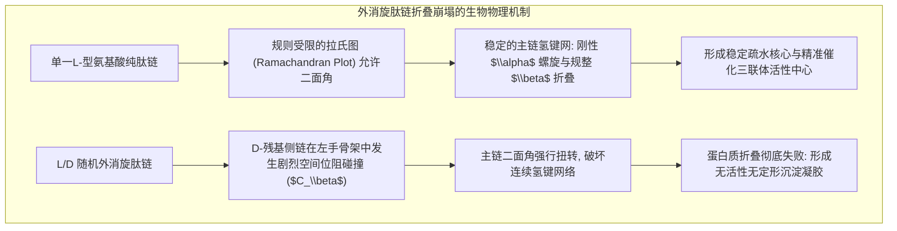
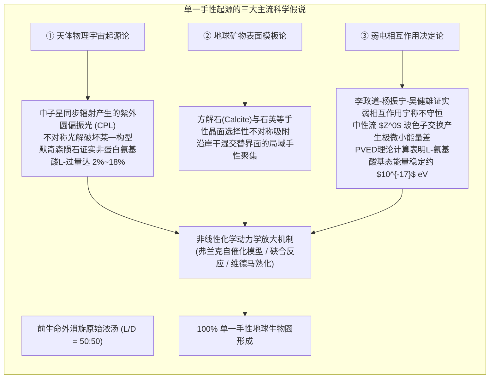

伸出你的双手，手心朝向自己。你的右手和左手在解剖结构上拥有完全相同的骨骼与肌腱连接顺序，无论怎样旋转右手，它都无法与左手在三维空间中完全重叠（Superimpose）。

这种像右手与左手一样、彼此互为镜像却不能完全重合的几何属性，被称为<strong>「手性（Chirality）」</strong>。互为非重叠镜像的一对三维立体异构体，被称为<strong>「对映异构体（Enantiomers）」</strong>。



在普通的非手性化学实验室中，由对称原料合成手性分子时，热力学驱动总是以完全相等的概率（50:50）生成左右手分子的外消旋混合物（Racemate）。然而，地球上繁衍了38亿年的整个生物圈，却表现出一种极端严苛的<strong>「单一手性（Homochirality / 单一手性现象）」</strong>：
- <strong>蛋白质：</strong> 构成生命代谢与结构核心的20种标准氨基酸（除甘氨酸外），无一例外皆由<strong>L型（左手型）</strong>构成。
- <strong>核酸：</strong> 承载生命全部遗传密码的DNA与RNA分子骨架中的核糖与脱氧核糖，全部由<strong>D型（右手型）</strong>构成。

如果地球生命起源于外消旋的化学浓汤，生命究竟为何抛弃了右手型氨基酸与左手型糖？这种不可思议的绝对纯度是如何被筛选、并以100%的确定性固化在遗传机制之中的？

---

## 1. 历史溯源：巴斯德与立体化学的诞生

分子手性的物理本质最早由法国微生物学与化学大师<strong>路易·巴斯德（Louis Pasteur）</strong>于1848年揭开。

当时，葡萄酒酿造木桶内壁沉淀的天然酒石酸盐表现出<strong>右旋光性（Dextrorotatory）</strong>；而化学合成过程中偶然得到的副产物“外消旋葡萄酸（Racemic acid）”，其化学式、元素比例和主要反应性质与天然酒石酸完全相同，却完全不具备旋光活性。



25岁的巴斯德在显微镜下观察<strong>酒石酸钠铵</strong>微晶时，敏锐地注意到晶体表面存在极微小的斜面（半面像）。这些晶体并非完全对称，而是呈现出互为镜像的两种形态：一半向右倾斜，另一半向左倾斜。

巴斯德手持镊子，在显微镜下以超人的耐心将这两批晶体逐一挑出分成两堆。当他分别将两堆晶体溶解于水后，偏光计给出了震撼的读数：一堆晶体让偏振光精确向右偏转，另一堆晶体则以完全相同的角度向左偏转；若将两者等量混合，旋光性便彻底抵消归零。

巴斯德瞬间顿悟：<strong>宏观晶体的左右不对称性，正是微观分子在三维空间中呈现非重叠镜像构象的直接投射。</strong> 立体化学就此诞生。巴斯德为此写下了那句名言：“宇宙是非对称的整体。生命在它所有的表现形式中，必然是宇宙不对称性的函数。”

---

## 2. 三点接触模型与手性药物的生死教训

生体环境之所以能够严厉区分对映异构体，是因为由L-氨基酸构成的生物受体（酶、离子通道、GPCR）本身就是一个<strong>极度致密的手性不对称口袋</strong>。

奥格斯顿（Ogston）提出的<strong>「三点接触模型（Three-Point Interaction Model）」</strong>清晰揭示了这一机理：一个手性配体必须通过至少三个特定的功能基团（$A, B, C$）与受体凹槽中的互补位点（$A', B', C'$）同时精确契合，才能诱导生物活性构象。对映异构体由于空间手性反转，即便两点重合，第三点也必然指向完全相反的空间方位，导致结合阻断或与非目标靶点发生危险副反应。

### 沙利度胺（反应停）的惨痛教训

20世纪中叶最严重的药害悲剧——<strong>沙利度胺灾难（Thalidomide Catastrophe）</strong>，彻底改写了世界药物监管史。

德国研制的沙利度胺曾作为改善孕妇妊娠反应（孕吐）的安全非巴比妥类镇静剂在全球热销。然而，该药是以外消旋体（$R$体与$S$体的1:1混合物）投放市场的。随之而来的是全球超过1万名患有严重“海豹肢症（肢体缺失或极度短小）”的畸形儿出生。

| 对映异构体 | 药理及生理效应 | 分子作用机制 |
|---|---|---|
| <strong>$(R)$-沙利度胺</strong> | 安全有效的<strong>镇静催眠作用</strong> | 调节前脑中枢神经GABA系统 |
| <strong>$(S)$-沙利度胺</strong> | 极强烈的<strong>胚胎致畸毒性</strong> | 嵌入E3泛素连接酶<strong>Cereblon (CRBN)</strong>口袋，促使转录因子SALL4异常降解 |

现代分子生物学研究表明，$(S)$-沙利度胺精确结合于人类细胞内的E3泛素连接酶复合体组分<strong>Cereblon（CRBN）</strong>，诱导胚胎肢芽发育关键转录因子SALL4发生泛素化并被蛋白酶体降解，导致胎儿四肢骨骼发育中断。

更为残酷的化学事实是：即使在生产过程中实现100%纯度的$(R)$-沙利度胺光学拆分，其不斉碳原子上的氢原子由于双羰基的强吸电子诱导效应而高度酸化，<strong>在人体血液中（pH 7.4, 37℃）会通过酮-烯醇互变异构发生快速的自发外消旋化（半衰期仅4-5小时）</strong>。这一教训确立了现代制药工业必须对手性异构体的单一构型活性、毒性及体内动态转化进行全面独立审查的铁律。

---

## 3. 结构生物学必然性：生命为何无法容忍外消旋

生命系统对单一手性的追求，并非审美偏好，而是<strong>高级三维功能高分子自组装的物理热力学铁律</strong>。



拉氏构象图（Ramachandran Plot）分析证实：在规则的右旋$\alpha$-螺旋中，若无意混入一个D-氨基酸，其侧链碳原子（$C_\beta$）会在三维空间中直接撞入相邻螺旋圈的主链羰基氧原子区域，引发剧烈的空间位阻排斥。这会导致氢键网络瞬间破裂，整根螺旋发生不可逆解体。

同样，DNA的Watson-Crick双螺旋之所以拥有3.4 nm的精确螺距与0.34 nm的碱基堆积间距，完全依赖于D-2-脱氧核糖的固定构象。如果在正在延伸的D-RNA或D-DNA链中掺入L-核苷酸，会引发<strong>「对映异构交叉抑制（Enantiomeric Cross-Inhibition）」</strong>，导致链延伸不可逆终止。没有单一手性，复杂的酶催化与忠实遗传复制便彻底沦为不可能。

---

## 4. 单一手性起源三大假说

生命诞生前的原始地球，究其最初的微小不对称性究竟从何而来？



### 4.1 天体物理与圆偏振光假说（默奇森陨石的铁证）
1969年坠落于澳大利亚的<strong>默奇森（Murchison）碳质球粒陨石</strong>研究震惊了学界：科学家在其深层样品中分离出了地球生物圈所不存在的非蛋白质氨基酸（如异缬氨酸等），并测出<strong>明确的L-对映体过量（Enantiomeric excess: $ee = 2\% \sim 18\%$）</strong>！隼鸟2号（Ryugu小行星）与OSIRIS-REx（Bennu小行星）的返回样品同样检测到了手性失衡。

天文学观测显示，在猎户座大星云等巨型恒星形成区，超新星残骸或中子星磁场导致强烈的<strong>紫外圆偏振光（Circularly Polarized Light: CPL）</strong>弥散。当星际冰尘有机分子长年累月接受特定自旋方向的圆偏振光照射时，圆二色性导致其中一种对映异构体被优先光解剥离，从而为太阳系原始星云带来了最初的“L-过量胚种”。

### 4.2 弱相互作用与宇称不守恒（物理定律决定论）
李政道与杨振宁发现、吴健雄实验证实的<strong>弱相互作用宇称不守恒（Parity Violation）</strong>表明，物理宇宙在基本粒子层面并非左右对称。

电弱统一理论中，$Z^0$ 中性玻色子的交换作用导致对映异构体的基态能量产生极微小的<strong>宇称不守恒能量差（PVED）</strong>：

$$\Delta E_{\text{PVED}} = E(D) - E(L) \approx 10^{-17} \text{ eV}$$

尽管这一能量差在室温热运动面前极度微弱，但萨拉姆（Abdus Salam）等理论物理学家提出，在漫长的地质年代中，大分子凝聚相的超导级协同相变有可能将这一基本物理常数级的不对称性彻底放大。

---

## 5. 非线性不对称放大：从千万分之一到100%纯度

即便宇宙圆偏振光或弱作用赋予了原始地球微弱的偏向（如 $0.0001\%$ 甚至更低），如何将其推向生命所需的<strong>100%绝对手性纯度</strong>？

```mermaid
flowchart LR
    subgraph FRANK_ZH ["弗兰克非线性自催化动力学系统 (1953)"]
        direction TB
        R["对称原料 A + B"] --> L["L-型对映体"]
        R --> D["D-型对映体"]
        
        L -->|正反馈自催化: A+B+L -> 2L| L_GROW["L-指数级爆炸扩增"]
        D -->|正反馈自催化: A+B+D -> 2D| D_GROW["D-指数级爆炸扩增"]
        
        L & D -->|互灭作用: L + D -> LD (不可逆失活)| TRAP["形成无活性杂手性二聚体 LD 沉淀"]
        
        L_GROW & D_GROW & TRAP --> BRANCH["分岔现象 (Bifurcation): 微小扰动引发压倒性单一独占 ($ee \\to 100\\%$)"]
    end
```

### 5.1 弗兰克自催化模型（1953）与硤合反应（1995）
物理学家弗兰克在1953年提出的数学方程证明：在包含<strong>“自身正反馈自催化（Autocatalysis）”</strong>与<strong>“异手性分子互灭形成不活性二聚体（Mutual Antagonism）”</strong>的开放体系中，对称的外消旋平衡点是极度不稳定的鞍点。任何微小的初值涨落都会导致体系在数学分岔中不可逆地冲向100%纯净的单一手性状态。

1995年，日本东京理科大学<strong>硤合宪三（Kenzou Soai）教授</strong>通过嘧啶-5-甲醛与二异丙基锌的不对称烃基化反应，首次在实验室内完美重现了弗兰克机制。即使最初加入的催化剂仅有<strong>0.00005%（五千万分之一）的极微不对称过量</strong>，反应产物在数轮自催化循环后也能迅速狂飙至<strong>99.5%以上的绝对对映纯度</strong>！

---

## 6. 合成生物学终极前沿：人造「镜相生命（Mirror Life）」

今天，人类正站在前所未有的科技交叉路口：<strong>我们是否可以用全D-氨基酸和全L-糖，在实验室里创造出一个完全反转的平行生物系统？</strong>

清华大学朱听教授团队等已成功人工全合成了超过300残基的D-氨基酸DNA聚合酶，并成功实现了对L-DNA（镜相DNA）的高保真复制与PCR扩增；进一步的镜相转录系统与全镜相核糖体的组装正在攻坚之中。

### 镜相分子的颠覆性应用与生态风险
1. <strong>天然酶免分解的终极药物（Spiegelmer）：</strong> 由L-RNA或D-肽构成的药物不会被人体内的核酸酶与蛋白酶识别降解，在血液循环中拥有长达数周的高稳定性，且极难产生传统免疫排斥。
2. <strong>免受病毒感染的超级细胞工厂：</strong> 自然界中的任何噬菌体与病毒都无法识别人造镜相细菌的受体蛋白，有望彻底终结工业发酵中的噬菌体污染灾难。
3. <strong>生态系统的潜在毁灭者：</strong> 镜相生物一旦逃逸到自然环境中，由于没有天然天敌（原生动物无法消化吸收其镜相外壳），哺乳动物免疫系统的MHC分子亦无法呈递D-肽抗原，它们可能成为完全不受生态链制约的“隐形入侵物种”，掠夺无机营养物并对原生生物圈构成潜在的不可控威胁。

---

## 7. 结语：非对称的宇宙与生命的律动

从巴斯德酒石酸晶体上的微观斜面，到横跨百光年的星际圆偏振光，再到打破对称的弱相互作用以及主宰生命折叠的单一手性大分子——宇宙正是通过一次次“打破完美的对称”，才从死寂均质的热力学平衡中孕育出了万千复杂而灿烂的生命形态。

生命之所以选择了左与右，是因为只有不对称的乐高积木，才能搭造起承载意识与智慧的高维生命圣殿。
