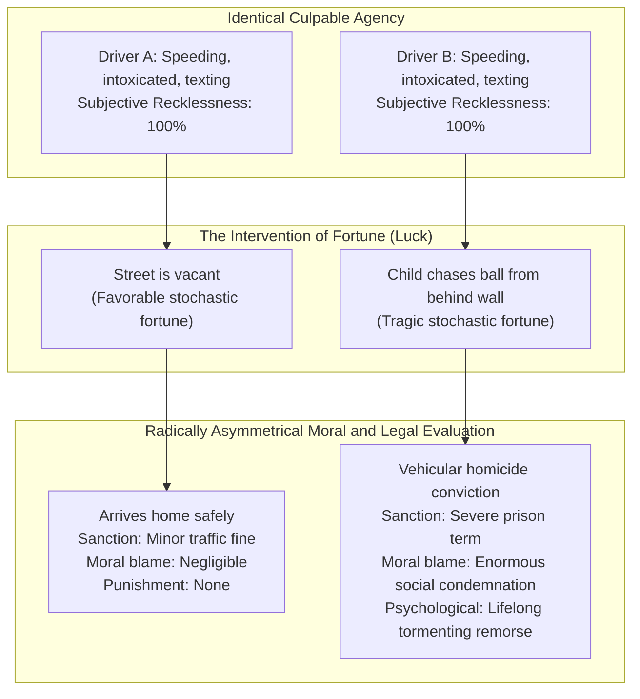
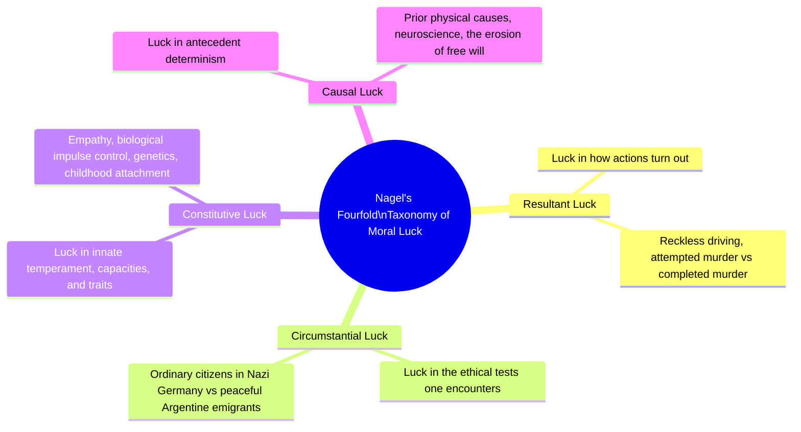
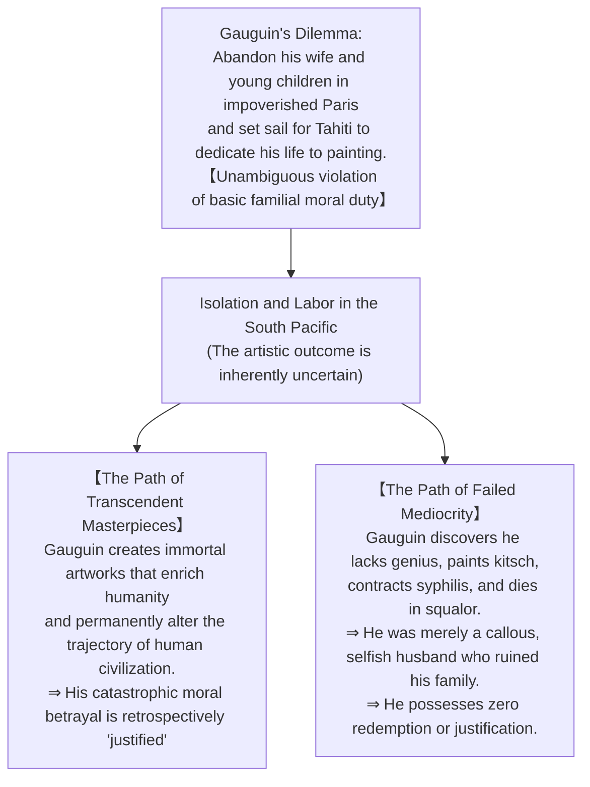
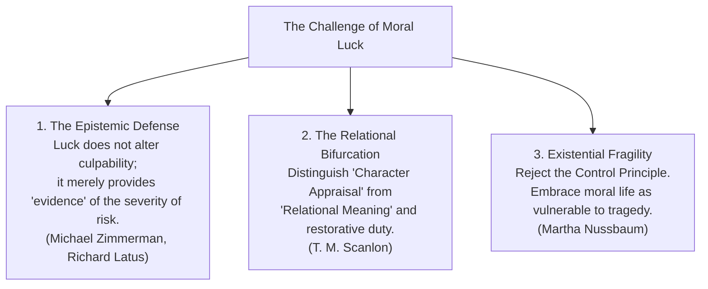
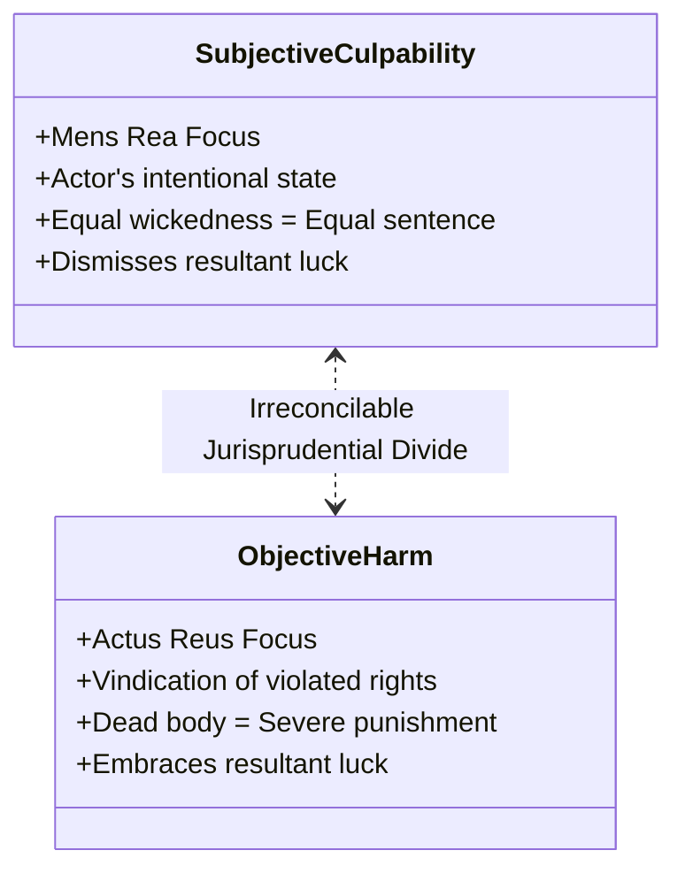
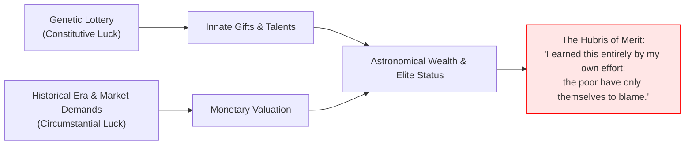

## Introduction: The Aporia of the Two Reckless Drivers

Consider two drivers, Driver A and Driver B, operating their respective vehicles late on a rain-slicked urban evening. Both drivers have consumed an identical amount of alcohol, slightly exceeding the legal limit. Both are traveling at exactly sixty-five miles per hour through a winding residential zone with a posted speed limit of thirty miles per hour. Both are distracted by their mobile phones.

In terms of their internal cognitive and moral states—their degree of subjective negligence, their culpable indifference to the safety of others, their technical vehicle handling, and the physical roadworthiness of their cars—Driver A and Driver B are <strong>strictly, physically, and psychologically identical down to the subatomic level</strong>.

Now observe the divergence of their respective trajectories:
- <strong>Driver A</strong> negotiates the wet curve. Nobody happens to be crossing the street. His tires experience a brief, minor skid, but he regains traction, arrives safely at his suburban residence, parks in his garage, and falls asleep. If caught by a speed camera, he faces a modest civil infraction—a monetary citation and a few penalty points on his driver's license. The community does not brand him a pariah; his conscience registers nothing more than a momentary twinge of relief: *"That was careless; I should slow down next time."*
- <strong>Driver B</strong> negotiates the identical curve at the identical second. At that exact fraction of a millisecond, a seven-year-old child chases an errant rubber ball from behind an obscured stone wall into the center of the lane. Driver B slams on his brakes, but Newtonian mechanics and wet asphalt dictate that the vehicle cannot stop within the clearance distance. The front bumper strikes the child, killing him instantly on the pavement. Driver B is indicted for vehicular manslaughter, prosecuted by the state, sentenced to a protracted penitentiary term, ruined financially by civil wrongful death judgments, and condemned by the community as a monstrous killer. For the remainder of his natural life, his psyche is shattered by an agonizing, irremediable burden of guilt.

Here arises the most unsettling paradox in the architecture of moral philosophy and jurisprudence:

> <strong>"If the intentions, choices, motives, and negligent actions of Driver A and Driver B were strictly identical, why does an outcome entirely outside their voluntary control—a pure matter of stochastic luck—dictate such a radical, astronomical difference in the moral blame and legal punishment they legitimately receive?"</strong>

Our fundamental moral intuitions are instantly locked in irreconcilable civil war:
1. <strong>The Intuition of Fairness (The Control Condition)</strong>: It is fundamentally unjust to hold an individual morally responsible for that which was beyond their power to control or prevent.
2. <strong>The Intuition of Gravity (Resultant Accountability)</strong>: It is an insult to moral gravity to pretend that killing a human child is no worse than a lucky near-miss. Driver B *did* something catastrophic; Driver A did not.

This intractable fissure at the core of human moral judgment was formally articulated and thrust into the modern philosophical forum in the mid-1970s by <strong>Bernard Williams</strong> and <strong>Thomas Nagel</strong> under the rubric of <strong>"Moral Luck."</strong>

This treatise conducts a comprehensive investigation into the problem of Moral Luck. We analyze the Kantian ideal of the unconditioned "Good Will" and its formalization as the <strong>Control Principle</strong>. We explore Nagel's fourfold taxonomy of moral luck: Resultant, Circumstantial, Constitutive, and Causal. We examine Bernard Williams's concept of <strong>"Agent-Regret"</strong> and the retrospective justification of human projects. We evaluate contemporary theoretical strategies to salvage the Control Principle—including epistemic skepticism, the bifurcation of character and relationship, and the embrace of existential vulnerability. Finally, we examine the concrete manifestations of moral luck across criminal sentencing, tort law, and the critique of modern meritocracy.

---

## 1. Kantian Purity and the Control Principle

### 1.1 The Inviolability of the Good Will
In the opening cadence of his 1785 masterpiece, *Groundwork of the Metaphysics of Morals (Grundlegung zur Metaphysik der Sitten)*, Immanuel Kant formulated the classical Western defense of moral autonomy against the vagaries of external fortune:

> *"Nothing in the world—or even beyond it—can possibly be conceived that could be called good without qualification except a <strong>good will</strong>... Even if, by a special disfavor of fortune or by the meager endowment of a stepmotherly nature, this will should entirely lack the capacity to carry out its intentions; if with its greatest efforts it should yet achieve nothing and only the good will were left... then, <strong>like a jewel, it would still shine by itself, as something having its entire value in itself.</strong>"*

For Kant, moral worth resides entirely within the rational agency of the actor—in the maxims that govern choice and the purity of duty. If an agent acts with a morally sound maxim, yet an unforeseen calamity turns the physical consequence into disaster, the moral excellence of the will remains spotless. Conversely, if an agent acts from wicked malice, but through comical serendipity accidentally saves a stranger's life, that agent accrues zero moral credit. 

To allow external circumstance, physical fortune, or stochastic contingencies to contaminate moral assessment would reduce morality to a cosmic lottery.

### 1.2 The Control Principle Formulated
Thomas Nagel distilled this foundational Kantian commitment into an axiomatic proposition known as <strong>The Control Principle (CP)</strong>:

$$\mathbf{The\; Control\; Principle\; (CP):} \quad \text{An agent cannot be morally evaluated for what is not their fault, or for what is due to factors beyond their control.}$$

The principle articulates an indispensable requirement of fairness. We do not condemn a hostage forced at gunpoint to sign a document; we do not praise an athlete for having unusually long femur bones. The capacity to exercise voluntary, intentional guidance over one's behavior is the sine qua non of moral culpability.

From the Control Principle, the following corollary necessarily follows:

$$\mathbf{Corollary\; (CP\text{-}Cor):} \quad \text{If two agents are identical in all respects under their voluntary control, they must be morally evaluated in precisely the same manner.}$$

If the Control Principle is universally valid, then Driver A and Driver B must be judged as morally indistinguishable.

### 1.3 The Paradox of Moral Luck
The philosophical crisis arises because human moral practice systematically, flagrantly, and unabashedly violates the Control Principle.

As Nagel observed in his 1979 essay *"Moral Luck"*:

> *"Where a significant aspect of what someone does depends on factors beyond his control, yet we continue to treat him in that respect as an object of moral judgment, it can be called <strong>moral luck</strong>."*

This exposes an acute logical paradox:

$$\begin{aligned}
\mathbf{Premise\; 1:} & \quad \text{Moral judgment requires the Control Principle (Control Condition).} \\
\mathbf{Premise\; 2:} & \quad \text{Actual moral practices are thoroughly permeated by moral luck (Outcomes matter).} \\
\mathbf{Conflict:} & \quad \text{Our theoretical conception of morality is fundamentally at war with its practical execution.}
\end{aligned}$$

---

## 2. Thomas Nagel's Fourfold Taxonomy of Moral Luck

Nagel recognized that the problem of the reckless drivers represents merely the visible tip of an intellectual iceberg. Luck does not merely influence the external consequences of our deeds; it determines who we are, where we are placed, and the very causal antecedents of our conscious deliberations. Nagel systematized moral luck into four distinct categories:

### 2.1 Resultant Luck (Luck in Outcomes)
Resultant luck refers to fortune in how one's actions, once initiated, turn out in the external physical world.

Consider the classic legal and philosophical pairing:
- <strong>Assassin 1</strong> aims a high-powered rifle at a head of state, squeezes the trigger with murderous malice, and fires. A stray bird flutters across the trajectory, deflecting the bullet by two inches. The leader survives unscathed. The sniper is guilty of attempted murder.
- <strong>Assassin 2</strong> possesses the exact same malice, squeezes the trigger with identical motor mechanics, under identical wind conditions. No bird crosses the path. The bullet shatters the target's skull. The sniper is guilty of completed first-degree murder.

Both assassins demonstrated the exact same moral evil, the exact same depravity of will, and executed the exact same physical movement. Yet Assassin 2 is condemned to capital execution or life imprisonment, while Assassin 1 receives a lesser statutory penalty. Their ultimate moral and legal standing was determined entirely by the flight path of an uncomprehending bird.

### 2.2 Circumstantial Luck (Luck in Context and Situation)
Circumstantial luck designates the moral fortune of the historical, geographical, and situational contexts in which an individual is placed.

Nagel presented a chilling historical example:
> *"The ordinary citizen in Nazi Germany in the 1930s who became a concentration camp guard, participating in unimaginable atrocities, was judged—rightly—as a monstrous war criminal. But consider an individual identical to him in character, inclinations, and moral fortitude who, in 1930, had the economic opportunity to emigrate to Argentina to run an export business. In Buenos Aires, he lived out his days as a peaceful, law-abiding merchant, a loving father, and an upstanding member of his parish."*

The Argentine emigrant led a morally blameless life. Yet his moral innocence was not an achievement of moral virtue; it was an artifact of <strong>circumstantial luck</strong>. Had the economic dice rolled differently, he would have operated the gas chambers with the exact same moral compliance as his German counterpart. 

How can we comfortably condemn the guard while honoring the emigrant, when their difference rests on the accidental timing of an overseas job offer?

### 2.3 Constitutive Luck (Luck in Character and Constitution)
Constitutive luck addresses the biological, genetic, and developmental lottery that constructs an agent's fundamental moral personality:

- One person is born with a calm temperament, a highly responsive prefrontal cortex capable of effortless inhibitory control, and high natural empathy mediated by robust oxytocin receptor density.
- Another individual inherits a genetic predisposition toward impulsive aggression, low dopamine baseline, severe ADHD, or is subjected to severe neurological trauma and neglect in infancy.

We praise the saint for being naturally patient, generous, and forgiving; we castigate the brute for being selfish, irritable, and callous. Yet neither selected their parental genome, neither designed their neural circuitry, and neither orchestrated their childhood environment. If character is largely a product of constitutive luck, holding people morally responsible for who they are violates the Control Principle at its most foundational root.

### 2.4 Causal Luck (Luck in Prior Determinism)
Causal luck represents the ultimate convergence of moral philosophy with the classical metaphysics of <strong>Free Will and Determinism</strong>.

Every choice, decision, impulse, and calculation of a human agent is caused by antecedent physical, chemical, and biological conditions stretching back into the primordial dawn of the universe. If causal determinism holds, every decision you make is the inexorable consequence of natural laws and prior events over which you exercised zero control.

### The Erosion of the Moral Agent
Nagel drew a harrowing conclusion from this fourfold analysis:
If we systematically strip away from an individual's action everything that is influenced by luck—the consequences (resultant luck), the situation (circumstantial luck), the innate disposition (constitutive luck), and the causal antecedents (causal luck)—<strong>what remains?</strong>

> *"The area of genuine agency, and therefore of legitimate moral evaluation, seems to shrink under this scrutiny to an extensionless point. The self is engulfed by the world."*

The quest for pure, unconditioned moral purity threatens to destroy the concept of the moral agent entirely.

---

## 3. Bernard Williams and the Phenomenon of "Agent-Regret"

Writing independently in the same philosophical symposium, Bernard Williams (1976) approached moral luck from an existential and phenomenological angle. Williams rejected the Kantian premise that morality constitutes a supreme, insulated domain of human value.

### 3.1 The Painter Paul Gauguin: Justification by Success
Williams posited the famous hypothetical case of the French post-impressionist painter Paul Gauguin:

At the moment Gauguin boarded the ship to Tahiti, whether his artistic gamble was justified was objectively unknowable. 
- If he failed, his abandonment of his family was an unmitigated moral disgrace.
- Because he succeeded in producing artistic masterworks of transcendent cultural value, humanity retrospectively acknowledges that his decision had an intrinsic validity that supersedes standard moral book-keeping.

Williams insisted that this justification is <strong>intrinsically retrospective and contingent upon resultant luck</strong>. Morality is not an absolute tribunal that judges actions solely from their ex-ante maxims; human life is an entangled web where value is forged through risky, non-moral gambles with fate.

### 3.2 The Anatomy of "Agent-Regret"
Williams introduced an indispensable phenomenological distinction between two modes of regret:

| Category | Subject of Experience | Phenomenology and Expression |
|---|---|---|
| <strong>Spectator Regret (General Regret)</strong> | The bystander or observer | *"What an awful tragedy that the child was struck. I wish it had never happened."* (Sympathy, external sorrow). |
| <strong>Agent-Regret</strong> | The causal author of the calamity | *"<strong>I</strong> killed that child. My hands were on the wheel. It was <strong>my</strong> act that ended a human life."* (First-person ontological anguish, drive toward reparation). |

To crystallize this, Williams described a lorry driver who, through absolutely <strong>zero negligence or fault</strong>—driving prudently at legal speed with flawless attentiveness—strikes a child who darted blindly into his wheels. Legally and morally, the driver is entirely innocent.

Now, imagine the driver steps down from the cab, shrugs his shoulders, and remarks to the weeping parents:
> *"Well, as the police report confirms, my braking distance was optimal and I was adhering to all speed regulations. I am no more morally culpable than a spectator standing across the street. Therefore, I feel no personal anguish, and I plan to have a delightful dinner tonight."*

We would view such a driver not as a model of Kantian rationality, but as <strong>a moral psychopath</strong>. 
We demand that a fully human moral agent experience <strong>Agent-Regret</strong>—a visceral, agonizing personal grief rooted in the objective, causal fact that *one's own agency brought about death*. To insist that luck must have no place in moral life is to divorce morality from the very emotional substrate of human solidarity.

---

## 4. Theoretical Defenses: Rescuing the Control Principle

Philosophers unwilling to abandon the Kantian citadel have devised ingenious conceptual strategies to reconcile the Control Principle with our conflicting moral practices.

### 4.1 The Epistemic Defense (Zimmerman and Latus)
Michael J. Zimmerman and Richard Latus argue that <strong>moral luck is a cognitive illusion generated by an epistemic deficit</strong>.

- Driver A and Driver B possess <strong>precisely identical moral blameworthiness</strong>.
- In the real world, human beings cannot read minds or measure degrees of negligence with mathematical instruments.
- When an accident occurs and a child dies, the physical carnage serves as <strong>epistemic evidence</strong> that makes the driver's underlying recklessness visible, salient, and measurable to the community.
- We blame Driver B more because his catastrophe forces us to see the full horror of the risk he took. But in the eyes of an omniscient observer (God), Driver A and Driver B deserve the exact same quantum of moral condemnation.

*Critique:* The epistemic account struggles with the fact that even when we eliminate all epistemic asymmetry—when a thought experiment guarantees that both drivers were identical in fault—our deep intuition still insists that Driver B has incurred a distinct moral burden that Driver A has not.

### 4.2 The Relational / Character Bifurcation (T. M. Scanlon)
In *Moral Dimensions* (2008), T. M. Scanlon proposed bifurcating moral evaluation into two distinct dimensions:

1. <strong>Moral Character / Blameworthiness</strong>: An evaluation of the agent's internal attitudes, principles, and regard for others. Here, Driver A and Driver B are identical. Both demonstrated an unacceptable indifference to human safety.
2. <strong>Moral Meaning / Relational Standing</strong>: The way an action alters the agent's practical relationships with specific individuals in the world. 
   Driver B has physically terminated the life of a family's child. This catastrophic consequence irrevocably alters Driver B's moral relationship with those parents. Driver B owes them profound apology, economic restitution, and symbolic mourning. 

Luck does not alter whether an agent is wicked; luck alters the objective moral landscape and the specific relational duties the agent must navigate.

### 4.3 The Fragility of Goodness (Martha Nussbaum)
In *The Fragility of Goodness* (1986), Martha Nussbaum argued that the Kantian pursuit of a self-sufficient, luck-proof morality is an evasion of human reality. Returning to the classical Greek dramatists (Aeschylus, Sophocles, Euripides) and Aristotle, Nussbaum suggests that true human virtue (arete) is inherently vulnerable to the slings and arrows of outrageous fortune.

A human being who cannot be hurt by fate, who cannot be broken by tragedy, is not a moral hero, but a stone. Morality is noble precisely because it is fragile.

---

## 5. Jurisprudential Realities: Moral Luck in Criminal and Civil Law

Nowhere does moral luck collide with institutional power more violently than in the courtroom.

### 5.1 The Asymmetry of Attempts in Criminal Law
In virtually every legal jurisdiction derived from common law or civil law traditions, <strong>the punishment for an attempted crime is significantly less severe than the punishment for a completed crime</strong>:

$$\text{Sentence}(\text{Attempted Murder}) \ll \text{Sentence}(\text{Completed Murder})$$

This statutory sentencing discount represents institutionalized resultant moral luck.

- <strong>The Subjectivist School (Model Penal Code)</strong>: The function of criminal law is to punish dangerous, anti-social wills and deter culpable behavior. Because Assassin 1 and Assassin 2 displayed identical *mens rea* and executed identical *actus reus*, discounting Assassin 1's sentence because a bird intercepted the bullet is irrational. It transforms criminal justice into a state lottery.
- <strong>The Objectivist / Retributivist School</strong>: The criminal law exists not merely to reform psychological intentions, but to vindicate the objective violation of legal protected interests (Rechtsgüter). A society where murder without a corpse receives the same punishment as murder with a corpse ignores the visceral social reality of irreversible harm and the imperative to soothe the community's demand for retribution.

### 5.2 Civil Tort Law and Asymmetrical Liability
In the realm of tort law (negligence), resultant luck reigns supreme.
Under the tort doctrine of *restitutio in integrum*, liability is measured by the damage actually caused:
- Driver A pays <strong>$0</strong> in tort liability.
- Driver B pays <strong>millions of dollars</strong> in wrongful death compensatory damages.

The civil justice system shamelessly abandons the Control Principle to serve a completely different master: <strong>victim compensation and loss-allocation</strong>.

---

## 6. Socio-Economic Expansion: Meritocracy and the Concealment of Luck

The philosophical scope of moral luck extends far beyond vehicular collisions and assassin rifles; it cuts to the structural core of modern socio-economic inequality.

### 6.1 Michael Sandel and The Tyranny of Merit
In *The Tyranny of Merit* (2020), philosopher Michael J. Sandel dismantled the core myth of contemporary global capitalism: the belief that market success reflects moral desert.

In a meritocracy, society tells its citizens:
> *"If you work hard and develop your talents, you will rise. Therefore, those who occupy the apex of wealth and prestige have earned their standing through their own autonomous effort."*

Sandel utilizes Nagel's concepts of <strong>Constitutive Luck</strong> and <strong>Circumstantial Luck</strong> to shatter this hubris:
1. <strong>The Genetic Lottery (Constitutive Luck)</strong>: Having a high IQ, exceptional working memory, athletic coordination, or an innate predisposition toward discipline is an unearned biological endowment. You did not work to acquire your DNA.
2. <strong>The Social Lottery (Circumstantial Luck)</strong>: Being born into an era that lavishes gargantuan economic rewards on your specific innate traits. An individual with extraordinary computational aptitude earns millions in Silicon Valley today. Had that same individual been born in fourteenth-century feudal Europe, his coding aptitude would have been worthless, while the muscular brute with an axe commanded the hierarchy.

When the wealthy mistake good fortune for personal moral desert, they inflict profound indignity upon those left behind, transforming economic disadvantage into a verdict of moral deficiency.

---

## 7. Mathematical Modeling of Moral Blame Functions

To formalize the dialectic between the Control Principle and Resultant Luck, let us construct a formal decision-theoretic model of responsibility attribution.

Let an agent's chosen action be denoted by $a \in \mathcal{A}$.
Let the stochastic state of nature (external luck) be governed by a random variable $S \in \mathcal{S}$ drawn from probability distribution $P_S$.
The resulting external outcome is given by a deterministic physical mapping:

$$X = g(a, S) \in \mathcal{X}$$

Now, let $L: \mathcal{X} \to \mathbb{R}_{\ge 0}$ be the external loss or harm function.

### 7.1 The Pure Kantian Blame Operator
Under the strict Control Condition, the moral blame attribution operator $\mathcal{B}_{\text{Kant}}$ must be a function solely of the agent's voluntary choice $a$ (or subjective expectation):

$$\mathcal{B}_{\text{Kant}}(a, X, S) = \Psi(a) = \mathbb{E}_{S \sim P_S}[L(g(a, S))]$$

Here, blame equals the *expected* harm foreseen by a reasonable agent at the moment of decision.
Because Driver A and Driver B executed the exact same action $a_{\text{reckless}}$ under the exact same subjective parameters:

$$\mathcal{B}_{\text{Kant}}(a_A, X_A, S_A) = \mathcal{B}_{\text{Kant}}(a_B, X_B, S_B) = \Psi(a_{\text{reckless}})$$

The outcome difference is identically zero: $\Delta \mathcal{B}_{\text{Kant}} = 0$.

### 7.2 The Resultant Moral Blame Operator
In actual human legal and moral psychology, the blame operator is parameterized by a resultant coupling factor $\lambda \in [0, 1]$:

$$\mathcal{B}_{\text{Actual}}(a, X, S) = (1 - \lambda)\Psi(a) + \lambda L(g(a, S))$$

When $\lambda > 0$, the moral penalty divergence between two identically culpable agents becomes:

$$\Delta \mathcal{B} = \mathcal{B}_{\text{Actual}}(B) - \mathcal{B}_{\text{Actual}}(A) = \lambda \Big( L(X_{\text{fatality}}) - L(X_{\text{safe}}) \Big) > 0$$

The enduring controversy of moral luck can thus be expressed mathematically as a dispute over the parameter $\lambda$:
- The Kantian purist insists that rationality requires $\lambda \to 0$.
- The legal realist and moral phenomenologist argue that human civilization is structurally impossible unless $\lambda > 0$.

---

## 8. Conclusion: The Wisdom of Moral Humility

The philosophical problem of Moral Luck does not offer neat, comfortable solutions. It reveals that human morality is an engine built upon fundamentally conflicting imperatives.

We cannot abandon the Control Principle without opening the floodgates to barbaric cruelty, punishing people for the color of their eyes or the weather on the day of their birth.
Yet we cannot strictly enforce the Control Principle without amputating the very heart of human moral emotional life—the reality of grief, the sacredness of human life, and the existential duty of Agent-Regret.

To live with the awareness of moral luck is to undergo a profound spiritual transformation.
When we see Driver B handcuffed in the courtroom, or the homeless person shivering on the city grating, moral luck whispers to our souls the timeless, humbling truth:

> <strong>"There, but for the grace of fortune, go I."</strong>

Recognizing that our moral standing, our triumphs, and our freedom from catastrophic guilt are held by the slender, fragile thread of cosmic luck is the ultimate antidote to human arrogance. It is the beginning of genuine compassion, restorative justice, and authentic ethical maturity.
