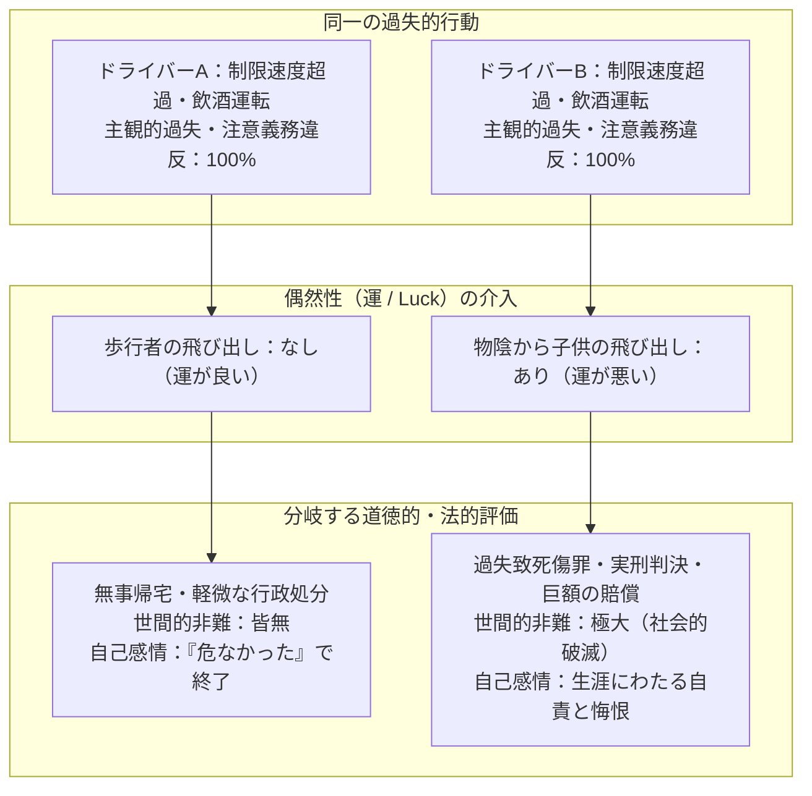
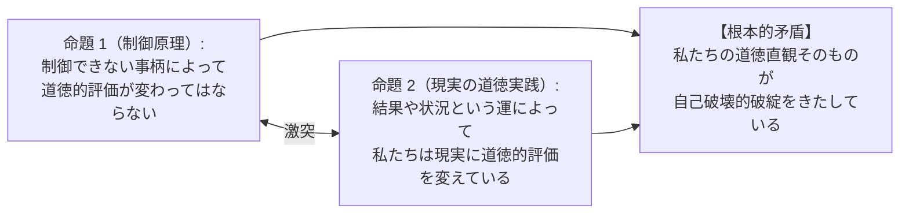
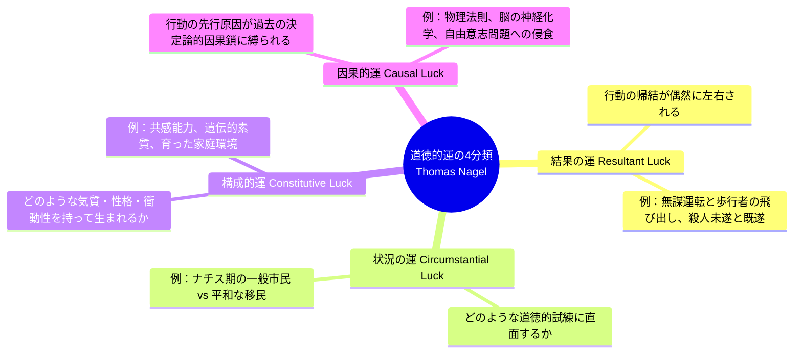
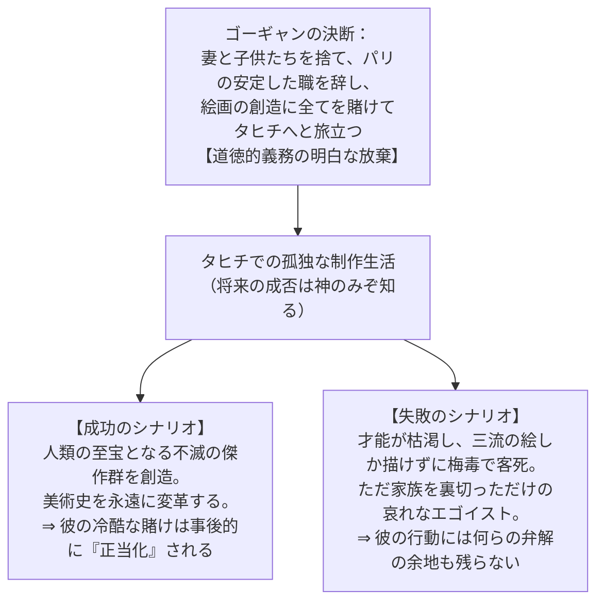
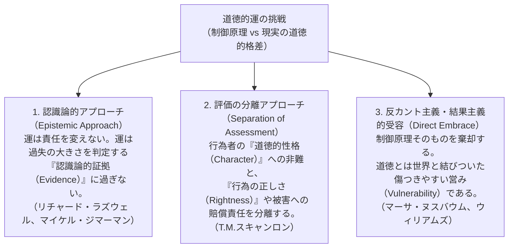
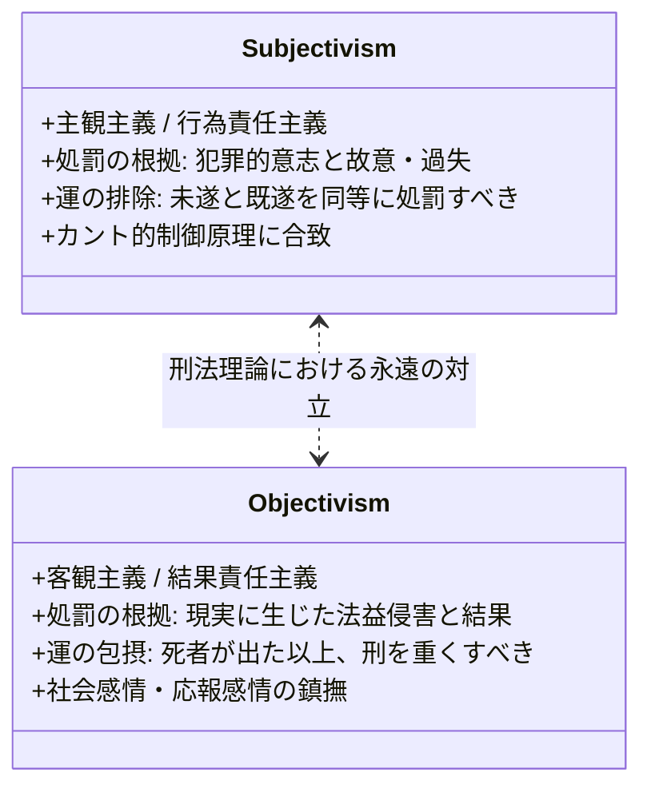
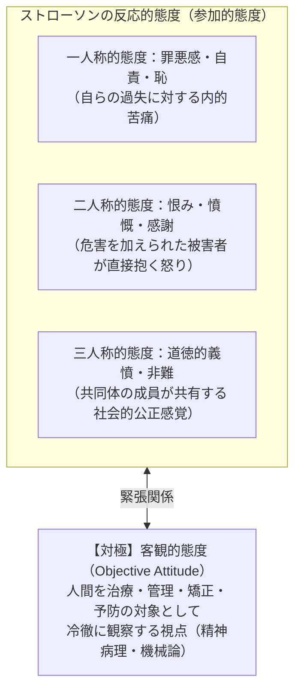

## 序論：2人の無謀運転者のアポリア

深夜、雨で濡れた市街地の道路を、法定速度を大幅に超過し、わずかに酒気を帯びた状態で運転している2人のドライバー、ドライバーAとドライバーBを想像してみてください。

2人の運転技術、注意散漫の度合い、車両の整備状態、路面状況、そして「危険を承知でスピードを出した」という主観的な過失や無謀さの程度は、物理的にも心理的にも<strong>完全に100%同一</strong>であると仮定します。

- <strong>ドライバーA</strong>の走行中、道路には誰もおらず、彼はわずかにスリップしながらも無事に自宅にたどり着きました。彼が問われるのは、仮に取り締まりに遭ったとしても軽微な交通違反（反則金や点数加重）に過ぎず、世間から激しい道徳的非難を浴びることもありません。
- <strong>ドライバーB</strong>が同じカーブに差し掛かったその一瞬、沿道の建物の物陰から、ボールを追いかけた一人の幼い子供が突然車道へと飛び出してきました。ドライバーBは急ブレーキを踏みましたが間に合わず、子供を撥ねて死亡させてしまいました。ドライバーBは危険運転致死罪や過失運転致死傷罪に問われ、法廷で裁かれ、刑務所に収監され、遺族からの憎悪を浴び、生涯拭いきれない激しい罪悪感を背負い続けることになります。

ここで立ち現れるのが、倫理学と法哲学における最も深刻で不穏な問いです。

> <strong>「ドライバーAとドライバーBの意志、行動、過失の度合いは完全に等しいのに、なぜ結果という自分では制御できない『運（Luck）』の違いによって、彼らが受けるべき道徳的非難や法的責任が天と地ほど異ならなければならないのか？」</strong>

私たちの直観は激しく分裂します。一方の直観は<strong>「制御できない偶然によって道徳的責任を重くするのは不公正である」</strong>と叫び、もう一方の直観は<strong>「実際に子供の命を奪ったドライバーBが、何事も起こさなかったドライバーAと同じ非難で済まされるはずがない」</strong>と主張します。

この常識的道徳の深奥に潜むパラドックスを白日の下に晒したのが、20世紀後半の哲学者<strong>バーナード・ウィリアムズ（Bernard Williams）</strong>と<strong>トマス・ネイゲル（Thomas Nagel）</strong>が提示した<strong>『道徳的運（Moral Luck）』</strong>の概念です。

本稿では、道徳的運の基本構造、イマヌエル・カントが提示した「制御原理（The Control Principle）」との衝突、ネイゲルによる道徳的運の4分類（結果・状況・構成・因果）、ウィリアムズの「内省的悔恨（Agent-Regret）」と芸術的成功の正当化、刑法・不法行為法における未遂犯と既遂犯の量刑格差、そして能力主義（メリトクラシー）や自由意志論に至るまで、人間の道徳的責任の境界線を徹底的に探求します。

---

## 1. カント的直観と「制御原理」

### 1.1 善意志とカントの純粋主義
西洋近代倫理学の金字塔を打ち立てたイマヌエル・カント（Immanuel Kant）は、1785年の『道徳形而上学原論（Grundlegung zur Metaphysik der Sitten）』の冒頭で、運や結果から完全に独立した道徳的価値の純粋性を高らかに宣言しました。

> 「世界の内において、それどころか世界の外においてさえ、無条件に善と見なし得るものは、ただ<strong>善意志（Good Will）</strong>のほかには全く考えられない。……善意志は、それが生み出すものや達成するものによって善であるのではなく、ただ欲求することそれ自体によって善なのである。」

カントによれば、善意志はあたかも<strong>「それ自体のうちに十全な価値を持つ宝石のように、それ自身によって輝く」</strong>ものです。
仮に運命の過酷な巡り合わせや継母のような境遇によって、善意志が何ら善い結果をもたらすことができず、あるいは意図に反して悪い結果を招いたとしても、その行為の道徳的価値は微塵も損なわれません。道徳の神殿から「運」や「偶然性」という異物を完全に追放することこそが、啓蒙期の理性が目指した道徳の普遍的尊厳でした。

### 1.2 制御原理（The Control Principle）の定式化
カントの洞察を現代の倫理学において公理化したものが、ネイゲルが定式化した<strong>「制御原理（The Control Principle: CP）」</strong>です。

$$	ext{制御原理 (CP):} \quad 	ext{行為者は、自らが制御できない（コントロールの及ばない）事柄について、道徳的評価の対象とされるべきではない。}$$

この原理は、私たちの公平性に関する最も基本的な正義感覚と完全に合致します。例えば、不可抗力の自然災害で約束の場所に行けなかった人を「約束を破った不誠実な嘘つきだ」と非難することは理不尽です。制御できない要因を道徳的非難から免除するこの条件は、<strong>「制御条件（The Control Condition）」</strong>とも呼ばれます。

制御原理から直ちに導かれる系（帰結）は以下の通りです：

$$	ext{帰結 (CP-Cor):} \quad 	ext{2人の行為者が、自らの制御下にあるあらゆる点で同一であるならば、彼らは道徳的に全く同等に評価されなければならない。}$$

もし制御原理が真であるならば、前述の2人のドライバーAとBは、全く同じ道徳的非難を受け、全く同じ刑罰に処されなければなりません。

### 1.3 道徳的運の定義とパラドックス
しかし、現実の人間社会の道徳的実践は、この制御原理と真っ向から衝突しています。

トマス・ネイゲルは1979年の論文『道徳的運（Moral Luck）』において、その衝突を次のように定義しました：

> <strong>「重大な側面において行為者の制御が及ばない要因に左右されているにもかかわらず、私たちが依然としてその行為者を道徳的評価の対象として扱い続けているとき、そこに『道徳的運』が存在する。」</strong>

ここに、逃れがたい論理的アポリア（袋小路）が生じます：

- もし制御原理が正しいならば、私たちが日常行っている道徳的判断（結果によって責任を加重すること）はすべて不当な誤謬・偏見であることになります。
- 逆に、私たちの日常の道徳判断が正当であるならば、公平性の根幹であるはずの制御原理を放棄しなければなりません。

---

## 2. トマス・ネイゲルによる「道徳的運」の4分類

ネイゲルは、人間の存在と行動がいかにあらゆる次元で「運」に包摂されているかを暴くために、道徳的運を4つの異なるカテゴリーに体系化しました。

### 2.1 結果の運（Resultant Luck）
行為者が意図的に行った行動から生じる「結果（Consequence）」が、行為者の制御の及ばない外的な偶然によって左右される運です。

- <strong>具体例</strong>:
  - <strong>救助活動</strong>: 川で溺れている子供を救うために飛び込んだ救助者。水流の偶然の変化によって子供を救い出せた場合は「英雄」と讃えられますが、予期せぬ渦に巻き込まれて子供の手を滑らせて溺死させてしまった場合、同じ善意で飛び込んだにもかかわらず、周囲や遺族から（そして本人自身から）厳しい責任追及の視線を浴びます。
  - <strong>銃撃事件</strong>: 殺意を持って標的に向けて引き金を引いた2人の狙撃者。狙撃者Aの弾丸は風の突風や小鳥の横切りによって逸れて標的は無傷（殺人未遂罪）。狙撃者Bの弾丸はそのまま心臓を撃ち抜いて死亡（殺人既遂罪）。2人の悪意、周到さ、引き金を引いた指の動きは等しいにもかかわらず、法と世間はBを殺人者として断罪し、Aには減軽された刑を科します。

### 2.2 状況の運（Circumstantial Luck）
行為者が人生において「どのような道徳的試練や選択を迫られる状況（Circumstances）に置かれるか」という運です。

- <strong>ネイゲルの提示した戦慄の例</strong>:
  1930年代のドイツに生まれた普通の市民を考えます。彼は特に極悪人ではなく、ごく凡庸な倫理観を持った人物でした。しかし彼はナチス政権の台頭という歴史的状況に巻き込まれ、親衛隊（SS）に徴募され、強制収容所の看守として人類史上最悪の虐殺に加担し、戦後は戦犯として永遠の汚名と死刑判決を受けました。
  
  一方、全く同じ道徳的気質と弱さを持った別のドイツ人実業家がいたとします。彼はたまたま1930年に会社の海外赴任辞令を受けてアルゼンチンのブエノスアイレスへと移住し、第二次世界大戦の間中、南米で平和な市民生活を送り、模範的な家庭人として尊敬されながら天寿を全うしました。

アルゼンチンに移住した男は、ナチスの犯罪に加担しませんでした。しかしそれは、彼が道徳的に高潔だったからではなく、<strong>「非道な試練に直面しない幸運に恵まれたから」</strong>に過ぎません。もし彼がベルリンに留まっていれば、看守になった男と全く同じ罪を犯していたはずです。状況の運という観点に立てば、私たちが「道徳的に潔白な人生」を送れていることの大半は、単に過酷な誘惑や究極の選択を迫られる状況に置かれなかったという偶然の賜物ではないでしょうか。

### 2.3 構成的運（Constitutive Luck）
行為者が「どのような傾向、気質、性格、能力、情動的反応を持って生まれてきたか」という運です。

- <strong>具体例</strong>:
  生まれつき冷静沈着で、共感能力が高く、衝動性を自己抑制できる脳の扁桃体・前頭葉機能を持って生まれた人。
  一方で、遺伝的・先天的素因によって極めて短気で、怒りの感情を抑制することが生物学的に著しく困難であり、他者の痛みに共感するミラーニューロンの働きが乏しい人。
  あるいは、幼少期にネグレクトや虐待を受け、愛着障害を抱えて育った人。

私たちは冷酷で利己的な人間を道徳的に非難し、寛容で慈悲深い人間を道徳的に賞賛します。しかし、<strong>人がどのような性格や気質を持って生まれるかは、その本人の選択や制御の範囲外（親の遺伝子や育成環境という完全な運）</strong>です。自ら選んだわけではない生得的気質に対して道徳的責任を帰属させることは、制御原理に真っ向から違反しています。

### 2.4 因果的運（Causal Luck）
行為者の選択、意思決定、行動そのものが、過去の先行原因（Antecedent conditions）や決定論的な因果連鎖によって生み出されているという運です。

これは倫理学における古典的な<strong>「自由意志と決定論（Free Will and Determinism）」</strong>の論争そのものへと直結します。
現代の物理学や神経科学の知見によれば、私たちが「自発的に決断した」と感じる瞬間のミリ秒前には、脳内の神経細胞の電気化学的発火ネットワークによってすでに意思決定の物理的基盤が決定されています。もし宇宙の物理法則と過去の初期条件が現在の行動を完全に決定しているならば、あらゆる行動は広大な宇宙の歴史という「因果的運」の帰結に過ぎなくなってしまいます。

### ネイゲルの戦慄の帰結：自己の浸食
ネイゲルは、これら4つの運の侵食を突き詰めていくと、驚くべき事態が生じると警告します。

> 「行為者の行動を構成するあらゆる要素から、運に左右される部分を差し引いていくと、最後には何が残るだろうか？ 外部の結果も運、直面した状況も運、本人の生来の性格も運、そして意思決定の因果的先行条件も運であるとするならば、<strong>行為者の制御下にある純粋な部分はゼロに収束し、最終的に『行為者（Agent）』そのものが消滅してしまう。</strong>」

道徳的責任を純粋に保とうとして制御原理を徹底すると、評価されるべき主体そのものが蒸発してしまうという、恐るべきニヒリズムの淵がここに口を開けています。

---

## 3. バーナード・ウィリアムズと「内省的悔恨」

ネイゲルと並び、この問題を独立に提起したバーナード・ウィリアムズ（1976年『Moral Luck』）のアプローチは、カント的な道徳体系そのものの偏狭さを告発する現象学的なものでした。

### 3.1 ポール・ゴーギャンの思考実験
ウィリアムズは、印象派の画家ポール・ゴーギャン（Paul Gauguin）をモデルにした鮮烈な例を挙げます。

ゴーギャンが家族を捨ててタヒチへ旅立った瞬間において、彼が偉大な芸術的成功を収めるかどうかは客観的な不確実性（運）に包まれていました。
- もし彼がタヒチで病に倒れ、凡庸な落書きしか残せずに死んだならば、私たちは彼を「家族を身勝手に捨てた無責任で下劣な男」として冷酷に断罪するでしょう。
- しかし現実のゴーギャンは、美術史を塗り替える圧倒的な傑作を生み出しました。その偉大な結果を知る私たちは、彼の家族への裏切りに対してある種の複雑な留保を置き、彼の選択が歴史的に「正当化された（justified）」かのように受け止めてしまいます。

ウィリアムズの指摘は鋭利です。<strong>ゴーギャンの行為の正当化は、行為の時点での道徳的熟慮によってではなく、後から生じた「結果の運」という事後的な偶然性によって決定されてしまっている</strong>というのです。

### 3.2 内省的悔恨（Agent-Regret）の現象学
ウィリアムズが導入した最も重要な概念が<strong>「内省的悔恨（Agent-Regret）」</strong>です。

ウィリアムズは、第三者的な「一般的な後悔（Regret）」と、自らが因果の当事者となってしまった者が抱く「内省的悔恨（Agent-Regret）」を厳格に峻別しました。

| 後悔の分類 | 体験する主体 | 感情の性質と表現 |
|---|---|---|
| <strong>通常の後悔 (Regret)</strong> | 第三者の傍観者・目撃者 | 「なんて痛ましい事故が起きてしまったのだろう。子供が助かればよかったのに」という客観的な願望や同情。 |
| <strong>内省的悔恨 (Agent-Regret)</strong> | 行為の当事者（原因となった者） | 「<strong>私が</strong>あの子を殺してしまった」「もし<strong>私が</strong>あの瞬間アクセルを緩めていれば」という、一人称的な存在論的苦悶と償いの衝動。 |

ウィリアムズは次の有名な例を挙げます。
何の落ち度もなく、完全に法定速度を守り、最大限の注意を払って安全運転をしていた模範的ドライバーの前へ、子供が死角から飛び出してきて轢死してしまったとします。法的に見ても道徳的に見ても、ドライバーには<strong>1ミリの過失も責任もありません</strong>。

しかし、そのドライバーが事故の後、「私には法的な過失は一切ないし、注意義務も尽くしていたから、隣のビルの窓から事故を目撃した通行人と同じ程度にしか心を痛める理由はない」と平然と言い放ち、翌日から何事もなかったかのように口笛を吹いて出勤したとしたらどうでしょうか？

私たちはそのドライバーに対して、激しい人間的違和感と不気味さ（怪物性）を覚えるはずです。
過失が一切なかったとしても、<strong>「自らの手と車によって他者の命が奪われた」という客観的結果に対する内省的悔恨（Agent-Regret）を抱くことこそが、私たちが健全な倫理的主体であることの不可欠な証拠</strong>なのです。結果を完全に切り捨てて意志の純粋性だけに逃げ込むカント的な道徳観は、生身の人間の実存的な道徳経験を説明できないとウィリアムズは告発しました。

---

## 4. 制御原理を救済する試み：倫理学における3大アプローチ

道徳的運というスキャンダルに対し、倫理学者たちは制御原理を守るため、あるいは修正するために様々な理論的防衛線を構築してきました。

### 4.1 認識論的アプローチ（Epistemic Approach）
リチャード・ラズウェル（Richard Latus）やマイケル・ジマーマン（Michael Zimmerman）らが主張する立場です。

彼らは<strong>「道徳的運などというものは存在しない（幻想である）」</strong>と論じます。
- ドライバーAとドライバーBの<strong>真の道徳的責任（Moral blameworthiness）は完全に同一</strong>である。
- しかし、人間は神ではないため、他人の心の中の「悪意の深さ」や「注意散漫の真の度合い」を直接計測することができない。
- 子供が死ぬという破滅的な結果（被害）が生じたとき、私たちはその被害の甚大さによって初めて、ドライバーが犯した過失の危険性の高さを明確に認識（Epistemic discovery）する。
- すなわち、<strong>結果は責任の大きさを決定しているのではなく、責任の大きさを私たちが知るための「証拠（Evidence）」として機能しているに過ぎない</strong>という議論です。

しかし、この反論には強い批判があります。証拠が完全に揃っている思考実験の状況（AとBの過失が同一であることが神の視点で分かっている場合）においてすら、私たちはなおBに対してAとは異なる重い責任を感じてしまうからです。

### 4.2 評価と性格の分離アプローチ（T. M. スキャンロン）
トマス・スキャンロン（T. M. Scanlon）は、道徳的評価を「行為者の道徳的資格（Meaning / Blame）」と「行為の許容性（Permissibility）」に区別することを提案しました。

- ドライバーAもドライバーBも、他者の生命を軽視して無謀運転を行ったという点で、その「人格・性格（Moral character）」に対する道徳的非難の度合いは等しい。
- しかし、現実に他者に危害を加えたドライバーBは、死者や遺族との間に<strong>「新たな道徳的関係性の変容（Altered moral relationship）」</strong>を生じさせてしまっている。Bには遺族に対する謝罪、損害の補償、そして特別な形の道徳的応答義務が発生する。
- 運が変えるのは「行為者の内面的な邪悪さ」ではなく、「その行為が現実世界において他者と結び結んだ道徳的関係のあり方」であるとする見解です。

### 4.3 傷つきやすさの受容（マーサ・ヌスバウム）
哲学者マーサ・ヌスバウム（Martha Nussbaum）は、主著『善の傷つきやすさ（The Fragility of Goodness）』において、古代ギリシャ悲劇の倫理観に立ち返ります。

プラトンやカントのように、運や偶然から完全に遮断された無菌室の道徳を目指すこと自体が、人間の生の現実からの逃避であるとヌスバウムは説きます。愛する人を失うリスク、自らの善意が破滅的な悲劇をもたらすリスク――そうした<strong>制御不能な運命の嵐に身を晒し、傷つきやすい（fragile）存在として他者と生きることの中にこそ、真の人間の徳（Excellence）と道徳的深みが宿る</strong>という実存的受容の立場です。

---

## 5. 法哲学への応用：刑法と不法行為法における運の力学

道徳的運の議論が最も血の通った現実的摩擦を引き起こすのが、<strong>法哲学（Philosophy of Law）</strong>、とりわけ刑法（Criminal Law）と不法行為法（Tort Law）の領域です。

### 5.1 未遂犯と既遂犯の量刑格差
世界中のほぼすべての法体系において、<strong>「殺人未遂罪」の刑罰は「殺人既遂罪（既遂殺人）」よりも軽く設定されています。</strong>

$$	ext{量刑の非対称性:} \quad 	ext{刑罰}(	ext{未遂犯}) < 	ext{刑罰}(	ext{既遂犯})$$

しかし、純粋な主観主義（Subjectivism）の刑法理論から見れば、これは極めて不条理です：
- 犯人Xは、被害者を殺害する確固たる殺意を持ち、毒薬入りのグラスを被害者に飲ませた。しかし、被害者が一口飲んだ瞬間に救急車が通りかかり、胃洗浄が間に合って一命を取り留めた（未遂）。
- 犯人Yは、全く同じ殺意を持ち、全く同じ致死量の毒薬を飲ませた。救急車が交通渋滞に巻き込まれて到着が遅れ、被害者は死亡した（既遂）。

犯人Xと犯人Yの主観的悪質性、反社会性、再犯の危険性、規範に対する反抗の度合いは完全に100%等しいはずです。結果の成否を分けたのは「道路が混んでいたか否か」という完全な外生的偶然（運）です。
それにもかかわらず、なぜ法は犯人Yを死刑や無期懲役に処し、犯人Xの刑を減軽するのでしょうか？

- <strong>客観主義・応報刑論の擁護</strong>: 被害者が現実に生命を奪われたという「法益侵害の重大性」は客観的事実であり、法は社会の処罰感情や失われた法益の回復を反映しなければならない。
- <strong>主観主義の批判</strong>: 運によって量刑を変えることは、国家が個人の道徳的責任ではなく「結果のサイコロ賭博」に対して刑罰を科していることに等しい。

### 5.2 不法行為法における損害賠償の非対称性
民事不法行為法（Tort Law）における「過失責任の原則」でも、道徳的運は猛威を振るいます。
前述の2人のドライバーの例に戻れば：
- ドライバーAが支払う民事賠償額は<strong>0円</strong>です。
- ドライバーBが支払う民事賠償額は、被害者の逸失利益や慰謝料を含めて<strong>数千万円〜数億円</strong>に達し、自己破産に追い込まれます。

注意義務違反という過失の度合いが同一であるにもかかわらず、損害の填補という民法の目的（被害者救済）の観点から、偶然の結果に対して全責任が帰属させられます。民法は制御原理を完全に犠牲にして、被害者の損害填補という結果主義的要請を優先しているのです。

---

## 6. 現代社会への射程：能力主義（メリトクラシー）と運の隠蔽

道徳的運の射程は、犯罪や事故の責任にとどまらず、<strong>現代の資本主義社会における富と成功の分配正義</strong>という巨大な政治哲学的課題へと拡張されます。

### 6.1 マイケル・サンデル『実力も運のうち』の告発
政治哲学者マイケル・サンデル（Michael J. Sandel）は、著書『実力も運のうち（The Tyranny of Merit）』において、現代の能力主義（メリトクラシー）社会の欺瞞を痛烈に批判しました。

能力主義社会の勝者（エリート層）は、次のように信じ込んでいます：
> 「私の富、社会的地位、名声は、私自身の才能と血のにじむような努力（自らの制御下にある要素）によって勝ち取った正当な報酬である。」

しかし、サンデルはネイゲルの「構成的運」と「状況の運」を援用してこの思い上がりを解体します：
1. <strong>才能の運（構成的運）</strong>: 生まれつき高いIQ、数学的才能、強靭な肉体、あるいはプログラミングへの親和性を持って生まれたことは、本人の努力ではなく、遺伝的偶然（遺伝の宝くじ）に過ぎない。
2. <strong>需要の運（状況の運）</strong>: たまたま21世紀の高度IT資本主義社会に生まれたからこそ、ソフトウェアエンジニアの才能は数千万円の年収を生み出します。もし同じ才能を持った人物が中世の農耕社会やルネサンス期に生まれていても、その才能は何の経済的価値も生み出せなかったでしょう。

自らの成功が「運」によってもたらされたという謙虚さを忘れ、成功をすべて個人の道徳的功績（Merit）に帰属させる社会は、敗者に対して「お前が貧しいのはお前の自己責任であり努力不足だ」という残酷な烙印を押すことになります。

---

## 7. 数理的・形式的定式化：責任関数の構造

道徳的運の問題を、意思決定理論と責任帰属の数理モデルを用いて形式化してみましょう。

### 7.1 責任帰属の形式モデル
ある行為者の行動を $a \in \mathcal{A}$、行為者が制御できない環境の確率変数を $S \in \mathcal{S}$（自然の状態・運）、生じる結果を $X = g(a, S) \in \mathcal{X}$ とします。

道徳的非難の度合いを測る責任関数（Blame function）を $B$ とするとき、2つの対立する立場は次のように数式化されます。

#### 1. カント的制御主義（Pure Control Condition）
責任は行為者の意志・選択 $a$ のみに依存し、運 $S$ や結果 $X$ から完全に独立していなければならない：

$$B_{	ext{Kant}}(a, X, S) = \psi(a)$$

このとき、同一の行動 $a$ を取った2人の行為者に対しては、たとえ結果 $X_A 
eq X_B$ であっても：

$$B_{	ext{Kant}}(a, X_A, S_A) = B_{	ext{Kant}}(a, X_B, S_B) = \psi(a)$$

が恒等的に成り立ちます。

#### 2. 結果的責任主義（Resultant Moralism）
実際の社会的実践における責任関数は、行動 $a$ に加えて、現実に生じた結果の損失関数 $L(X)$ の影響を強く受けます：

$$B_{	ext{Actual}}(a, X, S) = (1 - \lambda)\psi(a) + \lambda L(g(a, S)) \quad (\lambda \in (0, 1])$$

ここで重みパラメータ $\lambda > 0$ がまさに<strong>「道徳的運の寄与度」</strong>を表します。
$\lambda > 0$ である限り、同一の行動 $a$ であっても、運 $S$ の違いによって $B_{	ext{Actual}}$ は激しく乖離することになります。

$$\Delta B = B_{	ext{Actual}}(a, X_B, S_B) - B_{	ext{Actual}}(a, X_A, S_A) = \lambda \left[ L(g(a, S_B)) - L(g(a, S_A)) 
ight] 
eq 0$$

この $\Delta B$ を正当なものとして受容するか、それとも道徳的不条理としてゼロに是正すべきかという問いこそが、道徳的運の論争の数理的本質です。

---

## 8. 結論：運命の不条理を見つめる倫理

私たちは、自らの人生を「自らの意志によってコントロールしている」という誇り高い自律の物語を生きています。しかし、『道徳的運』という鏡を覗き込むとき、その自律の足元がいかに脆弱な偶然の地層の上に築かれているかが暴かれます。

私たちが今日、刑務所の鉄格子の外側で平和に暮らせていること。
私たちが「重大な犯罪者」として糾弾されずに済んでいること。
私たちが人並みの尊厳を保って社会生活を送れていること。

それらの少なからぬ部分は、私たちが卓越した道徳的善人だったからではなく、<strong>「たまたま子供が物陰から飛び出してこなかった」「たまたま過酷な時代のナチスに徴募されなかった」「たまたま衝動を抑えられる神経伝達回路を持って生まれた」という、果てしない幸運の連鎖に守られてきたから</strong>に他なりません。

道徳的運を認識することは、冷笑的な虚無主義に陥ることではありません。それはむしろ、過ちを犯した他者に対する<strong>傲慢な断罪の姿勢を戒め、深い憐れみと謙虚さ（Humility）を取り戻すための、最も過酷で誠実な倫理的覚醒</strong>なのです。

カントが夢見た「運から隔離された純粋な善意志」という高潔な理想を胸に抱きつつも、私たちが生きるこの泥にまみれた現実世界が、常に運命のサイコロと共にあるという事実を引き受けること――そこにこそ、人間という不完全な存在に許された、真の道徳的成熟があると言えるでしょう。
---

## 9. P. F. ストローソンの反応的態度論と道徳的運の架橋

道徳的運をめぐる抽象的な形而上学的対立に対し、日常的な人間関係の現象学から鮮やかな解決の糸口を提供したのが、ピーター・ストローソン（P. F. Strawson）の記念碑的論文『自由と恨み（Freedom and Resentment, 1962）』です。

ストローソンは、道徳的責任を「神の視点からの客観的帰責」として捉えるのではなく、人間が相互に関わり合う中で自然に抱く<strong>「反応的態度（Reactive Attitudes）」</strong>のネットワークとして基礎づけ直しました。

### 9.1 恨み（Resentment）と義憤（Indignation）の現実性
ストローソンによれば、私たちが子供を撥ねたドライバーBに対して抱く激しい「憤慨や義憤」は、世界が決定論的であるか否か、あるいは運が介入したか否かという理論的計算から演繹されるものではありません。それは、<strong>他者が私たちや共同体の成員に対して示した「配慮や誠実さの欠如（Ill-will or disregard）」に対して、感情的・身体的に自動応答してしまう人間本性の不可欠な一部</strong>です。

- ドライバーAが無事に帰宅したとき、被害者は存在しないため、誰もドライバーAに対して具体的な「恨み」の情動を向ける相手がいません。
- 一方、ドライバーBに対しては、目の前で引き裂かれた子供の遺族が直接的な「恨み（Resentment）」を抱き、共同体の成員が「道徳的義憤（Indignation）」を共有します。

ストローソンの視座に立てば、道徳的運とは形而上学的な欠陥ではなく、<strong>「人間が他者と共に生きる参加者としての生活形式（Form of life）そのものが、他者に及ぼした現実の危害の事実と情動的に不可分である」</strong>という、実存的な人間性の証明なのです。

---

## 10. 比較法学から見る結果無価値論と行為無価値論

日本の刑法学においても、道徳的運は<strong>「行為無価値論（規範違反説）」</strong>と<strong>「結果無価値論（法益侵害説）」</strong>という百年にわたる学派争争の中核テーマとして激しく議論されてきました。

| 法学派 | 基本思想 | 未遂犯の扱い | 道徳的運への態度 |
|---|---|---|---|
| <strong>行為無価値論</strong> | 刑法の目的は規範の維持と社会的倫理秩序の保護。行為者の主観的悪性と規範違反行為そのものを処罰の核心とする。 | 結果の有無にかかわらず、危険な規範違反行為を行ったこと自体の悪質性を重視（未遂も重く処罰傾向）。 | 運をできる限り排除し、主観的悪質性に刑罰を比例させようとする（カント的アプローチ）。 |
| <strong>結果無価値論</strong> | 刑法の目的は法益（生命、身体、財産）の保護。現実に生じた外部的な法益侵害（実害や具体的危険）を処罰の核心とする。 | 法益侵害が発生しなかった未遂は、既遂よりも実質的違法性が低いと評価。 | 結果という運の介入を法益侵害の有無として正面から受け入れる。 |

現代の主要な法体系は、この両者の妥協点を探り続けています。未遂犯を既遂犯より原則として任意的・必要的減軽とする刑法規定は、完全な行為無価値論（カント的純粋主義）に社会が耐えられないことを雄弁に物語っています。法は道徳的純粋性を追求するだけでなく、現実に破壊された社会の平和を回復し、被害者遺族の応報感情を鎮撫するという、政治的・実用的な使命を帯びているからです。
