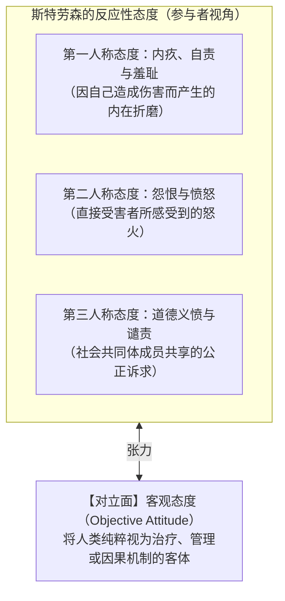

## 引言：两名鲁莽司机的悖论

想象一个在雨夜发生的典型场景：两名司机A和B，在饮酒后以完全相同的超速状态，驶过同一段湿滑的城市居民区弯道。

无论是在主观恶意、注意力涣散程度、车况，还是在道德上的过失程度方面，<strong>司机A与司机B在物理和心理上完全百分之百相同</strong>。
- <strong>司机A</strong>顺利转过弯道。道路上恰好空无一人，他安全到家。他最多面临一次常规违章罚款，没有任何人谴责他是罪人。
- <strong>司机B</strong>在转过弯道的同一刹那，路边墙角突然窜出一个追逐皮球的七岁儿童。B紧急刹车，但在湿滑路面上无法刹停，当场撞死了孩子。司机B被捕入狱，被判过失致人死亡罪，面临巨额民事赔偿，并终生承受无法释怀的自责与痛苦。

### 核心伦理拷问
> <strong>“两人的动机、行为与过失程度完全相同，为什么仅仅因为无法控制的‘运气（Luck）’差异，他们所承受的道德谴责与法律惩罚却有着天壤之别？”</strong>

这就是20世纪后半叶由哲学家<strong>托马斯·内格尔（Thomas Nagel）</strong>与<strong>伯纳德·威廉斯（Bernard Williams）</strong>正式提出的<strong>“道德运气（Moral Luck）”</strong>之谜。

---

## 1. 康德的控制原则与直觉的冲突

德国哲学家伊曼努尔·康德（Immanuel Kant）在《道德形而上学奠基》（1785）中明确主张：
> “在这个世界上，甚至在世界之外，除了<strong>善意志（Good Will）</strong>，没有任何东西可以毫无保留地被认为是善的。善意志之所以是善的，不是因为它所成就或达到的结果，而是凭借其自身的意愿……就像一颗宝石，它完全依凭自身的内在价值而闪耀光芒。”

内格尔将康德主义这一公平直觉形式化为<strong>控制原则（The Control Principle: CP）</strong>：

$$\text{控制原则 (CP):} \quad \text{行动者不应因其无法控制的事项而受到道德评价。}$$

然而，人类社会的实际道德与法律实践，却在每时每刻公然违背这一原则：<strong>我们始终在依据超出行为人控制范围的结果来调整惩罚与谴责的烈度。</strong>

---

## 2. 内格尔的道德运气四分类

内格尔在1979年的同名论文中指出，运气对道德生活的侵蚀远不止行为结果，而是全方位渗透到了人的存在本身。他将道德运气系统划分为四类：

### 2.1 结果运气（Resultant Luck）
指行动发起后，其外部结果受客观偶然性支配的运气。
- 典型的如同谋杀未遂与谋杀既遂：两个枪手以相同的杀意扣动扳机，一个被飞过的鸟遮挡子弹（未遂），另一个正中目标（既遂）。两者的量刑存在巨大鸿沟，完全取决于鸟的飞行轨迹。

### 2.2 情境运气（Circumstantial Luck）
指行动者在生命历程中面临何种伦理考验与抉择情境的运气。
- 内格尔提出了纳粹德国时期的普通市民与移民阿根廷商人的对比：留下的平民成为集中营看守，犯下反人类罪；而移民者在布宜诺斯艾利斯作为模范市民和平终老。移民者的清白并非因为他道德高尚，而仅仅是因为他“幸运地没有面临严酷的道德考验”。

### 2.3 构成运气（Constitutive Luck）
指个人天生拥有何种性情、同理心、冲动控制能力与基因天赋的运气。
- 一个人天生前额叶功能健全、性格温和耐心，而另一个人天生易怒且冲动控制受损。如果品格本身也是基因与早期环境的运气产物，将其作为道德责任的基础便动摇了控制原则的根基。

### 2.4 因果运气（Causal Luck）
指行为人的所有决定与行动均被过去的决定论因果链条所决定的运气。这直接将道德责任问题引向了<strong>自由意志与决定论</strong>的经典困境。

内格尔发出震撼人心的警告：<strong>如果将运气在每一层面上逐一剥离，真正的自主能动性将收缩为一个毫无体积的虚点，自我最终将被世界所吞噬。</strong>

---

## 3. 伯纳德·威廉斯与“行动者悔恨”

伯纳德·威廉斯（1976）则从现象学与存在主义的角度切入。他以法国画家保罗·高更（Paul Gauguin）弃绝家庭前往塔希提岛创作的著名事例说明，高更这种冷酷选择的事后“辩护（Justification）”，完全取决于他最终是否在艺术上取得了登峰造极的伟大成功——而这一结果在出发前是充满客观不确定性的。

威廉斯还提出了<strong>“行动者悔恨（Agent-Regret）”</strong>的关键概念：
即使一名完全没有过失的卡车司机不慎撞死了突然窜出盲区的小孩，他也绝不可能像一个旁观者那样平静地耸耸肩说“我没有过失”。一个健全的人类主体必然会感受到一种撕心裂肺的第一人称痛苦与悔恨：“是我杀死了那个孩子。” 纯粹排斥运气的康德式道德无法解释人类这种不可或缺的道德情感。

---

## 4. 法哲学中的投射：未遂与既遂的刑罚落差

在现代刑法中，未遂犯的法定刑普遍轻于既遂犯。主观主义刑法学派（强调主观恶性与行为责任）主张二者应同等惩罚，而客观主义刑法学派（强调法益侵害与结果责任）则坚称死刑或重刑是对实际法益剥夺的客观报应。

在民事侵权法（Tort Law）中，运气同样主导着赔偿责任：司机A赔偿0元，而司机B赔偿数百万乃至破产。法律在此完全牺牲了控制原则，以优先满足被害人损害填补与社会秩序维稳的需求。

---

## 5. 结论：道德谦逊与宿命的启示

审视道德运气绝非为了走向道德虚无主义。恰恰相反，它是一剂解毒傲慢的清醒剂。

当我们今天能够远离监狱、保有尊严与体面的生活，很大程度上并非因为我们道德超凡，而是因为<strong>“那个小孩碰巧没有从我们的盲区跑出来”</strong>。认识到运气的巨大支配力，是对他人的严苛审判转化为深沉同理心、是对现代功绩制（Meritocracy）傲慢的有力解构，更是人类在脆弱的存在中走向道德成熟的必经之路。
---

## 6. P. F. 斯特劳森的反应性态度与道德运气的桥梁

针对道德运气的形而上学僵局，牛津哲学家彼得·斯特劳森（P. F. Strawson）在《自由与怨恨》（1962）中提出了革命性的现象学视角。斯特劳森主张，道德责任并非来自全知全能视角的客观因果判定，而是深植于人类人际交往中的<strong>“反应性态度（Reactive Attitudes）”</strong>网络：

当司机B撞死儿童时，死者父母不可避免地产生直接的“怨恨（Resentment）”，公众自然产生强烈的“道德义愤（Indignation）”。这种情绪反应并非基于行动者是否具有抽象自由意志的形而上学计算，而是人类社会生活不可或缺的参与性本质。

---

## 7. 比较刑法学中的主观主义与客观主义

在刑法哲学中，道德运气体现为刑法学派百余年来的激烈论争：

| 刑法学派 | 核心刑罚依据 | 对未遂犯与既遂犯的处理 | 对道德运气的态度 |
|---|---|---|---|
| <strong>主观主义（行为责任论）</strong> | 行为人的犯罪决意与主观恶性。 | 杀意与行为相同，未遂与既遂应同等重判。 | 极力排除运气，贯彻康德式的控制原则。 |
| <strong>客观主义（结果责任论）</strong> | 实际造成的客观法益侵害结果。 | 未发生实质损害，未遂犯应当从轻减轻处罚。 | 全面接纳结果运气，以平息社会报应感情。 |

几乎所有现代法系都对未遂犯给予法定减刑，这证明纯粹的康德控制原则在现实法律生活中无法立足，法律必须回应客观损害与结果现实。

---

## 8. 责任归属函数的数学形式化

在决策论框架下，我们可用如下数学形式严格刻画道德运气的结构：

令行动者选择的行为为 $a \in \mathcal{A}$，外部环境的随机变量为 $S \in \mathcal{S}$，结果函数为 $X = g(a, S) \in \mathcal{X}$，外部损失函数为 $L(X)$。

### 康德式纯粹控制算子
$$\mathcal{B}_{\text{Kant}}(a, X, S) = \Psi(a) = \mathbb{E}_{S}[L(g(a, S))]$$
此时司机A与B的责任完全相等：$\Delta \mathcal{B}_{\text{Kant}} = 0$。

### 现实社会的综合责任算子
$$\mathcal{B}_{\text{Actual}}(a, X, S) = (1 - \lambda)\Psi(a) + \lambda L(g(a, S)) \quad (\lambda \in (0, 1])$$
参数 $\lambda > 0$ 正是道德运气的权重系数。只要 $\lambda > 0$，即使行为 $a$ 完全相同，外在运气 $S$ 的不同也必然导致责任评定 $\mathcal{B}_{\text{Actual}}$ 的剧烈分化。
---

## 9. 政治哲学中的延伸：迈克尔·桑德尔对优绩制的批判

政治哲学家迈克尔·桑德尔（Michael J. Sandel）在《精英的傲慢》（The Tyranny of Merit, 2020）中，将道德运气的洞见深刻拓展至现代资本主义社会的分配正义领域。

优绩制（Meritocracy）社会宣称：“只要努力，人人都能成功；因此成功者的财富与地位完全来自个人的奋斗与才能（自主控制）。”
然而，运用内格尔的<strong>构成运气</strong>与<strong>情境运气</strong>，桑德尔撕下了这种优绩主义神话的面具：
1. <strong>基因彩票（构成运气）</strong>：拥有高智商、数学天赋、充沛精力或编程直觉，是完全未经个人努力挣得的先天的基因赠礼。
2. <strong>时代彩票（情境运气）</strong>：恰好生活在高度奖励数字技术的现代社会，才能使软件工程师获得巨额报酬。如果生活在封建农耕社会，这些天赋便毫无经济价值。

当成功者将纯粹的运气误认为是自身的道德应得时，他们对失败者产生了残酷的蔑视，将经济劣势转化为道德缺陷的判决。因此，直面道德运气是打破阶层傲慢、重建社会团结与分配正义的必经之路。
