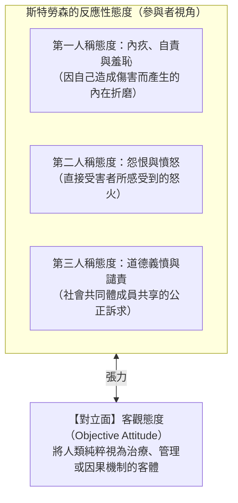

## 引言：兩名魯莽司機的悖論

想像一個在雨夜發生的典型場景：兩名司機A與B，在飲酒後以完全相同的超速狀態，駛過同一段濕滑的城市居民區彎道。

無論是在主觀惡意、注意力渙散程度、車況，還是在道德上的過失程度方面，<strong>司機A與司機B在物理與心理上完全百分之百相同</strong>。
- <strong>司機A</strong>順利轉過彎道。道路上恰好空無一人，他安全到家。他最多面臨一次常規違規罰款，沒有任何人譴責他是罪人。
- <strong>司機B</strong>在轉過彎道的同一剎那，路邊牆角突然竄出一個追逐皮球的七歲兒童。B緊急煞車，但在濕滑路面上無法煞停，當場撞死了孩子。司機B被捕入獄，被判過失致人於死罪，面臨巨額民事賠償，並終生承受無法釋懷的自責與痛苦。

### 核心倫理拷問
> <strong>「兩人的動機、行為與過失程度完全相同，為什麼僅僅因為無法控制的『運氣（Luck）』差異，他們所承受的道德譴責與法律懲罰卻有著天壤之別？」</strong>

這就是20世紀後半葉由哲學家<strong>托馬斯·內格爾（Thomas Nagel）</strong>與<strong>伯納德·威廉斯（Bernard Williams）</strong>正式提出的<strong>「道德運氣（Moral Luck）」</strong>之謎。

---

## 1. 康德的控制原則與直覺的衝突

德國哲學家伊曼努爾·康德（Immanuel Kant）在《道德形而上學奠基》（1785）中明確主張：
> 「在這個世界上，甚至在世界之外，除了<strong>善意志（Good Will）</strong>，沒有任何東西可以毫無保留地被認為是善的。善意志之所以是善的，不是因為它所成就或達到的結果，而是憑藉其自身的意願……就像一顆寶石，它完全依憑自身的內在價值而閃耀光芒。」

內格爾將康德主義這一公平直覺形式化為<strong>控制原則（The Control Principle: CP）</strong>：

$$\text{控制原則 (CP):} \quad \text{行動者不應因其無法控制的事項而受到道德評價。}$$

然而，人類社會的實際道德與法律實踐，卻在每時每刻公然違背這一原則：<strong>我們始終在依據超出行為人控制範圍的結果來調整懲罰與譴責的烈度。</strong>

---

## 2. 內格爾的道德運氣四分類

內格爾在1979年的同名論文中指出，運氣對道德生活的侵蝕遠不止行為結果，而是全方位滲透到了人的存在本身。他將道德運氣系統劃分為四類：

### 2.1 結果運氣（Resultant Luck）
指行動發起後，其外部結果受客觀偶然性支配的運氣。
- 典型的如同謀殺未遂與謀殺既遂：兩個槍手以相同的殺意扣動扳機，一個被飛過的鳥遮擋子彈（未遂），另一個正中目標（既遂）。兩者的量刑存在巨大鴻溝，完全取決於鳥的飛行軌跡。

### 2.2 情境運氣（Circumstantial Luck）
指行動者在生命歷程中面臨何種倫理考驗與抉擇情境的運氣。
- 內格爾提出了納粹德國時期的普通市民與移民阿根廷商人的對比：留下的平民成為集中營看守，犯下反人類罪；而移民者在布宜諾斯艾利斯作為模範市民和平終老。移民者的清白並非因為他道德高尚，而僅僅是因為他「幸運地沒有面臨嚴酷的道德考驗」。

### 2.3 構成運氣（Constitutive Luck）
指個人天生擁有何種性情、同理心、衝動控制能力與基因天賦的運氣。
- 一個人天生前額葉功能健全、性格溫和耐心，而另一個人天生易怒且衝動控制受損。如果品格本身也是基因與早期環境的運氣產物，將其作為道德責任的基礎便動搖了控制原則的根基。

### 2.4 因果運氣（Causal Luck）
指行為人的所有決定與行動均被過去的決定論因果鏈條所決定的運氣。這直接將道德責任問題引向了<strong>自由意志與決定論</strong>的經典困境。

---

## 3. 伯納德·威廉斯與「行動者悔恨」

伯納德·威廉斯（1976）提出了<strong>「行動者悔恨（Agent-Regret）」</strong>的關鍵概念：
即使一名完全沒有過失的卡車司機不慎撞死了突然竄出盲區的小孩，他也絕不可能像一個旁觀者那樣平靜地聳聳肩說「我沒有過失」。一個健全的人類主體必然會感受到一種撕心裂肺的第一人稱痛苦與悔恨：「是我殺死了那個孩子。」 純粹排斥運氣的康德式道德無法解釋人類這種不可或缺的道德情感。

---

## 4. 結論：道德謙遜與宿命的啟示

審視道德運氣絕非為了走向道德虛無主義。恰恰相反，它是一劑解毒傲慢的清醒劑。

認識到運氣的巨大支配力，是對他人的嚴苛審判轉化為深沉同理心、是對現代功績制（Meritocracy）傲慢的有力解構，更是人類在脆弱的存在中走向道德成熟的必經之路。
---

## 5. P. F. 斯特勞森的反應性態度與道德運氣的橋樑

針對道德運氣的形而上學僵局，牛津哲學家彼得·斯特勞森（P. F. Strawson）在《自由與怨恨》（1962）中提出了革命性的現象學視角。斯特勞森主張，道德責任並非來自全知全能視角的客觀因果判定，而是深植於人類人際交往中的<strong>「反應性態度（Reactive Attitudes）」</strong>網絡：

當司機B撞死兒童時，死者父母不可避免地產生直接的「怨恨（Resentment）」，公眾自然產生強烈的「道德義憤（Indignation）」。這種情緒反應並非基於行動者是否具有抽象自由意志的形而上學計算，而是人類社會生活不可或缺的參與性本質。

---

## 6. 比較刑法學中的主觀主義與客觀主義

在刑法哲學中，道德運氣體現為刑法學派百餘年來的激烈論爭：

| 刑法學派 | 核心刑罰依據 | 對未遂犯與既遂犯的處理 | 對道德運氣的態度 |
|---|---|---|---|
| <strong>主觀主義（行為責任論）</strong> | 行為人的犯罪決意與主觀惡性。 | 殺意與行為相同，未遂與既遂應同等重判。 | 極力排除運氣，貫徹康德式的控制原則。 |
| <strong>客觀主義（結果責任論）</strong> | 實際造成的客觀法益侵害結果。 | 未發生實質損害，未遂犯應當從輕減輕處罰。 | 全面接納結果運氣，以平息社會報應感情。 |

---

## 7. 責任歸屬函數的數學形式化

在決策論框架下，我們可用如下數學形式嚴格刻畫道德運氣的結構：

令行動者選擇的行為為 $a \in \mathcal{A}$，外部環境的隨機變數為 $S \in \mathcal{S}$，結果函數為 $X = g(a, S) \in \mathcal{X}$，外部損失函數為 $L(X)$。

### 康德式純粹控制算子
$$\mathcal{B}_{\text{Kant}}(a, X, S) = \Psi(a) = \mathbb{E}_{S}[L(g(a, S))]$$
此時司機A與B的責任完全相等：$\Delta \mathcal{B}_{\text{Kant}} = 0$。

### 現實社會的綜合責任算子
$$\mathcal{B}_{\text{Actual}}(a, X, S) = (1 - \lambda)\Psi(a) + \lambda L(g(a, S)) \quad (\lambda \in (0, 1])$$
參數 $\lambda > 0$ 正是道德運氣的權重係數。只要 $\lambda > 0$，即使行為 $a$ 完全相同，外在運氣 $S$ 的不同也必然導致責任評定 $\mathcal{B}_{\text{Actual}}$ 的劇烈分化。
---

## 8. 政治哲學中的延伸：邁克爾·桑德爾對優績制的批判

政治哲學家邁克爾·桑德爾（Michael J. Sandel）在《終結平庸的傲慢》（The Tyranny of Merit, 2020）中，將道德運氣的洞見深刻拓展至現代資本主義社會的分配正義領域。

優績制（Meritocracy）社會宣稱：「只要努力，人人都能成功；因此成功者的財富與地位完全來自個人的奮鬥與才能（自主控制）。」
然而，運用內格爾的<strong>構成運氣</strong>與<strong>情境運氣</strong>，桑德爾撕下了這種優績主義神話的面具：
1. <strong>基因彩券（構成運氣）</strong>：擁有高智商、數學天賦、充沛精力或編程直覺，是完全未經個人努力掙得的先天的基因贈禮。
2. <strong>時代彩券（情境運氣）</strong>：恰好生活在高度獎勵數位技術的現代社會，才能使軟體工程師獲得巨額報酬。如果生活在封建農耕社會，這些天賦便毫無經濟價值。

當成功者將純粹的運氣誤認為是自身的道德應得時，他們對失敗者產生了殘酷的蔑視，將經濟劣勢轉化為道德缺陷的判決。因此，直面道德運氣是打破階層傲慢、重建社會團結與分配正義的必經之路。
---

## 9. 瑪莎·努斯鮑姆與希臘悲劇中的「善的脆弱性」

哲學家瑪莎·努斯鮑姆（Martha Nussbaum）在名著《善的脆弱性》（The Fragility of Goodness）中指出，試圖將道德徹底封閉於無菌室中以隔絕運氣，本就是對人類真實處境的逃避。從古希臘悲劇（如伊底帕斯王在不知情下弒父娶母的悲劇）中我們可以看到，真正的德行從來不是刀槍不入的神性，而恰恰是在脆弱與不可抗力的命運中，依然勇於承擔對他人的責任與悔恨。這才是人性最崇高的光輝。
