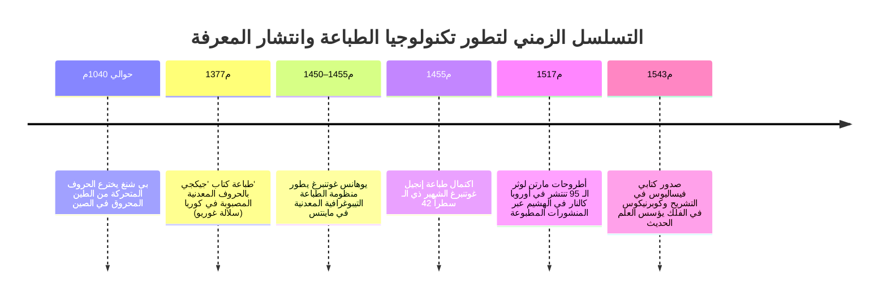
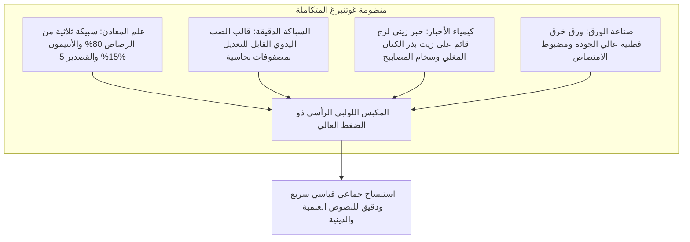
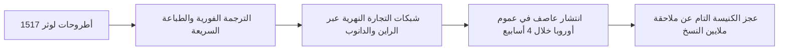
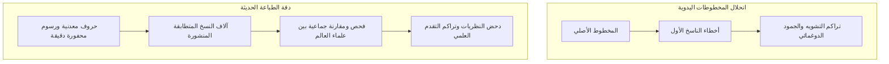

في مطلع القرن السابع عشر الميلادي، كتب الفيلسوف الإنجليزي فرانسيس بيكون في مؤلفه التأسيسي *الأورغانون الجديد* عبارة خالدة: ثلاثة اختراعات غيرت وجه العالم وحالة الحضارة بأسرها – فن الطباعة، والبارود، والبوصلة المغناطيسية. ولم تنجح أي إمبراطورية سياسية ولا أي سلالة حاكمة ولا أي عقيدة مذهبية في ممارسة تأثير أعظم أو أعمق في الشؤون الإنسانية مما أحدثته هذه الابتكارات الميكانيكية العملية.

في حوالي عام 1450م، وفي مدينة ماينتس الألمانية الواقعة على ضفاف نهر الراين، نجح الصائغ والمخترع **يوهانس غوتنبرغ** (نحو 1400–1468م) في ابتكار منظومة تقنية متكاملة للطباعة الميكانيكية باستخدام الحروف المعدنية المتحركة القابلة لإعادة الاستخدام. وكان هذا الحدث بمثابة الشرارة الأولى لأعظم ثورة معلوماتية شهدتها البشرية قبل ولادة العصر الرقمي.

قبل عصر غوتنبرغ، كانت المخطوطات والكتب سلعاً نادرة وباهظة الثمن بصورة لا تصدق، محتكرة داخل أديرة الرهبان وقصور الملوك والنبلاء. وكان استنساخ نسخة واحدة كاملة من الكتاب المقدس يستغرق أشهراً طويلة أو سنوات من العمل الشاق لخطاطين محترفين يكتبون على رقائق جلود الحيوانات الفاخرة (الرق). وكان ثمن المخطوط الواحد يوازي ثمن ضيعة زراعية شاسعة أو قصر حضري فخم. وعلاوة على ذلك، كان كل استنساخ يدوي يراكم حتماً أخطاء النسخ وسهو الخطاطين والتحريفات التفسيرية عبر الأجيال.

لقد خفّض مجمع غوتنبرغ التقني التكلفة الحدية لإنتاج الكتب بنسبة تفوق 99 %، وأدى إلى تدفق ملايين الكتب في عموم أوروبا خلال بضعة عقود، مما حطم الاحتكار الكنسي للمعرفة، وأشعل ثورة الإصلاح الديني، وأرسى الأساس المادي لنشأة العلوم الطبيعية الحديثة.

---

## 1. مجمع غوتنبرغ التقني: التقاء أربعة فنون تطبيقية رائدة

لم تكن عبقرية غوتنبرغ مجرد فكرة مجردة لسك حروف منفصلة، بل تجسدت في **التكامل الهندسي الشامل لأربعة ابتكارات علمية وميكانيكية** كانت معزولة تماماً عن بعضها:

### 1.1 علم المواد وسبيكة الطباعة: شذوذ الأنتيمون الفيزيائي
لكي يتحمل الحرف الطباعي آلاف الضغطات الميكانيكية العنيفة تحت المكبس دون أن يتشوه أو يتآكل، كان لا بد أن يتمتع بصلابة عالية، وفي الوقت ذاته بنقطة انصهار منخفضة تسمح بصهره وسكبه المتكرر في ورشة العمل. ابتكر غوتنبرغ سبيكة ثلاثية العبقرية تتكون من:
- **الرصاص ($Pb$، نحو 75–80 %)**: معدن رخيص الثمن وسهل الانصهار يشكل القاعدة الأساسية ($327^\circ\text{C}$).
- **القصدير ($Sn$، نحو 5–10 %)**: يخفض درجة انصهار الخليط الكلية ويمنحه سيولة هيدروديناميكية عالية عند الصب.
- **الأنتيمون ($Sb$، نحو 15–20 %)**: سر غوتنبرغ المعدني الأعظم.

تنكمش معظم المعادن عند تحولها من الحالة السائلة إلى الصلبة. أما الأنتيمون فيتميز بخاصية فيزيائية نادرة وفريدة: **يتمدد حجمياً عند التبلور والتصلب**. وهذا التمدد المجهري يجبر المعدن المنصهر على الاندفاع بقوة هائلة نحو أدق الشقوق والحواف المحفورة داخل المصفوفة النحاسية، مما يتيح استنساخ أدق التفاصيل الجمالية للخط القوطي اللاتيني بمنتهى الحدة والدقة، كما يمنح السبيكة صلابة فائقة تمنع تآكلها.

### 1.2 قالب الصب اليدوي القابل للتعديل (Hand Mould)
تختلف الحروف اللاتينية في عرضها الأفقي؛ فحرف `i` يحتاج إلى مساحة ضيقة للغاية، بينما يتطلب حرف `M` أو `W` قاعدة عريضة.

صمم غوتنبرغ قالباً فولاذياً يدوياً قابلاً للحركة والانزلاق على شكل حرف L:
1. يُحفر الحرف اللاتيني بارزاً معكوساً على رأس سنبك فولاذي صلب، ثم يُطرق على قضيب نحاسي لين لتكوين **المصفوفة (Matrix)** المجوفة.
2. تُثبت المصفوفة في قاع القالب بواسطة قوس زنبركي مرن.
3. يضبط العامل نصفي القالب المنزلقين وفقاً لعرض الحرف المطلوب صبه بدقة متناهية.
4. يسكب العامل السبيكة المنصهرة من ملعقة الصهر، وبحركة خاطفة يرج القالب بيده للأعلى؛ فيجبر القصور الذاتي السائل الثقيل على التغلغل في قاع المصفوفة.
5. في طرفة عين يتصلب الحرف، ويفتح القالب ليقذف حرفاً معدنياً بالغ الدقة. وكان الصانع الماهر ينتج ما بين 2000 إلى 3000 حرف متطابق في اليوم الواحد.

### 1.3 الحبر الزيتي والمكبس الخشبي
كانت الأحبار التقليدية للخطاطين مائية الأساس. وعلى سطح الرصاص الأملس غير المسامي، كان الماء يتجمع على شكل قطرات غير متجانسة بفعل التوتر السطحي، مما يؤدي إلى لطخات باهتة ومشوهة عند ضغط الحرف على الصفحة.

استعار غوتنبرغ تقنيات التصوير الزيتي الفلمنكي: حيث قام **بطهي زيت بذر الكتان مع راتنجات الصنوبر ومسحوق سخام المصابيح النقي**، منتجاً حبراً لزجاً شديد السواد يجف بالأكسدة بسرعة، ويلتصق بامتياز بوجوه الحروف المعدنية وينتقل بنعومة إلى ألياف الورق القطني الرطب.

---

## 2. رأسمالية الطباعة وعاصفة الإصلاح البروتستانتي

في 31 أكتوبر 1517م، أعلن الراهب والمصلح مارتن لوثر أطروحاته الشهيرة الـ 95 في فيتنبرغ احتجاجاً على صكوك الغفران البابوية. ورغم أن لوثر صاغ نصه باللاتينية موجهاً إياه لنقاش أكاديمي نخبوي مغلق، إلا أن أصحاب المطابع سارعوا إلى ترجمته فوراً إلى اللغة الألمانية الدارجة وطباعته في آلاف المنشورات الورقية الرخيصة (*Flugschriften*).

كانت الحركات الإصلاحية السابقة، مثل حركة جون ويكلف في إنجلترا أو يان هوس في بوهيميا، قد سُحقت وقُضي عليها بسبب سهولة مصادرة وحرق المخطوطات الفردية القليلة من قبل محاكم التفتيش. 

لكن أمام المطبعة، انهارت آلة الرقابة التقليدية:
- **سرعة الإنتاج الكاسحة**: قبل أن تتمكن روما من صياغة مرسوم الحرمان الكنسي وإرساله مع الرسل، كانت عشرات المطابع في بازل ونورمبرغ وستراسبورغ قد طبعت مئات الآلاف من نسخ كتب لوثر وباعتها.
- **شبكة تجارية لا مركزية**: كانت المطابع تعمل كشركات رأسمالية حرة تسعى للربح وتلبي تعطش الجمهور للقراءة.
- ترجمة لوثر للعهد الجديد إلى الألمانية بيعت منها آلاف النسخ في غضون أسبوعين فقط، مما وحد اللغة الألمانية القومية الحديثة وأسس لما يُعرف اليوم بـ **الرأي العام**.

---

## 3. ولادة الثورة العلمية: تراكمية المعرفة وقابليتها للتحقق

أثبتت المؤرخة الكبيرة إليزابيث آيزنشتاين أن نشأة المنهج العلمي الحديث في القرنين السادس عشر والسابع عشر كانت ثمرة مباشرة للتوحيد القياسي الطباعي.

### 3.1 القضاء على التدهور النصي الانتروبي
في عصر المخطوطات، كانت المعرفة تتعرض لانحلال تدريجي مع كل استنساخ:
- الرسوم الهندسية الرياضية تفقد زواياها وأبعادها الدقيقة.
- الخرائط التشريحية تتشوه فيها مسارات الأوعية الدموية بيد نساخ يجهلون الطب.
- الجداول الفلكية وحسابات التقويم تتراكم فيها أخطاء الحساب الحتمية.

كان العلماء يقضون أعمارهم في محاولة تصحيح النصوص القديمة التالفة لأرسطو وجالينوس. ومع ظهور الطباعة، أصبح بمقدور مئات العلماء في مختلف عواصم أوروبا الاطلاع على نفس الرسوم والجداول الدقيقة، مما فتح الباب للتجربة والمضاهاة ودحض النظريات وتراكم الكشوف العلمية.

### 3.2 عام الإعجاز 1543م: فيساليوس وكوبرنيكوس
شهد عام 1543م ولادة العلم الحديث بنشر عملين علميين فارقين:
1. **أندرياس فيساليوس: *في بنية الجسد البشري* (*De humani corporis fabrica*)**: دحض نظريات جالينوس الطبية العتيقة عبر التشريح الفعلي للجثث، مخلداً التفاصيل في رسوم خشبية بالغة الدقة والجمال.
2. **نيكولاس كوبرنيكوس: *في ثورات الأجرام السماوية* (*De revolutionibus orbium coelestium*)**: برهن على مركزية الشمس عبر منظومة جداول رياضية مثلثة لا يمكن تداولها دون دقة الطباعة المعدنية.

---

## 4. مقارنة تاريخية عالمية: لماذا انتصرت الطباعة في أوروبا وتأخرت في شرق آسيا؟

رغم أن الحروف المعدنية المتحركة قد ابتُكرت في كوريا في عهد سلالة غوريو (أوائل القرن الثالث عشر الميلادي، ومنها كتاب *جيكجي* عام 1377م) قبل غوتنبرغ بعدة عقود، والحروف الطينية ابتكرها بي شنغ في الصين في القرن الحادي عشر، إلا أن الانفجار الطباعي وقع في أوروبا.

| معيار المقارنة | شرق آسيا (الصين / كوريا) | أوروبا الغربية (نظام غوتنبرغ) |
| :--- | :--- | :--- |
| **نظام الكتابة** | لغوي مقطعي (أكثر من 30,000 رمز صيني) | ألفبائي لاتيني (26 إلى 30 حرفاً فقط) |
| **التكلفة الاستثمارية الأولى** | باهظة جداً: سك عشرات الآلاف من القوالب المنفصلة | ضئيلة للغاية: 200 إلى 300 قالب حرف ومصفوفة |
| **التكنولوجيا المنافسة** | طباعة قوالب الخشب الكاملة (*Xylography*) عالية الكفاءة | النسخ اليدوي البطيء والمكلف جداً |
| **البيئة السياسية** | إمبراطوريات مركزية محتكرة للنشر الحكومي | منافسة تجارية حرة وتعددية سياسية أوروبية |
| **الحبر والضغط** | حبر مائي يُمسح يدوياً بفرشاة رقيقة | حبر زيتي ثقيل تحت مكبس لولبي بقوة أطنان |

في الكتابة الصينية، كانت ألواح الخشب الكاملة المحفورة لكل صفحة أكثر جدوى واقتصاداً؛ إذ يمكن حفظ اللوح لعقود وإعادة طباعة نسخ محدودة عند الحاجة. أما الأبجدية اللاتينية فكانت البيئة المثالية التي جعلت الحروف المعدنية القابلة للفك والتركيب قنبلة اقتصادية ومعرفية غيرت مسار التاريخ.

---

## 5. خاتمة: إرث غوتنبرغ الخالد

توفي يوهانس غوتنبرغ عام 1468م معدماً بعد أن خسر مطبعته في نزاع قضائي مع مموله يوهان فوست، إلا أن الآلة التي أطلقها غيرت مصير الحضارة الإنسانية إلى الأبد. ومن ورشة الصب في ماينتس إلى الفضاء الرقمي وشبكة الإنترنت اليوم، تقف حروف غوتنبرغ المعدنية كأعظم شاهد على تحرير العقل البشري وانتصار العلم والمعرفة.
