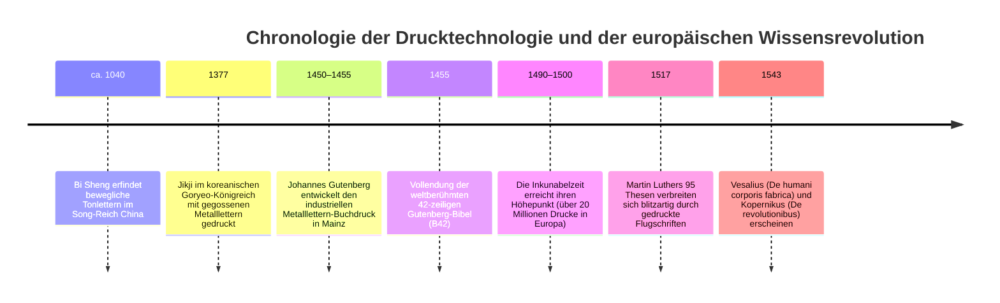
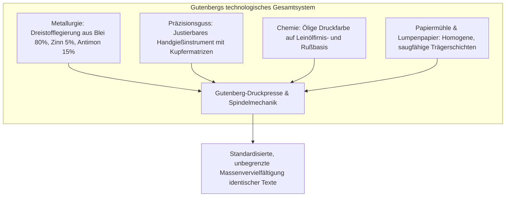
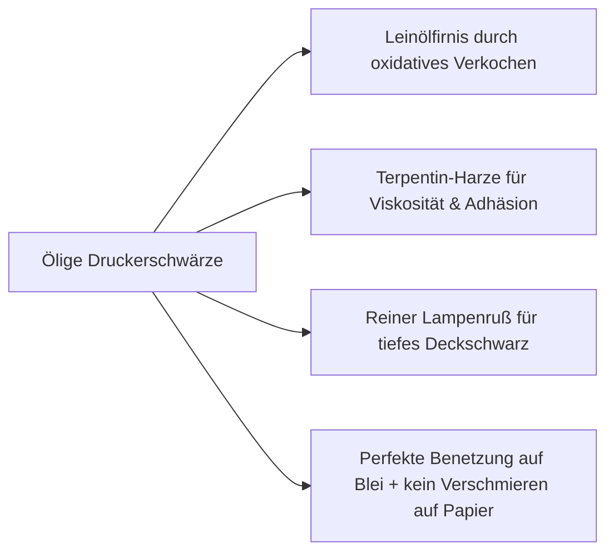
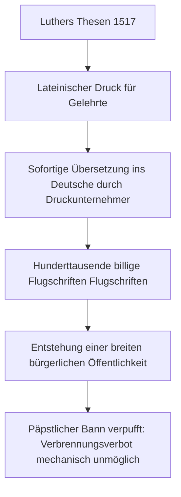
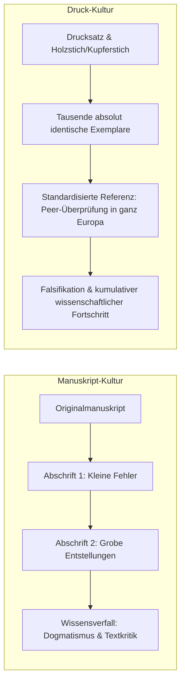

Zu Beginn des 17. Jahrhunderts formulierte der englische Staatsmann und Philosoph Francis Bacon in seinem bahnbrechenden Werk *Novum Organum* eine fundamentale Erkenntnis: Drei Erfindungen hätten das gesamte Antlitz und den Zustand der bekannten Welt vollkommen verändert – die Buchdruckerkunst, das Schießpulver und der magnetische Kompass. Kein Reich, keine Dynastie und keine religiöse Sekte habe je eine tiefere, nachhaltigere und revolutionärere Transformation menschlicher Angelegenheiten herbeigeführt als jene mechanischen Innovationen.

Um das Jahr 1450 vollendete der Mainzer Goldschmied und Patriziersohn **Johannes Gensfleisch zur Laden zum Gutenberg** (ca. 1400–1468) ein technologisches Gesamtsystem, das den Beginn der modernen Informationsgesellschaft markiert. 

Vor Gutenbergs Erfindung war das geschriebene Wort das exklusive Monopol katholischer Klöster, fürstlicher Höfe und weniger privilegierter Gelehrter. Jedes einzelne Buch musste von professionellen Schreibern monatelang, oft jahrelang, auf kostbarem Tierpergament von Hand kopiert werden. Die Kosten für eine einzige Bibel entsprachen dem Wert eines landwirtschaftlichen Gutes oder eines herrschaftlichen Bürgerhauses in einer Reichsstadt. Zudem schlichen sich mit jeder Abschrift unweigerlich Schreibfehler, Textauslassungen und willkürliche Korrekturen ein, sodass antikes Wissen im Laufe der Jahrhunderte korrumpiert wurde. 

Gutenbergs genialer technischer Komplex senkte die Grenzkosten der Textvervielfältigung um mehr als 99 %. Innerhalb weniger Jahrzehnte wurden Millionen Druckwerke über ganz Europa verbreitet, was die theologische Vorherrschaft Roms erschütterte, die europäische Reformation entzündete und das Fundament der modernen Naturwissenschaften legte.

---

## 1. Gutenbergs technologischer Komplex: Die Konvergenz von vier Disziplinen

Historisch wird Johannes Gutenberg oft fälschlicherweise allein die Erfindung einzelner beweglicher Lettern zugeschrieben. Gutenbergs tatsächliche Meisterleistung bestand jedoch nicht in einem isolierten Einfall, sondern in der **systemischen Synthese von vier hochentwickelten Schlüsseltechnologien**, die erst im perfekten Zusammenspiel eine funktionierende industrielle Massenproduktion ermöglichten:

### 1.1 Die Legierungsmetallurgie: Die physikalische Anomalie des Antimons
Eine Letter für den mechanischen Buchdruck muss zwei gegensätzliche Bedingungen erfüllen: Sie muss einen ausreichend niedrigen Schmelzpunkt besitzen, um hunderte Male am Tag schnell gegossen werden zu können, und sie muss mechanisch so hart und druckfest sein, dass sie tausende Abdrücke unter hohem Druck ohne plastische Verformung übersteht.

Gutenberg entwickelte eine ternäre Legierung (Dreistofflegierung) mit folgender Zusammensetzung:
1. **Blei ($Pb$, ca. 75–80 %)**: Dient als duktile, leicht schmelzbare Basismatrix mit einem Schmelzpunkt von ca. 327 °C.
2. **Zinn ($Sn$, ca. 5–10 %)**: Senkt den Schmelzpunkt der Mischung weiter ab und verbessert die Fließfähigkeit der flüssigen Schmelze in feinsten Konturen.
3. **Antimon ($Sb$, ca. 15–20 %)**: Das metallurgische Geheimnis Gutenbergs. 

Fast alle Metalle ziehen sich beim Phasenübergang von der flüssigen in die feste Phase zusammen (Volumenkontraktion). Antimon bildet beim Erstarren jedoch ein rhomboidales Kristallgitter, das zu einer **Volumenexpansion bei der Kristallisation** führt. Diese thermische Volumenausdehnung zwingt die erstarrende Metallschmelze mit hohem Eigendruck in die winzigsten Gravurlinien der Kupfermatrize. Dadurch wurden die feinsten Serifen, Kanten und haarfeinen Zierstriche der spätmittelalterlichen Textura-Schrift gestochen scharf abgebildet. Gleichzeitig verleiht Antimon der Bleilegierung eine extreme Härte.

### 1.2 Das justierbare Handgießinstrument
Um die lateinische Schrift typografisch zu setzen, reichte ein einfacher Guss nicht aus. Verschiedene Buchstaben besitzen stark abweichende Breiten (die Dickte): Ein schmales `i` benötigt nur einen Bruchteil des Raumes eines breiten `M` oder `W`. 

Gutenberg erfand das zweigeteilte, L-förmig geführte **Handgießinstrument (Hand Mould)** aus gehärtetem Eisen und Holzisolierung:
- Eine Stahlpatrize, auf deren Stirnseite der Buchstabe spiegelverkehrt erhaben geschnitten war, wurde in einen Kupferblock geschlagen, um die vertiefte **Matrize** zu formen.
- Die Matrize wurde mit einer federnden Stahlklammer im Handgießinstrument arretiert.
- Der Schriftgießer stellte die beiden verschiebbaren Hälften des Gießinstruments exakt auf die spezifische Buchstabenbreite ein.
- Mit der rechten Hand schöpfte der Gießer flüssiges Letternmetall aus dem Schmelztiegel, goss es in die Trichteröffnung und führte im selben Sekundenbruchteil einen kräftigen Ruck nach oben aus. Durch die Trägheitskraft wurde das schwere Flüssigmetall tief in die Matrizenspitze gepresst.
- Durch das Öffnen einer Feder sprang die fertige, maßhaltige Letter heraus. Ein geübter Gießer schuf so 2.000 bis 3.000 identische Lettern pro Arbeitstag.

### 1.3 Die chemische Innovation: Ölige Druckfarbe
Traditionelle mittelalterliche Schreibertinte bestand aus wasserlöslichem Eisengallustinte oder Gummi-Arabikum-Lösungen. Auf glatten metallischen Bleibuchstaben perlte wässrige Tinte aufgrund der hohen Oberflächenspannung ab, bildete Tröpfchen und schmierte beim Anpressen unleserlich über das Papier.

Gutenberg revolutionierte die Druckchemie, indem er Anleihen bei den zeitgenössischen altniederländischen Meistern der Ölmalerei (wie Jan van Eyck) nahm. Er kochte **Leinöl über Stunden zu einem zähen Firnis**, fügte Walnussöl, Baumharze (Terpentin) und feinsten **Lampenruß** hinzu. Diese hochviskose, hydrophobe Druckerschwärze haftete homogen auf der polierten Metalloberfläche der Lettern, floss nicht ab und trocknete durch oxidative Polymerisation wischfest in den Fasern des leicht angefeuchteten Hadernpapiers.

### 1.4 Die Schraubenspindelpresse
Als mechanisches Antriebselement modifizierte Gutenberg die hölzerne Spindelkelter, die im rheinischen Weinbau und in Papierühlen zur Entwässerung eingesetzt wurde. Über einen langen Holzhebel drehte der Drucker eine massive Gewindespindel aus Eichen- oder Birnbaumholz, die den Drucktiegel senkrecht nach unten trieb. Dadurch wurde eine gleichmäßige, tonnenschwere Druckkraft senkrecht auf das gesamte Satzbett ausgeübt, ohne die beweglichen Lettern seitlich zu verschieben.

---

## 2. Druckkapitalismus und die explosionsartige Ausbreitung der Reformation

Als Martin Luther am 31. Oktober 1517 seine berühmten 95 Thesen gegen den päpstlichen Ablasshandel an die Schlosskirche zu Wittenberg schlug (oder verschickte), beabsichtigte er eine akademische Disputation in lateinischer Gelehrtensprache. Doch der historische Verlauf entzog sich seiner Kontrolle: Studenten und befreundete Druckunternehmer übersetzten die Thesen binnen Tagen ins Deutsche und druckten sie als günstige Flugblätter.

Frühere Reformbewegungen – wie die von John Wyclif in England oder Jan Hus in Böhmen – waren von der päpstlichen Inquisition und weltlichen Herrschern durch das systematische Beschlagnahmen und Verbrennen handschriftlicher Manuskripte physisch ausgelöscht worden. 

Gegen die Druckerpresse war die alte Zensurmaschinerie jedoch machtlos:
- **Geschwindigkeit der Replikation**: Bevor eine päpstliche Bulle in Rom verfasst und nach Deutschland geritten war, hatten dutzende Druckereien in Nürnberg, Basel, Leipzig und Straßburg hunderttausende Exemplare von Luthers Schriften gedruckt und verkauft.
- **Dezentrale Netzwerke**: Der Buchdruck war eine freie Marktindustrie. Kaufleute transportierten Flugschriften entlang der mitteleuropäischen Flusshandelsrouten (Rhein, Elbe, Donau) in jeden Winkel des Heiligen Römischen Reiches.
- **Die deutsche Bibel von 1522**: Luthers Übersetzung des Neuen Testaments (das sogenannte Septembertestament) erschien 1522 in Wittenberg in einer Auflage von 3.000 Exemplaren – eine gewaltige Zahl für jene Zeit. Innerhalb von zwölf Jahren druckte allein die Offizin von Hans Lufft in Wittenberg über 100.000 Lutherbibeln.

Der Buchdruck schuf somit erstmals in der Menschheitsgeschichte eine überregionale **öffentliche Meinung** und legte den Grundstein für die Herausbildung der neuzeitlichen Nationalsprachen.

---

## 3. Die Entstehung der modernen Naturwissenschaft: Kumulatives und falsifizierbares Wissen

Die Historikerin Elizabeth Eisenstein prägte den Begriff der *Unacknowledged Revolution* (Die unerkannte Revolution). Sie wies nach, dass die Entstehung der modernen Wissenschaft im 16. und 17. Jahrhundert ohne den Buchdruck schlicht unmöglich gewesen wäre.

### 3.1 Das Ende des Entropie-Verfalls von Wissen
Im Manuskriptzeitalter unterlag jedes Wissen dem Gesetz der Entropie. Wenn ein Gelehrter eine astronomische Tabelle oder eine anatomische Zeichnung anfertigte, führte jedes manuelle Nachzeichnen zu Verzerrungen:
- Winkel in geometrischen Skizzen wurden ungenau.
- Positionen von Blutgefäßen in anatomischen Abhandlungen wurden verfälscht.
- Ziffern in Sternenkatalogen wurden von übermüdeten Mönchen vertauscht.

Folglich verbrachten mittelalterliche Gelehrte Generationen damit, verfälschte Texte alter Autoritäten wie Aristoteles, Galen oder Ptolemäus philologisch zu rekonstruieren, anstatt neue empirische Entdeckungen zu machen.

### 3.2 Das Schicksalsjahr 1543: Vesalius und Kopernikus
Im Jahr 1543 ereignete sich eine Zäsur, die gemeinhin als Geburtsstunde der modernen Naturwissenschaft gilt:
1. **Andreas Vesalius: *De humani corporis fabrica*** (Über den Bau des menschlichen Körpers). Gedruckt bei Johannes Oporinus in Basel. Vesalius ersetzte die 1.300 Jahre alten, oft fehlerhaften anatomischen Lehren Galens (der vorwiegend Affen und Schweine seziert hatte) durch akribische Sektionen des menschlichen Körpers. Dank meisterhafter Holzschnitte von Tizian-Schülern konnten Ärzte in ganz Europa exakt dieselben Muskel- und Nervenverläufe betrachten und am eigenen Seziertisch überprüfen.
2. **Nicolaus Copernicus: *De revolutionibus orbium coelestium*** (Über die Umschwünge der himmlischen Kreise). Gedruckt bei Johannes Petreius in Nürnberg. Kopernikus stellte das geozentrische Weltbild auf den Kopf und begründete das heliozentrische System mit umfangreichen mathematischen und trigonometrischen Tabellen, die nur im fehlerfreien Druck verlässlich publiziert werden konnten.

Ohne die exakte typografische Reproduzierbarkeit mathematischer Formeln und anatomischer Bildtafeln wäre der wissenschaftliche Diskurs – bestehend aus Veröffentlichung, Replikation und Falsifikation – niemals entstanden.

---

## 4. Weltgeschichtlicher Vergleich: Warum setzte sich der Buchdruck in Europa durch und nicht in Ostasien?

Ein faszinierendes Paradox der Wissenschaftsgeschichte liegt in der Tatsache, dass bewegliche Lettern bereits Jahrhunderte vor Gutenberg in Ostasien erfunden wurden:
- **Bi Sheng (ca. 1040, Song-Dynastie, China)** erfand Lettern aus gebranntem Ton.
- **Wang Zhen (1298, Yuan-Dynastie)** entwickelte bewegliche Holzlettern und drehbare Setztische.
- **Goryeo-Dynastie (Korea, 1230er/1377)** erfand den Guss von Metalllettern aus Bronze und druckte 1377 das *Jikji* (das älteste erhaltene Buch aus gegossenen Metalllettern).

Warum führte der Buchdruck in Asien nicht zu derselben gesellschaftlichen Schockwelle wie in Europa?

| Vergleichskriterium | Ostasien (China / Korea) | Europa (Gutenberg-System) |
| :--- | :--- | :--- |
| **Schriftsystem** | Logografisch (40.000+ Hanzi-Schriftzeichen) | Alphabetisch (26–30 lateinische Buchstaben) |
| **Ökonomischer Grenzertrag** | Hohe Fixkosten: Zehntausende Lettern müssen vorrätig sein | Extrem niedrige Fixkosten: 200–300 Matrizen genügen |
| **Dominante Technologie** | Hochgradig optimierter Holzschnittdruck (Blockdruck) | Mechanische Metallletternpresse |
| **Politisches Umfeld** | Zentralisiertes Kaiserreich / Staatliche Druckmonopole | Dezentraler europäischer Staatenwettbewerb |
| **Druckfarbe & Papier** | Wässrige Tusche auf saugfähigem Reispapier (Handabreibung) | Ölige Firnisfarbe auf Hadernpapier unter mechanischem Spindeldruck |

In der chinesischen Schriftkultur benötigte ein Drucker tausende bis zehntausende individueller Schriftzeichen. Für einmalige Buchauflagen war der chinesische Holztafeldruck (Xylografie) viel ökonomischer und flexibler: Eine Holzplatte wurde von einem Graveur geschnitten und konnte jahrzehntelang im Archiv gelagert werden, um bei Bedarf in kleiner Auflage nachgedruckt zu werden.

Im lateinischen Alphabet hingegen benötigte Gutenberg lediglich Groß- und Kleinbuchstaben, Interpunktionen, Ligaturen und Abkürzungen – insgesamt rund 290 Zeichenvarianten für seine 42-zeilige Bibel. Diese geringe Zeichenanzahl machte den wiederverwendbaren Metallletternguss zur ökonomisch perfekten Lösung für das lateinische Schriftsystem.

---

## 5. Das Vermächtnis Gutenbergs: Vom Bleisatz zur digitalen Ära

Johannes Gutenberg starb 1468 in Mainz, nachdem er in jahrelange Rechtsstreitigkeiten mit seinem Geldgeber Johann Fust verwickelt worden war und seine eigene Werkstatt verlor. Doch seine Erfindung entfaltete eine historische Eigendynamik, die bis ins 21. Jahrhundert nachwirkt.

Von Gutenbergs Handgießinstrument bis zum Zeitalter des Internets lässt sich eine kontinuierliche Entwicklungslinie ziehen:
- **Demokratisierung der Information**: Der Übergang vom Privileg weniger Gelehrter zum Bürgerrecht breiter Bevölkerungsschichten.
- **Standardisierung des Denkens**: Einheitliche Typografie, Orthografie und Paginierung schufen die kognitiven Strukturen moderner Bürokratie und Wissenschaft.
- **Freiheit des Wortes**: Das ewige Ringen zwischen Autorschaft, Urheberrecht, Zensur und freier Meinungsäußerung nahm mit den Druckerpressen der frühen Neuzeit seinen Anfang.

Gutenbergs bewegliche Lettern waren nicht bloß Werkzeuge aus Blei und Zinn – sie waren die molekularen Bausteine, auf denen das gesamte Gebäude der aufgeklärten Moderne errichtet wurde.
