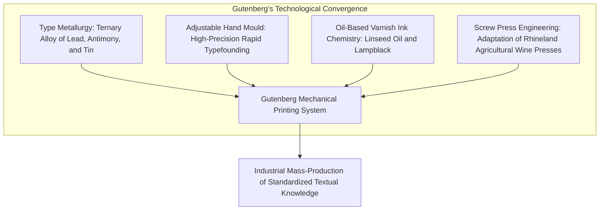
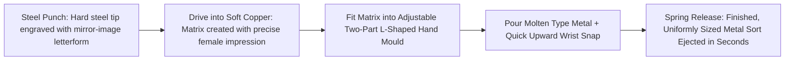
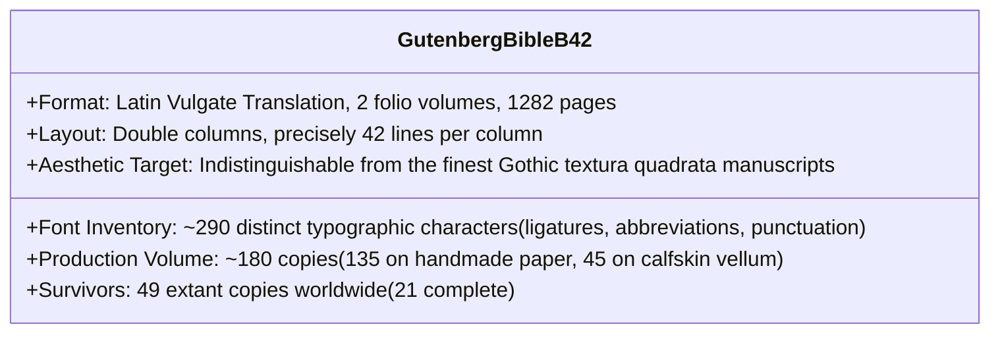
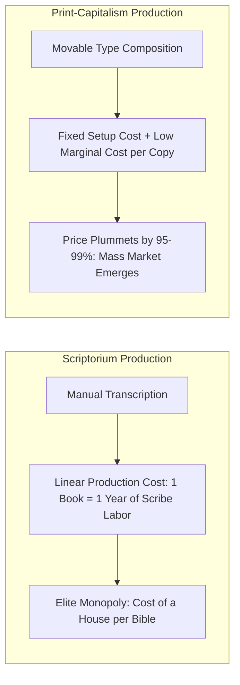
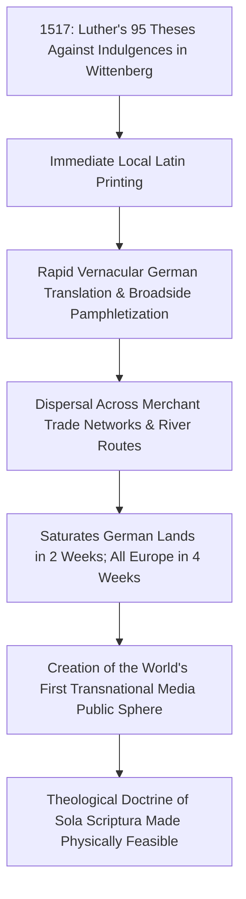
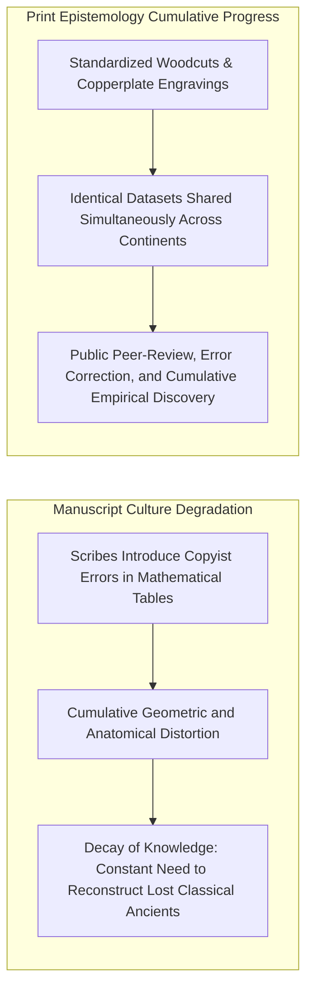
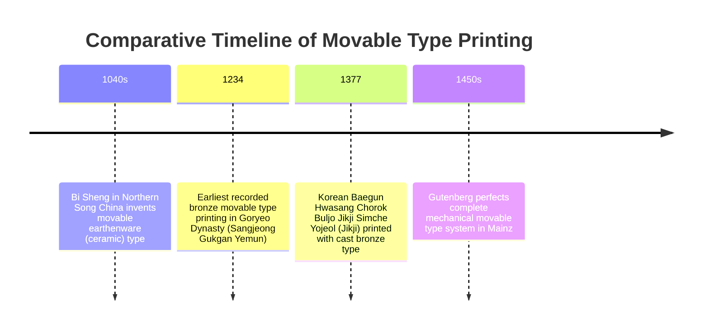
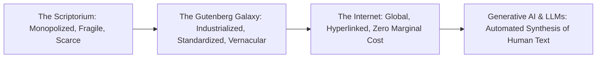

In the early 17th century, English philosopher and statesman Francis Bacon wrote in *Novum Organum* (1620) an observation that has echoed through the centuries:

> "Printing, gunpowder, and the compass: These three have changed the whole face and state of things throughout the world; the first in literature, the second in warfare, the third in navigation; whence have followed numberless changes, in so much that no empire, no sect, no star seems to have exerted greater power and influence in human affairs than these mechanical discoveries."

Bacon was entirely correct. The perfection around 1450 in Mainz, Germany, of **movable metal type printing** by Johannes Gutenberg (c. 1400–1468) sparked the primary and most radical information revolution in human history.

Before Gutenberg, human knowledge was held captive within the cold stone scriptoria of monastic orders and the private libraries of feudal princes. Copying a single multi-volume Latin Bible required the sacrifice of hundreds of sheep for vellum, months or years of laborious calligraphy by trained scribes, and capital equivalent to a substantial landed estate. Textual errors compounded with each successive transcription; knowledge was fragile, prone to decay, catastrophic loss, and ecclesiastical monopolization.

Gutenberg's technological breakthrough dismantled this scarcity overnight. The manufacturing cost of books collapsed by more than 99%. Within five decades, millions of volumes flooded European markets, igniting the Protestant Reformation, fueling the empirical takeoff of the Scientific Revolution, standardizing vernacular tongues into modern national languages, and laying the infrastructural foundation of modern civil society.

This treatise explores the full multidisciplinary scope of the printing revolution: the materials science and mechanical engineering of Gutenberg's convergence, the sociological explosion of print-capitalism, the historical comparative puzzle of East Asian movable type, and the direct parallels linking the Gutenberg Galaxy to the modern algorithmic digital age.

---

## 1. Gutenberg's Technological Convergence: An Engineering Masterpiece

In historical mythology, Gutenberg is often celebrated simply as the "inventor of movable type." In reality, movable ceramic and metal types had been engineered centuries earlier in Song China and Goryeo Korea. Gutenberg's true genius lay in **technological convergence**: the seamless integration of four previously disconnected mechanical, chemical, and metallurgical technologies into a single, high-throughput manufacturing system.



### 1.1 Type Metallurgy: The Ternary Alloy
To print with movable types, wood proved too absorbent and soft; pure iron had an impossibly high melting point for delicate casting; and pure lead slumped under the mechanical pressure of the platen. Drawing upon his background as a goldsmith in Mainz and Strasbourg, Gutenberg formulated a precise **ternary eutectic type metal alloy**:

$$\text{Type Metal} \approx 80\% \text{ Lead (Pb)} + 15\% \text{ Antimony (Sb)} + 5\% \text{ Tin (Sn)}$$

| Elemental Constituent | Typical Proportion | Metallurgical Role and Physical Properties |
| :--- | :--- | :--- |
| **Lead (Pb)** | 75% to 80% | Forms the ductile, low-cost structural base. Possesses a manageable melting point ($327^\circ\text{C}$) and high fluidity. |
| **Antimony (Sb)** | 12% to 15% | **The critical metallurgical breakthrough.** Uniquely, antimony expands slightly upon solidification from liquid to solid, forcing the molten metal into the microscopic crevices of the matrix to reproduce razor-sharp serifs. Substantially elevates alloy hardness. |
| **Tin (Sn)** | 5% to 8% | Lowers the eutectic melting point of the system to $\sim 240^\circ\text{C}$, decreases surface tension to enhance mould filling, and imparts superior oxidation resistance. |

The thermodynamic property of **volumetric expansion upon crystallization** exhibited by antimony resolved the fatal flaw of metal casting: thermal shrinkage. Without antimony, cooling metal pulls away from the mould, blunting font contours. Gutenberg's alloy captured the most delicate calligraphic hairlines of Gothic script with micrometer fidelity.

---

### 1.2 The Adjustable Hand Mould (Handgießinstrument)
To construct a level chase containing tens of thousands of individual metal sorts, every piece of type had to possess an identical height-to-paper (*type-high*), perfectly square parallel shank walls, and uniform alignment.

Gutenberg's adjustable two-part hand mould was the linchpin of his mechanical patent:



Because alphabet letterforms vary dramatically in width (compare a wide uppercase `W` or `M` with an ultra-narrow lowercase `i` or `l`), the mould featured sliding L-shaped steel halves. The typecaster could alter the horizontal character width instantly while preserving an invariant vertical body size and baseline height. A skilled founder could cast over 2,000 flawless types in a single working day.

---

### 1.3 Chemistry of Oil-Based Printing Ink
Traditional medieval inks were water-based, composed of gum arabic, iron gall, or carbon soot suspended in water. When applied to metal, water-based solutions bead up due to high surface tension and run off metallic surfaces, producing smudged, illegible impressions.

Gutenberg adapted the recent Flemish advances in oil painting (popularized by Jan van Eyck). He synthesized a viscous, quick-tack printing ink by boiling **pure linseed oil into a thick varnish**, blending it with walnut oil, turpentine, and refined **lampblack (carbon soot)**. 
Applied using ink balls (leather pads stuffed with dog hair or wool), this viscous oil ink adhered evenly to the metallic faces of the lead types and transferred cleanly onto moistened rag paper without feathering. Five hundred years later, the ink of surviving Gutenberg Bibles retains its deep, luminous, velvet-black luster.

---

### 1.4 Adaptation of the Screw Press
Gutenberg observed the massive heavy-timber screw presses utilized across the Rhineland for pressing grapes during wine harvest and squeezing oil from olives. He adapted this mechanism into a two-pull lever press capable of exerting thousands of pounds of uniform, perpendicular downward mechanical pressure onto a flat bed of type, imprinting an entire folio sheet in a single stroke.

---

## 2. The Gutenberg 42-Line Bible: The Masterpiece of Incunabula

Between 1450 and 1455, Gutenberg's workshop in Mainz produced its crowning achievement: the **42-Line Latin Bible (B42)**.



Gutenberg did not seek to invent a modern "machine aesthetic"; rather, he sought to disguise his mechanical print as luxury hand-illuminated calligraphy. To achieve perfect justification without uneven word spacing, he manufactured nearly 300 distinct sorts, including dozens of ligatures, multiple variants of individual letters with differing widths, and calligraphic abbreviations commonly used by professional scribes.

---

## 3. The Collapse of Knowledge Costs: The Economics of Print

The transition from scriptorium to printing press represents an unprecedented discontinuity in the economic history of technology:



### 3.1 Scaling Dynamics and Fixed vs. Marginal Costs
Manual manuscript transcription exhibited flat marginal costs: doubling output required doubling labor hours ($C(N) = c \cdot N$). 
Printing transformed book production into a high-fixed-cost, low-marginal-cost industrial enterprise:

$$C_{\text{print}}(N) = C_{\text{setup}} + c_{\text{marginal}} \cdot N \implies \text{Cost per Copy } AC(N) = \frac{C_{\text{setup}}}{N} + c_{\text{marginal}}$$

As print runs surpassed 500 to 1,000 copies, average unit costs plummeted toward $c_{\text{marginal}}$. 

During the **Incunabula period (1450–1500)**, printing presses expanded across more than 250 European cities. In those first fifty years, print shops produced an estimated **20 million volumes**—exceeding the aggregate manuscript output of all European scribes over the preceding millennium.

---

## 4. Societal Impact I: The Rocket Fuel of the Protestant Reformation

The printing press was the technological prerequisite for the Protestant Reformation ignited by **Martin Luther (1483–1546)** in 1517.



### 4.1 Bypassing Ecclesiastical Censorship
Before Gutenberg, early reformist movements led by John Wycliffe in England or Jan Hus in Bohemia were geographically contained and suppressed. Papal authorities systematically rounded up handwritten tracts and burned them.

Luther's *95 Theses* faced an entirely different information ecosystem. Operating outside papal control, commercial printers in Nuremberg, Leipzig, and Basel recognized massive market demand. Within two weeks, German translations were circulating throughout the Holy Roman Empire; within four weeks, across Western Europe. 

By the time the papal bull *Exsurge Domine* condemned Luther in 1520, millions of vernacular Lutheran pamphlets (*Flugschriften*) had saturated public consciousness. **Printers could reproduce texts orders of magnitude faster than the Inquisition could burn them.**

---

## 5. Societal Impact II: The Takeoff of the Scientific Revolution

In *The Printing Press as an Agent of Change* (1979), historian Elizabeth Eisenstein dismantled the myth that modern science was purely the product of individual heroic geniuses, demonstrating that **print culture transformed the institutional epistemology of human inquiry**.



### 5.1 The Miraculous Year of 1543
Two foundational monuments of modern empirical science were published in the single year **1543**:
1. **Andreas Vesalius, *De Humani Corporis Fabrica***:
   Printed in Basel by Johannes Oporinus, featuring breathtaking anatomical woodcuts by Titian's workshop that precisely mapped human muscles, organs, and nerves, overturning centuries of unverified Galenic dogma.
2. **Nicolaus Copernicus, *De Revolutionibus Orbium Coelestium***:
   Printed in Nuremberg, presenting the mathematical and geometric architecture of heliocentrism.

In manuscript culture, complex geometric diagrams, astronomical coordinates, and anatomical illustrations deteriorated with every hand-drawn copy. With print, a scholar in London, a mathematician in Krakow, and a physician in Padua analyzed **identical mathematical figures and identical anatomical plates down to the millimeter**.

### 5.2 The Feedback Loop of Errata
Print institutionalized the **errata sheet** and the **revised edition**. When errors were discovered in astronomical tables or cartographic charts, authors issued corrected second editions. Knowledge shifted from an unstable cycle of decay into an irreversible, cumulative, self-correcting upward trajectory.

---

## 6. Societal Impact III: Print-Capitalism and the Nation-State

In *Imagined Communities* (1983), political scientist Benedict Anderson pinpointed the rise of modern nations and nationalism within the dynamics of **print-capitalism**.

```mermaid
flowchart TD
    PrintCap[Commercial Printers Seeking Profit Maximization] --> MarketLimit[Latin Elite Market Saturated (~5% of Population)]
    MarketLimit --> VernacularPivot[Pivot to Massive Monolingual Vernacular Markets: English, German, French]
    VernacularPivot --> Standardization[Dozens of Dialects Compressed into Canonical Print-Languages]
    Standardization --> SharedReadership[Millions of Anonymous Citizens Read Identical Daily News & Novels]
    SharedReadership --> NationState[Birth of the 'Imagined Community': The Modern Nation-State]
```

Early printers initially printed in Latin to serve the international clerical elite. By 1500, that market was saturated. To expand market share, capitalist printers pivoted to vernacular tongues.

By selecting specific dominant regional dialects (such as London English, High German, or Parisian French) for typesetting, printers elevated these idioms into standardized national languages. Millions of geographically separated citizens who would never meet in person began reading the same daily newspapers and national literature, establishing the shared temporal consciousness that created the modern **nation-state**.

---

## 7. Comparative Civilizational Analysis: Why Europe and Not East Asia?

It is an established historical fact that movable type originated not in Mainz, but in East Asia:



The world's oldest extant book printed with movable metal type is the Korean Buddhist compilation **Jikji**, cast in bronze in Goryeo in **1377**—78 years before Gutenberg's Bible.

Why, then, did movable type spark an explosive socioeconomic transformation in Europe, while in East Asia it remained primarily an elite, state-controlled curio alongside dominant woodblock printing (*xylography*)?

| Factor | East Asia (China & Korea) | Western Europe (Post-Gutenberg) |
| :--- | :--- | :--- |
| **Grapheme Inventory** | **Logographic Ideograms (Hanzi / Hanja)**: Required casting 5,000 to 30,000 discrete Chinese characters. Typographic storage and composition were astronomically labor-intensive. | **Phonemic Alphabet**: Required only **26 letters** (under 100 sorts including caps, punctuation, and ligatures). Composition was fast, modular, and cheap. |
| **Mechanical System** | Hand-rubbing impression using horsehair pads (*baren*). No mechanical screw press or mechanical lever leverage. | Heavy screw press delivering thousands of pounds of uniform perpendicular mechanical force per pull. |
| **Ink Chemistry** | Water-based carbon ink (*sumi*), formulated for absorbent mulberry paper and woodblocks, but beads up on metal type faces. | High-viscosity oil-based varnish ink adhering smoothly to metal alloys and transferring cleanly. |
| **Market & Property Institutions** | Imperial and royal state monopoly (e.g., Goryeo/Joseon State Printing Offices) aimed at preserving dynastic archives and Buddhist scriptures. | Autonomous commercial entrepreneurs (Gutenberg, Fust, Aldus Manutius) operating in competitive free-market capitalist cities. |

The typographic alphabet possessed profound combinatorial advantages. Furthermore, Europe's fragmented political geography created an open commercial marketplace where banned printers could simply cross a border to publish, making systemic censorship impossible.

---

## 8. From the Gutenberg Galaxy to the Algorithmic Age

In *The Gutenberg Galaxy* (1962), media theorist Marshall McLuhan argued that movable type rewired human cognitive architecture, cultivating linear logic, detachment, visual bias, and modern individualism.

Today, we navigate a technological transition comparable in scope to Gutenberg's revolution:



1. **Zero Marginal Cost of Duplication**: Just as print collapsed the cost of copying by two orders of magnitude, the internet reduced marginal distribution costs to absolute zero.
2. **The Peril of Information Chaos**: Gutenberg's revolution unleashed destructive sectarian pamphlets that stoked the Thirty Years' War; similarly, our algorithmic digital commons struggles with polarization, deepfakes, and epistemic fragmentation.
3. **From Printing Words to Automating Thought**: While Gutenberg mechanized the physical replication of human prose, Large Language Models (LLMs) mechanize the algorithmic generation of semantic reasoning itself.

---

## 9. Conclusion: The Democratization of the Word

Gutenberg's humble print shop in Mainz unleashed a tectonic shift in human history. 

By setting tiny pieces of lead alloy into composing sticks, coating them in thick black varnish, and pulling the wooden lever of an adapted wine press, Gutenberg liberated human thought from the cloistered confines of the few and gifted it to all humanity. 

Every scientific paper, every constitutional democracy, every public library, and every line of digital code traces its lineage back to that dusty Rhineland workshop where human knowledge was first set free.
